# 【全集】密歇根大学 C++编程 中英字幕 1080P p02 Lecture 2 - 变量 -BV1TsAZzAEHX_p2-

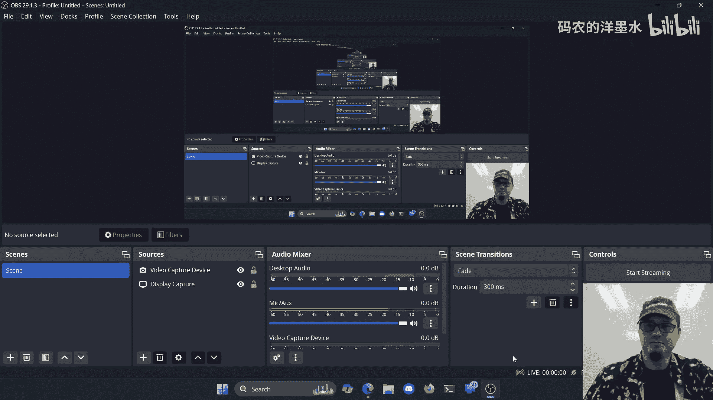

And。All right， so I didn't put a due date in for Zybooks yet because I know was everyone's got to figure out how to get it here。

 so what I'd like to do is again every week we've got a chapter ideally it's done by the following Monday but we're off a little bit here so it's not。

Too big of a deal so I plan to make chapter one I want the everything in by 98 for your points and that's the participation that's the challenges and the Zit labs that's again your practice coding and browser it will tell you if you did it right or wrong which is pretty cool so it runs these automated tests on it and says hey it got the right answer or not。

Which is nice to get some immediate feedback there and then for chapter two we're going to talk about today I don't want to also pile that up on the same Monday I want to give you a little more time on that so。

Im going to go to 915 on that one just you've got time to get both those ones in but then ideally next week when we start in chapter three。

 we'll also have that one due the week after。So we'll do Monday。

 Wednesday for chapter and then the following Monday I would like to have all the readings in and all the challenges and activities ideally you're at least reading it doing this for the participation first so that what I say makes a little bit more sense if this is the first time you're seeing it it's a little bit harder to keep up and as you can see a drink a lot of coffee so it's okay if you do a holler me to slow down that's great someone else in the class will appreciate that promise not a big deal but I'm going to try and give you different examples that the text gives you so that you'll see it my way you'll get the textbook way you'll get the lab practice way you'll get the labs of Dr。

 Saed practice way and then hopefully by then it'll feel a little bit better you'll be more confident when you get to the projects which are worth a whole lot of your score。

Right， so you've got a practice you've got to put some time energy and effort in against a four credit class with lab。

 but again it's about a 12 hour a week commitment so kind of keep that in your back pocket 12 hours a week worth of work。

And you should be doing well right if you're putting in the time and you're not doing well。

 let's have a conversation if you're doing well and not putting in as much time， good for you。

That's great， but you're going to need to put some time into it for sure if you want to be successful here so。

We'll get there。嗯。Yes， we'll get into chapter2 I showed you a little bit of GitHub。

 I put a link to the course repository right this is the public one I'm going put all my code examples that I do in class into this repository so if you ask me for the code I'll say it's on the website on the course repository I'm not going to put code in canvas because Canva is a stupid place to put code feel free to quote me on that not everyone agrees that's okay's fine if someone else tells you next semester put your code in canvas just smile and not guess it's not a big deal we can just premise and deal with it because people don't know how to keep up with technology but that's okay it's not the end of the world I did also add a link for my Discord server if you like Discord feel free to hop in there channels you can add for by different classes so we're specific there Discords on my phone so ping me anytime there as well emails go to my phones whatever you like here。

I find it way better than forums because I can add like a forum in canvasva and those are just ugly we've been doing forum since even before I was in school we had web forums and they're just they're not a great way to communicate so I think discords pretty handy I think a lot of folks are usually pretty familiar with it if you're not it's okay excuse me。

It is optional so if you want it great if you dont that's okay too and then I put a link to my done website just for fun here because it entertains me but it's got all my classes and all the course rep posts and a little bio and some other links here so I paid someone to do a graphic a couple years ago and I thought it was really cool so I put a link to it that's all。

All right I think that's it for stuff here again I'm gonna do my best to do the recordings add to the lecture archive it mostly works。

 but again your best bets showing up in person like you'all all are doing today that's great and then you can ask me questions live which is really nice if you get confused rather than having a pause a video shoot an email or text me or sign me a Discord and get an answer and then go back to the video。

So I'm going to go to Vis Studio and we're going to start with chapter two stuff here should be a lot of fun。

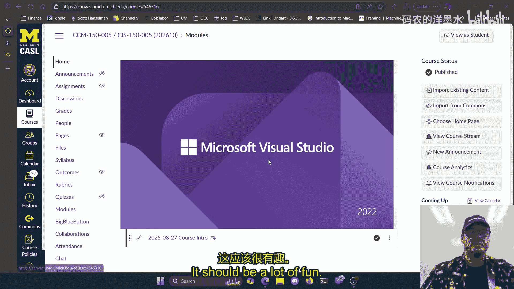

So。The first thing I'm going to do is I already have my repository so I'm going to make a new project in that folder I do repositories just a folder here when you do your labs and your projects we'll get repositories for those and each one is a new folder it's a nice way to keep things organized but I don't want to have 15 weeks of repositories so I'm just going to use one so I have one link here Nothing says you can't put 15 projects 20 projects in a single repository。

But it's nice to have them separated if you can deal with that here so that's what I like doing I think last time you did an empty project and we had to type a bunch of stuff out right we had to do our includes and we have to do an in main and we had to return a zero and don't bother memorizing any of that stuff it's not worth your headspace here so if you hit console app here instead of empty you'll actually get all of that for you。

Wwhichch is way easier right I'm a big fan of when tools make my life easier again we need to learn what the tools are doing so that we can understand it and if it doesn't do exactly what we want。

 make it do exactly what we want here but I like when they do a lot of the work for me。

My location is still my repository folder here， that's great and again if you're using a new repository。

 you need to pick the new folder every time so when we do different repositories，😊。

We want to put them in different locations right it'll work out pretty well you know we might just do one for labs I'll say i'll talk with Dr so you and see what he wants i'm not sure how familiar it is with Github but we're going to use it anyway so that'll be his fun。

But for the projects you'll do one repository per project， keeps your commit history cleaner。

 keeps everything organized， makes my life a lot easier so that files change after the deadline。

I don't think I'm not thinking you tried to change it on purpose。

That sort of stuff so just pick your folder here you can check this box if you want we'll eventually get somewhere where you'll have more than one project in a solution。

 but for now a solution is just a one or more projects and the projects are the things that run so we want。

Separate folders keeps things organized and nice and easy so I usually don't check this box and we'll just call this one week two so it's going to make a folder inside of this one called week two for the solution and instead of that'll be another folder called week two for the project so solution folder project folder all of that inside of the Github folder。

It's folders inside of folders inside of folders inside of folders at one point someone did a little research study I don't even know how official of a research study it was and they asked incoming college freshmen do they know how folders and files work and turns out if the only thing you've ever really done is on your phone you don't really understand what folders are and how to organize folders and I was really surprised but you all have computers so I'm hopeful nowadays you understand what your folders are if not and that's a big assumption on my part please do let me know I'd be happy to chat some more about that but and knowing your folder structure is real helpful and I'll say create。

And I'll open up the Gitthub desktop too so we can see it's going to recognize a bunch of new stuff was created here。

 so let me go to the 150。And here I got too many repositories here as says， hey。

 there's some new files， right green is new。Right yellowel， the dot is modified， red。

 the minus is removed。 So says hey， there's a new SLN file。's the solution file。 a new CPP file。

 that's my c plus plus that's my code file， a new VCxpro file visual C plus I forget what this one is here。

 this is the project file I the project filters file and just let it happen not to pick of a deal here So if we see new stuff in that folder that the getup client is recognizing we put it in the right spot。

 if this doesn't show new stuff， we didn't take the right folder that's our quick little first thing to check and you're welcome to commit as many times as you want again。

 they're free or we don't pay for them they probably uses someone's electricity somewhere the multiple data centers but that's okay we literally burn energy for cryptocurrency mining on purpose Sot compared to that right they like using as much energy as Denmark or something ridiculous。

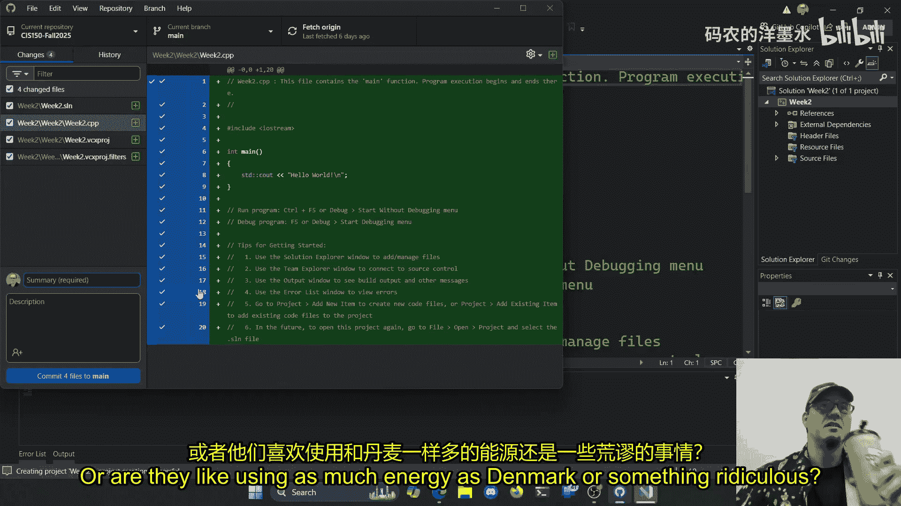

Does I bring any bills right I want to Google that now， much energy。That's bit。

don't even look at how much energy it is using here oh Finland here not demomark sorry Finland so not as much energy and that's that's literally on purpose that's the way it's designed is to make people burn energy with the proof of work concept here。

So that's a fun fact for the day， I suppose。All right， so we're right here。

 so we get a bunch of stuff in here， right？Anything with this slash slash here is a comment。

 so that means when the code is compiled， it gets ignored by the compiler and it shows up in green because visualual Studio is nice and helpful and wants to visually indicate hey this is a comment here so you're welcome to add comments to your code do I tell you my story about code comments last week。

Okay right I tell a lot of stories to a lot of classes and sometimes I get confused so please if i'm telling the same story again just be like Eric you already said it just stop you don't need to hear it more than once they're not all that interesting stories you're not going hurt my feelings。

For some reason， my wife plays a game with my mother in law that every time she tells her the same story more than once。

 she tries to act differently and use different words just to see how many times her mother will tell her the same story。

I don't know the patience for that I don't know how she does like God bless her so and she probably doesn't watch my YouTube videos so that's probably fine anyway comments when I was in school my first programming class in college back at 2000。

Four or five， I should really remember that， I think it was 2005。

That sounds about right I got everything right on the assignment but I didn't get full points because I didn't have a comment explaining something and the Prof said you had to have a comment explain your code and I said with the code works right it does what it's supposed to do why didn't I get points for it so at that point I was offended and swore if I ever got a chance to teach classes I would never give points for comments because it has nothing to do with the code working。

Poins to be for does your code work？And I've stuck to that ever since。

 so I'm not going ask for comments some people and it's okay you'll get there eventually they'll be like。

 hey， you have to have an author here and you'll say， hey， my author is me。

And you'll have to have a class and you will say this one here and whatever nonsense， right？

I don't need any of that here and the other really cool thing about Github is Github tracks that GiHub knows who did it and what here and it knows the date right say here here's the date last modified and all sorts of other nonsense so I'm never going ask for comments here you are welcome to put them in if you would like me to add them。

Please just holler at me sometimes it is occasionally helpful to have a comment explaining something in general in the school of thought that I learned to code in and practice in and worked in for many years we all generally frowned upon comments that explained what the code was doing because ideally and again it's a little bit rainbows in unicorn our code should be self-explaining and we'll talk about that what that means and we get a little further but you shouldn't need to explain what the code is doing but occasionally you could a comment saying why so why does it do this weird thing so we could leave a note oh I need to work around some sort of issue we're having or it didn't work this way so we're doing it this weird way it looks really weird and crazy but I promise it's on purpose and there's a joke I'll define the meme for you somewhere there's a comment in some really old project and they're like we've left this in here if we remove this the entire project doesn't work no one knows why and there's a count of everyone who's tried to remove it and it's failed and every time you try and remove it and fail you have to go increment that counter。

To show your shame it is just kind of amusing so comments go for them I'll add them if you'd like me to just holler but in general I almost never add them it's just not a habit of mine and the reason we frown upon comments is because your code can work with or without them so if you change your code to update something nothing makes you update the comment and it very quickly happens that comments become stale or out of date or even completely separated from the code they were supposed to be commenting on because the code itself changed and we just forgot to change the comment right I think I mentioned all good developers are lazy we're not I mean a little bit but we want to be lazily efficient I don't want to do more work that I need to do so why would I do the work to fix the thing and change the thing and then do more work。

To explain that I fixed the thing when my boss has told me to fix the thing。

Right they told me to fix the thing I fix the thing and now again I have to go update the comment saying I fix the thing it's just kind of silly redundant at that point and most engineering types that I've ever met here all tend to hate doing more work than we need to do redundant work those sorts of things it's not that we're not patient people are not kind people but we just don't want to put up with a bunch of busy work that's just not helpful and now you'll notice in the start because we have this STD colon colon the one thing it doesn't give us is that using namespace namespace standard。

I like having it in here and some people say it's bad it just makes all of our life easier further out so you don't have to add STD or standard colon colon in front of every time we want to use it here you notice they have a backslash n this is a fancy escape sequence here which means the new line character we'll talk all about characters in a little bit here。

Again， I'm not really fond of this one here， so I really don't have those and I use this EDL or end line here。

 which is the end of line character。Now， someone decided way back when。

 I don't think we've ever fixed it here， that the new line character is different from the carriage return character back from when we had actual typewriters。

L story here but to go down the line right on a typewriter you had to do the carriage return and slide the whole thing to the side and typewriter are actually a lot of fun to use you ever see the video of the one class the profit band laptop so someone brought a typewriter in to type their notes and is like click click click really loud and obmnoxious。

I was very amused by that I thought that was really funny but they' fun we did have one mostly is just a relic here I have a bunch of really old crap because my dad ever throws anything away but some interesting things here we've collected over the years and I now have a Mi garage so in Windows a backslash N is perfectly fine that's all you need for a new line and Windows knows oh you want to go down the line and I'm pretty sure it's done Mac I don't know Unix systems you need a carriage return and a new line character。

I don't know why so this end line just works here and you don't need to know which one you're supposed to use for what here makes my life a whole lot easier and then this again is a little easier to see a little easier in the eyes you're like oh。

 I know it's going down a line rather than this little backslash and character which you might miss you know just at a quick glanceance here you might not see that as easily getting stuck inside of a string of characters here So just makes it a little easier I like them again it's just a style preference It does the exact same thing they look identical。

So for our purposes， it still accomplishcompes the same task。

 it doesn't matter when it comes to programming， you can do something a dozen different ways to accomplish the task right it's really okay。

 you can do it any you want here。One of the big themes and a big Pe pevea of mine is when people write code in a way that makes it hard to read。

So some people think it's fun and amusing and they like to minimize the amount of code that they're doing and you know sure that's all well and good here。

 but the code that we write is really meant for people， it just happens to also need to compile。

So the C++ compiler needs to be able to understand it。

 but the way that we write it should be for people to read it because you need to be able to read it so you know what you did and you can go back to the next day and not be completely lost。

 I need to be able to read it， Dr。 Said need to be able to read it to understand what your lab was doing here and eventually in industry you're going get paid money to write code and you probably won't be writing the exact same program working on the same project your entire career I hope you move on to bigger and better things。

So some other port app is going to come in and inherit your mess so you're going want to have left them nice clean code because they're probably a cyclepath over gets hired after you and takes your spot right and you don't want them coming after you right so do do nice things so again the compiler doesn't care here we can get rid of all of our white spaces here。

 we can put this all on one line。Is really terrible and ugly this one we can't to include has to be on its own pretty sure does it work？

And let' find out。I thought anyone needed the own when we not。No， okay， it did fail。

It yelled at me here so I got some errors this error list is really helpful and you're going to hate those build errors but I canceled out of this window really quick i'm sorry never hit yes。

 that's never the right answer here。I've never checked this box。

I don't know if it will default to the yes or the no which is I've never checked the box here and again it's nice to pop up because then we'll probably pop up on here so it says it didn't build here do you want to run the last success build note you don't want to run the last version you want to run this version and if this version doesn't work you want to fix it right so never click yes so I always say no sorry about that so let's go bump down one I think that'll work now for us excuse me。

There it goes and now we get hellello world right again。

 this is terrible and ugly here and why would we want it on one line like that here。

I can format it a little bit， I didn't really fix it。

And oh this one doesn't even kind of return zero you don't technically need that it just good habit to happen here it'll implicitly end and return it so I usually add it just because it's nice here and then I put spaces between things to just again kind of organize make it visual a little easier on the eyes here all that white space gets ignored doesn't matter but it's nice for us to be able to look at and then other dumb things we can do we can output these things one at a time here if you want to I don't recommend it。

 but you can depending on how you're feeling。See out。Com后。Oh man。

 this is going to take a while it be as one line at a time isn't it， so how do we copy this here？

And I'll go down。😔，So O， space and a W， O RL。😔，Another one in a D and a exclamation point， right。

 and then we probably want to output our end line。You can probably see what it's doing here。

 but is this a nice thing to do。 No， that's a terrible thing to do to somebody。 but it works。

 right it outputs here if we output a character and we don't go down a line the next time you output a character。

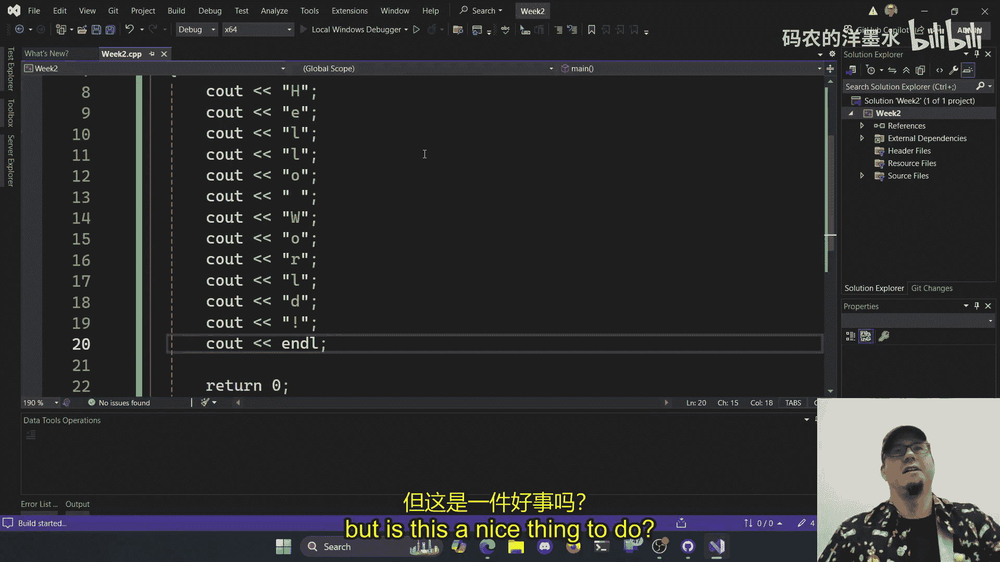

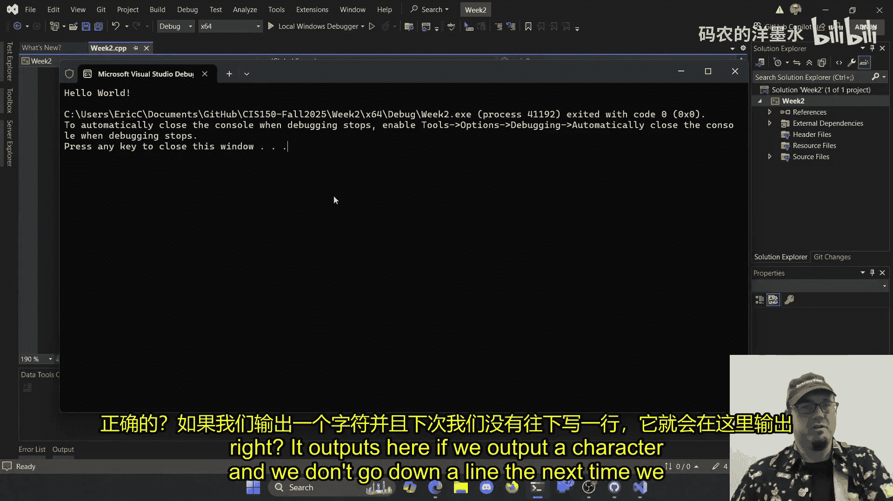

It goes next to it right so if I don't add an end line until the very end。

 all these go on the same line， so if I wanted to add one in between hello and world。

 I wanted to change this one to an end line。And we output it here。

 we'll get hello in the first line world in the second line。😊。

You can also add in those backslash characters right if you want to do that instead， we could say，y。

 I want to quote back slash。Backslash N。He was the new line character， and as they hover over it。

I tell us it's a constant car that's not very helpful so sometimes you get good information when you hover the mouse these little tooltips sometimes you don't。

 but it do it'll look the same for us here you do all sorts of ugly things so again that's not the prettiest don't do things like that right your code to be nice and readable and easy to see later on。

All， so so far Hello world's not a very exciting program。

 doesn't do much of anything it's not very interesting at all here。

 computers are good for doing things like computations。They're somewhat good at them at least here。

 so when we work with different kinds of data in the computer。

 we need to tell C++ to hang on to something， say， hey， C++。

 go and store this somewhere in the computer's memory。

Because the computer needs to hold on to that piece of information。

 and then it will go and do some work with that and give us back a results。

Lots of interesting stuff happens behind the scenes。

 you can learn all about that when you get into 310 and you start programming an assembly which is very useful。

 very cool programming language here super tedious。

 nothing I ever want to do here but people who are good at it can make a lot of money and they do really good stuff with it here which is really cool but again not my cup of tea but it's when you get exposed to all that stuff here so if we want to hold on to an integer value right a number without decimal places we tell C++ hey。

 I want an in。Again， we don't like using a lot of letters here。

 so we're going to have a lot of abbreviations， so int for integer here what we're going to do is we're going to give it a name。

So we get to these things called variables， a variable is something that the value can vary。

That's why it's a variable the value of it can vary so we get to create variables and C++ goes out and says okay。

 I need to store this variable in memory somewhere so' going say have on an int for number and then we're going to assign it the value of something so this is not equals here。

It gets a little awkward， it's okay， the single equal sign is the assignment operator。

 it says take the thing on the right， assign it to the thing on the left， right give it this value。

 store this value so I can say hey int number 42。😊。

So C++ will go out and ask the operating system for place to store an integer。

Which I want to say is eight bytes， I should probably Google that。

 It doesn't really matter too much right now， I'm sure it's inside Zbook somewhere it will take up some number of bits and bytes in the computer's memory。

Sure， and then we'll go and store that value now anytime I want to use that number here。

 I can use the variable name for it and it will go look up what value it's storing so I can say see out just the number。

We'll add an end line here。Now outputting a number is not very interesting。

 we haven't done in the arithmetic with it， but that's okay。

 we'll go and fetch that value and I'll put it。

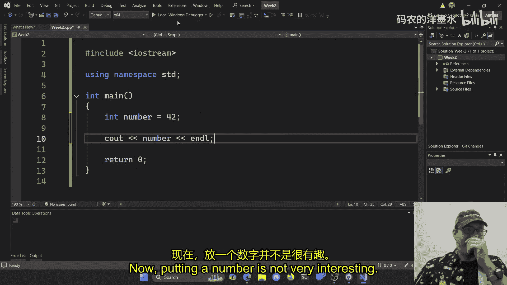

so it's okay， I stored it somewhere wait until I ask for it when you ask for it。

 grab it and do whatever I asked for it， so we asked for it to output here so if I want to say， hey。

 how about number plus 10。

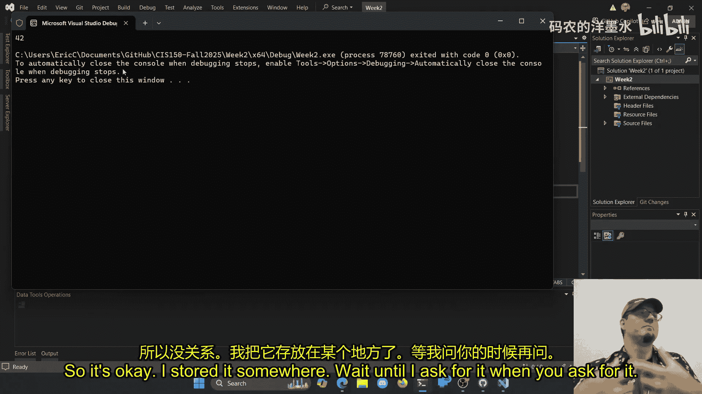

It will do the arithmetic here right in line and then output the result。

 it hasn't changed number number still 42， but number plus 10 is 52。Okay。

 so we can do some quick arithmetic。Sure we can also use other variables so I can make another number here so here's another number now when it comes to names the common convention in C++ is a lowercase letter to start and then every next word it's an uppercase letter they call this camel casing because the humps of a camel camel's back so it's a visual way to be able to read the words because if you don't uppercase this and you say another number。

That's way harder to read somehow I don't know how our brains work like that。

 but with a capital and there your brain like triggers on that you're like oh okay， another number。

And maybe I've only been it for 20 years， and makes a lot of sense。

But this is what we're going to do so we're going to name variables and we're going use this camel casing here so that we can identify them so maybe'll make this one tab so I can say hey。

 how about number plus another number and I'm sorry I'm using more shortcuts if you double click something it will highlight the word。

So double clickick will highlight the entire word here and then control C copy control V paste so let me undo that here so I went in here we do so I double clicked another number。

 I copied it I came and double clicked on 10 to highlight both characters and I hit control V paste to replace it with that so if it looks like I'm typing crazy fast I promise you I'm not I do type fast but I'm using shortcuts all the time so it just makes my life easier and I like my shortcuts。

So we'll get the same result right all we've done now is put a name to that number， which is nice。

 so we should get out 52。

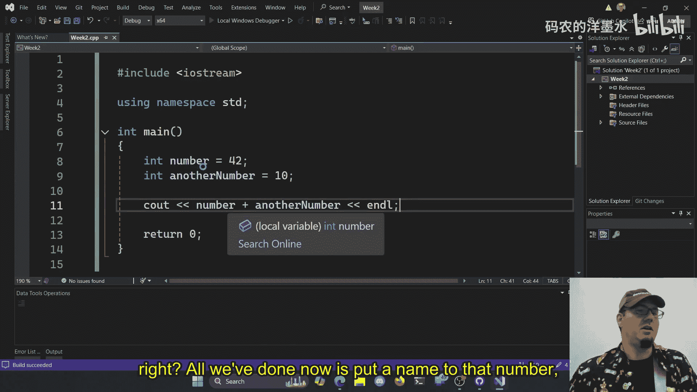

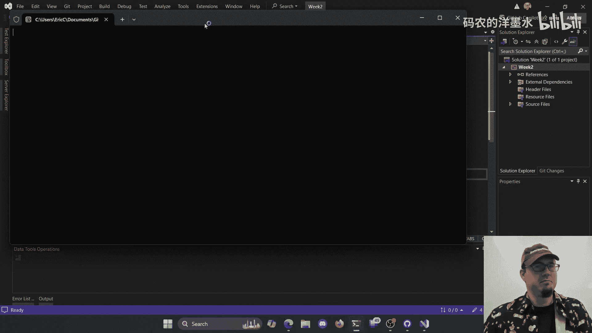

There it goes， maybe we' have a hit run and we get our result。

Not the most interesting so we could then have another variable I can say hey here's my result then it willll be number plus another number again I'm using more shortcuts here I'm sorry so as you start typing here and you give it a couple letters this is called Intels or type ahead or I't forget what do people call it nowadays but it's saying oh you probably are typing this variable name here because it matches and if you wanted to type the rest of it for you。

 you just hit tab here so you don't have to type it out here because I have a long variable name may be oboxious to type another number every time here I just type a couple letters here and I hit tab and it auto fills for me it autocomplets here now I can take my result here and it will throw the result out the exact same thing here so now in memory when a program runs we're storing three different integers so it's stored 42 it's stored 10 and the stored 52。

Now our computer has tons of memory， so it's not too big of a deal here to store a couple different integers here I'm just going to Google it less integer size and memory I think it's8 bit8 bytes。

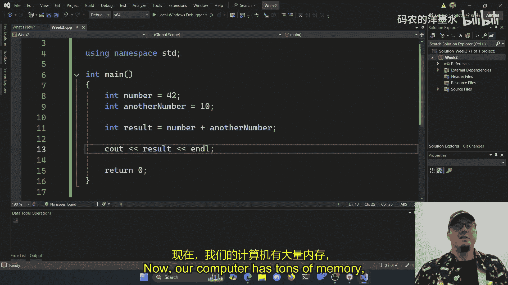

Come on Google， really。就系。Wow， of course we need AI to go and generate this for us here。

What is the size and integer？I，Wow。Yes。Lets say eight。Four bys。That one's four， you want it in C++。

Yeah。Interesting。So four bytes， yeah， it looks like， okay， yeah， oh yeah， you can use size up。

 look at that。It's giving us code， we can just copy paste and of course。

 anytime you get something on the internet， you should just copy paste and hit run because that's the safest thing to do in your computer。

 right？I'm glad you're laughing'm most of you understand that here don't install programs either that you don't know what they are that's again probably a bad thing to do yeah so I should be able to get that let's let's just see what it does here we need yeah。

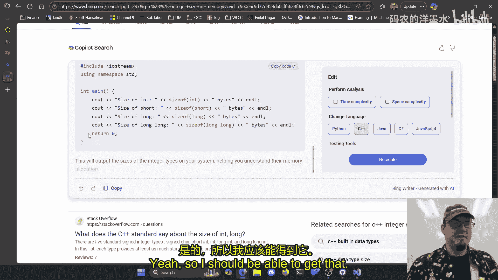

Throw it in here， so I don't actually need the in， so let's just take this couple just this intersection here。

We'll throw some of that in and see what we get。See if that works。 Yeah，4 okay， so four bytes so。

We can talk real quick about bits and bytes just you've heard it here。

 it's not the most interesting thing in the world and again you'll get back to it later here but the Windows calculator is actually really cool。

 it has a programmer here and you can switch to bit operations here because some nerd wrote this somewhere I was like。

 oh， I think other nerds are like this and guess nerds do like this that's entertaining So this is my binary input binary means two right on or off。

With electrical singles， you can have a signal， not have a signal with our computer's memory it's either yes。

 there's something stored there or no there's nothing stored there so we string together bits。

 these individual on or offs here into bytes because someone decided that sometime here so that's my insulin pump so eight bits make up a bitete。

I don't know why but that's what we've done forever now some smart person started it and we just got went along with them here so sugars high I some donuts with my coffee soll it'll take a little bit should come back down but it'll be beB for a while sorry。

嗯。So the first bit here， if it's on or off， so it's in the bottom right here。

 this is the first bit is a one or a zero right， so if it's on my value is one if it's off my value is zero。

The next bit then is the next power of two。 So this is2 to the zero。 This is2 to the1，2 to the2。

2 to the three，2 to the4，2 to the 5 to the6，2 to the seventh。

 They went know what two to the seventh is off the top of their head。It's 128。It's okay。

 don't have them memorized it's not worth your rain power here。

 but essentially if you turn all of your bits on here， you can get to 255。

So in eight bits in a single by， you can have 256 different values right from zero to 255。

Right and what's cool because this is all powers of two。

 if you add another byte now we get even more space so let's add on the next byte here and we've gone from 256 values to 065000 values here with two bytes let's go add another byte here so we go add 8 more bits and now I can get up to 16 million here again because we're doing powers of  two and we're doubling increasing the size of your。

😊，Value here， it doubles every time， so if I had another8 bytes here。

 we'll get up to some 2 odd billion here。嗯。Now， problem with using all of my bits here。😡。

Is I have no way to indicate if a number is negative or positive。And。By default。

 the systems that we should be able to know if a number is positive or negative。

 we don't want integers to only be positive integers。

 so we're going to save one byte to say whether or not it's positive or negative and we'll use the other 31 bytes here to indicate values so we have an integer can store up to 2。

1 billion。Positive。And 2。1 billion negative。 So really。

 we're storing 4 billion different numbers with 8， I'm sorry。

32 bits of memory which is not much considering our computers have so there's bits and then there's kilobits which is 1024 and then there's megabits which is another 1024 on top of that and then there's gigabbits which is another 1024 on top of that here so there's a000 with kilo a million with mega and then a billion with giga so gigabytes of memory I've got a billion bytes here and I'm going to use four of those billion to store this one number here。

we're spoiled for memory here we've got so much memory。

 anything we do in this class will not matter how much memory we're going use right it's not going to do anything here when you get into bigger and more advanced things it'll start to matter so eventually you'll get like data structures and algorithms analysis and be like how do we make sure youre being memory efficient because it's going to matter at some point when I'm storing lots of information here and you get into data science sort of things here we're like hey I want to look at a billion points of data？

Yeah， I need to start being memory efficient here right when we're doing operations millions of times a second。

 it matters if we can do it fast， those sorts of fun things here。We can look at our bits。

 so that's our integer。We can store a bunch of interesting numbers with our integers here。

 and we can do fun stuff。 We leave all that out here。 So we've had numbers。

 So let's do the the largest one here。 right， what that the value here for。I want to copy that。Now。

 the sad thing is I can't put commas in numbers。Because C looks at a comma and's like， oh。

That doesn't look like a value here。So we can't use commas is really sad can we use can we use underscore we cant even use underscores there's no digit separator so numbers are a little tricky they just look kind of awful here we can do number。

And what is this number plus 10？对。Oh， it's negative something， right， obviously？no。

 so when we ran out of space。We just overflowed so you have to be a little bit careful when we're doing arithmetic because we can't store a number that large。

 it only stores the bits that it can store and all of a sudden now we flipped into the negative range as we flipped a bit and we do it the wrong way so you have to be a little bit careful so computers are good at arithmetic but they're also really dumb when it comes to arithmetic so we have to be careful not to try and do dumb things with our arithmetic because it will give us dumb results。

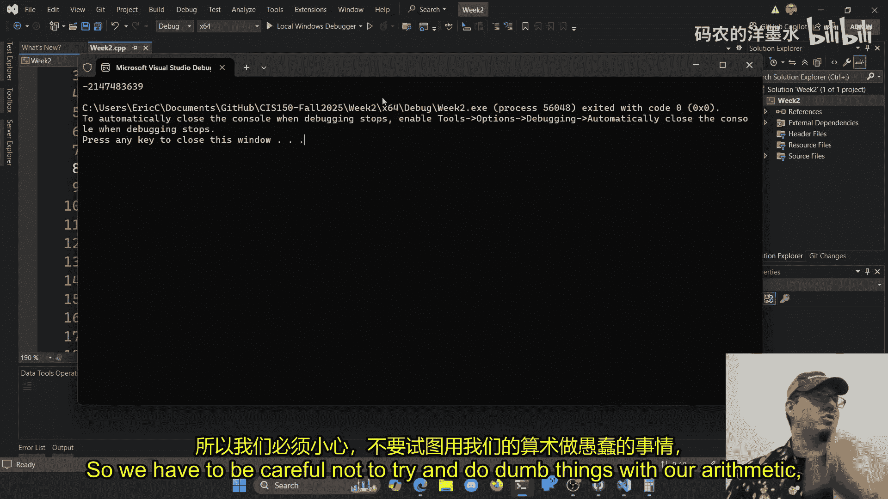

Great。So just be careful， so this might be fun then to like add a note here。

 adding above integer max give garbage。Right so。This is garbage。

Like it's just it would be a terrible number and if you're doing relying on the arithmetic from your computer here and you're like。

 oh， the computer must be right because it knows how add numbers and we go and like calculate someone's pay。

We've done a real bad thing right or you know， protecting in rocket trajectory。

 you've done a real bad thing right you're playing someone's game in their game crashes out the end of the world here。

 but you know， you take insulinsom pump and you change my amount of insulin because you add wrong here I've dead。

Right so like the stuff we do does matter depending on your applications here right some of us have the luxury of working in the entertainment field where it doesn't really matter。

 no one cares if Netflix ads another zero and they've screwed something up you just hit refresh and you're like。

 okay， I'll just try again my browser the video didn't load no one cares， not the end of the world。

So it's arithmetic right we can add you can also subtract。

 you can multiply you can divide right all those things would work like you'd expect them to except division dividing seemed like it'd be pretty easy here。

 but let's go take so just shout out two numbers from here so first number is what。Two， all right。

 and the second number is。10， give me an odd number。

7even okay sorry thanks even numbers won't work for this exercise sorry all right so let's divide them right so let's see out the result of and then let's add in here so I'm going to keep on using this this is the extraction operator insertion operator one or the two and I can never which one of is here will' take my second number。

Divided by divided by， and then I'm running low one space， I'm going to go down a line here。

Now notice I didn't add a semicolon because I didn't want to repeat my C out here you can just you can keep going to the right as far as you want here。

 C+ plus doesn't care but in general it's a big no no to make someone have to scroll left and right to view your code because again it interrupts their flow and they want to be lazy。

 they don't want to have to scroll right and left they' to be able to see it on the page and make life easier here so we don't go too far to the right。

And we just go down the line， it's not a big deal here divided by my first number。Is。

And then we'll just do the earth particular， we'll take my second number divided by my first number。

 oops， not that one here， first number。And then we'll add our end line all right I to scroll a little bit to the right here or I'll move it down I'm zoomed in a lot too so that that kind of impacts it。

 but。So what do you think seven divided by two is？

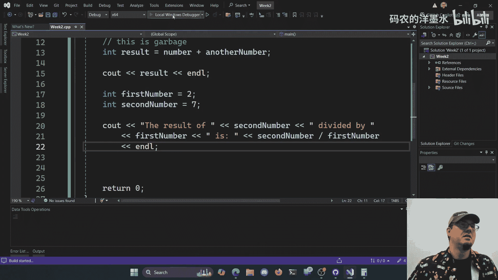

自由。3。An integer divided by an integer gives us an integer result integers don't have decimal places right so it's like oh you we have a decimal forget it it's gone so it truncates any decimal remainder as you took an integer divided by an integer you must have wanted an integer result you don't want those decimal places they're pesky they get in the way here right so this is our integer divisionger division。

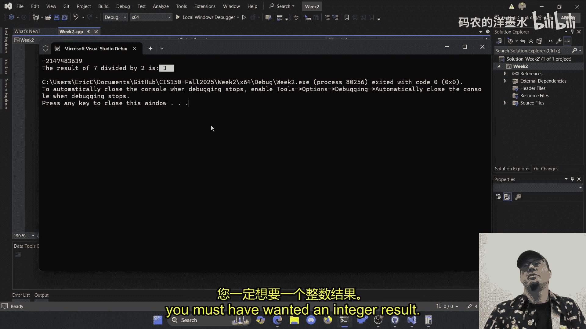

Its integer results。So so far we've only ever done integers。

 we don't know how to get numbers with decimal places right if I want a number。With a decimal。

And I say like 4。2。Should yell at me。 Come on， yell at me here， un。咁啊。Number with an decimal。啊。

Sometimes intelligencescense doesn't want to work here and you have to fight with it。

 I'm that saying， let's see if that runs for us。

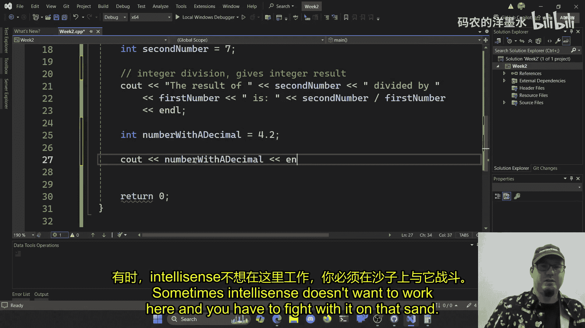

。It shouldn't。 Oh， it does。 We got four。

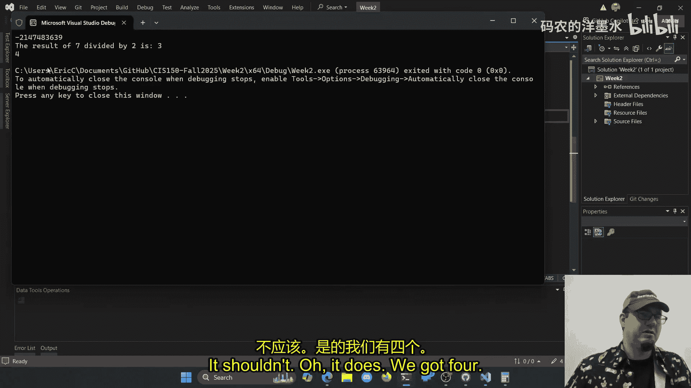

Sep like， oh， sure， you want an integer， but you gave me 4。2， I'm just going to ignore the estimate。

Not very helpful right， so if you actually want a number。

 so we'll call this how about a pretend number。With the decimal place again I'm just double clicking to highlight copy paste here there's other ways to do that I'll show you too we want an actual number of the decimal place there's lots of ways to do these here so my preferred one is double。

😊，And it's called double because it's double precision。Double one， double the other one。

 the other option that I don't like here， so we'll just work with doubles for now。

Here's an actual number。With a decimal。Its 4。2 and now we can output that。

 see out an actual number with a decimal here and an end line and now because we've declared it as a double here。

 it should actually work for us， we can store decimal places in doubles。

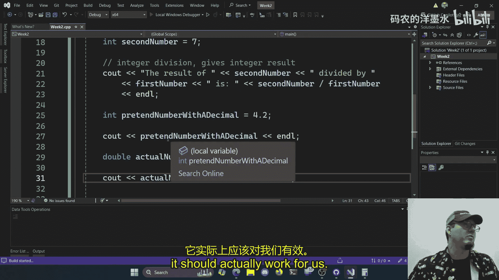

4。2 Now there's some actually really interesting stuff that goes into how we store numbers with decimal places and honestly I learned it once and then I've forgotten it since because it's not useful information for me so it's not in my head again go take 310 you can learn all about how that actually works but we store the whole bit and then we store like the exponent and then we store the other bit behind the decim it's this whole complicated system that some smart people came up with and it's great The problem is it sucks。

 it's not actually all that great so doing arithmetic with doubles doesn't work so well。

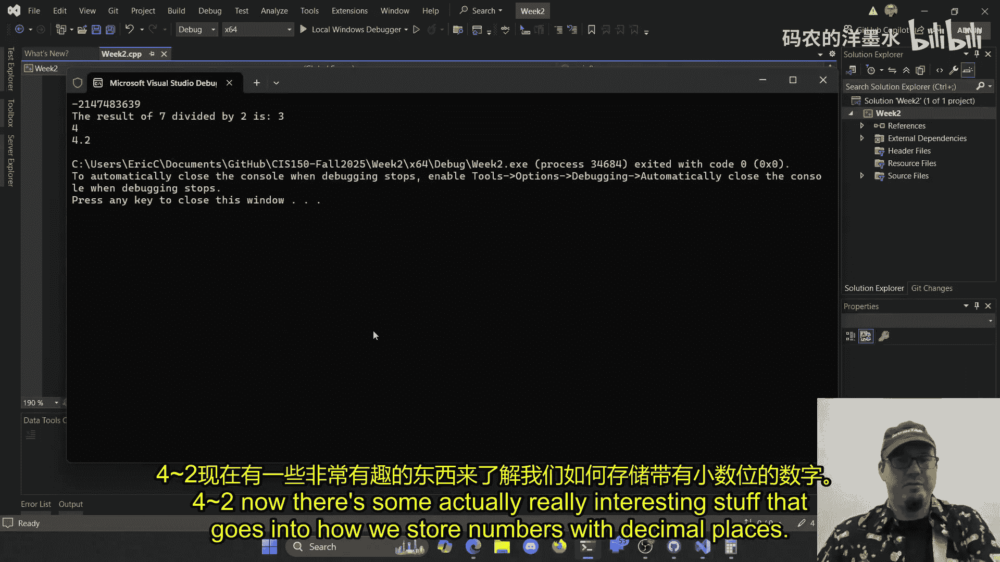

Right， because every so often we get some weird results。

 so a double is going to hold about 15 points of precision after the decimal。If I recall。

 I think it's 15 so we can have a number decimal place and 15 digits after the decimal right and I think the double takes up eight points here is that size of。

Size of double， let's see what we get here mine we should probably have a quote here in size double。

And let's see what that is here， I think it's eight plate。

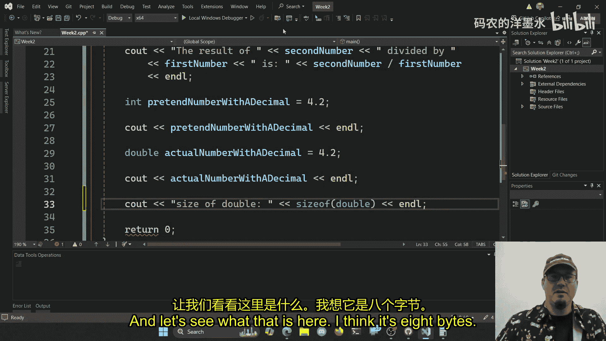

Yeah eight bytes so if you just think about a real quick here right and we don't even need to flip all of them here。

 can we delete there we go if I just look at this bit here。

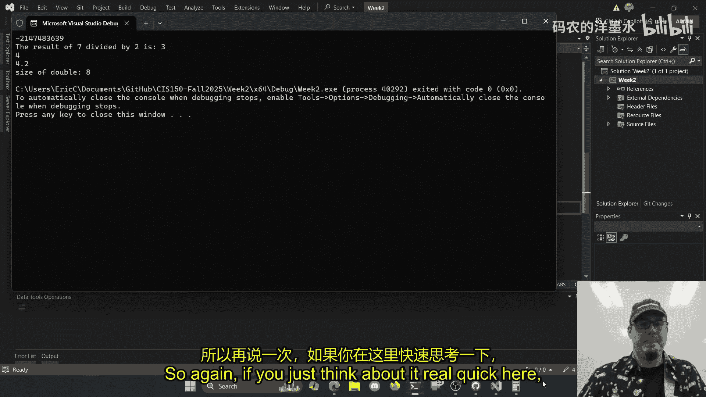

Right this is that was eight， here's another eight so there's be 16 bytes but I'm sorry one byte two bytes that this is only eight bytes here right that's。

Millions， billionions， trillions， quadrillions， centillions here。

 but again we don't use all of it because we need to place for the decimal bit so you can get a pretty high right and if you're dealing with numbers this large I don't know what you're doing maybe some sort of astrophysics。

I don't know， but for our purposes we probably don't need numbers that big right probably okay that works out pretty well so our double has lots of room for stuff here。

 but if we're going to do arithmetic with it we take our actual number let's like multiply by 1。

1 here。4。2 times 1。1 should go pretty well。4。62 right life is good there and how we divide by something here。

 so let's do some interesting math One of these eventually will' screw it up here divided by。Hello。

S divide by two。

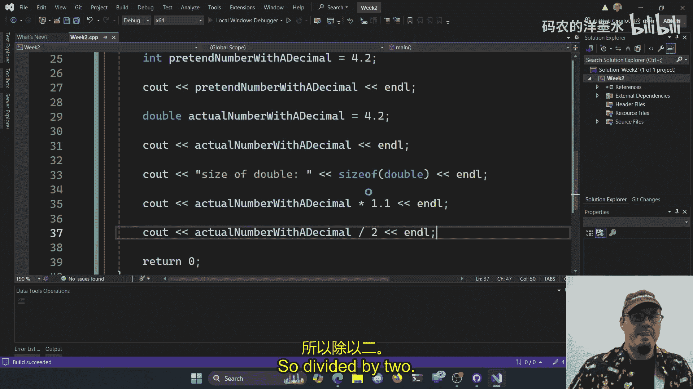

This one， because we have a double divided by an integer。

 we keep our decimal place because if one of the operarans is a double， you get a double result。

Just because one of them is an integer something like， oh， you started with one and was a double。

 you probably want a double result and life is good here。

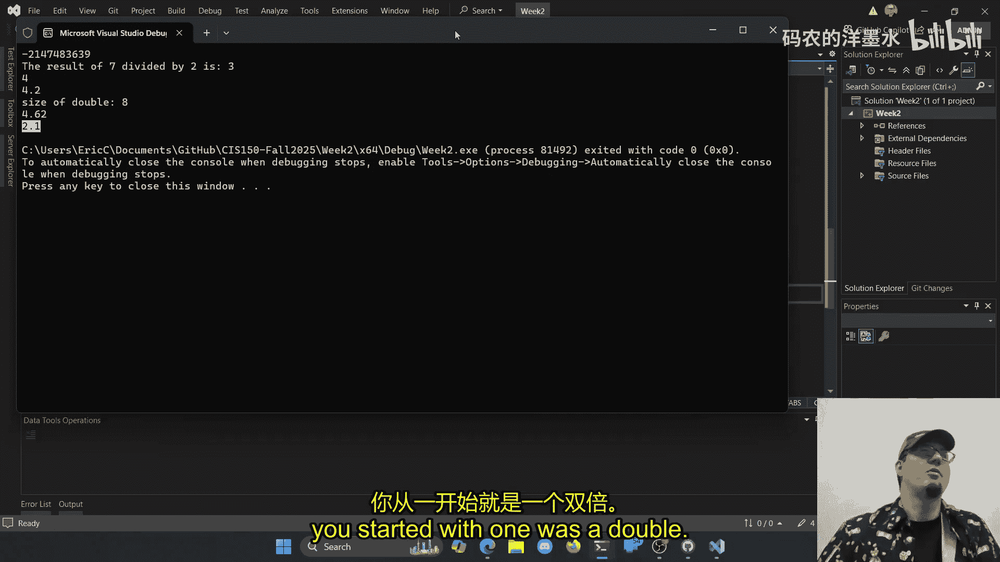

At some point in here， we can change it。Let's see like plus two。

One of these is going to rake it here，'s see。Yeah。Can't remember which one does it here。

Actually with decimal times3 divided by two。Plus I'm just adding a different number here to see if we can get a result out here。

No。Think back to order of operations， right？Same thing applies in code so it doesn't do this times three divided by2 plus seven and then divided by two because our multiplication of division have a higher level of precedent it does seven divided by two and it's going to add that three and a half to the result of this times three divided by two right Okay good we're all good at that that's nice integer revision oh it's warning us here so notice there's like three little dots it might be hard to see on the screen there there's three little dots I going hover over it and it's telling me hey integer division result it's truncated before casting two floating point。

It soundsunds really fun here， but it's saying hey you're going to lose your decimal place。

 so maybe we want like 7。0 here and now that little message goes away if we actually wanted our three and a half here。

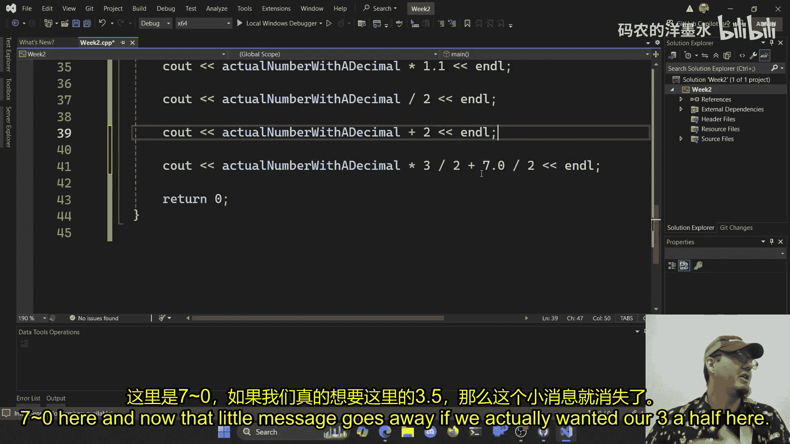

At some point we can make this break， no， goodness， we need more。

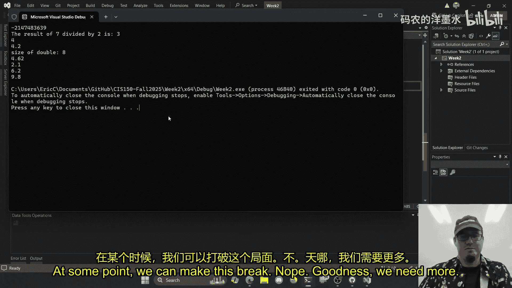

I wonder if we can come up to an example here， I'll just ask it C++。Tample of。Bad heading。

In point numbers。😔，I bet they'll give me one。Let's see， oh， here's stack overflow。

 this one still exists， right？嗯。No that's not a very good answer there this is the problem right you don't always get the right ones here bless you thank you。

Yes， this is the one we want herehuh。

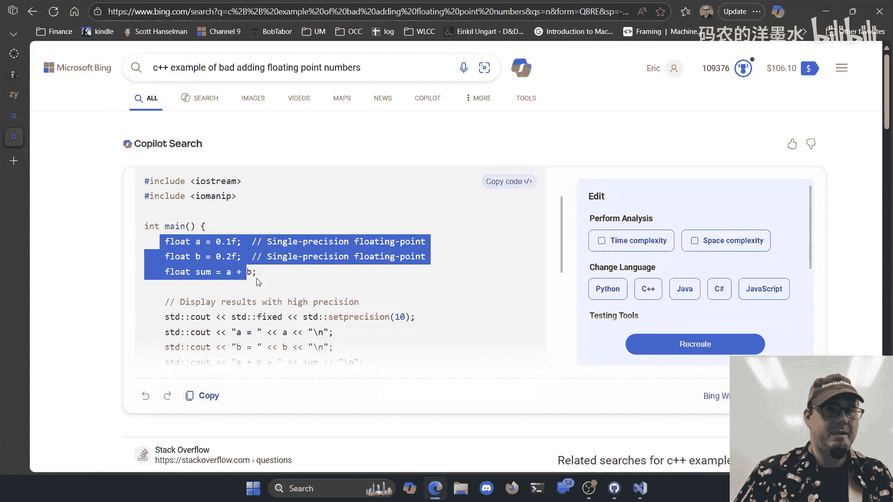

Try their example， well it'll steal shamelessly from online so we get the result we want here。

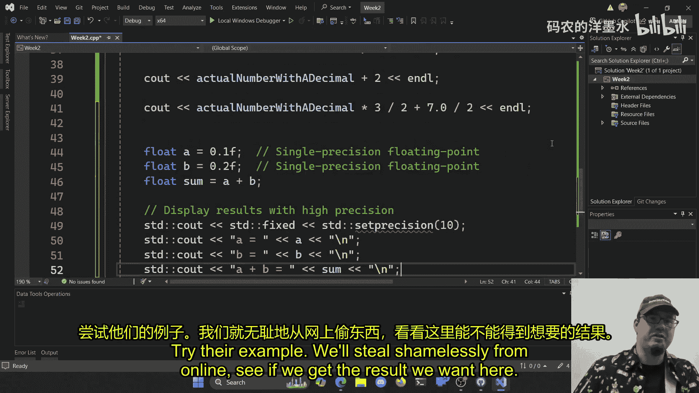

Seub precision so notious this Iio Manip library you can use the Zybooks goes into this stuff here so Iioip IO manipulation。

 I input output manipulation， this is our IO stream input output streams we could see out output stuff This lets me do things like set precision and say I really want 10 decimal vases here。

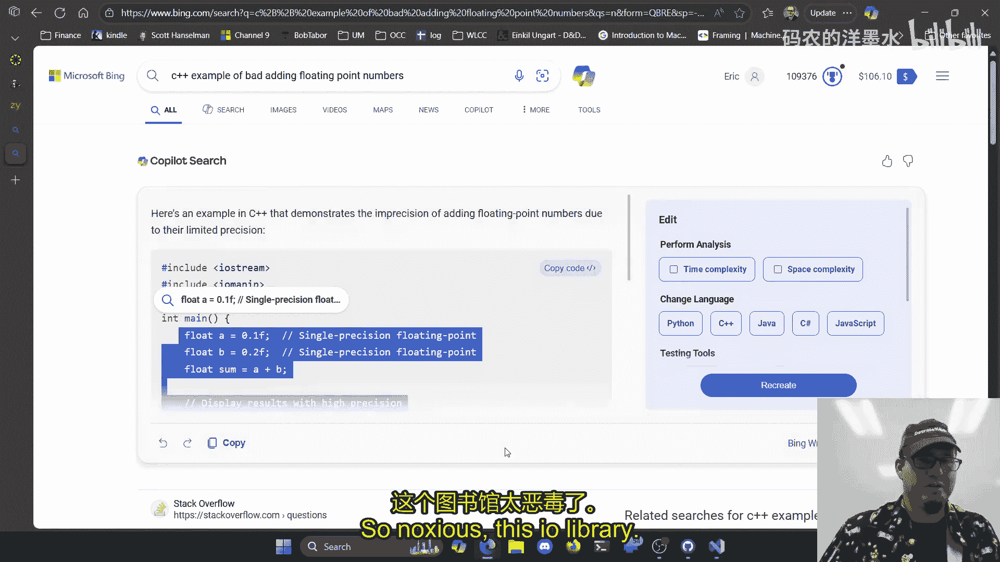

interesting， all well and good here， don't worry too much about it and look I should cite my source here so this was copi。

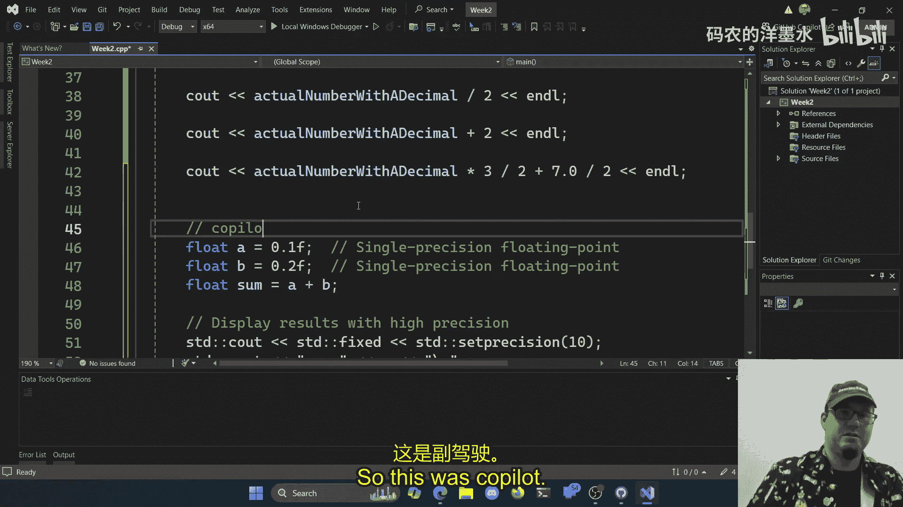

Being answer right because I'm going to ask you to do this right so cite your sources here。

 I will cite my sources。

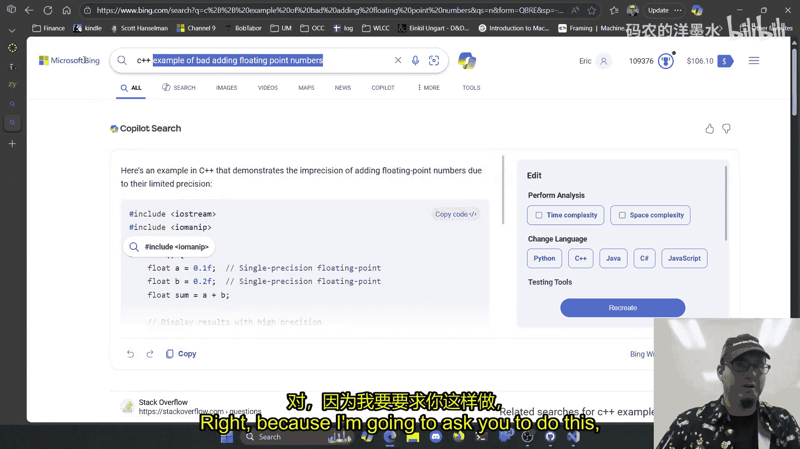

It's good to have it。There we go， okay， so。This number。Plus， this number。What where do we get 0。

01 and 0。02？But we got this like 0。15 trailing at the end here， we good garbage here at the end。

Eventually weird stuff happens you get this trailing garbage which most of the time doesn't matter。

 but if you need very precise mathematics it can give you weird results so should just be 0。

3 when we get this weird stuff at the end here that was the whole example we're looking for here and I don't know if you noticed here these ones are declared as floats so floats are smaller number smaller than doubles here with numbers with decimal places here what is the size of a float what do you think it is size of a float。

Float， let's try a float。

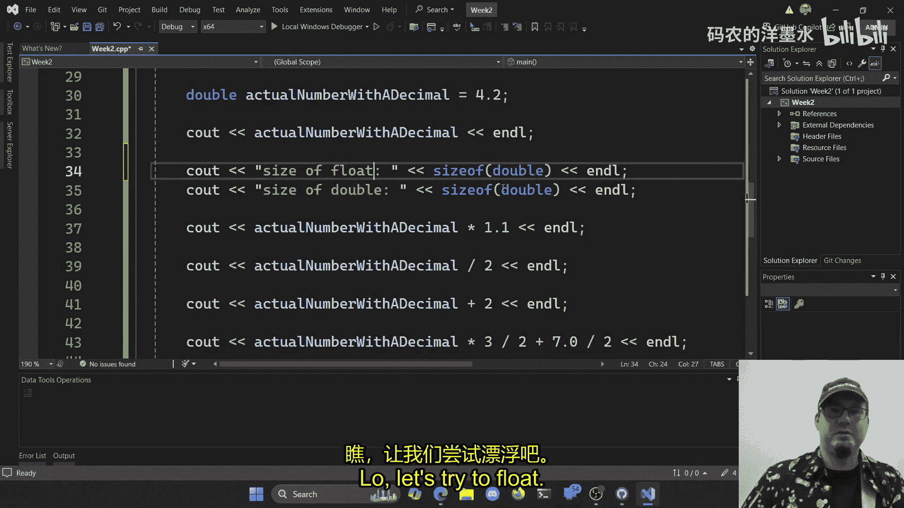

Im going to go to a parade for Labor Day？He， there's a good one， the size of float， four bytes。

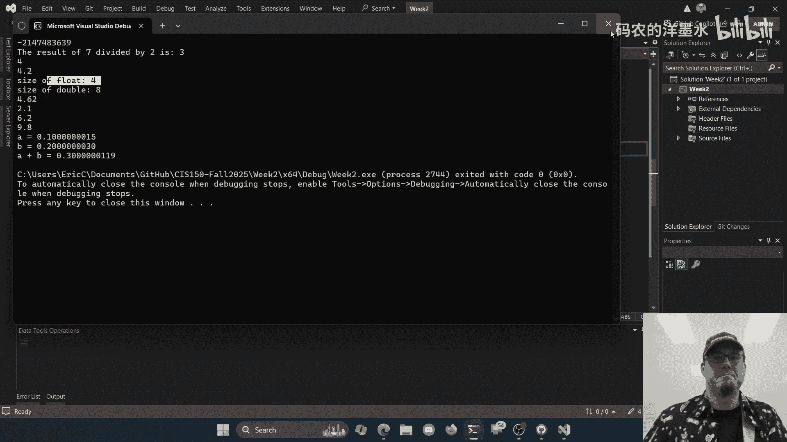

So they're smaller the reason I hate floats here is you have to add an F until CL says， hey。

 I really want this to be a floating point number rather than a double。

Because it's obnoxious that's okay so we can again。

 I'll probably never use floats just because it's annoying to have to just explicitly declare them if you don't need all that precision and you're trying to save memory because you're doing a billion of something。

 yes， please use floats。Life is good， we can optimize， but for now we don't need to optimize here。

All right so bad stuff happens we get these weird trailing spaces here at the end we go back and see how we're doing on track here so it also was in the chapter integers identifiers athmetic arithmetic doubles floats you can do scientific notation sure if you want to be very specific constants math is fun you can do some really cool stuff in math here's the binary chapter re section modulo is a fun one here this one is a fun term so modulus is division and gives you the integer remainder so think back to when you started learning long division was that third grade you'd have some result and the number remainder this modular gives you the remainder so I can say the result an inch remainder。

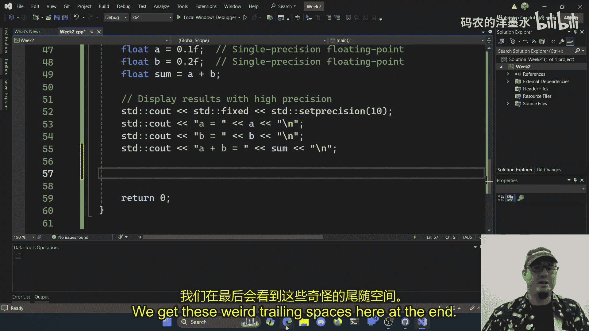

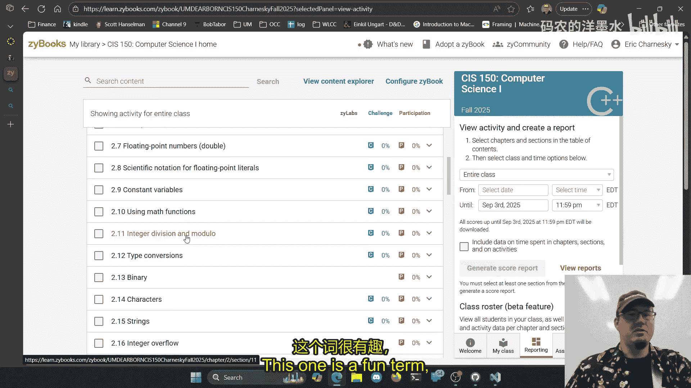

I's going to be seven modulo2。And I'll get back to the remainders one because7 divided by two is three remainder one。

It kind of almost the opposite of integer division maybe not opposite but gives you the what was going to be removed from the integer division as a whole remainder this can be useful you do some fun stuff with it here we'll use this for our first exercise we want to know what the remainder is of some result here and having to subtract and subtract and subtract and subtract until you get less than something is really a boxious right it's a pretty quick way here and then we don't have to see what the decimal place is and like you could multiply the decimal place by the number you divided by and you guys are good at math right we can figure that stuff out but this is a nice little shortcut。

This is modulus， mods。你 whole。Are the integer rangeer？Meinder of division。Okay。

 so seven divided by two， but I want the remainder， so I use the percent sign。

 so we came up with that for some reason here。

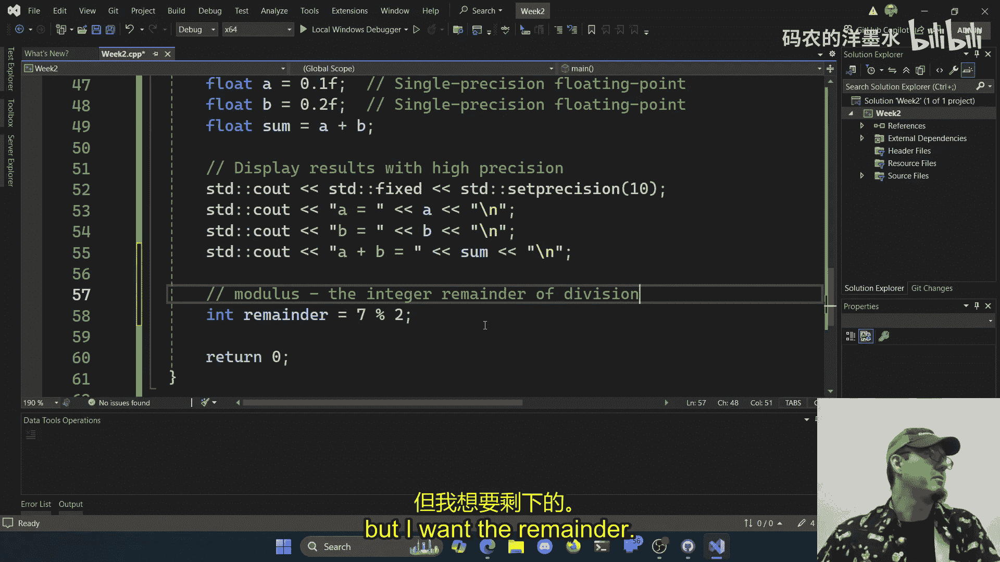

Consts are nice so we can。

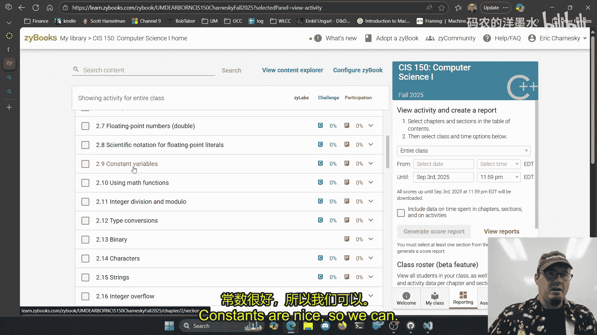

Sometimes in our code we want to have a number and we want to keep that number and not go and change it so so far we haven't really done anything interesting with these here but because these values are variables here and we said hey number was this I can go later on here and say hey。

 I want to change number I want to say now I don't need to tell sequence+ it's an integer again I just have to say number and assign it a new value here。

So because I've already declared it， I've told C++ up here， hey， I have an integer called number。

 I don't need to do it again right so if I even if I try and say int number it's going to yell at me。

 should yell at me， where's my red line Viual Studio is being done right now。

 there's the bill error Yep， int number redefinition number redefinition， multiple initializations。

So these red ones are the errors， they won't work because of these。

 and then it tells you here at line 60， that's where your problem is。

if you can see those little line numbers it's a little small there sorry and you can click on it and it should take you right to that section there so I don't need to declare it as an integer again and already knows what it is here I just go assign it a new value so you can use that assignment operator and assign values to variables more than once you can change the value works out really nice here again all this is not very interesting because it's pretty static here right it'd be more interesting if we ask the user to enter some numbers here right like we could ask the user to enter two numbers so we can do that so we've got a way to get some input from the user which is super fun I'm going to say you have first number of second number right I think we have those。

First number yeah we first number and second number， so let's go and ask the user。

 so we're going to output and say enter your first number。Again。

 I like you can leave it on the same line here if you want。

 or you can move it down wherever you like for your inputs here。

I don't know if I have an actual super preference or not。

 and then I'm going to use C for my standard input here， this was the standard output。

 this is the standard input， and I'm going to flip my arrows now。

So we're going to go the other direction into my first number。

So C I think this is extraction and this is insertion because we're inserting to the output stream or we're extracting from the input stream。

 I think that's what it is doesn't matter too much here。

 we're going to input whatever the user types in as first number here and then we'll do the same with second number so again I'm just going to copy paste because I'm lazy and we'll go say second number and I'll change this one to second number add autocomp so we have two numbers here。

And then we can see out， I don't know your first number， It， that's due to like first number。

And a plus sign。And a second number。And usually we just use a single equal sign right when we in Mathland。

 sure we can use that， it'll look a little funny but that's okay， so first number plus second number。

I got a little long here， let's move that down maybe。And then at the end of this。

 I want to add my new line line here。And we'll do a bunch of arithmetic based on what they entered so plus and minus and multiplied by and divide it by and make sure I actually go change them in here as well right that's something I've done before when you copy past you' got to be a little bit careful here because you might miss replacing something happens all the time I now we can run this and it should ask actually ask whoever sitting at the computer and hit the run button enter some values。

SWhere to go？So's it running？

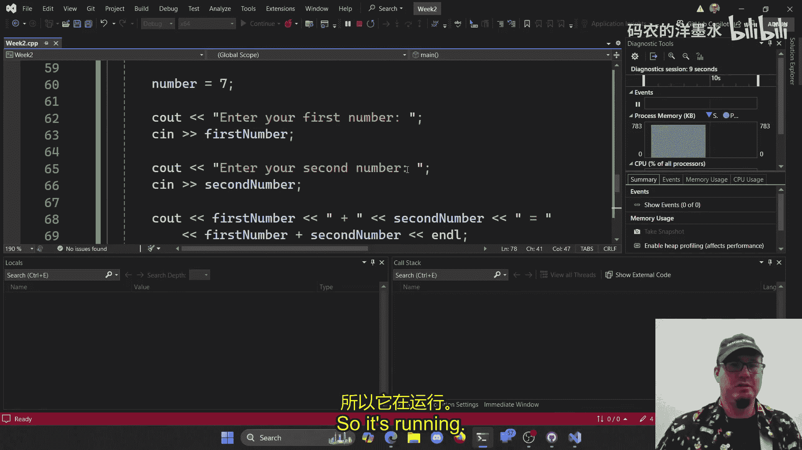

Did I break it， is it not actually running？There it is， okay。

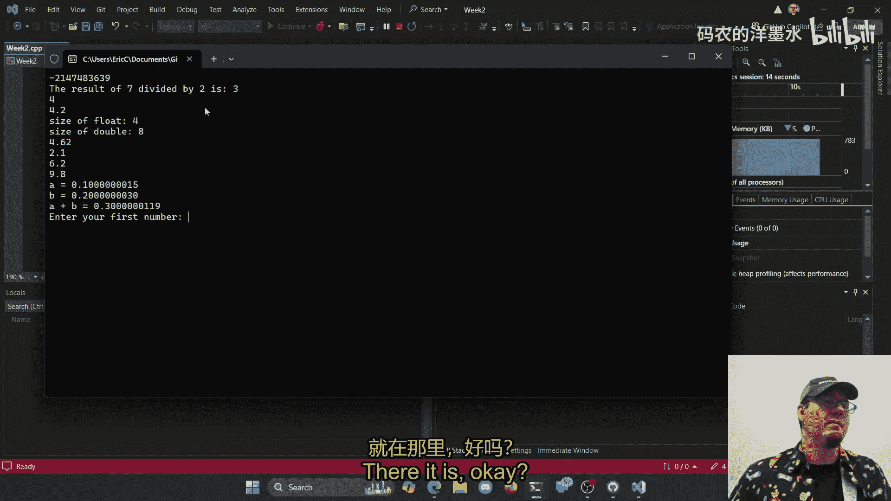

As just behind my visual studio for some reason there。

 so that's alt tab and Windows you can flip between your open tabs， open windows。

 if you like that shortcut。

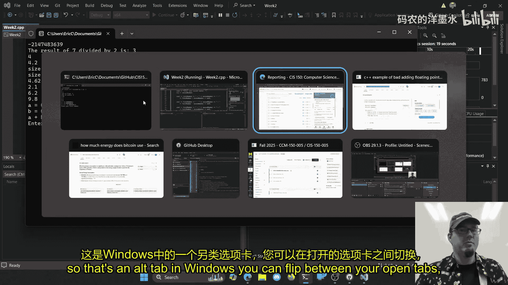

So enter your first number， once we enterverse。Five， okay， and the second number。S， six。5 plus6， 11。

 5 minus6， negative 1， 5 times 6， 3，5 divided by 6，0。Integer division， right there's no hole at all。

 right so when we truncate the decimal， it's gone。

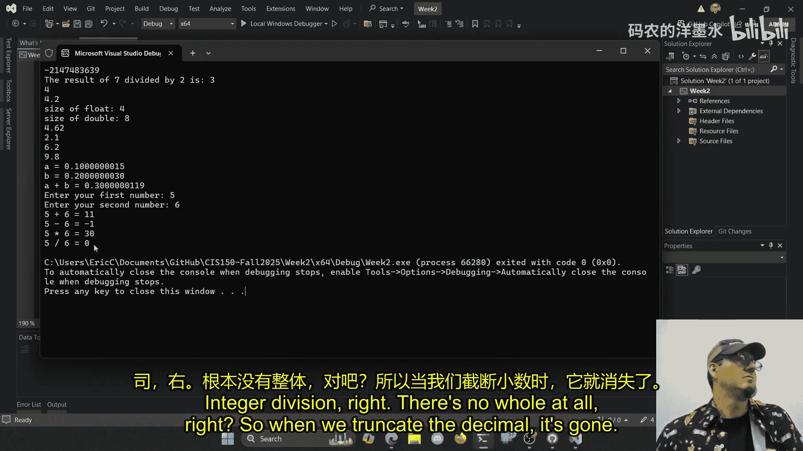

It seems to work， okay， so now our program can be a whole lot more interesting because whoever runs it can give it different values。

Finally gets to be a little bit more fun because I can do something now rather than every time I hit run。

 I get the exact same output， that's kind of boring。

So maybe we do something really sad and depressing and we calculate your annual pay， right？Okay。

 so let's do that。 So let's see out enter。Your hourly wage。

Right and we probably want that one as a double right so double right because you probably like 750 or I'm sorry like 1250。

1525， 1792， I don't know we come up with weird numbers here they're like。

 hey youve got a3% raise this year so did the CEO and the CEO's raise was you know $50000 raise and your raise was like a。

10 cent race， but it's the same 3%。Definitely fair right that's math this one like that anyway so we need to double for wage right and now I can see in to wage so enter your wage declare kind of like declaring first here it doesn't matter at all as long as you do it before this one we're okay。

I think it just looks a little bit nicer here。 and then we'll say your。

Average hours worked in a week。Again， might be a double here right you maybe you work 12 and a half hours a week。

 I don't know， make sure you get paid for that half hour。

 don't let the employee employer commit wage theft。

 which interestingly stealing from your employer can quickly become a felony。

 but wage theft if your employer steals your wages and doesn't pay you is never a felony。

There's a fun back for the day。So this is hours per week。

Oops I copy too much undo redo so control Z is undo control y is redo if you see me undoing and redoing as I talk to myself here so we got that now we can calculate right so we know how many weeks in a year right if you're lucky you get some paid time off but that doesn't usually happen as a parttime employee right so we'll probably just assume 50。

50 weeks， maybe it takes some unpaid time off Sure， so then we can calculate here。

 So the amount of money you make in a year。 So this will be a double for yearly salary is's going to equal we're gonna assign the value。

 whatever we calculate right that's our wage times our hours per week times 50 Now anytime you've got a number in here and it doesn't have anything associated with it we've done a bad thing So just putting 5 here like we just talked about it。

 And I said it probably means you work about 50 weeks in a year。

But am I going to remember that when I come back the odds are pretty low right I'm an old person I got a bunch of kids I don't I don't remember what I had for dinner yesterday Okay be coming back to my code remembering 50 that's pretty low So what we can do is we can make a constant value So constant values don't change thats how we got to this whole conversation So variables you can change Cons are variables that don't change they stay constant So we're going to declare a constant hint for weeks。

Worked per year and just our convention for Cons is we use all uppercase because we want them to stand out here and then if it's all uppercase you can't do camel casing and this looks nasty right so the way we can separate our words here is with underscores this is He of Lake snakeake casing that it's all uppercase so I'm going to use that now so now I have a value with a name we've put some context around what that 50 means because I added a variable name for it that is pretty clear right it should be pretty good and then we can output。

Your annual salary is。And we probably want a dollar sign， right。

 and then we'll add in here the yearly salary。And then line。Oh don't forget about taxes， right。

 so we should probably calculate that as well，Your salary after you know。

 even if we estimate low at like 10% taxes between the 3% you pay to Medicare and the 7% you're paying to Social Security。

 that's a zero taxes and you probably pay some federal income tax depending on where you end up with your brackets and things。

 so people will say 15%。Is that it's just a rough estimate， Okay， after taxes is。

 and we'll take off 15% of that here to our yearly salary。Times 0。85。Right again。

 shoot now I've got a number with no really meaning here。

 so that's fine we can go make another constant double for hack。Okay， so this will be 0。15。

 then somewhere you'll multiply by one minus attacks。Right， that sure， okay。

Not feeling great about having to do all that interesting math here， but saying tax of 0。

85 doesn't make a whole lot of sense right okay， so let's see what it is here。

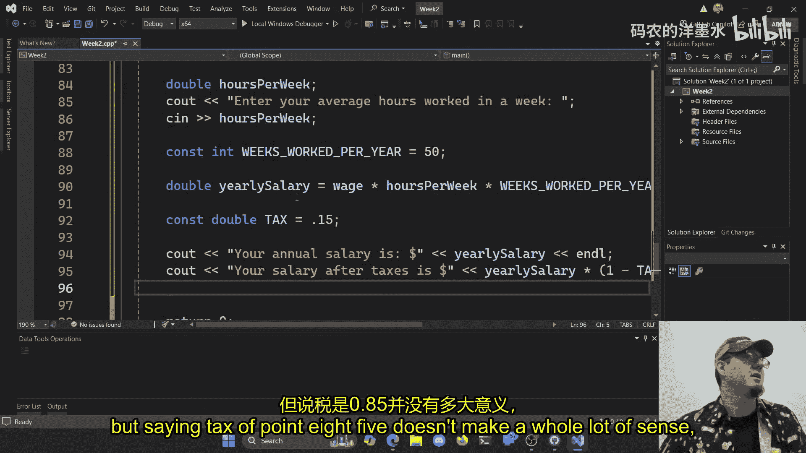

Hit run， all right， so two and three， sure， anyone want to volunteer。

 you can just make up numbers too， it's okay。ItOkay， 20 bucks an hour， all right。

 how many hours a week do we work？嗯。It's22 hours a week， okay？Annual salary， $22，000 after Texas 18。

000， oh we had that subrecision on still we got 20 gu places。

 that's ugly we can go change that later， but okay。

 we are to calculate and we can run this with different values every time here。Right？

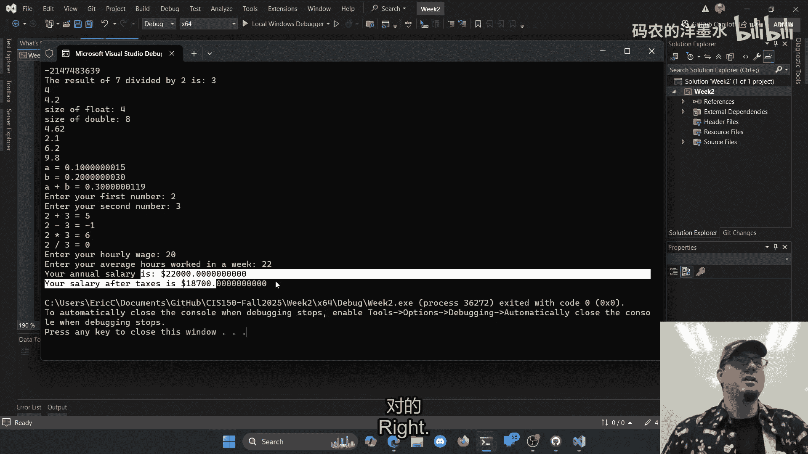

Okay， now let should we do more silly exercises we had a little bit of time still right right so let's let's take your average rent we'll start taking that out see how much money you have after rent Okay soll see how enter your。

Monthly rent。And then we can that's probably an integer， right。

 I don't know if you pay pennies on that。Inch is probably okay here， so this is monthly rent。

And we can see into monthly rent。And then we have to multiply that by 12 right and take that out right so we can we can do that arithmetic so we've got we probably actually want to save this salary after tax if I'm going to use this more than once as my starting point for how much money you have left。

Right we want to save that I don't to have to do this arithmetic more than once because I'm lazy right。

 so let's go save that So this is our double or salary。After tax， oh that's yearly salary right。

 so yearly salary after tax。Right and we'll just take this here I'm going to cut control X for cut paste that in here and my semicolonons all so we got rent here should we just divide that by 12 that'd be useful like our monthly salary or we like going up yearly right I think you're at least fun。

So then you can see how so after paying rent， you have。It'll take our annual salary。

Yearly salary sorry yearly seller and so if you get more than one option here with Intelsense I'm using my arrow keys to go up and down so and then I can find the right one I want here minus and that's my monthly rent。

No， unclear。Rent time 12 I'm probably okay with multiping by 12 and monthly rent I don't know if we need another months of the year variable。

 maybe we should， but。I'm not going to feel bad about every single one here。

 but like 50 and 7 52 was a little weird。Okay and then an endline and I know this will work first here right because order of operations if you'd like you're welcome to add parentheses C++ doesn't care right if you want to add parentheses to make it visual this is happening first great go for it it's not gonna hurt anything and again i'll bump that down just so it doesn't come down to another line here and then we probably what other expenses we got like a car payment and car insurance and a cell phone bill and this is starting and get sad real fast right that's okay let's start asking so of an int for car payment and int for car insurance in for phone bill what other sort of monthly bills we have。

Health insurance， health insurance， health insurance。Gim memberships， right， I don't know what other。

Gim membership but I'm sorry utilities yep yeah heat and gas we can do them separate we can do them all together utilities here we'll just we'll have a couple now you can see really quickly it's gonna be a little bit of code you have to ask and enter and ask and enter and ask and enter so we're just gonna copy paste bunch here right so if I declared them all here now we can just go repeat so it's 601。

2，34，5，6 this is monthly。Car payment。Car payment car insurance and you just got to make sure you input to the right one because C plus plus let you overwrite so I could input monthly rent six times in a row C plus plus is happy because it's valid C plus plusco it doesn't actually know what we're doing here so this is our monthly car insurance and then phone bill。

Thoneville and health insurance business health insurance is ridiculous insurance if you're lucky you can send your parents to your' 26。

It's health insurance gym membership。嗯。Yeah。Ship and utilities。Monthly utility。

 oh these should all be monthly right， sorry monthly monthly。Monthly phone bill。

 monthly monthly car payment。And then we don't want run but it's few utilities right。

 and then of course all the money you guys spent on avocado toast， and that's why you broke， right？

Or is that me， is that my millennial generation。 So you guys don't like avocado toast。

 You're too broke for it。 That's why。Sorry did they say that？😊，All right。

 let's give this us a shot here so we did all these monthly ones here right and then we go let's I'm just going to copy all these ones here again here so then we'll figure out the I don't know it for。

Yearly other stuff then equal。Car payment， plus this car insurance。Plus this one， plus my phone bill。

Plus the health insurance。Okay。Plus， this one。Plus this one。

Now all of that if I want this to be yearly right， for some order of operations and then multiply by 12。

 again， 12 months in a year， that it's probably okay if you want to add a constant variable better。

At some point you're not getting a whole lot of your returns here so' not too big of a deal here and then we can see out after paying all your other bills。

Not including food。We have our let's our what does it here yearly after yearly so after tax， oh。

 we didn't even take out the rent， we should add in the rent then right， so let's add in plus rent。

Here， monthly rent times 12，'s skip too long again here now， feeling bad。All that time 12。

 that's our yearly salary。After tax minus the yearly other stuff here， right？

We maybe add a little dollar sign here， okay， that should calculate it if we're doing it right again。

 there's lots of places this could go wrong if we're if we're tyling something here if we're you know。

 so running our program and making sure we know what should come out is super important because just because I meant it to do something doesn't mean it's going to do the thing I meant for it to do。

Right so I have to be able to give it some values if I know what this goes in。

 I know I should get back out with that's testing our program because any code that's worth writing is worth testing right because if it wasn't worth testing that it didn't right。

 why' you write it in the first place and it doesn't matter？Right， if garbage is okay。

Don't don't write it because no one wants garbage Okay so let's come up with some values here and we should be able to do it kind of by hand to be able to check our output right so let's go to Excel here because that's pretty easy I'm a big fan of Excel you can do a lots of batch stuff with Excel which is way over you so our usually salary right what do we say that we made 20 bucks an hour。

 22 hours a week here so then this was weekly this times this。

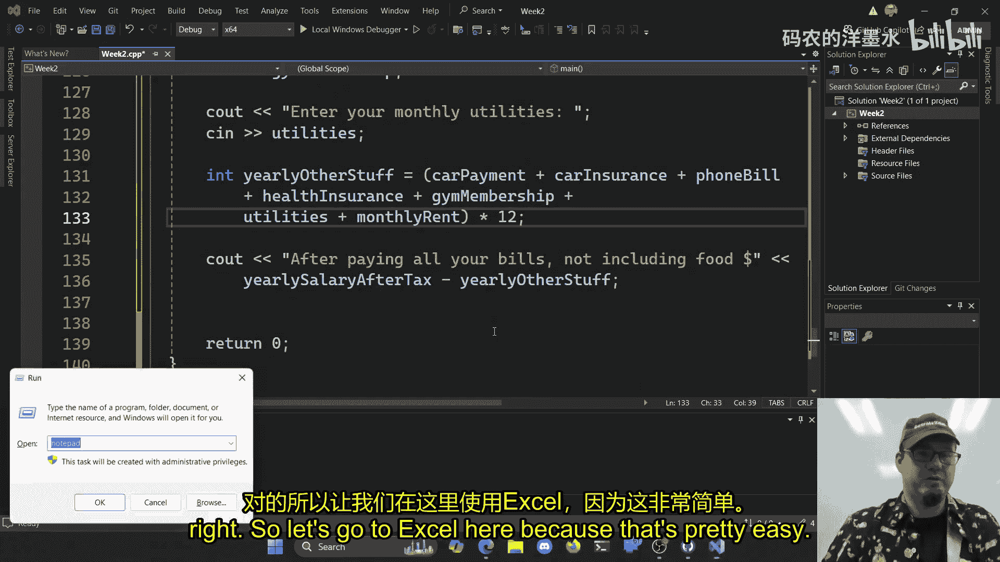

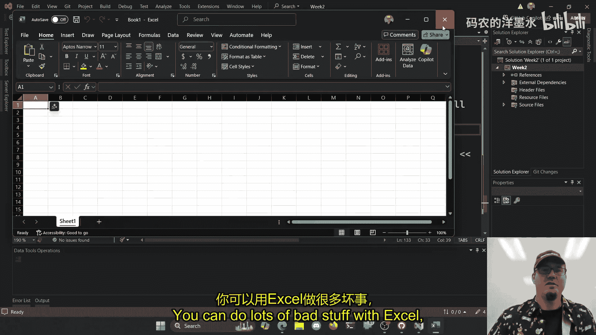

RightThat's 440 equals to 440 times 50。So we got 22， and then we did this times 0。85。

So we had 18700 right is what we had I think that worked the first time here now we wanted to come up with all of our monthly stuff right so we have。

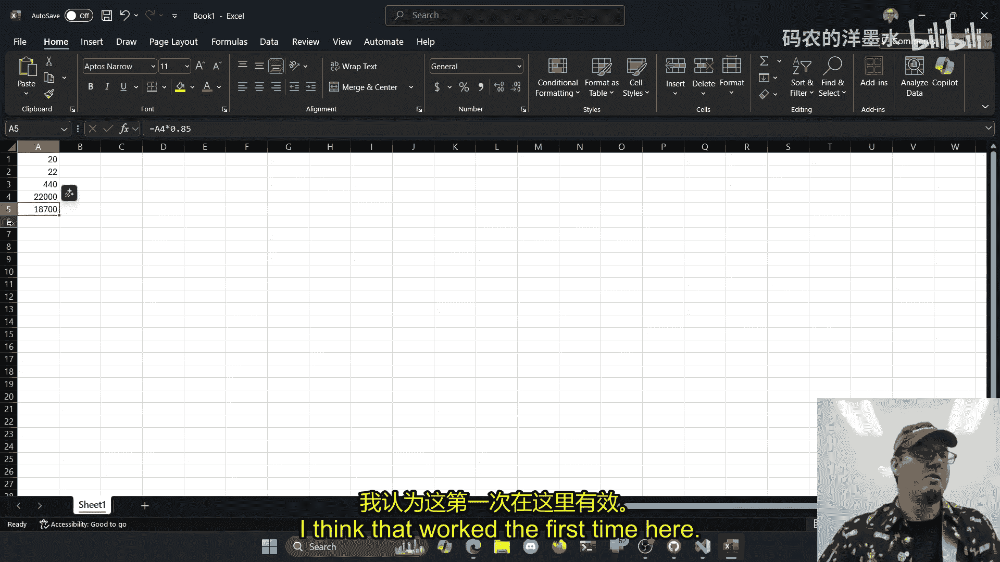

We had car payment current insurance， we'll just copy all these here right。

 or I could do it on two screens， there we go or left and right。

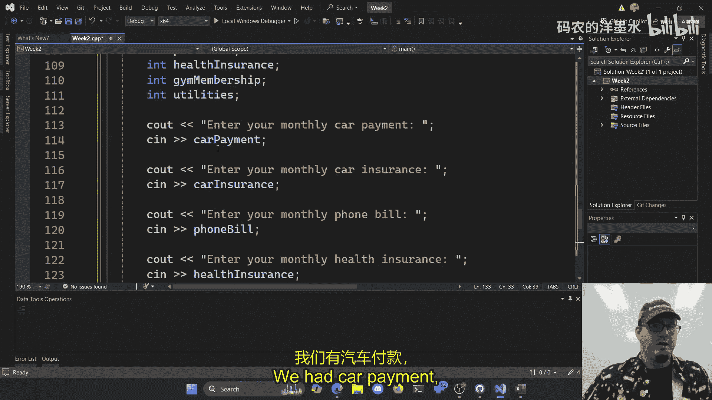

That's the Windows key left and Windows key right will snap something to your screen on Windows mode here so if we have car payment。

 car insurance。Phone bill， health insurance。Jim。Okay。Gyim and utilities， all right。Okay。

 so let's come up with some value， so we'll just come up with on horse。

 what do you think for a car payments？300， okay， how about for insurance to 50 a month？Man。

 being young socks， you guys get charged crazy rates。All right， phone Bill。50， okay。

 health insurance。Me me say zero if you're not paying for it， it's okay， gym gym membership。

zero zero or what about plan fitness right we go we'll go to the cheap gym I got friends who go to powerhouse and they pay like crazy amount of money and like go plan of fitness okay whatever and utilities。

200 for utilities， Okay， sure， and we'll sum all these up here。It' that's 8 15 a month then， right。

 so then this times 12。Let's us at 9780 right， oh we forgot rent， shoot much how much was rented。

1200。You want to go zero on this one， my son was bad。Right right。

So there's our number with rent here， so then our total should be this one minus this one here。

 so if we work it out by hand， we're losing a lot of money here every month because living is expensive。

yeah， you don't get any no food， no Netflix right no is it HBO max or is a max or is it HBO plus it' changed it back Yeah it was like HO Max the company they're paying to consult them is making a killing off of this here。

 which is so fun。I don't know， but no one names things well， especially not Microsoft。

 which is okay and I love Microsoft。All right， so we should get out a negative $5480 if we give it these values right we worked it out by hand。

 I mean I used to Excel but you could do it pen and paper too， but I'm lazy。

Let's try it right so we can run our program so let's go at five to run because I don't have the run button I mean windows small。

All right， and shrink this a little bit here so we can fit them both on the screen all right number and number don't matter。

 okay， hourly wage we said it was 20， 22 hours a week。18700 were good so far。

 monthly rent we said was 1200。All right， we all 4000 left after paying rent， right。

 well how about our car payment we sell with 300 bucks a month？250 for insurance。

 50 bucks for the phone bill， nothing for health insurance， 15 bucks a month for the gym membership。

 200 bucks for utilities。After paying all the work at negative 5，480。So。

The number we expected to get came out and we did a whole bunch of stuff right if we didn't get the right result here。

 we'd have to go fix it right that's where debugging comes into play right？

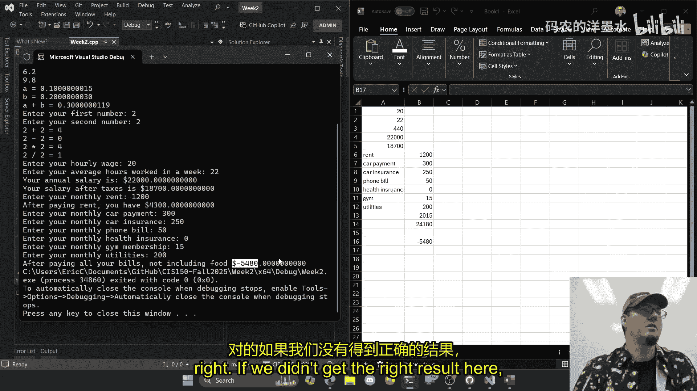

long time ago and my father likes to tell me stories because he likes to talk a lot and I like to talk a lot I wonder to where I got it from here when you used to write programs。

 you would write them on punch cards I don't know even like how they would go do this thing here but punched them out in the note cards and had to feed them into this really old-fashed computer and would read all the note cards and there was the instructions you gave the computer and it would run the program and give you the result back like he always swo like hours later because you had to wait in line and would queue it up and the thing here and at some point someone's program didn't work like I know I did it right I checked it three times and if it takes you three hours to run your program before you give the result out you're gonna be a lot more careful than I am of like oh I'll just try it and hit run。

 try it and hit run， try and hit run so they were pretty careful about making sure they did the right thing back then if they had to be but someone's program gave them the wrong result and like what's the matter here I know I triple checked this right I had my friend check it for me before I ran it it should be fine and we went through the note cards and there was an actual moth on one of the cards here in the place of where one of the holes was they had a bug。

In their program， a literal book and the program gives them the wrong output。

 ever since then we've named these flaws in our program bug。

Now you can have logical bugs right where we told it to do the wrong thing。

we gave it bad logic and the computer said， okay， sure。

 I'll do what you ask me to do because computers are stupid， they'll do what we tell them to do。

Right， happily。So we tell to do the wrong thing， we just made a logical bug right other sorts of bugs here if our program crashes right if I'm running my program here and it says just I got to close that one down I think lets try that again so enter your first number 2。

5。I just got no bug， this is a runtime error here because I gave it something it didn't want here。

Unhandled exception integer division by zero。Our program crashed right if I can continue you it's just failing it's not even going let me run here it just got to stop and bail out right bad stuff happened We crashed it so other sorts of bugs can happen to so logic bugs happen a lot so what we can do is we can run in debug mode。

Dbug mode lets us help find the bugs and take them out to debug our program right or're the exterminator。

😡，Sure so over in this right left hand side here next to the line numbers you notice as I hover over I get this little gray circle if I put click it and get a big red dot that's a break point what that does is it tells my program to pause right there and wait and show me all the cool details of what's happening on the inside so first number two other number three hourly wage 20 22 hours a week rent to 1200。

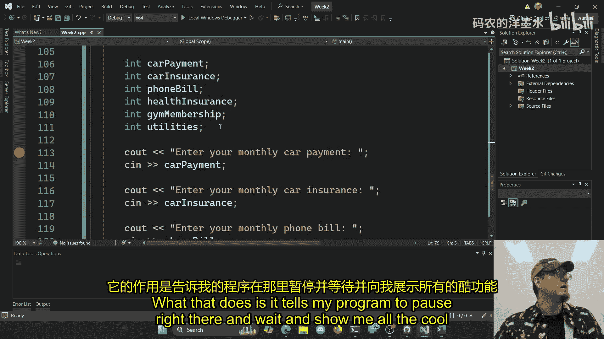

Now you see it's still waiting here but nothing's happened behind the scenes of visual studio now I see this yellow arrow this is my current line here and what's really cool I get this variables window down here these local variables these are all the values of all my variables here what is actually stored currently in memory and notice these ones that I've declared but not assigned we've declared these numbers we didn't give them a value you're allowed to do that right we can declare them and give them a value later a lot of times we would declare it and give it a value but you don't have to right for。

😊。

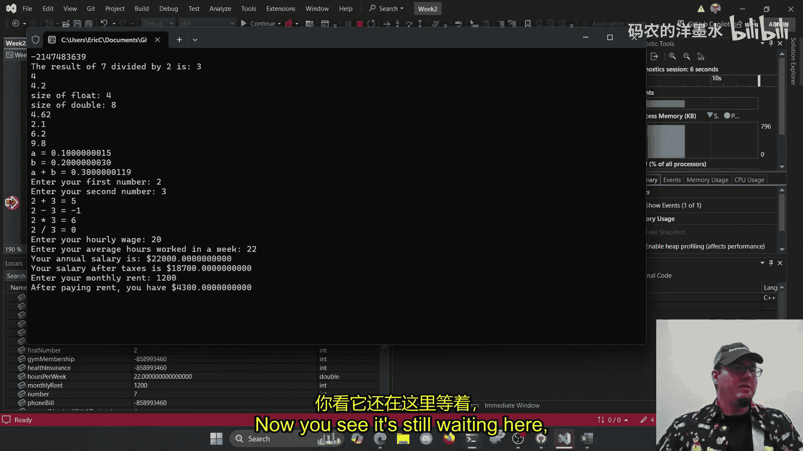

Stuff that's coded in my program， we probably just do it on one line because I know what the value is。

 but for anything that's a user input here， I don't know what the value is， but it starts as garbage。

So got to be careful want to make sure you initialize your values so we declare that we need to initialize。

 we need to give it its initial value， otherwise we get garbage out。

So it's waiting for me to go and do these things so I can look and I can say oh hey。

 my hours per week was 22。 my monthly rent was this so I can look and see what the actual values are before any arithmetic happens to make sure that I didn't maybe I  type maybe I meant to get car insurance but I left its car payment because I hasten it wasn't being careful so we can step through our program one line at the time and let it run so in the debug tools up here in the top you get a couple options。

 this step over this one that's kind of like a little arrow goes over is the most common one for now。

 eventually well get into the step into and step out of but for now we're just gonna step over or F 11 I'm sorry F 1 if you like shortcuts here we can run one line at the time here and we can see what's happening So when it gets to this line it ran this output so if I could look back in my window here it says hey enter your monthly car payment Now it's a little weird we deal of CNs because I'm going run that line of code and it's gonna sit and look like it's doing nothing。

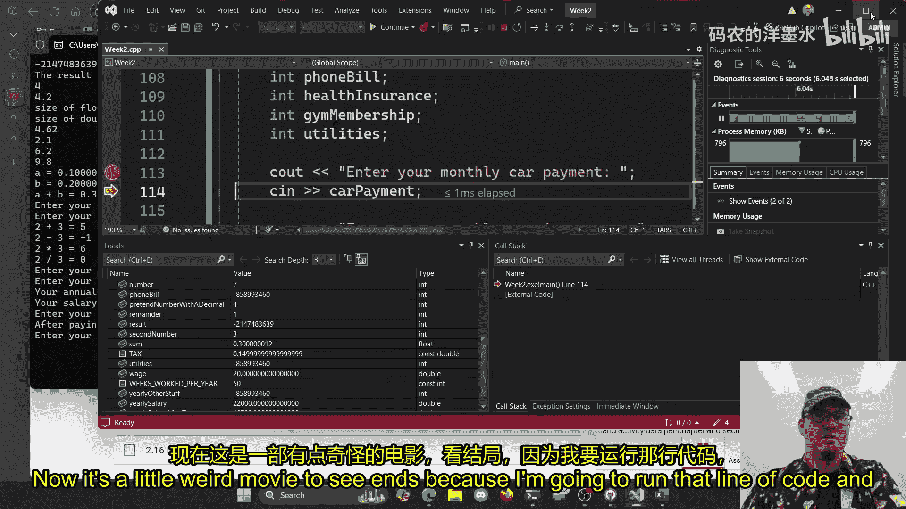

What it's doing is waiting for input right once we run that C line。

The program just sits and waits until it gets some endpoint right so now I can go give it here of my car payment of 300 bucks a month。

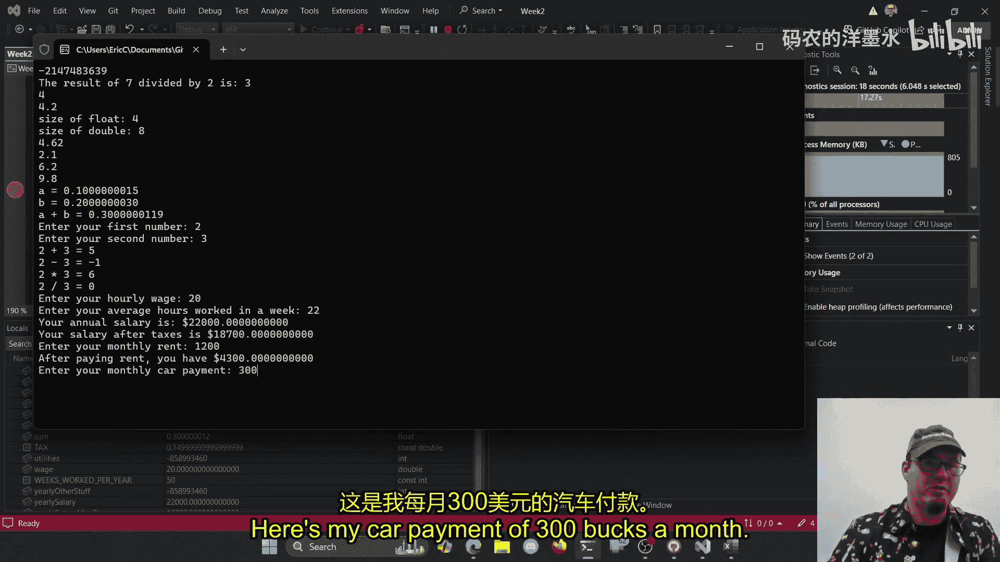

Now I come back and it's running again， so it's essentially like just sitting suspended waiting。

For the user to do something okay， so when we're debugging。

 we got to be a little bit careful watching that there。All right， so we can see all the value。

 so if we had some sort of logical error where we got the wrong number out。

 you'd have to go in and see step by step by step what was happening。

The other thing you can do is you can do it one at a time right we can calculate my annual after this annual after this annual have to like add more outputs here that's fine too。

 but then you have to do a lot more typing， debugging usually you have to do less typing because we're just looking at the values rather than outputting it every step of the way here outputputting' is okay too that's a fine strategy here。

 but sometimes you don't want all of that in here your output。

All right， so let's go back to Zybooks here so we did constantstance math functions here。

 there's some cool math functions again i'm not going to show too much because this shows up on YouTube。

Our math library， if we include C math， we get cool stuff like square roots and all sorts of cool things in the C math library here。

 so not having to do this stuff by hand is really nice we can include。

C math now this is the math library from the C language。

 this is C plus plus don't it's a whole big mess area that like C++ kind of built on top and。

Don't spot it too much here but you can do cool stuff with C math right so now we get like square root here we can do some cool square root stuff Okay all sorts of cool math functions powers fabs is the absolute value I don't know why there's an enough there's's a whole story there at some point that one's fine cool and then intervis modulelo we did I go back to。

😊。

Conversions， you can convert between types， you can read them on binary characters is a single character characters are really fun because we have this thing called the UniIode table。

😊，Now characters in C++ are not actually stored as characters because the only thing we can store is bits and bytes right so if you can only store bits and bytes it only if you store numbers。

 every character has to be stored as a number。So this Uniiccode table says， hey。

 the capital A is stored as a 41。The lowercase A is stored as a 61 and any sort of character we want here is stored as a number。

So all of our characters get turned into numbers for storage and then converted back right so we can have a single character at a time here。

 So if we wanted to have let's just do this at the top， I guess here。

So we'll have a char for character like letter I can say is E now this gets single quotes or apostropphhees for single characters here。

 then if you want a string like name here is in double quotes， we're going to say Eric。

 so strings get double quotes that's a lowercase S here and those shows it kind of a funny color here that actually comes out of the standard library and then characters are single letters here。

The silly thing you can do with characters， though， we can see out like letter plus five。

Here and of course， e plus5 is， well let's see E capital is 45， so 45 plus5 is。

74， oh。

I do that one wrong。You get a lowercase E45 is it not it's not actually 45 should hang on。That is。

 is that the hex value？I might be on the wrong one，'s simple tables leading me the wrong way。

So this one？Well find a better result here。Oh， that's awful， It want that one。

Come on， Wikipedia， they're probably better here， but we get here。Okay。Com on。Yeah one minute left。

 we could do it capital I mean not have our regular characters in here， oh my goodness。65 characters。

 that's the one I wanted。Oh， here it is okay。I still don't have my letters。

There it is e capital okay yeah any is 69 there we go so the actual integer value sorry 69 the other value is someone else here but 69 plus5 and we got out 74 all right thanks folks don't forget reach chapter two finish chapter one i'll put the deadline in we'll go from there thanks。

