# 【全集】密歇根大学 C++编程 中英字幕 1080P p03 Lecture 3 - 分支结构 part1 -BV1TsAZzAEHX_p3-

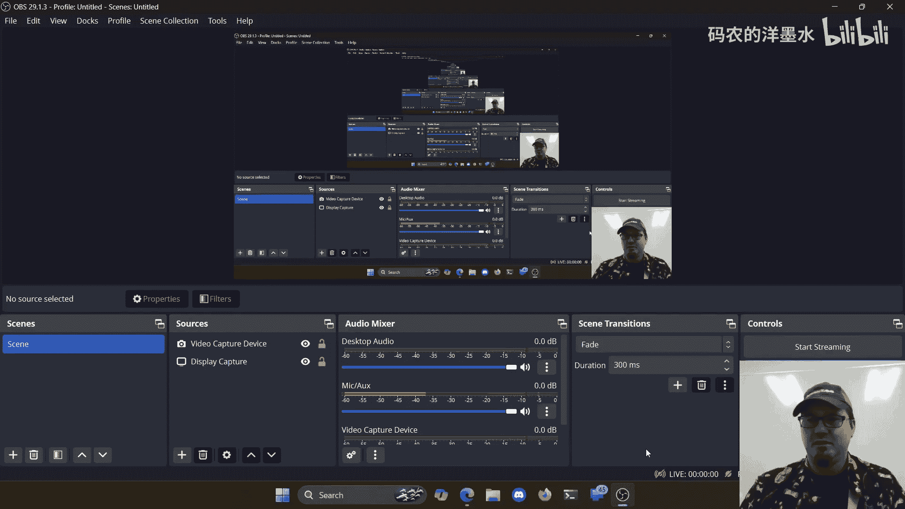

Alrighty， happy Monday， our first full week here and the weeks are going to be a little bit weird for this class because we've got lecture in the morning。

 Monday， lab Monday afternoon， lecture Wednesday。We'll see how that schedule goes。

 had a chat with Dr Seed he should be all set for labs starting 4 pm today I've got a lab from 2 to 345 in that room so I might just hang out till about  four o'clock or so and say hi to him。

I don't know if he and I have ever met in person Im trying to remember here and I get 100 plus new people every semester and names and faces are just blurd to me unfortunately。

 my apologies there but I might be there to say hi and then take off so make sure you attend lab with him it's his lab sections so whatever he says goes right I'm going to do what I do for the lecture sections he's going to do what he does for the lab sections。

It'll be a little weird， but we'll make it work。 Okay， so at the end of the day here。

 he's going to tell me。What percentage of this 10% of your grade you get for attending labs and participating in the labs and submitting the labs and himgrading the labs right so that's his section there that's the time he's got to sit around walk around help you actually look at your code right it's hard for me to do that during lecture time。

Even if you're following along in your coat， I can't stop what I'm doing go look at your computer and see why you're getting some weird error or the red lines or whatever so that's what that's for if youve got questions on the lab。

 they go to Dr。 Saed right because he's running the labs you've got question on the lectures on the projects。

 they come to me。Again it's a little weird but it's okay we'll get we'll get used to it here and we'll figure all out that makes sense Okay cool so we got through most of chapter two there's a lot to do with variables it's okay a lot of information here。

This by itself， though was really boring because the only thing we ever really do is like。

 here's an here's a variable。 and then I。I did a arithmetic with it and that's it so we need to get into branches to make it more interesting and then we can start talking about our first project because this will be a whole lot more fun so we're going use variables when we start talking about branching branches here just like any math class you don't get to forget the things you've already learned we're just going keep building on these concepts so if something didn't make sense in the first week we can like I don't know these are like half weeks or don't know what you going to call these here you got to let me know go to the Si sessions ask somebody ideally me because that's my job to answer your questions that's kind of why they pay me otherwise you could just watch YouTube videos right。

Okay so my job is answer your questions happy to do that so and again I talk fast。

 I got a whole pot of coffee here， I already had coffee。For this pot as well。

 so I did not sleep much last night， so I'm rather hyper at the moment if you're a little fuzzy on something holler okay。

 because if you're fuzzy on it， one of your classmates is fuzzy on it and they'll appreciate you being the one to raise your hand and say something okay。

Okay。I think。Want to try and start the project today？We might， that's okay。

 so you might be able you might not be able to finish it today。

that's okay the goal is this will you know not necessarily be two weeks worth of work。

 but you've got time to spread it out over the next two weeks here Okay so want an intro today so I'll try and pause about noon or so of me talking at you here and then switch over to explaining what the goal is with the project Okay and we'll go through that way I'll show you the Github steps Oh goodness sorry I sugar hi。

Sorry。Why any people let me？Yes， sugar is high。All right。

 it's coming down show you okay it might keepep for a while。

s it's not the fastest thing in the world to change so sorry about that。All right。UYeah， so。

I'm going to start a new project， and go to Visual Studio。

And do a new project everyone I'm assuming got hello world working on your device。

 whether or not you have a Mac or Windows PC， there's a lot of Mac， my goodness。

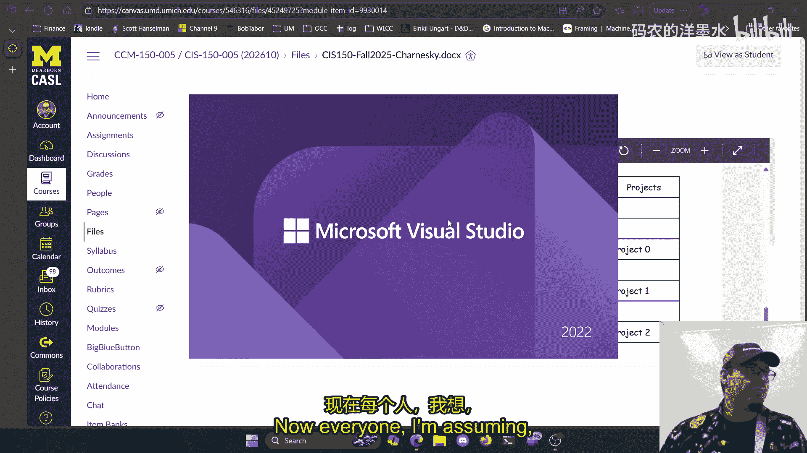

It's like least a 3 of you。Maybe close to half。W。Okay。

 that's fine it'll totally work you can do all the things you need to do on Mac not a problem but it'll just look a little different because Xcode is not visual Studio if you want to use visual Studio we've got it on the lab PC so when you get to lab you can use the Windows computer if you want you can log in on the lab PC and do it all in Vi Studio if you'd like here。

Either way it should be fine you'll still end up with a CPP file that's the important piece here。

 I like all of the other stuff that comes along with it it makes life easy， get is fantastic。

 lets you track all that stuff and then if something happens to your computer you can just pick up where you left off really easily。

Right so we're officially in week three which is weird， it doesn't feel like week three。

 so again empty project gives us nothing， the console app gives us the starter file and an int main so I prefer this one because it saves me some typing I don't have to memorize any of that other stuff。

So I like the console app I'm going to put it in my git repository folder okay so when we get to the project I'll show you how do you make your own repository。

 we'll go through those steps of cloning it， take you through all of it。

 don't worry it's going to be a lot of clicks， but we're going to do it every time for every project and eventually we'll get into the habit of it and it'll feel pretty comfortable。

I promise you it's worth it Git is fantastic using source control is worth it even if it's just you。

 I know you can put it in some sort of cloud drive。

 but this is the right way it's good to get into the practice of using it here and let to say I don't know。

 percentage of oh why didn that top there you go。

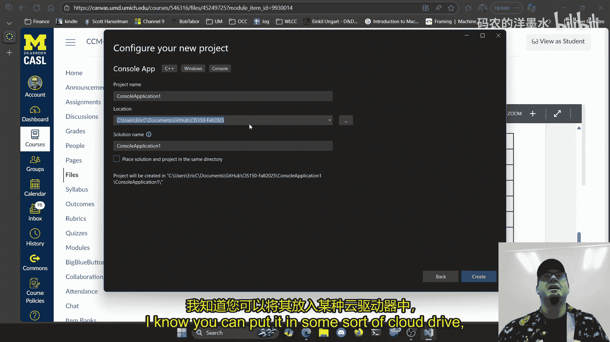

Developers using Git， let's see， I'm sure we can get some stat here right。I want 70% use Git。Okay。

 sure， I have no idea where do they pull those off of。

GtHub statistics by developers and GitHub specifically it's a lot right a lot of people use Git it's the most widely used source control tool let's try that source control tools by usage sense see if we can get a better result。

That was weird。嗯。Enter。I broke it somehow。 That's great。 Okay， sure。We're getting。

 I just want like a chart here。No okay that's fine we can find one later here but Git is definitely the most oh CVS this one is awful don't use CVS SVM wasn't too bad this was the popular one before Git here。

All right anyway， we'll pick it up we we'll come back to that later so put it in the folder if it's in the folder that Git is watching Git can do its job okay if we don't put it in that folder Git can't watch any of the files because nothing changed in there again I like the Github desktop tool visual Studio has integrations right with Git you can do that directly again I use this tool because it's the exact same one for every class and it's basic we don't need all the extra bells and whistles that we get all the other tools eventually you'll want the bells and whistles because they let you do cool things this one's nice and easy here so right now there's no changes nothing has changed in that folder yet。

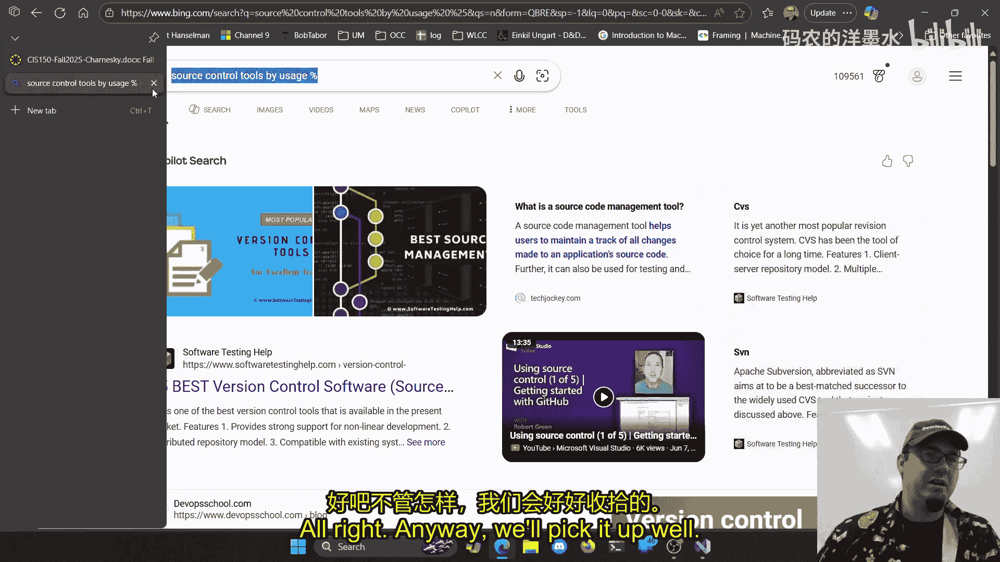

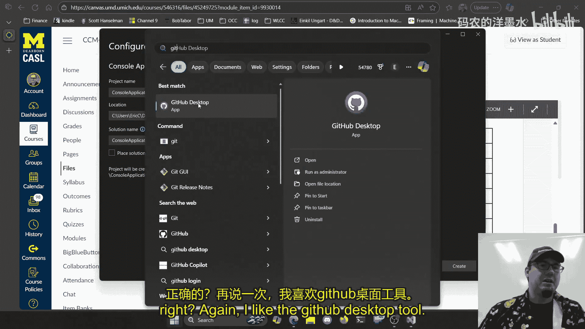

Once I make my project， it's going to say hey， there's some new stuff here。

 I'm going we'll call it week three， check your box or not， it doesn't really matter here。

Ill make my project。Visual Studio does its job make some file so we get an SLN file our solution file a solution is one or more projects the VCx pro is the project file the CPP file was our c plus plus code file and then this filters it just let it have doesn't matter here so we get a bunch of stuff and I can make a commit if I want right commits are free commit early and often week three started。

Commit and push so once I commit until I push the cloud doesn't have it right that origin。

 the central repository doesn't know about it just my computer does I'm going to push to get in sync with the cloud okay until you've pushed cloud doesn't have it and you don't have a backup right so commit and push all the time eventually you can get into some other flows and you get a little bit more advanced。

 but for now just commit and push always push make your life a whole lot easier okay。

And we get a bunch of garbage we're going to get rid of here。

 we don't need any of that other stuff here， but we get our into mainine we probably should return a0 not that it really matters here but it's a good habit to get into and then again I like using the namespace standard because the way I don't have to prefix all of my seat outs here with standard okay just save me some typing and I'm all about saving typing here and I like these end liness here it doesn't really matter here the backslash ends are okay too but I've gotten into the habit of using these and。

I'm the creature of habit so I like sticking with my habits all right so we've got a program it should be able to run。

 we should get a hello world always good to give it a run make sure it works okay before you get started waste a bunch of time and we get hello world life is good so far。

All right。So we've worked with variables now we want to look at this idea of branching branching lets our code do different things based on different cases so we get to come up with here。

 so we get a really fancy term here， a Boolean expression。Anyone know what Booleing means？

What is it true or false yeah booleing that's either yes or no true or false on or off right if you do a lot of the circuits and we get on and off it's a lot of fun here and then I'll kind of come back to computers it's either on or it's off we looked at bits last week right that was a lot of fun powers of two with our bits here it's on or it's off so a booleing says it's true or it's false it's a yes or no so we're going to use these things as's true or false here so if I have an inch for say let's do a double here double for money in my pocket how much money do I have in my pocket's probably not very much。

Going to $12， I got $12 in my pocket here。Now we can check and do something so if we want different things to happen。

 we're going to say if here and then a set of parentheses okay so this is where we're going to put a boolean expression。

 something that needs to be true or false and what we're going to use is our relational operators another fun technical term they're greater than less than equal to。

How does this relate to this so I can say， hey if the money in my pocket is greater than 10 here。

I can see out。You can get lunch at Picasso。Right。And then if it's not true here。😡。

What else do I want to have happen， we use an else， we say if this is true， this part happens， else。

 this part happens and notice I use a set of curly braces。

 I sorry I forgot to call that out here Everything inside the curly braces belongs to this if so I can have as many lines of code here that I want here。

Code， whatever we want here， it will all run if this is true right and then the else case here。

 we have to say you get ramen noodles。是。So if you've got more than $10， we can go to Picasso。

 if we don't have more than 10， we' got to eat to ramen。

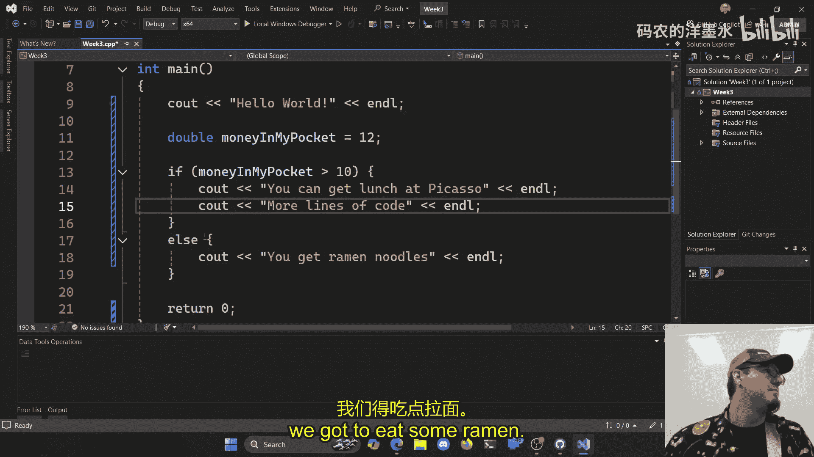

， so now when I run my program， I should get only one of these blocks of code to run and I get hey。

 we can get lunch of Picasso。

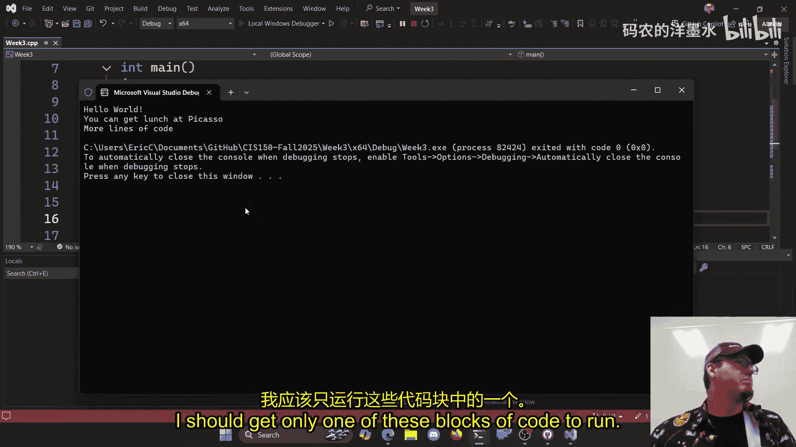

So what happens is they become mutually exclusive， so one and only one of these will run because they're tied together here as an if and an else。

 so either this one runs or this one runs。Which is fun so and then we can make it more interesting。

 we can ask the user right how much money do you have in your pocket， oh goodness。

Much money do you have in your pocket？And line and then instead of declaring it and it's always 12 here。

 right we can say， hey， I want a value and then I want to see in。

 want to get the input and store it in the money in my pocket variable。We do used input last time。

Okay good， so now we'll ask the user and now whoever is sitting down to run my program。

Can get a different result based on whatever they entered。 Our program varies。

 And this is where programs are actually much more interesting because if it does the exact same thing every time。

 it's kind of boring。 right So much money do we have in our pocket。

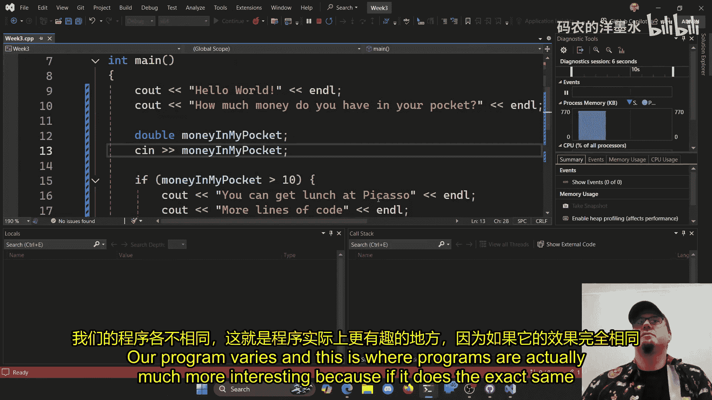

Let's try less than 10， right？All like three bucks， five bucks。We get ramen noodles。

 that's what we expected to have happen right we're testing it here because I know what it's supposed to do。

I want to make sure it does that so I'm going to test all those different cases here and again we'll test more than 10 just for fun here。

 we'll test like 12， we have lunch picasso， but than if we enter10。What are we going to get？

Rmen noodles because 10 is not greater than 10 yeah great you guys are good at math right you're least in Calalculon I know。

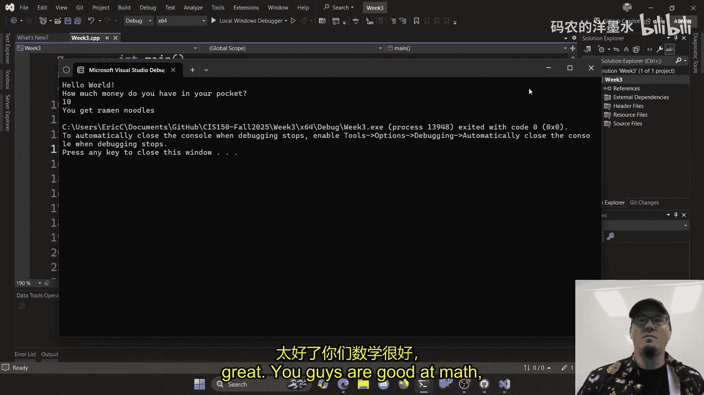

Right，Sure， so we can do greater than you get greater than or equal to you get less than you now equals gets to be a little bit funny here because remember the equal sign is our assignment operator。

 so I can't say it's single equals 10， I can say does it double equal sign 10， that's our check。

 does it equal the value of 10。Because otherwise C+ boss is like oh。

 you want to assign 10 to money in my pocket， why did you do that and that was warning us with this nice little green line here。

 like assignment used where quality probably intended it's like， hey， don。

Don't do that here that's a bad thing here right so sometimes the tool helps us here sometimes it doesn't so again doesn't double equals doesn't make a whole lot of sense for our our example here but that's good now。

What if we wanted to have multiple ranges here right because you can get more expensive than 10 bucks at Picasso right you get like you get pizza at Picasso for less than 10 bucks if you want one of their sandwiches。

 one of the works of art， those which are pretty tasty by the way you're like looking at like 12 bucks right？

By time you get the full size one so if we want to have more than one case here we can do that so all we're going to do is we're going to chain these things together。

 so we're going to say， hey， if my money in my pocket is greater than look like 15 bucks。

Then you can get the whole combbo， right and get a combo。At theicasso。Now。

If I just have an if and I just have an if here， they're not tied together。

 they're not mutually exclusive， so more than one of these can run if it's just if， if， if。

 if because more than one can be true。RightIf I have 20 bucks， this is true and this is true。

 If I want them to be mutually exclusive， I have to chain them together。

 I'm going to use an elsese here。 I'm going to say else if， So if elseif， Elif， Elif， else if。

 else if， else if until we get bored of it， eventually you can have an else if you want to sort of your default case it doesn't match any of these here。

And then one of these will run guaranteed。Because we've got a default if it doesn't match any of our ifs here。

 it'll run。we get our combo， we can get this or we get ramen noodles。

 so we can have more than one case here so we've got like 20 bucks here。

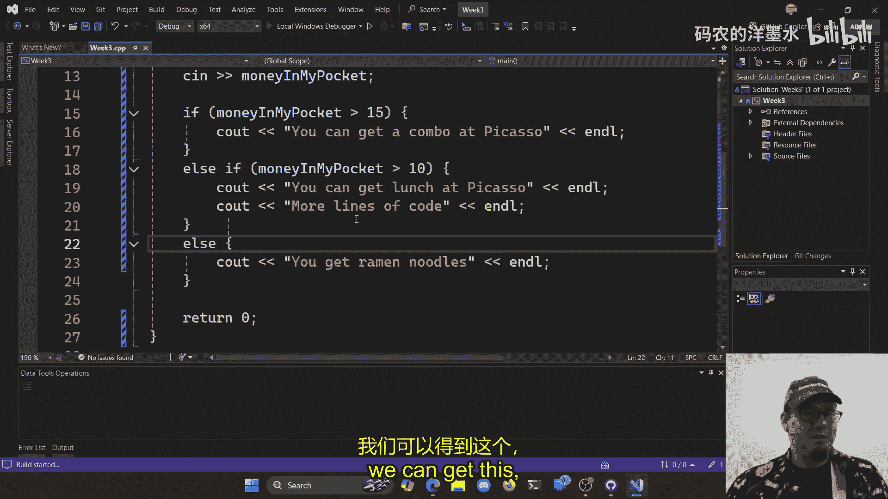

You get the Conlo Picasso。That's what we expected to happen so if I have less than 15 but more than 10。

We get lunch picasso。Right and then still10 or less right we just said five bucks we get ramen noodles so I'm trying it i'm going run it off in here we've got the luxury of hitting this little run button and trying it and it should take you two seconds it's not a very long lead time to test it out here which is great so we can try it make sure it does what it's supposed to do this idea we're going to develop incrementally little bits at a time making sure it does what it's supposed to do you don't want to spend five hours writing code and never hit the run button because you're probably gonna have a lot of errors that you didn't realize right。

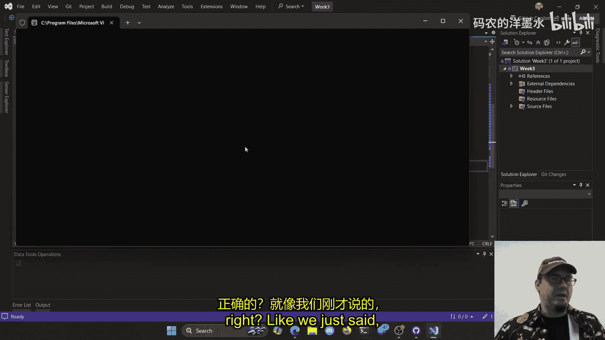

You just shorten your cycles between writing code and testing it， writing code and testing it。

 writing code and testing it， it'll work better for you。Okay。

So we can have as many of these as we want here and then the else now we can also do dumb things right that's perfectly possible C++ doesn't care if we do dumb things I can say else if。

Money in my pocket is greater than 20 here。You know， you're buying lunch or your friend as well，没有。

Is this one ever going to run？Here。Can we ever get to where this is true no C++ lets us do it here because if you have more than 20 you would have had more than 15 and this one would have run。

 it never would have ran any of these blocks of code here so when we put the things in a mutually exclusive chain。

 the order really matters we have to be careful to make sure hey the first thing and then the next thing and then the next thing in the right order。

Right， so this。Never run。First， if。We'll run instead。

Is that a helpful note I can add comments every now and then here， I just forget。Right， okay。

 so just be careful when you put the order in， okay？So that's one way of doing branching here， right？

If Elsif， Elsif， Elsif， Elsif， Elsif， eventually we get down to and up here， very exciting stuff。

Okay。😊，Let's look at another one， so let's do。Yeah。

Let's do it there's another way so you can do something called a switch which is similar to these here。

 I don't like switches， I tend not to use them just because the syntax irritates me but you'll see it in a lot of code。

I don't know why people really like it here， so let's let's spit out a menu here so enter。

A choice here。And we'll go down a line here and then let's going to use like one。

 two and three for a menu right， so one is Coke。And two then is Coke zero。And three。U。

What other beverages should we offer in our menu， Mountain due？

Now most places won't sell Pepsi products and Coke products here。

 but I guess we're special does that regular Mountain De？没有。All right。

 and then what else should we offer here？Let do one more spray， okay？嗯。All right。

Now I need to get their input so I'm going to have an int for their choice here and I can see in choice again these are probably whole numbers right they're probably going to be one two or three here life is good now instead of saying if my choice is equal to one else if choice equals two else if choice equals three we'll it in a switch statement we'll do both so you can compare in a second we'll start with switch I'm going say switch on choice。

So switch on choice here and I get a set of breath curly braces。

 so everything inside of here now is going to be。What does it match to say what does it match a say case one and a colon so if the choice is a one in this case。

 if it's a one here， what do I want to have habit see out。You got a Coke。With your lunch， okay。

 and an end line sure。Then I can say， okay， how about case two， C how？😊，You got a。

Cote zero with your lunch I don't know， this is not very exciting here we're not giving up pricing or anything like that case three the out got a Mountain dew。

What does that one do the do， let' I say do the do？All， and then in case four， see out。

It's right for you。Now， if you want to have a default case at the end。

 like this kind of like bend else here， we can actually just use the word default here。

 so we don't say case default or just default here and see out。Inval choice， no pop for you。

RightIt's called P here in Michigan， I don't know why bunch of weirds call it soda or around the rest of the world。

 but we call pop in Michigan。Right， so cool， so I have my cases here， so let's give it a try。

 see if it works for us。

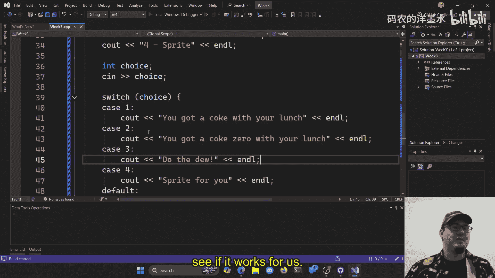

All right， money in our pocket， 10 bucks， all right， so what do you want to drink？Co。Oh。

We got everything， switches are stupid， this is why I hate switches。

The first time it matches a case it says， okay， sure。

 I'm going to keep running until I find a special keyword called break。

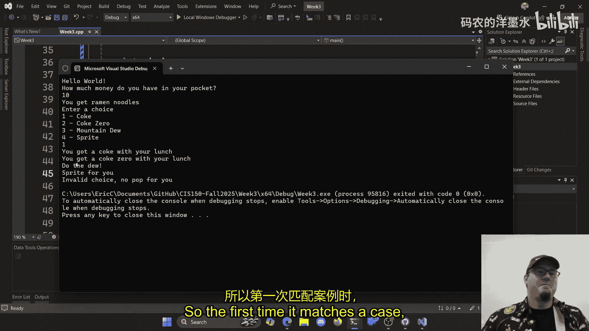

Breake says， please stop the switch。Okay， so the reason why I hate switches is because you have to include a break after every single case and I'm kind of lazy no one have to break。

 break， break， break， break， break， break， break， break。Here。

 now you shouldn't need a break after default here， No break needed。

It's already done right there's nothing to break out of because the next line is the end of the switch right you don't have to tell it。

 please stop because it's at the end and I don't know if you notice if you hover over this it's telling me hey switch choice this is the ending curly race for switch choice here it would also highlight it here but it's kind of too far up here to don't too far low to see that right and we'll say hey this is int main that's the end of main here so it's going to tell us about where our curly races line up which is nice this is our else one。

Else， here's the LCF money in my pocket one so you get some visual cues here in visual Studio as well so if we had a breaks it should work let's give that a try so we wanted to buy a Coke。

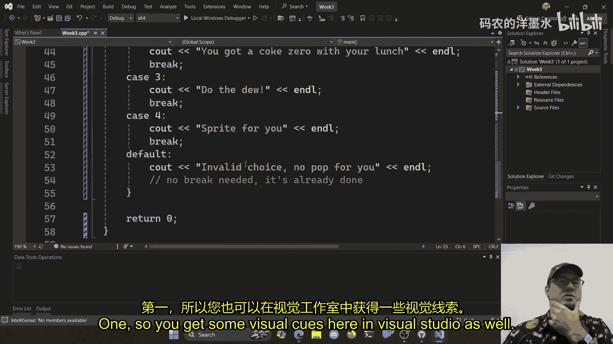

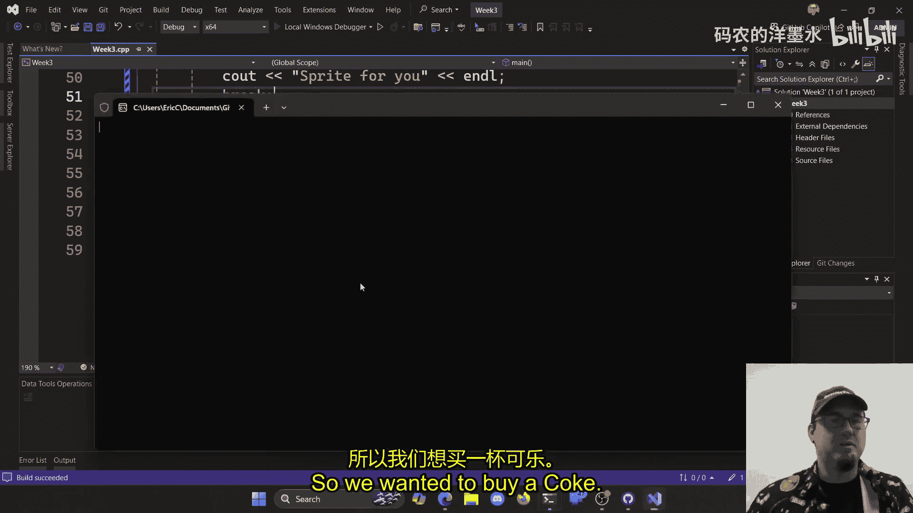

$10 in a pocket， we got a Coke， we had a Coke with our watch， great， it's try again。

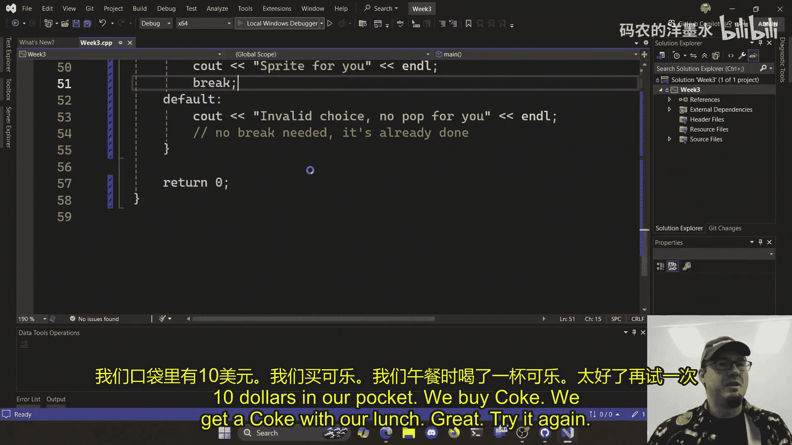

Again， I'm going to test each one of them， make sure it works here， it's a little bit silly。

 but I wrote the code， I want to make sure it does what it's supposed to do， so code zero good。

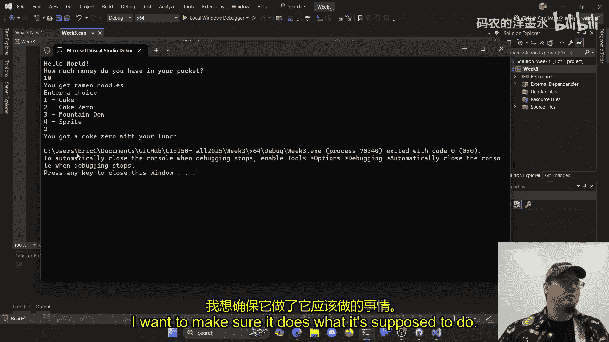

OhI got to close that one， run it again。Mountain Dew。Do the do and then sprite。

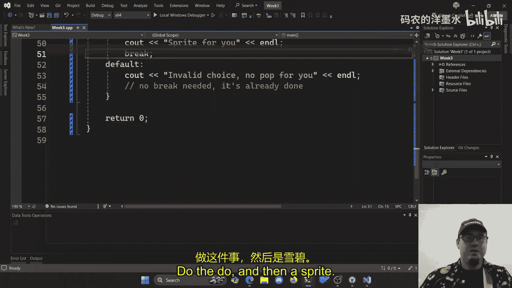

$4 sure and sprite in the last one， something that's not a one， two， three or four here。

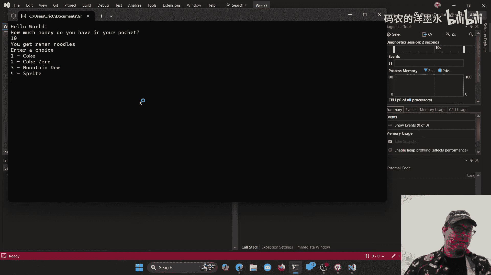

Like， I don't know，10 invalid choice no pop for you。 Okay。

 now this doesn't stop it from crashing right， if we give it something that's not a number here。

 if I give it like 10。

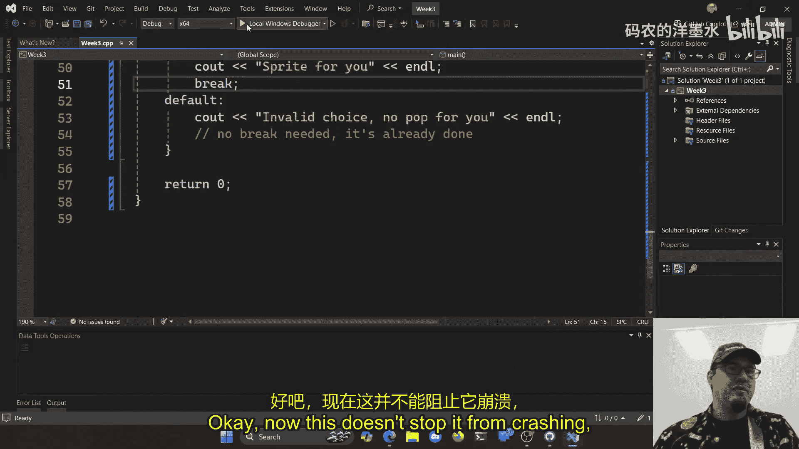

哦诶别。That's surprising。 I really thought it would have crashed。

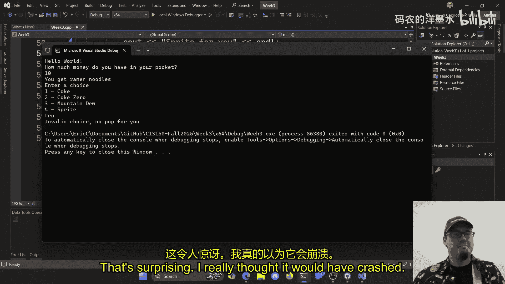

哼。Guess tends， that shouldn't have worked， that's okay。嗯。Wellll pretendtime like that didn't happen。

 usually that crashes。

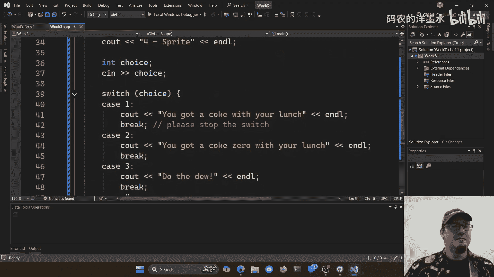

Does I give it， if I give it a double instead of， is it just ignoring， oh。

 I guess you probably just ignore it I give it zero， 10。5 yeah。Still doesn't crash。

 and that's interesting。

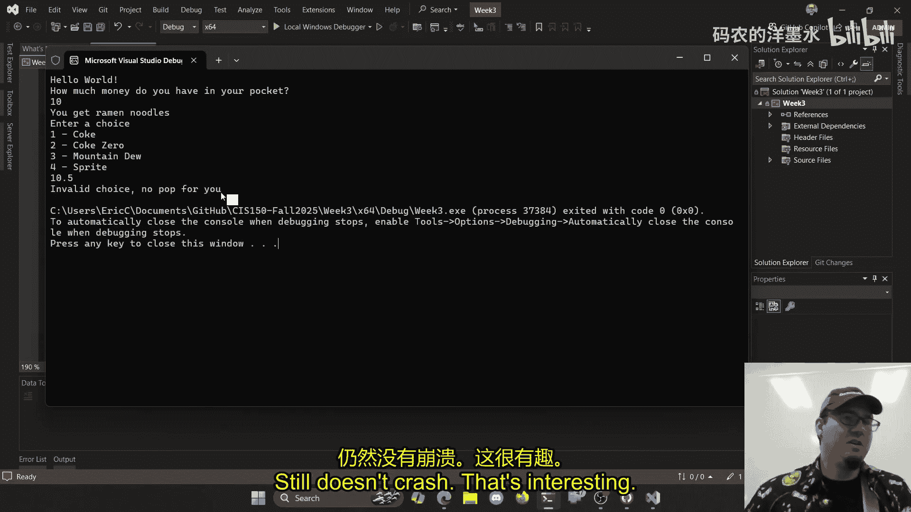

That's all right， So if we wanted to do this with the if else if instead， right。

 we could say if my choice equals one。See out， pokeke。And then Lifft。

Choice equals two these double equal signs， see out look zero。More cur races。

 Elif choices equal to three。See out do to do。I used to drink a lot of Mountain dew when I was younger doesn't taste the same anymore。

 I don't know if they changed the recipe or I just got sick of it and then sprite。

Enline and then our last L here， right is Ipapa。点该我れた。Right， so sure， so here's the F LF， LF LF。

Here's the switch。对。Not the end of the world here， but again， I don't like adding all the breaks。

 so I will probably never use a switch again。OkayI just want to show you one more thing about switches。

 though there's one sort of neat thing it can do here and that relies on this where it runs some code here。

All right， so we're going to make another switch here so we'll ask the user what you want to ask them how about did they even want to biPOop before you do any of this nonsense right。

 so let's ask them so we'll say see how do you want to pop。对。And line。

 and then we need a string for their input here right that's our I't know input sure we can see into the input。

Now I'm going to do a switch。On the input。And what I want to do here is this is probably like a yes or no。

 right， we should tell them hey， enter a Y or an N here。Right。No。Switch on an input。

We can't switch on strings。So we can switch on chas here， a single character。

 which is just a single letter， I we looked at that last week， chas are single letter， sure。

 we can switch off of that。The problem is strings aren't number values and it has to match on they're essentially the numeric value remember characters really just store the numeric value because it's one letter as far as the unicode value。

So I can say hey， case of we want a y sorry a single apostrophees for that and now what if they entered a uppercase y because they want to yell at me and type in all caps Sure so now we say hey case capital Y here so I can have two cases in a row and remember as soon as it matches the case it starts running code until it finds a break。

So it works to our advantage here that， oh， it matches on a lowercase while it'll also run。

And we'll ignore the next case here， we can say all of this should happen then inside of that case here right so here's our。

Choices here， I'm just going to cut and paste that in here。And then add a break。

 so that's a big long case here right for why or no why。喂。And really。

 I don't care if they entered anything other than a why。I don't really need a default case。

 I don't need anything else， I'm just saying， if it was a lowercase y or an uppercase y。

 go ahead and run。RightAnd that's the end of our switch for the input here。

Because it'll get to the end here and just be done。

So all of this happens if you enter a lowercase Y or an lowercase Y。Right。

 now the way we could do that instead， we could would say if。

My input is equal to a lowercase Y and now we need to add in logical operators so we had relational operators。

 is this bigger than this or smaller than this， is it equal to this we didn't even show not equal we'll look at not equal to here but if you want to say is it equal to this or equal to this we can combine those two things together so we can say or and it's plus plus lamb someone decided that it's pipe pipe which is the shift backslash key above the enter key I don't know why but that's or two pipes here it probably relates to math but I don't know is that a math symbol anyone into math。

That those， I guess。Okay， so then input equals uppercase y。

 so this is saying does it equal this one or this one， y or why？

Cl do it this way with an if here versus case case。Again， doing the exact same thing here。

 but we have this if here， okay。All of that's still a pain here。

But it's okay it's not the end of the world we can we can check here now the other cool thing we can check if these if this was a string here。

 right？Now it's yelling at us saying no operator matches these operaans。This is a big， long。

 ugly error， but we really only care about that second line。

 operaan types are standard string equals char。So it's saying you can't compare a string to a cha。

Okay， that's fine， so let's go back and make this a string here of too many it's too helpful wants to add a closing quote here quote。

Closing quote right so now we can compare does the string match so you can't switch off a strings。

 but you can if off a strings right does the string match another string you'd think it'd work with a switch。

 but for some reason they haven't figured that out yet， I'm sure at some point it won't work。Okay。

For now we're stuck Okay so the benefit with these ones here then right can use strings in。

If statements， I'm going to put it back to a cha， is that okay， if we put it back to a char。

 so we'll just go back to char。Okay， so let me say that was a string input。

If input equals like lowercase y or input equals uppercase y。Okay if that gets too messy。

 let me know I can only reorganize it here， but if we had strings we can do strings but we can't use a switch right so switches don't work with strings must be char only。

That looks ugly uppercase char okay chas or integers are some numeric types here Yeah so when we set a string that's a bunch of characters。

 one or more characters so the way C+ stores it is different than stor a single char here so I could enter the word yes or I can enter yes please I want lots of pop or yes give me a Coke whatever they entered here we' in a stores input。

We're going to check。 Did they give me a lie at this point here。

So we can make our program do different things based on what was entered gets to be very exciting we finally get to make decisions here and say you go on this branch or you got on this branch so different things can happen based on what the user entereds。

Gets to be whole lot more exciting and that someone might actually want to run our program because they can give it a bunch of values we can calculate something for them right I think we we did the。

The monthly cost estimator rate。Last time， but we didn't say if anything was true or not， right。

 Maybe we should tell them a， you know。Oh you already spent all your money on rent。

 you don't going to buy food this month right that's a really helpful application right just tell people like just don't spend money on food right？

Anyway wait， you' stay within your budget。okay， that was a little sad sorry but we could do something like that right or hey。

 don't buy that car right don't have a $300 month car payment right just walk everywhere right Detroit's totally made for walking。

No， okay， yeah， we're don't have a lot of good options， unfortunately。

But in other programs it could be more interesting Okay so what if we do something like a little grade calculator we do something like that so we'll make it kind of basic we'll to make it points based here so let's come up with like three assignments i'm asking for their scores on the assignments here we should do four because the way we can do like 25 points each year so we'll have an int for assignment one score and int oops。

Now， some people， I don't like it here， but you can have it on the same line here。

 assignment two score if it's the same type here， so I can say， hey， I've got two different integers。

I don't like this format here sure it saves a line of code and technically is us typing if think I'd like it。

 I just think it's ugly that's all but that's perfectly fine to do it that way or you can split spread them all out here and assignment three score。

F store。Right， either way， okay， I think Zybooks uses this occasionally here。

 so you might see it it's not the end of the world， oh Zybooks。

 I am like a squirrel sometimes I'm sorry。

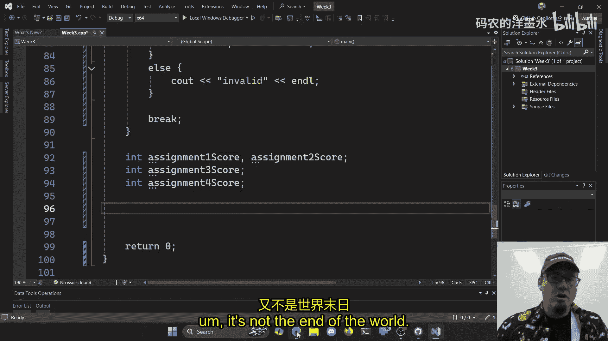

A couple of people asked about the labs， yes， so the Zi labs again are part of your reading they're tedious。

 my apologies here， but it's good habit， good practice to get into let's get very specific to the exact number of spaces that at once in the output here。

 every decimal place， things like that。It's good practice here and it will tell you if you did it right or wrong right away。

 right， you plug it in， you hit run or submit and it says， yes， you worked， you worked， you worked。

 you didn't work on this one。OkayIt'll get more interesting as we go so they are part of the reading so so far。

 45% of people have finished the Zi labs， 62% people have finished the challenge。

 62% be able to finish participation next Monday right I think I said the due date for next Monday。

September 15th。I'll look at Zybooks and then will give me a report by person。

 how many what percentage should you get here， what percentage did you get here。

 and I'll go plug that into your score here， notice the worth 100 points each of the points don't matter with their only matter within the category。

it just 100 points makes it easier so I can take your percentage and just turn that into a number。

 95% is 95 points， just makes my life easier， okay。

That makes sense so all three chapters one two and three are due by next Monday right we kind of had a slow start for chapter one and two no big。

 I wanted to give you a little extra time on that here has anyone worked on the x labs yet do they take a lot of time？

A little okay a little bit of time at least so don't wait until Monday these are due at 1159 pm don't wait until Monday at 11 p。

m you be like， oh crap I have to do my zebos。That won't work well for you right Okay。

 again this is your incentive to read the book right you get free points for reading the book you can't get these wrong because you just keep trying。

Right that。You can， I guess get it wrong and leave it wrong， but if you get it wrong。

 it tells you you you get to try again。So I would like everyone to get 100% on these。

That's what I would like， you know， it's okay if it doesn't happen， it's up to you。

 you can prioritize your time and say it's not worth of 10%。It's up to you， it's okay。

 not the end of the world here， but。Point the time in and you'll get the points is sort of the idea with this one。

 right？If you have questions about them， let me know。

They you're usually pretty straightforward right， it'll get a little bit more complicated to we get into this stuff like hey。

 a branching lab here， let's go look at some of them here for leap year Sure。

 let's go look at leap year。A year in the modern Gorian calendar consists of three and say。

 oh my goodness， I bored already， February 29th， so if the year is divisible by four here。

And divisible by 400 here。Our leap years so figure out if it's a leap year or not so we're going to input the leap year this sets a boolean value oh we didn't look at boolean did we you can have a boolean of true or false we can have a boolean expression that resulted in the true or false you can also just have a variable and set it to true or set it to false which is a lot of fun here so write some code right Hey is it evenly divisible by something。

We looked at an operator called modulus that would give you the integer remainder of something。

If it's evenly divisible， is there a remainder？No， there's no remainder。

 so the remainder should equal0。do your modulus， check the remainder if the remainder zero right so we would have to store that right so。

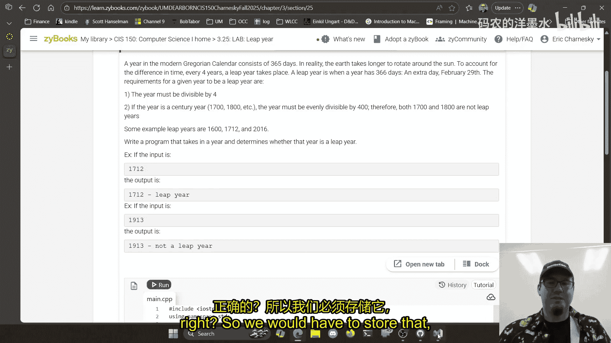

An int4 remainder is 100 modulus4。Okay， oh my goodness， I can't spell remainder here， right。

 and then I can say if my remainder。Is equal to zero。No， I still can't spell， remainder， my goodness。

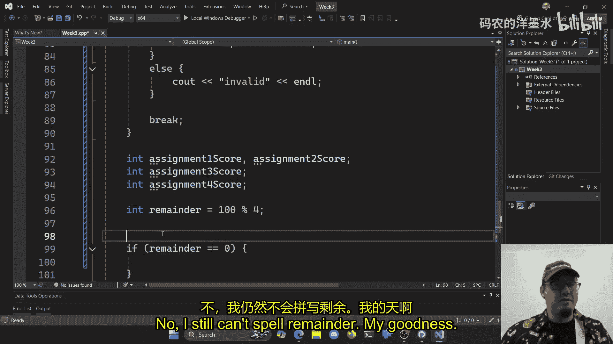

Right， that sort of thing， but remember there's another case as well， right not only to by4。

 but also。It is July 400， if it's a century year， oh my goodness， right， well。

 how do we know if it's a century year？Yeah， check if I've had on all the hundreds。

 see if there's a remainder。So you can put if's inside of ifs if you want。

 we put an if inside of an if and we。😊。

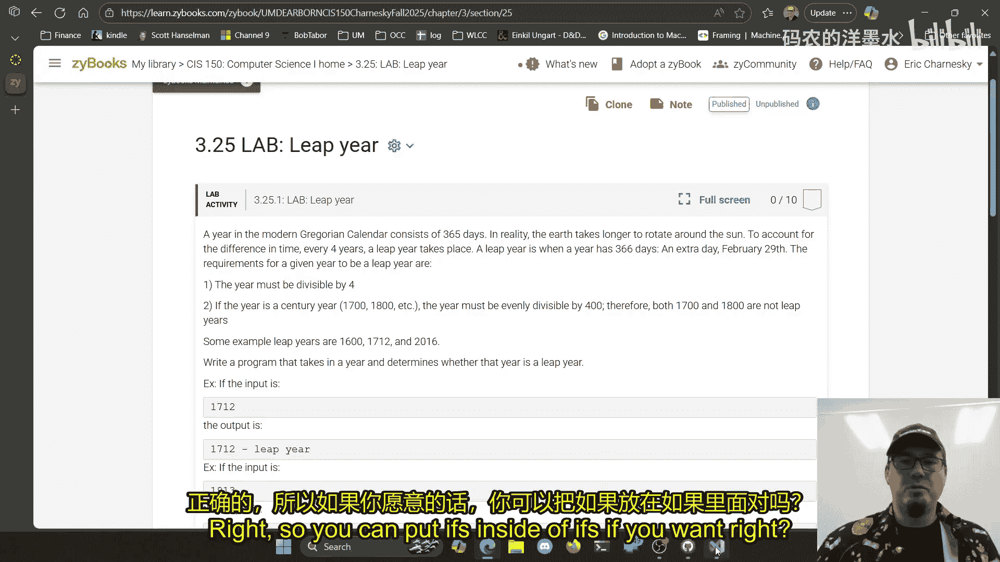

We didn't yet。 I thought I did。So hey， if the remainder zero， right？Remeinder is equal to zero。

 Oh my goodness， I should use the type ahead。Remainder equal to zero。Oh goodness， okay。

 then if my I don't know， we wanted to check the year divided by 100 or something。

 I don't know whatever we wanted to check here， right。

 that input never happened to be right modules 100 Oh， don't do that right equals zero。

Right to have a check inside of a check， that's okay。

 you can have these as nested as far as you want you can put an if inside of an if inside of an if inside of an if all the way off to the right side of the page here。

You've probably gone too far at that point here you want to be able to read it not have to scroll left and right is ideal。

 but it's okay you can have an if inside of an if inside of an if usually three or four levels is okay up the end of the world there's other ways we can do it and we'll get to those as we get into the more code but that sort of thing does that make sense right with that one so that's what we're going to do with like the Z La so you have to go write the code here it goes and does it and you say I want to go run it here and if we did the result right so we try this one So we actually do it in the Z lab here。

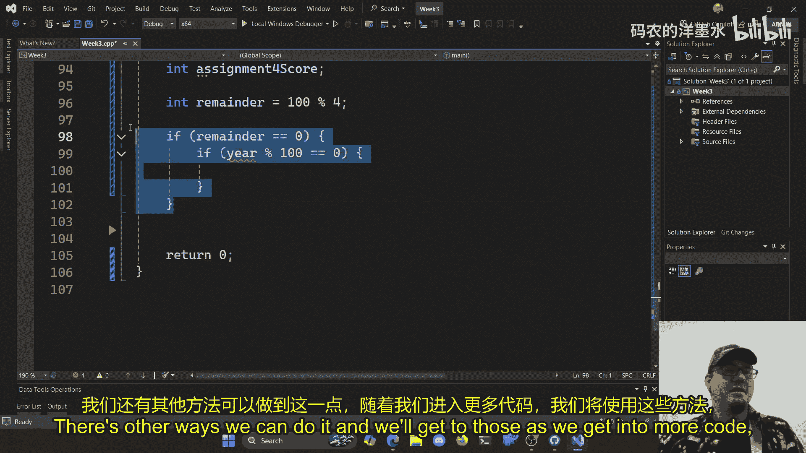

Okay， sure。 so we got an input here， So we'll type our code here。So let's check okayy。

 if input year modulu is four。Equals 0。Brena set is leap year。Equal to true。Let's be a leap here。

Then we output leap year， not a leap year。I guess we knew we need to change that， we could just say。

 hey， if it is， then right we see out。The input year。With a dash， right space and a dash。

 right that's very particular about the spaces here， right？Leap here。Okay。Probably an end line。

 if it's not， then right， see out。Input year。Dash not aivier。Right let's give it a run。

 so we're ignoring the centuries right now， that's okay， we'll come back to it。

 let's see if the basic part works for us here。And it shows us our little output here。

Unused variable， we never used it。Okay。That submit for grading， it's just a warning， right。

 we should be okay with that。So score8 out of 10 okay， so if this one worked， not a leap year。

 this one worked leap year so it expected this， it got this 1900 should not have been a leap year it was a century so we didn't finish all of our cases right so if it's divided by four then right？

If it's also then。A century year。Divided by 400。So we need another case before we decide whether or not it's a leap year or not right so then if my input year。

Modulus 100 equals zero， there must be a century year。Right。That's the century year。Okay。

 if that is true， then it also has to be divisible by 400 that so if it's a century year and。

We could use a logical operator， we could say， and we didn't get to Ansy， we did os。

 ands is ampersand ampersand。On why that's your hand end here then input year input year。

Divided by 400 is zero right the remainder of that right if it's century year and it's visible by 400。

 evenly divible by 400。Right， then it's a leap year。Okay， so。Which one here？ So we want。

 if it is divis by4。And that one。It's a little bit messy here， that's okay。

 so if I just put it here though。It's not going to work for me because a lot of the years are not evenly divisible by 400。

Right。So if I just put it here and let's do stop and running again here。Thiss been for。

 we should pass the one test case， but not the other ones。Right， we only got five out of 10 points。

 so we got our。Oh， we got no outputs sure， okay， where's the we didn't even get 900 not a leap year。

 we didn't even get that far。So if it is， that's a leap here， if it's not。Then not a leap here。

Not a leap here。It it's divided by4， but not even is by 100 and 400。So getting a bit of a mess。

 that's okay， let's see if it works for us。Again this's not going to pass all of them we got some problems and that's okay right we want to kind of work at it a little bit by little bit so this one worked not a leap year this one did not correct the output here give us not a leap year right because it was divisible by4 but it was not divisible by 100 and 400 so it write to the not a leap year。

That's kind of a bummer， right so we sort of need a different check here。Right。

 so maybe the first thing we check。Here I think you can do these lots of different ways here。

 the nesting actually gets to be a little bit ugly here。

 so I'm going to move all of that up to here and say if it's zero by four and 100 and 400。

So that is my if if it's divis by four and it's a century year and it's every 400 century year。

Then it's a leap year。Then I can say， okay， else if， if it's not that， is it just divisible by four？

We'll have another leap here。RightOtherwise， if it's not that one。

 then let's see we want the end of you got too many curly races in here else。

So if it's divisible by four and a century year and a 400， this one， it's a leap here。

 if it's not that。Then， okay， is it just a visible by four， it's a leap year。I it's not leap year。

Is this going work any better you think？Let's see， we're still going to have some errors。

Smith graing。8 out of 10 again。Still thinks 1900 is a leap year， it should have been not a leap year。

It didn't match this one， but now this one needs to say that the。Remainder does not equal 0。

Because if any of these are not true， the whole thing's not true， we go to the next one here。

So not if it is divisible by four， but these don't match， well it's still divisible by four。Right。

 so we need to check then we can say if my input year。

Module 100 does not equal since the exclamation mark equal s does not equal zero here。

 then it's a leap year， which we already checked the first one up above here。Let's give that a try。

 so now hopefully that will avoid the ones that are century years that are not divisible by 400。Oh。

 compilation failed。 Oh， I forgot my handss here and。This tool' is not as nice as Vi Studio。

 I do prefer visual Studio。Let's see， and now we get 10 out of 1。

It's gonna to take a couple iterations that's okay You probably won't get to write the first time nothing wrong with that right we can try it and try it and try it and try it and try it eventually you'll get your points here we'll get tell in life is good does that make sense and they had this leap year right so it'd be probably a little bit nicer I've got the same code here twice anytime you have the same code twice as she feel bad about ourselves that's a good rule of them so we can change that here right because we can get rid of that warning so at the end of this we can say if is leap year。

Now this one's fun because that's already a booleying， there needs to be no expression。

 I don't know if it does equal， equal true。That's redundant here is just if here and it's either true or false。

 so if it's true， when we put that。Otherwise else。Will input not a leap year and now I don't actually need a default case here because I'm only going to say is leap year equal true。

Here or leap here equal true is leap here。Nple true。So if it's this or it's this。Will be true。

You can stop a run。Oh， lowercase T true sorry， lowercase T true， I wish of be a visual studio。

Ansome it。Should work the exact same way here， till 10 out of 10， right。

 but now we're using this only here in our F here and I don't have to have multiple see outs。

There's always different ways of doing stuff with your code right both worked both are perfectly fine here in general'm going to avoid having the same code twice and don't we don't have all the ways all the tools yet but we'll get there。

Does to make a little bit of sense？Okay， no。This is getting a little bit silly here because I'm saying if this thing is true。

 set it to true， so we could save some time here， it's maybe a little bit less readable here。

 but we can also now just say is leaf here。Equals this。Yeah。Equals zero， right。

 because that will then set it。Two， true or false。This result here this is a boolean expression will either be true or false we've said it now。

 but now I don't really have my elsesif if here this gets a little bit ugly so I can say all of this here。

Right？4。All of this one。That's a little bit long here， so I'll bump put down the line here。

And my semicolon。Now this is probably a little harder to read。

 so I would argue the first version was probably better， at least for you folks here。

 if you do it for long enough， you can sort of puzzle this out here， but it's still a bit ugly。

 but we're sayingI leap year is going to be the result of this logical expression。

 which is this bulloleying expression or this bulloleing expression。All， let's give it a try。

 right I change this around let' see if it actually works here。Hey， we still get1 out of time。

Life is good so far， so again， three different ways of doing it here。

So when you put stuff into chat tools， you usually get this sort of garbage here。

 which is really hard to read and most of the time when I look at people's code。

 I can tell if a freshman wrote it or if an AI tool wrote it because you guys don't code the same way as AI tools is that。

that's understood， right， it'll give you things we haven't done before and we give you things that most freshmen don't understand。

Okay， we don't want to use code that we don't understand okay。

 if you look at this and your eyes crossed， you don't understand it。

 don't use it just because I wrote it doesn't mean you should。

RightThere nothing wrong with the if way we had it before。That was okay。

 we're just looking at there's different ways of approaching it here。

 we can combine our ifs and our O's and our ans and all sorts of silly nonsense here to get results。

lots of different ways are going about it。But again， you'll do all the labs here。

 it's good practice these are different than the labs you'll do with Dr。 Said。😊。

Okay these are just your textbook labs， if you've done the reading you should be able to do these。

That that's sort of the goal here right so I'm going to give you examples。

 the textbook is going to give you examples， you're going to do practice for the the Z labs you're to do practice for the actual course labs and then you'll do projects。

So having done it and done it and done it and done it should make you good at it so that's sort of how that works right and your focused good at anything outside of school do you have any hobbies。

Any't know like play an instrument or play sports or？How'd you get good at it？Practice。

 and you're going to do it。forgot to ask you early you all CSs majors occasionally get some math majors in 150。

 which is so sad for math majors， they have to take C++ way better languages to take for math majors。

Okay， no math majors， Okay， you guys are good then so as a CS major， do you want to be good at code？

Yeah okay good that's that's a good answer right you want to be good at the thing you you're learning how to do here so we can do it the vibe coding。

Is useful in some cases here again there's some lots of good discussion around the tool here people are using it and there was just one recent study I'm sure they were selling something here because everybody wants to sell their opinion online and sell you their stuff here theyre like 95% of AI related projects don't make it to production here's what the 5% do different and you're like well thanks for selling me your newsletter or whatever nonsense here but。

You can get decent far with our AI related tools or vibe coding here。

 I really thought was a joke term， but now people are using it seriously and it still hurts me all the time。

It's okay， I have to show you the funny videos at some point here。

 but if I post another YouTube video and I post this to YouTube it gets。Bad stuff happens。

 so I'll just share the links in Discord and you can take a look at them there。

But it can't doesn't yet get all the way there。 So you need someone who knows what they're doing to get it across the finish line and to modify it。

 So it's going to make developers faster， which is really cool。 right。

 We've used software in literally every industry in the world。😊。

To make things more efficient and faster and better。Right。😊。

It's really cool software can do lots of really cool things here。

 but we need people who understand what they're doing so if you only ever vibecode your way through school because you can get through most projects。

 I'll be honest right most of your undergrad， you can probably get through here they're working on making them better。

 better or better， you can probably get through。ButAnd you get a job and you don't know what you're doing。

 the only thing you could ever do is ask the chat tools here， why would someone pay you money？

Because they could just ask the chat tools to that sort of thing right like you need to have some skills and expertise here and again for things where it actually matters here you could actually go and do some real damage like putting bad code into production and crashing things or。

Doing wrong arithmetic and taking money out of peoples bank accounts or you know I forbid my insulin pump malfunctions and kills me right that stuff can happen with software okay。

Com。Oh， there's a really good Star Act 25， I think that's what it is here。Yeah。

 there's a whole Wikipedia page here。Oh multiple issues， we should improve it here。

 someone else will improve it， I'm sure right？If you yet to be a Wikipedia contributor really should be。

 the library actually has a really cool event for。😊，即。Something related to women。

 women in technology， women engineering， I forget what I think it' women in engineering。

 they sponsor it where they'll go out and try and fix up articles about women in engineering and make them a higher quality thing which is really cool because。

They tend to be overlooked right we look back at the history of things and it's just been overlooked so but。

The Act 25， it's a pretty standard case study I'll probably want to do it at some point here in health informatics。

 software engineering and computer ethics here highlights the dangers of engineering overconfidence and the engineers dismissed end user reports leading to severe consequences it's the radiation machine。

 early cancer treatment here。An earlier version of the machine had a hardware stop and this latest version was like。

 oh we can put a software check in instead of a hardware check so you don't have to manually pull this lever whatever nonsense it was here I forget here。

So。This electronic theme here， whatever it is， that would go in ring sense of radiation here and they had switches。

Yeah， this is what it is here， so sure they replaced my software checks instead of the actual box in place to make sure it was correct。

And when they were using it， it popped up some sort of error message that people just ignored。

There's a whole story here you can go read about it here and I ended up killing people with radiation because they did their software badly。

So since we've gotten a little bit better these sorts of things and realized we should probably put a little bit more time。

 energy and effort into checking our software， but yeah that's so what is it you can keep pushing the P perceived key here。

Air message H tilt。So they do it again and again and again and again。Oh。Yeah， that stuff happens。

 so software is important。All right， so for branching， let's see。Characters， order of operations。

 this one's kind of fun here， so we did branches， the order of operation， order of evaluation here。

Prirenheses。

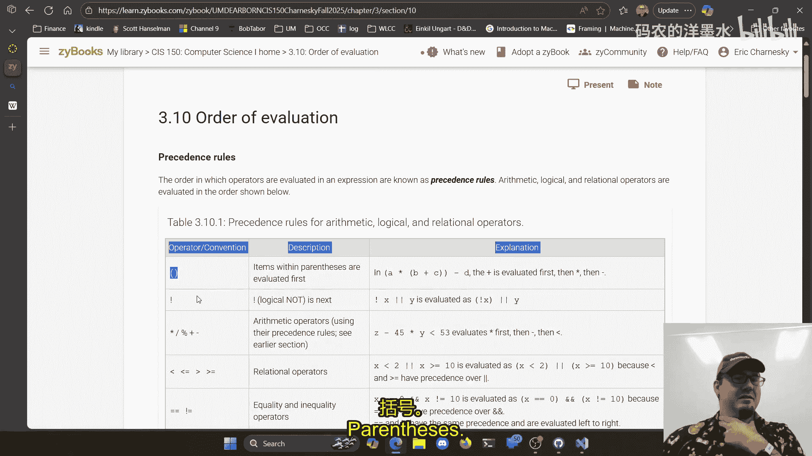

Oh， we didn't look at the knot here we go， so not as fun here， if I have bulloleying for。

 I don't know， I am hungry。And we'll say true here。It's like， if I'm hungry。Go eat。Andline。Else。

 I don't really need to do anything otherwise right just don't eat right you don't have to have it else there。

Right you can， but you don't have to here so the other things you can do here we can have a bullying for not hungry here and we'll say that's false because I'm。

Not not hungry it's a little bit weird here and that's okay。

 sorry so it means I am hungry here and then we can say， hey， if not hungry。Equals false。

 we can do it this way here。Go eat。Go eat， right？Now again I think I mentioned you don't need to say equals true here right because that's redundant if it's already true。

 I don't need to say just true equal true， I can just say if it's true right go do that here。

 but I should I should leave that as a note here right so if。I am hungry， equal's true。We done it。

 done that， done that。Aun and。Remember。That's okay， so instead of saying if it equals false。

 you can use the not operator， we can put a not in front of this。

 so not true is false and not false is true here and we can avoid all that here。

it's the same as not hungry。Equals flux。Right we're just saying not so that's the unary operator it operates on one upper end and it just reverses it so depending on how you want to do your logic you're welcome to use the knots here。

We also could look at if it does not， let's see so Im hungry。

 we could do another silly one if I am hungry。Does not equal false here so exclamation mark equal sign is a not equal sign here so if you're not false it must be true right again you can have these in a bunch of different ways here perfectly fine so not equals so let's let's let's really handy you like for number guessing game he guess a number 1000 if it does not equal 42 you lose。

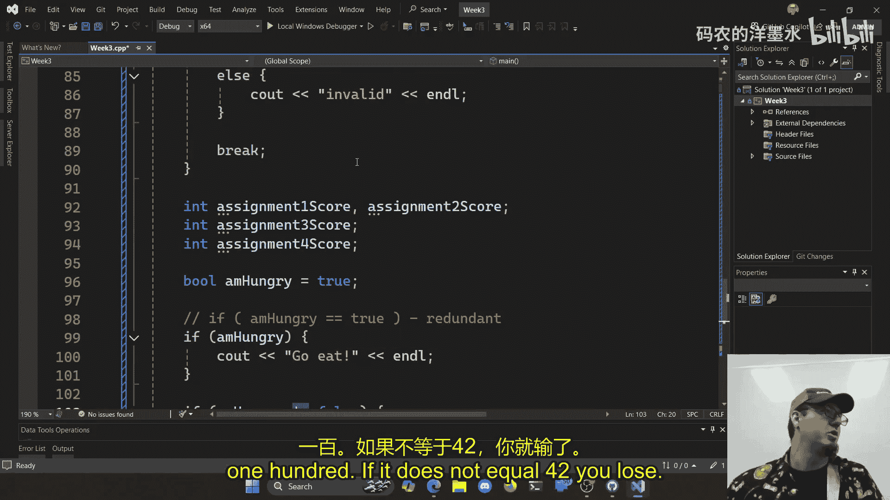

That sort of thing we can use not equals。So parentheses， the unary， logical knot。

And then our arithmetic operators， and I think this makes a lot of sense so if we're combining these things here and we say。

 hey， if you know， 10 plus four is greater than 15。

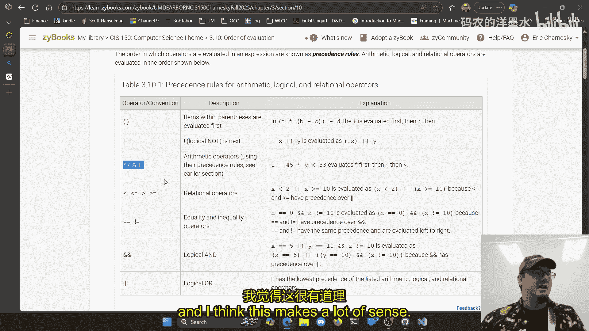

Right。The arithmetic is going to happen first， it's not going to say four greater than 15。

10 plus false。That just doesn't work here right so if you just think about it for a second， yeah。

 of course the arithmetic happens first that way we can actually compare the results here right。

So arithmetic。Pbits first。Great， then relational operators， okay？

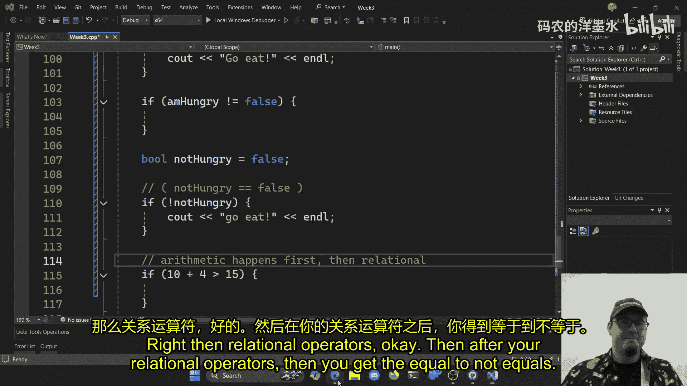

Then after you relational operators， then you get the equal to not equals。

Not too much of a problem here then your ans then your ors so the biggest problem we're going to run into is ans and ors here because ans will happen first so if we wanted to say hey if it's this and this and this or this here let's see I think we already lost the Z lab that's okay we just need to essentially put some parentheses around it so we can say if。

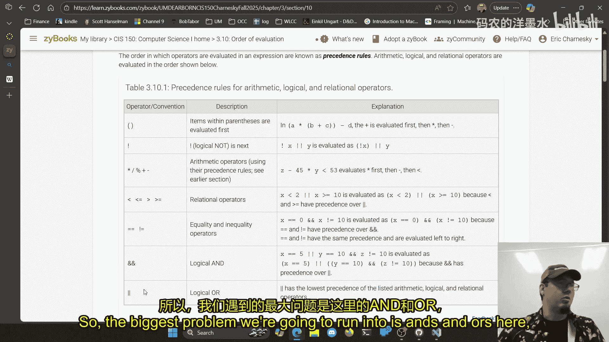

Put on this line。No， this。This line， there we go。10 plus4 is greater than 15。And I don't know。

 five is less than 20。Or 20 is greater than 7。The ans are going to happen first。

 so 10 plus four is greater than 15 is false5 is less than 20 is true but。

False and true when you add them together， the whole thing's going to be false。

 then I have a false or true here。So just working through it gets to be a little bit awkward。

 so my recommendation is just always use parentheses if you're mixing in ands and os。

It' just make your life a whole lot easier here right it'll work but parentheses never hurt because we're going and make it explicit。

 yes， I want to have this one happen first here。And sorry I forgot to show you the whole table here so this is。

Oh yes， no really matter here。So。Probably assumed this here， my apologies， so true and true。

 the whole thing is。True， right。True and false， the whole thing is。False， false and true。

 the whole thing is false。False and false。The whole thing is false。

 so the only way ands are true is if both sides are true。

Right now if you ever forget about this just remember McDonald's right when you go to McDonald's and order a burger they say do you want a burger and fries you say no because McDonald'ses are nasty they' just gross awful land fries。

 they're the worst fries out there so yes you want the burger but no you don't want the fries you say no you don't want burger and fries because then they'll give you nasty fries and the only thing you do with them with thrown away okay they're gross if they said do you want a burger or fries you look at them and you say yes and then they look at you like did you want the burger did you want the fries be like no you ask me a bullolean question do I want this or this yes。

And then they tell you， sir this is a Wendy's leave， right。Right true and true。

 both sides have to be true okay or as though are the opposite so true or true is either one of them has to be true。

 so true or true。All thing's true。True or false， the whole thing is。True。

 because if one side is true， then the whole thing is true。F or true， the whole thing is true。

 and the only way you can get a or to be false is if both sides are false here， so false or false。

 the whole thing is false。Okay so sorry I didn't go over that one first I should have done that first with the Cie McDonald's story here oh Wendy's fries are pretty good' they're not too bad burger King fries are not great here of the curly fries you want to get curly fries on RVs if you want real fries that's where you got to go or was it checkers I think there's a checkers it's really good too they got some good fries。

Okay five guys burgers and fries and they're okay not great we should have a ranking of fries right and see whose fries are best here because it really makes the meal or you can't just have just a burger you need the fries with it otherwise it's kind of disappointing。

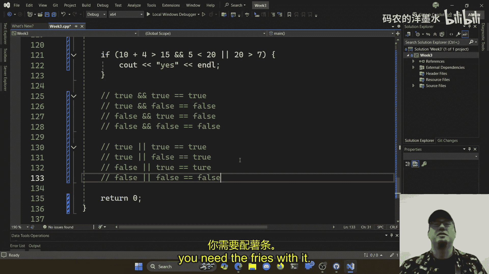

可。不right。So got a branching here order of operations logical Earth happened last you can do this fun that'll here's the evaluation of it here sure that's that's all good stuff here see what else was in here switches we did switches the ballooning data type strings。

We didn't get to string X so we can save some of this till Wednesday that's good here so we'll do some of these other things here the conditional expression is basically the easiest way for me to know you didn't write your own code because no freshmen use these because they're awful I dislike them most of the time use them occasionally here but that's fine okay cool so we'll save a couple things for later that's good let's talk about the project so first I need to go to my Github classroom tool now this has been a little flaky for me which is a little bit unfortunate but that's okay it's not the end of the world we'll make it work。

So CIS 150， fall 2025 so what GiHub Classrooms lets me do is give you a link that generates a private repository that you have access to and I have access to。

 which is good you don't want to use a public repository because if your classmate copies off of view I think you cheat it。

Or I think they cheated， but really I think you all cheated that at some point that's a bad place to be right no one wants that。

So private repositories I mean no one else on the internet has access except for you and me which is good you don't have to do any extra steps here so I'm going to make an assignment here they'll give us that link this is C 15150 fall 2025 project zero here I don't use any of the due dates in the classroom tool I just use it for the repository so don't worry too much about it here。

C plus plus template。There we go， private private repository that shouldn't have changed that's weird kind branch T。

Okay， create I'll double check that in a second here， so I'll show you all the steps here。

 I promise it's not too bad it just takes a couple steps Okay。

 so here's the URL we go to assignments。This is project nopes， nope， goodness gracious， project zero。

So let's have this do in two weeks here， that'll be the 20 seconds at。11 AM。Nope， 11th A。

 A learn how to read credit。We'll say 10 points for now again。

 the points only matter within the category， so just because it's 10 points and the Zybooks are 100。

 don't sweat it here， doesn't really matter。Okay， so here's the URL。She。

So please submit the URL of your repository。Include a screenshot of it running。In the Readme file。

 I'll show you how to do that and a self assessment using the rubric。

In read me I'll show you how to mess of the readme file in just a little bit here don't worry too much about that and then we'll get to the project in a second Okay so we've got the URL so what that's going to do you click on it and it takes you to this tool says hey you want to accept the assignment you say yes you want the repository this generates the repository this should work if you get an error let me know I just need your Gitthub username and I can fix it here。

If not the end of the world it's a pretty quick it should go to here it's been a little flaky though which is unfortunate so this link here is a private repository so notice it says private up here。

 so no one else on the internet has access to it except for you and me so it will give you a URL in my organization Charnasky it's mine and then the class project zero semester and then your Github username here because Gitthub username have to be unique this makes a unique repository you'll have access all have access oh good my search history showing it again that's fun when you search bunch of D&D stuff you get really weird search history results HR depends on what you search you got to be careful。

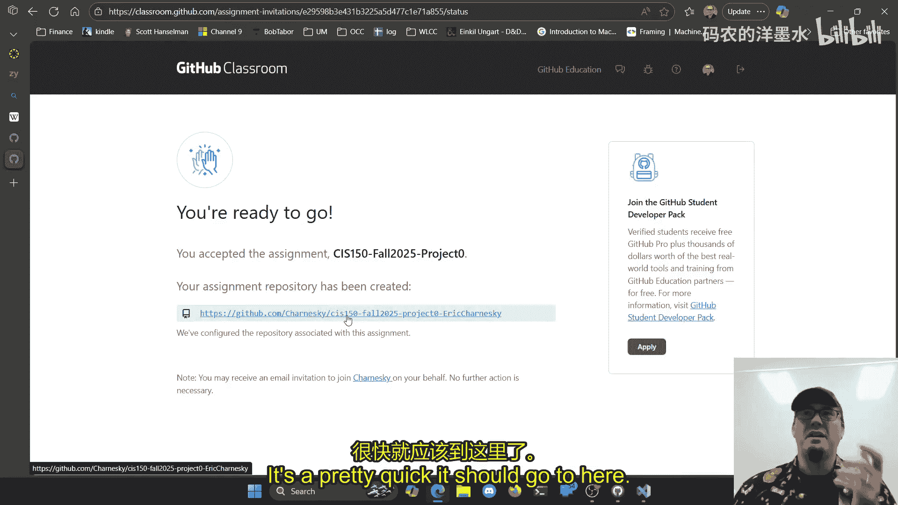

Okay， and then because it's the C++ template we get a get ignore file which is good because we want to ignore all of the things that we don't need。

 I just want your source code， I don't want any of your executable files here and It want anything in bin debug release any of that other stuff here right I don't do we actually look at any of that stuff I don't think we have yet if I go and open this up here and I say so I'm right clicking on the project and saying show folder and vi Explorer。

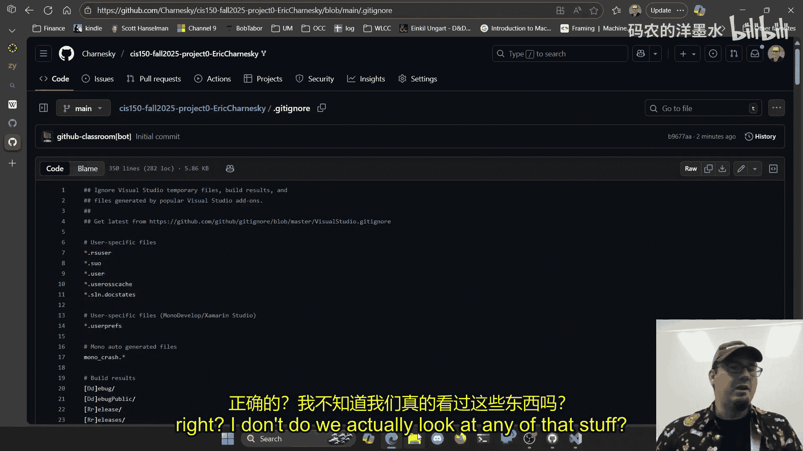

There's a bunch of other stuff in here this x 64 folder and a debug folder。

 here's an actual executable file。 This is the program itself that was created here。

 so this is a runnable program here and how much money do you have in your pocket 20 bucks right What do we want to drink Coke Notice it quits right away though。

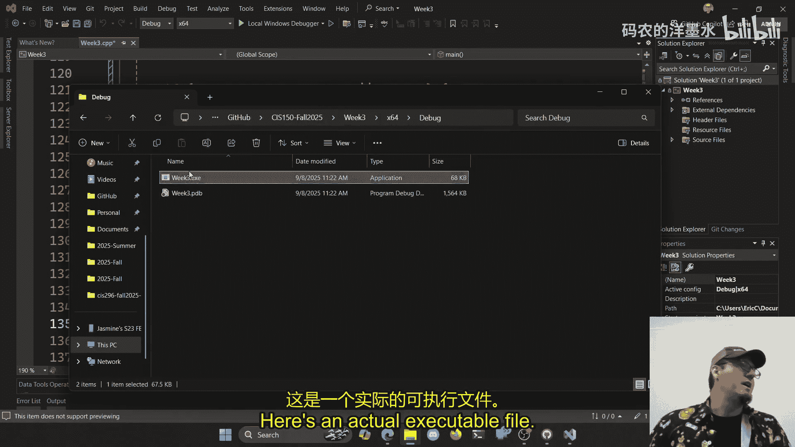

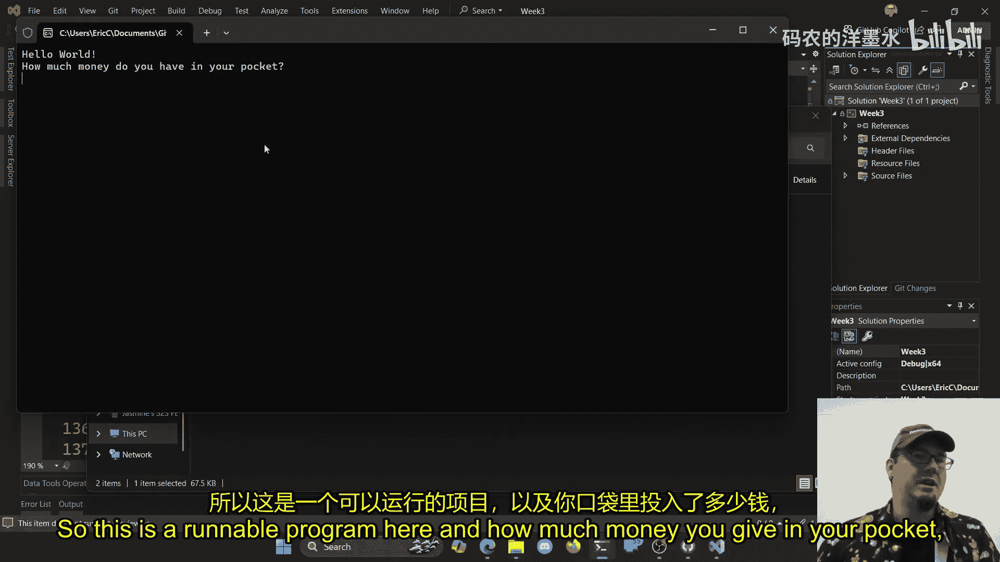

There's nothing at the end。 Remember when we hit run in debug mode and we get to the end here。

right we get this little message， hey， do you want it to close。

 do you want it to not close that sort of thing here。

 this is because we ran in the debug mode it stays open。If you just run your executable。

 as soon as it's done getting user input， it finishes the program and closes it like oh。

 I'm done on my job here so running your executables is not very helpful。

Most of the time okay so that being said right it ignores this folder。

 we didn't add our executable file to GiHub because we don't need it there we can go and build this right we're only adding the source code so the ignore file says ignore that folder please don't add that right we never got any of that stuff so here's more week three。

Examples。I'm going to commit and push give that out to GitHub。We get the ignore file。 great。

 and we get a readme file。 You want the readme file。 I'll show you how to do this in a second。

 so we've got the repository。 There's nothing in it yet， though Ex from the template stuff。

 So you're gonna to click the green code button and say open with Github desktop again there's like five different ways to do it。

 I like this one。 whatever you like is fine。 And your browser says， hey。

 do you want to open the Github desktop application。 Yes。

 please do that because that's what I wanted to do I just told it to and your Github desktop application then says。

 okay， I'm going take this repository and put it here on your computer here on your computer can be anywhere you want。

 does not matter to me。 You just need to know where you put it because we're gonna go put a project in that folder。

😊，Okay， it defaults to the documents GitHub folderer， that's great。

 life is easy if you keep your defaults， but put it anywhere you want to that's fine and we say clone。

😊，S。不。So now I've got， I'm sorry make sure you click the second option for my own purposes。

 otherwise you get some weird errors occasionally， there's another issue with the tool。

It's still a lot less steps doing than having to do this manually， so I usually like it。

so now we've all of it don't click this first button up here it's okay you might say open a visual studio just don't click it it's not worth your done so I can say show and Expr if I don't remember where I put the folder here I get my path here I can copy this path that's what I usually do here I just copy that。

Works easy for me， so I'm gonna come up here copy my path back in visual Studio。

 I'm gonna make a new project， new project， a console app and in the location here I'm just gonna to paste that in or you can click little three dots and go browse go find that folder in your Github directory any you want here go find that folder again I like my shortcuts here we can call it project0。

 you can call it ABc， I don't actually care what you call it here。 if you call it project0。

 it'll be easier for you to know it's Project zero when you go open it next time you get that list of here's all the projects you open recently if you name it project zero it's easy to find so it's a good habit give it a nice name here。

 let's say create and then if we put it in the right spot。

 we should see a bunch of new stuff I see the solution file， the CPP file the project file。

 the filters great I see some code Life is good I can start here I don't know Project zero started again commit early and often commits are free at least if you don't pa in a little bit of electricity they use Don't feel too bad about it。

佢。😊，And then again， I'm just going to hit run for a second just to show you what the rebean does here。

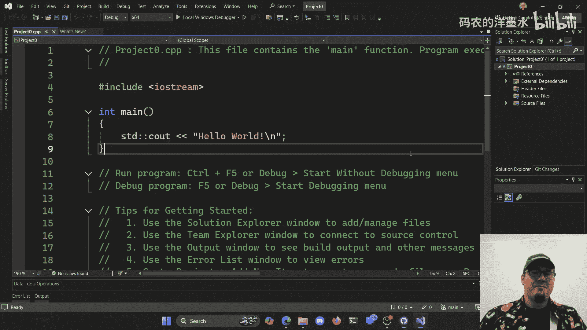

So here's the running here so in Windows La if you hold Windows shift S it opens the screen SNip tool。

 Windows key shift an S and you can just drag over your output here and it'll put that little snippet on your clipboard which is nice so now back over in the browser I'm going to hit refresh here and I should see a bunch of stuff right because I committed and pushed。

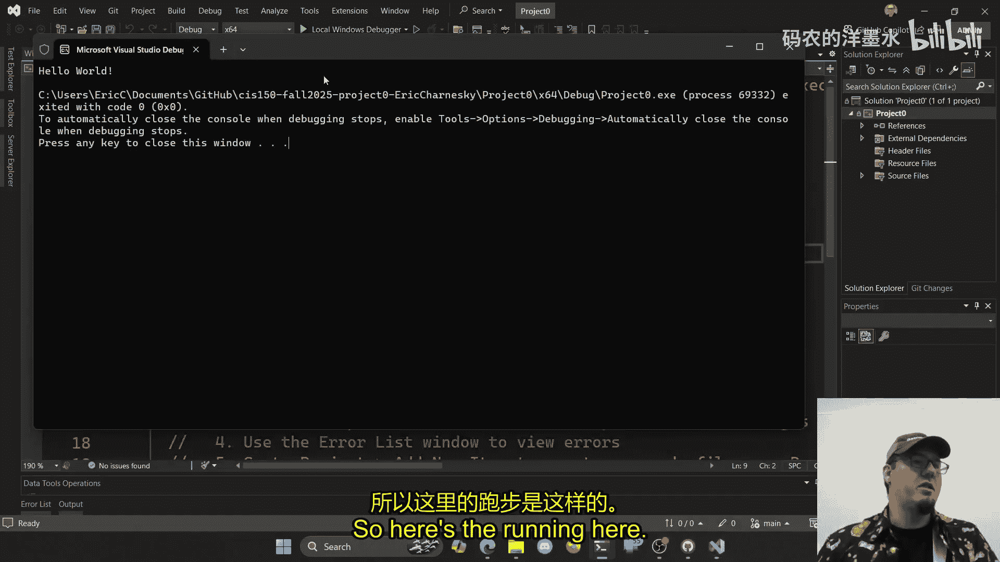

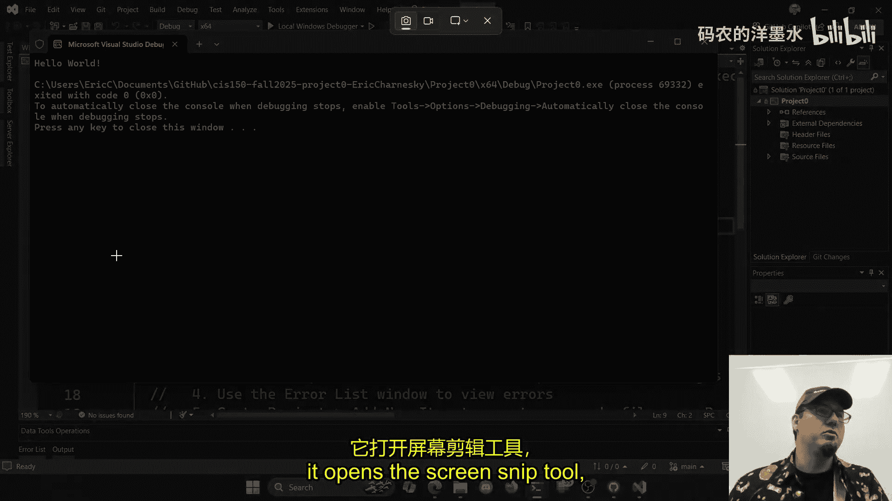

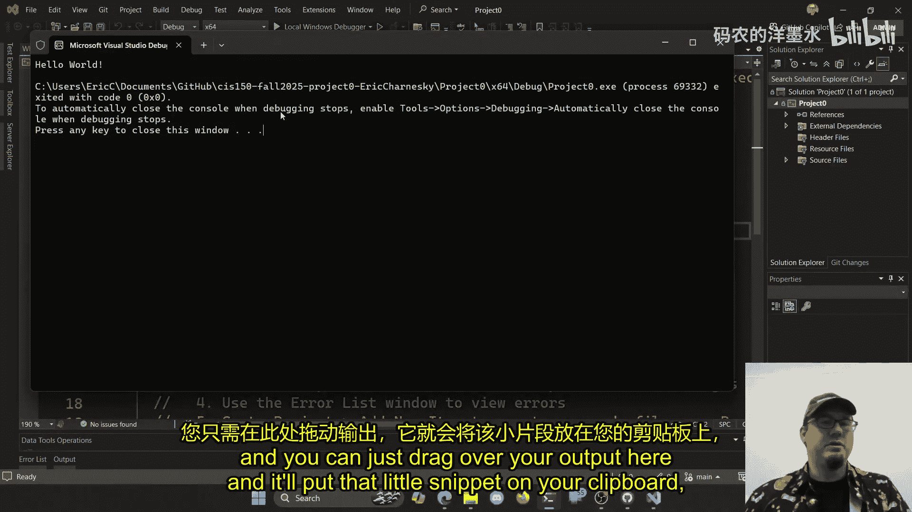

Ideally， let's see， come on。Did I push， yeah， I did， all right， come on， refresh。

There it goes I see my project zero folderer so I feel pretty good right I especially see at least the starter code here so to get something in the readme file the easy way to go about it and I'm all about easy is you click the little pencil that says edit the file so right from the browser you can edit stuff so I'm going to come up here and add a couple lines you want to be on a new line here and I can just hit paste today control V paste。

😊。

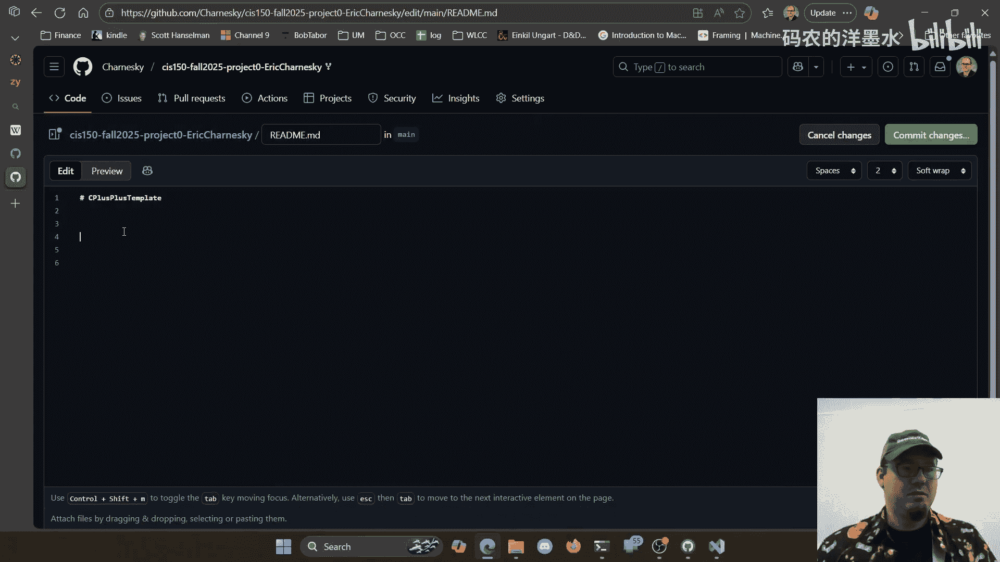

My goodness， okay， it lost it hang， I got to go back let me just run it again no yeah。

 I'm just going to run it again。

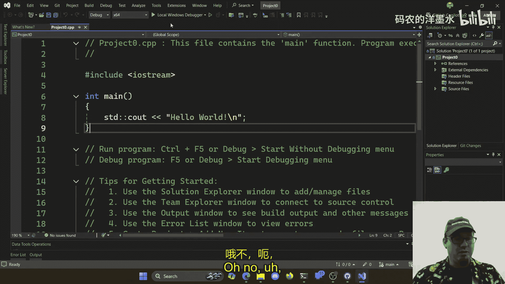

And those shift us， try it again， I think I got too excited。

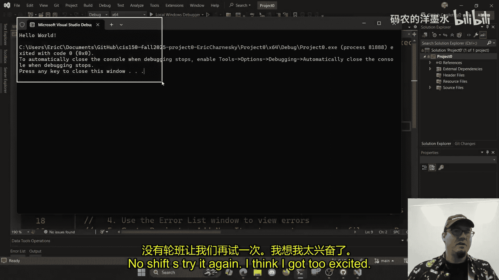

Back in the browser control V， there it goes， and it will automatically upload the image for you to some location great。

 I don't care where it points at some location on Github。

com and it will add it as an image to your readme file。

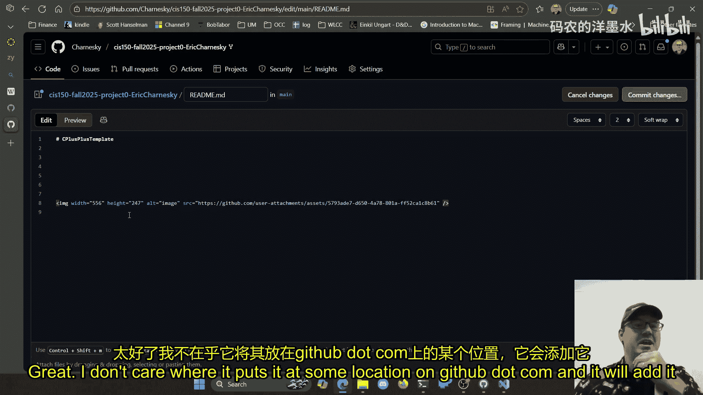

Which is really cool when I say，Com。It says what do you want to call it， you hey。

 updated commit's fine， updated read me is okay， all that stuff is good。

 we commit anything you add to the Readme file is viewable when you look at the readme file so here's the screenshot。

😊。

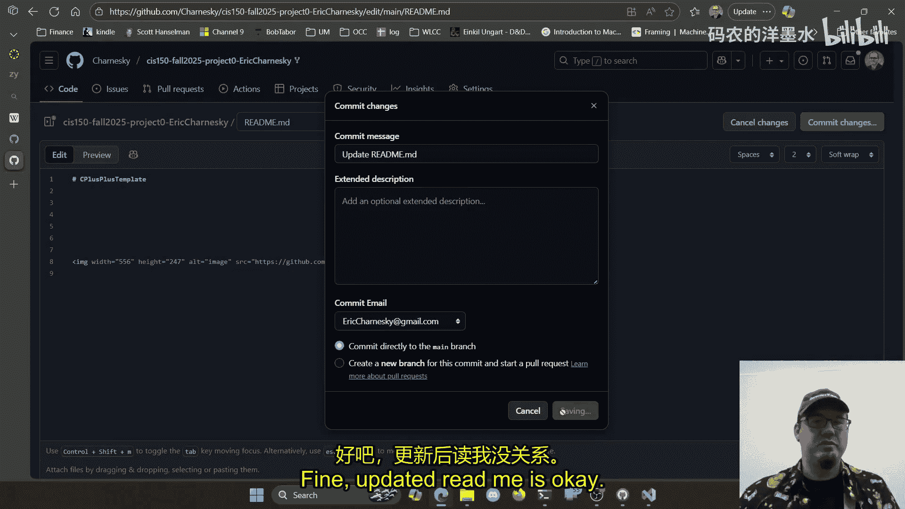

So I can see right from my project， what's in the Readme file。

Which is really nice so you're going have a screenshot of it running here now it's probably going be more than one line right it's got a little bit more interesting stuff happening here。

 not a lot of interesting stuff it's our first project you know set your expectations low it's okay's just our starter project here but you'll put that in and then we'll also do the same thing with the rubric you can either take a screenshot I mark it up or you can just tell me hey this item I got two points and this item I got two points and this item I got two points wherever you want to do it that'll work out okay。

Rightect。That part makes sense again， if you're not sure just watch the video again happy to ask。

 happy to help you if you were in trouble， the first time you asked me for help。

 won't be offend if I say did you watch the video。Believe it or not people ask me for help all the time and they didn't watch the video and they're like oh no I didn't it's like。

Go watch that please and then ask me for help but after that i'm happy to help right so a bunch of steps we'll get used to it now in the GitHub client here it doesn't fetch all the time fetches like go look for changes if I hit fetch now I'm going to get hey you have to pull get is a push and pull system I made it change in the central repository in the cloud my computer doesn't have it so it says hey you need to pull that change down。

Sure， no problem here I'm going to pull that change down it will change the ReB file for me it's pulling down that readme change that I made from the browser so you can actually edit your C++ code from the browser。

 100% do not recommend it here because editing here in the browser is awful and then typing C++ code here like no one wants to do that。

You technically could but just please don't right life will be easier if you actually use your real tools here。

 I promise okay。All right， so we got that there so now we got to do the actual project here。

 so we're going to write a party planning program and a party。

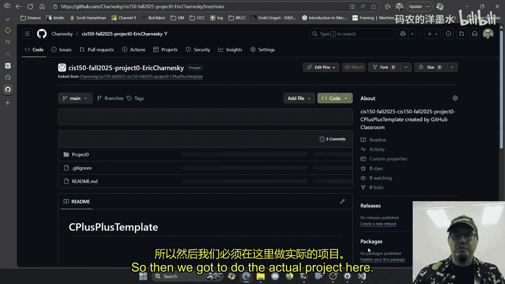

Planning program okay， so we need to know how many guests are coming to the party and what we're serving to know how much we need to buy and what it's going to cost。

Okay， so we're going to have three different options here， so ask the user。

How many guests are coming to the party？To the party。Okay。

 and don't forget to include the the user themselves。

 so like if I say I'm having four desks that's really five people。

Right because I don't usually count myself， so make sure you're buying enough for five。

 not just for the four guests because your host probably wants to eat two okay。

 then ask them what they are serving。So what sort of options should we serve。

 we're going to have three different options right if Elyn whatever we want to do here。

 what things we serve for our partner here？Okay。Three choices。What do you serve at a party？

It's up to you guys， what do you want to serve three choices？Birthday cake， birthday cake， okay。

 birthday cake。Can we just say cake， I'll show you why birthday cake will be problematic or cake。

What's another option， pizza， classic？And last option， all right， just pop， yeah。

 bring your own food party easy。Right。Three choices then so how many people are coming。

 what we're serving and then for cake， assume each person。Eat， now， are your friends really hungry？

Like we'll say a fourth of a cake okay， so if you've got five people coming。

 how many cakes do you need to buy？2。Two， right， we need to round up I don't think you can go to Meyer and order a quarter of a cake。

Probably won't go very well for you right so we're going to round up here right so each person eats a quarter of a cake each person eats a third of a pizza right I'll eat two in two and a third slices right of an eight sliced pizza。

I'm sure don't you cut your slices in half again to make them go farther okay。

 that's fine and 32 ounces of pop。We should do， we should do leaders right。

 because we buy these in two liters， everybody drinks one liter。Atop。

 now I'm probably not an entire leader， that's a lot， how about07 in5 liters。得。Okay。Forch pizza。

 zoom each person and the pop。Soom each person drinks。75 liters above， okay？

Then we need to ask them is the user how much each item costs， right， how much does the cake cost。

 how much does the pizza cost， how much does the two liter of pop right cost， that's one cake。

 one pizza。Two litter up。Okay， so how much is a2 liter， this sort of thing here。

 and we'll calculate the estimated。Cost of the items。So we'll tell them how many to buy。

 so tell them。These are how many of the item to buy。And calculate the estimated costs。 Okay。

 so you need to buy72 liters a pop。 It should cost you this much money right you need to buy three cakes and will cost you this much money So we don't know how to round up yet don't worry about it。

 we'll talk about that on Wednesday not to big video Okay。

 a little starter punch shouldn't take too long， but it's a little bit of time here right if this is taking you more than like a couple hours reach out。

 let me know。系 question我名。Well， the largest sign。Oh yeah， I'm sorry。

 that's right that's what you're asking so eight slices， sorry。So one pizza has eight license。

 but we're just assuming they eat a third of a pizza you even need to ask them here。

 if he didn't ask the user but that gets even more complicated。

 I don't need to do that much of a fancy that fancy math right？Okay。

 so they'll pick what they're serving， they'll tell us how many people tell us how many people are coming。

 they'll tell us what they're serving， we'll ask how much it costs for that item and we'll tell them there's somebody you need to buy。

 this is what it's going to cost you。Okay the little starter project uses a bunch of Felifs here。

 we got a bunch of code not too much here， not too bad and then you're going to turn in the URL add the screenshots。

 add the update3B file I'll add a rubric for you in just a minute if part's not exciting but you'll see it here in the rubric section so here's our project zero。

And let's do a frankly。We goodness。But guests。Two points what they are serving。😔，嗯。Two points。

D like from cake。Calculates for pizza。嗯。And calculates for。Okay。

 so two points each for those 10 points here， and I'll use that one for grading。

So that's your rubric， so two points each as we go， okay， thanks everybody。

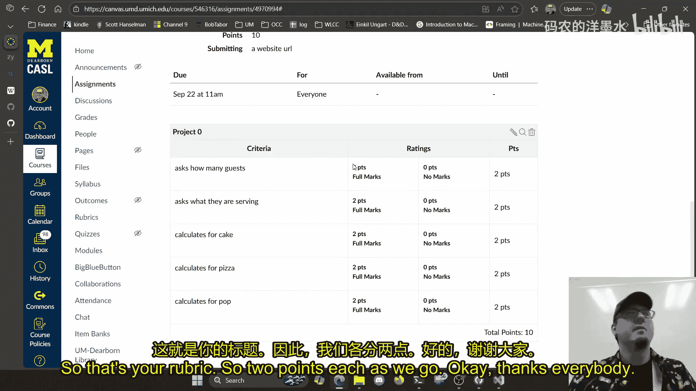

嗯。