# 【全集】密歇根大学 C++编程 中英字幕 1080P p04 Lecture 4 - 分支结构 part2 -BV1TsAZzAEHX_p4-

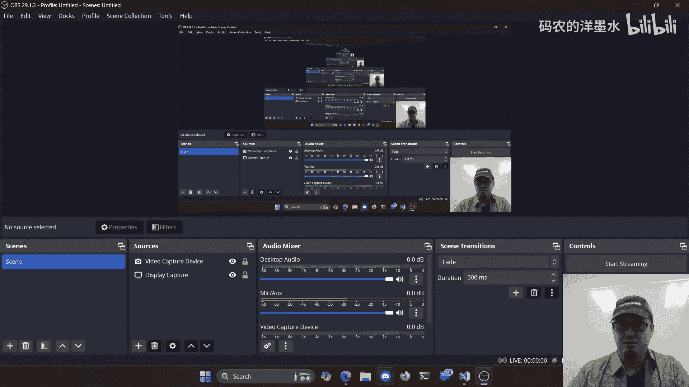

All right， yeah， cool。 I think it's going。 So we're going to finish up chapter three on branches today。

 we got lot of stuff we went through really quick。We got a lot of material so again。

 just sort of as a check for you here if you're keeping track of time。

It's about 12 hours a week worth of effort kind of keep that in your back pocket right as a four credit class four hours is or so in person。

8 hours outside， doing your readings， doing your homework， doing your projects。

 doing your stuff here How do you think it would lap on Monday I did not make it to stay sorry my earlier class finished up early I was like do I want to sit here for an hour and no I didt want to sit there for an hour so apologies so I generally won't see you for labs unless my earlier lab and day runs late let you go okay。

Maybe okay not too bad right cool so I'll chat with Dr。 Seed see if he needs anything from me。

 but I gave him previous labs I've done before I don't know if he's gonna make up his own labs or use mine and this should be a lot of fun so you'll get the joy of having two different people you have to work with we'll have to do all this stuff I want the way I want you to do it you'll have to do all the stuff the way he wants you to do it but it shouldn't be too bad right generally the philosophy with the labs is if you show up and you try you should be able to get them done they're not meant to be crazy hard that's your chance to practice and get it done when someone can answer your questions and we can stop and see what's happening in your computer is that。

Hopefully that was your your experience and that that's ideally how those things go as our friend said forgot her name already I' I get hundreds of new names every semester and I'm terrible at remembering them my apologies and I don't remember what her name was from the engineering learning Center but they're fantastic。

Go and get help if you need it。And ask me， I'm happy to help， ask your Dr。 Saeb。

 he's happy to help ask your SI， they're happy to help。Go and talk to a tutor one on one。

 they're happy to help that。I've sort of struggled a little bit with this class and then how many people fail the class because I feel like between me and the lab instructor and the SI and the individual tutors and everything available。

 you should not fail。And you have people keep failing and it's a little depressing because I feel like if you just put the time energy and effort in。

 you'll get there， you know。Maybe you get there and you realize yeah。

 this sucks I don't want to do this as my major that that's okay。

 I won't be personally offended if you change majors here。

 but I think people should pass 150 in general like if you're going put the time in you've got people who going help you pass all right but if you just sort of fall off and don't ask for help and then you come around at the final project time and you're like oh。

 I haven't done anything for 12 weeks because I gave up and just sort of sat there quietly。

There's no chance there right so you got you got to put the time in every week here and if you get behind we're here to help we got resource to help I can meet you with you like we got we got options so just let me know。

It should go relatively well for you again it's not。Hard material。

 but it's a lot of material and a lot of people will tell you it's like learning a new language so I'm sure there's a lot of you in the room who are smarter than I am I could speak more than one language I barely made my way through French and high school just to get the credits I needed to graduate and then I ended up in France。

1015 years later and honestly didn't even remember how to say anything more than hello That was all I had after two years of French in high school and I sucked at learning another language。

 but I didn't practice like I had my class and that was it I never tried outside of it and I didn't retain any of it。

 So if you think this is something going to make your career out of and get into doing computer science work and programming work。

You got to practice it to get good at it here did I did I ask you you focus on Monday。

 I forget who I ask what again， so to interrupt me if I've already said the story before。

 but any of you view anything outside of school that you're good at any like hobbies。

Sports and how'd you get good at sports he practiced right， you know， to be like， oh。

 I want to be a football star and go out and kick a soccer ball do they call to football？This is。

But so so we call it a soccer ball because we play soccer but if you call it football you call that a football okay。

 you kick a football around like and all of a sudden you can bend it like Beckham that silly thing I tried it once says like that looks easy right No I don't think that's easy。

 I don't know how the man does it right Can any of you guys do that can any even bend bend a ball when you kick it？

Give it like it's enough spin， right， it's just physics right， you just give it enough spin。

That's crazy now what you're going to practice right so we're going to put the time in we're going to practice you have so many opportunities to practice that you even get points for practicing right go and do the labs looks like 5% of people so like two of you have gone through chapter three right is that two of you or so out of almost 30 and no one's touched the labs yet。

If you hate Zabs， I'm with you， I understand it。 Okay， they're not fun。 It's not meant to be fun。

 It's meant to be practice right its to get you repetitions in that's why we've got a lot of them here。

 Okay， if it's taking you more than 12 hours a week to get through these。

 let me know I can tweakak them if I need to But in in general。

 it should be the right amount of effort for you here right So if it's taking you hours and hours and hours to get them done。

 Yes， it's supposed to if it's taking you 20 hours to get them done。

 no something's going wrong right you know， there's a good few number of hours to get through them here is is to be expected So don't get behind again。

 coming up the following Monday here。 So Monday。I've put the date in canvas here didn't I 15 thank you so 1159 pm so ideally you're done Monday because we're starting on the next stuff on chapter 4 on Monday but if you need the rest of that day sure and 1159 pm is the default if I want to change that to another time I have to click some buttons and you've noticed by now I'm kind of lazy I like defaults right so it says default 159 pm I'm going to take 1159 pm okay so get that in get your percentages up here because part of your score comes from completing the Z。

so getting in and doing them how we doing it on the labs，6% of the labs done。

 so two of you have done the labs from chapter two。

And we're on chapter three now right that this ideally was last week again， you know。

 we're sort of a slow start because of sort of a half week here。

 46% did the labs here for the first one great。These were super easy right anybody who do these lamps it was chapter one like these were not very interesting labs it sort of here's how the labs works right or try one or try one okay these will take you some time trying to give you a lot of warning here put the time in it'll go well if you get stuck in these reach out let me know happy to point you in the right direction on these here。

We can get you moving， okay， but we are going。Chapter by chapter by chapter we're going to cruise through here。

 we'll spend a little bit of extra time on loops when we get there because there's a lot of things we're going to do with loops。

Oops are a lot of fun we'll spend two weeks on loops， two weeks on functions。

 but then we get another chapter two weeks on in chapter chapter chapter and when we get to eight and nine we're going to。

Packle not super deep these are topics that are kind of come back up in CIS 200 so it'll happen in a lot of your classes it happens in math classes happens in the programming classes we'll talk about a topic and then your next class you'll go deeper into that topic so that's sort of what we're doing in this class you'll do the same thing in 200 you'll get into a couple advanced things that you'll pick up even further along like in 350 that sort of thing so we'll go through the chapters we're not going to go into necessarily everything in them here so we'll spend a little bit a little bit lighter weeks there essentially we've got nine chapters worth of work here so we're kind of blitzing through the first three because these are foundational we can't do the other stuff without them here and then we'll spend a little more time in loops and in functions streams is a lot of fun we'll do a lot of stuff with streams。

We'll use that in our projects as well raisein vectors will spend a lot of time on these send to confuse people just the syntax is super weird when we get to these it's okay it's just gonna be weird we can Google it if we need to we'll get used to it pick up objects and classes pointers have break review time catch up on anything we missed if something needs to shift we can hold up for a little while here and then on the eighth time to work on your final project and then ideally again you're done by the eighth because you probably have some other classes and not everyone has the philosophy that you can just turn in the project really you know what you do for a history class project like how do you show you've learned the history stuff。

Maybe you could do a presentation， I'm not sure， but I think you still get final exams where you have to memorize a bunch of crap and take a test at three hours。

I think that still happens around here so if you're done by the eighth。

 that's fantastic right we'll have almost a month to get it done and then you have nothing to worry about for this class here you can focus on your other final exams when you guys come in on the 15th you'll just run it and show us a works answer a couple questions about your code and takes maybe five minutes and then you're done and everyone's going to go through it no one likes public speaking most everybody doesn't like public speaking you'll get used to it it's a skill you want to develop because you want to be able to present your ideas to your team it's really sad to be the only developer here and not have someone to bounce ideas off of and at the junior level you're probably not going be like a solo IT department either because you have no idea what you're doing and that's okay so you'll probably work in a company with a larger IT team software team that you can work with and present your ideas to before you move on to other things so。

Good habit to get into developing some of those soft skills presenting， talking。

 getting comfortable with it it's okay if you're not comfortable with it you'll you'll get it after doing this for almost every class you'll present something so hopefully you're here in college to learn something。

Maybe I get sort of need a piece of paper nowadays in this this environment。

 but you know ideally you learn a couple things along the way and that are useful so that's sort of the goal。

But。All right， should we go write some more code？That's the exciting part right you all came here for code all right so far we did not do ranges so we did like a one。

 two or three said if it matched that if it was or wasn't now we looked at a couple。

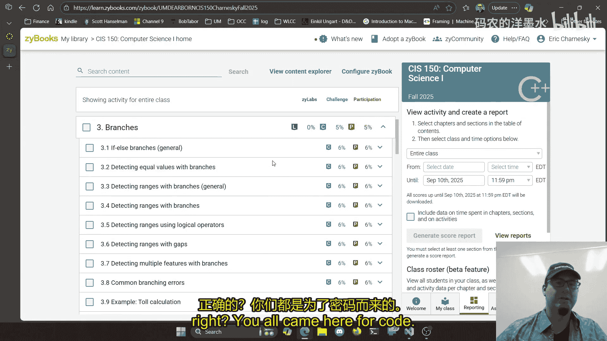

Relational operators， how do we relate greater than less than equal to not equals here right。

 does it not equal something， does it actually equal something here so。

The switch statement again I'm not fond of these I probably will never use them here they're not great if you have to do a range of values here right so make sure going to start back up at the top is that okay so you open up the same week three files we don't have that many different ones to go through here so I'll put my stuff at the top otherwise I have to run through all the previous things and that got tedious last time anyway。

So if we want to determine how about we take a score and turn it into a letter grade。

Because everyone seems to love letter grades I mean no one really loves them。

 but that's the focus right turns out anytime you measure something that's sort of what people focus on。

So if you get into engineering management， measuring the right things is really important。

Because that's what your staff is going to focus on if you start measuring that and rating people based on some sort of metric。

 they're going to focus on that and if it is something stupid like how many lines of code can you write。

 then I'm going to be able to write twice as many lines of code and we'll do the exact same thing。

Right， so you've gained nothing by measuring that as sort of sort of a stupid metric here universally understood via stupid metric unless you're Elon Musk。

 who apparently thinks that's the greatest metric in the world see's a moron but that's okay right so let's do a range right so let's say probably a double right because you might have like 92。

3% or 92。5 and you like oh 。5 should round up here like。Well I mean。

 what does it say in the scale usually I round stuff anyway。

 but you know so we'll have a double for a grade I know percentage right percentage here and then we can pass them enter。

Your grade percentage。Sure。Now， if you ask a math person for a percentage。

 are they going to give you 92。3 or are they going to give you 0。923？冇。You would enter 92。3。

Okay you're not a math major then right Okay， that's all right， so I think most math majors。

 would's say 92。3 is a percentage， right？Because that's what that is， right， not 92。3。

Percent that's okay， so we'll probably assume they'll give us a number one to 100 right because that's what most normal people would do not everyone likes to be weird so。

We can assume then so we can then we can input into percentage， right， C to percentage。

It's probably going to be a number one to 100 life should be good there。

 so do you want to start with failing or do you want to start with As？

Because're going to start it and the top or the bottom we'll work our way through the range。不是。

Start from the top oh I heard the top sorry， because we'll say， okay。

 if then my percentage is greater than and I should actually look and see what the scale is because I don't forget。

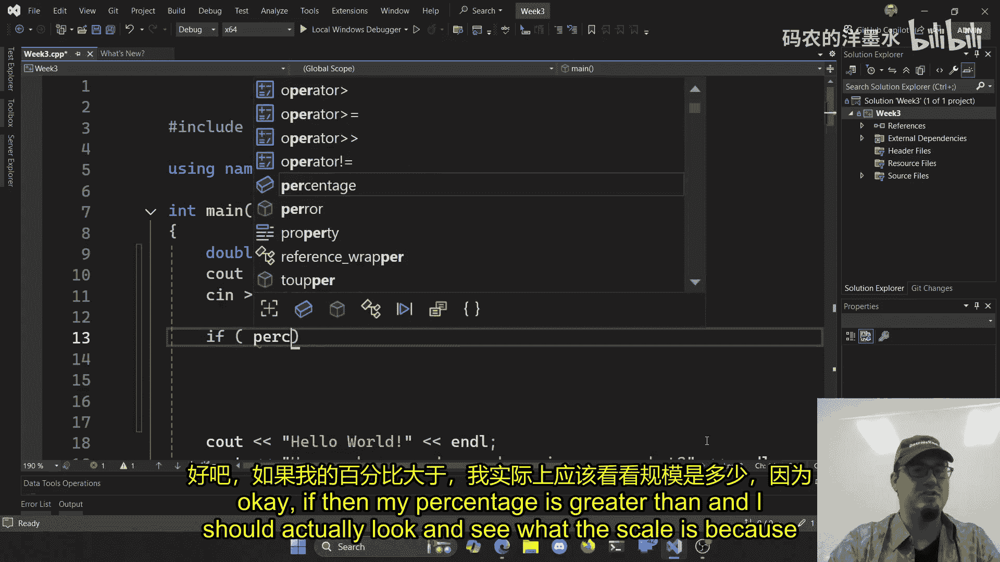

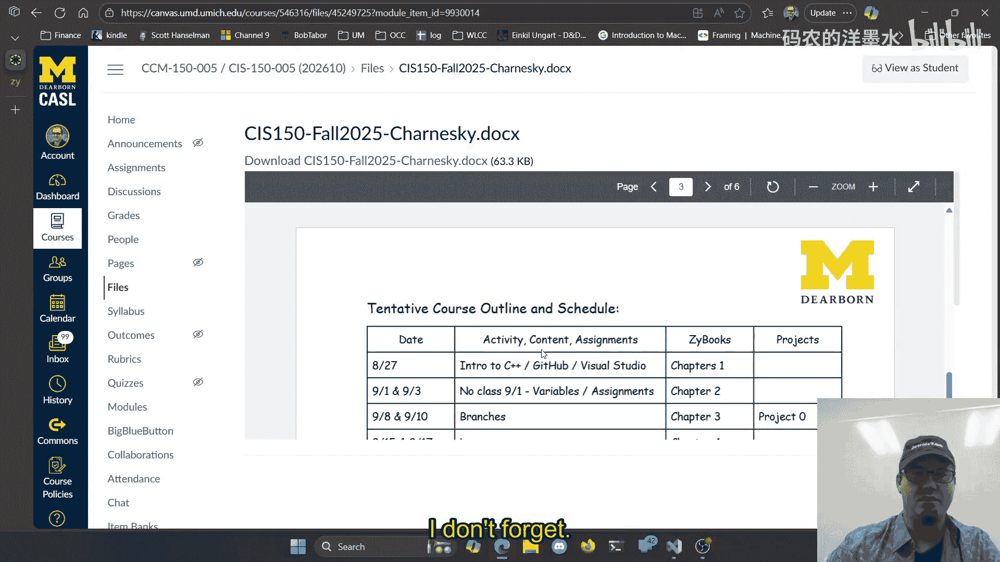

94 right so if we're 94 or higher， right so 94 or equal to 94。Then we can see out you have an A。嗯。

Maybe no exclamation marks， that's okay now。ThisThere's no range here， right。

 this is just greater than greater than 94， we're not checking anything else。

Other ways we can do this then， right the smarter way to check the range now will just be Els if so if it's not more than 94。

 what's the next one I need to check， okay， well'll do more than a 90 right？

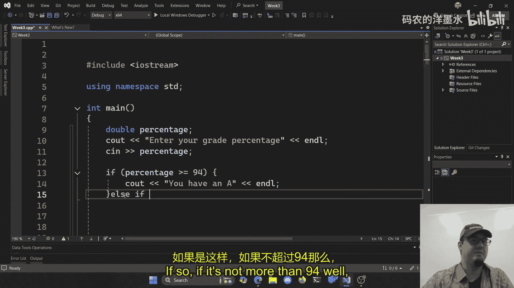

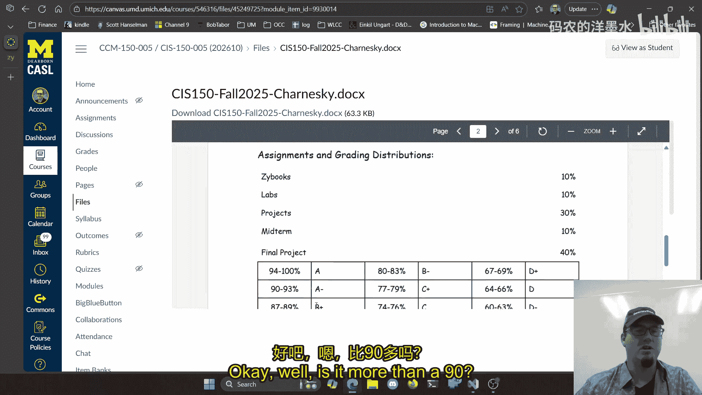

Greateaer than or equal to 90。Because I can't get to this line of code if this was true。

 so I know it has to be less than 94 to get anywhere near this line of code right when we chain these things together they're mutually exclusive so I have an implicit range here right and we know it can't be。

More than 94。If it was more than 94 we ought have stopped here so we essentially have a range so it's the same thing then as saying so it's the same as。

If my percentage。Is less than 94。Because we want if it's not this so less than 94 right and then we did our ams right so if it's less than 94 and something else is true。

So less than 94， two am sand and percentage then is greater than or equal to 90。

So chaining them together gives us the exact same result as having one if here。

Right because I know this one can't be true to get down here。

 so it just saves us a little bit of time to have that range here because I already checked higher now we're at the next one here so we can see how。

A minus。And this just gets to be a kind of a tedious copy paste exercise here。

 so we got a b plus a b a b minus， a C plus， a C a C minus a D plus and a D and an f。

 so that probably the right number of them and now we just have to go change a bunch of stuff。All。

 all right， so now we're looking for 87 for the B plus。 So we go back here and we'll call the B plus。

And this is if you're 87 or higher。And now are you 84 or higher？Okay， so 84， 97 oh man， yep。

 that's that's a typo， you would not end up with a B plus so ready much go we're going to test it in a minute。

 yep， so if you can catch it before you even hit run， you'll be a lot less confused。

E minus and then we go down to if you want 77 right， for a C plus。And then 74 for a C。

70 for just a c minus。

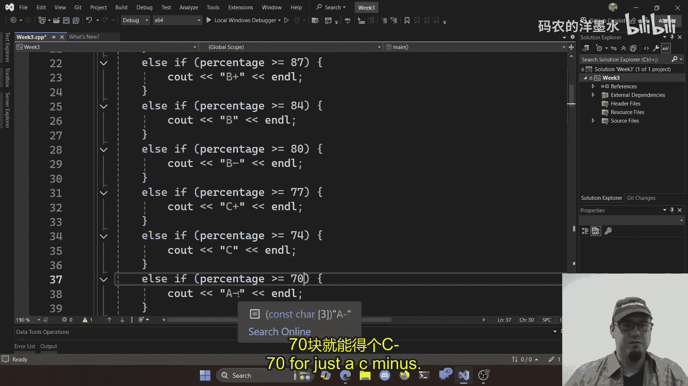

And where do we go C minus？确定。67 for a deep oh this one even has a D minus oh oh there is a D minus。

 okay， 67 a D minus。

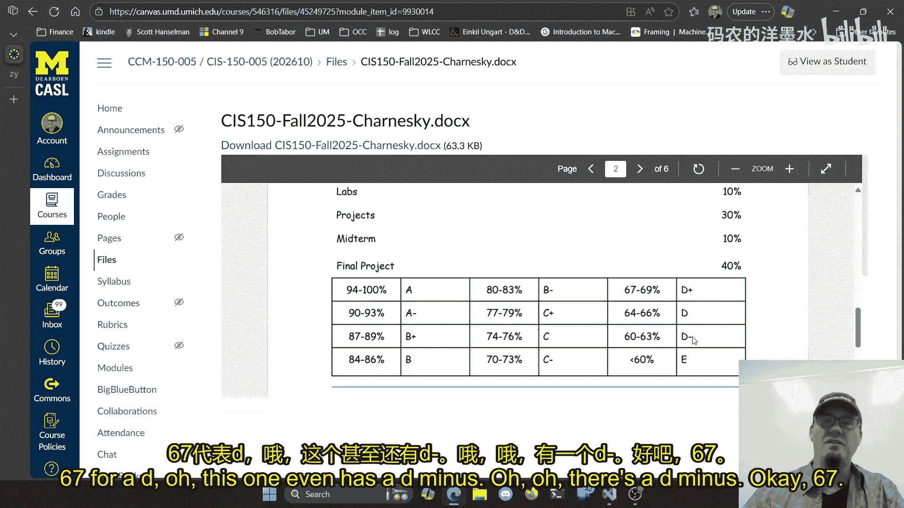

64 for D。And now if it's not one of these here， right。

 I don't even really need the rest of a range here， I can just have my default。right。You fail。

That's the sad letter right no one wants to fail it happens sometimes it's okay。

 it's not the end of the world you can take the class again。So we have implicit ranges here。

 works out pretty nice for us。Right。Now， other ways of doing ranges right。

 this is nice and efficient， so this is ideal。Assuming we've done it right。

Because let's going to check the first one and the next one and the next one。

 one of them should match and it's within that range that we've specified because it can't get to these lower ones unless the upper ones aren't true here。

But we don't always have like this exact sequence， or maybe we don't want to do it in this exact sequence here。

 We don't have to do it this way。 We can get the exact same job done differently using。

Multiple conditions right using a little bit of。Logical operators like ans and Os。

 know Os probably aren't going to get the job done here where we're detecting ranges。

 but maybe we also then want to say at the beginning here。 So advantage the percentage and say， hey。

 if your percentage is less than one。Or your percentage is more than 100。

These are like invalid ranges， so the ore here does make sense or you can either be too low or you can be too high。

I can't have both of them true at the same time， so I can't use an and as you can't be too low and too high at the same time here。

 but we can just tell them， hey， did you gave me a bad number here。Invaled percentage。

Enter1 to 100 now we haven't got to how do we make them mentor it again？

I guess we just we can seeN to percentage again。And hope they give me the right thing。

 but nothing stops and nothing keeps them in here， so we've at least tried once again。

 we'll come back to this next chapter。Do better。Next chapter， I will do better next chapter。

 but for now that's okay， let'll just ask him one more time。

So we'll enter percentage so if they gave me 0。293 like a math major would when you asked for a percentage here obviously it's not a whole number because it'd be what 9000% right so 0。

923 or' like， oh no， that's invalid enter one to 100 Well maybe you should have told me 1 to 100 to start。

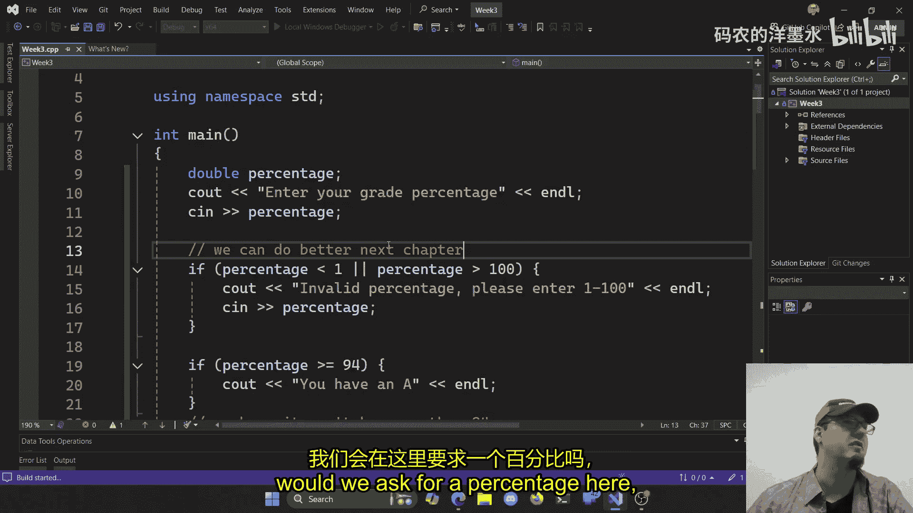

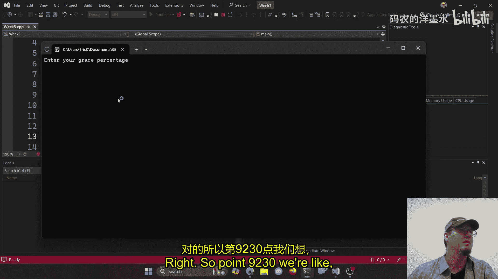

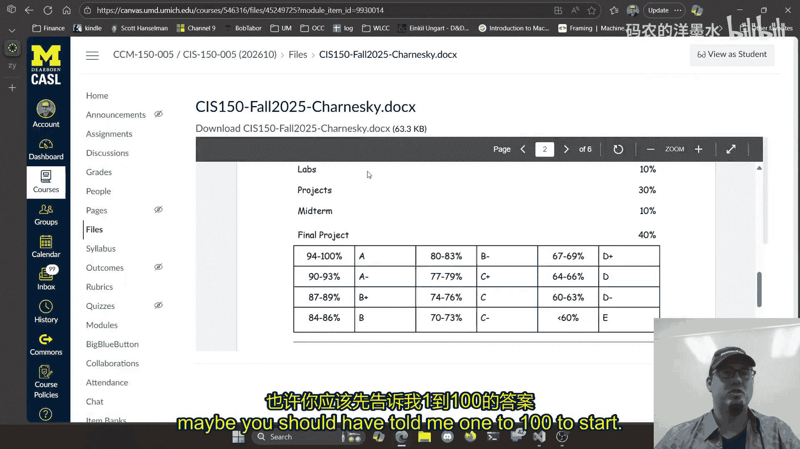

Right，'s like。Help your users out， tell them what you're expecting at the beginning。

 and you might get some better input， not guaranteed。

 but probably get some better input if we ask for specific numbers here。

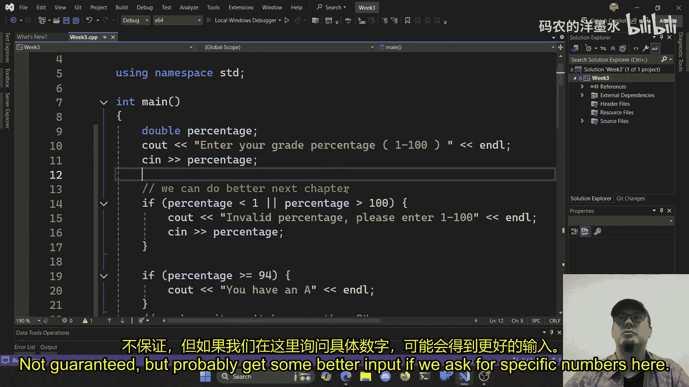

So I mean， it works the first time and then certain and now let's do like a 91 and we got a a minus like we expect now。

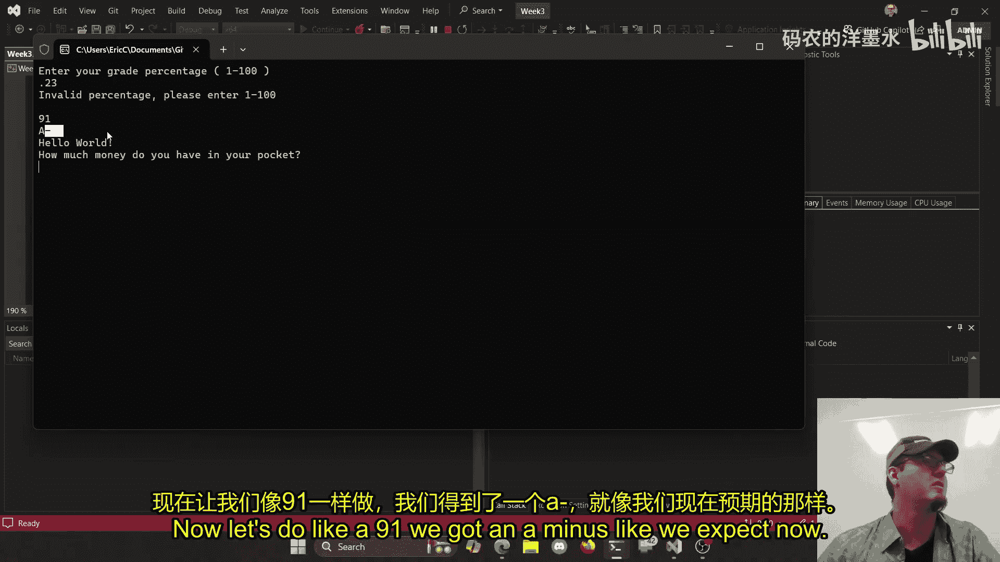

It's going to take a little while here but we probably want to test all of those ranges out here because if it's important that it works。

 we need to make sure it does what it's supposed to do because like you saw it's really easy to typo things。

 I totally did that on purpose to illustrate how easy it is to typo things right that happens and just like an English paper we know what it's supposed to say。

So when we go and proofread to ourselves we're like， oh yeah， I'm sure it's fine。

 I meant to not have the word the in there three times in a row。

 but somehow I typed the three times in a row。

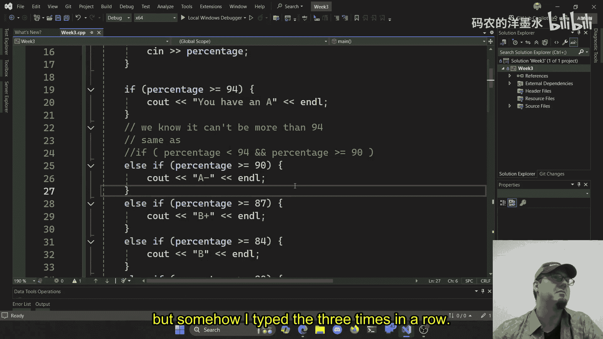

That happens。 So we're going to run it and test all of them out here， which is kind of obnoxious。

 but that's okay。 so 95 is an a we did a a minus。 Now we need to run it again for。

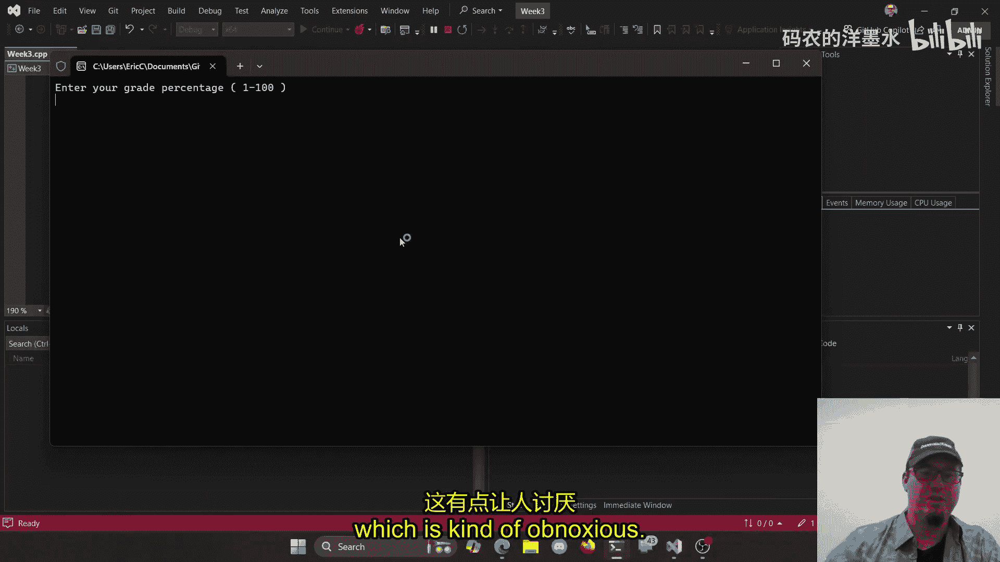

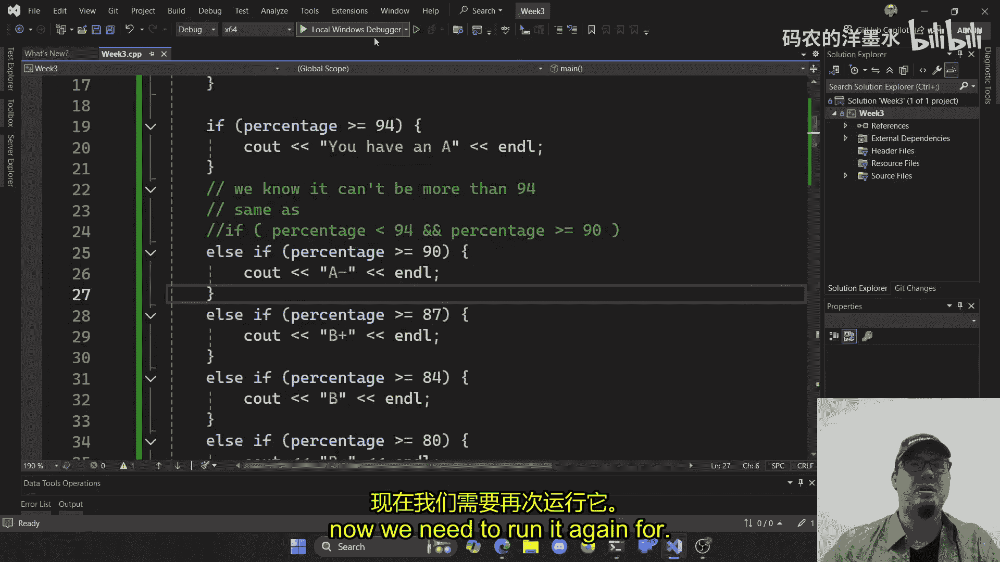

A B plus like 88， get a B plus stop run again。 Let's try B， like 85。 Sure， B is good。

 Stop running again。 And you get the idea this this kind of sucks here， right， but。

It's good because we want to make sure if we wrote the code that it does what we told it it's supposed to do here right because it's possible to make mistakes。

 it's likely to make mistakes。

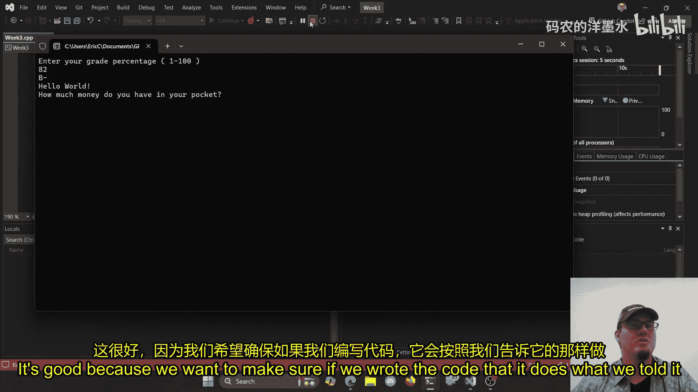

That happens。 So the only way we know how to check it is by trying it。

We know what's supposed to happen if I put this in， I get this out。

That's our fancy term for algorithms everyone loves in the word algorithm， such a fun term here。

 but that's all an algorithm is if you put something in。

 you know what's supposed to come out the algorithm is what happens in between。Okay。

 so if we're trying to solve a problem and I know， hey， when this goes in， this comes out here。

 we have to write the algorithm。We have to figure out， okay。

 here's how you do it step by step by step by step to make sure a dumb computer can solve it。

Because that's all computers are going to do for us they're going to do this step and do this step and do this step and do this step just like you tell us to do right so again nothing super interesting with this one here but now maybe we get tune into some more interesting pieces here so let let's try and take something that's in the news should we try and calculate tariff rates that be fun calculate how much we're going to pay for tariffs just a pop quiz。

Because you're all intelligent people in college， who pays a tariff？

Customer of what which customer product I mean basically the person who manages the trades e close to that so the the customer of a foreign product yes okay。

 thank you， thank you for reading specific yeah， so the person importing the importer。Okay。

 pays the tariff right， it was recently in the news that if tariffs get overturned if the court decides that the president didn't have power to unilaterally import imposed tariffs。

 they're going to have to refund a bunch of money。That's sort of how that works I don't know why people are surprised about that but okay so let's calculate that so at one point there used to be an exemption for lowpd goods the certain number certain amount of goods you can import without paying any tariffs and then if we get higher then you to pay more tariffs right so we need to have some sort of range here so I don't actually remember less' at the small tariff。

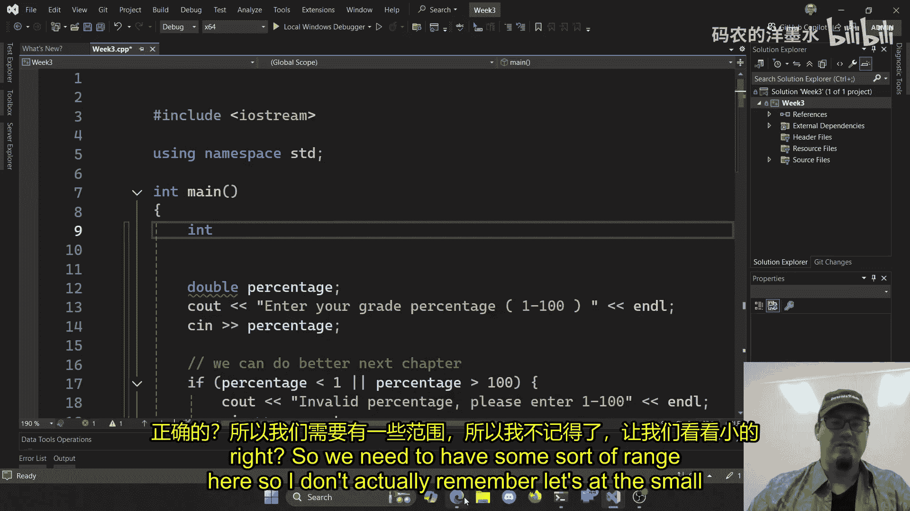

Desumptions or small orders or I forget what it was called here。

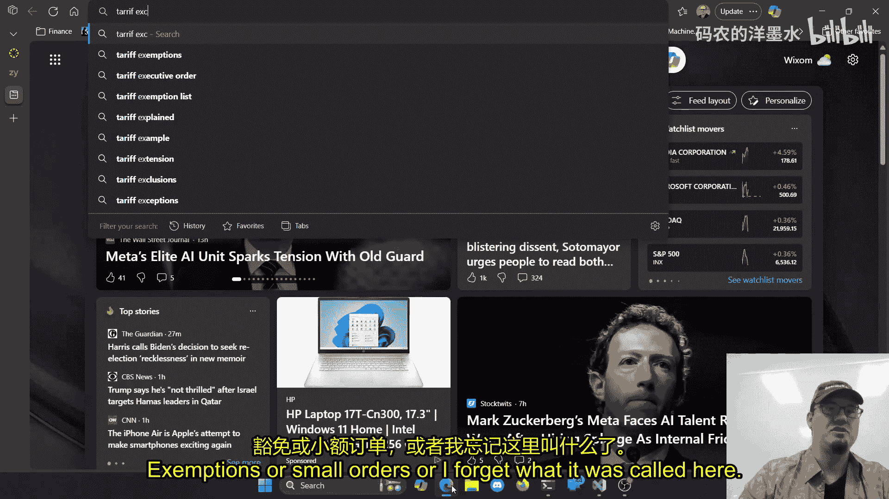

There we go for $800 or less oh it's gone now of course that's that's helpful we'll pretend like it's still here because who knows and that would make the example really boring otherwise so if the order is $800 or less we won't have to pay any tariffs。

Right we're protecting the small importers or people want to spread their orders out or want to however this works sure so I'll have a。

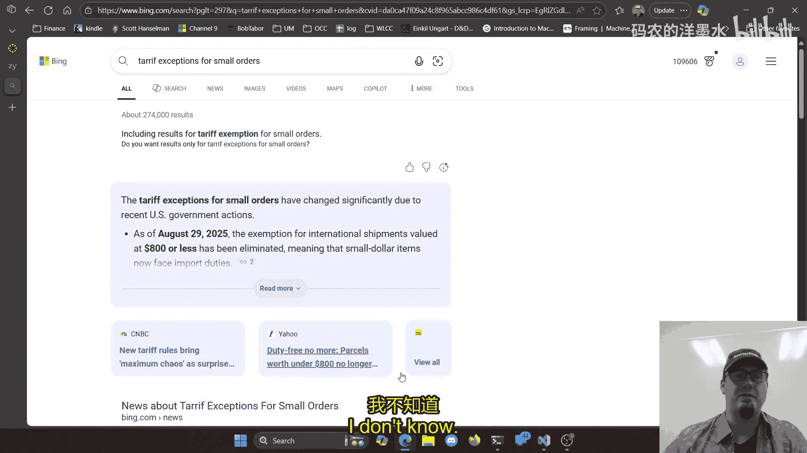

Terariff。Order minimum。What are we want to call that minimum？Care forward a minimum， sure。

 we'll set that at $800 now。If I want a value and it's not supposed to change here I don't want to change this one in my code we want to make this constant so we've got a way to say hey。

 keep this value from changing so we tell C plus plus I want this to be a constant constant value and for some reason we don't like using the last couple letters we drop constant we are off the G from integer Sure so a constant int tariff order minimum and then if it's a constant you can name it this way but it's frowned upon we love visual cues。

 we love conventions to give us information about our variables just by looking at them here so I'm going to change this and call it tariff order minimum。

A minimum sure that's probably close so if I do all uppercase and then I use underscores because if you run them all together here it's terrible so we have to have some way of separating our words here。

 that's terrorist spelled wrong isn't it two fs right two fs there we go。

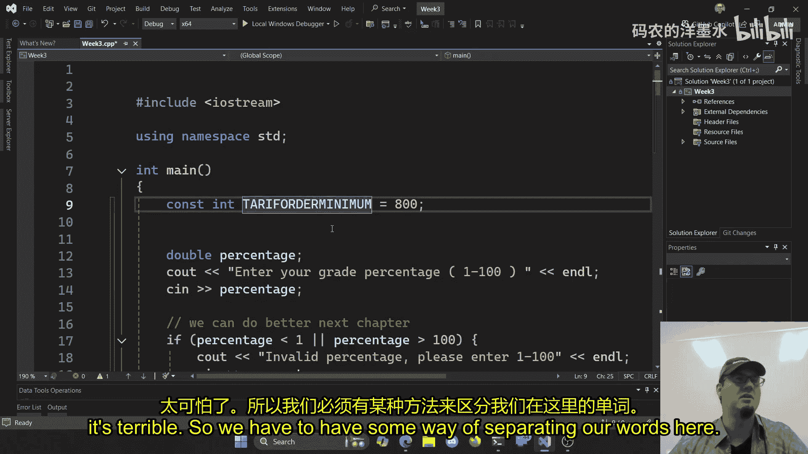

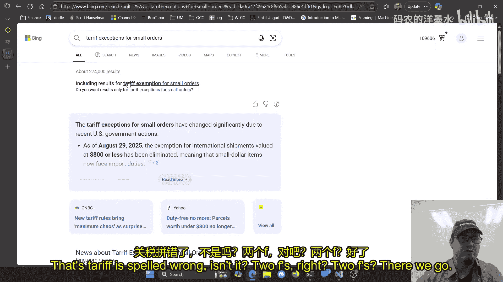

Here of order minimum now it's visually striking looks different here and the convention is this is a constant value don't go change it now I don't need to go look somewhere else in my code to find out this is constant I just by the looking at the variable name'll see it here and then we'll ask them for so we need a double for order cost order cost。

And we'll see out enter the cost。Of your international order。So we can calculate。Turariffs。One R。

 two hours， I really can't spell， my apologies，1 R， okay， that's what why I thought two f。My tariffs。

Okay， and then we can see in on our order cost。And now we're also going to need to know what country this order came from。

Because。Someone with a spreadsheet decided we should charge different countries different amounts based on the trade deficit。

 which means we want to buy more of their stuff， we're currently buying more of their stuff sorry this is not an economics class but the stuff is interesting so the trade deficit means we buy more from them than they buy from us。

So we want what they're selling。They don't really want as much of what we're selling that's what the trade deficit is right so for some reason we decided。

I should exclude myself from me that that sounds I didn't decide some people decided that just because we're buying a bunch more stuff from this country that we should have to pay more money for it because there's a trade deficit that we're going to tax。

Imports from that country higher because we really want their stuff。That makes lots of sense。

 I'm sure。I've got a dear friend I work with who's a PhD in economics and she just is visibly angry when we talk about tariffs which is a little bit amusing。

 trying not to bring it up too often but just like digital like she gets real angry about it which is it's amusing right you like irritates your friends on purpose like you know that just irritates them they're going to go off like okay so then we'll ask what country came from so of a string for the country。

Of origin。And then we'll ask what country？Did this order come from？Yeah。

And then we can see in the country of origin。All right now we need to see what our tariff is going to be right so we we paid the company whatever amount of money was our order for it and now how much were going to pay the feds what's what's their cut on this order here so it's based on if the order is less than $800 right so if my order cost is less than $800。

See how no tariff。At least two weeks ago。It wasn't。It's changed since then。

 but again that's I feel bad about example changing its going to be a lot more fun here that's okay so if the order cost。

No one else， right？Okay， well， Els if， right if it wasn't less than $800， if my country of origin。

Then equals USA。This was one of the whole premises， right， if you buy domestic， there's no tariff。

Yeah， sure， okay， but that's a fair promise， no tariff。

It wasn't imported unless you are Chrysler and you liked your slogan of imported from Detroit。

I thought was kind of a good slogan actually that was that was kind of catchy I thought and remember that they ran was a commercial in the Super Bowl for like the Chrysler 200 or something was a couple years ago I'm an old person now you guys don't remember anything I I do I okayy I see one that was imported tried。

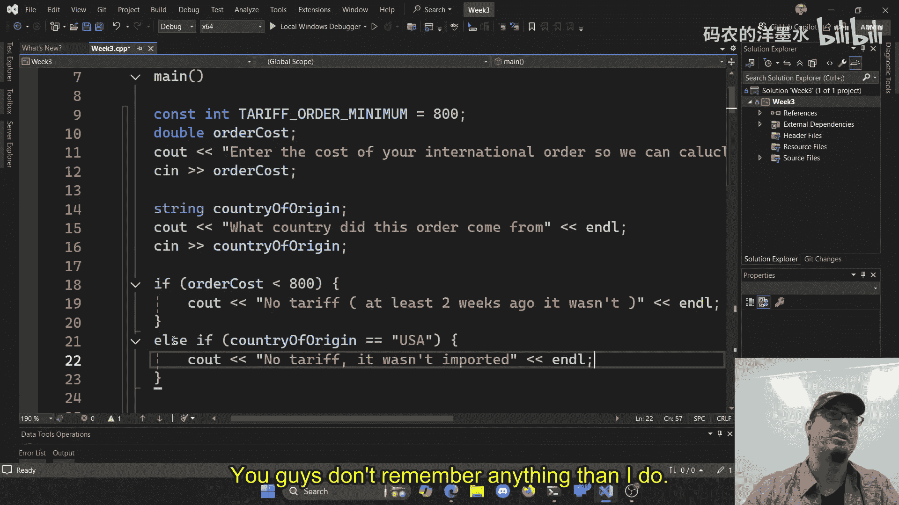

And。When did it run 2011 oh my goodness， goodness， really？I still remember that life。It。

 did really well for them。 Like it was a good campaign。 Okay， wow。

And a whole ad it was a really good ad。I mean， I don't know。

 it had like highlights of cool pictures of stuff in Detroit。

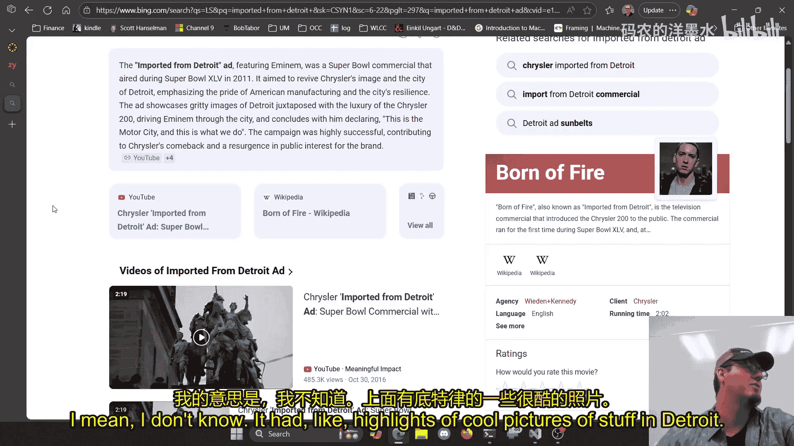

Okay， never mind， sorry my sugar is high， why is the people to me？

So I stopped for breakfast on the way here， it's my fault。Yeah。She go a little words， Linda。😔，Coect。

Yes。All， so now we need so if it's not that then， so Elsif。

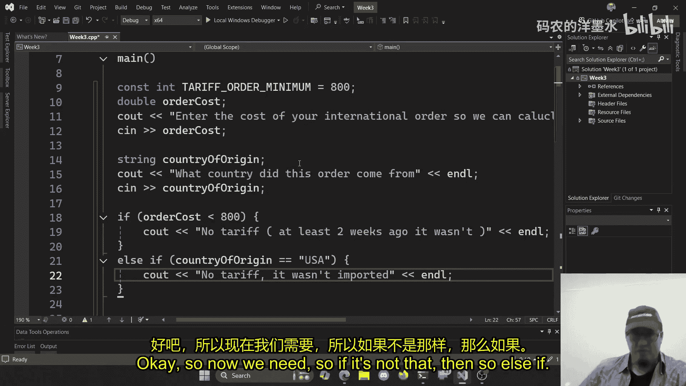

Now we need to start looking at， let's just look up a couple tariff so tariff rates。Greatates。

 I country， here we go。Passportglobal。com， I don't know of tariffarcheck。org。Cariff rates。

 world population review， Wikipedia。啊。I don't even。Tariffche。org sounds okay。

 I don't know it doesn't actually matter because we're just pretending here right。

 so right so if we're buying from India， it's 25% tariff。

If we'd like to buy a bunch more stuff from then than they like to buy from us of course we should punish American consumers for buying goods from India so I have opinions about this I'm sorry you probably noticed by now that's fine we'll try it here so if the country of origin then country of origin is equal to India India there we go。

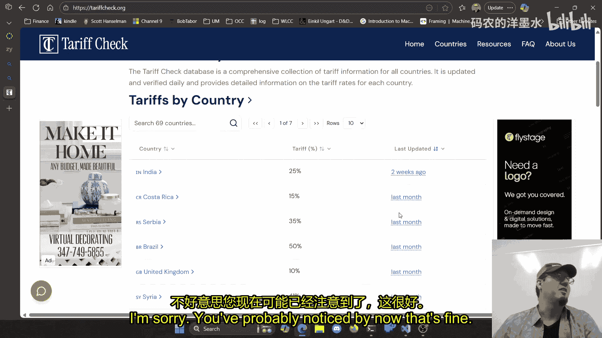

We know the order cost has to be more than 800 already， then we can see out。Your tariff。Cost is。😔。

Maybe we'll add a dollar sign and make it look prettyty right， so it's the order cost times。No。

Oh my goodness。 I did a bad thing here。 I came up with this tariff order minimum。

 and I didn't use it here。 just realizing here。 Now， we'd probably need a constant double for tariff。

Great sound tariff。Great， India。0。25 right so orac across times 0。25。

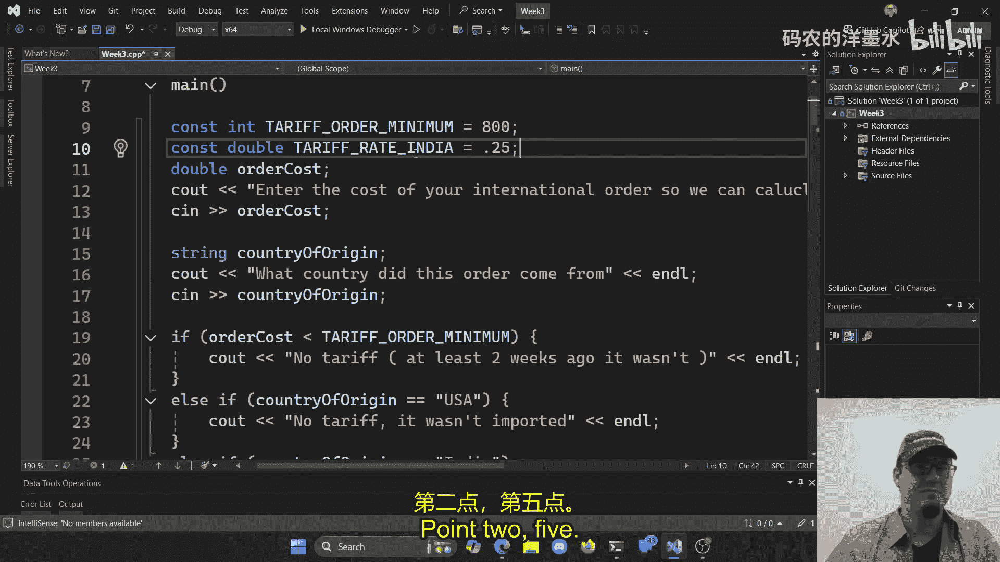

Sure， and we'll have bunch of different ones Oh for Brazil，50% for Brazil。 I'm sorry，'s 100。

 So this website， you're saying two weeks ago is out of date。Yeah。

 because trade policy should definitely change every week that that's helpful for international trade。

 I'm sure。Goodness I'm sure there's an economist economist here who's much smarter than I am go talk to them you'll make their eye twitchitch but go ask and be like hey。

 my CIS profits tell me about tariffs they'll Ill just start twitching it'll be funny but they can inform you。

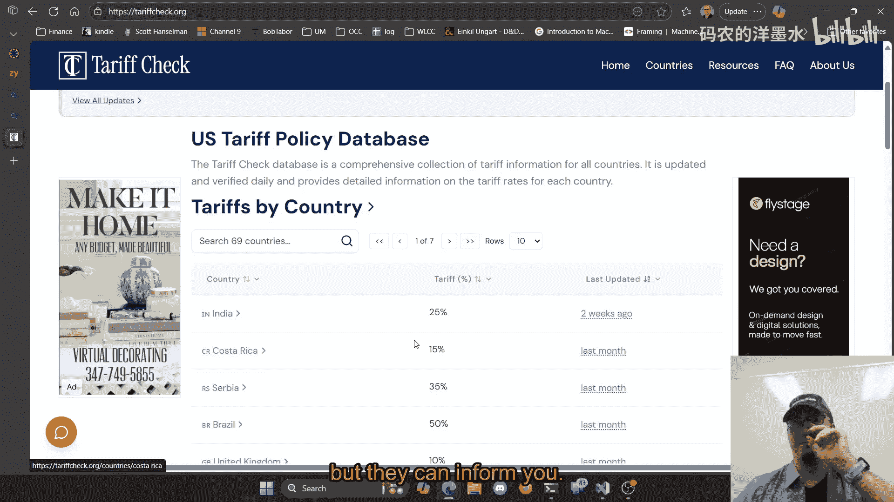

Hund0% now。Okay， so look， we can change it in our code。 Now， look， we've done it。

So you know having a constant here is kind of nice， we'll put it in here， that's fine。Sure， ter fate。

And then an endline。All right。And wed have to go through check a bunch of different countries。

So you're going to be a little tedious， right know。

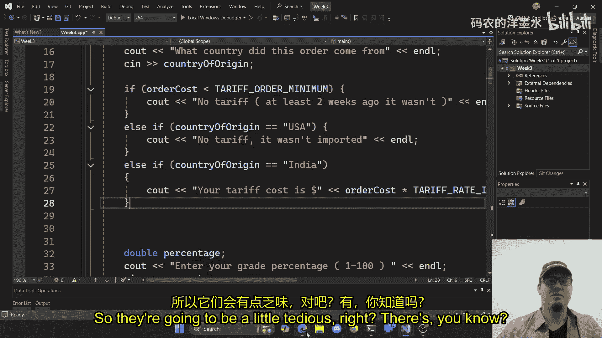

Interestingly。I see a number of countries in the world。😔。

Hang on before I say a dumb number and look stupid here。How many countries are in the world。

 I just want the number here。UN members 197 independent states。

I think that's the the official number we'd like to go off of right so less than 200 right Do you remember how many trade deals were promised？

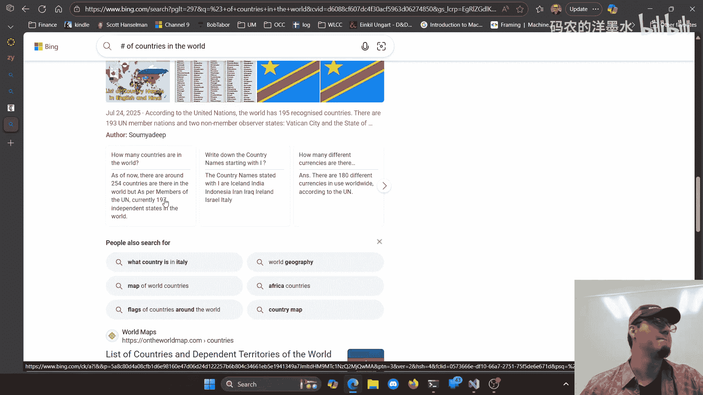

More than 200， anyone remember that okay so。You know， we could。

 we could go through and have a list of 200 countries。

197 different countries and have a different tariff rate for all of them。

 And some poor person software has to have that。 It's not the end of the world， raise。

200 lines of code， plus a bunch of checks here。Right。

 we could do it if we wanted to do we want to type it all out today now when this we've illustrated it let's do one more minute so else if country of origin we'll do Brazil right because they showed up under this country of origin。

Is Brazil。Then we probably need a Brazil tariff rate。Tearer freight for Brazil。That was 0。

5 right just a measly 50% tariff you know we're not doubling the cost of anything that's just 50% more here so sure so we'll copy that one and it'll just take my tariff rate for Brazil。

I think you get the idea of how we could calculate these here right checking。

 looking it up here and if you're thinking there's a better way to do this， yes。

 we just haven't got there yet， we'll get to better ways of saying oh。

 if this is a country here's a rate， if this is a country here's a rate like sort of mapping that data。

 yes there's way better ways to do that here I promise we just haven't got there yet。

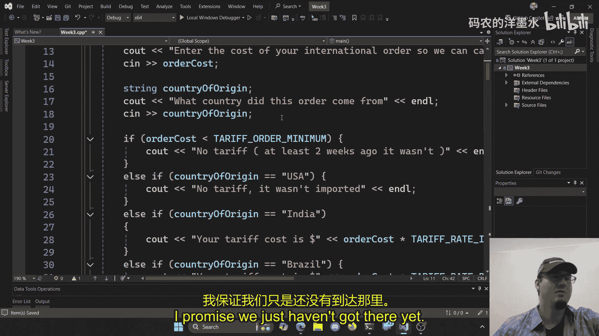

Okay。Is there a way to calculate the？Terip cost of an order。Free tariff calculator， gettar。com。

That's kind of what I was looking for actually， see let's see if the websites any good here。

 know the total cost before you buy here。Product description， if we want to like drop ship stuff。

 right， we'll just order a bunch of crap。And then resell it under a different label it has not exactly drop shipping。

 but something similar right so we'll say it's from China here we got a bulk order of I've been buying a lot of these flies waters here。

But。Yes。That I can't it is typing okay why s it's just typing in a light gray that's really useful user experience there and can you guys see how light gray that is it's there it's typing。

They didn't give me my regular black fonts， I don't know why， and the import value。

 we'll just say this is $500 here。Calculate tariff costs。25% tariff rate here。How did I get to。Sure。

500。To 900 with a 25%， Okay， I don't oh， it gave me a shipping estimate well look at that product cost that how much they're going to start to be shipping port and handling。

Getting it actually handled at the port， okay， they're not going to ship right to me。

I don't buy you can tell I don't buy things all that often that aren't from Amazon。

 they take care of all that for me， right？Look at that， save and get a flow report， share my results。

All right， so we can write our own calculator， right， feel pretty confident。Okay。Ranges。

Features branching poll calculations， order valuation we do order evaluations we complain about that a lot good all right you want to hear that again it switches the booleing data type is really cool we do that and we talk about that right it can be true or false all by itself if you're hungry you're not hungry b that's a just a boolean value so you don't need to compare it。

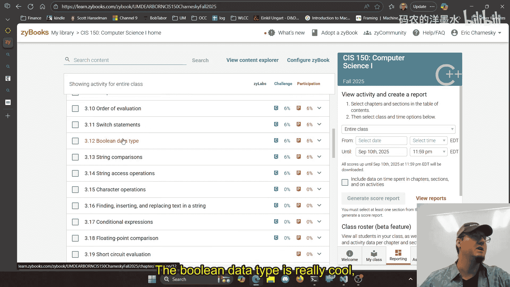

You don't need to say is true equal to true you just put your boolean in here that's the implicit this is true because if it's not true it doesn't run Boolean values the conditional expression this one's a lot of fun here and by a lot of fun the syntax is terrible I don't ever expect to see freshmen write it and usually when I see them I have a pretty certain feeling that they didn't actually write their code because they copy pasted different online and Chat GBT loves Boolean expressions I don't know why or what code they copied off of here but it loves these and we'll use them all the time and they're boious so a conditional expression here。

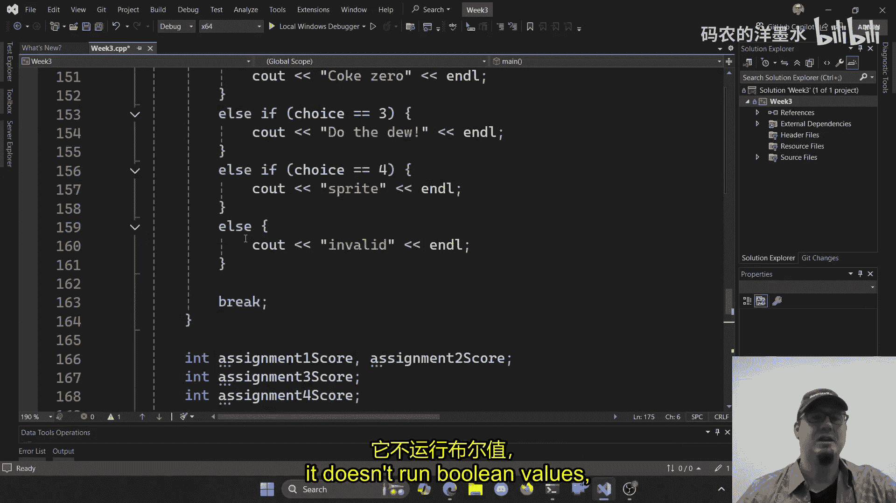

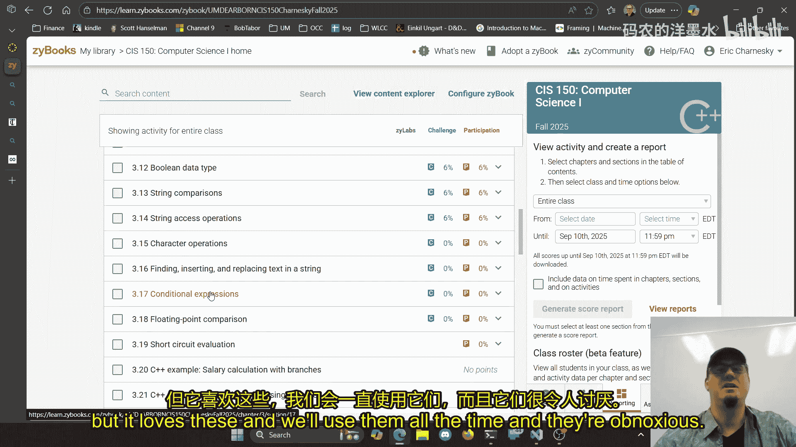

Now this actually works out kind of nice here so we can have a instead of like outputting here what my values are here。

 let's have a tariff cost here， so we'll have a double for。Chaair cost and。

Now we need to go set that value to something。Right， so instead of outputting it here。

 right we'll or maybe we'll do both here so we'll set tariff cost yeah let let's。

Let's just set the tariff cost to zero here， and then we can output at the very end what the actual cost is tariff cost。

Zero。Terariff cost is this calculation here tariff cost equals will'll assign it the value that we're calculating from here。

Two F's there， and then one more time we'll assign at the value we're calculating here。

And this is pretty good。 so we don't have a bunch of duplicated code， right。

 we're just cing what the tariff is。 And then at the end， we can see how your tariff cost is。

ADo sign and take the tariff cost。Aff cost。Okay， we can do it this way and that probably looks a little bit nicer we'll add end line but we don't have to have 50 different or 197 different prints here we'll just have a sea out once and we'll have 197 different calculations。

Sure that should be easy now this gets to be more complex depending on what the type of good is here because we have different rates for different things or if you have to be Apple and have lobbied the administration to let your products not be tariffed here because you have a lot of money that you can donate to the president you can get an exemption I mean for strategic reasons US national interests I'm sure that's why Apple got exemptions right what's the official line I forget you can get exemptions has nothing to do with them donating lots of money I'm sure absolutely nothing related to that。

Now it's warning me here saying on using uninitialized memory。It's kind of a weird error。

 but remember you declare values and then you initialize them， you give them a value here。

 so we declared a value called tariff cost。But it's possible none of these ran。

And see both and the compilers telling us， hey， you might not have set this to something I think makes sense here because it's possible this didn't get set。

喂。😊，So。Different way of calculating this year。Some we can do so we can check to see or maybe give it we can either give it a default value start with zero or we can use that conditional operator so the conditional operator。

Ugly， but it's okay。 So let's give it a try here。 So instead of these ones here， let's go。

I guess we have to use it in here， though we can go。Let's go set it here。Let's say my tariff cost。

Is equal to and now I'm going to give it an in line if else expression these conditional operators。

 they let you give it an if else in line so it's essentially if something's true here's a value else here's a different value right if that's all we're doing with than if else here then I can do this right in line here so we'll say the tariff cost is。

And then I give it my expression， so this is my total order order cost less than 800 then。

And then we give it a question mark here is zero colon。Order cost times。

 I'll just go to the tariff rate here。 I don't actually have this set yet。 we do。

We do one more variable here。 So double for tariff rate。Great， then we'll start at zero。

And then I'm going to set the rates here this way。Tariff rate， the tariff rate。

So now we get this garbage line here， this is a conditional expression so here's the condition if it's true we get this value if it's not true the else we get this value here and this is why I know people don't write them because these are awful looking right is this helpful at all no but look I've written less code and it looks fancy I saved five lines of code so it's the exact same thing we can say if my order cost。

Is less than 800。Then my tariff cost。zero else。A tariff cost is equal to the order cost。Timesterra。

ok。Six lines of code， one line of code。Sure we're much more efficient and fancy and now you might have seen in Zybooks and you might have had someone tell you these curly braces are optional。

 which is technically true here so sure if you want to save one more line of code here。

Or two lines of code， right we can do that with an if and else this way。I would。

Strongly discourage you from ever excluding your cur races here。I think it's a terrible practice。

 some people love it and I just hate it and。I remember this was a very long time ago。

 probably before some of you were even born because this was when I was in high school the Safari browser had an issue where the SSL security broke。

 there was a way to bypass the security of vulnerability and it was related to the developer not using curly races here because they had two lines of code here like something else was supposed to happen like I don't know。

 tariffra。Equals something else is supposed to happen if you don't include curly braces。

 only the first line runs。Here， and now nothing else is else is detached， doesn't even work here。

 so I think it was probably in their else block here， right？

They probably had something like this I forget exactly what it was here so it looks like if this is true this part runs else this part runs here but without curly braces this line will run every single time 100% of the time and cause an issue so just always use your curly braces here。

I promise it's a good habit here when you go get a job if they tell you you don't always need to use curly braces just smile a nod you don't it's not worth arguing about here but I would assert it terrible practice and you don't even have to type them like it generates them for you you're not saving any time because then you have to go erase them yourself like you've taken more time to go erase them and you could have just left them here there's any good idea you' going to make your curly braces for you but this conditional here is the same as an ets so all it does is take this value or this value here and the reason why I hate them because I can never remember my question mark first to my colon first。

That's really the entire reason I hate them right because I don't remember which one you're supposed to put first and if I have to go like look it up here。

 I've wasted my time when I could have just written an F here and I feel like these look look better。

No。You can also do terrible things with conditional expressions where you can have a conditional inside of a conditional。

Here， and at this point。You're just trying to hurt people， but you can so was saying， okay。

 if it's less than 800， there's no cost then what otherwise then will say a if my country of origin。

Is equal to Brazil。I can't spell Brazil。Then we want to give。I don't know。

 like just don't just don't bother it's not。NoNo one wants it so don't stack them here you can have ifs inside of ifs else's inside of things。

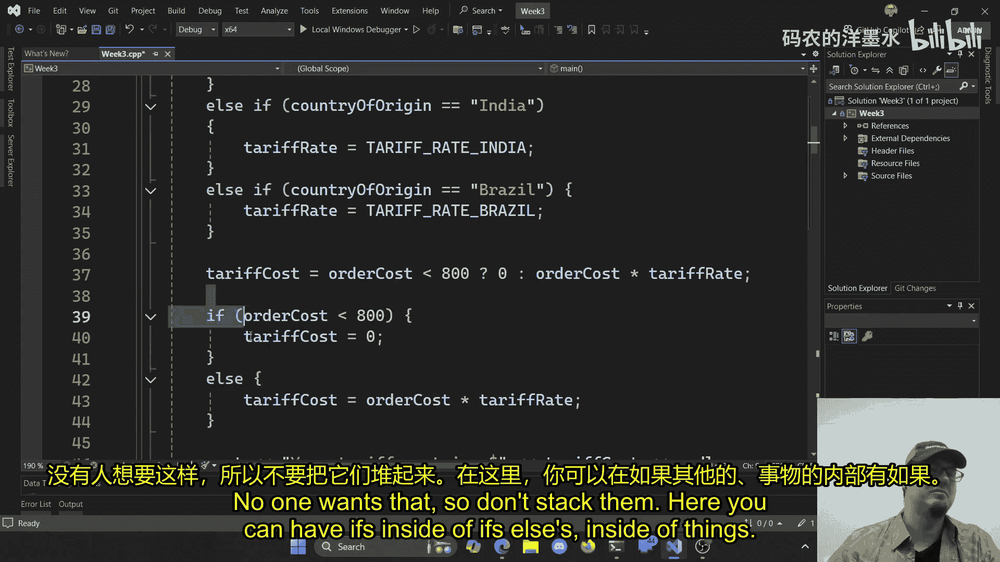

Just do it this way life is be a whole lot easier so the conditional expressions。Strings are fun。

This is a fun piece here so we can look to see if something is inside of a string with the find function here。

Now， if it's not found， it gives us this string end pause of no position is the little caveat here。

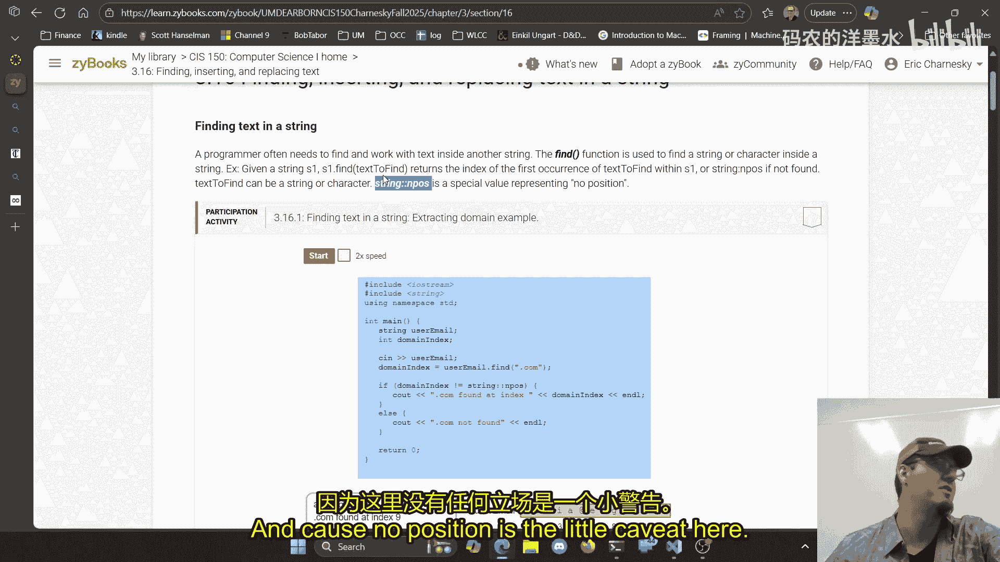

Want to see hey did is there a particular value within a string here。

 so we'll ask someone maybe how about a string for an email address。Okay。

 and we'll ask them enter your email address， email address。Address。

And we can see in the email address and then let's check so want to say， hey。

 if my email address find an at sign， right， looking for an at sign。

If the find of that is equal to string。No position， not felt。That's probably invalid， right？

So you got to have an app sign in an email address。

 and this is a terrible way to check if it's valid or not here。

 but can we can check pretty quickly here if we found it or not， right？If we did find it， right。

 else， if it's not， then pause。Then we going to go find where it is here so we can get the int index of at't sure。

 is my email address find？Okay， so that's going to tell me what position it's at here in that string。

 which is a lot of fun， so now I can go and do something with that information right I can go。

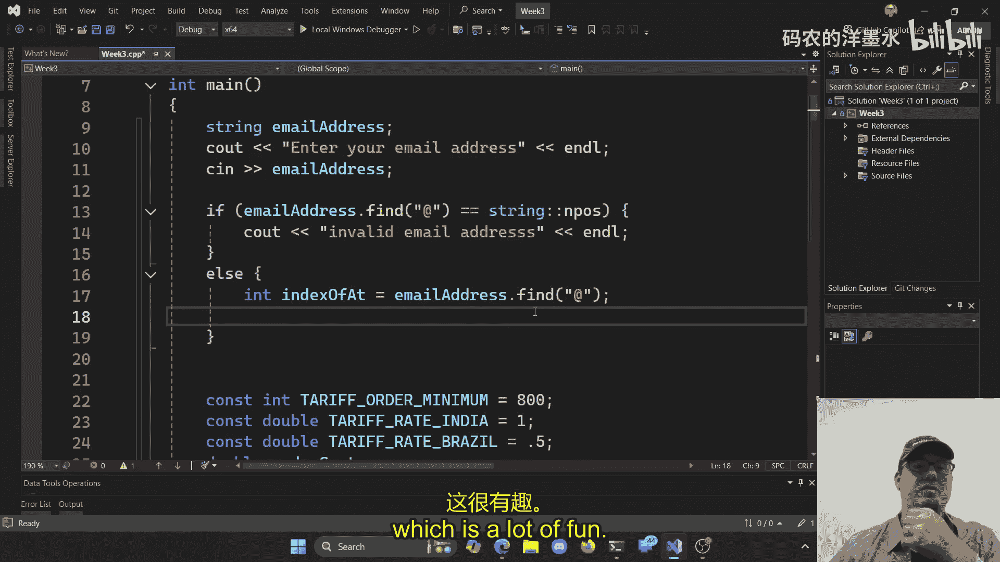

Get piecess of that string。Up to that location right if I wanted to split it on what's your email address and what's the domain here so we can find it and then we can go get it out oh yeah。

 here's the outside there we go hold us where it was we can go get a piece of a string here a substr So I want some number of characters out of that string So when you ask for a substr so we'll say I want the substr from something to something else forgot this was our example in there my apologies but it's very exciting right so their username。

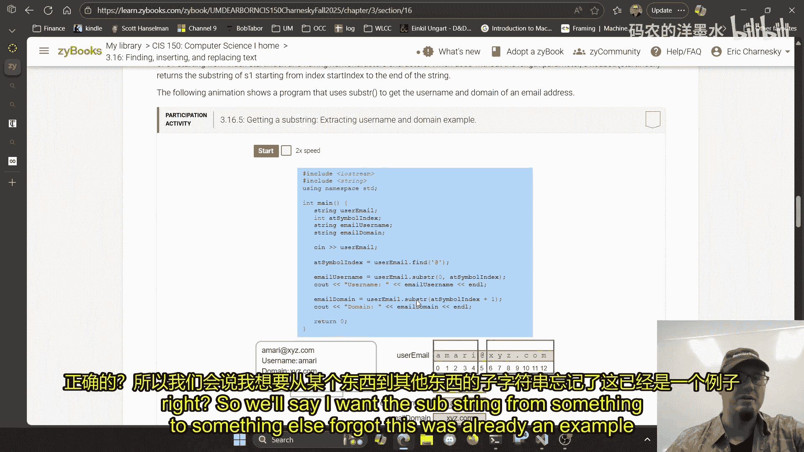

Or the user part of the email。Wheres。I will take my email address， that substr。

Plus there we go this one email address substring so substrR and we give it you know this is kind of ugly thinking but where how many characters do we want right well I want whatever the index wants here。

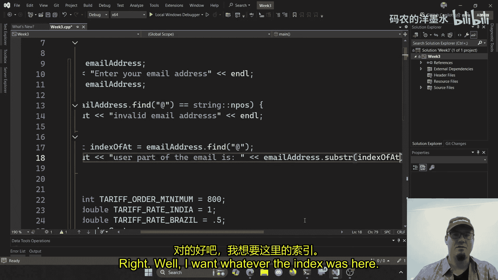

嗯。Right。So start I'm sorry to start add zero， so starting at zero is the start of our string up to here。

 giving those many characters right and then the domain。

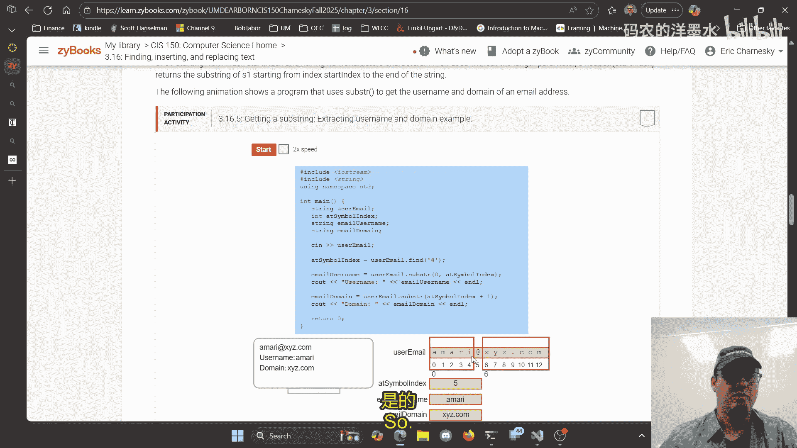

Part of the email is。Starting at so substr， starting at that index。

Plus one because I don't want the at sign， I want to go one past the at sign right。

 and then I want to go how many characters， well， I need the length of my string。

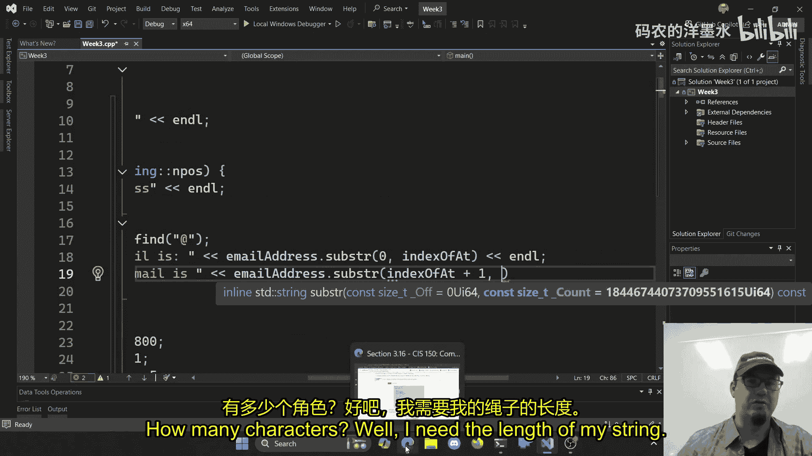

oh goodness， Oh， okay， I can just start at the end here。 There we go。

 let'll save a little bit typing here I can cheat I know we need to find out how many characters。

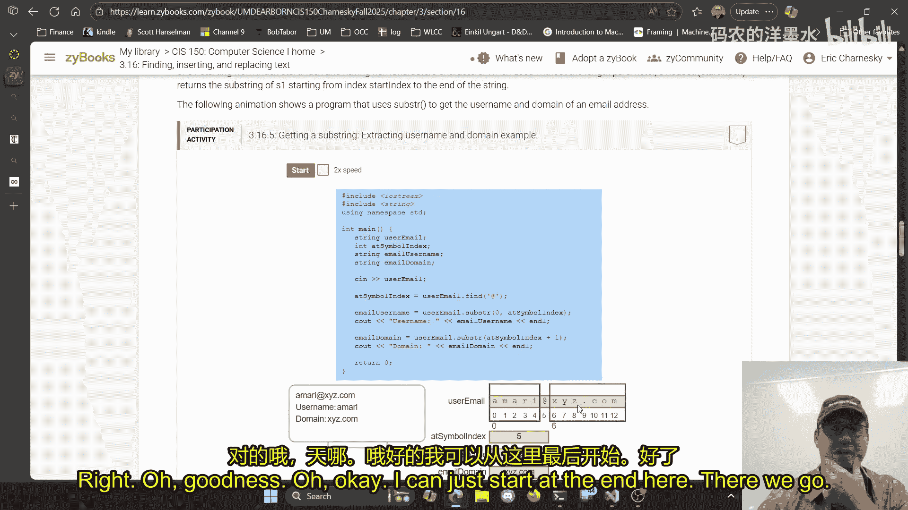

So let's try my email address see if it works。

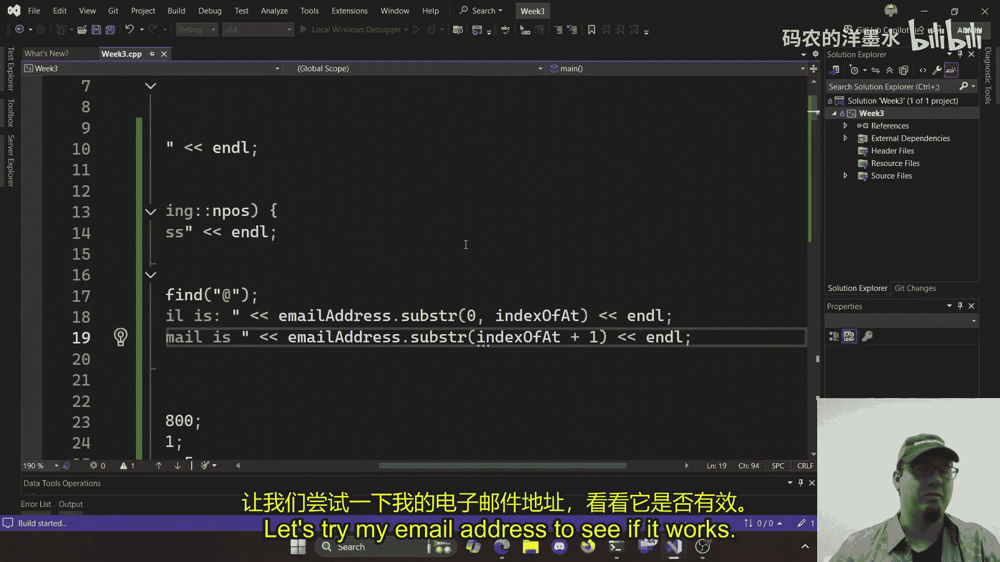

Okay。Tin us at UishedduU。So it's going to go find the out sign， so this is index zero， index 1。

 index 2，3，4，5，6，7， right， eight letters。so then here's the index of the outline is8。

 it's the ninth character。 So everything up to there each on us。

 everything after the outside is the image do Edu。 very exciting。 we've split it here。

 but being able to check to find these indexes in a string is really nice。 We can look for specific。

😊。

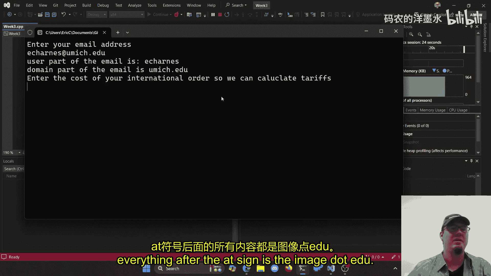

Pieces in our string as we go here with the substrate。

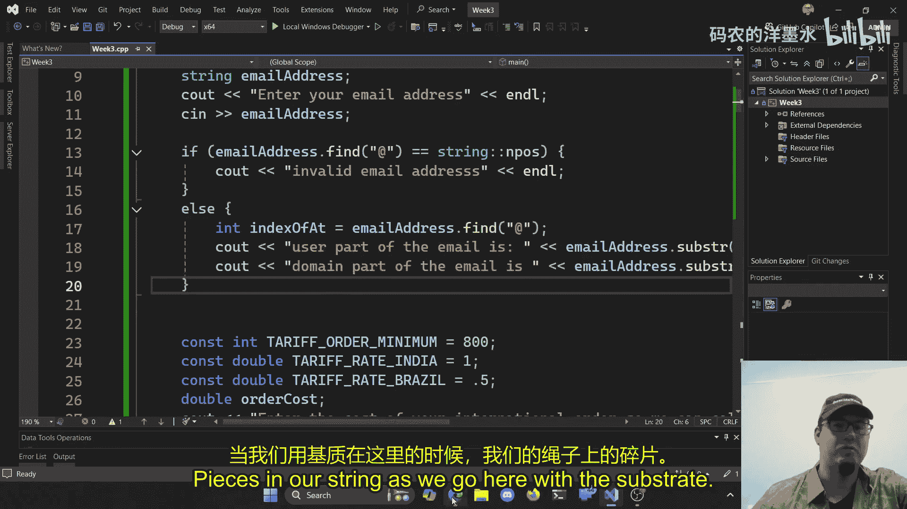

So you can get start at a position， this many characters。

 start a position this many characters or start here to the end。

different ways of getting that here now finding a character， right， where do we find that character。

 the size of a string。Minus three will get you to the last three characters。Right。

 so if you take the size minus-3， so start at the end。

 go back three and give you everything to the end， you can do some fun things with it you can replace。

Characterters in a string。You can insert characters in a string。

 which is a lot of fun so we can manipulate these to do any sort of fun stuff if we want to so let's go and should we replace here with some new text maybe we can go and encrypt our string here have a little bit of fun with it so we'll ask for some message soll a string per message and we'll see how enter a message to encrypt。

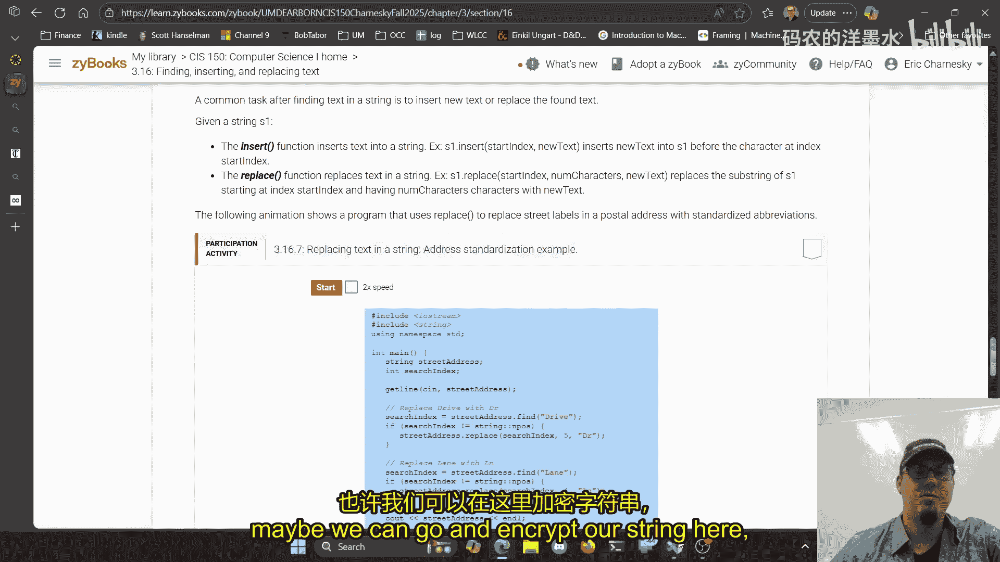

And then we can see in on message。And actually encryptpt is really the wrong word here we're just putting it through a cipher here。

 but that's okay， so we'll take that and now we want to go start replacing a bunch of characters here now this is going to not work well if I replace a character with a character and then later on so if I replace all the A's with E's and then later on replace all the E's with another character。

Well I've now changed the as to ease and how the ease' to something else so we need to like make a copy of our string first or do something else with it here。

 so what I would like to argue is probably just a quick easy way here let's start with lowercase and replace it with upper case letters。

By the way I'm never going to replace uppercase letters right that's what should make life a little bit easier so if I want。

But two lower， oh goodness， how do I do that hand lower。Hes lower bill。

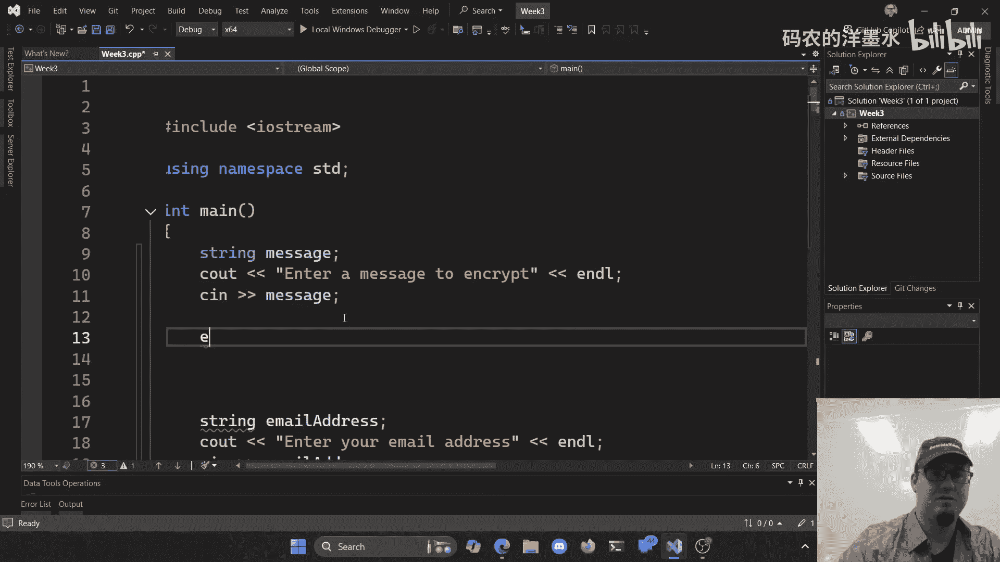

That'sage done。Oh my goodness， there's a way like so I really have to do it one character at a time。

 I might have to do one character at a time。That's ugly。

I'm just going to let's give both of us a overcase。String， I thought there was a way here。Too lower。

 yeah， okay， too lower。That's how I thought it was standard library too lower Oh I tried low。

 I didn't try too lower， sorry sage。

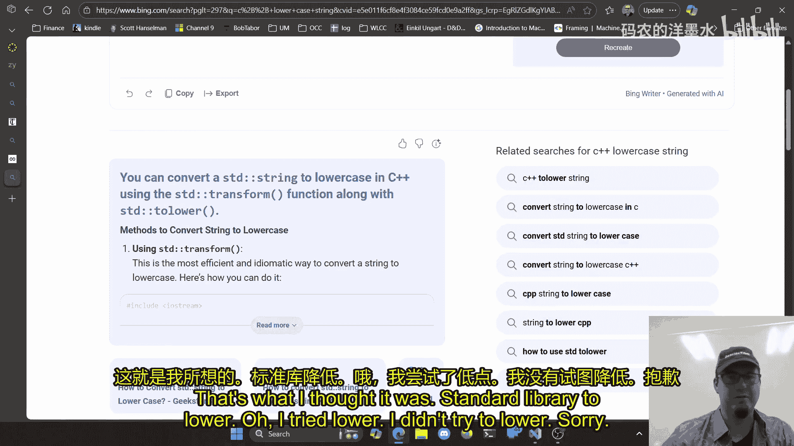

Too lower， there we go。So we'll just take our message， assign it to the two lower of message。Message。

就是。Is that going to do it for us no？Doesn't convert。Yeah。Does I do one character at a time， okay。

 I guess we did the wrong thing here。

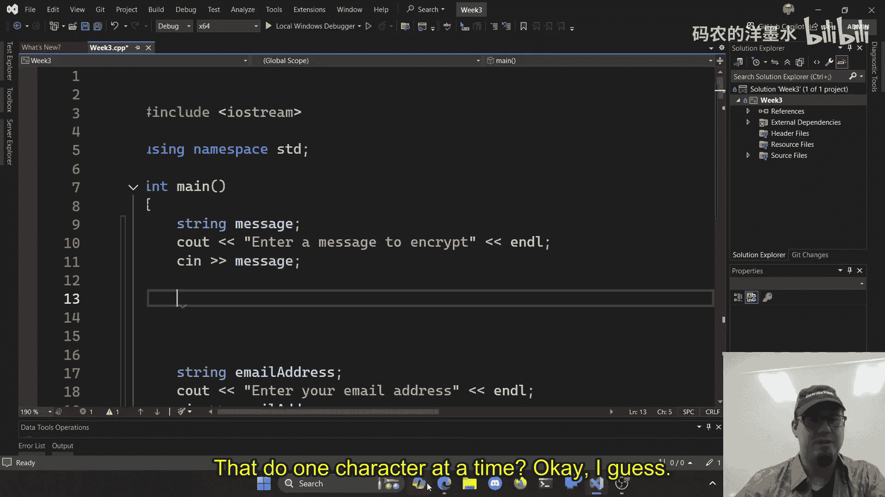

So oh my goodness。That's converting a character， I want to convert the entire string。

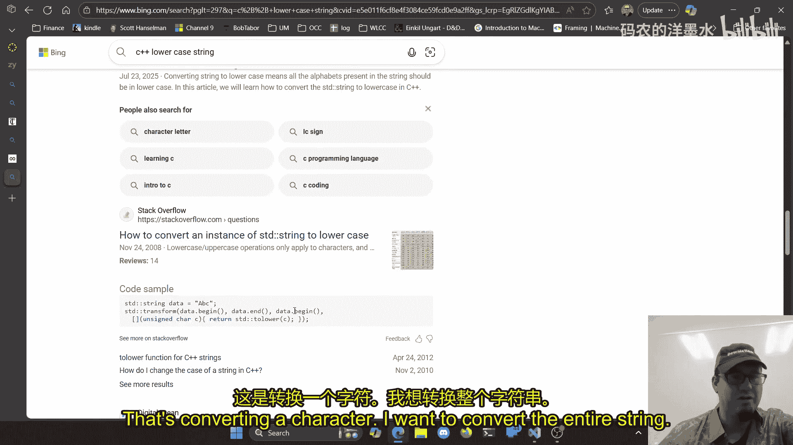

All right， we'll do it one character at a time， I guess that is terrible and I'm sad now that's okay。

 Other languages have much nicer tools see us is a little bit going。

So we'm going to go through our message here and we want to take the character。

And convert so we can get out individual characters out of our message so let's just make we'll just make a new message here so we' the string for the new message or encrypted message message then it's going to start off as nothing here。

So we'll start this office as blank and I'm going to grab the characters out of this one and add it to the encrypted message。

We'll do that here so we'll go through and convert them so I can take the crypted message and I want to add to it here。

We'll say equals the encrypted message plus I'm going to take my message。

If you want to get one character at a time， you can use this little at syntax。

 So I want the character at zero here， so we'll grab the first character and then we want to。

Convert it。so we're going to change it to something else here， so we' want to change。See。

 that gets me one character out let's try。Let's's it。No alcheist。Yeah。

If we don't have loops yet， this is much harder， I'm sorry this would be much more fun if we've gone through what loops are。

Goodness， kind dont want transform。Oh。Whatant the loop。Too lower。

 none of those are fun here without those。Yeah。

Just all just replace， all right， that's fine message。That replace， what do you want to replace？

All right， so when we're replacing here， this gets a little bit eye bookss go here so we can cheat and use our replace so we got to replace what。

嗯。What address are we going to replace？With what value， So from0 to 3。

 we're going to replace it with this。 we could replace。嗯。Goodness。Lth of three。

 so from zero to three replace with three characters or we could replace one character at a time here。

Re是。Place lean with LN or shortcu。Very exciting here， we just want to replace one character though。

So。We want to go find。Rich， we maybe find the ease and change it easily into something else。

So we want to replace what， so let's take our message， find。An E character here。And。

We want to replace it with。Should we replace ease with these？Oh like at this。

Oh。It's not going very well， I'm sorry。

Yeah。How many characters long， just one， one character long？Please ease with these。

And then message not replace。Message， not find。As with。Let's replace As with？B， sure。

 A with B E with Z。All right。And。Let's see out our message。IfWe didn't make a copy， that's fine。

 we didn't make a copy， it's going to be a little bit ugly。Its。Oh maybe we can make a copy。

 that's fine。 let's give a message。

See if it replaces them。So what word has an A and an E in it？So happened。你系啲答过佢。

I'm I'm sorry Apple Apple， I'm sorry， a hard time hearing Apple， all right， so we get E， PPLZ。

Replaceed， thank you， great apple。

It replaced our letters again this runs into the issue though if we actually had a Z later wanted to replace all of them。

 it' is going to be a little bit messy we can come up with better ways to do it once we've looked at oops so next week we can do much more fun ones here my apologies this is a little bit boring without a loop because now it's only going to replace the first E as well。

She is a little bit of a buffer。If we don't have those letters， if I gave it like banana。

That's got an A， but there's no E， we get invalid string position and our program crashes on us and we're sad。

 So each of those should probably have a。If。It does not equal an Npa。Great。😊，Then we go do it。

So if we have an E right in my message。Then we go replace the E。But if I had more than one E。

 well I could just copy paste this a couple times， I guess like， hey。

 maybe there's three E's in there， I don't know this is looking terrible here。

Fs bad needs loops we're not there yet so we can just you know do it five times and feel bad about it and that's okay well there's got to be a better way yes there's a better way we'll get to that better way so we can replace all of them here eventually replace all of them replace all of them here as we go all right how good are we doing on chapter three。

I think you've got almost everything short this is a fun little piece here because the way our logic works。

 C++ is lazy or they wrote it to be efficient here so if you're adding things together here。😊。

The first time C++ C is a false， it stops evaluating。Because you said， if this is true。

 do something and as soon as sees a false and it knows it's ending。

 it doesn't care if the next thing is true， the next thing is true， the next thing is true。

 the next thing is true， if the first thing is false。

The whole thing is going to be false and it stops so it takes a little bit of a shortcut and does that short circuit evaluation here。

 so like 10 plus four greater than 15， we know that's false， this never even gets looked at。

Because it's false okay so short circuiting saves some time here comparing floating point numbers gets to be a pain here and you have to be a little bit careful remember because math is bad or see cells is bad at math and we have these like little bit of trailing decimal places here so what we want to do is use the absolute value here and check is the delta small enough。

She is。

Not the end of the world， but we can check here， so we'll look at one of those real quick because that's fun here。

So if we wanted to say。Let's have the user enter a number， maybe so we'll pay。Yeah。

An int for the denominator。And it' see how。Enter a denominator。And we can see in the denominator。

And then we can say the result or that's a double result。Is one divided by the denominator？

And then if we wanted to say， hey， if the result is equal to。t33， three3，33， three， three， three。

 so like if I happen at a third here， right？See else。You entered three。Else。You didn't enter three。

silly example here， sorry， but we want to look at how we can use that。

Essentially the delta between the two here。So if I enter a three， it should be about3，3，3，3，3，3。

 remember， we're never going to get exactly there。

Because if we run this in debug mode， right， so add you a little break point in the gray spaces the debugger is going to be your best friend I promise I want to learn to use it here。

We'll calculate what it happens to be。 So I put in the three。

 and then I'm going to step over to make this line run right it pauses here where the yellow line is and now I can run it one line at a time。

 So I step over and I can see a result is。

Oh。0 it's  zero。You got nothing。嗯。😊，Oh it's not a third， the denominator is a third。Should we do 1。

0 divided by  three。3。Step over right now our result is 0。333333333331。

We've lost some precision here because our decimals aren't great and we're going to check is it equal to this one？

Nope didn't work， right。Again， if we want to compare numbers of floating points here， at some point。

 we probably don't care if it was。The 15th festivalimal place， 16th festivalimal place。

 whatever happens to be here we don't particularly care so we're going to check we're going to see hey is the absolute value of this and for some reason that's fabs。

F absolute value。Sure， if that floating point absolute value， I don't know if that helps at all。

 but it's fabs of the result minus that then is less than 。0000001 or something like that。

 right whatever my precision happens to be here that I want。

So if I subtract all this out here and the difference is less than that。Great。

 so I only care about the first was that eight digits， two， four， six。

 nine digits here after nine digits， it's fine if it doesn't match right I'm okay with that。

So now we can run it and see。And I'm going to step with central denominator。

 we'll get three step over calculate result okay。Now we get where we want it to be here because we're checking is the delta small enough here were you close enough when you calculate it here because they're never going to unlikely that they'll ever match it's possible they' match here but to get the actual whatever we calculated for one divided by three is going to be rough so just be careful when using floating point numbers here because we know the last couple decimals can get screwed up here I'm going to be a little bit careful with that one。

All，Coal floating points， ranges， operators， branches。Switchches， bulloles， strings， strings。

 characters。 Yeah， other fun things with character。 This ones the one with head lower and upper。

 You can convert individual characters around。 This one's a lot of fun here。

 I think that gets us through chapter 3。 How are you feeling。😊。

A lot of stuff right this was a lot in the first three chapters you one was sort of a soft soft start two and three are foundational a lot of material kind of at you。

Get you reading done， let me know if you have questions。

 have any help or we started on our project here。嗯。And just a soft start project， not crazy hard。

 but once we've gone through chapter three， this should all be doable here。

 just some calculations here， nothing too bad with this one。How you feel able to go from there？

All questions， thoughts， concerns， All right， awesome， I will see you folks Monday then take care。

