# 【全集】密歇根大学 C++编程 中英字幕 1080P p05 Lecture 5 - 循环结构 part1 -BV1TsAZzAEHX_p5-

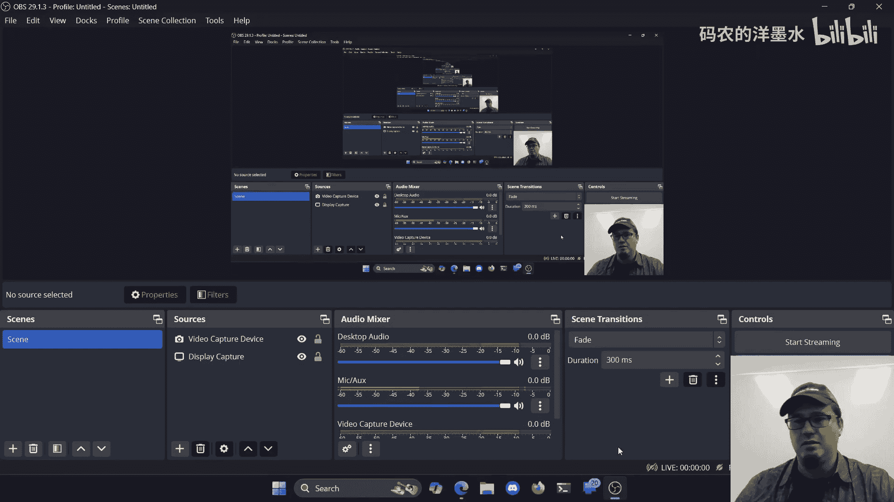

Al righty look at that I remember the record button I have forgotten it before so if you don't see me click record just holler at me because your classmates will appreciate it again I make no warranty like no I'll do my best to record the sessions that if someone screws up it screws up or if I forget I forget so。

Oh you're all here in person I don't know I'm preaching to you with that's your best bet Thank you there's three of you who took the syllabus quiz I got a couple of questions about it is great you guys get emails from Can when stuff shows up and you're like what is this crap so I was gonna tell you Monday sorry I missed you I took some nightqui probably about like five in the morning because I wanted to actually get a little bit of sleep and then slept through my alarm and at 1050 I woke up。

And wife was like don't you have class is like， so I'm like out a 40 minute drive from here so by time I showered and got here just would have had five minutes of class and that seemed dumb so apologies。

Yeah， so I'm mostly better just don't get too close like the cough is still here。Okay。

the hot coffee seems to help that so and I think we'll be okay because we had a little extra time in here planned for loops I think we had two weeks dedicated for loops and usually after three sessions you get pretty tired of me talking about loops so I think it'll work out okay。

I just wantt go today goodness so we'll get into chapter four loops so the chapter4 section of Zybooks then we won't have due until the 29th here you probably saw I didn't put scores in yet for chapterpt 12 and3 I had more than one person email me and say hey you know I got it late or I having some technical trouble or something happened or I enrolled in the class late can I have more time and instead of me going through and scoring a bunch of people and then having to read scores or for you know I'm just not going put scores in until next Monday and I'll do that for chapters 12 and3 so all welcome take advantage of that get in as much as you did if you didn't get it done yet I won't put the scores in until Monday the what day is that the 29th here so。

Anyway I just officially change it here real quick for you then。These dates。

 no that's that's not the right Monday no the 22nd I'm sorry we can't。

 the 29th' will be for chapter four， we put that in here。So here's chapter four。我。

And then that'll be Monday the 29th because we've got a little bit of time on that。

 I think I've put these all 100 points to make it easy。

And I'll go on and change these deadlines why not we can do that real quick。

 so let'll just do the 22nd for these。And then I'll go and put the scores in for everybody and this does include design Z labs。

 so if we go and look real quick can give you a snapshot here。Um。

 the sales rep for Zybos called me and was like， did all your students get the book because they're concerned not they're not making enough money？

I mean， they're concerned you're not learning。Pleasely。

So Is like most of them got it so yeah so not quite as complete on chapter three。

 so maybe this little extra time is helpful for several of you folks。

 which is fine here and even 100% on chapter one I'm a little disappointed。

But that's okay it's your score it's not my score， it is what it is So the weights for these things when you look at it they give you like a certain number of points here like this was the one point here for that。

So the challenges and labs are worth more than the participation。

 just the way it's all scored out here， right。And so that should work out okay for you here most of these got done here。

 Okay， 75% of you got through。嗯。Yeah， and we'll just go from there， so two weeks for chapter four。

Or two weeks from Monday is that reasonable again it's your own benefit you want to keep up with it because it's good practice if you leave it all to the end it's just it's not not beneficial and then it just really feels like busy work and ideally it's good practice that sort of thing so right let me find your visual studio。

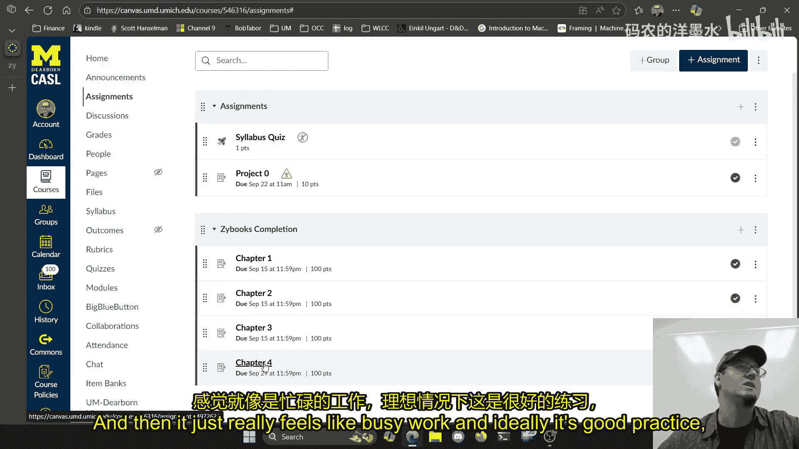

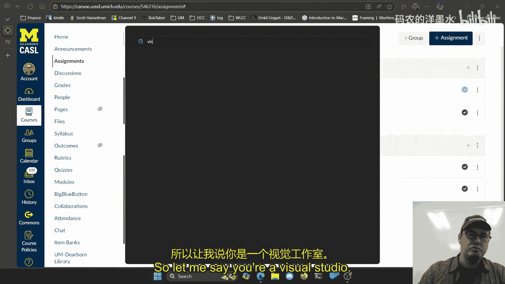

And we can make a new project and talking about loops so loops are a lot of fun。

 there's a lot to it though so it doesn't seem like there's a whole lot but I promise it'll get more interesting as we go here so we'll start with our wild loops here and then we'll get into four loops we'll get into nested loops which are my favorite here we can do lots of something and nested loops and then we'll look at some fancy keywords that I don't like in loops but people use I just don't like them because they confusedfuse me I get confused easily and I'm a big fan of code should be readable and understandable and you should go to look at the code and understand what's happening without having to do mental gymnastics and the break can continue keywords make you have to do a little bit of gymnastics here we'll look at scope and then enumerations is fun that's a fancy word here we'll look at all those as we go okay。

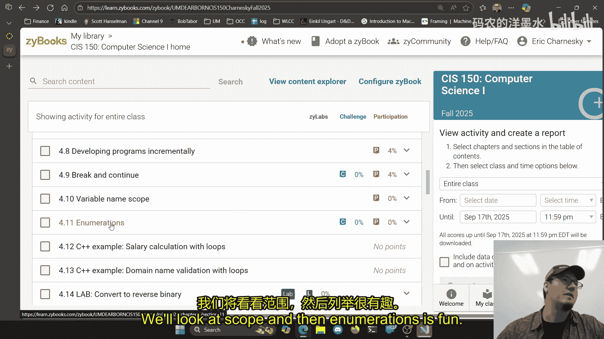

All right so let me start a new project here and I'll make sure I put it in the course repository right pick the location here so I'm going to do a console app that gives me the starter code I like that you can start with empty that's okay too I don't want to put it in the project zero folder that was our demo showing you how you would go and clone the repository make your project in that folder so get contract track it I'm just gonna to put it in my main course repository if you're never sure just click your three dots and go browse that's okay too I like to copy paste I would like to click less here that makes me happy usually call this week。

For loops， are we still in week three， this is the end of week three。

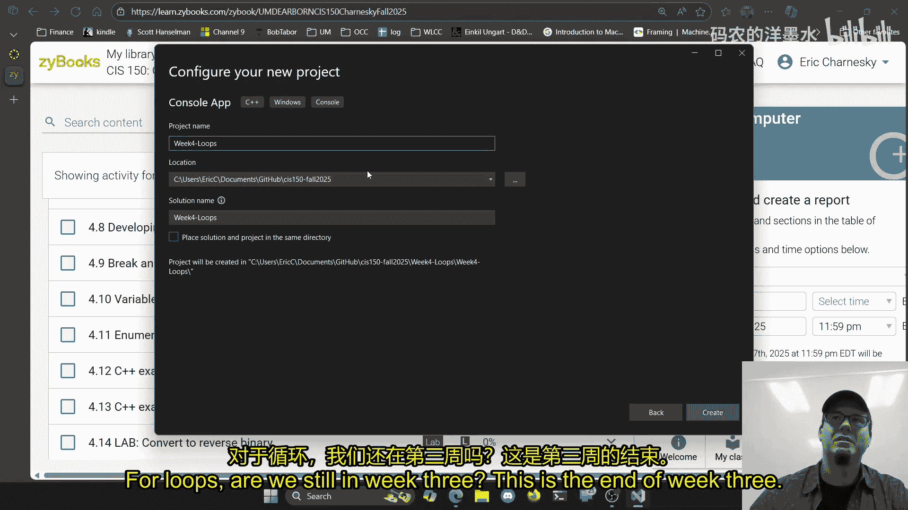

I really don't know what day it is here， I'm sorry， it's the cold myth。あ。

We not know either is it three or four。It's trying to start counting on Wednesday always confuses me so like I do this is week one。

 this is week two， this is week three so okay， we are week four sort of。

Yeah that it's like just a day it was weird okay I'll call it week four os just hopefully that keeps it a little easier to view things gets alpha sorted so if you put weak and then a number here it should sort nicely。

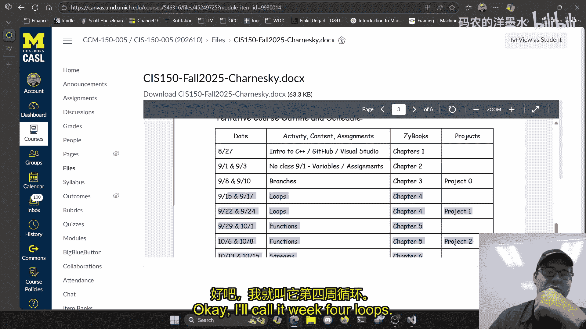

Hopefully it works out like that。And then we'll create that project。嗯。Yeah。

We look at random numbers yet。No， no random numbers okay well it'll be fun we'll do some random numbers in a minute because this makes our demo much more interesting again I like the using namespace standard someone tells you not to use it to smile a nod but I'm going to keep using it because I don't like typing a bunch of stuff and for some reason I really like these ends instead of the backslash ends again I think it's just a little more visually appealing as all makes no difference whatsoever here supposedly this will work differently on different operating systems because some operating systems like a return character and a new line character so I'm just like the new line character I would have to go Google it I don't think it makes any difference for our purposes。

So make sure we get a little hello world。Always good to start with something and then if I fire up my Github desktop client。

 I can see if it's tracking new files here， I got it in the right spot here I go make sure I find the right folder my repository here I got a couple Yeah and I see my solution file my VCX Pro file my CPP file that's the important one at least have that one the rest of the project files make it nice and easy if you can open it later which is handy at least have this one here I'm tracking life is good here I can make a commit why not before started。

And then we'll push， so push right and manually syncs to the cloud。

 there is no automatic syncing here it's not like your Google Docs that as you type it saves。

 which you can， you know if we think through enough here that probably makes sense you don't want your code to be changing on the fly because as we're typing。

 it's not even going to run。You got to get to a point where it's runnable here。

 so some random numbers here。If you want to pick a random number。

 we get to use this random function from the library which is really cool so we' built in lets us generate a random number so we'll have I don't know we'll call this the lucky number here equals so it's RA and then a set of parentheses now。

Rand。Does some weird stuff to start with here。It should give me better。 I have to search online。

 really。

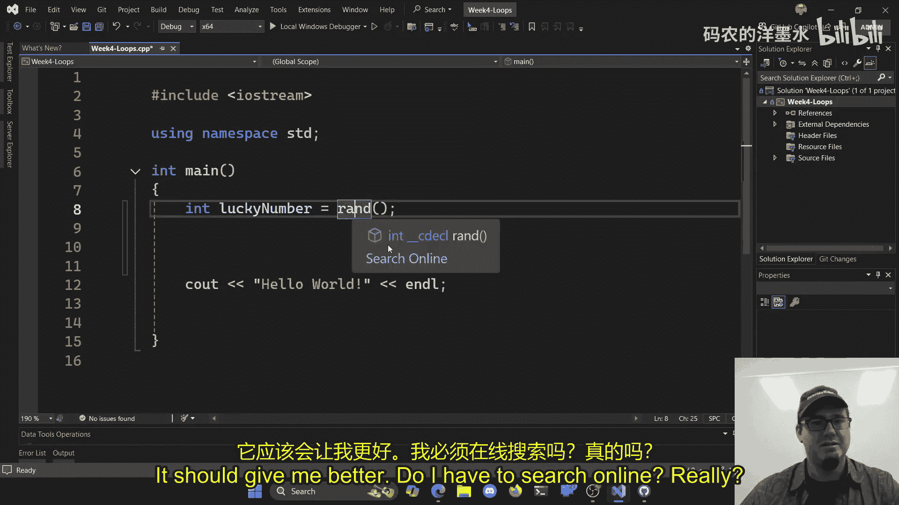

是。I want the whole definition。 No， okay。All right， that's lame。

 we can just run it here and see instead of waiting for some output here， here's random C++。com。

 a reference here， generates a random number between zero and the random Mac。

Just some sort of big number depending on what's in your C standard library。This can vary。

 I don't think it's changed very often at all here。 I wouldn't worry too much about it。

 but essentially zero to a really big number， probably about 2 billion or something。

 as my guess here。 we could look up what random max it is right now。GoodnessH the a supported here。

At least 32，000 here， depending on how they've implemented it， that's helpful。

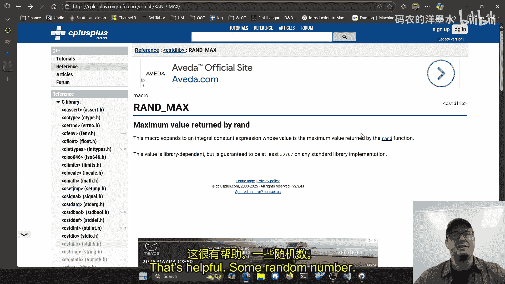

Some random numbers。 So if you want a specific range of numbers here。

 we're going to do some quick arithmetic right， and they had some examples here with the modulus operator。

 That's one one of my favorites here。 That's the integer remainder of division。

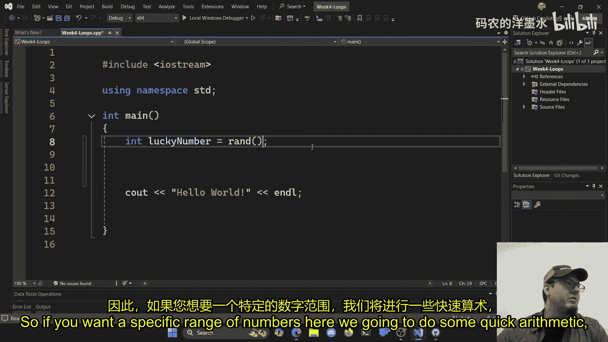

So if you take a random a number mod 100， you're going to get something between 0 and 99。

So if you want to number one to 100， you mo by 100 and then you add one。

it gets to a number one to 100 which is nice so if we want to pick a random number one to 100。

 we'll do a random number mod 100 plus1， you're welcome to add parentheses around modulus if you want it's not going to hurt anything。

 but it has the same level of precedence as division。

 so we know that it will do the division first and then add one。

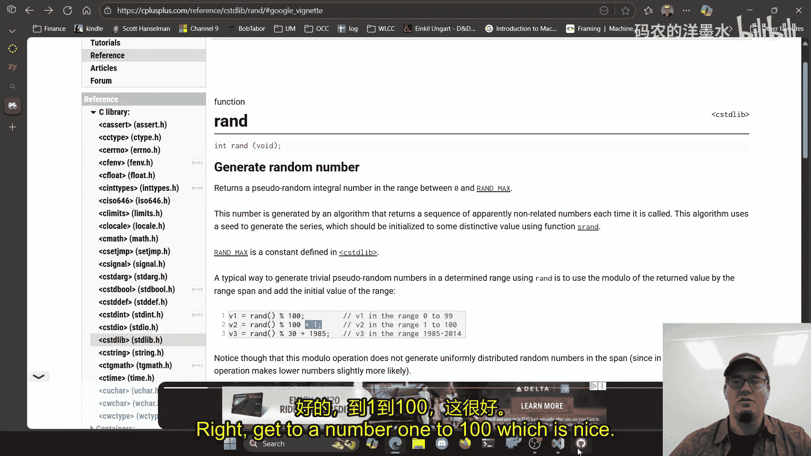

Right， you know you all have at least in calculus so I think you can do of operations by now So we got a random number and then we want to ask the user to guess it right so we can see out guess a number。

😊，One to 100。And then we can get the I don't know a guess and we can see into the guests here。

Right now we can see， didn't they guess the number， right， they either guessed the number。

 they were too high or they were too low。Right， so we can say， hey， if my。Yes。

 it's equal to the lucky number。We can see how you guessed it。And then line， no。Elsif。

We probably don't need the else here right， because we're going to check hey。

 if the guess is going to go less than or greater than first， you look' too low or too high。

Less than less than， Okay， so the guess is less than the lucky number， right because？

They are exclusive just because you can't be equal and you can't be less than we don't technically need else here。

 but it's a， you know， it's fine one of these three things will happen and then it's ever so slightly faster。

Not that it's going to make any difference at all for us。

 but if we were to play this like a billion times， you would save。

 you know like one second or something ridiculous here， but again。

 this is probably better here to have it chain together with the if El if here so we can say。

You' too low。Too low and on N line and then if you didn't match and you weren't less than really this could just be an else。

 we don't need an if saying your guess is greater than because we've changed them together if we had three separate ifs。

 then we would have to be guesses greater then if we weren't using our else clauses。Either way。

s okay， it'll get the same job done here， so it's really just a style preference here。

 we'll say too high。At this point here。 Now， this is going to be kind of tough here for us to guess the number 1 to 100 and get it right the first try here。

 Well， let's try it anyway。 What number should we guess。

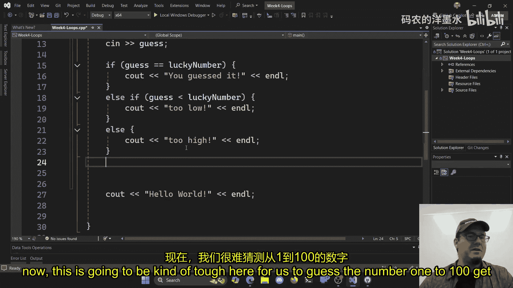

7272， Oh， Itype 73 too high。

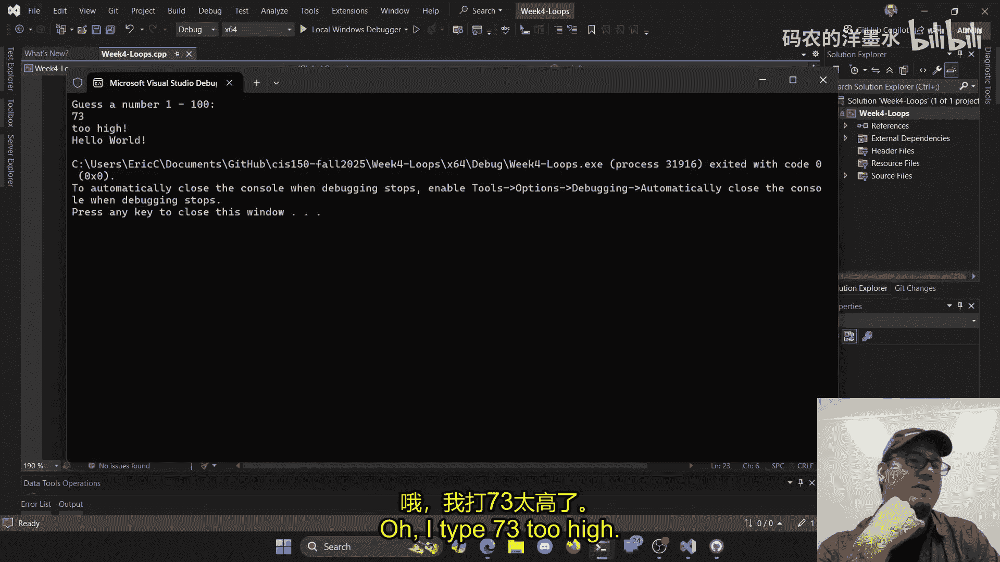

Oh and we still have hello world so this is not very interesting or very useful here it'd be nice if we could play it again and play it again and play it again and play it again and you know until we guess it right and。

😊，IThink I mentioned my rule of thumb before， but I'd like saying it often here。

 if you have the same code more than once you should feel bad about yourself。

 pretty good rule of thumb here， we don't want to have to type the same thing out more than once。

 we don't even want to have to copy paste it。RightBecause as we're going to learn today there are better ways to do it。

 we don't need to copy paste this code five times and have you guess and check and guess and check and guess and check five times that's really tedious so what we get to do is we get to use a loop。

We can tell the computer do it again， do it again， do it again， do it again。

 do it again until something is true or false right we use these Boolean expressions。

 that's our fancy technical term， something is true or false to say if or else if LF Llf Elsif， Ellf。

 Elif， whatever here we have a Boolean expression what we get to do is we get to make a Boolean expression that says keep on running this code until it is true or false here So we get a while loop。

 So instead of doing it one at the time we're going to say while my guess here now with a while loop。

 this one runs。If the condition is true。Okay， so it runs if the condition is true。

 so we only want to run if it's true here， so what we want to have happen？

What what do we need to be true here if we want this code to run what we want to not be equal to the lucky number if you guess the lucky number。

 you don't need to guess again。So we're going to flip it here so we're going say。

 okay if it's not the lucky number and now I can just take this bit here and slide it in。

 I just cut and paste control X control the cut and paste so if you're not the lucky number you were either too low or you're too high。

You could not have been the lucky number。 This block of code will not run if this is not true。

And it's only not true if it is the lucky number， right we got a little bit of a double negative there if it's not not the lucky number。

Right then it doesn't run， I know this sounds ridiculous right。

 but the Y loop runs if this is true so if you guessed not the lucky number。

 we're back in our loop here and we're probably going to tell you， hey， guess again， right？

So guess again。And I don't know do we need the same prompt here we don't need to redecl in for guests right we already told the computer we have an integer for guests right so we just need to give some prompt and take some input right and then I get to the end of my curly brace and we come back to this condition check so it runs if it's true and we get to the end here and it says go back and check。

Effect the condition。Okay， we go back up to the top the condition， if it's not the lucky number。

 run again， if it's not the lucky number， run again， if it's not the lucky number， run again。

 if it's not the lucky number， run again， if it's not the lucky number， run again。

 it will run forever。Here， so you want to be careful that your condition here has a chance to change if we never took any more input here。

 we would just be stuck in a loop forever。If we  typepo it had some sort of a logical error in our code。

This will just run infinitely right if I take out that input here we' watch it run forever it's very exciting here there's build errors oh goodness oh because I cut and paste my if block here so。

I don't even need the if here because the only way for this to stop running is when this is not true。

And if it's not true， then you did guess it， so I can get rid of that if here now we'll on and we'll have an infinite loop if we don't guess it right the first time。

 what should we guess？

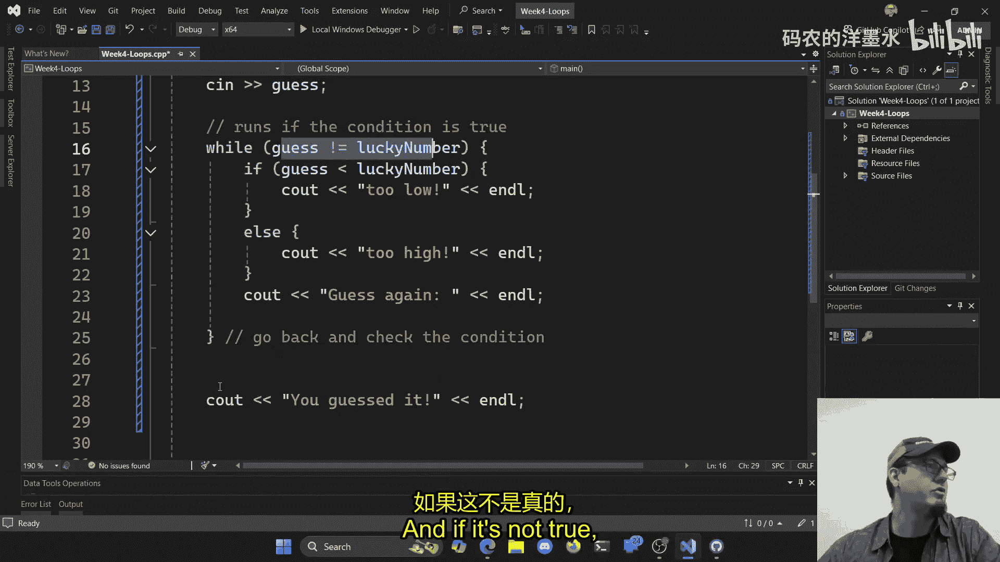

不是。6，69。Too high， too high， too high， too high。 Gu again， too high。 guess again， too high。 Gu again。

 Too high。 guess again。 This is very exciting， right， If we forgot something here like the prompt。😊。

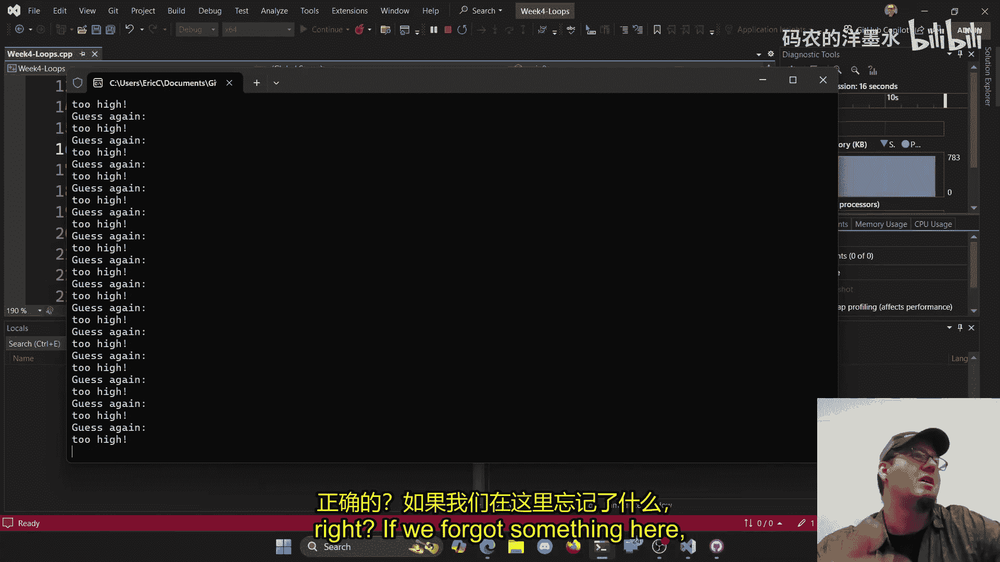

We're stuck forever so like control C we'll kill that here or you can just close the window or hit the stop and your debugger here you got a couple options。

 but we want to see in the guess here。

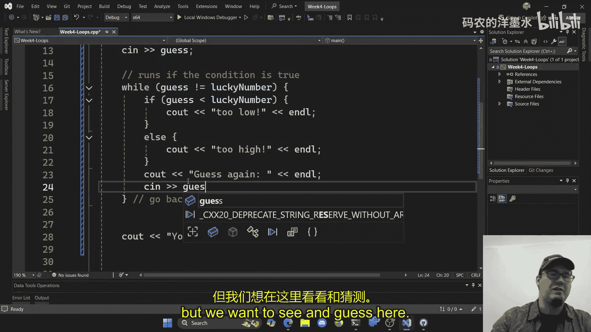

So eventually now we should be able to guess the lucky number， right？And what we guess。

 you all know how to do this smart way， right？You start in the middle yeah。

50 all right start in the middle too high， All right， so split the difference if that was too high。

 go between 0 or 1 to 50 that was too low all right between that is like 37 that was too low like what 44 that was too high I don't know。

40 is too low， 42 Hey， we got it 42。And our program finishes， eventually that became true。

I'm sorry the the not equals the lucky number became false because it was the lucky number and the loop is able to stop now it doesn't stop your users from being stupid and just one。

 one， one， one， one， one， one， one， one， one， one。But there's at least a chance the user is not going to be dumb and the program will stop eventually。

 right？we can't control what they're going to give us。

 but they have the opportunity to get out of this loop eventually here right you can click the extra close in you can come up and stop and anyway and go about it here so this is our first loop here it's a while loop if it's true it runs so it's possible your while loop never runs right if I put a breakpoint in here。

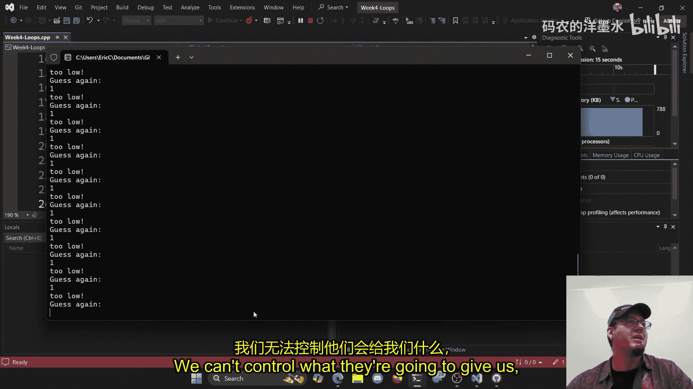

We get to pause the execution of our program， so the debugger is your favorite tool because this lets you see behind the scenes and I can see。

 hey， the lucky numbers 42。Right so I see what the lucky number is， okay， awesome。

 so when I go I'm going to continue on it's going to now it' will prompt me here。

 I guess the number 42， my while loop never ran。

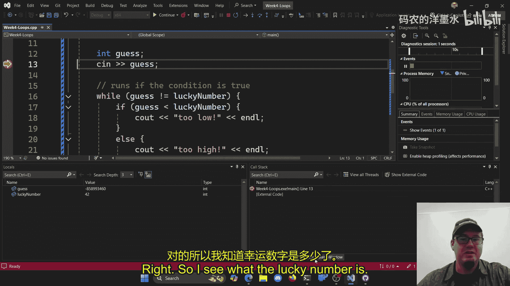

Because I got the number the first time， so it's a pret loop， it tests to see if it's true。

 if it's true it runs， so it might not run automatically for us here。

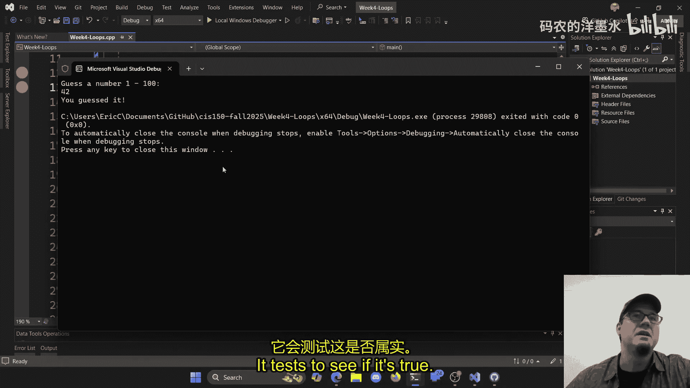

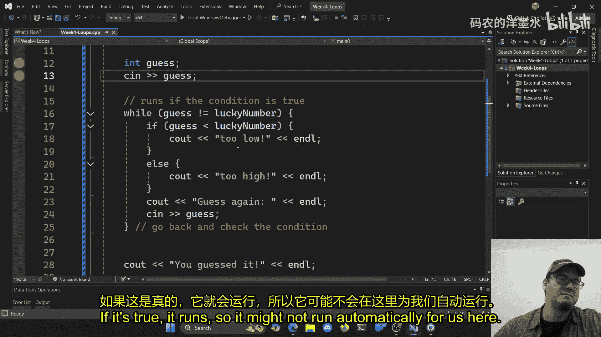

I was 42。Is it 42 every time？

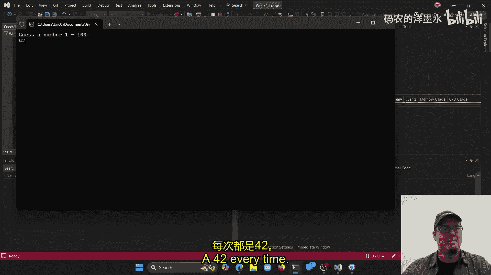

42 every time how exciting so random is not actually all that random here。

 so what we want to do here to get a more random looking number here now the reason why it's not random is because there's just code behind the scenes that's a generator random number。

And if you've learned anything about code so far， you know。

 it does the exact same thing every single time。So every time we ask for random number we get the same sequence of random numbers。

 these are pseudoran numbers they're kind of random random looking here。

 but we'll get the same sequence， if we want to change that we're going to use S random here。

 which stands for seed random， so it says here's a seed value。

That you're going to use behind the scenes to generate your pseudoran numbers。

 and if you give it a different Cd value each time。

 it'll look like a different series of random numbers each time。Okay。

 and then think we give it like time or something silly here。

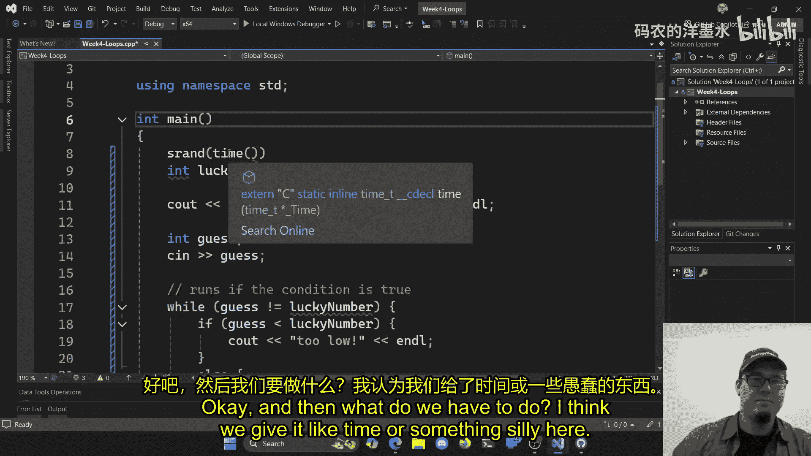

I got this I have I'm just going to go Google it C++。I think it's with time。

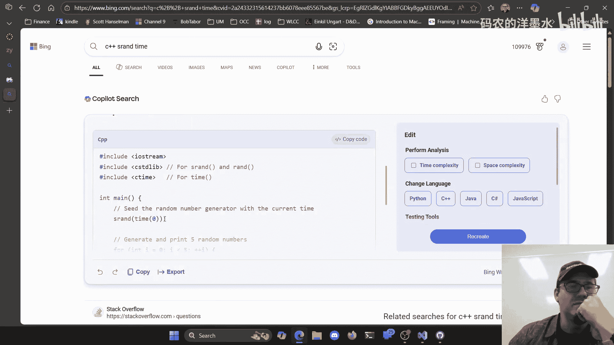

Yeah， okay， the C time library， that's what it is here， so you have to include C time here。

And then we should be able to ask for time， and I think we give it a zero。 is that right？

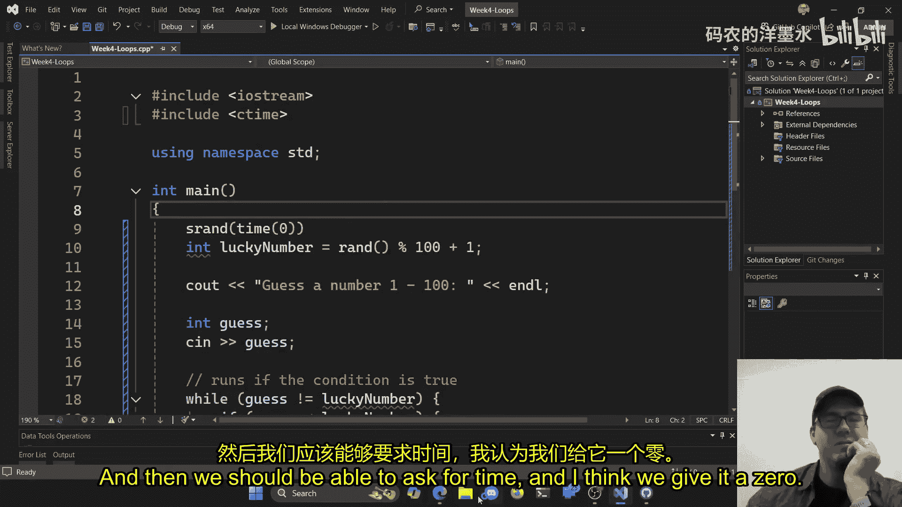

Yes， S round of time of zero seeds around the number generate with the current time。

 What that does for us is every time I hit run， it's probably a different time than the last time I hit run like the clock time。

Just some number of seconds have gone by right so it will look different every time for me now now that I've seeed it here and I suppose I should be good here and cite my source because I forgot here being。

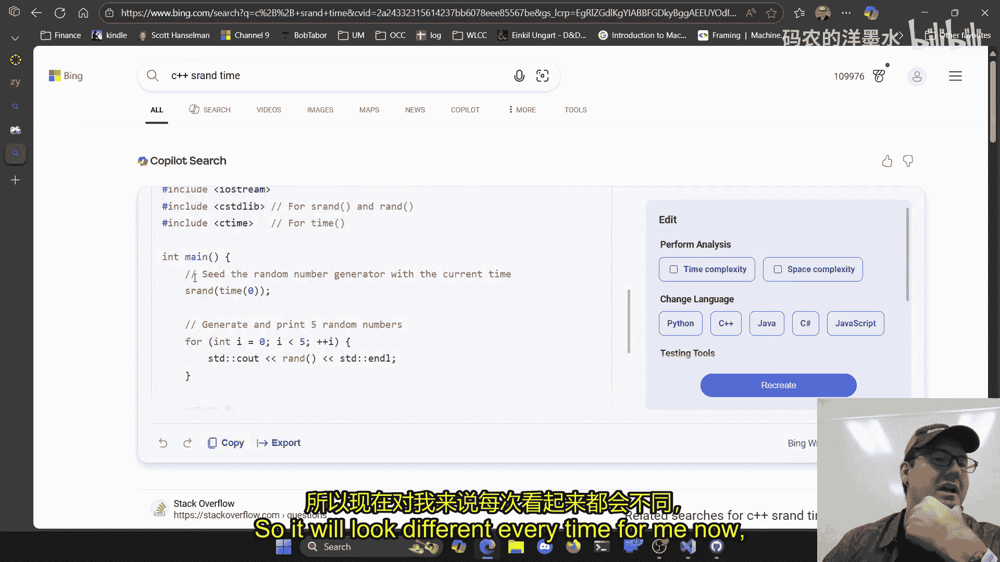

Lo at that I have now cited my source academia is happy with me here and I need my semicolon so now it won't always be 42 here and if you're going to cite some source you've got some code from somewhere that's not yours that's all you have to do just drop me a note this is where you got it from。

I'm perfectly happy with that people get paid a lot of money in the industry to use other people's code。

For some pieces， right they don't they still have to do some of the work here right。

 if anybody could just copy paste code， we wouldn't pay software engineers a lot of money。

I think that makes sense， you need some sort of skills somewhere to understand what you're doing。

Did ever hear the silly story about some mechanic mechanic who had to like fix some machinery at some place here it's like this really old guy he's been at the shop for years and years and years and he's been repairing stuff forever and he retires and then the machine breaks and they don't know how to fix it the new guy has no idea what he's doing and they call him in and he like walks around and he takes a hammer out and hits something and he gives them $1。

000 bill like really' $1000 to hit a thing with the hammer he's like oh you want the itemized bill $1 for the hammer strike  $9990 for the expertise to know where to hit。

Okay knowing a couple things here is useful right that that's why we become good developers because we know a few things here。

so now it won't be 42 right I can I took out my break pointss right as a running there it is but I's guess the number 50 is too low oh it's not 42 anymore now it looks different right 75 too low 87s too high okay。

 so like 80 I don't know too low， 84 hey， it's 84 and when I run it again。

 it's probably not going to be 84 84 was too high。

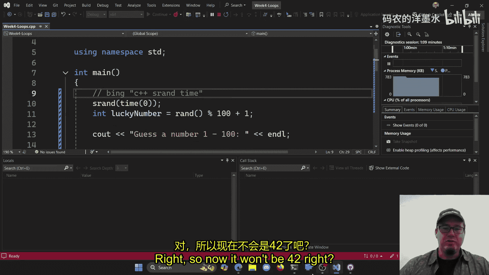

Now it looks random right and yeah it's kind of boring we probably don't want to play this more than a few times here it's only entertains my kids for a few minutes now and they think typing into that black box is terrible sadly all this class we're gonna to type into a black box here that is console and then all of next class you're going type into a console here we don't get to any interesting graphical user interface applications until you get to your language electives here and then we get to do some fun stuff in Java or Python or C sharpp and have buttons and things you can click on it to be a lot of fun。

I don't know， I find the much more entertaining most people do。

 I don't know the last time any of you used a console based application。Anybody？Yeah， all right。

 we got one taker for a console based application， you're ahead of the curve。

All right they are very useful though like it's not unused lots of lots of tools are console based we write a lot of scripts and development tools and other things and shortcuts and things that'll be console based because you don't need the bells and whistles and the buttons to click on so it'll be fun all right so let's our while loopops so it runs while it's true now other things you might do with while loops right so let's I don't know we'll put that move our next code to the top here we can even commit here so here's our guessa number。

It's a number game， right， why not make a commit here？Now if we wanted to make this even fancier。

 we could ask the user how high a number they want to guess It doesn't have to be 100。

 we could get some input and if you want to guess one to a million because you're terribly bored here in your science class or something。

 you guess the number one to a million Sure and that could all be flexible we just all the logic here is exactly the same is just what number we might buy and what numbers and our prompt and those things are easy to change with a variable so use your imagination if God to have more fun with it but other things we could do with a while here are something like do you want to play again do you want to run this again here so we can have some sort of input here so why not cha for play again。

Now， what I'm going to do is I'm going to start this as a Y here because I'm going to make this by loop。

 so while play again is equal to a Y。I want my loop to run so by starting at something that I know will make the Y loop true。

 I know my loop's going to run at least once right and then eventually at the end of my loop here I'll ask them do you want to play again。

But again， and then。I'm going to suggest here right a Y and N right。

Tell them why slash N and hopefully you'll get the right input here。

We're telling them please enter one of these characters who knows what they're going to type in。

 but if they give me a why we'll play again anything else， they're not going to play again here。

So we could take all of this here then。And reseed it。And put it inside of it。

 Do you want to play again or not。So we get a loop inside of a loop， that。It works。

 so guess number 50s too high， 25， too low， 37， 42， 46。 hey， we guessed it。

 Do you want to play again？Oh。哎。Did not input to play again， I put the prompt here。

 but didn didn't actually ask them here we're stuck in an infinitely loop。

 we were playing forever so we should see in on play again right play again。All right。

 now it'll actually ask you here and you know this is kind of getting a little tedious here。

 let's guess the number one to 10 we'll make our life a little bit easier here， make it faster。

All right， so guess a number one to 10，5，7，6 you play again。 Yes， all right， is it6。 Oh。

' we guessed it。 Okay， again， yes，6。 Oh， we guessed it oh。嗯哼哼。😊，It's not changing here。

That's a bummer， it shouldn't， looks like it should be seeding it again here。Why is it not receding？

I'm sad it's not receding here。 That's okay。 It's not worth fixing right now。

 We'll come back to that later。It'll just take some more googling here。Really should have， oh。Okay。

 all we have to do is move this out we're going to see it one time here because the next time you askcar random a number you'll get another random number here and that'll make life easier one more time to make sure it works look at that was able to fix without a Google I think5。

7，8 nine。10， ay， we guess to play again。 Is it 10。It's not 10， He， we did it seven， six， okay。

 life is good， so the next random number that shows up here， right？

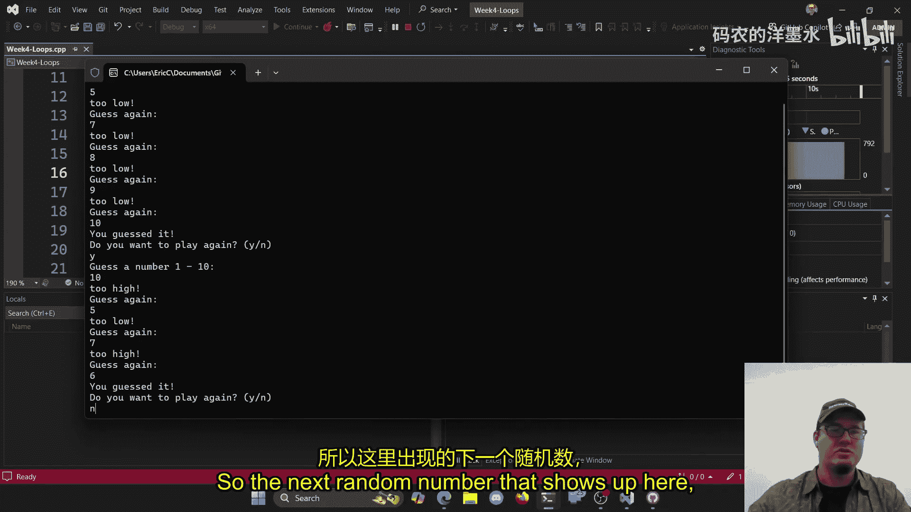

All right。So all of this then is a loop inside of another loop。

Great we can do that you can have loops inside of loops inside of loops here but these sort of do you want to do something again it's pretty common here other sorts of fun things we can do with our loops then here's our what is this an infinite。

Lalay again Hubble。Play againable because that's probably a word right it is now。Right。

 other things we might want to do here。It's a little bit annoying if I don't know if they're going to give me a Y and N right so if I have some sort of valid input here。

 I can put you in a loop and make sure you don't get out of the loop until you gave me the thing I want。

Here。Right， I'm actually， let's do it here。 Why not？ So let's we're gonna say while。Play again。

 I don't know。 So we're going to input， play again。 Do you want to play again here。

And then while my play again。Does not equal a Y。Or play again does not equal。A no， I'm sorry and。

 sorry， we want and。If it's not a Y and not an N。It's it's wrong。 If it is a why， then this is false。

 false and true。 the whole thing is false。 My whileage doesn't run。

 So I'm only going to make my loop run if it's not why and it's not that。 So if it's not valid here。

 we're going to tell them， hey， that wasn't valid。Or I don't know， enter only。Wire in。Sure。

 we'll do another endline。And ask， do you want to play again？So only a wire is valid here。

And then ask them do you want to play again and input again so they can't get out of this loop until they've given me just a Y or just an n。

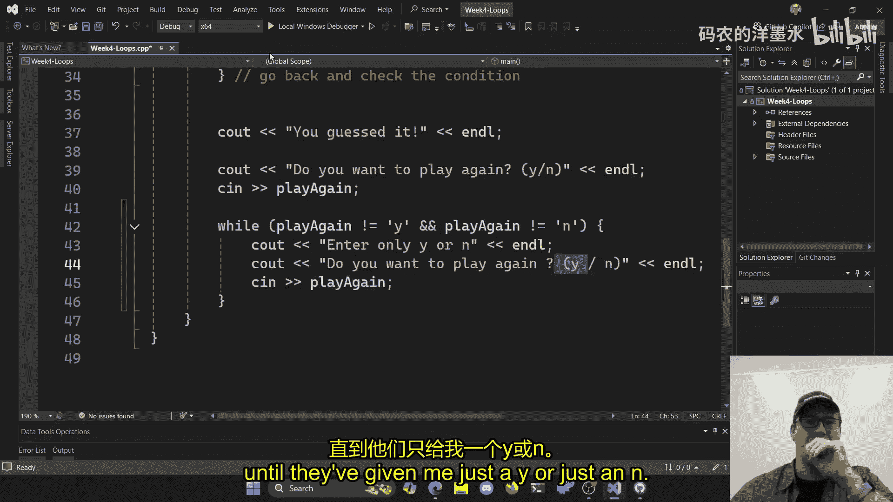

Let's try it and see。5ive2 low， seven，9，10， all right， 10 again， do want play again， yes， oh shoot。

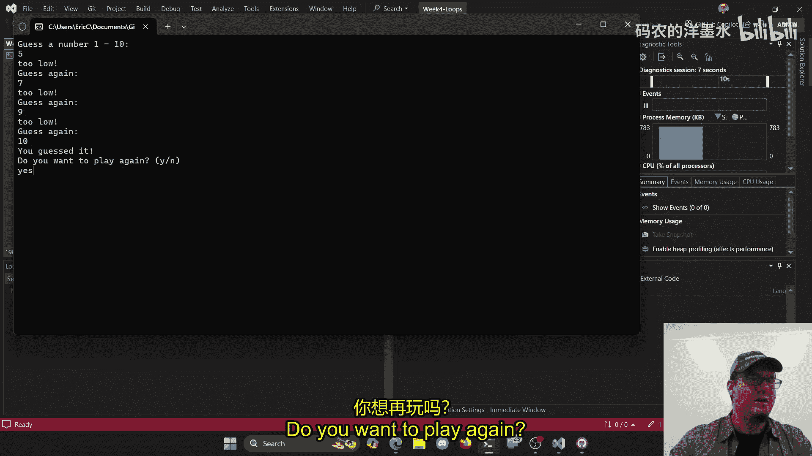

Right。If you just so when you ask for just a character here。

 it takes the first letter so I typed in more than more than one letter that's my bad here。

 let's try that again， so 10 was too high， fives too high to right go play again like A enter only wire n you play again B。

 C D E。

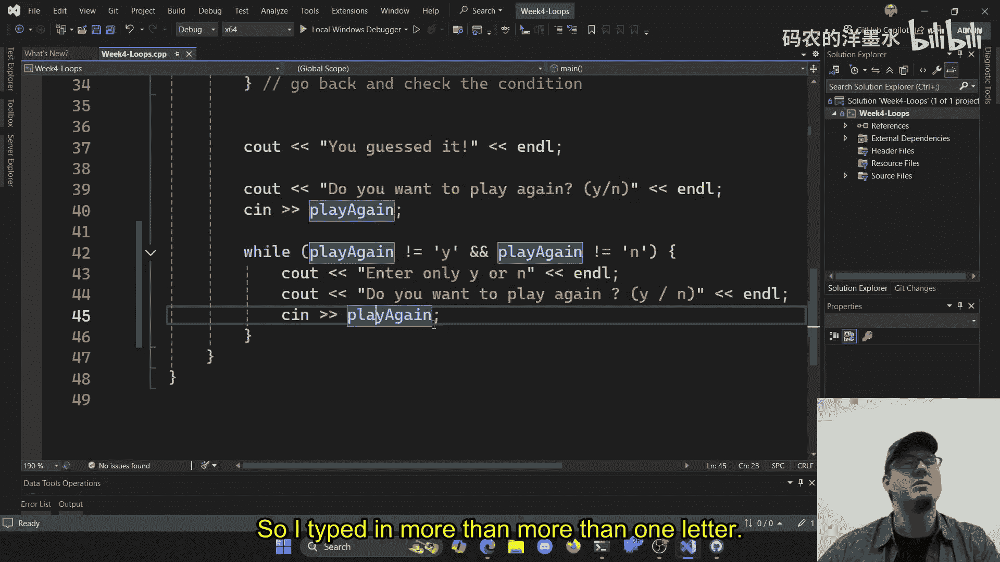

Right， F and game over。Sure we did pretty good here so so now you can't get out of this input here until we' validated it so this is an input validation loop so if I know what our valid options are。

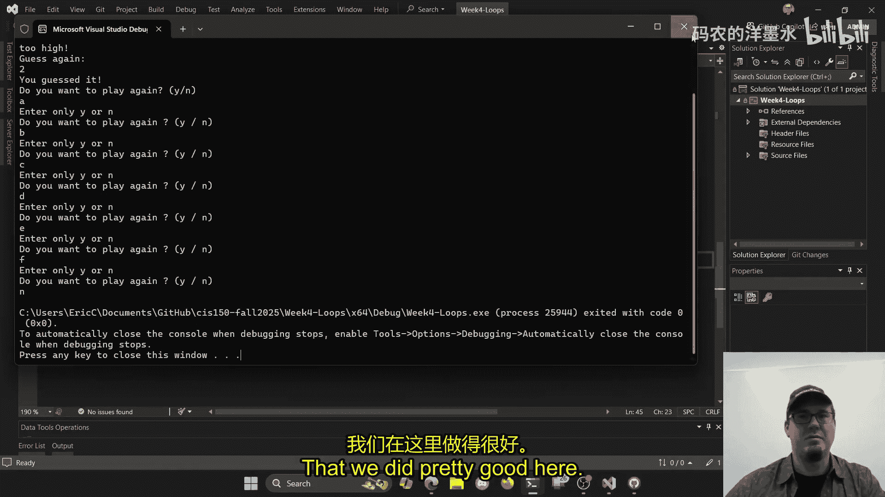

I'm keeping the user here until it's valid。It workss really nice now the problem is if you've got like 10 things that are valid options this clause gets pretty long here and that's unfortunate we just don't really have a better way to do it yet we'll get to better ways eventually we just don't know any yet so if a Y was valid a N was valid or a P was valid and the Q was valid I don't know whatever we had here it'd be a long list but we could do that right and they can't get out of it here。

嗯。So let's ask the user to to guess a number here， let's do that here so this is why comments are stupid I just did it to myself here right I have my comment documenting how I looked up SRN here and then I moved the code and I didn't move the comment。

I swear think usually I'm just in the habit of ignoring comments。

 so now my comment lies because it's not attached to the code it's supposed to be commenting。

Right again， this is why comments are stupid if someone else tells you put comments in just smile a not。

 it's not the end of the world。I don't care right that's fine if they want to give you points for it。

You can probably put the comments in it's not hard right the hard parts the CO part all right。

 so now okay now I move my comments here so if you want to ask them how high a number do you want to guess？

But number do you want to guess？And then we can input， I don't know， a int for Max。

Guess or max number。And then we can see in on max number。

Now I want to validate and make sure they gave me something good here。

 so if you give me a negative number。We probably have a problem。Right， because all of our code here。

It might actually work if you give me a negative number trying to think here。

 no because we can't mod by a negative number， that's the problem we't be able to modulus by a negative number。

 so has to be positive non zero。Right。So we can check， hey。

 while my max number is less than or equal to zero。

Change it like you did it wrong dude it again here。

 we don't need to read the clear max number and then we can tell them see how。

Let's be greater than zero。Right how high whenever we want to go so we can do a validation loop on numeric things right less than or equal to zero is invalid right so we're defining the invalid right so an invalid range check or validation loop。

Right， if we wanted to put a max to like a million and say you should not be guessing numbers higher than a million because you're just wasting your time。

 we can have if it's less than zero。Or it's greater than a million。 So in this case。

 right it is this way wrong or this way wrong， right， we could have that right， or max number。

Greater than a million，1， two， three， one，2，3， so greater than zero and less than one million。

Right whatever rain we want here is okay， we can define the rules here。

 so now we're going to ask them here。

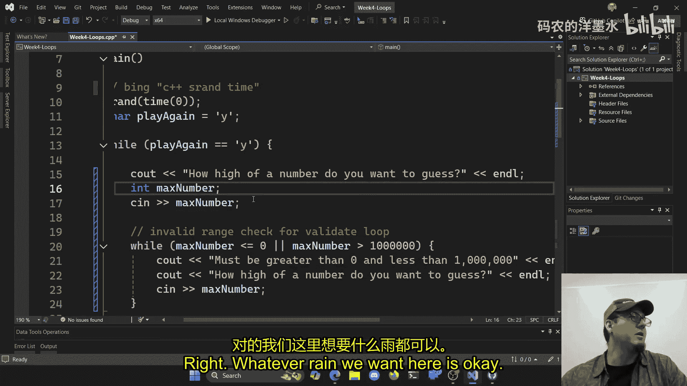

Oh I got to fix one more thing here sorry so it's not guessa number one to 10， it's guessa number。

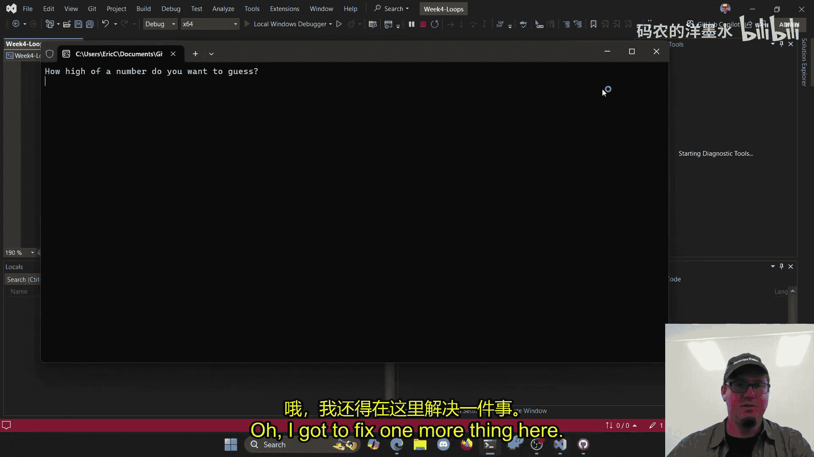

1，2。嗯。Max number。And then a colon in。Yes， the end line is kind of silly at that point。

 but that's okay。All right， let's try that。

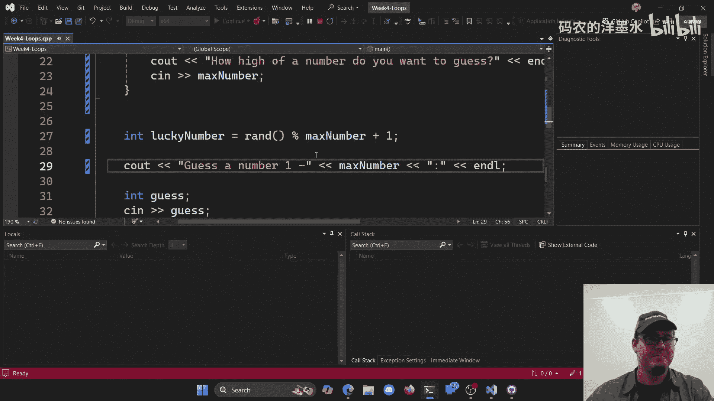

There it is。 So how high of a number do you want to guess negative one must be greater than0。

 less than a million。 Let's try a billion。So be less than a minute okay。

 so the bounce checking seems to be working right， I wrote some code I want to make sure it does what I intended it to do so I have to test it。

Any code that's worth writing is worth testing because if you don't care for works right。

 why don't you write it in the first place if you're going to accept garbage。

Don it it's not helpful right you shouldn't be making garbage， okay。I'll I have a number。

 what about 50。Okay， guess on number one to 50， oh， we're missing a space here。

 so Zabs would mark us down here because we don't have a space after our dash， right？

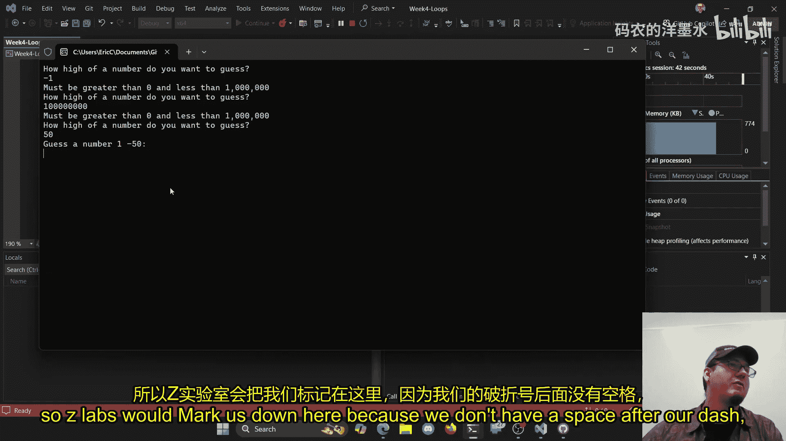

We should go fix it。 we'll get in the habit of being accurate。

 so there there's our extra space right， I we'll go back and try it to again。

 So all right guess number one to 50，25 it's too low。

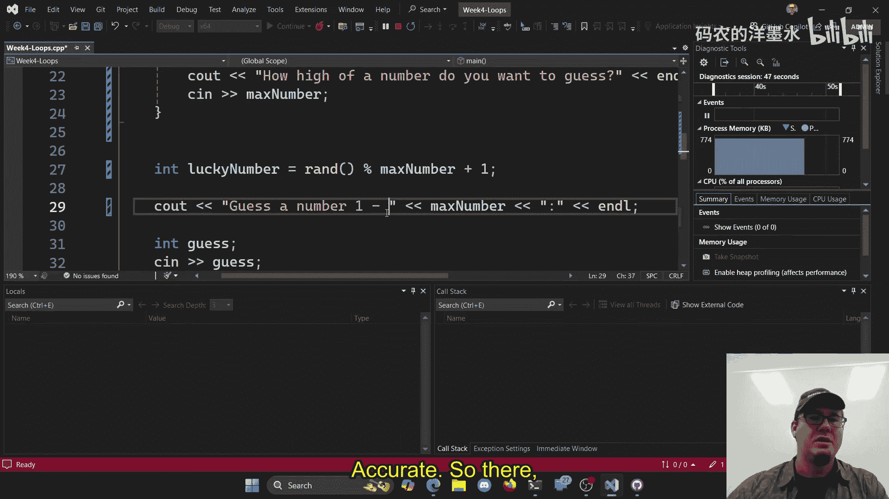

40 its too low， 45 is too high， 42， low 43 hey， do you want to play again， Yeah， let's play again。

 I'll have a number do you want to guess let's guess one to five now。

Right that because number one to five three， two， hey， we guessed did you'all play again。

 a only wirednet our validation loops are checking here， so no we don't want to play again。

 game over， please stop。

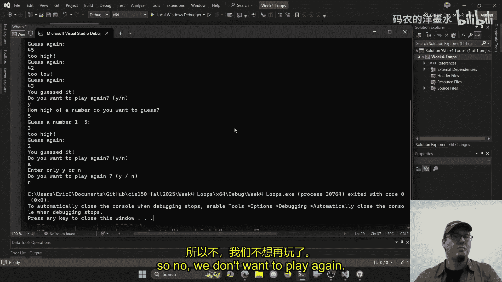

So this is our validation loop。For characters are not a valid option。So this one。

 if it's not a valid option， we want it to run。This oneSo this one was using anNs。

because it has to not be any one of them here where this one was using ors because we had it was either low on this side or too high on this side it can't be both you can't and there so those logical operators they take a little bit of time it takes some puzzling through oh am I using an and I'm using an or what do I need to do here and just like it did with our if blocks we do it with our ws。

We need to kind of think through and make sure it makes sense which one of them we're using here。

Okay， so we got Y loops for。Condition here。Inside of a while loop for play again。

 we're validating then input here。 right we can do all sorts of fun things with ws we've done a couple so far。

 right so what does this commit do。 So look， hey， we move this line here right red meanss removed green meanss at it。

Great， so this is now allows for。Setting the max number and it's cool it shows you at the line level what changed right oh we also have a play again oops。

And play again。And I can push， we'll put that out there。

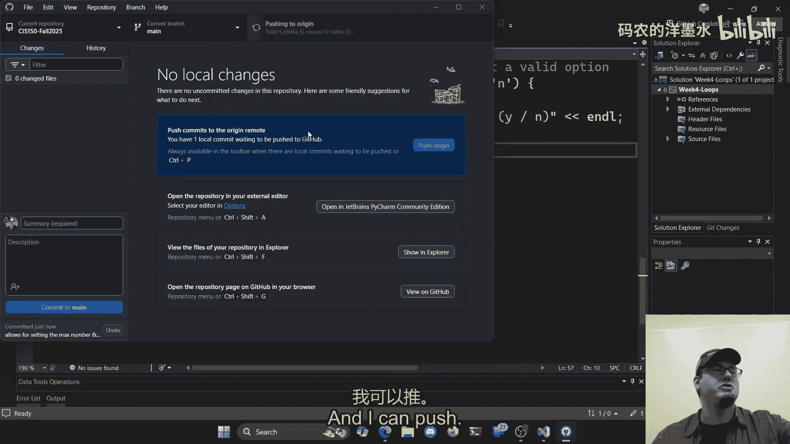

Now another cool thing I want to show you just because it's a fun feature here。

 if you go and take a look at that file here， there's an option called blameme。H。

Goodness this one here I can never remember where they put it so blame will show you which commit changed what line in the file and you can see how long ago it changed but now that the history and this one's not very interesting。

 but when it comes to bigger projects and things you can like go look at a file like oh。

 this part of the file hasn't changed in three months。

That's probably not a problem if I'm tracking down some sort of bug that someone reported。

 it's not doing what it's supposed to do here。 This part of the file changed last week。

 Oh maybe I want to focus on that。 right when we're tracking down bugs that I can introduce。

 So get also adds those other fun features here you can see what changed when。

 which is really nice here。 So that's just a fun feature there。

And then again I've got all my code out here， you can see it look weeks I didn't name the weeks here。

 this one was loops， this was branching， we could go rename them here but that's probably a hassle as we go all right。

 we got our wide loops。

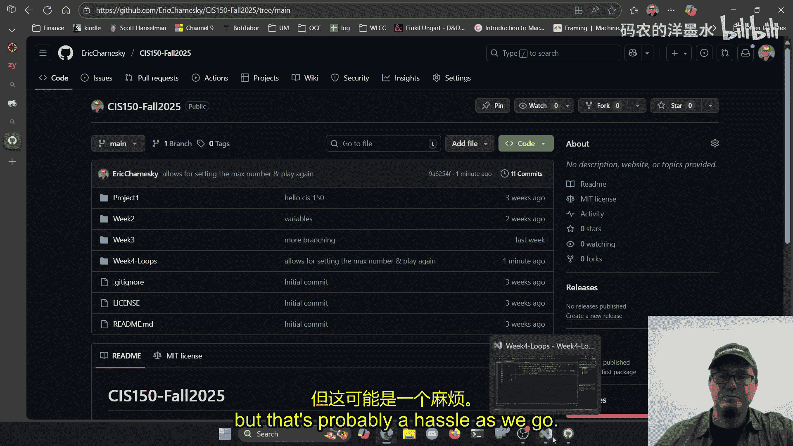

A all okay with Wi loops？Read for something completely different then all right Ill do more so that was our while loops so the other kind of loop we can do that's similar to while loop but I hate them purely if there's one character and that's the entire reason I hate them here is's called a do loop so remember we call these ones pretest loops they tested first before they run here now we're going to do a loop that runs at least once and then might repeat itself that's a do loop here so we can say do here actually I want to leave my random up at the top here so do that one here。

So we're going to do at least once here and then a do loop ends with a while what here。

 So we want to run at least once while what's true。I kind of like the play again idea here。

 but that's we're already using that one here， which we do while。'll。

 we'll say how about a char for more。Or equals y。No。

You don't have to set this char if you use the do loop so that some people like that or equals y。

And then you put a semihole in here。This semicolon is really the entire reason I hate dolos and I never use them。

I spent。Several hours as an undergrad troubleshooting my code one time because I didn't have a semicolon in here。

 And it drove me bonkers。 And ever since then， I've hated do loops。 I never use them。

 That's my story。 So it is nice。 You don't have to set the value of more。

Because we can set it inside the loop well with the play again loop here。

 excuse me we have to sneeze。Maybe I've got the genetic thing where if I look at lights it usually makes me sneeze。

 but it's not working。I never realized I was genetic。 That's crazy。唔好。

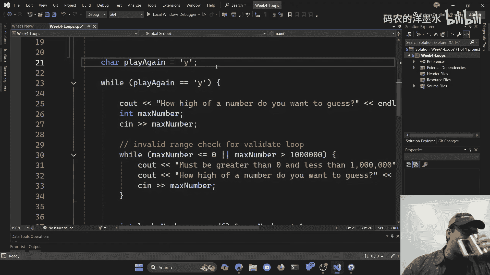

There's a fancy word for it what is it？Can't lights makes you sneezing？sneeze name， is it called？

Photonic sneeze reflex。11 to 35% of the population。Are affected by that。 Look at that。 I'm rare。

I knew it， I knew it I'm special my mom always told me it was special。

So for this loop to work， you have to give play again a starting value。

Right because I've made it run at least once with this do loop。

 it's going to run at least once and I can just set it inside here， we can like see how， hey。

 do you want to play again you want more and again we should probably pro a wire it at here。

That sort of thing。And an end line here and then see in on more。Okay。So。

We'll run it again if you want to do more or you can even use this as a validation loop， right。

 go get some input here and while it's not valid， keep on going here。Right so okay。

 let's do it as a validation loop so it is not why。And more is not equal to and here。

We'll keep on asking why or in no。This gets weird because now I don't have a chance to give them a message they did it wrong。

 I'm only giving them the same prompt because I can't tell them they did it wrong。

Here inside the loop because it would tell them at the first time so it's got some downsides it's got some upsides here。

 but we can then use this because I know it runs once I don't have to define more outside right I can have the prompt once so some people like this here so runs this is a post test loop。

Runs at least once。Here， then it might run again。So if you want this for your validation loop， great。

 you can do it this way here， that's okay。

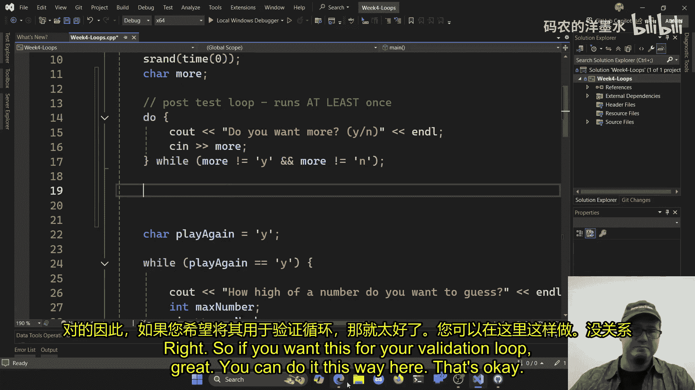

Let's see how we're doing here。W loops。Did even have do。

 I don't even see the do loop in here I know they must have it in here， do。Do while loop。

Do Luke not found， do wild。Feel like something's wrong here。Do wildly。

AhIt's in your chapter 16 additional material。Ihy didn't they put that in with loops okay that's fine we've talked about it you don't have to go to the additional material section that's okay so just want to make sure they't miss anything there。

It is fun to have a textbook you can search that is that's kind of a neat feature if why is it not even running there you go right so why loops。

 do loops， the other kind of loop we can look at is a for loop which is a lot of fun so now these get different and that's okay。

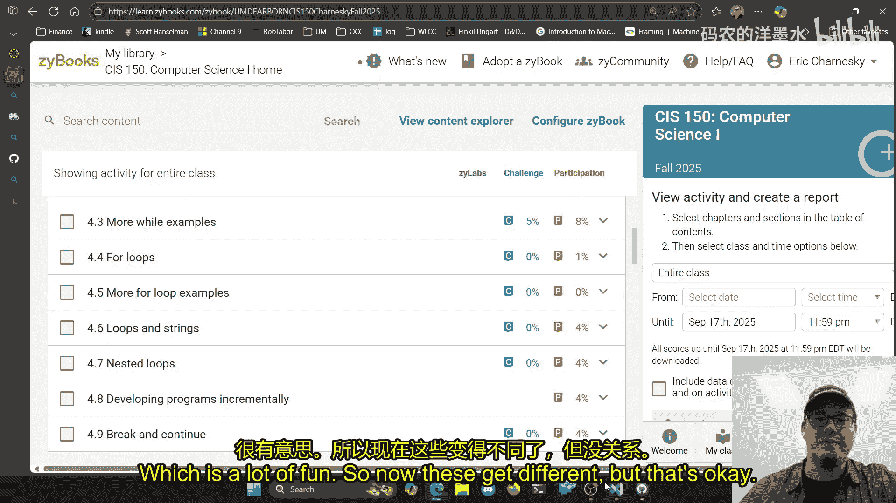

So while the do loop and the Y loop run while a condition is true。

A for loop technically does as well， but that's not really what we use it for the for loop is usually if we want to run something a set number of times。

 so with for loop we get three things so we get to initialize a value， we get to test a value。

 we get to increment。A value we're going to say four and then a set of parentheses and here's where we get the three things so we might say and number equals zero right we are initializing a value that exists for the purpose of this loop right so number exists for the purpose of this loop what's my test here I want to say hey my number is less than 10。

And I'm going to incr， I'm going to think number plus plus， add one to number。系。😊，So it initializes。

 it has the test and then it increments my value or could decrement right it could this is like change usually be to increment here。

 it doesn't have to， but most of the time you see plus plus that's pretty common here and we get a see out number。

And in that line， very exciting loop here， this will print out。What， what was the print out first？

s0 and then this happens and then a one and a two and a three and what number does it end with nine yeah because it's9 is less than 10 when it becomes 10 it doesn't run anymore right so this is essentially like the wild condition here test right I mean to think of that as like your wild condition here。

Like a while。I don't know if that makes any sense here， we'll just stay while here， right？

So we could repeat this here we can say int number equals zero。While。Number is less than 10。

See y number。Number plus plus and of that line。This is identical to the for loop。

But it took five lines of code， instead of three。Obviously three is better than five right。

 less code is always not always better， some people think it is， but again readability。

Should be the highest priority。F loops are going to be a little weird for little while。

 but we'll get used to them， everybody uses four loops all the time because it saves you you in line here and the other nice thing is it's hard to forget the increment where with a Y loop。

If you have a bunch of code there， like the first time and we forgot the input here。

 like it's possible to have an infinite loop because we screwed up because we forgot to do the increment here。

It's harder to forget it with a forlet so it's a little bit safer to use because we know， hey。

 I'm going to do it this many times right off the bat here， so I want it 10 times。But both ways。

 we get the same number  zero to9 printed out right here's zero to nine with the four loop。

 here's  zero to9 with a while loop we can even well even add that in here， right let's。

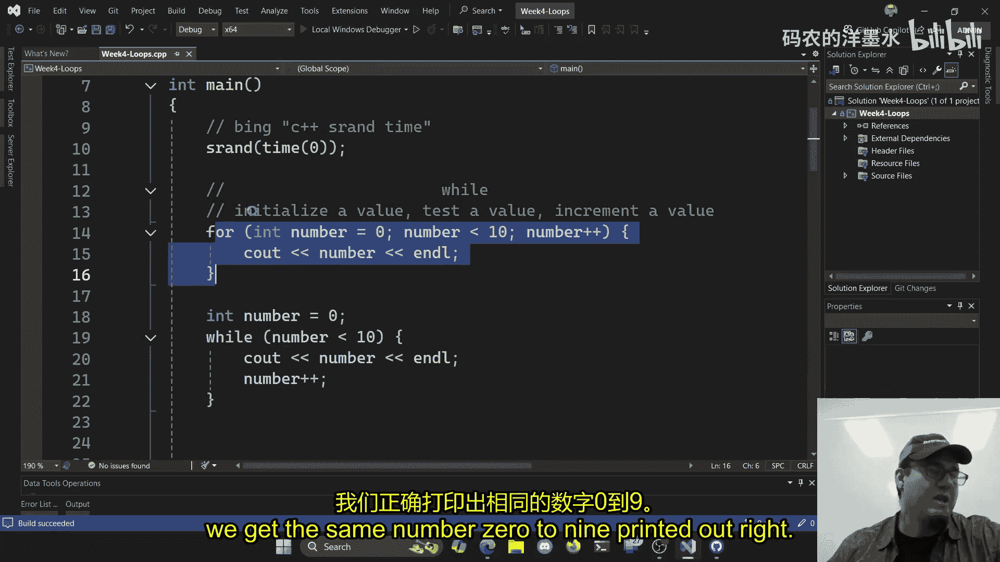

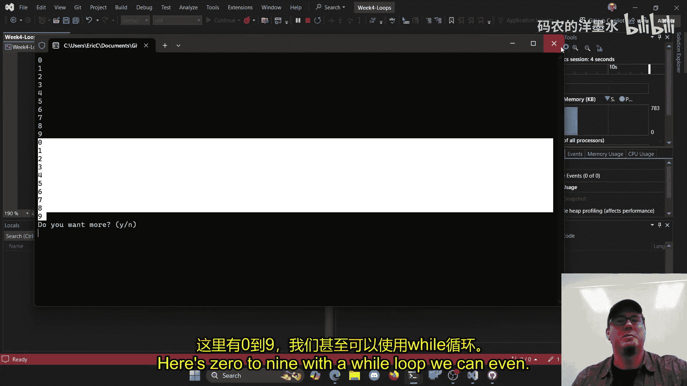

Let's see out。Let's。It's print 0 to 9。 It's the for loop。Why not put that in our code here？

Instead of a comment， let's print。0 to nine， which they do for a while。

Should we also do it with a do loop just for fun？Why not let's practice a do loop here。

 So let's say end number right， we don't need to set a value first we're going to do。

And now while my number is less than 10， semicolon， semicolon， let's see out。嗯。😊。

Well I kind of need to start it with a value right because I'm not inputting anything here so it' started at zero right we'll see out the number here。

Number and end line。Then I'm going to take my number plus plus。

Keep on going it looks pretty similar to my while loop now。Like almost identical。

 the only thing we've moved is where the while is right I don't think we've gained anything here because we had to start at zero anyway。

Hope I forgot we should let's not even do that anyway， let's do it with a do loop。R do Luke。

Where am I missing。😔，Oh， I can't declare into number a second time here， here's my do number。

If you want to change the name of something here。I've already used it a bunch of times I don't want to change it everywhere。

 so I'm just going to do like my do do number here。

I'm just going to double click to highlight the whole word here。

 triple click will highlight your entire line here， double clicks highlights one word。

 and I'm going to go copy paste with more double clicks。just to make my life a little easier。

 and'll hopefully take care of that error here。

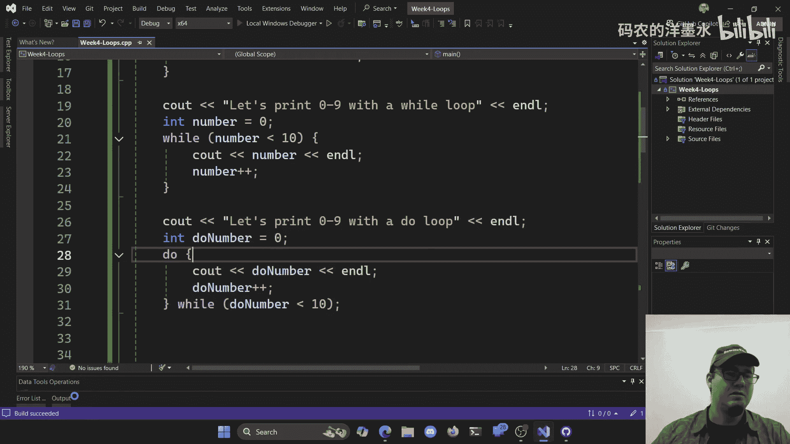

Yeah， okay， hey， we did it with a for loop， we did it with a while loop， we did it with a do loop。

 three different ways to do the exact same thing here， that's pretty much the rule in programming。

 anything you want to do you can do multiple ways。

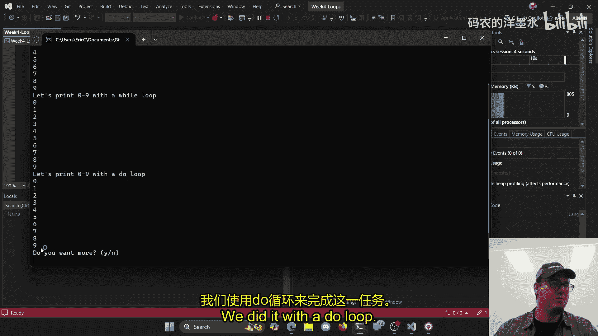

A lot of this comes down to what do you like， what's preference here there's a lot of art that goes into software here as you get further along here I'm sure they're going to pitch you hey you should continue school and get a master's degree because you we want your tuition money right which you can learn more cool things with a master's degree that's why I went and got a masters because I was a school junkie and that's lots of fun things to learn but one of the programs we offer is a whole degree in human computer interaction。

Just is super cool， the study of like user experience， user design， human computer interaction。

There are good scientific ways for computers and humans to interact。At this level， I could care less。

 it doesn't have to be pretty， I don't care。It's fine， right。

 but let's just acknowledge there are good ways to do things here and there's bad ways to do things。

Okay not the end of the world so we don't need to we don't need to aim for the hey here's the you know the most scientifically proven I we're gonna to give you the prompts here with the right font and the right sizings and bold things here and it's crazy like humans are are weird you can look at a website and within less than a second you've decided whether or not you think it's a good website or not just by its visual appeal and that colors your entire experience with the website here on out so you go to some website and it looks ugly or a load slow you're like oh this thing is trash even if it's the best application out there you're not going want to use it right？

People are weird like that so all right so a basic for loop initializes something tests and has its inment yeah sorry to tolerate me so if so if we write lessId does the same thing is the memory allocated is that still going to be the same or less。

So in terms of how much memory is allocated， it's not based on the lines of code。

 but how many variables we're using so if you've got seven different variables when you could have stored it in one。

 you're using a little bit more memory now。Our variables take a very very very little bit of memory here so unless you're doing something a million times or a billion times it makes no difference at all eventually we'll look at how we optimize and that's a bit more of the science things in computer science optimizing problems and thankfully there's smart people who've studied these sorts of things yeah so eventually we'll get to the optimizing。

For now we're spoiled if we just want to solve problems and practice the problem solving how do we get code to solve problems for us eventually but we'll figure out how we make them fast but yeah nothing in this class worries about speed or efficiency a little bit in CIS 200 and then CIS 350 gets into a lot of the algorithm design how do you make algorithms fast that's the。

Very exciting and fun class everyone loves。P。Yeah， it's great。

And I'm glad people study that stuff and into that sort of thing here。

 but again I like to make computers go beep boop bo。

 other people make that fast and I just get to tell the computer what to do so I'm a little spoiled。

Now that's the fun thing， there's lots of different fields in computer science。

 lots of different specialties here。All right， so this four loop here right starts a number test the number and prevents the number now we can put a loop inside of the loop here if we want it right so if I wanted to do something like print out a rectangle now you all remember ASI art you can make a picture out of a bunch of characters here。

We're going to do shapes because that's super exciting here that's about as good as I get I'm not much of an artist。

 but I could do shapes so if we wanted to print a rectangle here I'm gonna to say four and now this will be my row starts at we can even start a one it doesn't really matter row1 my row is and I'll go less than or equal to 10 if I want to have 10 rows right I can go one to 10 I could go zero to 9 this gives me 10 this also gives me 10。

It's really just a preference here for you here and then row plus plus。

Plus plus now for every row I want to print out a certain number of stars right so I can say four in column is one column is less than I don't know。

 let's go four maybe here， less than an equal to four and then column plus plus。

I'm going to see out a single star character here， now I don't want an end line because I don't want to go down a line until I've printed out every column。

Once I've printed out every column， then I want to see out that end line here。

 so this will print four stars and it'll print an end line。Then it goes back and says， okay， row。

 go to row two， row two says okay， column starts at one， print four stars， and then print an endline。

 row number three。Green4 stars， hand line， so number four， right， on and on and on。

 so for every time the outer loop runs， the inner loop runs from start to finish here。

So it's a loop inside of a loop now this is a fixed number of ties because it's my for loop right it's not like my while loop inside of a while loop here that checks your guess here。

RightThat was a loop inside of a loop， but this is also a loop inside of a loop here。

 so now I'll get a nice little 10 by four rectangle here。

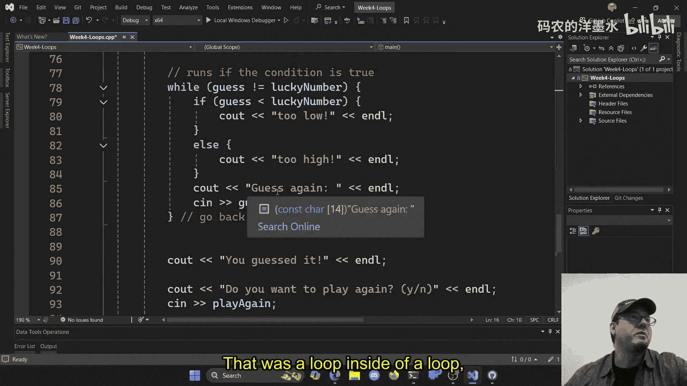

And we've made art。It's our class now right or we can make these variable right we could ask the user so we have an int for rows or this should be like max rows or I don't know we can we can just just code rows that's fine we'll see out how many rows rows do you want。

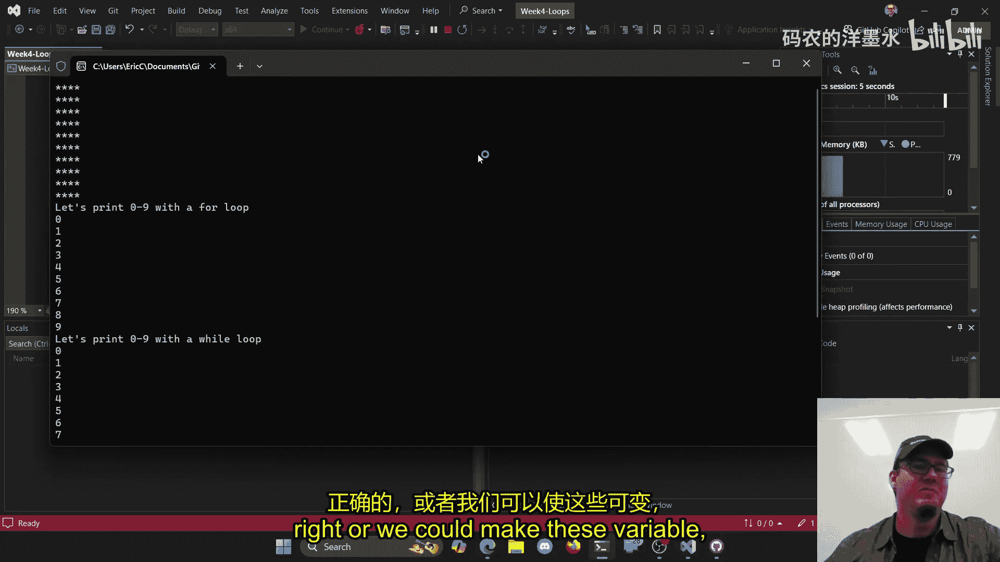

And then we can see in on rows now my loop now， instead of being less than or equal to 10 will be less than or equal to rows。

Right a variable that these are entered right and we can do the same with columns so I'm just going to copy paste here and then do columns with an S here。

 named columns， how many columns with an S。Make sure you don't forget your plurals here copy pastsing puts you at risk of using the same variable name when you don't mean to just be careful。

Oops， I forgot to change it here by four so man it was always going to be four so one more time。

 let's do less than columns now。

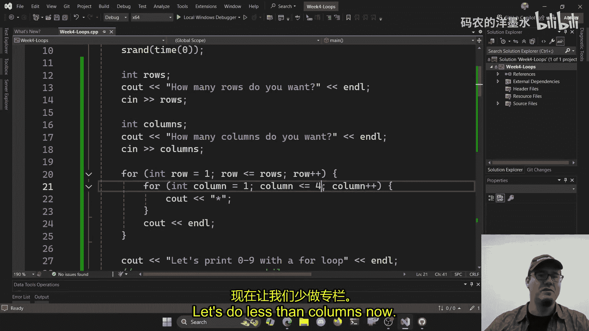

，So now you should be able to ask how many rows do you want for your rectangle？Fine friends。Five。

 okay， and how many columns do you want？5， we now have a square， all right， five，5 five。

 which all squares are rectangles right thanks to math fun like that。Cool。

UWe did a rectangle or we did a rectangle。

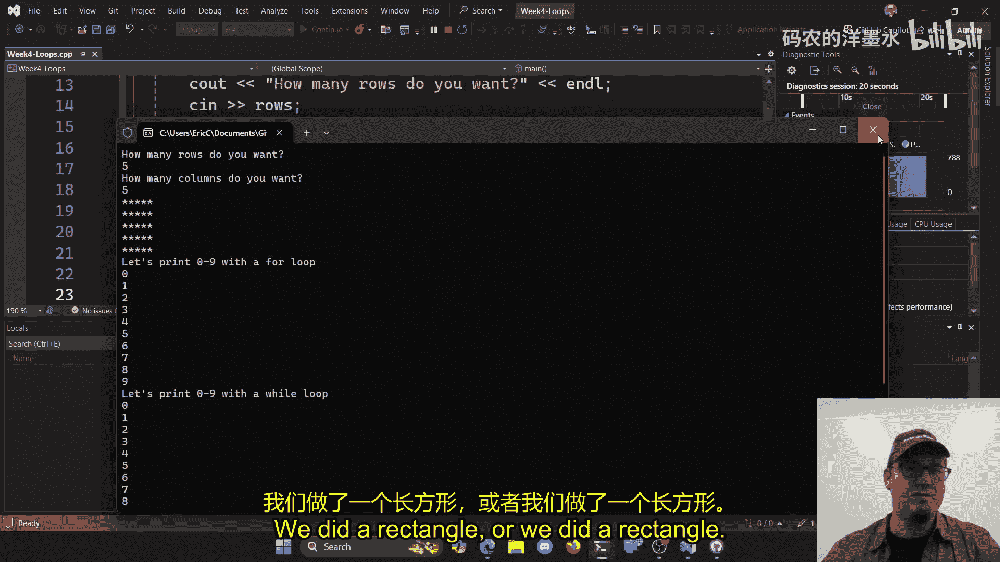

What about a triangle。Go to do a triangle I'm going to do a right angle triangle because that makes my life easier so I'm going to have like a star and then。

Two stars and then three stars like that right a nice little right angle triangle that's pretty probably pretty easy here now with that all I need to know is the height or the base。

They should be the same。Right， so let's just ask them here， then'm loving it for height， maybe？

And then we can see how enter the height of a triangle。End line， and then we can see in on height。

Now I'm going to spit out just a couple of end liness here just to add a little separator。

 hopefully two is enough here because I want the triangle not to touch the rectangle。

Otherwise it gets hard to visualize it that's all so I'm going to do something here so for again。

 I want rows and I want columns here。But I want it to be a little bit different。Rows are fine。

 but how many stars I' want in each row， well the first one I might want one star。

 the next one I want two stars， the next one I want three stars and four stars and five stars so that rows will be less than equal to height。

Now my column is going to be less than or equal to row。at row1， I want one star at row two。

 I want two stars at row three， I want three stars， row4， I want four stars。

So my loop then will run a number of times based on whatever row it's on。

So the values you can use aren。Limited to something the user entered or a hard coded number。

 it could be based on another loop value。Its a little weird， I've done this before。

 and don't be super amazed that I noticed that pattern of stars to rose like we do this example every semester right。

 but let's try it。

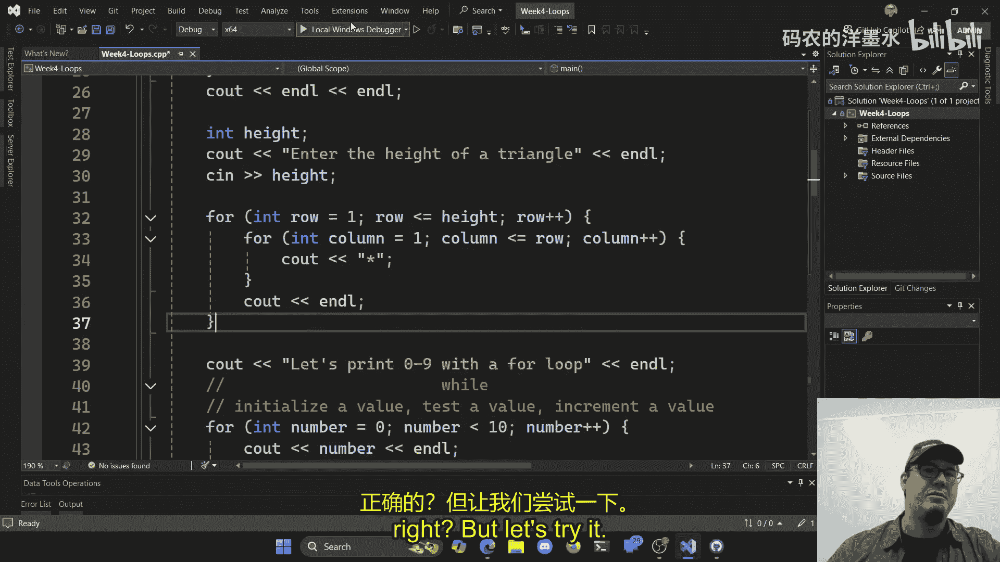

Peach。All right， rose， I don't know five by five， all right， how about the height of a triangle？

I heard six first。Great， one star， two stars， three stars， four stars， five stars， six stars。

 we now have a nice little right angle triangle。Alsosome。

 we missed yesterday was Pythagoras's day right， it was 9， 16 25， right three squared， four squared。

 five squared in 2025， which is 45 squared。You guys don't like math enough to you。

I feel like you have to kind of like math a little bit because you've got to get through a bunch of calculus。

And if you don't like math， that's just miserable。All right， sorry， that's okay。Oh， I should mention。

Because I'm thinking of it now and this is 150 here。At some point， if you want to do an internship。

 some companies are stupid and they filter out internship applications based on GPA。

GPA is just one number and it doesn't really measure a whole lot of stuff and actually we have research that shows it's not even a good indicator of job success。

 but yet they do it anyway because they're big companies and they can do whatever they want I mean they need some sort of filter I suppose if 100 people apply for an internship so。

Sure， whatever， but if your GPA is used to filter you out for an internship and you don't like math。

Don't take calculus here。If you don't do well at math and you just get eye with C's， that's okay。

 C's pass， but Cs get degrees perfectly okay， like don't feel bad if you get Cs。

But if you don't take the calculus here， if you take it just across the street over at Henry Ford。

 it passes in transfer credit， not GPA， so you can get a C over at Henry Ford and it doesn't affect your GPA here at Dearboard。

I got season my and I have like a 3。5 because I yeah you transferred it over see this guy over here smart listen to this guy now of course we want your tuition money you should definitely take your classes here and obviously we're better than Henry Ford College because geez there're a community college right or you of M we must be better。

Okay， whatever my full time job was over at Oakland Community College so I can make fun community colleges right is that okay。

 all right？So that's your pro tip if you don't like math， which seems like a lot of you didn't。

 it's a little bit sad math is fun， you don't actually use a lot of calculus depending on what you're doing in computer science。

 you don't need the calculus， some some branches and some specialties use a lot of calculus as a software developer。

Who did software engineering stuff I never used it here。

 anything didn actually take calculus till I wanted to get into the doctoral program here。

But that's fine， I had a buddy who dual majored in math and computer science。

 he's like it's only four more math classes to get another major。

 why not get a dual major and then he's like II never used any of that math ever again。

So but my brother's buddy got a whole master's degree and went to work for AutoCAD and his master's was in。

 how do you draw efficient curves and he did load of math to make curves draw quickly on computers。

And that's why we have cool AutoCD software that does curves really nicely。If you like math。

 there's opportunities for it if you don't， go take it to the community college。그래。

M i'm on recording saying that that's okay that's fine I'm thoroughly convinced no one here at the school watches my YouTube channel and hopefully the students do but no one no other faculty watches why it'd be so boring like I would not want to sit through someone else's class that sounds terribly dull so。

嗯。All right。We did four loops， we did a loop inside of a loop we can do all sorts of fun things with these how about we make an equilateral triangle right that has something like a star and then we'll do three stars and then we'll do five stars I can't line this up right here。

 five stars and then we'll do seven stars。

Can we do something like that a nice little equilateral triangle？Okay。

 now for us to do that we need to figure out a couple things right from when we print here。

 we print from the left one character at a time right so what's being actually printed on this first row here is a couple spaces and then a star and then there are a couple spaces and a star。

 a couple spaces and a star here。So if we took a look at this real quick and like wanted to sketch it out on paper here or on the whiteboard behind me。

 we could do that， now I'm just going to type it on my computer because that's a little bit faster here。

 but we'll say， hey at row1。How many spaces do we have？One， two， three。I see three spaces。

 right spaces。And one star right at row 2， how many spaces do we have。On two spaces。Two。

 and how many stars， three stars。Stars， I guess if we one stars， oh my goodness， that looks terrible。

 that's fine， row three， how many faces do we have？One， okay， and how many stars we have five stars。

 right， and then at row four。How many spaces we have zero and how many stars we have seven stars。

 okay？No。If you were to imagine this was just a three star pyramid， it has two rows。

 a five star pyramid has three rows， a seven star pyramid has four rows。

 if we wanted a nine star pyramid， so row five how many oh our spaces have to change here but we'd have nine stars right we'd see that pattern going so what we need to do then is find out what's the relation between how many stars we have at the base and how many rows we have and how many spaces we have。

So there's some quick arithmetic we can do with looking at seven stars has four rows。

 five stars has three rows， three stars has two rows here。

It's okay if you don't see the pattern right。 I've done this gazillion time here。

 but think about it for a second here。 do we see any sort of pattern。

Any sort of arithmetic we could do you get from seven to four， five to three， three to two。

And we'll just continue on here， ignore the spaces for a minute here， so row five。

 then would have nine stars， right？Pro 6 would have 11 stars。So how do we get from 11 to six。

 nine to five， seven to four？What's that look like room that with the？1 형 로 게스 plus1 돌 개 라。我听时。Okay。

That sounds trickier than what I was thinking， but definitely workable。

 I think we could work with that。So you start adding an additional one for every next row。

So what you're saying？Okay。So we would have to count up to the number of rows rather than like if we would ask how many stars do you want and we would at the rows from and we'd have to do some counting up I think we can make that work。

 I think there's an easier way。Actually， I know there's an easier way。We could try that if we wanted。

 or do you want to keep thinking about the easy way？All and keep things about it。

We keep looking at the pattern， oh seven， 13 stars。Row8 has 15 stars。对。Yeah。

 what's the relation between the two， how can we calculate rows from stars or stars from rows？

Re sorry。Stars be like the last two thoseback together。I looked' was okay。Definitely workable Okay。

 you guys are coming up with stuff I havenvanza， which is really cool yeah times2 minus1 that's what I was looking for that's the easy thing right finding the previous two added together definitely doable。

😊，Sounds a lot harder to have to write code for so times two minus1 now the problem is we're going to ask them for how many stars they want so we need to reverse that so what's the opposite of times two minus1。

对。Divided by 2 plus one and we want integer division。

 We want to floor that division right We don't want halves here right so 15 divided by 2。

7 and a half， we just want 7 plus1，13 divided by 2，6 and a half。

6 plus one right that's what that's what I was looking for。

 that's what I I imagine is easiest one here。 So if we ask them how many stars they want then so even an int for stars。

And we see out how many stars， stars in your base here， I don't know， something like that， sure。

And an in line do this and then we see in。SarRS。And then we can calculate rows then so in rows then will equal my stars divided by  two plus1。

integer divided by integer， we get integer result， we don't have to worry about decimal places plus one we're going to go with with our number of rows okay now。

The next tricky part here， how do we get from the total number of rows to how many spaces we need right so let's just look at this example here right if we got four rows。

 how many spaces did we have。Well， so how many spaces do we start with？Three。

 so if we were to pretend this was one higher here， two one， and then row five。

Would have zero spaces and nine stars， right？Five to four do we see a pattern， we had five and four。

 we had four and three。inus one， okay， yeah so easy。

 so then I in for spaces then starts at my rows minus1。Right。

So now I have all the information I need to print this out here， and we also start with one star。

 this pattern was easy I't even ask you here right， so in stars。Oops， that's total stars。

 maybe we'll call this want like base， we'll call that base。

Base then so base divided by two and then stars just starts at one。Right。

And we want to do it so for inch row。Equals1 row is less than rows。Row plus plus right。

 This will be how many rows we're doing here right。

 and then we need to print out the right number of spaces then so for。

And space is zero or space is one， I guess， right， space is less than or equal to spaces here space plus plus。

Let's see out the space。No endlines， right just this number of spaces right after printed out my spaces。

 now we can print out our stars so for stars one。Stars less than stars here， right， star plus plus。

We'll see how a star for every number of stars are supposed to print out here when that's done。

 then I want an end line right go down a line。Okay。

 now what happens to our number of spaces and number of stars？What happened？Plaaceces should go。

T one and stars should go plus equal two our little combined assignment operator we love shortcuts here right that's the same as stars plus equal stars plus two remember that one Okay。

 cool that's just our shortcut。So this is minus， we don't decrement all that often， but we can。

 we can decrement right， let should we try it。Oh I get a copy in some endlines here too。

 separate our triangles here。All right， oh oh no， in't rose， or I red definedfined row， goodness。

Right， that's fine， so we don't need to tell it it's int rows here because we already have used rows up above we just going to say let's reset the value of rows oh no。

Oh， okay， my bad， I had left all those stars in here。

All right， that was all the errors nice， right so I don't know how many we want for our rectangle。

Vixed by。4， okay， there's a rectangle， how about right angle triangle。all right。

 now how many stars on our base for equilateral triangle？E。嗯。

If it's an even number doesn't work very well， we lost something here。So let's go fix that。

 right even numbers are bad。It has to be odd to start with one， so let's go validate。

Okay why not so how many stars in your base while now how can we test if the numbers even are odd mod two perfect so base mod two equals zero it's even right evens are bad right we want to say how many stars on your base here。

See out must be odd。诶。Like Eric。W。

It'stra again。All right， I don't know five by five by five sure stars in your base we said eight and we get must be odd how many stars in your base nine。

哦。

Still didn't print out right something's not working right Okay。

 well let's find out what's happening here so let's let's go here lets put the right point in see what's happening。

F， five by five and nine， right？

So we get。Rose is five， right， one star， three stars， five stars， seven stars， nine stars。

 that's good， right， spaces should start at four， right， four spaces。

 one star star starts at one life is good so far。 So rows less than five good space less than spaces。

 we should have four spaces。One， two， three， four spaces。We're done with that loop。

You see my error here， we're about to run into it here。 Star starts at one。 Star is less than stars。

Print out a star， it didn't run。My test here wasn't true。

This was false I forgot my equal sign yep less than or equal to here so if it's not doing what we expected to do running it line by line by line will show us it skipped something that we thought was running right obviously did that our purpose to demonstrate that for you here that was not a ty0 minus my part here it happens all the time don't feel bad about it right debugging your code perfectly normal's nothing wrong with that at all here so it's stop and give it a running it here。

S it again， so five， five， five， right try nine stars， Oh。

 I'm going to continue here right that'll just run to the next great point here and now that looks a little bit better。

Right one， three， five， seven， oh， where's my last row？

have another another typo here less than rows I did it again less than or equal to number of rows goodness most of the time I don't use the equals here most of the time I do less than and I start at zero my bad is is just to have it here I don't usually start at one but somehow we got into that example let's try it again five。

 five， five nine stars in our base continue oh I can just take my break point out two for next time continue。

And does it look right？Hey I think it looks right a nine star equilateral triangle we've done art today in computer science congratulations it's actually some really cool art stuff you can do with computer science like fractals and other sorts of fun things really cool that's that's fun stuff。

😊，How you feeling， that's a lot， a lot of loops， fly loops， do loops， four loops， got pre test loops。

 weve got post test loops， a。They can all do the exact same thing。

So a lot of it's just a style preference here if we know how many times a loop is going to run。

 we're going to use a fort loop。It that's easy， it just puts it all in the header there。

 the loop header， and then it runs。A little bit harder to do validation loops with four loops you can。

 but it's kind of ugly we don't usually use four loops validation loops。

 those sorts of things here so we stop that I got 1211 on the clock you want four minutes back and get out of here。

Yeah， just to look at outside I be looking at here know。

