# 【全集】密歇根大学 C++编程 中英字幕 1080P p06 Lecture 6 - 循环结构 part2 -BV1TsAZzAEHX_p6-

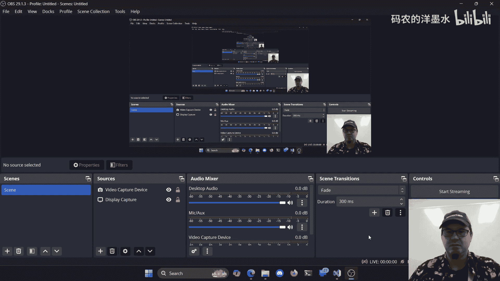

Right， well happy Wednesday。finishing up loops。 So this chapter then should be due the following Monday to have that right。

 Is that in here already， Chapter 4， Did I put that in。I did。 Good。

 So Luke's chapter again through our books next end of Monday， end of next Monday。

I didn't put the scores in yet after the first three chapters I'll do that after my next class when I'm hanging out my office。

 I'll put those in for you。Did have an extra day。 Maybe there。 Should be fine。啱。Yeah。

 everything going pretty well。Sweet。

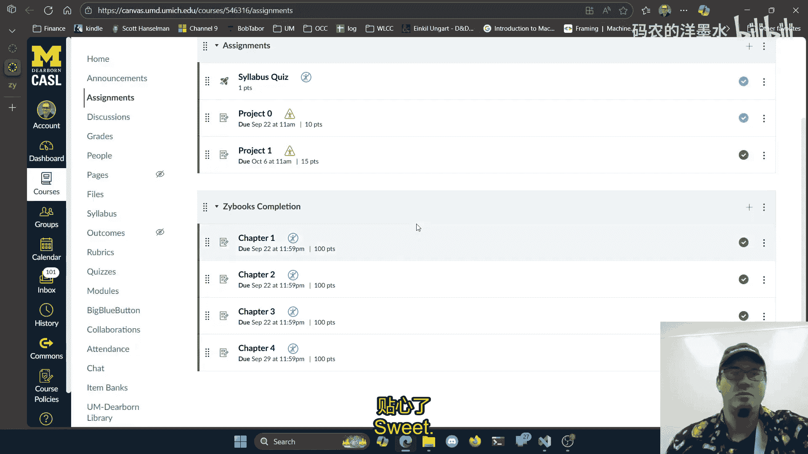

That's so if this project was week four loops， I'm going to start a new project that we got through。

Regular loops， we got through loops within loops， we did four loops， we did while loops。

 we did validation loops that said， hey， as long as you're giving me a value that I want。

You're stuck in here or as long as you're giving me not a value that I want。

 you're stuck in the loop， I're going to only let you out of the loop。If the value is good。

I did those， we did it with numeric values， we did it with characters works out pretty well you can do it with strings as well。

 so lots of fun with loops we're going to use loops here on out。

It's a nice way to just repeat the code， keep something happening until we're done with it right then our next project was loops based at a couple loops within loops and silly loops for things。

And the goal of that one is not meant to be crazy difficult heres to just practice doing loops。

In a way where I give you less help right that's sort of the idea here at the labs practice So at the end of this。

 you should be pretty tired of loops here or pretty familiar with loops I guess I should say is a better way to put it here So to start a new project this will be week five loops here。

Make sure it's in my repository so we can commit and push。好。I'll add my namespace。Spire can。

All right， and give rid to some of this garbage stuff here。So the next thing we want to look at here。

 when we get to loops， there's some fun。

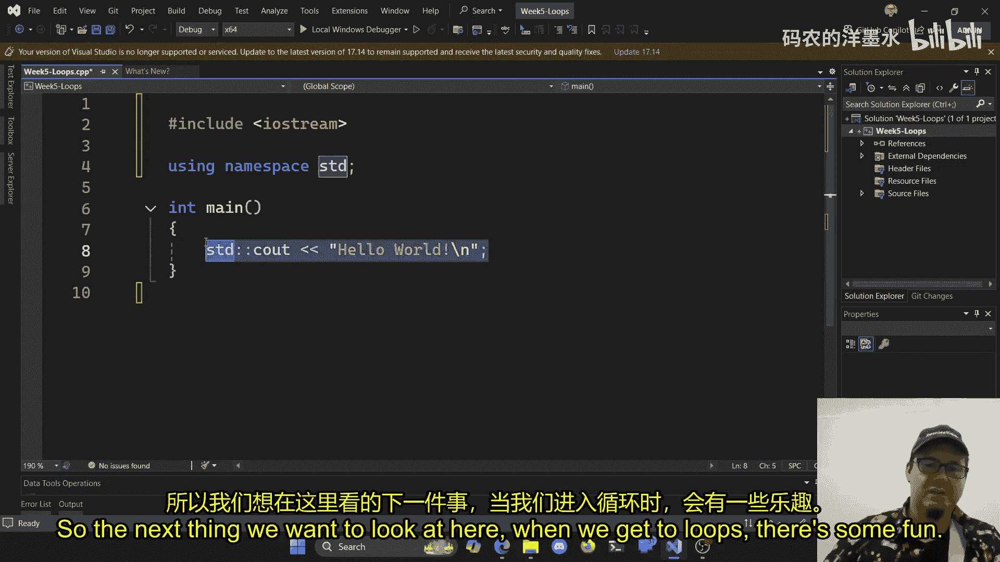

Keyword here that you can use with lookss， break and continue。 I really dislike these。

 so I will almost never use them。Honestly， the only reason is that it just makes it harder for me to follow the code and they're perfectly fine and people love them and use them a lot here。

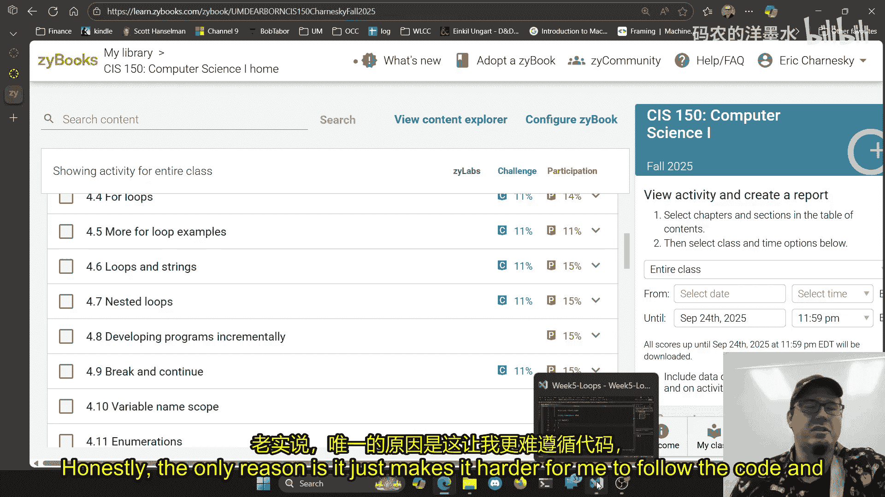

That you're we're going to look at them and see what they do。

 they interrupt the flow of the loop okay is all all that happens so one of the things we talked about。

 I think right is when we make a loop， you don't want it to run forever。

That's an infinite loop right so I say while true， I now have an infinite loop here。

And we can see out how about we like a not hip so int。Numbers one， we'll see out the number。

And and then you can do this cute thing here if you put a plus plus here。

 do you look at these pre increment and post increment operators plus plus and minus minus or so this one updates the value after it's used so it uses the value one and then I add one to it。

If I put it beforehand， it'll add one and then it'll use the value and I start counting a two look little silly here。

 but now I've got an infinite loop because I put wild true so it's never not true。

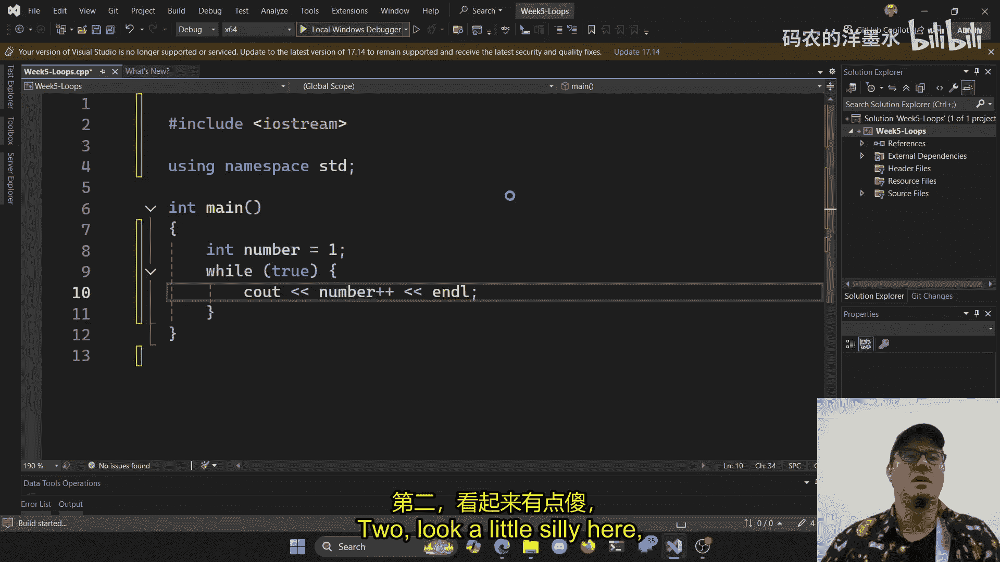

And eventually if we let this sit for long enough， we'd hit get to like the 2。

1 billion max number and then we add one to that and the sea supposed we'd get confused。

 we go negative again and then we start counting negative 2 out some billion up to 0 and to 2 billion again。

 I don't think you want to sit here that long so。For what it's worth here。

 the computer is really slow when it comes to output so putting something on the screen is a very slow operation right we've only gotten to 55。

000 operations here right and that was with me talking for a little while here oops I killed it you can also hit the stop but I did control see the kill it you can also go and stop your debugger here so if you wanted to see how fast the thing count。

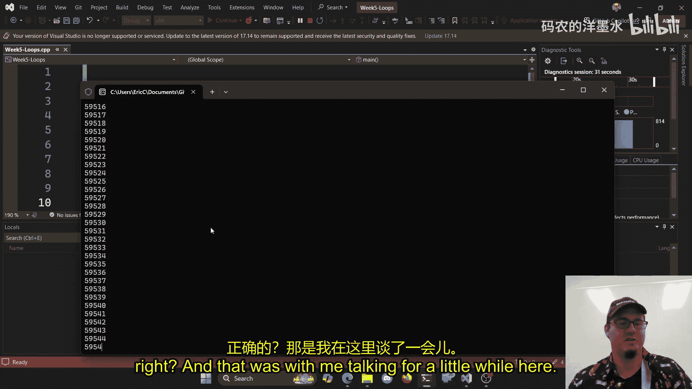

But'm not printing every single option here so we can say， hey， if my number。

 how about modulus 1000 is zero。Then we should do the e out thing， So we're still adding。Oops。

 I'm sorry I need to do。Oh man， okay so。Do this to the number。

 I can't have the plus plus inside here。He it will never add right because 1000 is never true。

 it'll never add one to number so' see other number and after this then we'll take number plus plus。

So we lose our little shortcut here or that's okay。

 so we're always going to add one here and only if it's evenly divisible by  a000 will we print。

 so now you'll see it can add one really fast。

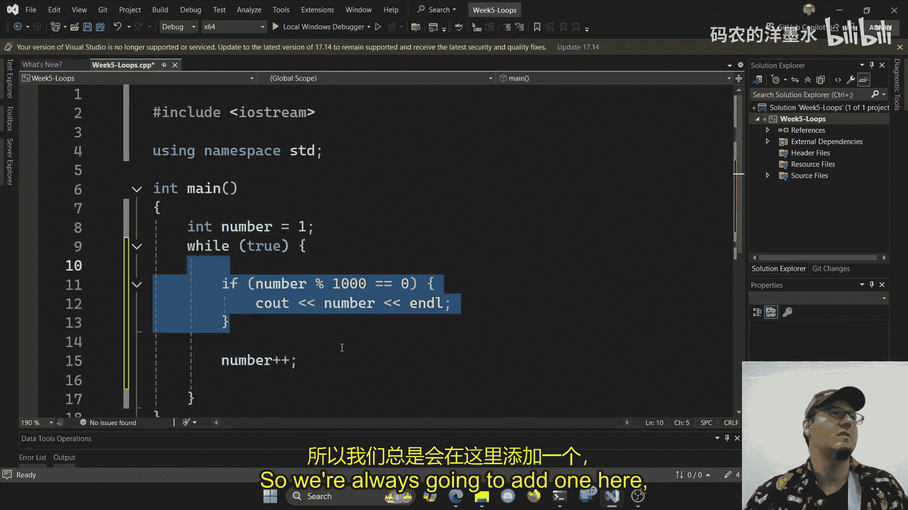

Right now we're up pretty click here counting by thousand， so the slow part wasn't the adding one。

 the slow part was printing into the screen， so you can see it's still ridiculously fast here if we want to go you know let's do by a million。

 maybe three now by millions here。

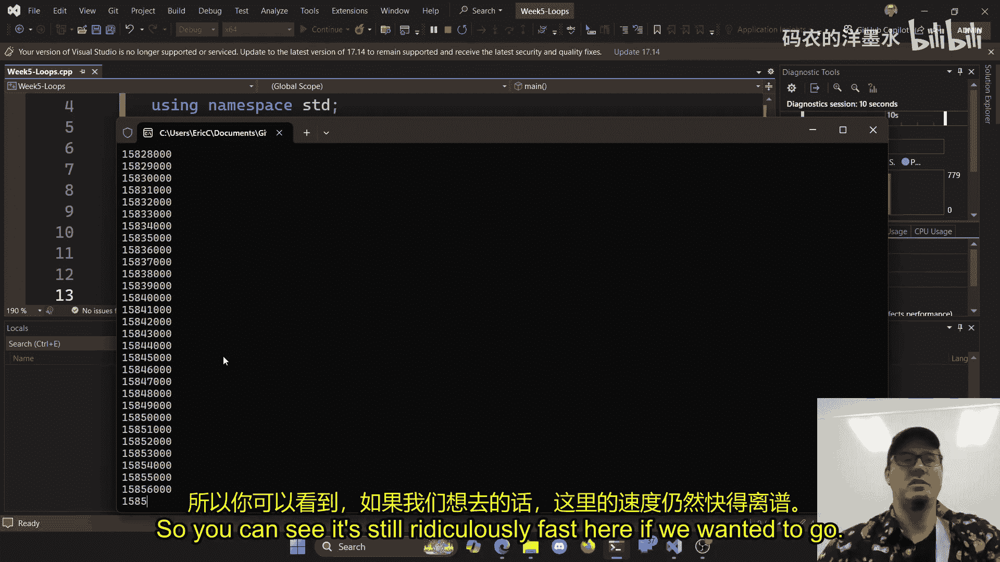

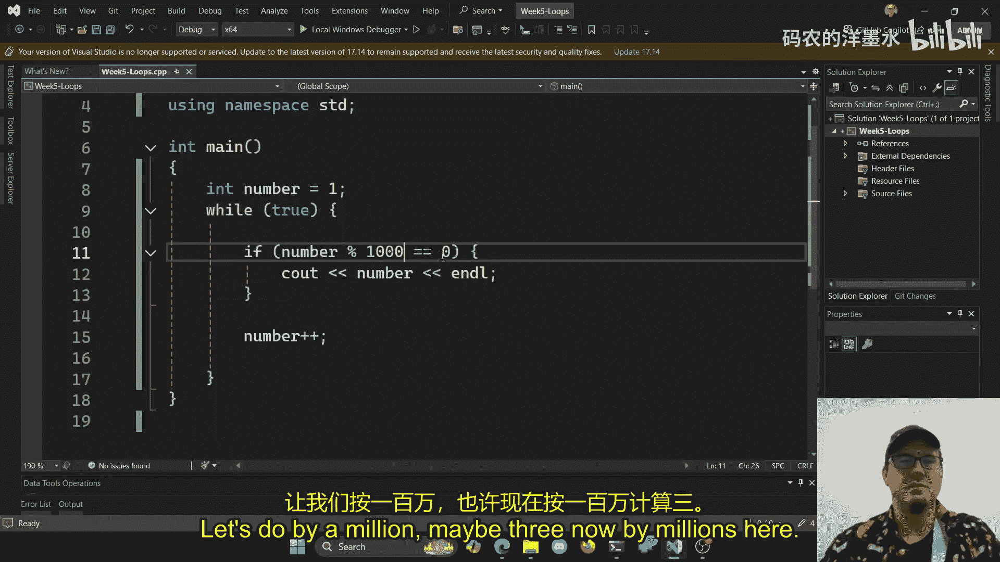

that' only take 2000 sum operations to get to 2 billion。Let's go pretty quick。

And then we get negative again， right？So again。It's adding one millions and millions of millions of times here it's added one over2 billion times already because we've wrapped around4 billion times now so the arithmetic part is very fast it's the display part that's slow for what it's worth here。

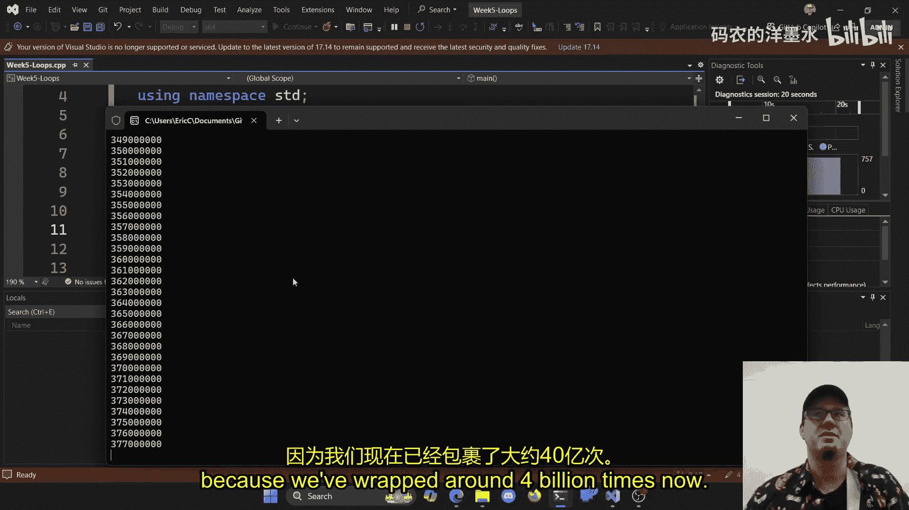

But infinite loops are sent。No one to so what you can do。

Is you can use a keyword here to stop your loop and this is where I dislike them here so we can say。

 hey， if my number is equal to is an empty to max。You can use this keyword called break and what brake does is it breaks the loop。

Exute， oh my goodness， race， I'm judge my spelling。嗯。

English is hard right I don we've got words that sound the same with different meanings and Im dumb so。

 so writes the loop ends it。Your stops。Pps completely， so whatever lying you're on。

 it immediately just says， okay， go to the end of your loop body and then we can see out。The路 is on。

So when we get to our max integer， we should stop here。

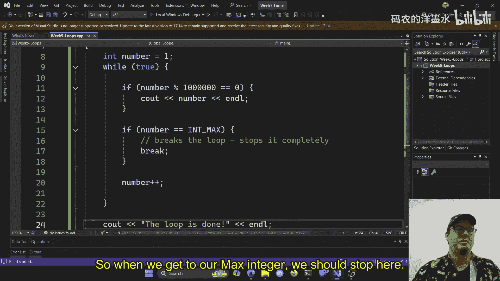

That should go pretty quick。You can add one a lot of times。

And our loop is done as we hit our break keyword。

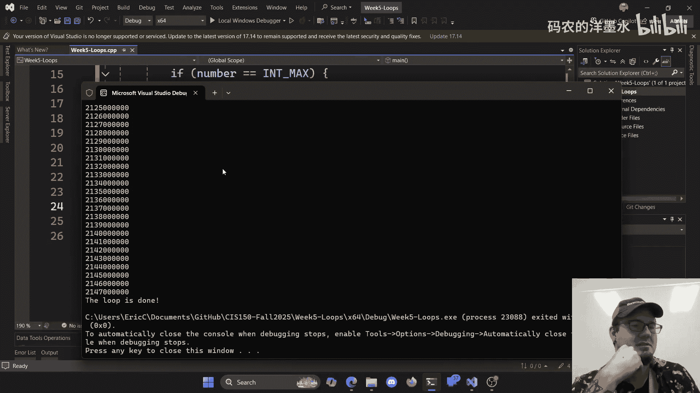

While the condition never became untrue， never became became false。Break doesn't care。

 You hit a break， your loop stops。So when I'm reading a loop and I say， okay， I start my loop。

 here's my curly brace， I'm going to go from the top to the bottom and then I'm going to come back。

 Greg says， no， oh we got other ideas。Gammee over looptop。 And that's why I dislike it。

 because it's jarring to follow the code be like， oh。

I'm not going to do what I usually do with the loop I'm going to stop and that's all and some people really like them and that's fine here I just try not to use them here because I'd rather put my condition here like while the number is not the accent do something。

Because then I don't need that a break and I can see when the loop is going to stop here rather than having to read halfway through my loop to find out。

 oh， it's going to break significances to this。Oh。That's all it does some silly stuff here。Excuse me。

 The other thing you can do with loops and those fun keywords and controlling what happens in your loop is you can use a continue keyword。

So if we wanted， let's do a different loop here， so we'll say how about four。

And I'm sorry I sure I hate I but that's okay I is zero I is less than let's go 100 here I plus plus I just don't like I because I don't know I feel like we should have more meaning to it but most people use I all the time I'm just weird so if we only want to print the odd numbers here because say hey if my。

I modulus2 is zero here。Which is the not case what I want to do is I want to continue this loop。

 so continue。Says。Jump back to the looppeter。走。Stop going down line by line by line。

 just go back to the top。It's all it does， so it skips everything that goes after here so that after that I would see out I and an N。

Here。So oh， we probably don't want that loop to happen first， that one's too long， sorry。

Let's put this one at the top， maybe。Let's go by a billion， I guess that will be a lot faster。

I'll put my loop back， so we'll just count twice。

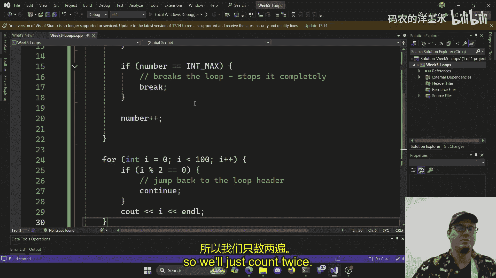

Oh't no， it was 100 million billion。

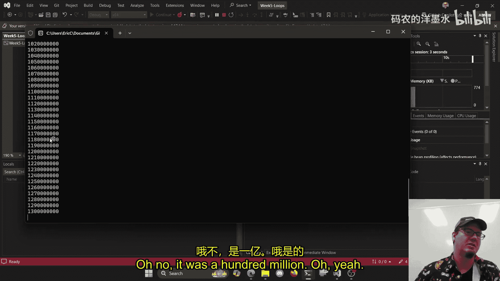

It was done。 Oh， I never got。My output。I do wrong。 I did it wrong here。

I'm too tired to need more coffee， Why didn' it not give him my？I did， did I I closed it too soon。

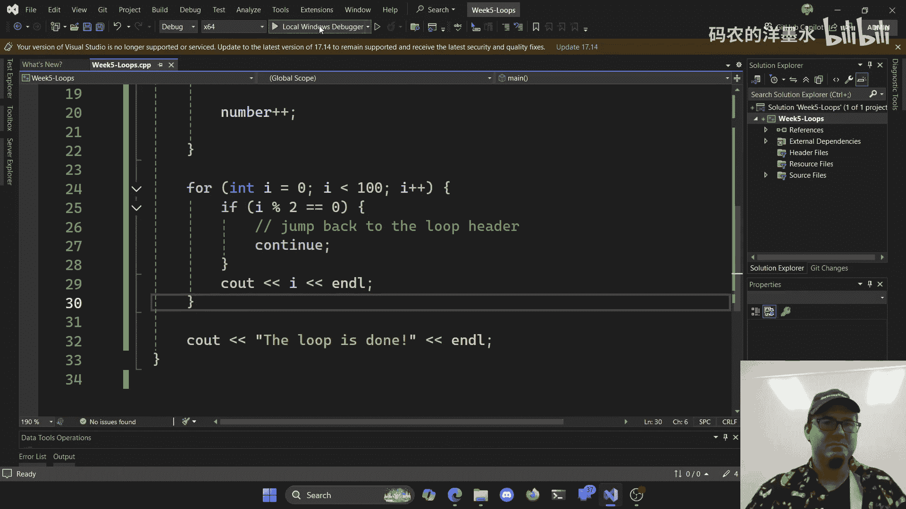

So。Did， I'm。toldold you youll work off yeah， we get the odd numbers not very exciting here we could have just said if it's odd print here now sometimes the continue is helpful because you might have like 50 more lines of stuff in your loop that you want to skip and that's much faster。

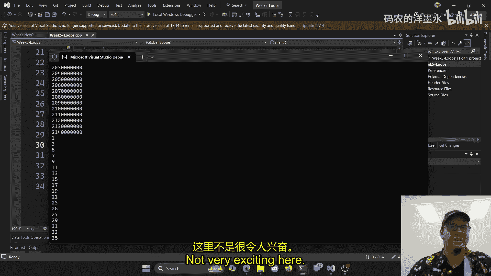

You can just put it in this block， though。Let's say if it's true， do this。

And then no other code runs， and then it comes back to the header here and again。

To me is visually jarring to have to try and follow loop code with a continue in it so what you can use them you're welcome to do is the book has some silly examples where you do breaks and continues and that's fine right there are tools in your toolkit you're welcome to use them they don't allow you to do anything that you can't do without them so there's just shortcuts right we could。

Uses it continue just with an if else。Right， so instead of having to use the continue keyword。

 we just。But if this is true and that if it's not true。

 everything else happens with the break that just needs to go in the condition。

If you wanted to break in the middle， well then you have to do a little check。

 hey do we meet our condition in the middle but you can still have that in your wild condition here so they don't give us new things to do they just give us some shortcuts as all but the breaking continue。

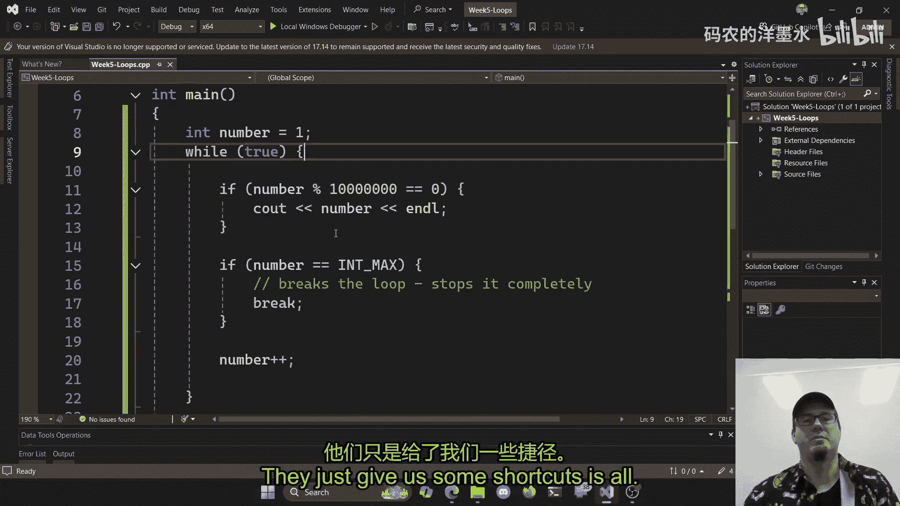

All right， variable named scope， this one's important here， so scope is a funny。Word here。

 is's one of our technical terms， it's all about the block of code here determines a scope。

So where you declare a variable？Determines its scope。

So if you declare a variable inside of a loop here， it's not accessible outside the loop。

 it's only accessible within its block of code so and I think we looked at trying to set values and things that we did our first loops last week and do too much here we have to declare it outside the loop so you can set it inside the loop and then it still has a value when you're done with that here so because number exists here when I'm done I can see out number。

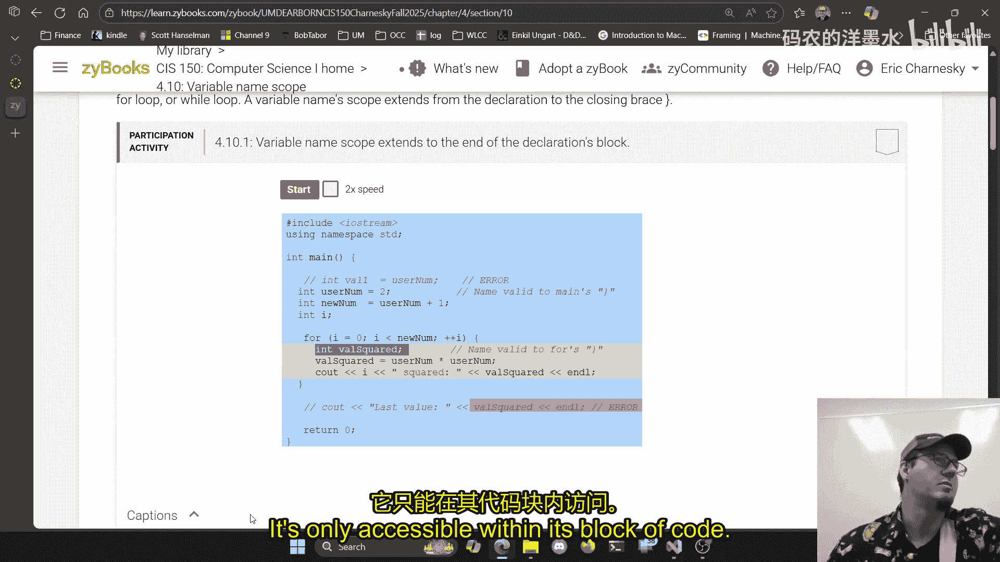

And number still exists because we didn't create it inside the loop with I。

 I only exist within the loop， I can't output I after the loop is done because it doesn't exist。

Says eyes un。Unfined， it only exists within this loop scope， the scope of the loop here。

 So it's not accessible outside of that。You can with for loops， you can declare an eye。

Or whatever value you want， and then just set it within the loop here。

Most people don't do that right if you want to for loop usually you want to just use a temporary counting value here now weird stuff happens when we have in I here and in here。

B errors get。Local variable I。Uninitialized local variable I used。

It says I was never initialized it was never given a value because we have an I within this scope when we use I and uses this scoped I。

 not the outer scoped I。She gets awfully confusing。

 so generally you don't want two variables with the same name。That's just a pretty。

 pretty good rule of thumb here， but like if we were to set the same to zero here。Here。

 when we print down here， it'll still be zero。And our program will run and be happy。

 it won't be the 100。

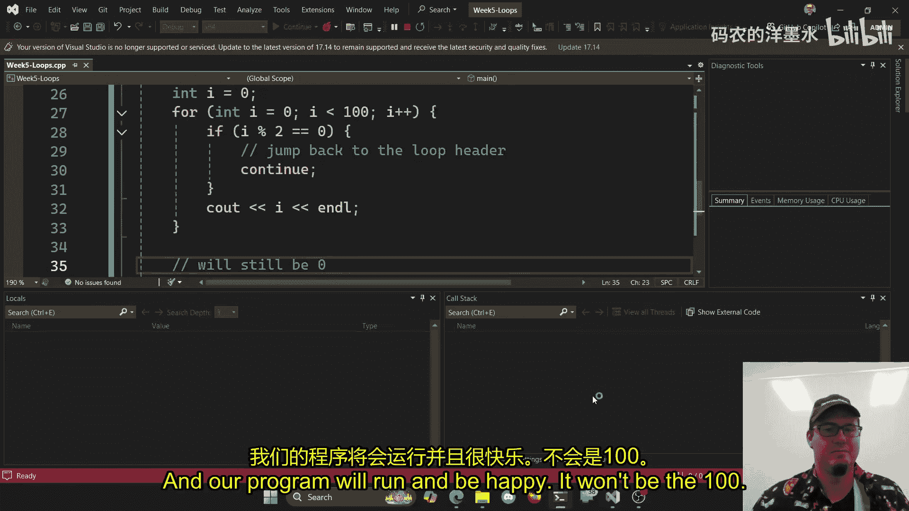

Oh， there it is。

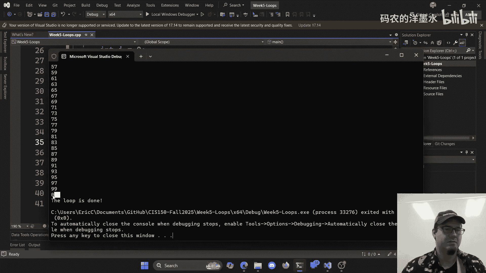

So it's still zero because it's a different value for I and if you're not sure you can put it in debug mode okay let me go another I zero here that's still awfully slow。

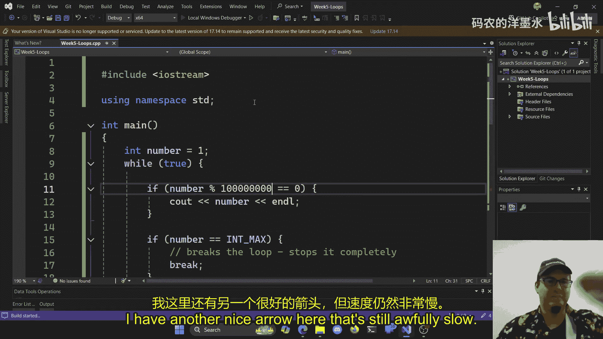

So in debug mode。😊，Oh， now it's taking like a little second here to add 100 million at a time。

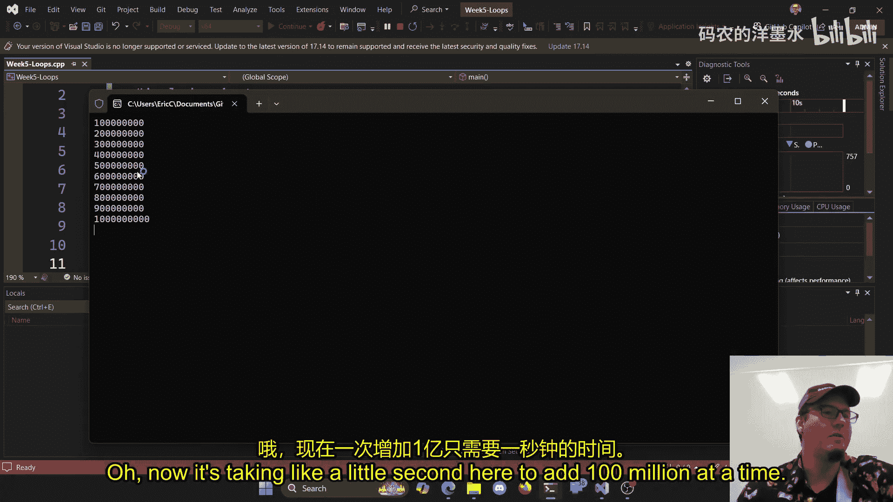

What was that maybe less than a second for the computer to add 100 million right now we're in debug mode right this debugger is your favorite tool to be your best friend for why is my program not doing what's supposed to be doing for you to get rid of the bugs to debug the program。

It's a Q term right， we have I here。This eye doesn't exist because it's no longer within scope of our debugger。

 so if we paused within here。Then we would see， I think can I drag it back。

 I think I can drag it back here。 Hey， look at that。Sometimes that works。

 you can go back a couple lines。It doesn't always work well。

 but sometimes you can change and go back up up with a couple lines like rewind time which is kind of fun and now we see hey I've got I is 100 and I is zero I've got two different eyes and it's a little bit confusing here right。

But you can see both of them and then I continue on and then back to my loop。

 loop stops and so when it goes out of scope， it's no longer visible as a local variable here。

Because it's not accessible anymore， so it's not going to show me what the value is。

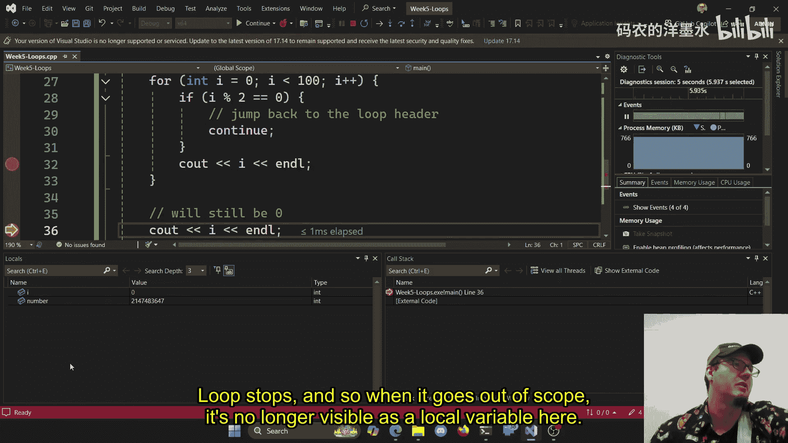

So use the debugger that's fantastic here。Yeah4 loops。Sure， okay， awesome enumerations。

 so this is a fun way of putting names to values。So why we like it because it gives me names and values so you can use a type of enum here。

And then whatever we want to call it， what is this type of enum here so their fun little example was light states unless these are terrible he some of their sample code here。

 but I didn't write it that's okay so I can make fun of it。对。All right， so with an enum。

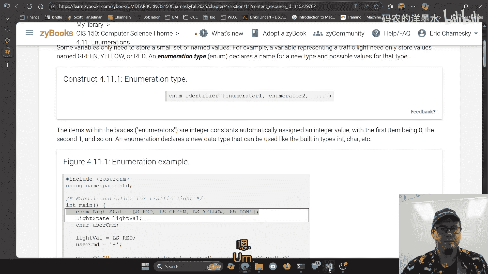

Its really just a shortcut way for me to put names to values so that anytime I want to reference a light state here。

 I can say， hey， this is the red， green yep。Why red green yellow。I guess it does， Okay。

 if you start with red， it goes in that order， but that's a。It's a weird order to start it。

Other countries still were rare。Yeah有吧。R's at the top and yellow is in the middle and the greens in the bottom。

Yes， but so like we're saying it out I don't know， okay。

 it's it's besides the point so if I want to pass a light state around here， I want to say like， hey。

 I want to help my car to stop while the light state is red here。I can use this value of LS red。Here。

😡，And I can set other values in my code here， I can have a light state value。

 and it can be a red agree green and a yellow room done。I don't know what done is here。

 maybe it's like some sort of racetrack here， I don't know。Yeah。So like my light state。

 so a late state。For current light state equals a last red。

And while my current light state is equal to Ls red。Okay so I can put like a name here。Hey。

 this is red， I guess I should this was bookss chapter4 all right， I'll even give you the URL here。

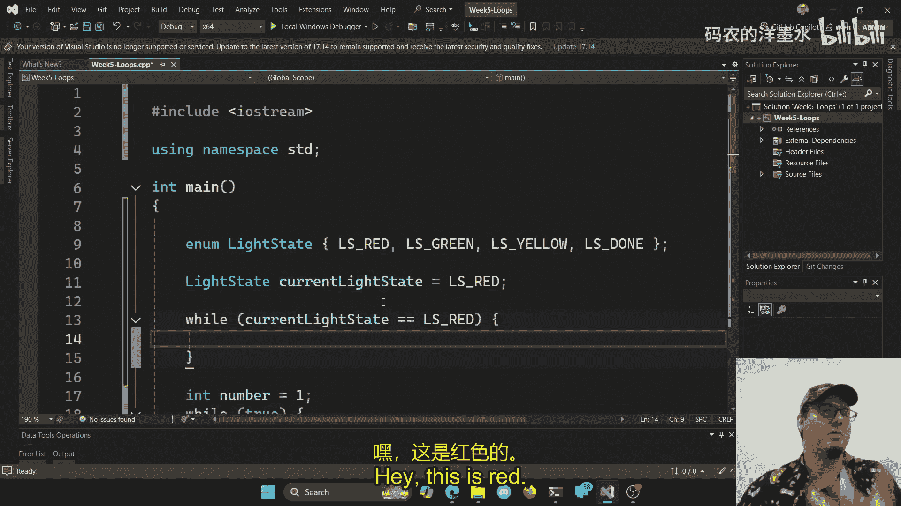

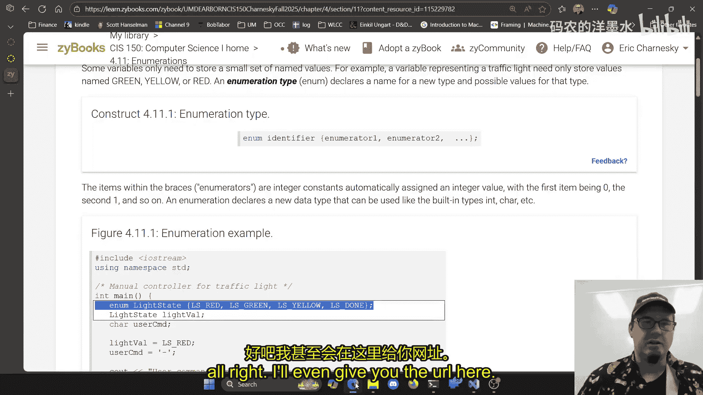

I'm going to try and be good here。If you use someone else's code。

 we should cite our source even from one line， that's fair。So。Or right if it's red。

 I don't do something here and how will we we printprint out here。Me at the red lights。

And then I'm just going to do a really dumb thing， it's okay。

 we're just going to count to a billion to make my computer be slow。

There's better ways to do it I promise we just haven't got there yet and I don't want to Google that so hintt zero。

I have less than 1000 million，1 billion。And then we can set my current light state。

To light state green。And that should stop my loop eventually。

 and then we can see how green meanss go。All right。

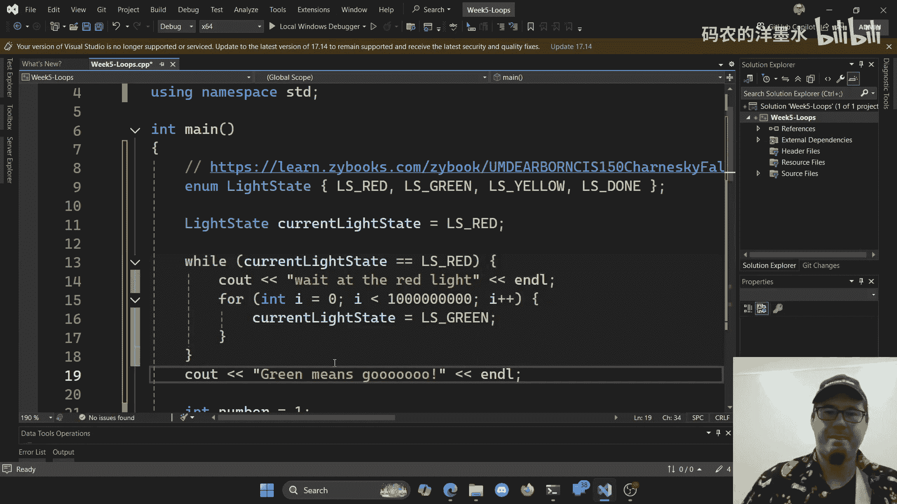

So it should take a brief second here right to pause way to the red light and now we got a experience go because we made the computer waste a billion operations here thankfully it was pretty quick。

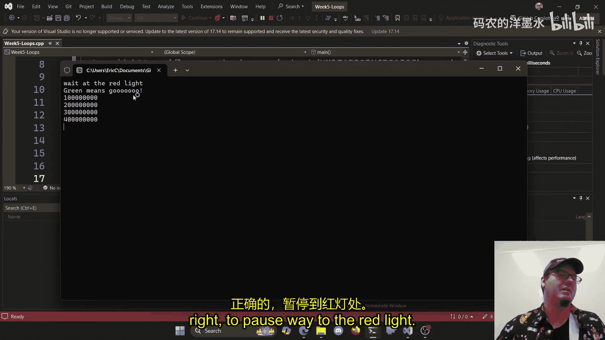

Theyre very exciting。It was very exciting。So the nice thing here is I have names to my variables。

 maybe we talked about using constant values before。

You have a name to a variable now what's nice about an Eum is I don't need to have like this constant is0。

 this constant  one， this constant2， this constant 3 and remember any of that and then store them as integers。

Because we could do that， right， we could say， hey， I've got a， you know， a constant andt。Green is 0。

 Constant ant， yellowlow is one。 Constant ant。 red is 2。

 We can have some constant values here for these。But then if I want to store what the value of the light is。

 it's an integer， Earth light。Right。I can assign a height that's green here。

 but it's the type of integer， so it's possible to give it something that is not a valid light snake here in my coat。

So by having an enum， the only possible values you can give it are red， green， yellow， and done。

You can't give it 27， I mistake。So it's a safer way here and then it's even quicker right you don't have to do a lot of typing here and then I don't know if you notice when you hover over it。

 it tells you hey red is zero， green is one， yellow is two， done is three。

 it's actually behind the scenes is storing into values for them here。

But we don't have to worry about any of that stuff here， so they actually are integers。

 but we don't need to give them integer values and things and then we get a nice restricted， hey。

 you can only be set to some of these things here like if I try and set it to 27。It's no good。

Which is nice， right we want that sort of protection here to make sure we can't get to a bad state here so let'll set it back to red。

Here， and we can use that value。But it's really nice to be able to loop through or have these values and use them here like that。

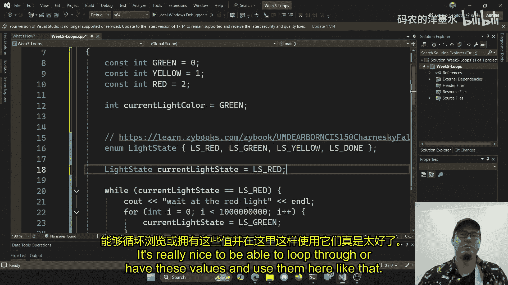

All right， so it was our enums， I our state machine very exciting so you can go through those examples here。

😊，All right， I think that covers。All the pieces from loops， very cool。

Do we get through all of them we do breaking developing programs incrementally hopefully you've seen this ideally we do this when we tackle a big program we want to do little bits at a time it's hard because nothing we've really done has been that big yet but eventually we'll get there to bigger programs we're going have okay here's a little bit and here's a little bit and here's a little bit we'll just get something there and it doesn't need to be finished yeah but we want something that runs test on a little bit that runs the add more to it so we'll get into some of those as we go。

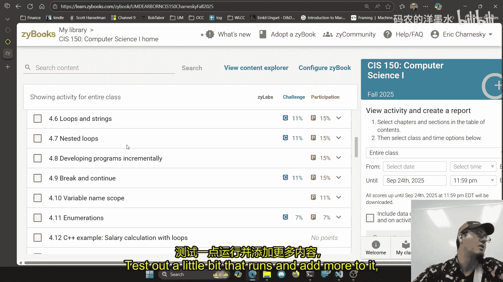

I wanted to do one more shape here because I'm quite fond of shapes actually no。

 I wanted to do a dice example here because I really like dice and they make me happy now。

We're going not going to be able to do all of the really cool things that I want to do because we don't have ways of storyor information yet that aren't tediously slow。

 but after I'm done recording， I'm going to show you a video from a really cool YouTuber standup maths that talks about some dice statistics here and eventually we can do the sorts of things he's doing in code here in C++ we just aren't quite there yet we need how many more weeks we need to get to raisein vectors before we can start doing what he's doing here so in a couple more weeks we will to tackle his full problem here Ill a little bit of fun so one of the things we can do with dice here is we can sort of see essentially how random these random values are we can test it out so if we roll pretend we have a six side to die we'll pick a number one to6 we'll do a bunch of times we'll look at the distribution if it's actually random the distribution should be pretty even。

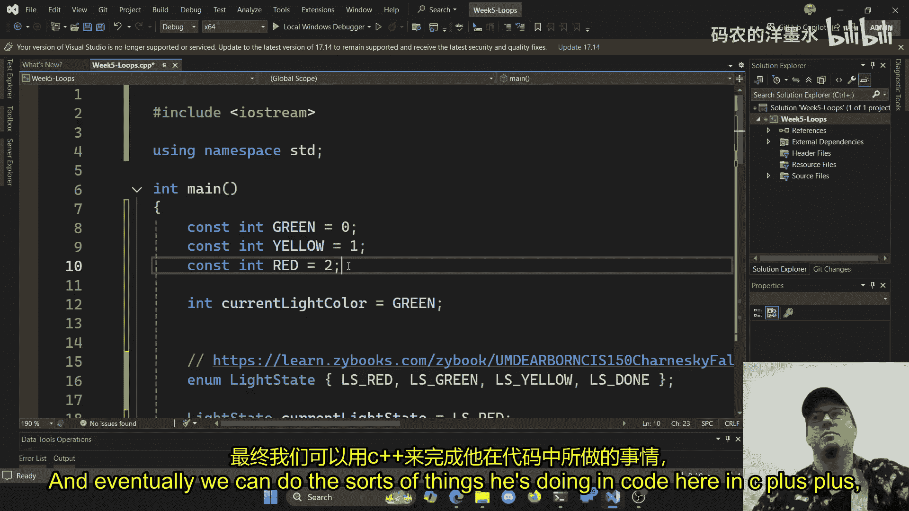

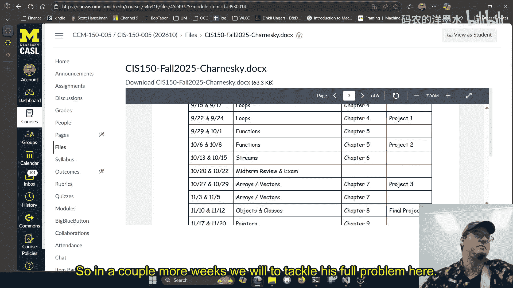

It won't be exactly even because it should be random， some will have more， some will have less。

 but it should be close right so if we take a sample of 10 roles。

 it's going to be bad if we do a sample of 100 rolls it'll look better， a thousand rolls even better。

 a million roles even better。We'll get closer and closer and closer to that nice even distribution。

 the more samples we take。You're all good to math right Does anybody take a stats class or did you get right like bypass stats and get right in the calculus you get stats you bypassed okay。

 you have stats No stats was my favorite math class by and large the most practical math class for software engineering in my opinion and my opinion means very little but that's okay so we want to do some dice statistics here so we're gonna to generate a bunch of random values here so I need a way to count how many times each of those showed up right so I'll have an end count of ones。

 starts off at zero count of twos starts off at zero and I got tired of typing already here so I'm just going to go copy paste three it's fours five and sixs。

 I'll just fix these here， three。Fours， fives and sixes。系。

And if we want to do something some number of times。

We want a for loop right because we know how many times we're going to do it here or we can even ask the user right。

 why not， so we'll have any number of roles。Mes。Equal。

 so I'll just start here and we see out how many times do you want enroll。Do you want to roll？是。

And then line and then we can see in my number of roles and then for int role is zero role is less than my number of roles。

 role plus plus again I'm not actually doing anything with this role value here。

 but I like putting a word to it here this is what we're pretending to simulate here we'll pick around the number。

So we need in random of value is RA。And then we want modulus six will give me a random number between zero and five。

Right and then I can add one to it to get one to six right plus one， and then， hey。

 if my random value。Is equal to one， then I'll take my count of ones。

Plus plus and this is where it gets really tedious once we get to the array bit we can show I can show you a shortcut so you don't feel bad about yourself I'm going to copy paste to watch code here we in a value is equal to to value to。

Co of twos， oh my good， this's not the out count of twos。

Plus plus right and this way I can copy paste now for threes， fours and fives and sixes one2。3， four。

 five and。We could just have this be an else because if it's not a one， two， three， four。

 or five it's got to be a six here， I'm going to leave it here because we're going to change it in just a second I'm going to go expand on this so。

Either way works here right， you can do whatever you want here fives。Fours， threes。

Right and then when we're done here， we can see out ones。Its the count of one， Oh man。嗯。

And probably an end line， right， you want to do a percentage here of roles or just have the counts。

two percentage rates， oh， okay， just the counts， sure， you need just the counts。

Ones and twos and threes。The rest is， threes， fours， five， six is。

 and then make sure we change our variables here， so the downside of copy paststing is it's possible you type the wrong variable name。

 do it all or forget the updated variable name here and do that all the time。

Sometimes it's easier than trying to type it all out， so I think we got it all right here。

 so let's give a shot。

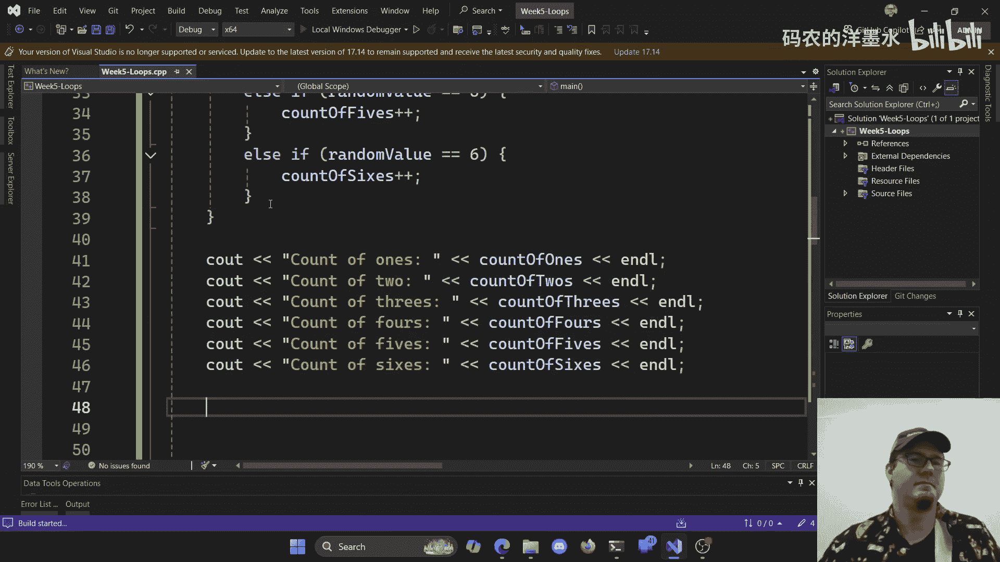

How many times you drive？I heard four， right， so we got two fives and two sixs。

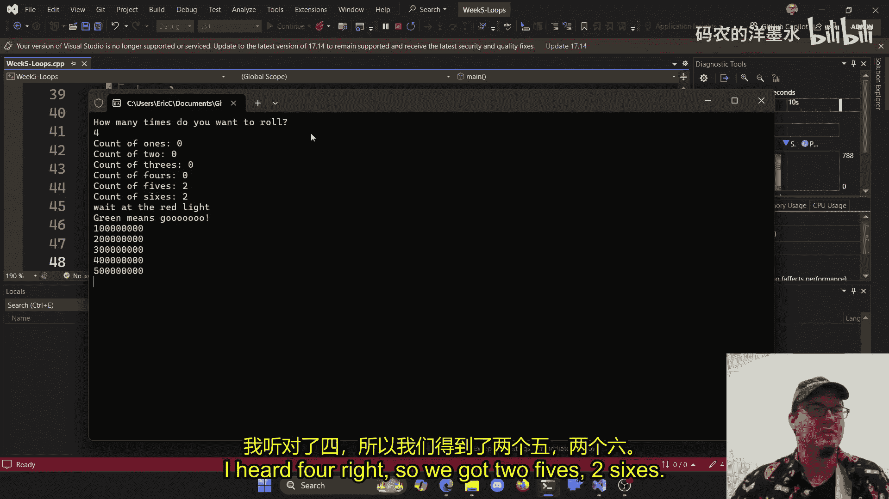

Very exciting'm just。没有了。String paws。UIf you just see in on something your program is weight。

 so it'll just sit there for a second for you to press a key essentially。

 let's try it again how many times you roll now？

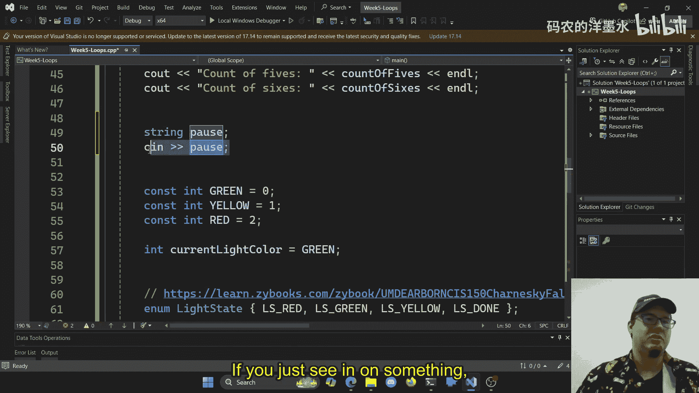

三。😊，Right we're getting the same we got to seed it right。

 so let's go back and see we have to include time or something， what was it？

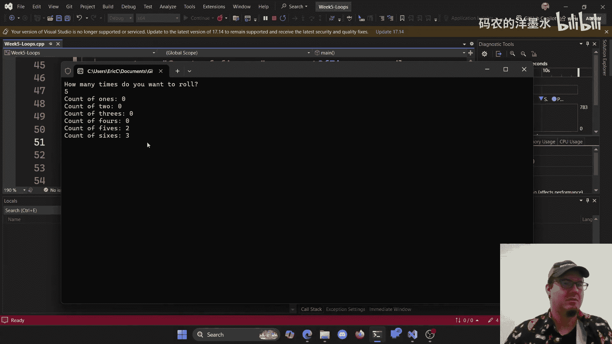

Seea time。See time and then we have to do a。S R of time of 0。So right？

Trying to remember what we did last time， which was when I had to Google it last time。

 trying to remember how well。I think that'll work a little bit better。 All right。

 let's pick another number let's do five again make sure all right。

 now we're getting different values。 Life is good， so let's do a bigger number right so we get a better distribution。

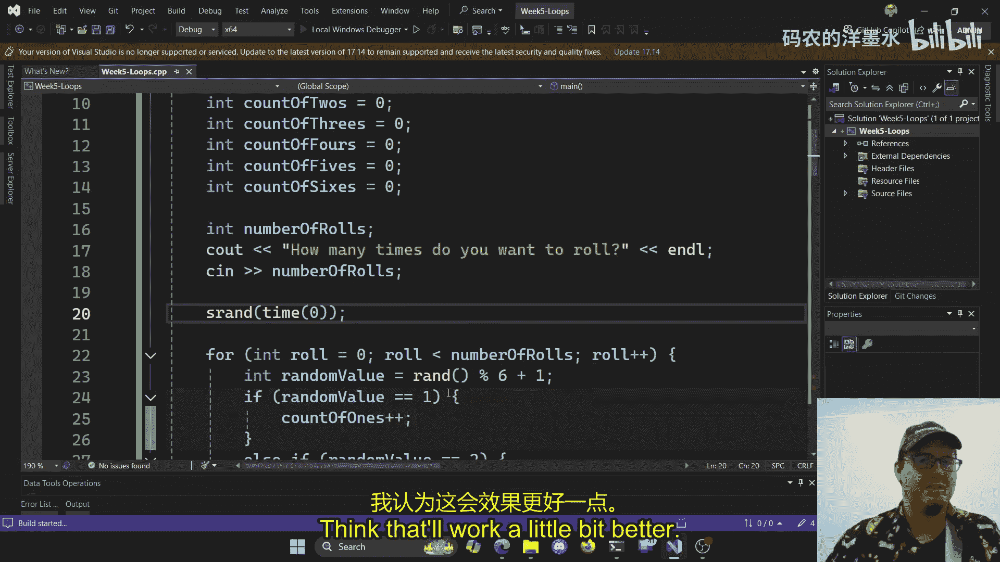

15。And we got a lot of threes， no ones， let's go even higher like in the hundreds。200200， all right。

26，39。 so they're relatively close， right， And if we do it， say like。100 thousand times。

 they're even closer。 It's still off a little bit here， but within100。

 which is like less than 1% difference of each feels pretty good， feels pretty random。

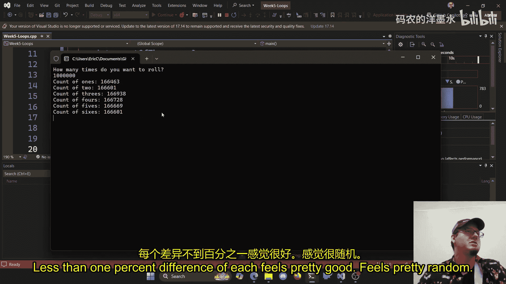

Right， all right， awesome， so we can do fun stuff like that with loops here。Okay。

 the YouTube video is about 25 minutes long here so I can stop the recording I can't record another person's YouTube video because I'm opposed their recording of it on YouTube。

 they'll take mine down。Or mute it all out or do weird stuff like that here so I'll post the link herellll show you what it is it's a stand up math here we go。

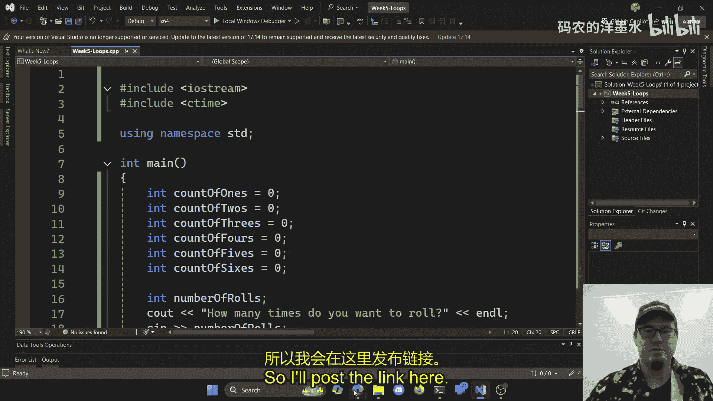

This。

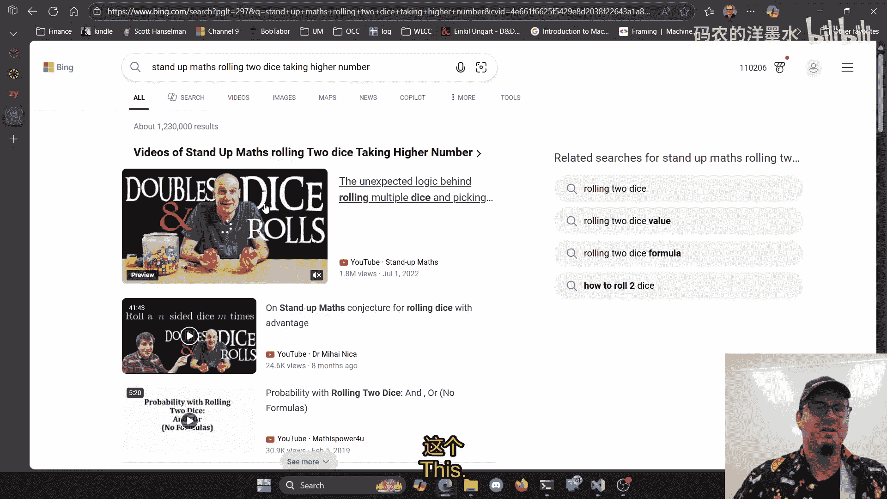

I don't want it in your weird viewer being no I want it on YouTube the unexpected logic behind rolling multiple daysce and picking the highest those of you who aren't familiar with nerdy games like Dunngeons and Dragons that's rolling with advantage So now you know right so we'll watch this。

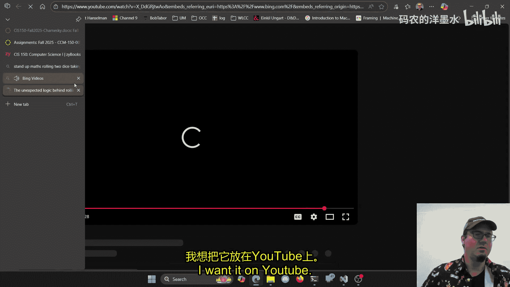

When we get to array， we'll come back and we'll do this in code because it's fine and I like numbers So if you're not into stats and numbers。

 that's okay， it might be a little bit boring。But it's really cool and he writes he does Python code it's a little easier for math folks to do Python code than it is C++ is anybody a math major？

Bth meters used to have to take 150。就是。weirdir choice。

 but we didn't have a Python class previously so ideally now they're taking Python rather than C++ for math majors。

So okay， every now and then I get a math major people want to get like into actuarial sciences and stuff and do fun mathy things。

 but all right awesome so we stop the recording， we'll watch this and then we'll call it a day for loops and move on from there okay。

 awesome。

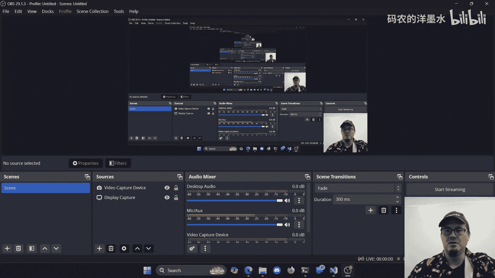