# 【全集】密歇根大学 C++编程 中英字幕 1080P p07 Lecture 7 - 函数 part1 -BV1TsAZzAEHX_p7-

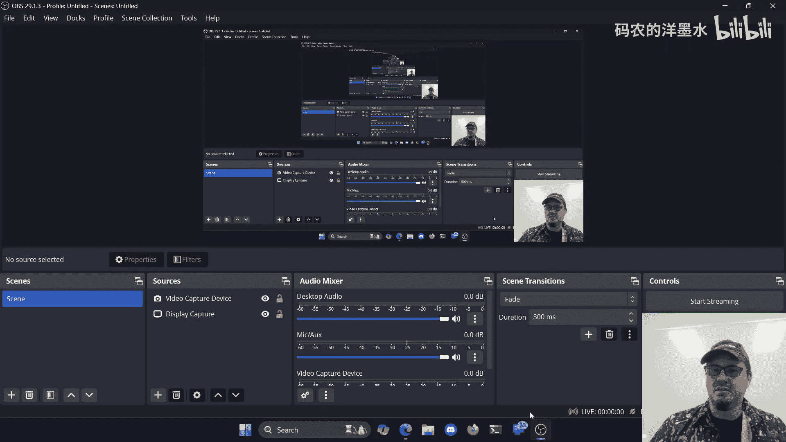

All right。 Hy Monday。 We're moving on to new stuff。 Very exciting。All box here。

 Don't forget your chapter 4， right。Do。Today， 1159 p。m。

 we're going to start to talk about functions here。Functions are great。

They don't actually let us do anything new， though， it's a little bit sad so。

It allows us to write neater code， write more efficient code。

They're helpful and we're going to see them all the time。 in general。

 our good rule of thumb is anytime we have the same code twice we should feel bad about ourselves。

 So functions allows us to not have duplicate code。

 we'll take a look at how that looks here as we go。

 So we'll have two weeks for this chapter so they won't be do until the 13th here。

 So we go plug that in so that you have the date。There。Chapter 5。13th。

And theres a no submission there we go。 make sure do that one right。All。

 so I'll run the chapter4 report I'll probably just do it Wednesday when I'm here maybe Tuesday。

 but sometime after tonight， we'll run chapter4。And。Not doing great on those numbers here。

 We definitely do better of the first couple chapters。So what of this。Yeah。

 if if there's anything in help with these， let me know I'm happy to talk in chat。

ItsUually relatively straightforward。 it is going to take some time， energy， and effort and。

Looks like one persons got ahead on chapter 5， awesome。

 maybe so we're working through chapter5 here me full a visual studio。

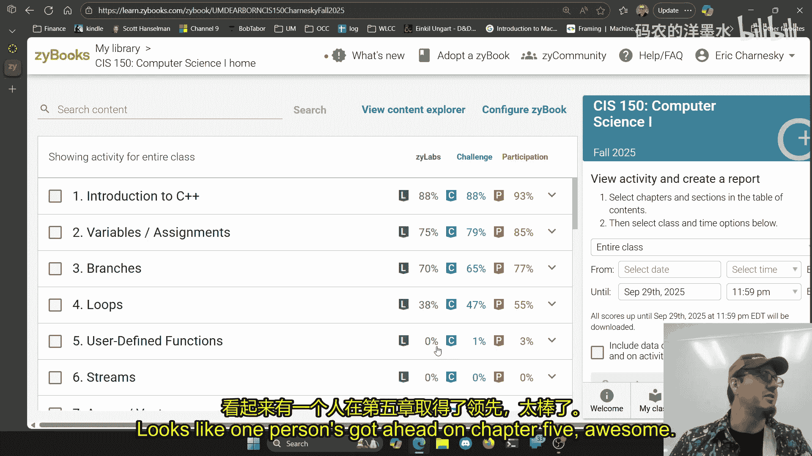

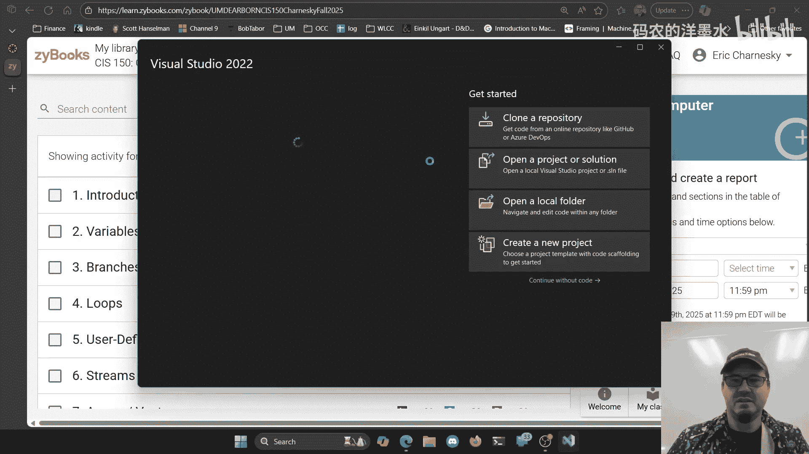

I'm going to make a new project this is this week six now， is where we're starting。

 if you want to count the first day as a week。

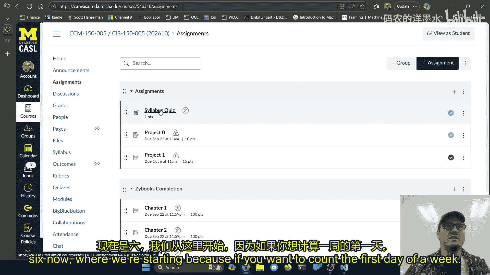

That's probably close。Six functions are part  one， we'll call part  one。For。

 we have lots of time for functions。T remove some this stuff。So int main here is actually a function。

 So we've been using。This function a whole lot。 we just didn't really do anything with it。

 Cves didn't really call it out as a function here。 And we've been using other functions as well。

When we did。But some number rounded up like 3。5。Purun it up is。

We did the seal function that was rounding up here so you take 3。5， we can round up very exciting。

Probably want a space here， so that separates a little bit。So these are functions here。

 it calls some code。Some functions you hand things。 Sometimes you don't。

 So most of the ones you've been doing we're handing it something here。 So we're giving it。

 Here's the 3。5。 and we're expecting back some kind of results。Right。

So we can make our own functions here Now C++ is a little bit particular about functions here。

 so we're going to make ours above main most of the time we'll get into other times when we don't need to。

 but most time we' put on above main here so they're easy to find。

And if we want a function that gives something back。

The first thing we have to tell C plus plus is what we're giving back so in this case。

 main is giving back an integer， we can get back an inch so we can a height sum number。

And then a set of parentheses in this set of parentheses is the list of anything that we want to be given to our function。

They're known as arguments or parameters。Technically。

 this is the argument here inside the function of the parameter。It's not very exciting。

 and we use a return keyword to say give something back here when we're done。So in this case。

 we're just。Giving back the number 10， not a very interesting function here， but we can do that。

 and we can use it outside of that function here。 So I output。The number is。

And I can call some number by name， right， So I'm putting a name to that bit of code that I just wrote。

 it's not exciting code。 We'll get to more interesting function in a minute here。

And if I put it in debug mode， right you're coming over to this left side， add a little red dot。

 That's our break point here。 and we run with debugging， it'll pause there。

 And now we can actually bounce around。 So before it's been kind of top to bottom and we said， oh。

 now you can do branches So maybe this part runs or this part runs or maybe we can do loops where you just go back into the top。

 but it's still pretty much top to bottom。So finally with functions now we can go completely somewhere else。

So when I get to my point here， it says some number is what now I've got my couple options here。

 I have a step over。Now， step over is not going to go into our function because we want to step into。

 that's the other option here， this is F 11， if you feel like your keyboard shortcuts。

 I want to step into that function call。And step into， says， O， sure。 I'll go up here。

 You called some number。 I think it's not very interesting function。

 But we can see on this call stack over here。 we came from line 15。 We're running some number。

 We're currently a line 8。 When this is done， come back to line 15。 right。

 It has to remember where we were。 So for this code to run and come back。 So this case。

 it just returns。 We get back a 10。 and we print out our output here。 Very exciting。😊。

And that one's done。 So we wrote a function here。 So maybe we'd want some sort of function that could give us a random number。

 That'll be much more interesting。 So some random number here。Ohoops， I need to set up parenthesesis。

And then a set of curly races。 So everything inside the curly races belongs to that function here。

 So if we want a random number， we can take random。Right which is a function call。

I remember these parentheses， we're doing a function call。

 And if we do like I don't about 100 plus one， we should really get a number。1001 to 100。可以。

And if we want， we probably should see that， so we have to let include sea time。

Think we did it like that， right， And then we set s R of time of0 or something。That sounds right。

 I think I Googled it last time。 that one seems probably close to enough。

 So we'll get a random number so we can get random numbers now。Right， so some random the number。

And the number is。And we'll take our random number。With parentheses。

 because we need to call the function， the parentheses mean please call the function。Yeah。

And we should get out around the number， though I don't need the break point here。

 we don't need to pause。Oops。It has to return a value。 So we said， hey。

 this is supposed to return an int and we got an error saying it doesn't return a value。

 It needs to return a value here。 so we need to have that return keyword。Now。

 it'll be a little happier here。 Now I get my return to key。 they don't have to be one line。

 We can have this happen on multiple lines， but for now， it's。

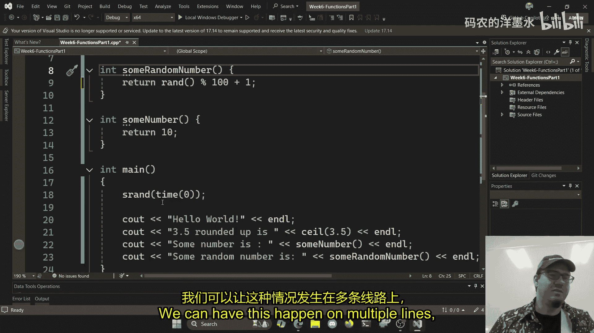

Let's do single lines。Oh goodness。 I have to update Viual Studio。 we got 74。 If we run again。

 we should get an 84 and a different number and a different number。 Very exciting。

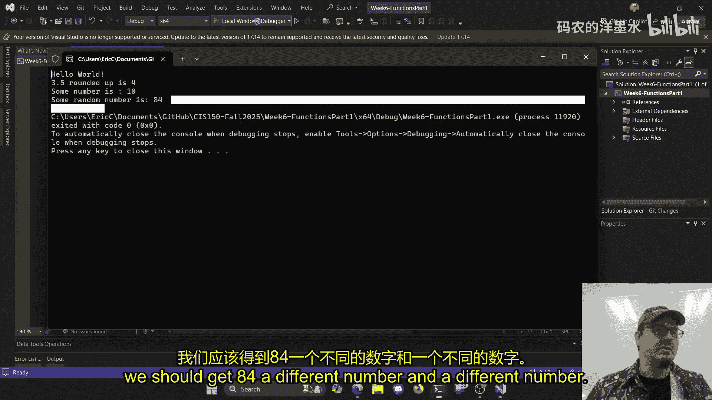

But what if we wanted to be able to give it， hey， here's the maximum number we want。

Wouldn't there be a helpful function。Yeah， thats good good thinking， so maybe we can say， hey。

 in my list of parameters here， you have to give me an int for the max number。Now。

 what this means is inside the function， I now have access to some variable called max number。

I know it's an integer。 That's all I know。It's probably a positive number。Might not be。

 That's probably positive， right， so I can modulus by max number here。And then add one。

 so they give me 100。I'll do random number， mod 100 plus1。 Life is good。So we can now pass in。

 say 100 here， right so I'm sorry this was red here before think too few arguments in function call。

Now that my function requires an argument here。You have to give it one。

 You can't call a function without passing at something than it once。 In our case。

 we can pass it the hundred。 and we'll get the random number one to 100。Life is good。

 now if we do something silly like a negative number。

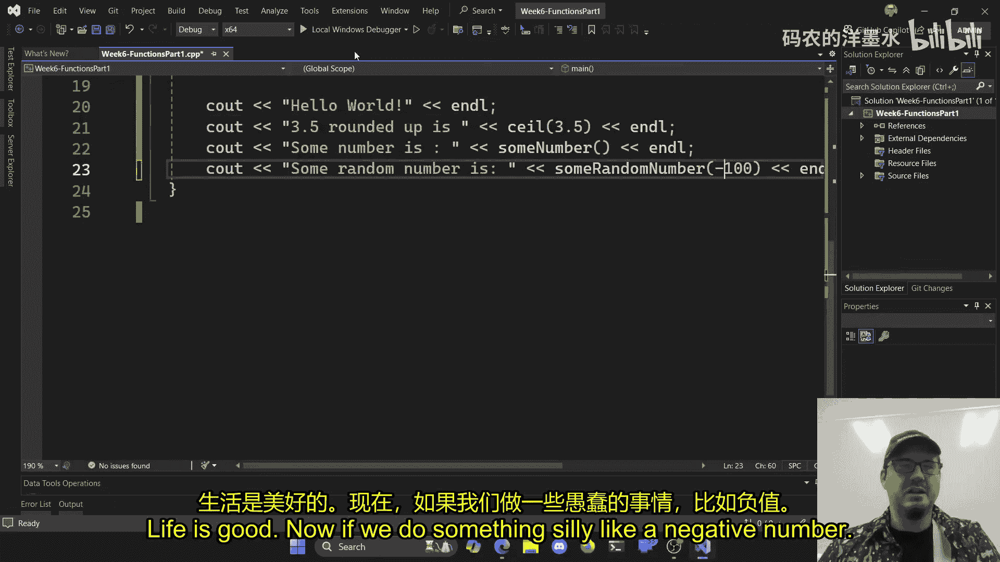

Still worked， interesting。You got a result here。Never actually tried to modulus by a negative number。

 maybe it just works。

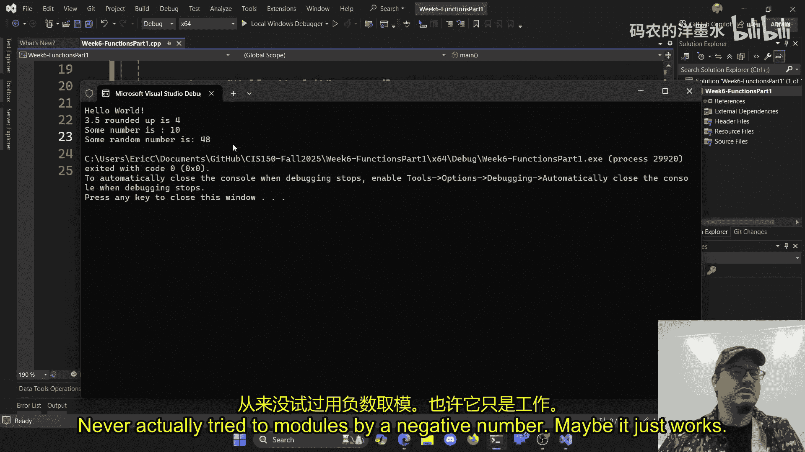

Ma is still a remainder。Not really sure。Well we can pass it a number。

 so this is our argument and you can have more than one。

Right if you wanted to have a minimum number and a maximum number， we could do that。 right。

 That's just arithmetic。 It's not too hard to figure out。Instead of just adding one。

 you add at a different value。Those sorts of things。

 so you can pass more than one value if you want here。So if we wanted to function。

 let's do a different one here， though， let's do a tool a function that doesn't return something。

 So if you don't want to return a value， you just want to run some code here， you say this is void。

 void means you don't return something。 That's our fancy keyword for that here。

 This will say I don't know。 I print。Let's do a print triangle because we like printing triangles and maybe you got to give it an in for a size。

And then maybe we want a second argument， so if you want more than one argument passed in。

 you comma separate here and say， hey， I want to char for the character。

So you tell me what size and what character， and then I can print out a nice little triangle for you so we can say four in row is It know。

 one row is less than or equal to size， row plus plus。And then another loop， right。

 I'm got to do more loops for。Column is1， column that's less than or equal to row。Colln plus+。

I'm sorry， not 44 for end column， there we go， that would help。We can see out the character。

Character。Maybe after the column is done， then we can see out an that line。

And that you print out a little triangle of any given size of any given character。对。

So we can make our own triangles here。 Now this one I don't need to call C out。

Because it's doing the printing here。In these cases， because I was returning an integer。

 if I wanted to see that integer， I had to output it。Tings called print triangle， let's do。

 I don't know 10 and what characters we use。Star， all right， classic， we need to say print triangle。

 size 10， here's the star character。Can we comma separate the values we're giving it for its arguments？

So these are arguments。These are parameters for what it's worth almost no one cares。

 but technically they're different here。So this is fun。

 and then we can even make this be based on what the user says right we can ask the user how large of a triangle。

And then we can get a in for size。And seeing on his eyes Now what's fun is I have a size here。

And I have a size variable here。But remember anytime you declare a variable。

 its scope is what set of curly braces you declare it。

 so if this size only exists within the main scope。

This size exists within the function scope print triangle。 So it's okay that they're both named size。

 They don't have to be both named size。But， it can be。And then we can ask what character。Use。Okay。

 character。See you on the character。And we can pass that character as well。

So I can make lots of different shapes triangles， shaped triangles here。

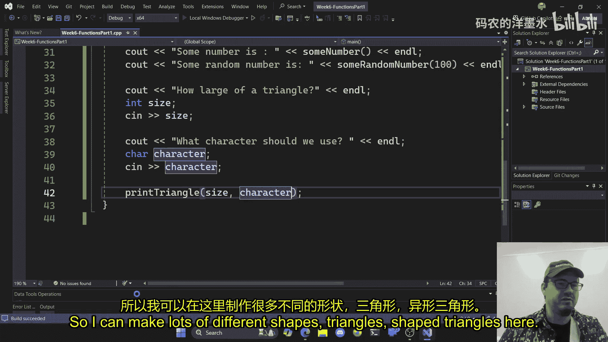

What's ice？Five and what character？Plus。

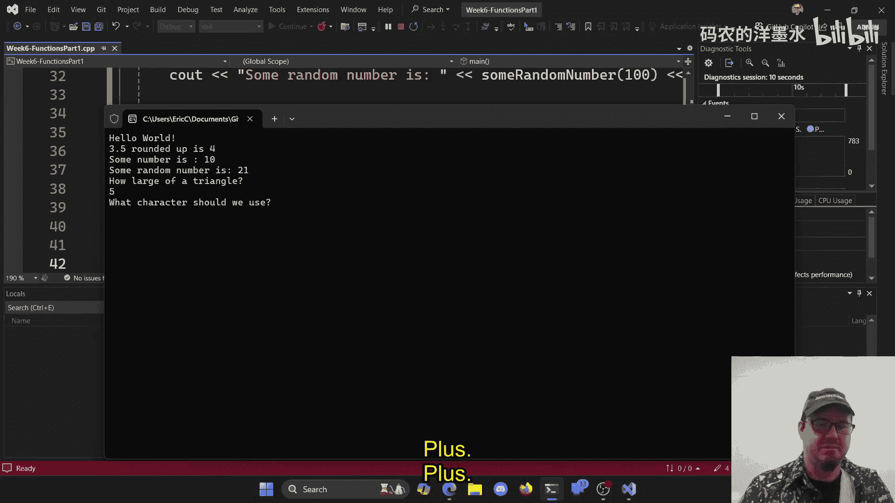

All right。By that。 we have a fun little triangle now。 Very exciting。 Now， so far。

 nothing we've done here。Reduced any code。We only used these things once。

 so we could have just put that exact same code in here。That's fine。

 That's okay right One of the nice things we get to do is we get to put a name to what our code is doing one of the big benefits of functions is you just name what's happening so instead of having to have all of that print triangle code right there。

 I can just break it off and separate it from a smaller piece。

One of my favorite terms is functional decomposition。 It takes a big problem。

 and you break it down into smaller and smaller and smaller pieces。

 that we're decomposing a big problem into smaller problems。没有。

So I would encourage you for Project one to use functions， you don't have to。

There's nothing wrong if you don't here， but it's easy to tackle one little piece at a time here。

With functions。ItHere's one small piece， here's one small piece， here's one small piece， right。

 it's much easier to solve a small problem than it is to solve a big problem。

So if we can think about our big problem and break it down into lots of small problems。

It'll be much more likely to be successful solving 15 small problems than you are solving one big problem。

 and we can solve them all one piece at a time， talk about all the functional decomposition。

 go drop that at a party you're at， make people look at you like your nerd。It's okay。

 you're in a computer science class， you probably are a nerd。 can you can， you can own that here。

But it lets us break down those problems in a way that's easier to manage。

 easier to tackle and easy for us to design solutions to right that's the hard part of programming。

 not making the computer understand what we're trying to tell to do。

 it's how do we take a big problem and solve it？Big problems are hard。

 so we have to break them down into these small problems that we can get a solution for。Right。

So something like a quadratic equation。RememberAnd finding intercepts， isn't that very exciting？

We we can find intercepts now I'm going to make this be void here。

 we're just going to print what the intercepts are that's not great here。

 maybe we should return some values。Pro is you only really get a return one value。Here。Okay。

 so we get to look at。Some silly things to do with this here。When I pass in size here。

 if I wanted to change size， I can say size， I don't know。

 plus we're going to make triangles really big here。This will change size in my function here。

 but the size that I give it I see out not size。

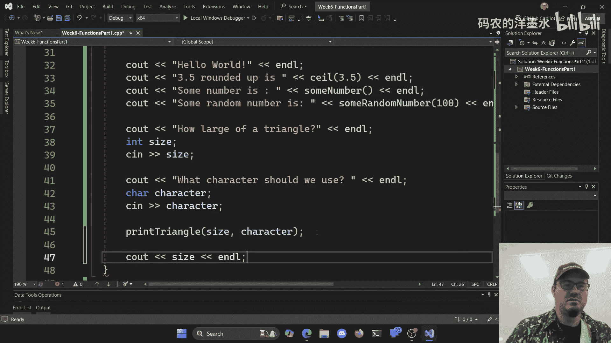

Here。It's not going to change。C++ does some funny things。

 so if we make that size5 triangle here size， it's still five outside of the function。

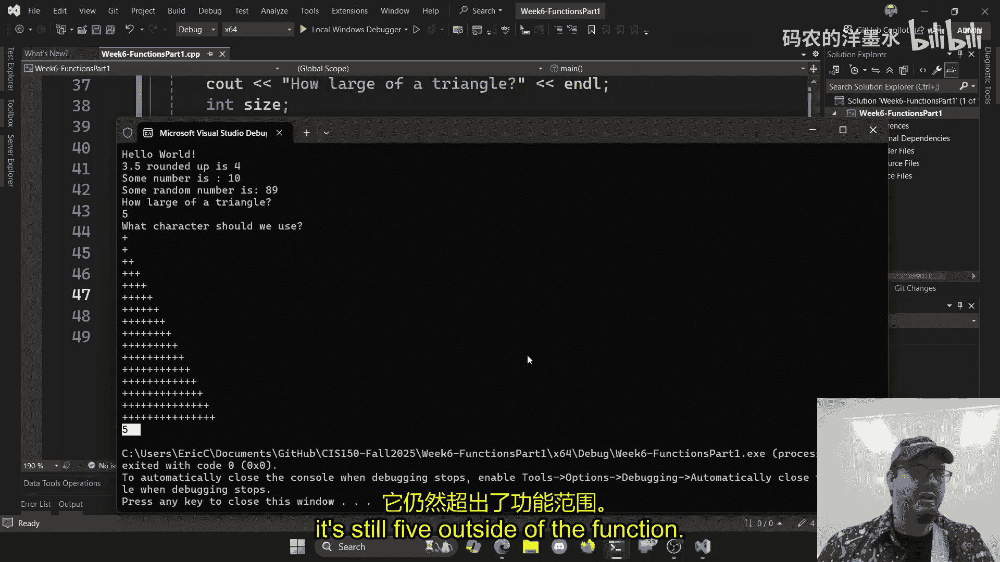

So this size， when we pass it here， we're passing by value。

 So I passed the value intoteger 5 here so you can change this all you want up in your function。

You're not going to change the original value from where I gave it to you。

That's an important piece here， so if we pass things by value。You can't really change them。

But what if we want them， if we want them to be changed here， we need a mechanism for that。

 C++ lets us do the silly thing， which is pass by reference。 So instead of saying here's the value 5。

 we're going to say here's where my value lives in memory。

 Here's the reference to where it lives in memory。Here。

Go for it so they can either access it or they can update what's their memory。

So we can change that value here。If we pass values in by reference。

 you can go and change them inside of your function and there's a funny。Character we use。

 the Ampersandstein ear is for reference。 I don't know if who came up with it here。

 but're we're going to use it here。 So to pass by reference。me use the Eand sign here。

 So now when I run。

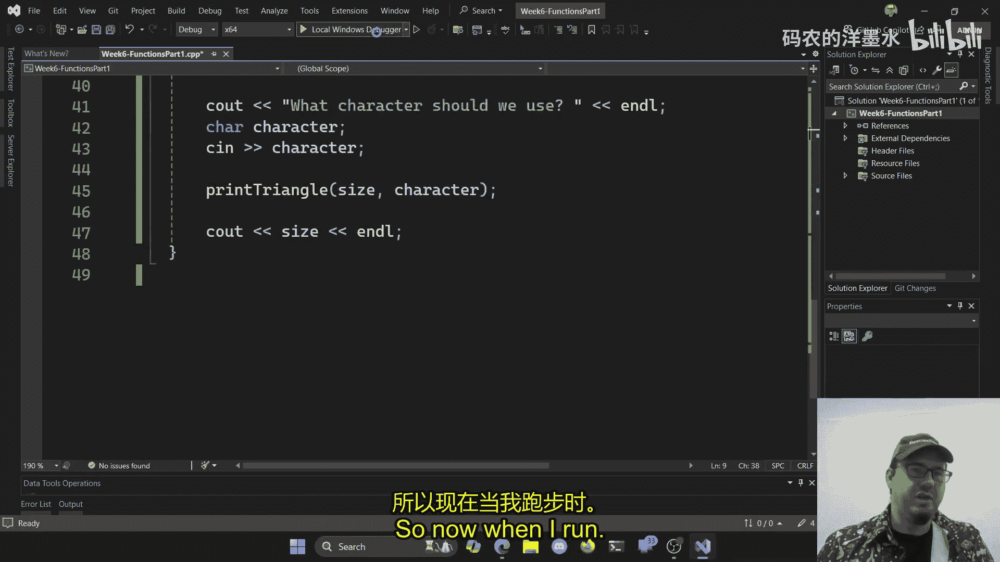

，Size5 plus sign here now size is 15 where we're done， so with a single character change here。

We now have access to size that we were given。 And this is a little weird。 Yeah。

 so we're passing the memory reference where the value size it is in memory。

 So remember any time we have a variable， seabel sauce is going to ask your computer， hey。

 I need so many bytes to store something。 And your computer says sure here's the memory address。

 Here's where you can store it。 So before。All we were passing was the values we passed a copy essentially here's the value of five。

 when we pass the memory address， you say here's the actual memory address X 29，2， F7，8。

 something here where it lives in memory so you can go and change it。

So if we pass something by reference， they can go and change it so we can essentially get more values out this way if we wanted to do some sort of silly function here so we can have a void line intercepts。

就是。Stepps here that takes we need a double for。Oh my goodness， I really tired right now， A。

 a double for B， a double for C。And then a double for intercepts one。

 and we want this one by reference。And a double for intercept 2。Maybe you want that one by reference。

So if you give me places to store your intercepts here。

And then I can go and set them because we're limited to only return a single value you can return one integer or one double。

 one something here， but。Some quadratic equations have two intercepts。

So we need a way to pass them both。Okay， so this is the form what is this Ax squared。Plususs be x。

Plus C， right。Equal0， I think that's the our default formula to this one here。

Now we need to go and figure out， are we even going to have any intercepts， right？

So we have to find what is that the determinant here to see if that's even going to be positive or not。

 right That's the square root of B squared minus4AC。

So B now we need to take power of B2 minus 4 times A times C。That's our determinant。So。

 that's a double。Terminant instead of ET terminant ants。 I don't even know double。什份证。Oops。

 we can't even take the screw root to that until we know if it's positive or not。

So this number first， right before we even square this， if this is negative， we've got no intercepts。

可以。If it's zero， we've got the one intercept。RightAnd if it's positive， we've got two in ourselves。

Thank you for being math people I'm pulling memories way far out in my head here it's been a while。

 as you can tell I don't teach math。Okay， so if then my determinant。Is greater than0。

 We're good to go。 Oh， sorry， that's Python my determinant determinant。Oh man。

 I didn't even spell that at all close to rightf。Amman determined。Determinant。

 that looks a little bit closer， so if that's less than zero。

There's no intercepts we can just be done here， right？No。

We might want to output some sort of message， like no inter's found。You don't really， I don't know。

 don't really have a great case here for that one。Maybe we can give an error at some point but it's that's sorry。

 we'll come back to that so no no intercepts if it's zero we're okay right we can take the square root to zero formula formula is going to be fine right so if that's not the case then。

No， if we want to。Some people really dislike having your code tabbed in and tabbed in and tabbed in and tabbed in。

 Then the more tabs， the the worse it is。 It's a pretty good rule of thumb。

 If you don't want to have to have an else here and have all your code tabbed in another。

But we can just return after this。Because when a function hits the return keyword， it's done。No。

Right here， it had a single return and a single return。Those at the end。

 but you can have returns anywhere you want， and you can have more than one return。

 but only one of them gets to run， right， Like our chain of if Elsif， Elif。

 only one of them gets to run here。 So if for determines less than 0， mean let's return。You know。

 maybe we return， let's return a string I'm going to feel better about this here。

 so we will turn no intercepts found。That's a little bit nicer here。

So we'll just tell them no intercepts for foul so we can return that to the string。

Now we can go back and do the rest of the math， so then we'll have our intercepts。

Intercept 1 is going to equal then。Square root of this， I don't， I'm sorry。

 negative B So negative B plus。Square root of。They deterant， we did that math already。

And then both of those divided by 2A。So。I have to do it before I can I do it after。我的合作。

Do this one first and then divide by 2A。Two times a。嚟嘅。😊，Is this good？

We forgot your order of operations。 You're my math guy。

What is divided by two and then multiply my egg going to do for me？This is not dividing by 2 a。

 This is divided by 2 and then multiplying by a。More parentheses， right？If you want to divide by 2a。

 multiply 2a first。I'm really tired。All right， so that I think will probably work here for the first intercept。

and then we'll take the intercept the next one here， intercept  two。Then it's the same thing。

 but minus。They're going to be minus the square root of the termminants， the holding divided by 2a。

These could be the same value if the determine zero， sure， if they're not， it's fine。

 not too big of a deal here。We'll have the two values， and it we willll return inter7。Se。是。

So we're not actually returning the math thing that we're doing。

 we're just setting the values we were given here。But it should work out， right， Let's try in here。

 So should we ask for A B and C， See out， So we need a double for a， double for B， double for C。

 I shouldn't some people like putting them on the same line here。

You can comea separate your values here。I particularly hate the formats， I don't know why。

I don't like it， some people really do。I'll leave it there because some people will do that and we need an intercept one。

And intercept2。Okay， now we need to ask the user。Enter a。B and C or A x squared。

Plusus be X plus C equals 0。And we can see in a。He seen。You've seen that format。

 I try not to do this either because it also single lining irritates me that you can。

 you can get them all at once。If you space separate them。So on the same input line。

 they can give me all three values with spaces here。 it's a little awkward。

 I like one line at a time， but that's just my habit here。

And then we can see out if we found any the intercepts or not， so that is our。嗯。

What do we even call fine intercepts。Given A B， C， intercept 1。Entercept1 and intercept 2。

We'll get some results here and then we can see out the intercepts here， right。

 or if we found intercepts or I get to be a little bit weird here。We'll try it， we'll try it。

 I'll put it here。我人呢。The intercept 1。And intercept  two。

 I'm just to copy paste that and change it too。2 and2。Right， should you try it？No，5， sure。All right。

 give me AB and C。清楚。2，3， and4。对。

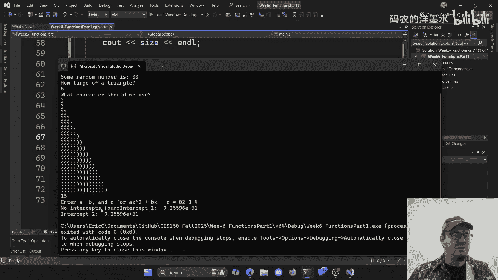

New intercepts found。So2，3， and 4， and that one didn't work very well for。

 So and it adds more new lines here， too。Knice we got garbage values for the intercepts that was kind of sad too。

 It's like a negative C usually helps with finding intercepts。

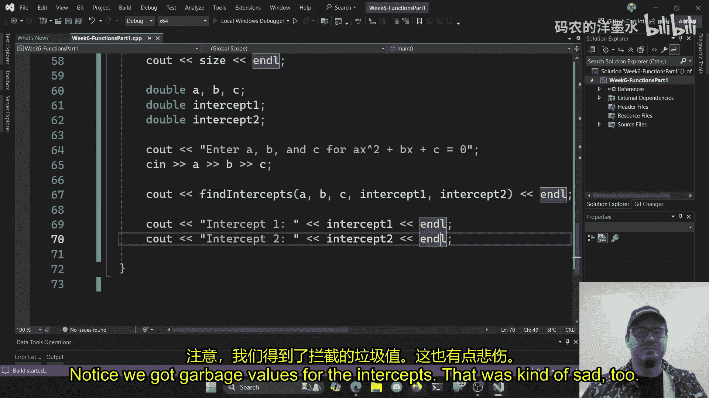

2， three， and minus2， try that All right。

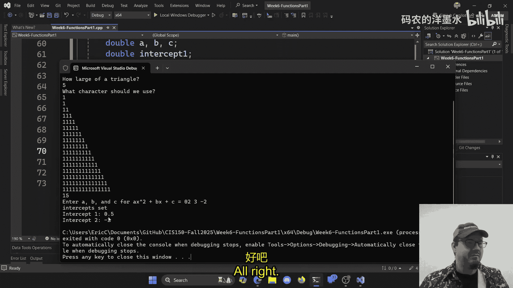

。5 and negative2。So try it。Do you graph those on do you use decimals for graphing？These our handy。

O my graph calculator。Let we a 2 x squared。Plus 3 x minus2。Oh， it's right， 。5 and 2。All right。

 we can graph quadratic like that。

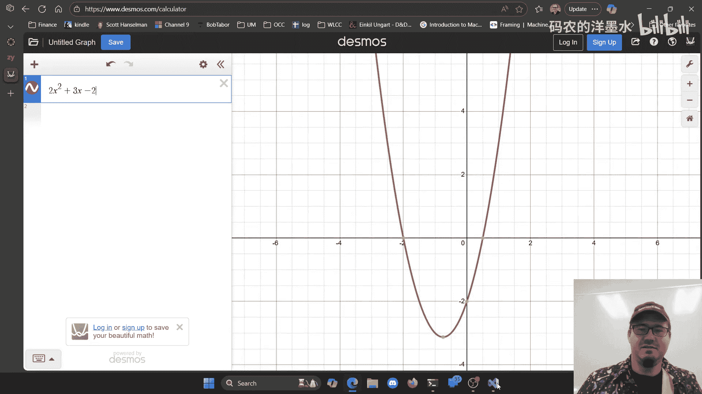

All right， feeling good about our intercepts and this whole thing relies on us passing references。

 passing by reference so that we can set values here outside of what we're returning because we can only return one thing。

Which makes us a little bit sad。 So it's limiting to only be a return one to only be able to return one thing we'll get to。

A way to cheat around that we just aren't there yet， let's see where did we get to that here chapter。

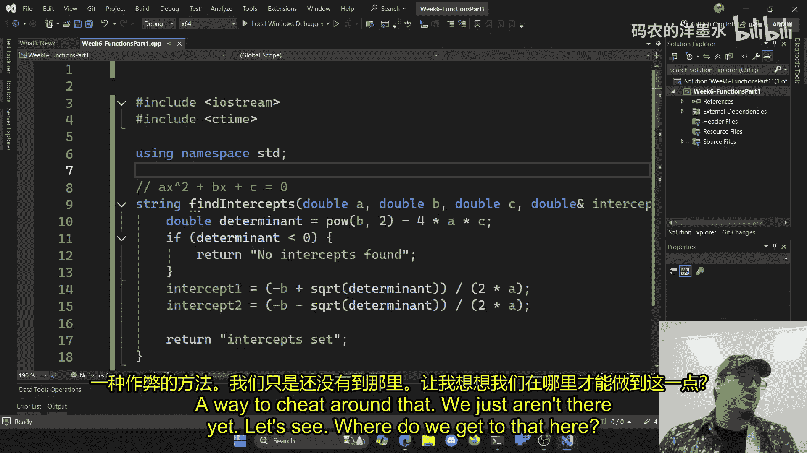

When we get to arrays in vectors。An array is a way of storing more than one value in。A single period。

Now you can essentially return more things because you。Have a bunch of things in a single container。

One container is one thing， even if it contains a bunch of other things。

 so you can sort of cheat around here， but that's that's okay for now。嗯。So functions， printing。

 reasons for functions， math functions， functions of the branch functions with loops。

 unit testing functions is my favorite。 I love unit testing functions。

 I don't think they give us a good。Yeah， doesn't give us a good bit for it here， but that's okay。

Using cert。Is really ugly。I think this is terrible， but it's okay， the book really likes it。

That's fine。This assert function。If it doesn't work， bad stuff happens。

 So you can use the assert library here。 what' go steal here。

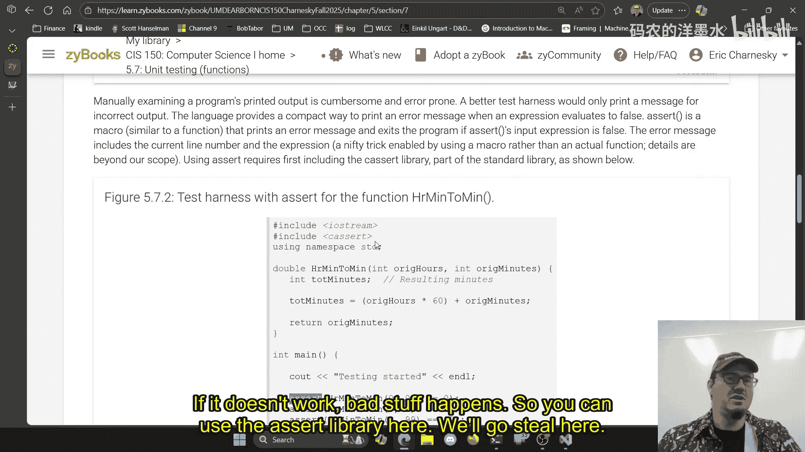

So。In general， here。Have you guys written English papers before？

Yet you make typos in your English papers。Is it hard to notice your typos when you're reading your own English paper？

Okay， so we understand we're bad at checking our own work。

Because we know what it's supposed to say and when we read it。

 it's really easy to not notice that it doesn't say what we thought it was supposed to say。

so as we're going through examples and testing our code， we've been running it and be like， okay。

 I know if I put this in， this should come out。Actually。

 we didn't even know what was supposed to come out that first time， but in general。

 they' would have been a good test to know here。If I have to run my code and look at it。

 it's possible I'm going to miss it because or bad at that sort of thing。

You know what's really good at saying if this value should be out two， is it actually a two？

Gues what's really good at checking for that sort of thing。Computerters。We can say， hey。

 I put this in a function， I get back this number。And they can check it and they can check it over and over and over and over again。

 and it's not to get bored of checking it。Right， which is nice。

 so let's go try and we've added our assert library here then so we can assert after we do our intercepts。

We're going to put it up at the top here for a second here so we can insert。呃All we need。

Any more values here。A 1， B1， C1。 I don't want to that double。He one。SoLet's set that as what two。

 three。C C1， we said， with negative2。Incept。Tscept。One， oh goodness。 That up two， I guess，3。

I have together get in different names than what we have down below。

 otherwise it's going to be upset with me intercepts， how about test intercepts， there we go。

That's an intercept point。And then we expect this one we set the value in a minute and test intercepts。

Tcept2。Then we can go and get those values back out so if we call， I find intercepts。Given A1， B1。

 C 1。The test intercepts。And my test intercepts。Wow okay。

 test intercept there you go right now we're going to assert that they match here so the way that you do it you say hey。

 this something value equals something else here so after we've called our function。

 then my test intercept should equal let me say negative2。

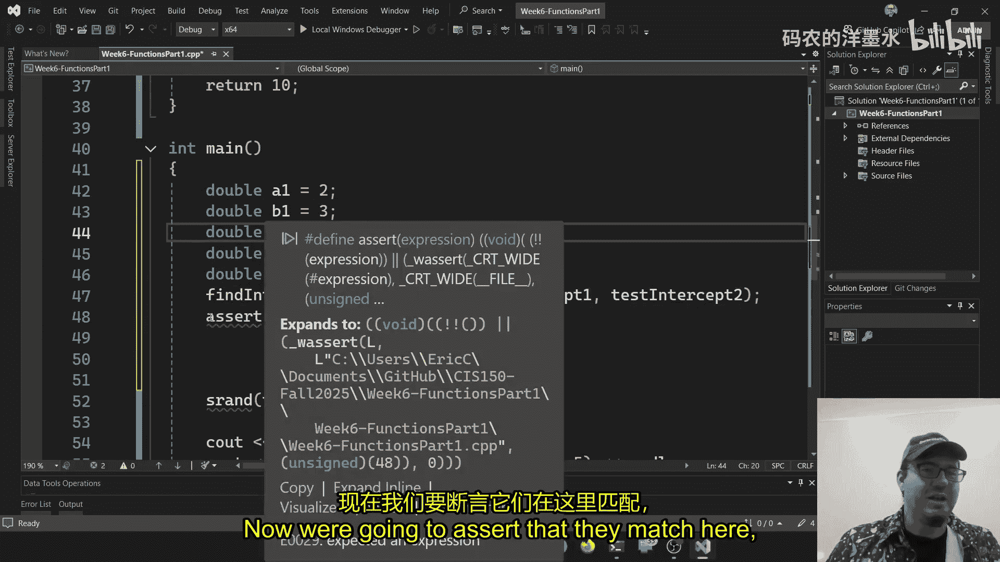

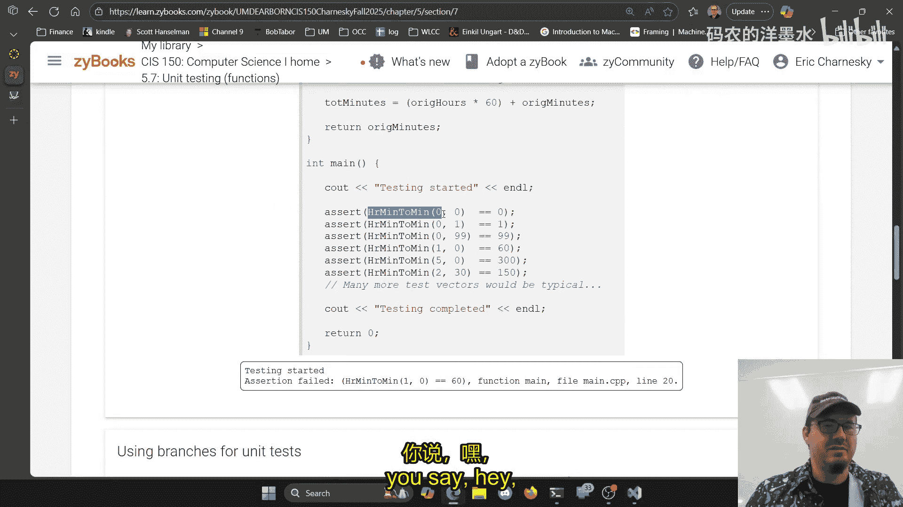

Seems really weird， and then we're going to put another assertt here。That my test intercept two。

Equals 。5。

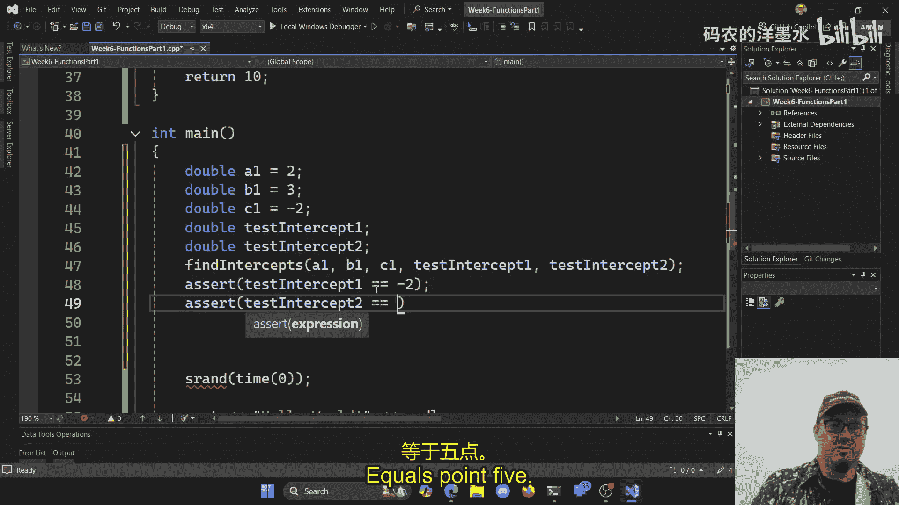

Now when I run my code。🎼。A search failed。 My program crashes。

This is really obnoxious to have tests crash your program。That's not happy at all。

 so I'm going to abor because that was no good， right？Didn't equal negative2。Oh， what a bit equal。

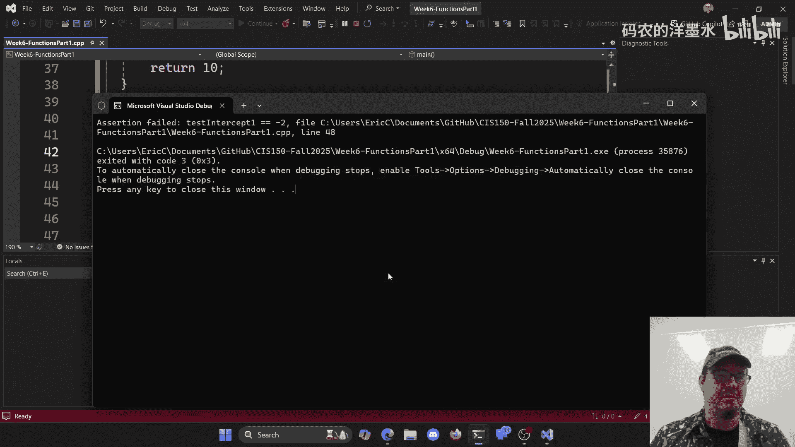

Does they equal 。5 divided them backwards。5 and negative2。And， we did the plus first。 Yeah。

 who had done the positive one first。 That's my bad。 Now we run it here。

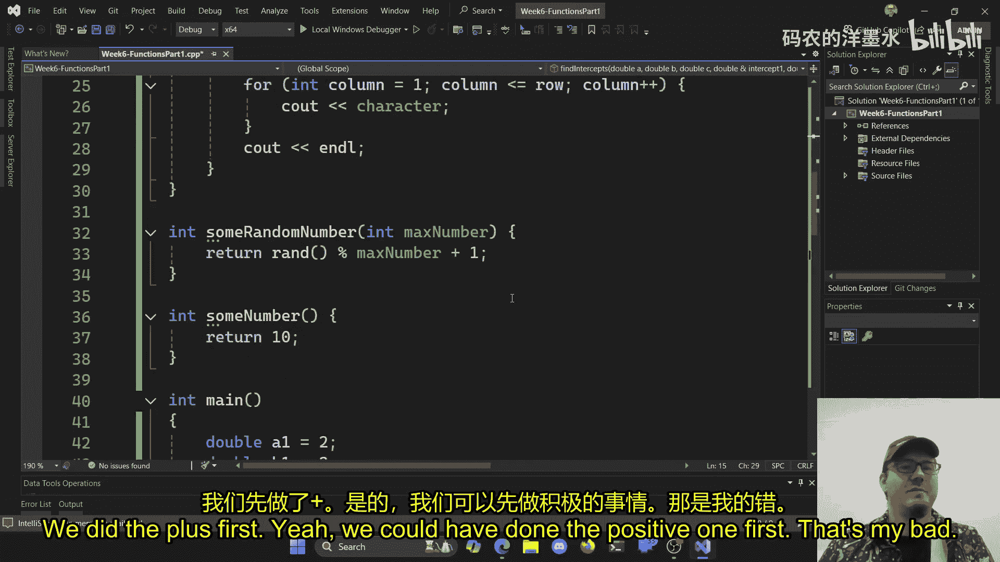

Our program doesn't crash。Very exciting。It's one way of testing to make sure that you get the right values out。

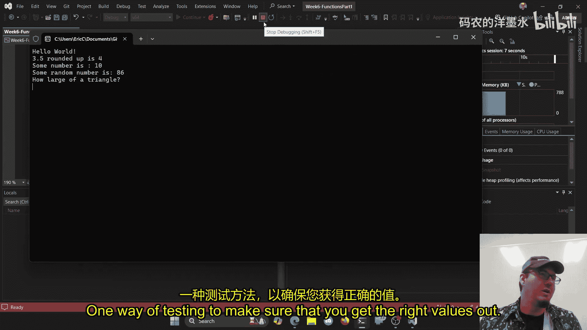

In something that's pretty critical for the values to be right。Yes。Otherwise， it doesn't run at all。

But we can check real quick， oh， hey， it should give these values。 Here's a quick test here。

Go for it I get this is not a great way to do testing here。

I can't really show you the better way to do testing until we get to a couple other chapters as well。

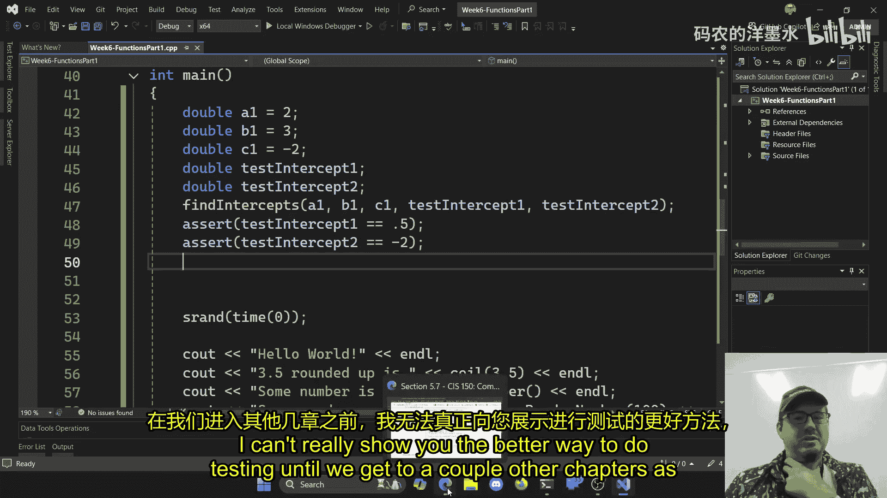

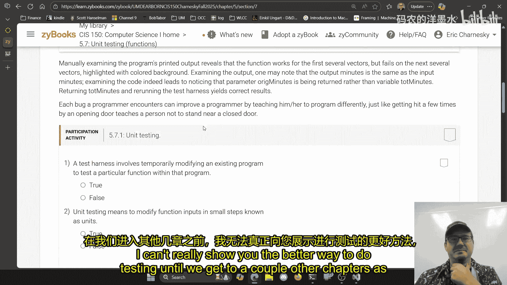

Is a much better way to do testing I can show you real quick here， which is fun so and。Making code。

Par code is my favorite thing in the world。 It's very exciting。 I like testing。

 So this is Microsoft's product V S code， their open source tool。😊。

Some of you might have used it before。 You can actually write C plus plus code in VS code。

 It just takes a couple more steps and to get it to do all the things we're doing。 again。

 a couple more steps。 But' it's a nice little environment here。 It's kind of fun。😊。

It's hosted in GitHub， Microsoft Os GitHub， so they're going to use their own tool which is fine so this has 138387 commits so right get us tracking every time this folder changes here and it's been changed a lot this product's been around for a little while。

So you can check out all the commits here。And then the other cool thing you get to do is if we have code that runs tests。

 and I'll show you how to do that。Not quite yet， we'll get there later once we have classes。

When you commit your code， you can have continuous integration testing。

 So as your code is integrated into your source control system， in this case， get hosted on Github。

 it can go out and run all those tests automatically for you。 So in this case， hey。

34 of the 37 tests have been running three of them are still running。 looks like right now， this one。

28 out of the 28 tests passed here。 you can see all the different。

Essentially suites of tests here that they put out here。

 I don't even know what most of these ones do， but that's okay， Some are interesting。

Hoode scanning results and you can click on details。 So this is another fun thing you get。

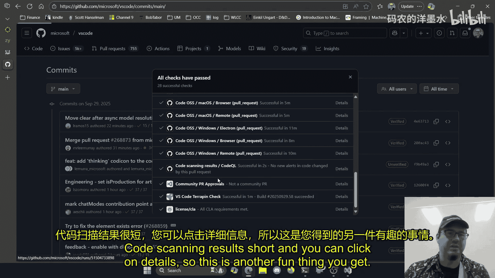

Features with Github that add on top of just tracking your source control tool。 So it's saying hey。

 I went and did all these things here in the all past life is pretty good。

 I'm happy with all the automated tests that we wrote here。

 So again beyond these assert ways we can write tests that are easier to track if they passed or not here。

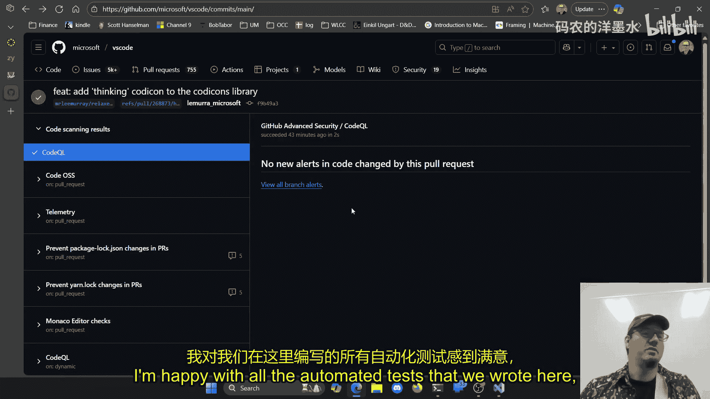

。We could try it here。 It's just going to turn really ugly。We' try。

 we'll try it and see if it works here。So。In Visual Studio， there's ways to do this in Macland。

 I'm not familiar with them because I don't use Mac， so don't worry too much about it here。

 but you can Google， I think Google has a test suite or something you can use in Viual Studio we've made a solution with a single project so far。

That's about all we've done so what we're going to do is we're going to add another project to our solution and we're going to add a testing project and what's really cool about that is eventually when you write code that's really fun and worthwhile and useful here rather than just throw throwaway code for classes here。

 we want to give that code to somebody。Ideally you want to sell it or maybe just give it away for free because you're cool like that。

 but ideally in the real world you're going to sell your code here or the company that pays you will sell the code you write and make money off of your labor that's how that works。

 but anyway you want to not have to package up all of your testing with the code that you give away。

Right don't be like the places where you have to go download a 76 gigabyte update from steam every time you want to play someone's game。

That's really obnoxious， right so you want to take away all the extra stuff here。

So what we've been doing here is we've just been running our program in debug mode。

 but you can actually go through and have a release set up here So there's options here when you build your code to build releases versus building the stuff for debug So again lots of fun features we can get down down the road But we're just going to add another project。

 so we're going to go add a new project。And I'm going to go search here for test。And I want。

A native unit test project。 And， this will work in Vi Studio so I can work on Macland。

 I think Google testing probably works。 But again， I don't own a Mac。

 This school hasn't paid for me to have a Mac。 So I have not had a chance to try it here。

 This is just fun features here。 So I want a test project here。

 when I called test 1 is probably fine here。 We're going to make that。

And what we get is this funny looking。Pest build out here that does a bunch of stuff for us here。

 but we can eventually get into writing tests here that are going to test our code。

In more of an automated fashion and we get better looking results here。So let we go through。

 we need to go and add oh our source file， that's why。This is why it's a small paint。

 because I want to get my source file over there。She。That's right。 We haven't done classes yet， Okay。

 and it'll be a little harder to get to in one second go add。Isit the linkers。Right。

 this is not going to be very fun， I'm sorry， there's a bunch of extra steps you have to do to get access to our code here。

 I'm just going to go steal this one for a second。This is not the right way to do it here。

 we'll get there eventually， I just want to show you because this is super fun here。

 We're going to write out our functions here。Think I can go put at top here。Second on now，' shoot。

I haven't even let me put it there。All right， I got too excited。 I will show you later。

 we can search。Sird Col。2。Its true。Is true。I'll just put true in here。 This one's a little silly。

 It's just saying something should be true。 And I'm just giving it true。

 This one's definitely going to be true。 And now on my test menu， I can build my test Explorr。

 which is a new window you haven't seen yet here。 and we can go and run tests here。Run my tests。

 There we go。 that run button。And you get a list of your tests and if they pass or fail。And we see。

 hey， our test passed。Test method 1， fast。So we can write this test code to test it here。

 and this is what we use for continuous integration testing。

More of a formal approach for testing here， but you get nice little menus for things。

 You don't get this ugly hey， your program crashes because you used As here This whole thing because I dislike the assert library here。

 but having test code。It's fantastic depending on the product that you work on。

Again there's a lot of variables here， lots of things that happen in the industry if you have tests here and your suite of tests run and you feel good that you didn't break your software when you made the latest change because all of your test pass you can move from continuous integration testing to continuous deployment and you can take your software and then go automatically deploy it to your servers wherever you haven't posted works really well for websites other tools do that sort of thing I don't know if you've noticed GitHub has asked you to update several times already sometimes it does a behind the scenes it's like hey。

 we need to update just go ahead and close。You can update your software pretty quickly。

If you have the automated suite of tests， then you can have that check and your software can say。

 hey。If everything passed go ahead and deploy it so I had some buddies used to work with or over at Khan Academy now Khan Academy updates dozens of times a day because they have continuous immigration testing and continuous deployment so。

The faster developers can get software changes into the hands of people who are going to use it。

Ideally， the more productive they are。 If you've got this long， hey， I made a change。

 It's going to take three weeks for some to even go try it and tell me if they liked the change I made。

 and if I did it， right。We this long feedback time werere less effective。

lesss productive at making changes and getting them in hands of people who can use them。

So be able to close that timeline and make it faster to deploy your software is huge so having good tests so we can get closer to continuous deployment it's great。

 not everyone wants your software up three times a day updateate five times a day。

 but if it happens and no one notices that's a pretty good thing we can do fun stuff with it so that's the assert library again I'm not fond of it that's okay not too big of a deal。

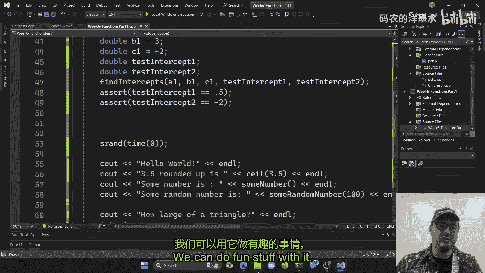

We did pass by reference here。We didn't。 We don't have vectors yet here。

 but you can modify strings if you pass a string by reference， right， we can change those。

 We at some common errors。 It's probably good。Next starting point。

If you copy paste code and you don't do it right。Happens all the time。

 You're going to get errors here。 So this says， I don't know why they don't spell things out here。

 This is a big pet peeve of mine， Zel tofa。Celsius to Fahrenheit would not have I can't spell Fahrenheit anyway。

 but would not have been too hard to pipe all this out anyway here。 so they're like， oh。

 I'll just copy paste it and change it here。 Well there's a problem on the right here。

You can shout that when you see the problem on the right。Yeah。

 they didn't change what they were returning。Good catch。

 So you were returning to the Fahrenheit Valley at the Fa Valley， F Valal。Sure。

 and they're still returning to fall all here right so just got to be careful when we're doing things like that。

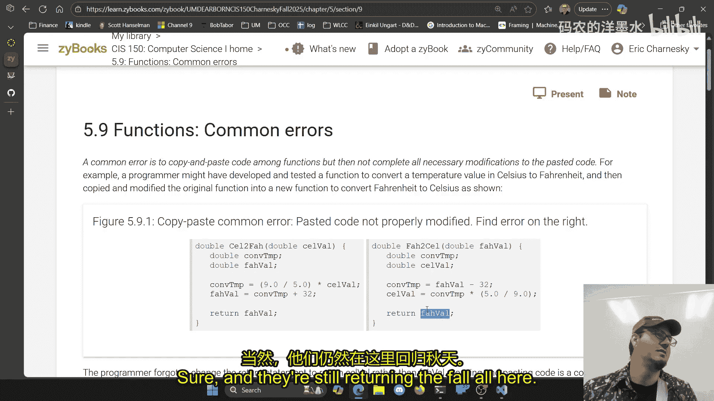

嗯好。And that's why testing our code's important。 We want to make sure we wrote some code。

 I it doing what we expected it to do for us here。So other fun things we can do with our code here。

Remember， we spent a lot of time doing validation and we said， hey。

 is this a valid input or not here and we like doing validation loops， we can do a function for that。

so I can say， hey， I wantiture。Get user input within range here。

 given an in lower bound and an in for upper bound。

Sometimes you write a function that's useful and you're actually going to keep that same function for a long time。

Getting something within range is helpful， right so we can see out enter a value between。

The lower bound。And the upper bounds。And then we can go， we need a that's an integer for the value。

And we can see the value。And while my value is not within range， right。

 so if it's less than the lower bound。Lower bound。Or my value is greater than the upper bound。

We're going to keep them in the loop。Great， we can see out。Vllid， let's try again。Let's try again。

And then our prompt again。See out CNN。嗯，是。Here's my prompts。

get the value eventually they should be able to get out of this loop here。

 maybe depends on how stubborn they're feeling here and we can give back in value。喂。So if this works。

 no matter what lower and upper we give it。As long as you actually give me a lower。

 that's less than your upper， right， if you give me a lower bound that's。

Greater than your upper we're gonna be in。For a bad time， but that's okay。

 right if you you can probably use it the right way。

 we can figure out how to check that sort of stuff later。

So we can go and get bunch of values within whatever ranges we want here。

And we can try that and see now， dealing with user input is much harder for testing。

Right because I don't know what the user is going to type in so trying to do with some sort of automated testing we're dealing with user input it's actually doable it just takes a bunch more steps so for now we'll skip it we can go back to how we can test that with user input later。

But we can try out and see， right？So we need an in for the value。Right。

 so some number right whatever are how about art for our size right for how large of a triangle that so instead of C a on size。

 then we'll get some value for size so I can use my inside as we can assign it the value of get value within range。

OhSo that when I called it get user input within range， get。User input within range， so zero。

 but really probably one right is the lowest I want to go。And up to what， you know。

 probably 100s fine here。So how large of a triangle will get that value between 1 and100。

It'll be very exciting。

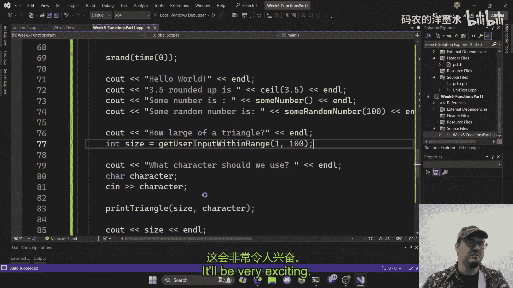

So if I enter a number that's too big， it's invalid try again。

0 invalid tri again right so we can move our validation loops out into functions here。

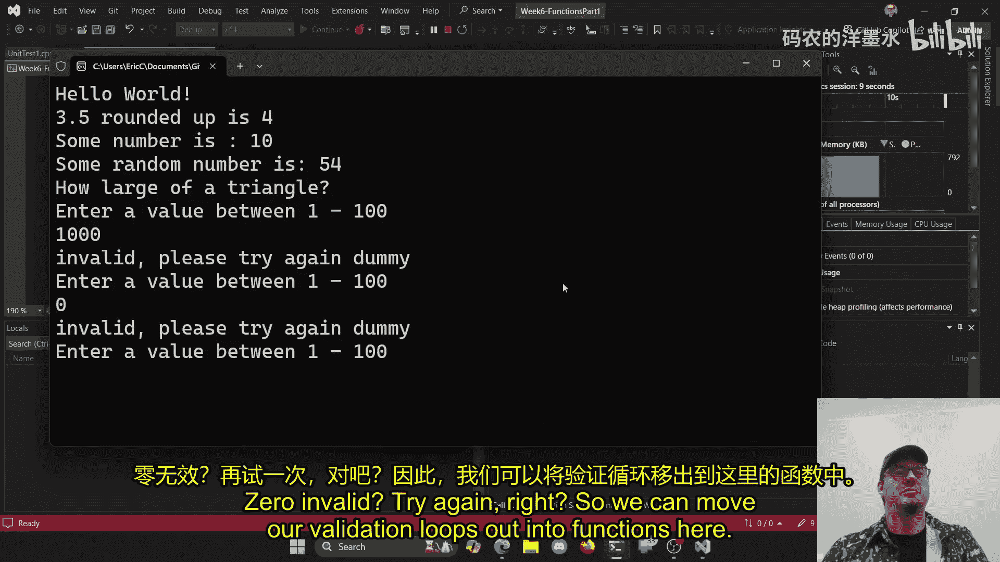

And then the cool thing is they work with different values。Right。

 so not only is my code has a nice little name to what's happening here， but it's reusable。

With different values here， so I can use the same thing as the value is 1 to 10。

 values is 1 to 100 for 1000 to 2000， right whatever ranges I want to give it here。

 the code is identical。So the next thing we're able to do is we're able to look at our code and say。

 oh， you know， this is slightly different than what I did over here。

 but the only thing that's different is a variable。

If the only thing that's different between two different blocks of code is a variable。

There's a light ball that can go off in your and say， oh， that could be a function。

 and the thing that's different could be the argument for the function and the variable。

That's the only thing that changes here so we can。Further reduce our amount of repeated code here by using functions that take variables。

Ass what's different here， share of the upper lower round if you wanted to do some sort of string input here from the menu。

That one gets to be a little trickier here， we don't know how a arrays worked yet。

 but you could give it a bunch of strings here we can validate any of those strings。

I haven't done a raise yet， though that's a bummer。Oh， here， okay。

 so let's get a character input here。 So we'll get a it character。From user。From valid string。

And we can have a string for the prompt here， and then we can have a string for valid characters。

Remember a string is just a bunch of characters here。

So we can check all the different characters within them。

 maybe we looked at all the different string indexes， string indexes 0，1， two3 we did that one。

 right Okay， cool。So。If you give me the prompt here。

 I don't even need to see out anything initially here。

 I can see out that prompt that you give me and probably an end line here。

 Most people don't add end lines to their prompts here。 And then we get a charge for the input here。

 and then we can see in。On that input。And now we need to check to see if that input was valid。

Was it in the list here？Did we have we didn't find an easy short study yet。

 did we we have to loop through？Maybe have the loop through。 Okay， that's obnoxious， but's okay。

 We can do that so we can have a booleying for is the input in。Vilt characters， right。

 and we'll we'll start that off as。False until we know otherwise。All right， so actually。

 let's let's ask him first here then so we'll start this off as false here。And we can say， while。

II the input。In the veiled characters， sloths， not in the  validiled characters， bless you。

So I want my loop to run here， I guess we could do a do loop too， but got going hate do loops。

 we'll get the input。Right， we did the prompt。 We know loop's going run。 we'll get there input put。

 And now we can go through and check for every character， right So for char。

Character in my valid input characters。If my character bless you。Is equal to the input。s no。

 not not a quote here， if it's equal to the input， then we can set this to true。We found a match。

I'm going to look through every character， find a match。 Now， at this point。

 maybe you might like your keywords。 Remember， we found that fancy brake keyword that will stop your for loop here。

Sure， I dislike breaks here， but that's going to slightly speed this up like if my list of valid characters was 10。

000 characters long。We don't have 10000 characters right now。

 but if we had like all the Uniiccode ones right， it might take a little while and we've saved a bunch of checks here when we know it's already true。

 So maybe it's nice to break that loop here， this will break the for loop that it's in not the while loop here for then my while loop comes and says。

 oh， if it's not in the list of all characters， ask him again。

 and maybe we have to repeat the prompt here， look at that， we can repeat the prompt。

Here's the prompt。 Here it is here。Go for it。Again， big and ugly。

 but now we've put a nice name to what's happening， you can tell it， hey。

 here's the prompt I'm asking for， you know， enter the letters， something or other here。

 here's your ballot options here or you know why why for yes and for no。

Right and I only want to get back a wire and N right Do you want to play again wire N Sure。

 we got some options So well maybe we want to tweet lowercase。They're their input as well。

And eventually then we need to return the input。I guess we'll probably put that as lower， right？

Input。嗯嗯，可以。Oh， no I have to declare it out here， sorry。

It was invalid because I declared it inside the while loop， right the scope of it。

It's only inside the wire loop。 It doesn't exist down here。

 So if we declare it outside the while loop。Then it exists outside the Y loop。

 and I can return it when we're done。All right， so she would try it， so get some characters。

So a cha for， I don't play again。Is。A git character from user from valid string， goodness。

Do you want to play again。Is my prompt here with a y or an N？

And then my list of valid characters are just lion。喂。

So I give it two different arguments right the string is the prompt here。

 I could output it myself here， but this was a little bit easier because I didn't want to be able to repeat that prompt here if they did it wrong。

 I'm going to keep repeating it。Eventually I'll get back a wirenet。

 the only way this comes back is if they give me one of these two valid values。这楚。

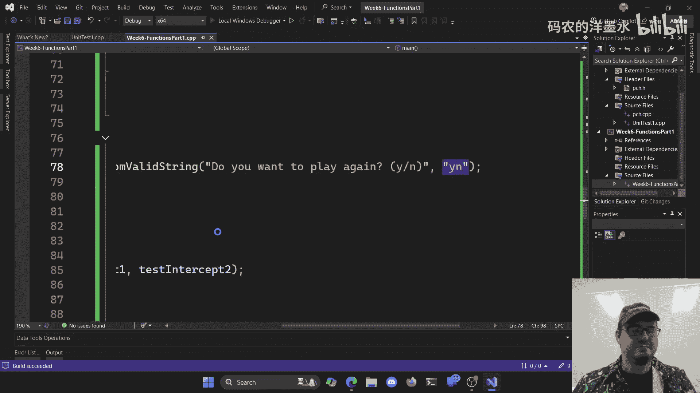

Youll play again。Oh， I gave it 20 inputs， sorry A C。

 D E F G right if you're only taking a character it gets one at a time， so it was getting。

 it got all four inputs there， let we say no， eventually it will stop here and life is good。

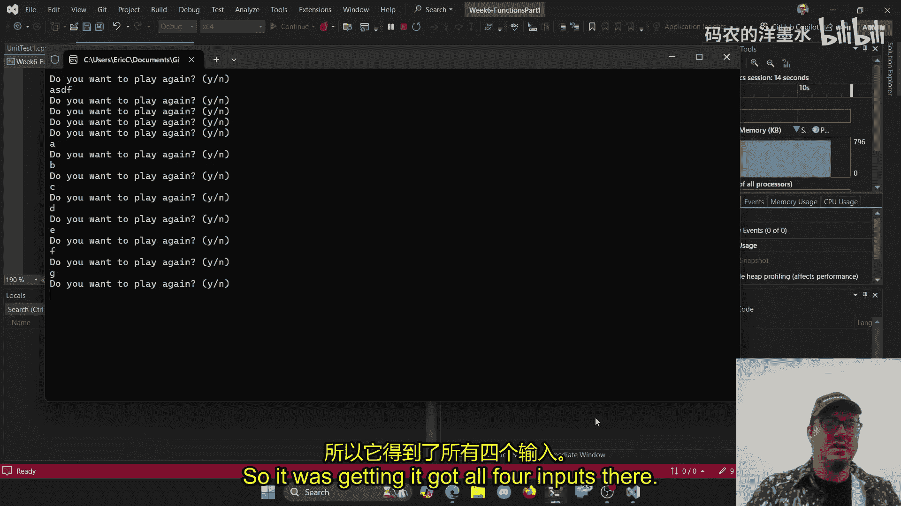

So weve got lots of cool capabilities and cool things we can do with functions now。Is this。

 are we solving problems we haven't been able to solve before no？can't really do anything new。

 but we can organize our code nicely， but we can put a nice name to what's happening here。

 and you know， ideally， your main function is actually pretty easy to read。

And there's not a lot of coVID there， right？You want most of your code to be often function so that someone can come look at main and be like。

 oh， it's getting a character。 Oh， it's finding intercepts。 Oh， it's doing some random number thing。

 Oh， it's getting some user input。 right， Oh， it's gonna to print a triangle。

You can quickly scan through the names of the functions to get a feel for what your code is doing。

 And then if you want to know， oh， what is that actually doing here。

 then I can go up to that function and go read that particular piece here。 But that way。

 as I'm reading through main， I can see get essentially a feel for what is happening without knowing all the details right away。

 So it breaks it down into smaller pieces。 Let's organize it， make it look a little cleaner here。

Again， depending on who you talk to， people have all sorts of fun rules and things with their functions。

 And some people say they should fit on a single screen。 That's probably a good rule leton。

 But again， it's just。That's more of the art side of things here is how you like to format here and I'm zoomed in a little bit。

 so I feel a little bad that that's kind of big， but if you're using like a normal size font here。

I had plenty of room to fit more charactery or rank， but I'm zoomed in decent amount here。

So that might be too much， that's still viewable okay。So we put a nice name to it here。

It's reducing repeated code， which is really nice。 We always want to not have the same code twice because we don't want to feel bad about ourselves right and then it gives you the opportunity to not have repeated code if the only thing different is a variable。

We've done lots of user input within ranges and things like that we've done lots of silly testing here so in this case。

Sure， the only thing that's different was the ranges this one's easy to check here if I'm testing some sort of user input was this valid input Sure that's easy to check right and we can essentially use this function any time we need to get input now you've got it done ready to go just copy paste right we haven't figured out how to get it from another project that's why the testing was going to be obnoxious here getting code from one project to another project is obnoxious until we get to classes that' are made for that sort of thing。

so。Anytime you want to use this function go for it copy past it and you've got the code done you should feel good as should do what it's supposed to do we've tested it out we'll feel pretty good about it here let's see so other common errors you can go through the rest of those ones is fine missing returns is big。

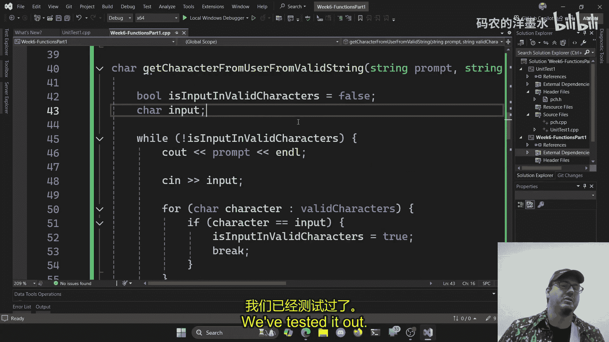

And we did passing by reference， that's a big one。I don't want to go to these other we'll save these other ones for later。

 we got lots of time to talk about functions here。Yeah， I think we're doing pretty good。

 is it you want to stop a little bit early？SoWe got a little bit of time for functions。Okay。

 let me stop a little bit early， take the time， make sure you're working on project one yet if you want to use functions。

 go for it。You don't have to。Totally up to you。 But when I solve it。

 I'll solve it with functions because I think they're fun that sort of thing here。

 So we got till next week for this one here。 So on October 6。

 we won't have tons of time for functions because we'll do the project solution and talk about our next project。

 which we'll be using functions。 Hey， you guess it。 Good job。Can we go from there， okay。Awesome。

 thanks everybody， take care， I will see you Wednesday and have fun at La。

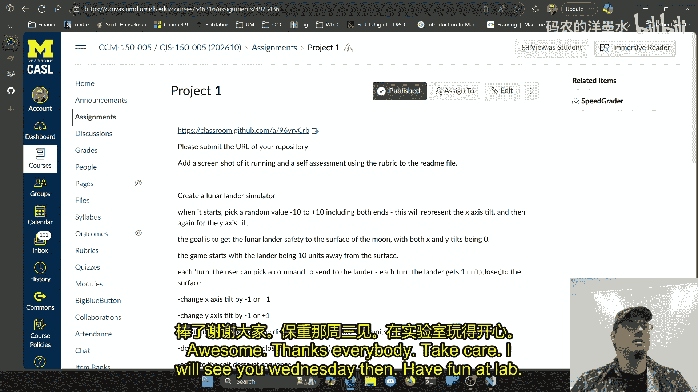