# 【全集】密歇根大学 C++编程 中英字幕 1080P p08 Lecture 8 - 函数 part2 -BV1TsAZzAEHX_p8-

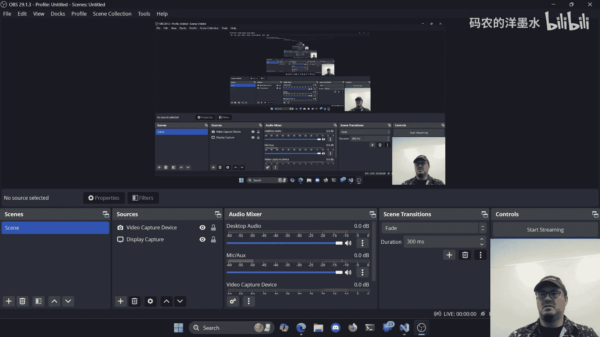

righty， happy Monday， sorry for the late start here。So Monday， I guess。

So we're going to finish up functions this week here and move on to the next project very exciting stuff。

 I saw a couple of people submitted awesome if not get a little bit of time right make sure this start of class。

Somehow， every time someone emails me and said， oh， I thought I was due at midnight。

Despite everything， all the projects always have been to do at start of class。

Let's do at the start of class， that's what it says in campusva， hopefully once I screw that up。

I guess because the dates are different for the books sorry if that's confusing。

 I think go over solutions in class and all of you are here， you've heard me say that。

 So I think it's the people who don't come So we'll finish up functions Cha 5 that'll be due next week and the 13 for the chapter 5 Zybo stuff I got to put scores。

 I think I did scores for chapter 4 already。 I'll take a look at that and see。

And then we'll go over the solution of Project one， talk about Project two on the eighth。

 it'll be function based， we'll have some fun with functions。

And then we'll move on to streams and then midterm review and exam it's a little bit later here I don't know when your other midterms are。

 but this is week seven， this is week8， but the first week was like half a week I don't know so 1020 is just the plan to review I'll give you last year year and a half one the last time I taught the course midterm so you can see how I write the questions it'll be half quiz style short answer。

 true false questions multiple I don't usually do multiple choice because those are not just but short short questions and then like three long answer rectum code questions here。

Plan is you could get it done in an hour。Right if you need a little bit of extra time you would have had the whole hour 15 to do it。

 but it's open book open notes， open internet， not open neighbor。

 please don't work together on it the goal is this is easy honestly if it's not easy for you we need to chat this should be an easy midterm's a good check in hey this was easy good you're in good shape it was not easy let's talk something's not working right here something isn't clicking with c++ but because it's open book open notes open internet。

 I typically don't sit around and watch people take it because it's very dull and if you're anything like me。

 you're not firing at all cylinders at 11 in the morning here even three cups of coffee and it takes a little bit like peak time is like 11 pm11 like two in the morning'm on the most productive so anytime you want to take it between 1022 and 1027 I'm happy so start it when it close it come back to it。

Okay。What is what oh the pret yes thank you， yeah I'll say that thank you they told me I have to give a pret。

Five weeks into the semester。Sure， so the long story it's part of our accreditation process。

 all the courses are just to have pretest so we can kind of track how people are going along the way here so take it at some point somewhere it's like four questions。

 but the first two or what's your name and what's your team what browser do you use or something like that。

Put it in here is an assignment the due they put out is December 3 it should take you like 10 minutes maybe so at some point get this into me I've turned them in at some point here don't feel like you have to print it right on it feel free to just type in it at the word doc here so like two actual questions email address and browser don't know why we ask you for your email address because we have your email address but sure this is not my invention here I didn't come up with it apologies so。

How do you know you have enough lumber or how much lumber you need Okay sure and then how do you know how many characters you have in an N road triangle in terms of end here there's no points for it let see there are wrong answers but it's not all that important if you get it right or wrong it's just to see where everyone was at the start of class essentially deceive how they give it to all the 150 classes here we see how they do there's a pretest in 200 and then we'll give it everybody and ideally they notice oh hey one person's students didn't do so on the pretest and then they can talk to that person and make them better at teaching or something here。

That's sort that's mostly the goal just just type in it it's fine yeah it's a word doc so you can should be able to download it and open it and edit it and just。

Yeah， yeah you think you can yeah you just upload it back to campus here yeah the is going be taken in this classroom if you'd like me to come and sit and watch you take it I will show up I have no plans to do that because no one's ever asked me to do that before。

So yeah， it'll open on me go back to the syllabus here， sorry。The 20， what do we say the 27th？

No on 22nd， sorry it'll open in the 22nd and then it'll be due by the 27th so untimed just。

Take it at some point。 again， the goal is it should take you less than an hour。

But you've got as long as you want on it here i'm fine with that it's open book open notes so I don't feel like I need to sit and watch you take it you'll just I'm sorry yeah and it's just a be on canvas yeah it's anywhere you have internet it's you're going to agree not to work with another person right and it's your own energy your own effort。

You can use the internet right use your book look things up that's great use an IDE do those things paper tests are silly as far as i'm concerned but yeah so it's just a check in point here so these things should be easy for you at this point here for the midterm。

And they look at my syllabus funny if I don't have exams on it。

 so thankfully we got away with not having a lot of final exams once COVID happened。

 they're like oh wait。Final exams are done during remote COVId why don't we do projects and I wass like yeah。

 projects are great， I don't care if you can code I don't care if you can memorize crap and tell me something in three hours and then giving someone a final project in the three hour window is just cruel and unusual。

 so I don't think many people do that。嗯。So that being said， the final project is a little larger。

But you've got like a month to work on it so usually that works out pretty well for most people yeah sorry oh okay sorry that good question。

Book。Great， and then we'll come back， pick up arrays and vectors， objects and classes， pointers。

 this is everyone's favorite， you'll love pointers， E++ is amazing with pointers。Yes。Okay。

Yes yeah everyone hates pointers under the worst thing and C++ but it's okay they're not that bad I promise they're just it's obnoxious there's all and then well Thanksgivinggiving break this week is planned just for review time catch up anything that we need I do have one extra topic I need to cover is UML which is not covered in our textbook it's drawing pictures I promise it's really easy we'll do that probably during this week as well and then 128 the plan most of this week probably will be project time as well but on 128 set aside just for you to work on the final project here goodness。

Still not with it the dayquill is really good， but it makes me really loopy。

 so nightquil is even better but then I sleep to my alarm and I miss you guys so I can't take nightquil at three in the morning anymore。

Yeah so that's the plan and then ideally you're done by the eighth I would love that for you folks I don't know think i've said it before' if I've said it too many times just tell me just shut up it's okay I can move on to other stuff but ideally you're done and then you can focus on your other finals and all you have to do is show up and run your code answer a few questions about it and life is good on the final project presentations here for the final project week it's probably in this room but they assign it like the week before。

All right so that's the plan we are about halfway through the course already believe it or not because we don't actually have anything in the last two weeks so we're about at the halfway mark just pretty fun so let's talk more about functions so'll start up another project here's be week seven functions。

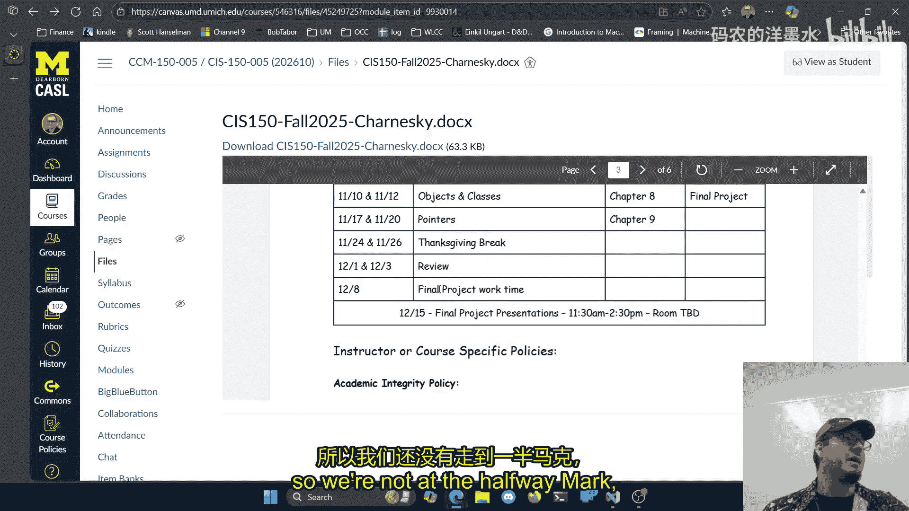

Make7 functions， part  two， and we're going to get into some of the advanced features of functions。

 which are really fun。 So these give us more ability to have shortcuts right and really。

 the only thing we've we've done with functions is。😊。

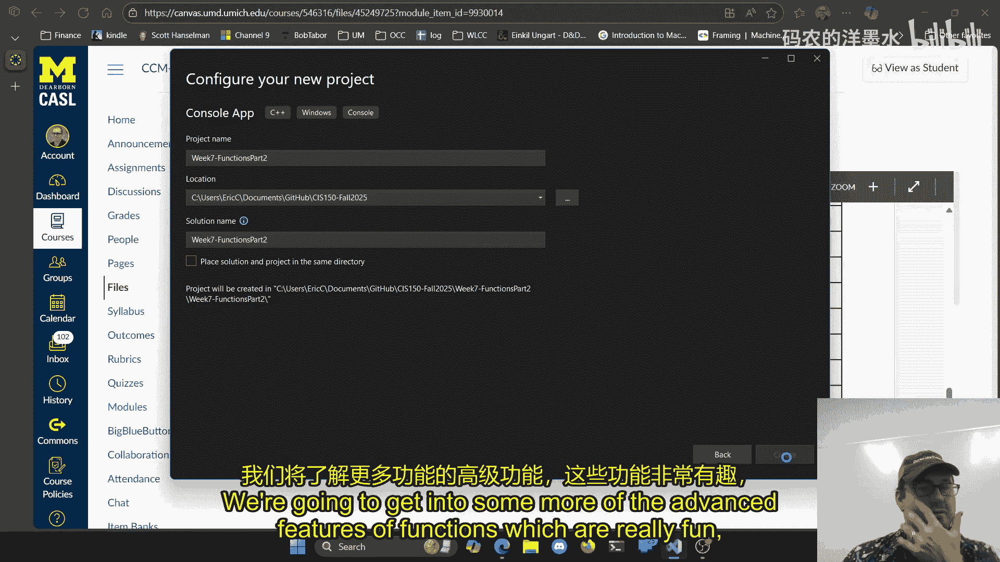

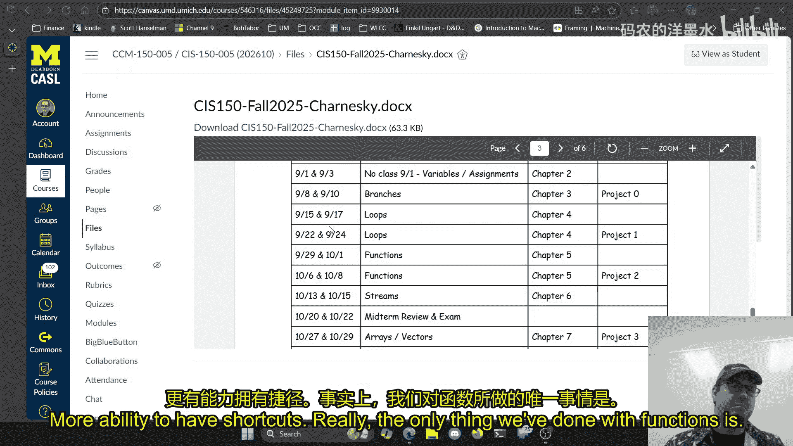

We write less code we can't do anything that we haven't been able to do before with functions we just don't have to copy paste code and we feel good about that but the other benefits right you got to put a name to what's happening and that's huge code is meant for people because we're the ones that read and write it here it just so happens that computer has to understand it as well but when we write code it needs to be human readable and understandable and that's the goal because know we need to know what we're doing。

 we're going to forget about it we come back the next day or software lives for years and years and years and years and years right and that code needs to be maintained you not everything always gets updated all the time here but most of software lives being maintained in this idea the software development lifecycle to talk about that technical term yet when you start with your idea you start designing your solution you start building it you test it and when you actually let people use it。

 you deploy it and in use in production and then it just lives and then you have to。

tain it and keep it up to date and make changes right Business change and in our business software。

 they want to keep up with the things it does here。 and that's expensive to do those sorts of things。

 So the longer companies can keep their software running。

 the more return on investment they get from developing it。So that's why we still run really。

 really old systems， banks still run Colbal systems and our state unemployment agencies still run Colbal systems because it's really expensive to replace working software。

With working software that does the exact same thing。There's a term called technical debt。

 which is a fun issue you run into here， but that's a difficult concept for a lot of people who are not technical people to understand。

 and it's very rare that's some sort of someone in a company is like， hey。

 let's spend $5 million to replace the software and get nothing out of it。

It's hard to justify large software projects。We run into those issues here so right but functions are great right putting a name to it we wanted to be readable we want to be able to understand it here ideally our main method could just be hey I'm going to call some functions right so if I want to see what someone's program is doing。

 I can just kind of scan through main and I see oh hey it was doing this step who was doing this step who was doing this step who was doing this step I don't really care about the details right if I want to know what that step specific it was doing then I can go look at that function but oh hey。

 we've got some input okay you know you did your validation that I don't need to look at all the lines of code for that every time here so it helps us break our code up and organize it make it a little cleaner here。

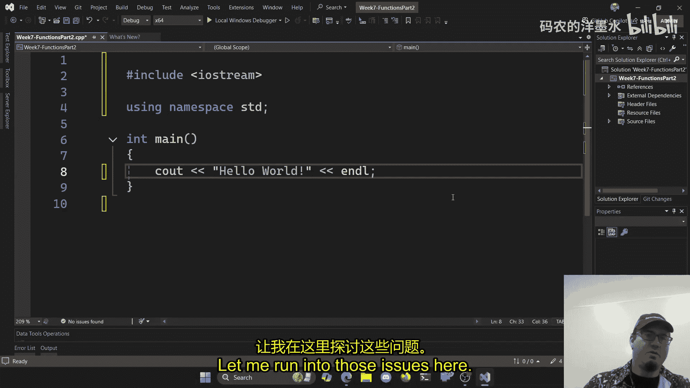

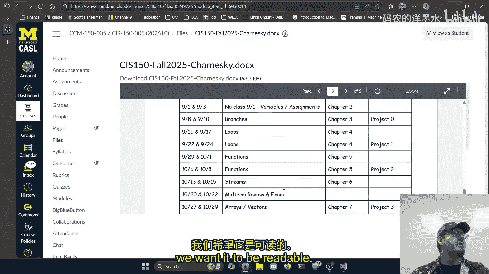

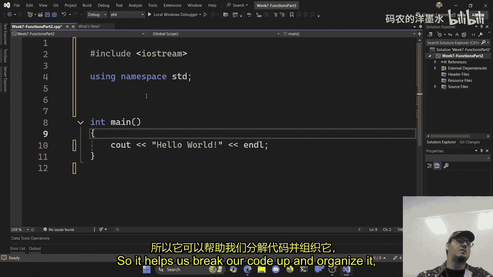

So some of the fun things we get here， let me pull up theai bookss again here。Excuse me。This is that。

I think my browser just I got like reset here or something。Ive had a log back into everything so sad。

Okay good we got logged in no functions so we got through we didn't get to testing testing is easier when we get to classes here with testing your function little bits at a time trying it passing things by reference do we get that far yet I don't think we did yet okay so you know I should just open the other one here let me a visual studio again。

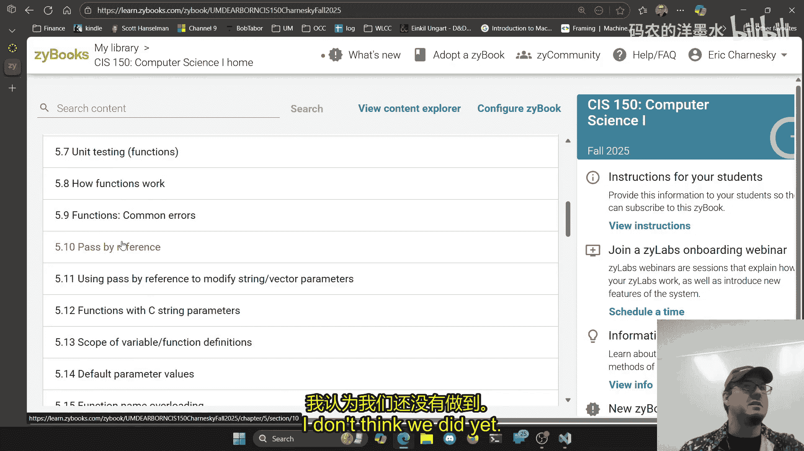

Oh。We'll open up this one just to give it a quick look。嗯嗯。Yeah getting one bounds， great。

Get character。Find intercepts。 Yes， we did。 Oh we did the intercepts。 we， we passed by reference。

You guys are remembering。You're remember just as well as I am That's fair the ampersant sign to pass my reference here。

 So when you write a function， you can say instead of giving me the value for this integer。

 I want you to give me the location where it's stored in memory so that I can go change the value stored in memory at that location and when you're done with the function you can go read that new updated value。

So passing things by reference is great for these primitive types here and then as we run into more complex types of things。

 making copies is considered expensive it takes a lot of processing power and operations to make copies of objects so passing a reference to an object is a lot easier if it has a lot of data it doesn't mean a whole lot yeah we'll get there eventually with classes so keep this passing our reference in your back pocket here we'll be doing a lot of this here because it makes things faster and eventually we care about things being fast at this point nothing we do is going to be slow unless like you just print a million to the screen that was a little bit tedious to print out numbers to a screen but basically everything we do is really fast here we don't need to worry about optimizing but eventually we'll need to figure out how we make things faster that's the more sciencey side of computer science everyone's things fast which is fun so at Earths we pass by reference our printing the triangle if you pass the reference you can change the value otherwise you've got the copy。

our first like you can mess with size and then it stays changed outside of the function here。

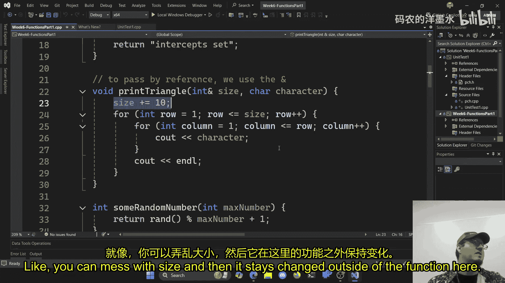

So other things we do with we didn't get to vectors yet， you got to strings yep so passing a string。

 if you give me a copy of the string。You can't change it if it give me a reference to the string。

 you can change it。like we did with integers and doubles。

I C straight we didn't get to the next chapter yet this is really weirdly out of order here that so scope when we talk about where variables exist here you can create a variable inside of a function and outside of a function so I might have an int for my number 10 we can have some sort of function that maybe we return in the integer so there are return types into here and this adds to number here that takes an integer number argument。

 excuse me。

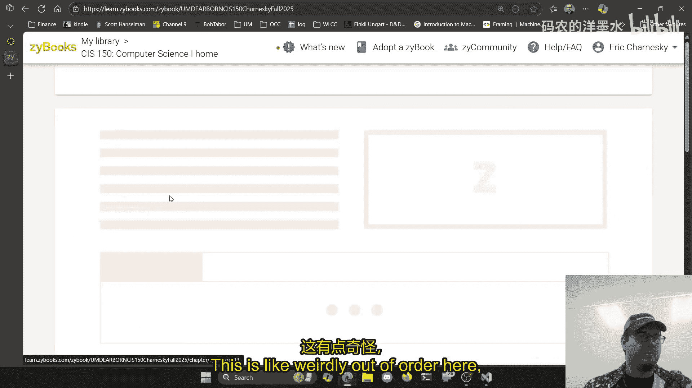

Thank you， I order you to take number plus equals 10， and then we can return number。

So in this case we're taking a copy of a number or're adding to it but we're returning the value so this way we're going to give something back so if you want to take that return value and do something with it you have the option we're not changing the value you're passing seems like a lot of extra work but those are some options we have here so we've got number。

And then I can say， hey， I want my number to equal the add to number。And I'll give it my number。She。

so I can assign the thing I get back back to my numbers。 So instead of passing by reference。

 I can pass the value， get return something here。And then I can reassign it。 Now。

 I could call this one my number as well here in this code。

They have different scopes so this my number exists inside of the scope of main right so pretty much whatever curly brace you declare it in is the scope so we've looked at that a little bit like if you declare something inside of a loop it doesn't exist outside the loop so when we did some of those validation loops because I don't like do loops I always have to declare it and set the value outside the loop and then we can change it inside the loop so same I with our functions。

I declare it here， so it only exists within this function here。

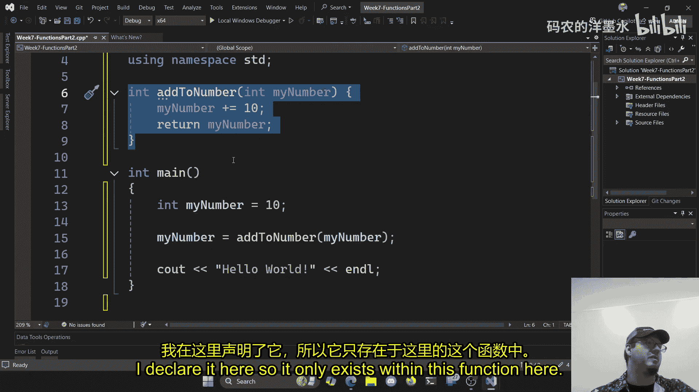

Now you can do some weird stuff with it here and you can have values that exist outside。Of。

The functions， so。Generally， you want them to be constant here。

 but they don't always have to be here， so in their example you can declare values here。

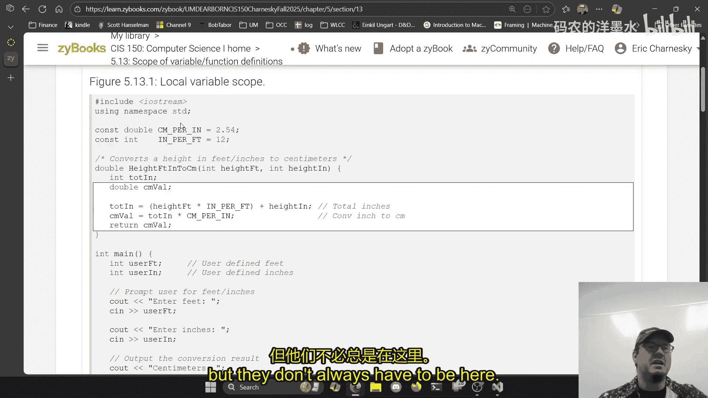

So this is my number int。By number， it exists outside of the scope here。

Now this one is kind of in gray here， like a light gray， this one's in light blue。

 so I've declared it again inside of this scope here。

 and if you hover over it says it's a local variable。

So I'm saying this one is local to this scope here， so if I don't do that I can say hey。

 my number is 10 and now you notice it turns to the gray one it's not a local variable anymore so naming things and depending where we declare them can cause trouble sometimes you' got to be a little bit careful here。

And then if I wanted my add to number here， we could even change this one so it doesn't even take a value here。

 it just takes my number plus 10， and we don't need to return anything here。

 we'll just say add the number and then we can print out my number here， print out。N number。

Let's do my number before。So。And my number after。So because they're all working on this。

I don't know if global is the right term for here really it's like a class level that exists at this。

All scopes within this file here we can modify it because we've declared it here。

 we don't have another one that is hiding it or the technical term is shadowing。

 we didn't declare a second variable with the same name here we're just using the same existing one here and the coloring is really。

Best thing you have to help you see it here。 Oops， spill errors， goodness， What did I do。Oh。

 must return a value， I forgot， I'm going to change that back to void。

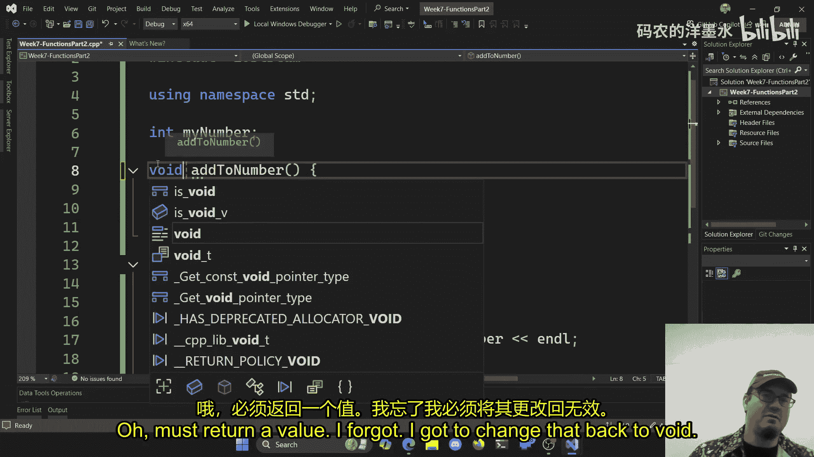

I said it was an in return type， but I never returned anything， so it yelled at me， but now we get。

 I can change the value so。

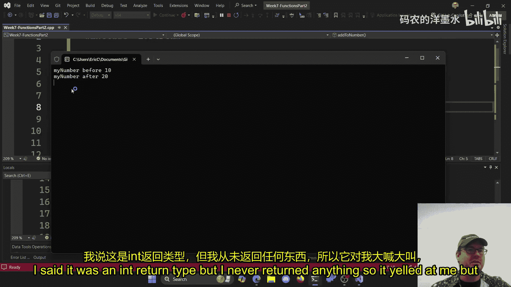

In general， though， this is bad form and you don't want to have lots of these global variables。

 it just makes things messy， so it's better even if it feels like a lot more work to pass things into functions and take things back from functions than it is to have a bunch of global variables。

Hopefully get the job done， it's okay， so when it comes to the project。

 if anyone read ahead and you have a bunch of global variables for your project， great， that's fine。

 it'll still do it。Not the end of the world， but in general it's ideal to not do a bunch of these global variables and it's just a good programming habit as all but again there's lots of ways to get the job done here so it's not the end of the world all right so that is our scope for these ones here so you can use them got the global variable versus local here。

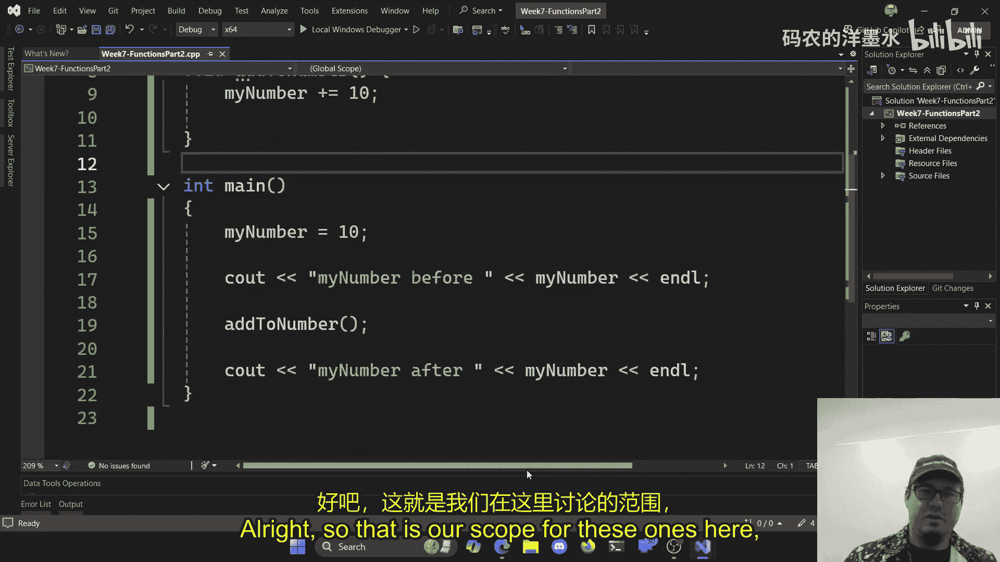

Yeah， makes maintenance hard。Sure so generally we just do constants things that don't change here because it's nice to have constant values that exist everywhere that you can just share like and there for example the head inches per feet in per foot like can you just spell out inches in foot at and CMm per ion centimeters per inch centimeters is a little bit long to'll type out I get that。

 but like sure。

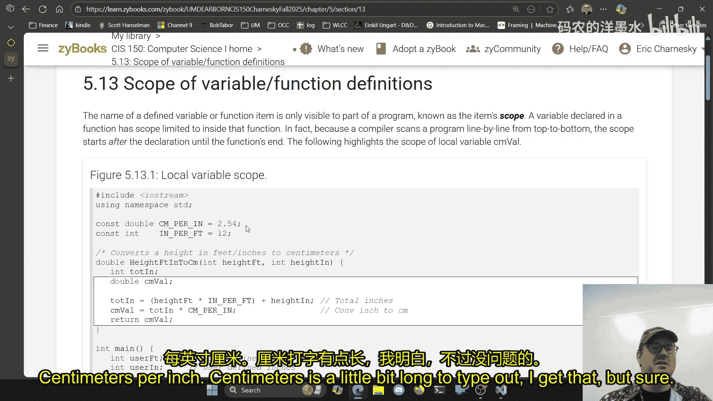

。瞓。All right， so that was our scope， again， this is I don't know is that form。

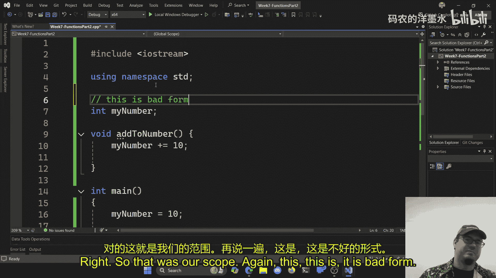

So constants are better。Let's see。Ourre。The fault parameter values， this is super cool。

 So before we were doing functions， we had something like this。😊。

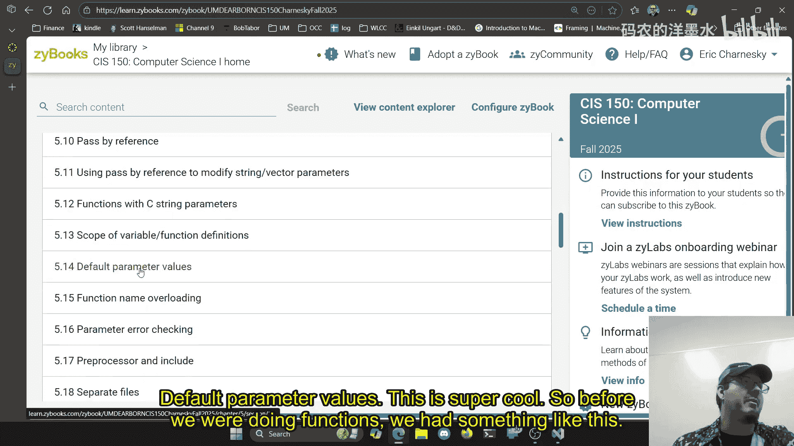

Get a number here sum max number where's this one get input within a range with the lower bound and the upper bound right but then every time I had to pass in。

 here's the lower bound， here's the upper bound， it' would be nice if like I could assume one of these values would be one right the lower bound is probably one unless you tell me otherwise here so we can do something like this。

 I'm going to steal this one。 we're gonna copy it over here to this one。So。What I can do is。

 I can give。Arguments a default value say if you don't give me this value here。

 I'm going to assume it's a value right here's the default for it now the problem is those have to come second it's a little bit awkward here but's it's not the end of the world here so I'm going to say hey I want the upper bound you always have to tell me what the upper bound is I'm going assume the lower bound is one。

So this equals one is giving it a default value here， so this is。False to one。Its not provided。

 so when I want to call this function， I can either just give it an upper bound or I can give it in an upper and a lower bound。

Which is kind of cool So let'ss see So if I wanted to get a number get a number。

Get user input within range so the upper bound and it's showing me hey。

 give me an upper bound right so it'll say hey go one to 10 and then I don't need to give it the lower bound if I'm okay with the default value being one so let's be user' number。

Is your number。Right， we can get the value within range， so it's going to default to the 10 here。

 which is pretty handy。 Now， the reason why you can't have these first is it's really hard to tell。

Which one you meant isn't really letting you do that？I don't think that works， Yeah， okay。

 that doesn't work。It's weird it not yelling here。How would the program know here if I meant。

 keep the default of one for the lower bound and 10 was the upper bound。At this point here。

It's very hard to determine if you want the default here or if this meant to be the one that was replacing the default。

 so your default values always have to go at the end of your your list here。

So that when we go and call the function， it just says oh， you gave me one thing， okay。

 I'm going to match the first thing oh and you gave me two things， I'm going to match both things。

And you could have seven different arguments with different default parameters here。

 but does all the default parameters have to be at the end。So it match so it okay， here's the one。

 here's the two， here's the three， here's four， and it just matches in order in that sequence here。

 which gets to be a little weird depending on what your default values are here so we might have that back a little bit。

If we want another function， there's usually the common one of like a date here。

 So we're going to have a screen for。Get date here。

 And you can tell me in in for what the month and in for the day and in for the year。

But we'll probably assume if you don't tell me what the year is， it's 2025。Right and。

Well I can probably default the month here but not the day right so why don't we say hey the month is 10 right and you just tell me what day in October of 2025 or you can tell me what day of what month in 2025 or you can tell me right any of those sorts of things here so we're going to return。

W want this plus the year。Plus。The best date format is year dash month， dash day， of course。

 no one else does that here， but it sorts very well alphabetically in computers it's the ISO format。

For some reason in America we go month day year， which makes no sense at all because you know you take the middle size。

 small size and the big size， like it's not in any sort of order。

 but the European format of day month year is also confusing for a lot of people。

 but year month day is less year， so year plus a dash。I need thiss a string here kind of string。

Oh my goodness， hang am into string。Yes。I want to pin all these together and it's not you put me here。

 that's sorry， hang plus' a dash。Plus， the day。Why isn't that like that one？Us them cha。Year Monday。

All right， now doesn't like that one。WellThat's fun。Okay。

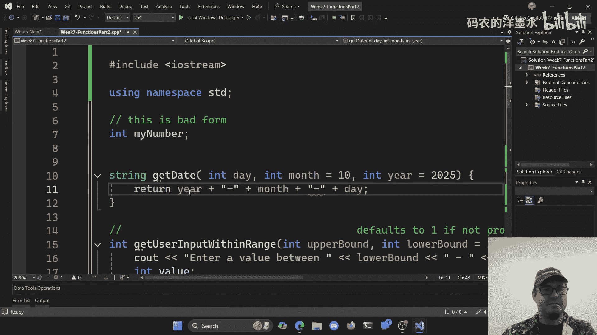

嗯。Ining。

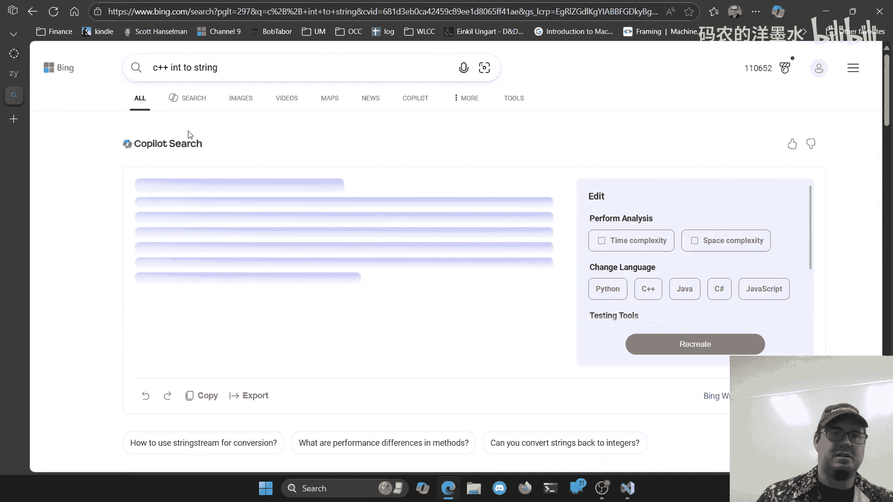

A， too string。 There we go。To string。Two string。Yeah。Two strings， I that happy now？No。

Is it not from you have to include the string library， there we go。

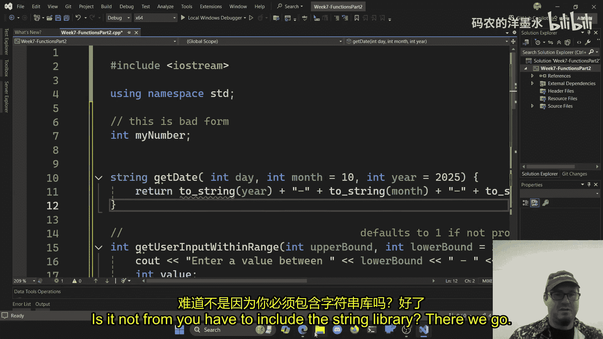

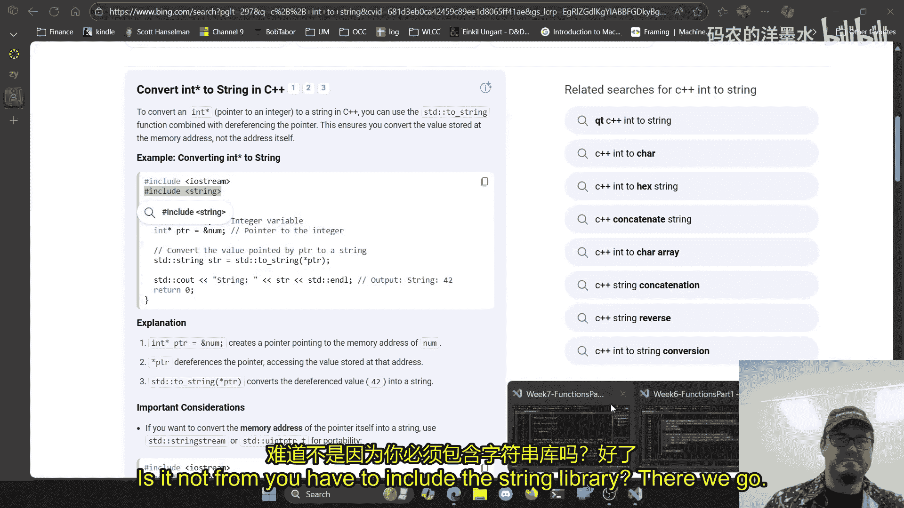

Yeah。There， okay， now that's a little heavier and sure I searched this。

 this was where did that even come from？

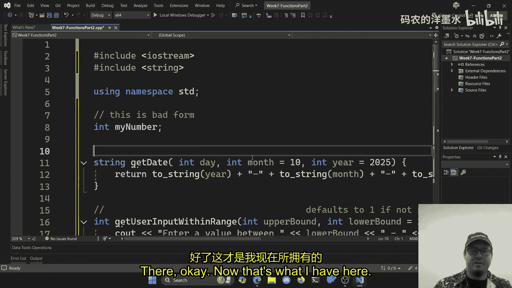

嗯。That's like kind of considered an AI answer， right， yeah， an AI answer， okay。EAI。

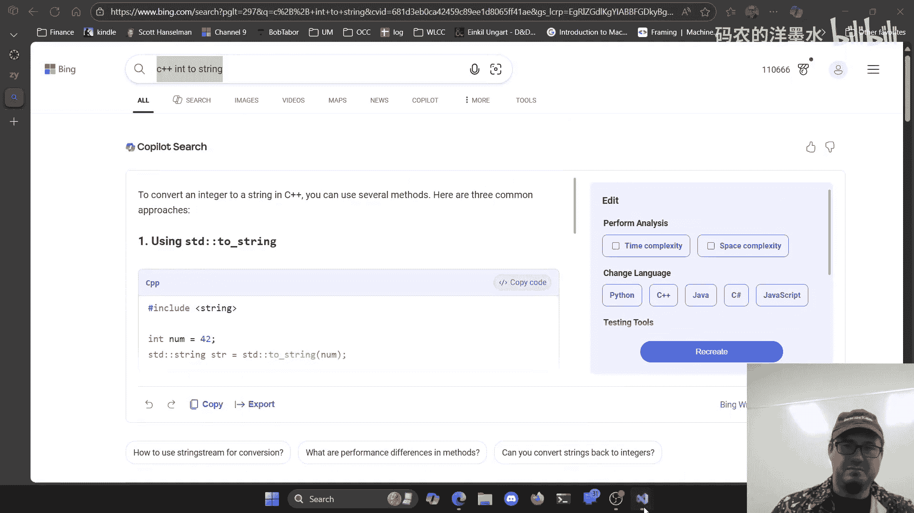

Can I answer。RightIf you're given， oh my goodness， paste。If you give me some of those generated。

 just tell me what you asked because it's really hard to give me a link back to these things。

 so is that fair for citing a source？It it was just one small little thing here。

 right I wrote the rest of the code。I feel okay with that the majority of us still mine so yeah one little thing here that was probably in our textbook somewhere too and I just forgot。

Was that okay。So we could get a date， you know， more than one default and it just goes in order。

 so I can't give it a year if I don't give it a month。

Because it goes in order right so I can print out the day， see out， get date。

8 given what today is the sixth。Great， great， that would give me the date and then line。meOh。

 sorry about that or we could get the date here。

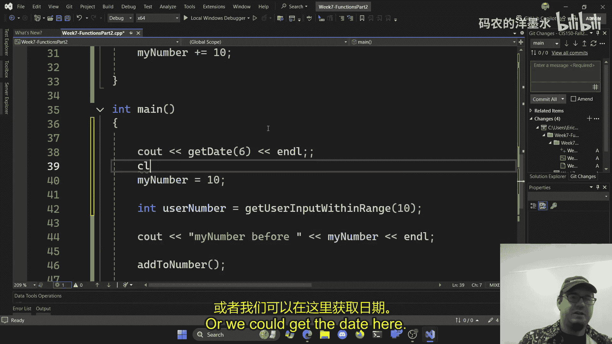

Was what state the class was over right when when was that going to be over？

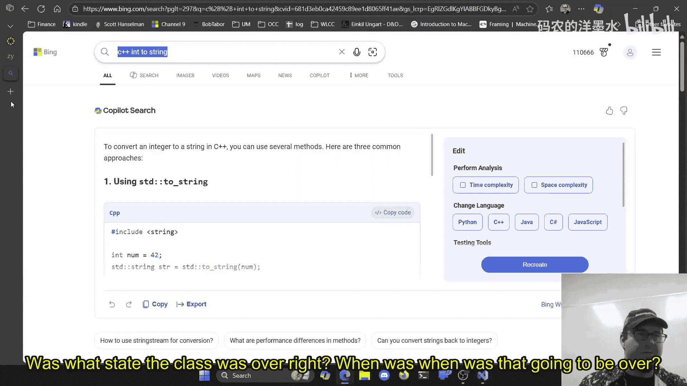

The 15th here， so we'll go 1215， script 12， 15 here。没。You let me be able say today。

Bless you and this is final presentations。Okay。It's the date right。

 and then yeah out graduation get date I know what what's one's something going to graduate like April of sometime？

是 what对。I don't knowAll right， well May 1st so one。Right。

 wanted to say was October and I can't put the year in， I can't say hey 2027。

Because that's going to be substituted in for the month。Right not the year， so just if you have them。

 you have to do them in order here。This is what， May 1st。2027。

And we should get out some dates by using those optional default parameters。

 which are really fun to the day your presentations graduation。

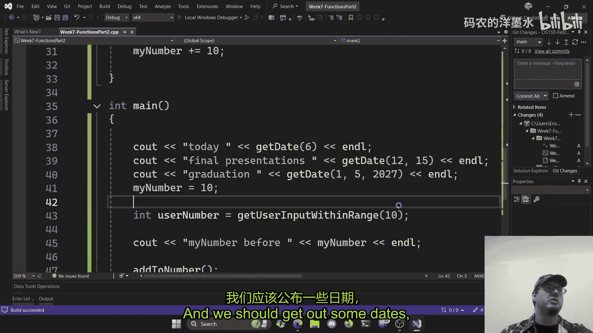

Yous don't have it all planned out，'t you I don't have any more semesters until you graduate。No。

 seven， okay， seven more， so not 2027 and 2028。

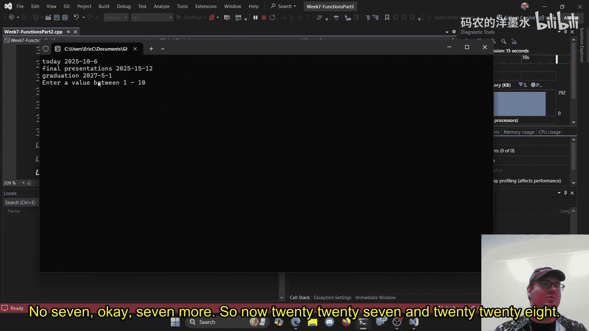

For 2029。A of 29， okay， I always' do that then 29。一。

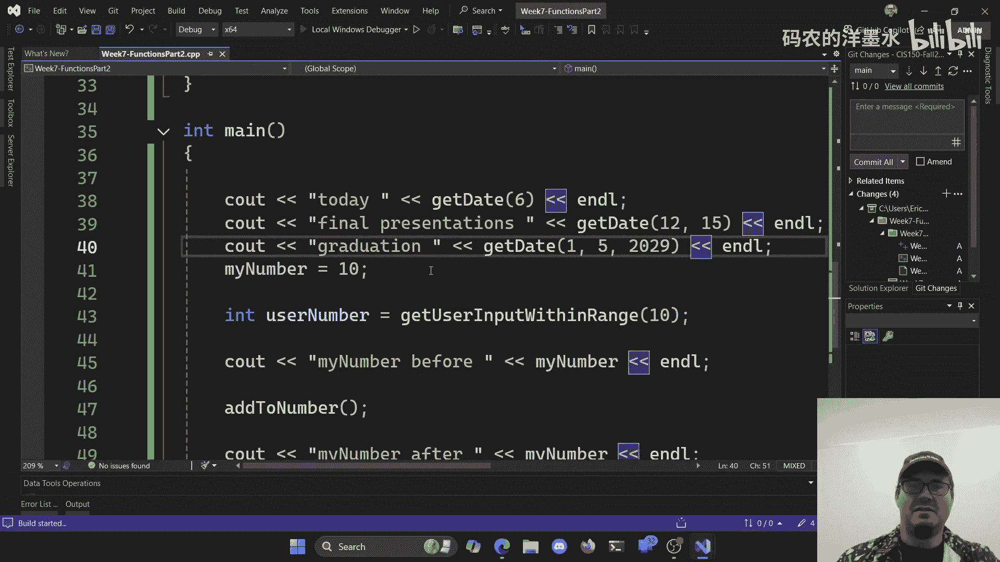

没有 29。Awesome， all right， so we can use the default parameters here。 And again， it's just a shortcut。

 It lets us。😊。

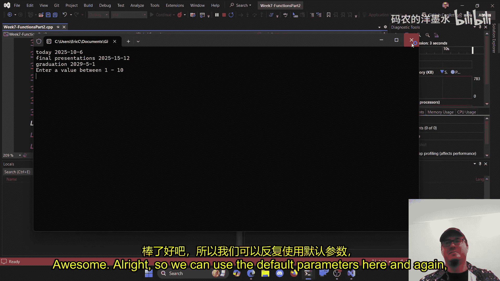

Make this a little bit easier to use if there are sensible defaults。

So they don't always have to give them to me here， which is nice。

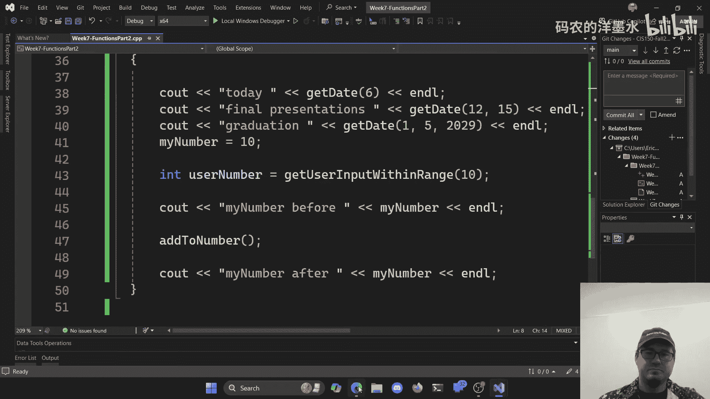

All right， so was our default parameters， excuse me。Function name overload。

 So the other way that you could do these here is you could have the same function here。

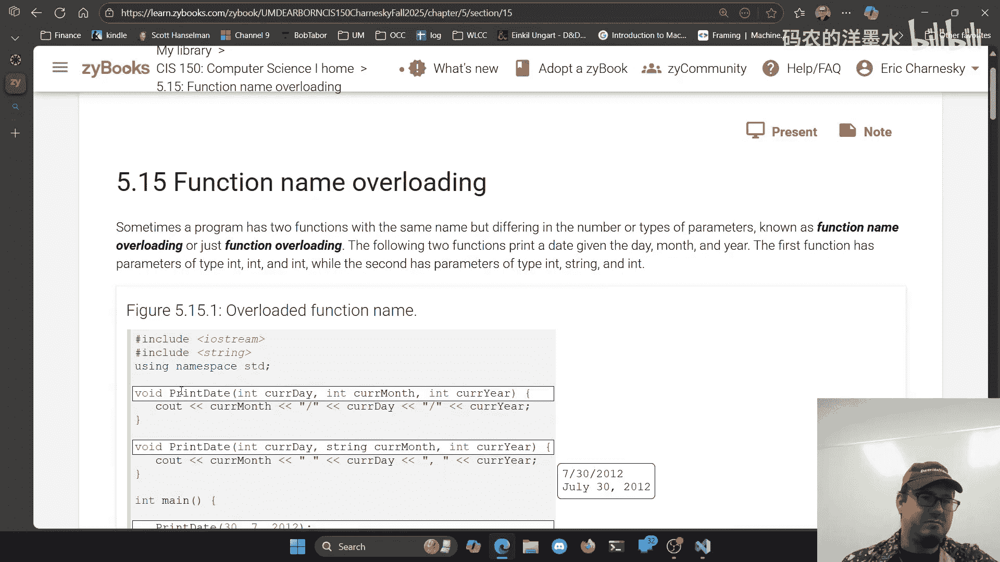

。This was the the old style here so if we wanted to get dates a string for。

Get date that takes a in day。It returns get date of。Today and in 2025。Okay。

So this is overloading the function here so I have the same name。

 but the parameters are different as long as the parameters are different C plus+ is okay with it because you can tell it's oh this one versus this one here now this is much easier than writing a bunch of other functions I just call the same one so this is much more common nowadays here but the other weird thing you can do with it is you can have the same function with different parameter types here so in that case it was like hey。

 here's a string for the day a string for the month and a string for the year。And hey。

 I want to default that to 2025 and this one we want to default to a string of 10 or something So if you want to give me a string for the day I'll take that if you want to give me an integer for the day i'll take that right and both of these do the same thing so then year plus dash plus the month plus。

Aache。对。Why it's going down so0 lines stash plus the day。

So you can have different types here in your overloaded function， so this overloading。

Different types。So this one makes a lot more sense because then you're making the function be more flexible。

 hey， you can give me a string， you can give me an image we can even make one that takes doubles。

 maybe。RightI mean I don't know what 10 and a half is for a month。

 but youve probably meant October if you gave me 10 and a half we have options here so we can make the same function name as long as the parameters are different because when we go to use it here。

C++ says， oh， if you give me strings， you want the one that uses strings， if you give me integers。

 you want the one that uses integers， it can go in bind to that function and it knows which one to use。

So as long as the functions， I'm say the parameters are different。

 it's like the return type is not enough to be different you can't have two with the same name。

And the same parameters with a different return type here。

This one's unhappy returns zero for a second。Because C++ won't know which one you want。Right。

 let's the say。Can't overload distinguished by return type alone， that's a nice helpful message here。

 hes telling us that's not enough。Please when you go to use it。

 C++ doesn't know did you want the one to give you an in or the one that gives you a string？

It's not going to be to tell， so you have to be distinct enough here。

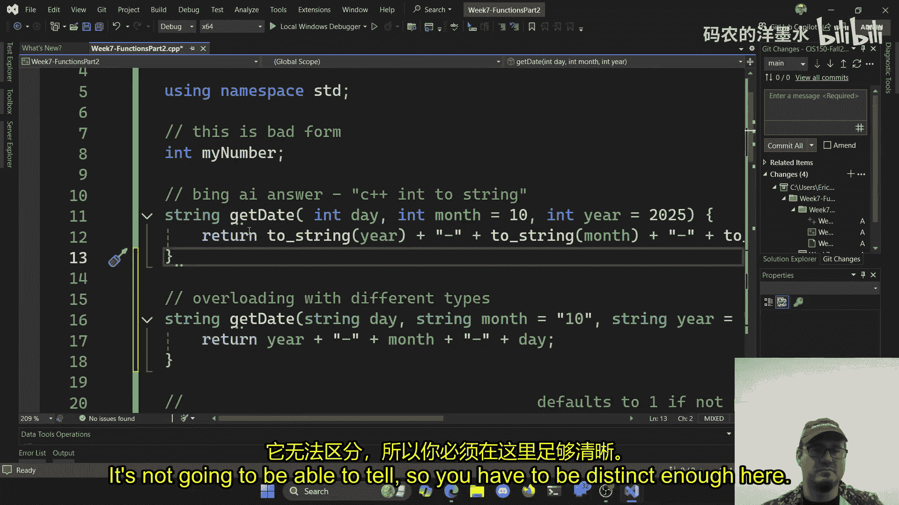

All right， awesome so those are dates yeah， they did the dates here too shoot I forgot。

Checking if your parameters are valid。

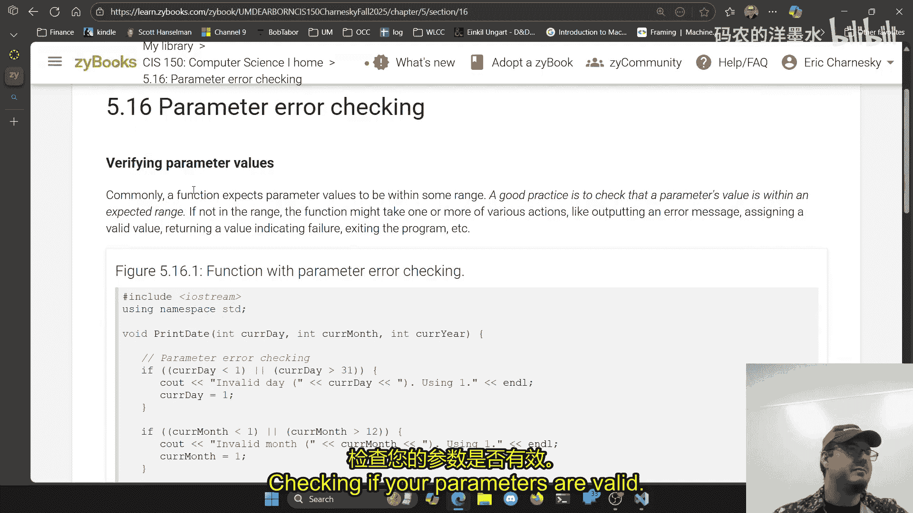

Definitely a good practice here so with our functions we want to make sure if we're going to do some sort of arithmetic or some something。

 whatever happens to be with these values we should make sure they're good values here and if they're not good values well there's not a whole lot of things we can do here so see outing that is invalid is not。

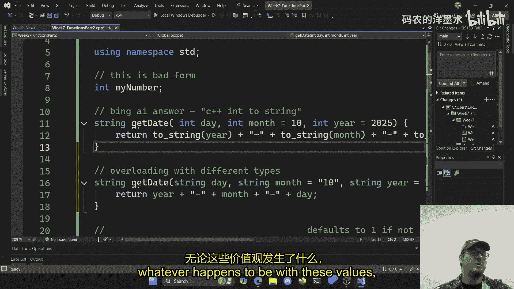

Great here， but that's about all we have so far， eventually we'll get to the right way to make this you know have some errors。

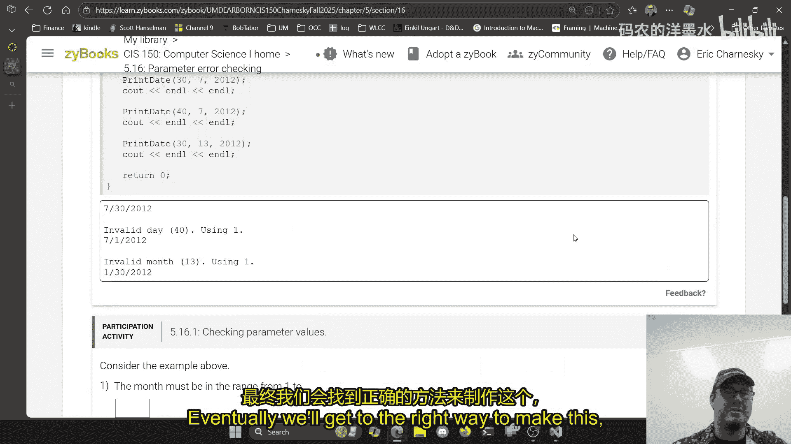

But we should go and check them so valids we can check validate our day right is the day。

Day is less than one or my day is greater than 31。 Now if you wanted to check the number of days in the given month。

 we could do that too， that seems a little bit trickier right now， we probably could， right。

So which which month have 31 days， so if month is equal to one。More month is equal to three。

One month is equal to five。Or month equals。That's June only as 30， right， is July， July and August。

He's July and August， isn't it， we pulled my calendar here July and August， okay？Yes。Stop stop。

 all right， yeah it's July with seven then August and July， so seven or eight。

 why is that our pattern sure？Or the month is eight or the month is then October is 10 and then December 12th。

Co one。It's 12， all right， there we go。What do we want to do here？Well。

 we could do a check and have an error and then do a different check and have another error and do another check with another error。

喂。I like writing less code here， but again there's lots of ways to go out of here so how about we say like A in the month As。

It days in month， we're going to start at 28 here。And then if it's an odd or not odd here because 8。

10， whatever， this will be 31。Elsif。The month is two or not two because that's 28。If the month is4。

Or the month is six， or the month is nine or 11。11。Then my day in the month。Is 30。

 otherwise it's same to 28th for February。I guess we could have made it 30， there we go。

 let's make it 30。And then if it's two， we deserve the 28。She。

I would have saved just some typing rate key in the month equals 28。I think 31 had them。

 we should have done it for 31， it's too late now。Joseph great， and then we can validate hey。

 if my number of days was correct right so if my days is less than one or days is greater than the days in the month。

You can see out invalid a。😔，Oh， that's singular day， sorry day。就。

And then maybe we just change it I don't know if to default it to one or something silly。

 we got choices here， right which probably should have checked month。As well。

 right make sure it's not more than 12， and I don't know how you want to validate year。

I think technically any year could be a valid date。It is。You know， you give me the year 10。

000 and who knows that's crazy， but sure。All right， so definitely validating。

 making sure we have good values is important because we rely on these things to be。good value。

 if what we're going to do makes a lot of sense here for to make any sense at all。

 We need to make sure we have good values there。 We can do some error checking。 so the。

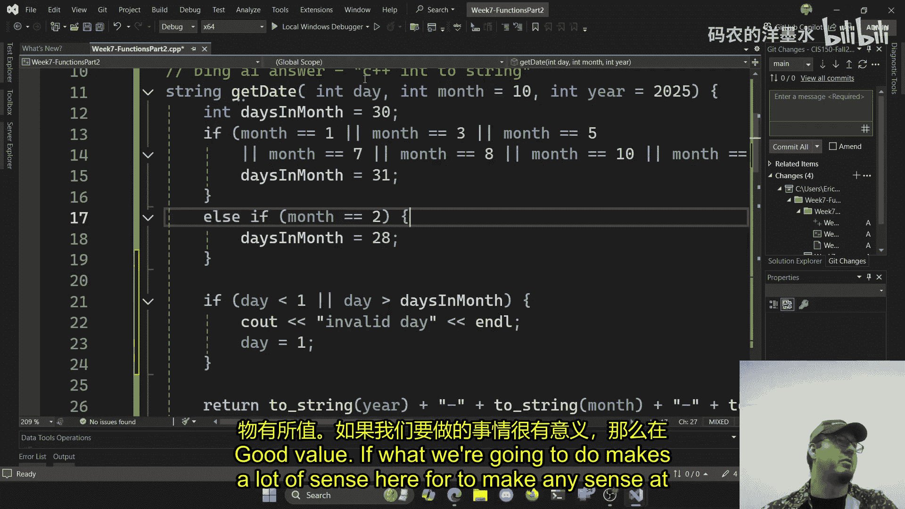

No。Includes yeah that's fine if you want we can like we've included other libraries so far like straying or IO stream we've done those we did time right？

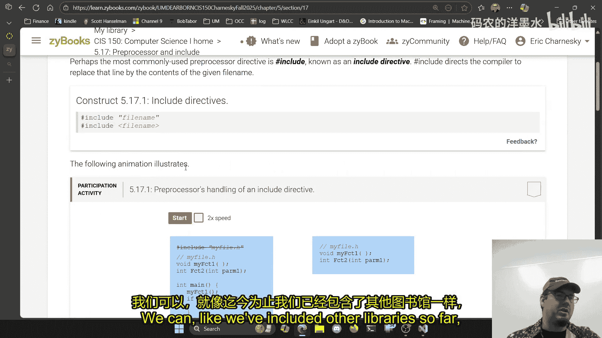

It is essentially going and telling C+ lets go grab that code and use it here。

 go and include it in what we can do is we can make our own files here and include our own files。

 which is fun so you can make a file with just a bunch of functions in it here。

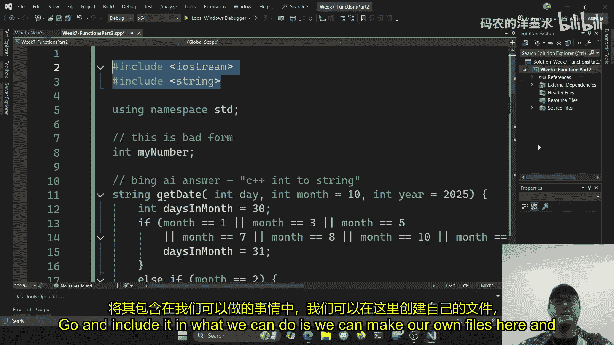

And then you can go and include that file， which is really fun so in quotes then we give our file name so if I wanted to have some functions here to go add another file now this gets to be weird generally we want to do them as header files or H files。

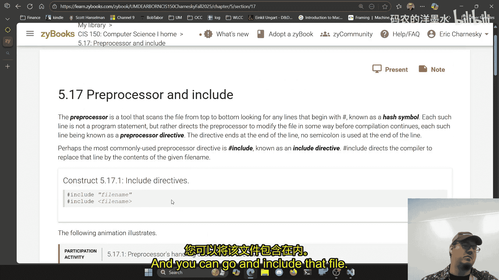

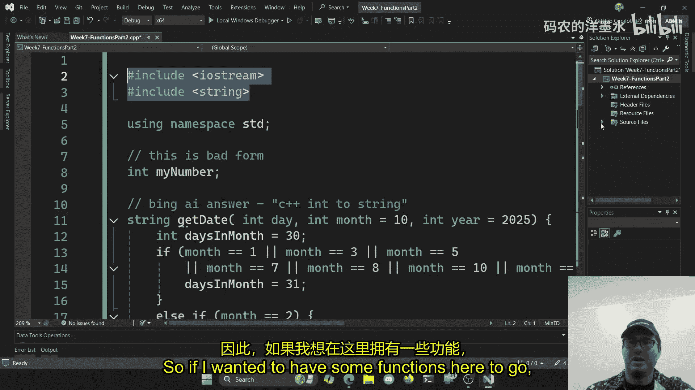

They're slightly different than the CPP files there's a whole big story behind it it's not all that important right now。

 but it's really easy to include header files harder to include the cP files。

 so we're going to make a new header file here we'll call this one our。

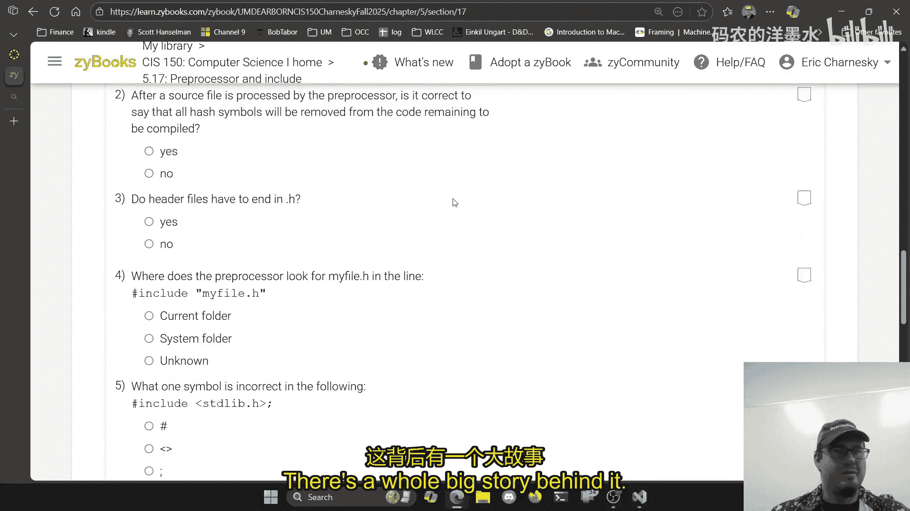

Headerphi this is functions。对。And if you're in Vi Studio land， you get the Pragma once。

 if you're in MacL， you have some other nonsense you have to use here， where is that in here。

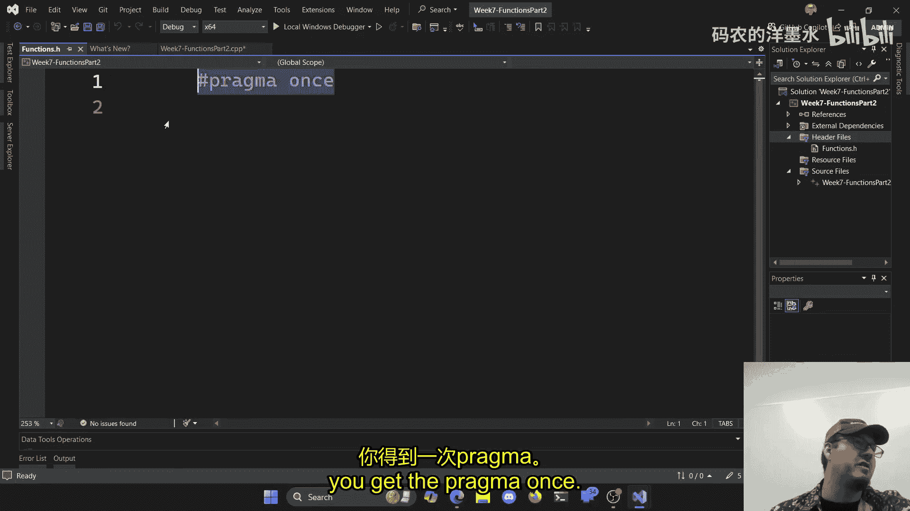

Do they not include it， yet， goodness。Do you have three for that？ It's like， if not defined。啊。

Great close。Excode， code if I or。Their files yeah。This one here， this looks right。Yes。

 you have to check to say。If this header file is not defined， I'm going to add a definition for it。

 and at the end I will end my if this is not defined。

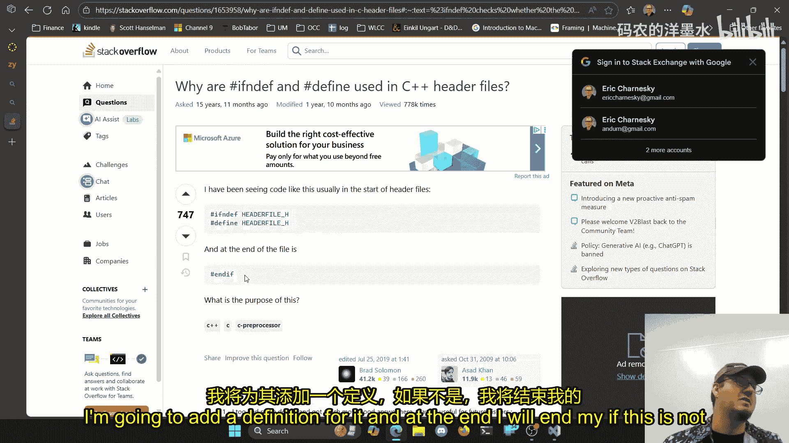

It's really ugly so thankfully in visual Studio land you can just say pra them once。

 which is please only do this once the reason why you can get these weird scenarios where one file includes a file that includes another file it includes another file it includes and you get this like circular loop where that file included that file。

And if we don't say hey， if it's already defined stop， it's just going to keep on going forever。

 we just put ourselves in a bad cycle here so it's saying if you've already defined my file。

 if you've already included it once， just stop please that was enough so you'd think that would be the default for some reason it's not I don't know why what we can do is we can put our functions over here so let's go move our now add the number won't work because it needs this variable mind number here and this is why having these global variables is kind of ugly here but I can go put these over here I need to include string。

🤧She。And I need use namespace。😔，Standard。I think all those went away oh and then we need to include。

Io stream if we're doing any sort of sea out stuff I think all those are happy now。

 so to use my functions here in a different file， I have to go and include them and they're like。

 hey， they're not here。Right， show potential fixes， hey， we could go and include it。So it can detect。

 hey， you've got this function somewhere else。So sometimes this red light red line is helpful sometimes it's not so it adds in the include now this is a custom header file this is one of our own code files here so a nice way we can break all this up here and separate things so really I only have to have main in my CPP file all the functions can be in H files which is pretty cool。

There's some really cool magic stuff that happens behind the scenes with compiling code go talk to some of the props who are really smart about that sort of stuff。

 I could care less about compilers， but essentially when you hit run it goes and does a bunch of steps right and it kind of goes really quick it says build started build succeeded behind the scenes it goes out and compiles and gives us that executable file。

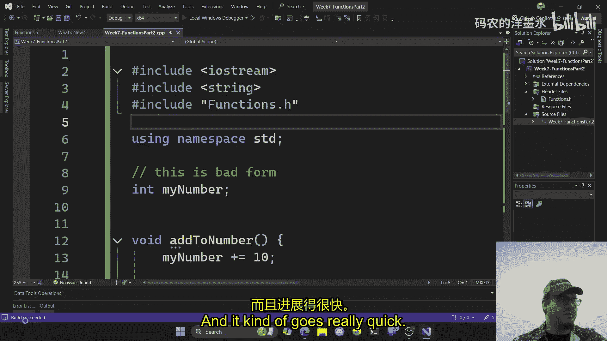

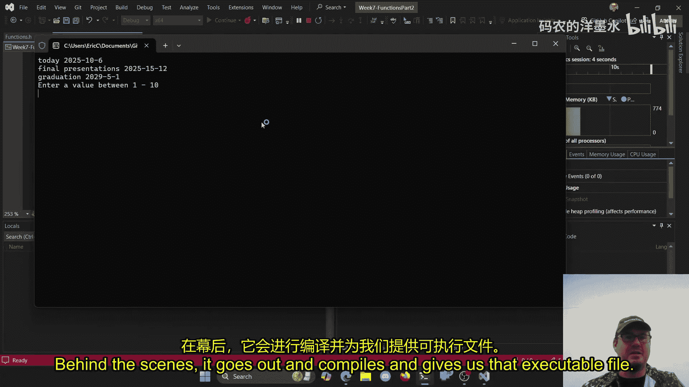

If the header file has already been compiled， it doesn't need to compile it again。

So it can save some steps here， which for our purposes， you don't really notice it's any faster here。

 but you can imagine if you're working on a project with dozens of people and you've got thousands and thousands of lines of code and dozens and hundreds of files。

 not having to compile 100 different files。It's pretty nice right because the bigger it is the longer takes so if you can avoid some of that right breakingking it out actually does speed things up long term so it's a good habit to break things up then we can organize things nicely and we'll get to classes where we have to use headers for them as we go So for now if you'd like to use them great we're not going to immediately when we get to classes we'll start using header files and I'll tell you more about it but if you'd like you can move out your functions to its own header file which is kind of fun and just keep things a little bit more neat and organize for your main file which is cool I think if we open this up here。

😊，I think we even see it right do we do we see it I don't I think it's all compiled to164 debug Yeah。

 it's all it's all part of the same executable here but。

Eventually when we get larger and larger market， we can break these up into other artifacts and they get other files and things。

Compiling gets really complicated really fast as you start getting bigger projects so but if you do it the right way。

 you don't have a 76 gig download when you have to update a game on Xbox。

Right if you've done this the right way， you can update just that particular package here and make a small update so you don't those are just lazy when you have to re downloadload everything that's just terrible that is what it is。

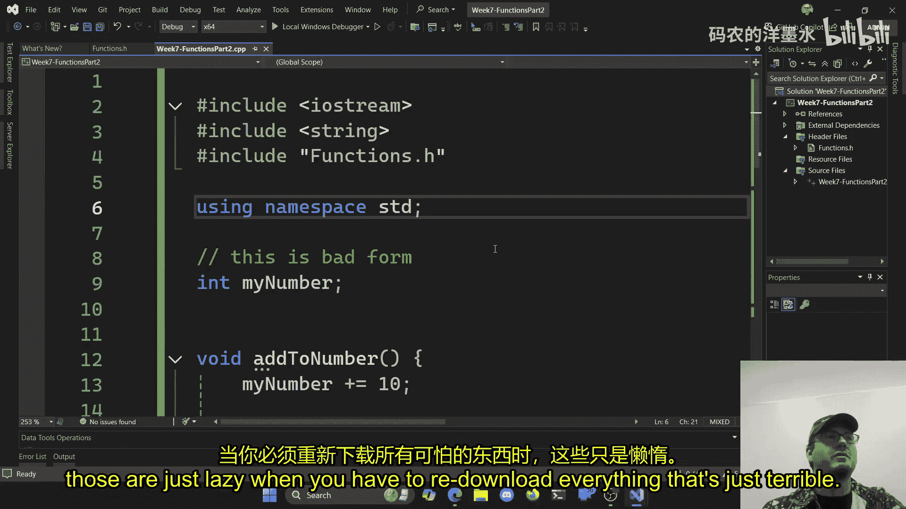

All right。I think that was at it here for。Yeah， separate files great and then some examples。

 they got the labs coming up， make sure we take those as we go。

 how's it going here where iss the reporting？Everything going okay on the project。

 you got started already。Some people said yes， it's good， not very far in Zybooks。

 it's not the end of the world， again having seen it once my way is good。

 having seen it a second time the Zyocway is even better。

 having practiced the Zybooks is better than that， practicing in your lab， even better。

 you need those repetitions to get better at these sorts of things here。I know it's a little tedious。

 I want to keep apologizing every time for being tedious。

 but ideally the practice is very worthwhile here and you'll get better at it the more you do it。

 okay？All right questions， thoughts concerns， I think we can talk about the project if we've got any other question about functions we can cover those on Wednesday and we'll talk about the new project which will be based on functions be very exciting。

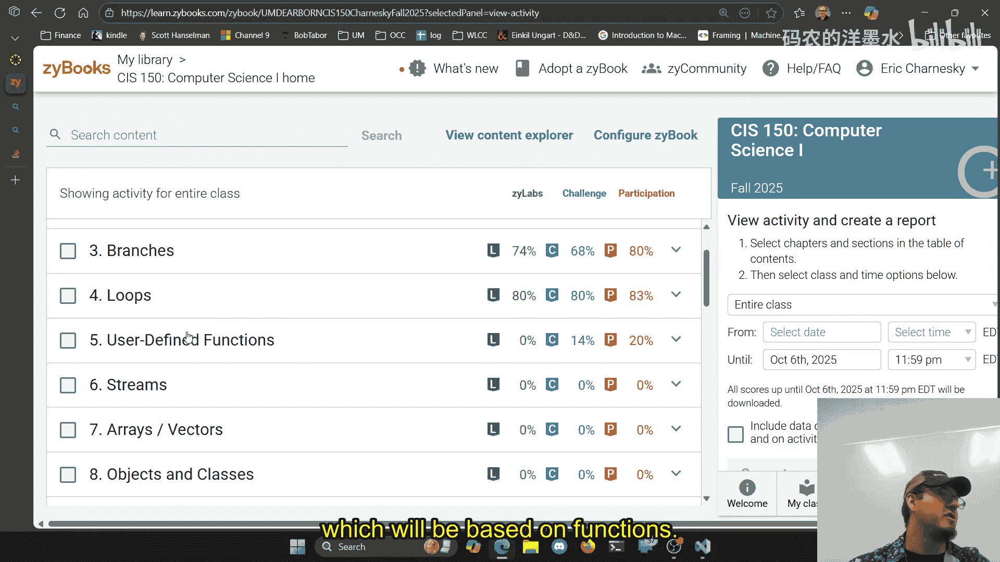

Okay。😊，Awesome， thanks folks， I will see you around then。

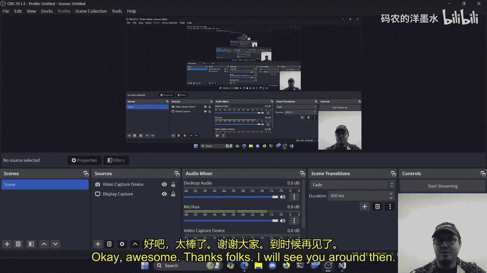