# 【全集】密歇根大学 C++编程 中英字幕 1080P p09 Lecture 9 - 数组与向量 part1 -BV1TsAZzAEHX_p9-

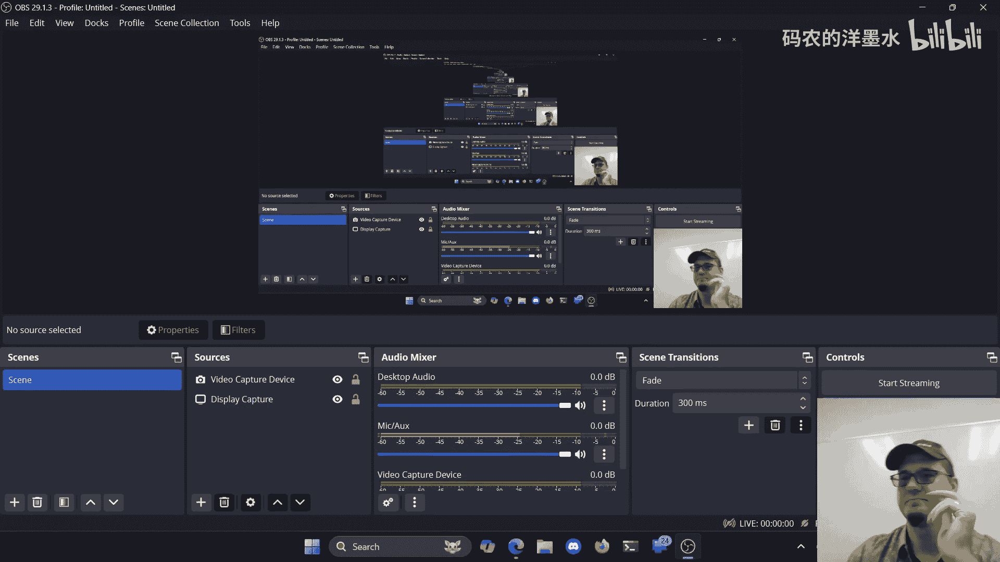

Alrighty， oh you still can't see the screen， let me click this button。Hey， you know you can see it。

 All right， well welcome back from Midterm。When okay， was pretty easy。Okay， that's good。

 That was the plan。 Again just a checkpoint here。 we're gonna move on to new stuff here。

 which is very exciting arrays and vectors and the next project we'll see how far we get today we might not start the next project till Wednesday we'll see how far we get with raises and vectors here Oh that's why you asked because we have two weeks for this chapter Okay I I am a little slow still I've only had a little bit of coffee I need more yeah okay so chapter 7 won't be due until the 10th then because we're spending two weeks on it here let me go put that in。

Here's says chapter 7， we do on the 10th。Thank you。 Sometimes I do dumb things。This is chapterpter 7。

😔，And we'll put that out till 10th。I think you got your other's ZBook scores in there。嗯。Submission。

 no submission， thereio。All right， if you want me to go。

Back to some of the previous chapters and rescore them， I'm open to the idea。嗯。

If I give everyone like one or two chapters to reco， that seem pretty fair。Okay。

 I'd rather not reco them all， but you know， if you I'm going to underscore one or two of them at some point。

 I'm open to that again。It's for your benefit that you're reading the textbook。

 doing the textbook stuff here and following along in class， so we've got chapter  seven we' do。

 we'll do chapter eight and chapter nine， so we only have a couple chapters left。

 which is pretty cool。We'll get to objects and classes and then for pointers we don't go crazy deep into pointers we'll do all the pointer stuff but next semester in 200 you'll do a whole bunch more with pointers so it'll be a little bit of fun we've got a break review time and final project work time and can get that hopefully finished again by then so you can focus any other final exams and that should go pretty well so they follow up visual I'm sorry they don't have me on the schedule for it yet so usually if they add another section then they be like who's free and I can say I might be able to teach it depending on the time because the winter schedule is out now if you go look。

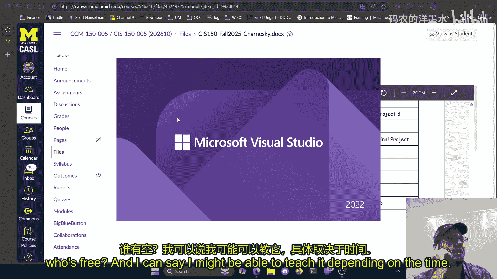

So it's week 10， right？10 is his arrays and vectors。Now definitely a little biased。

 I really don't like as and I really like vectors compared to as。

 some people really like their arrays and that's fine it's not。

Not terrible here they're just a little bit more inflexible when you try and use them is really the entire reason I don't like them because I'm all about think being easy。

So if it's difficult for me to use， then I'm going to avoid it。All right， so we got our namespace。

 you don't even need this line， so the whole idea with an array。

Is now we can finally hold more than one of something。

That's really all lets us do here So instead of saying if I wanted to have five different numbers。

 I don't need an int for number one and it for number two an in for number three and in for number four and then for number five I can say hey I want a place to put five integers here and we can use an array to do that so we can say I wanted an integer array。

Called numbers now we have to tell it hey， I want five numbers here goodness gracious and I'm on the wrong side numbers。

Sorry， I always going to mix up on which side these square braces go on。

 so we use square braces here to reference the index。

We're going to start counting at zero because that's how all normal people counts and we always start 0。

1，2，3，4 right that's how we get to five things right doesn't make a lot of sense it's okay we'll get there we're going to do it all the time so we always start counting with0 and there's good reasons for it So if I want to access one of these numbers here I'm going to say hey numbers and then I use my square bases to say index of it's how we kind of say this in English so it's numbers index of zero and we can assign hey the number 42。

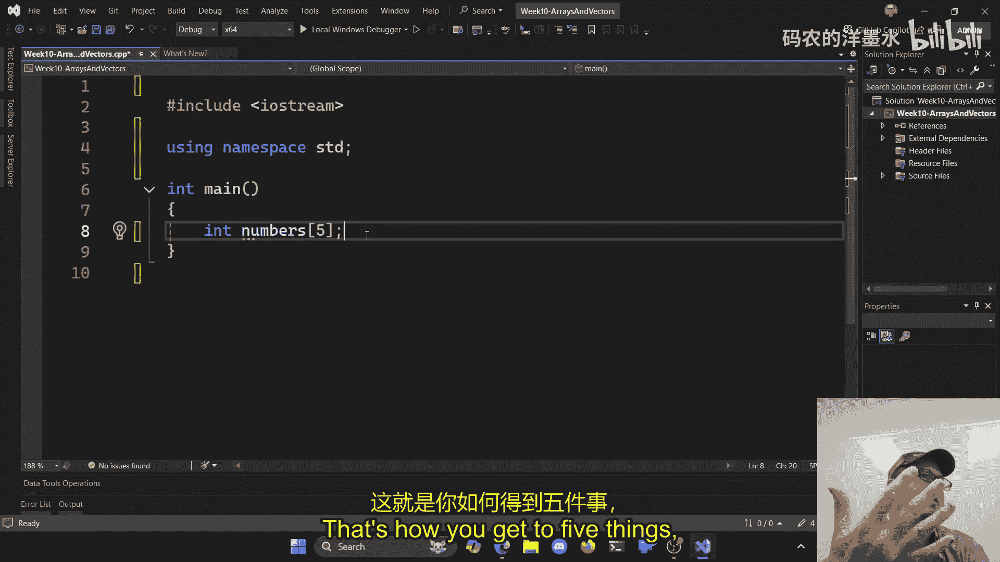

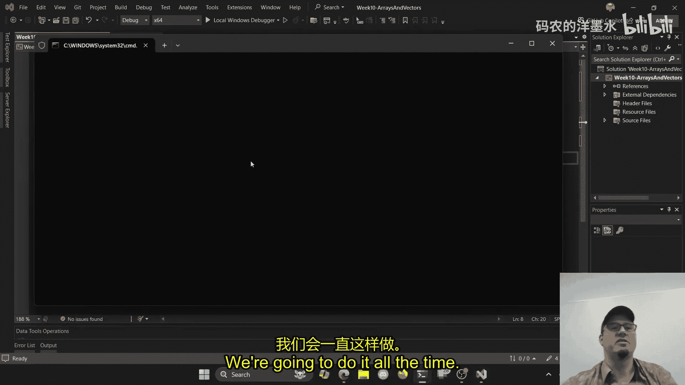

I can say hey numbers at index of one numbers index of one。

 let's assign 77 and numbers index of  two， let's put in 100 numbers index3。

 we can put in a zero doesn't really matter what we put here right just throw a number then numbers index of four let's put in a。

How about of six okay。I have room to store 5 integers here。

 and I can then go assign individual values to each of those five places using this index notation。

 but we already start counting with 0。So the first position。Is index  zero。Now this lets us assign。

 we can also use that same notation to read them， so if I want to do output or do something with it here I can say hey。

 I want numbers index of two right and we can just do arithmetic right in here you know。

 let's double that。Right。So numbers index of two says， hey， C+ plus go out to that numbers array。

 go to the second index， read the value that's there， just like it's a single variable。

 it will go get the value that's stored there， we're just saying hey。

 go to the array at the second index。so it's like go to this spot and then up a little more now the whole reason why we start counting at zero is the way all of this is calculated is some cool little speed up memory magic so remember when we store a value the computer we have to go out and ask our computer hey。

 I need a place in memory to store it and we know it's memory address。

It's somewhere in my computer's memory， here's the address to it， and we go look it up by address。

With an array， we get a chunk of memory that's five times the size of an integer。

 right if our integers are 32 bits。For integers， we get five times 32 bits of memory in one spot so it's a contiguous block of memory and what we get to do is if we want the zero with index the first item it just reads an integer at that memory address okay here's where the memory address starts read 32 bits that's your integer Hey guess if you' can to talk about the whole if you want the second index it says okay I know the size of an integer 32 bits let's take your starting address and go up two times 32 bits and it just shift this space and this space over and it reads right at that location if I want an index or an array with like1 thousand0 indexes we can do that it'll get a thousand times 32 bit that chunk of memory I can read index 27。

It'll take an integer Time 27， Off that from the the start address and go' read it。

 so we get immediate access to any location。based on its index。

 so that's why we started zero because the first number is actually written right at that location in the memory。

So there is no index5 here， so that stuff happens if you try and use index5。

Because we never put anything there， we're going to get garbage。Great。What's ever written here？

It's not part of the array。So if we try and write just go and access the value here， excuse me。

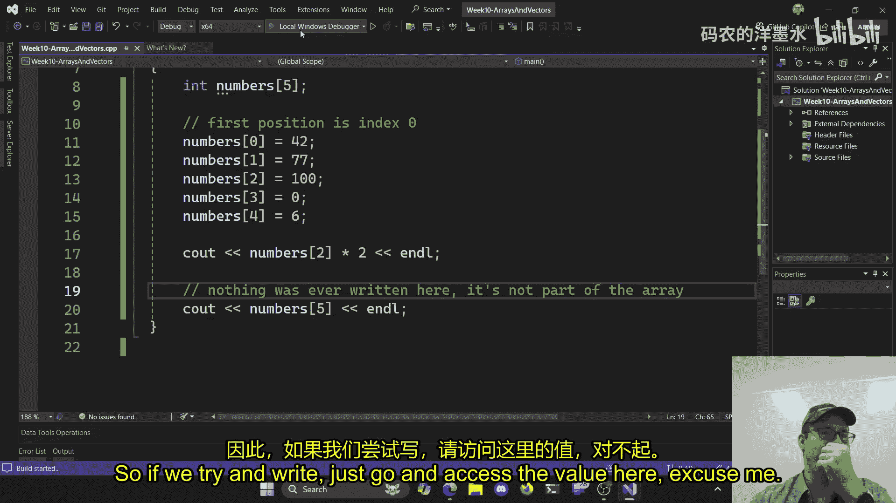

C plus+ is going to say， okay， sure， it's some garbage。

That's not helpful and we never even got a warning that hey。

 you shouldn't have done that now we're getting a warning here because visual Studio knows， hey。

 you said it was size5， you're trying to access an index that doesn't exist。

 but it's not giving us a very nice notation here it' saying， hey。

 the readable size is only 20 bytes， but 24 bytes might be read。

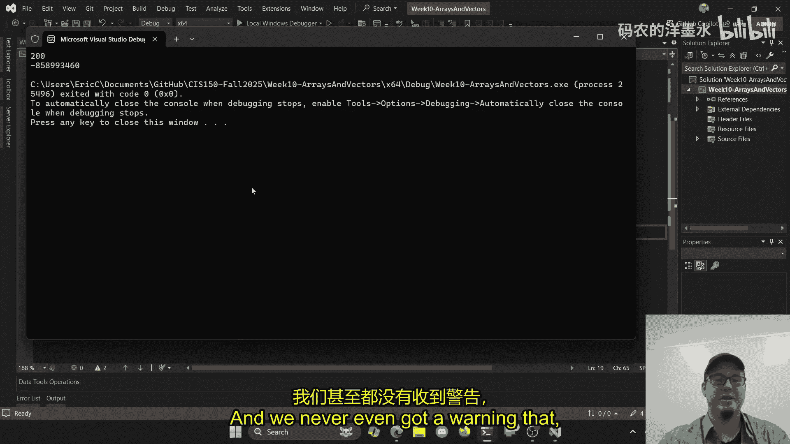

Because a bite is eight bits。So a 32 bit integer is four bytes and it knows hey we only did five times four of those we only had 20 bytes now if you don't know that stuff off the top of your head you're like why is it 20 I told it five right like that start of stuff doesn't really make a lot of sense it's not a very helpful error but if you're like keeping fun facts in your head and you have nothing better to do you probably remember an integer is four bytes and oh five times four that's where it gets to the 20 front and that you're reading 24 bytes because we're trying to get out a fifth。

Index， which is really the sixth item。six times four is 24， so saying， hey， you've read 24 bytes。

But we only ever used the readable size of 20。But it works。

 so lots of bad stuff can happen if we're not careful in C++ because it lets you shoot yourself in the foot。

There's no protection here to not let this program run and you're going to do a bad thing so if you're not careful。

 they're like， oh yeah I have five items I'm going go read the next five I of the last item and you've done a bad thing the only thing we get is visual studio saying hey dummy。

But it's a really bad error， it's not very helpful and this is one of the reasons I don't like as。

 but again， it's okay， it's not the end of the world here。That's totally workable。

We'll just let that be garbage， that's okay if I try and assign to it numbers of five and we put a number here。

 let's say like put a 20 in that location。And now let's see if we can read out。Yeah。

Now we get to build error。So this one here is a forcible error。Again， though， saying， hey。

 its size was 20。You did a bad thing。But it's not a good error saying hey your index is invalid that you have to do the arithmetic yourself to realize what's actually happening here。

 so if you assign to it it stops you， your program won't even compile and run but just reading from it it lets you read garbage okay so thankfully this one won't compile。

So I'm going to leave that comment out so it'll work for us here and we don't need to read it again because we already did that once。

Okay。Now the downside of arrays right， you'd be like， oh hey， it's number I want five here。

 what if we wanted to ask the user if I had an in for a size here and we said see how and enter a size。

Enter don't know the number of numbers you want to store。And went an end line and then if I said。

 hey， I want more numbers or so this is my integer array of I don't user numbers， size of size here。

Well that doesn't work， says expression must have a constant value。

 the variable value of variable size cannot be used as a constant。

What happens is when you make an array。The size has to be known at compile time。

So when we hit our compile button or our build button here， right build and compiles。

 when you hit run， it has to compile first here。You can't have an unknown sized array because it doesn't know where everything's going to go。

 it doesn't work。So I can't ask the user， yeah， I'm sorry。We could do that。

 but then if I see it on size， right？So as soon as I doing the C。

 it knows that it's variable it knows that the value has changed based on something else if I started a zero and never ask the user。

Yeah， we can use size。Size nope， it oh， if to tell it's constant。You ought to be greater than zero。

 sorry。Couple different errors it doesn't let you do a size zero because that's useless so you have to use the constant modifier here so that you can't go change it after the fact and if it's constant and I can't go see in on that value here because that part fails because it' constant so there's a couple different protections here to make sure you can't use a variable size here for your arrays these are fixed sized arrays。

They're very fast and that's why people like them， they're very memory efficient。

 they just give you the little chunk， you know what size they are， you can do things with them there。

Excuse me。Now the other fun thing we can do is we can use arrays in functions so I can have some sort of function like in for total or I don't know sum of array given an integer array called I don't know numbers here So if you give me an integer array is it on the other side numbers。

Hate trying to remember where these things go， there we go numbers。

Now I can go through and get the sum of these， this array here。No。

The hard part is I don't know what size this array is here。

 So we've got some shortcuts so we can we can do some quick notations I can have minute it for I don't know。

 we'll say some it starts at0 and then for int。Number in numbers。哦。I need something。

 It's not working here。 I can't just loop through this value because it doesn't know what size it is。

 So you have to pass it in int for the size。Here which is obnoxious and now I'm not going to use this sort of loop I can use in a regular form loop I might say hey the index starts at zero as long as my index is less than size。

 take my index plus plus now most normal people just use the letter I here I hate that and it just drives me crazy I'm always going to spell out index here because I'm just obnoxious like that so everyone else you see will just use the letter I there。

That's fine I'm always going to use index because it's more clear to me I can type a couple extra letters I don't mind it here and I get really confused between I's and Js and sometimes when you have a loop within a loop they do an I and then they do a J and then I can't tell the difference at all and I just feel stupid and I don't really like feeling stupid not a very pleasant feeling I get that enough so I'm always gonna spell that index so I can take my sum and I'm going add to it right my numbers at the index here。

So the numbers array at the index so if you give me the array and you tell me what size it is。

 I can go loop through it right I think there's another way it was a plus size of array。

 let's see there's a size of thing here。

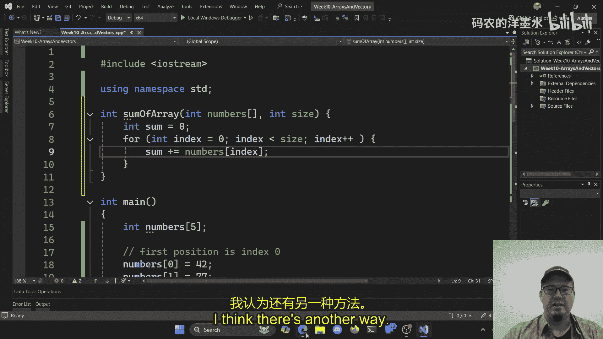

Yeah， okay， so you can do the size of here， which is kind of fun。

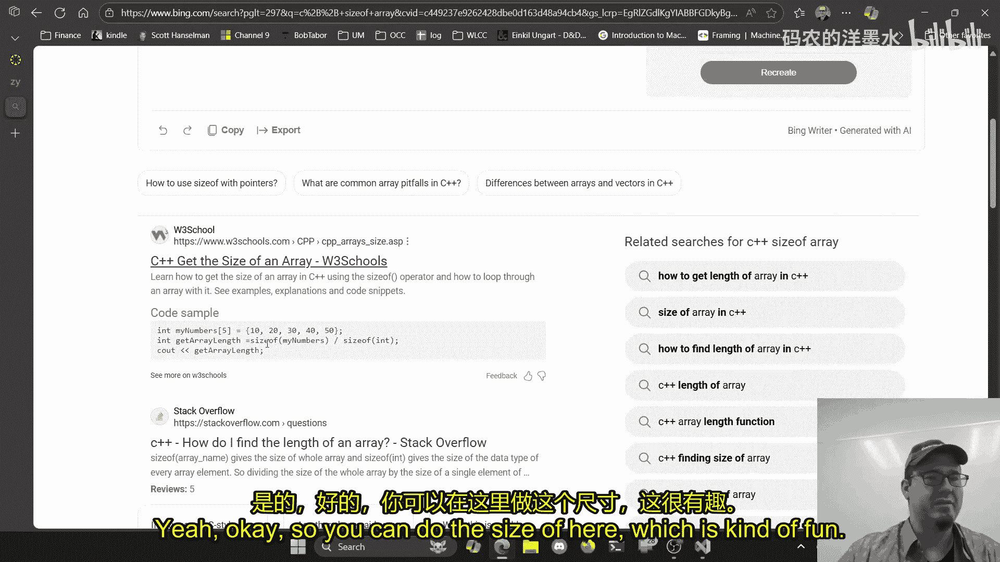

Let's just steal this one here。There's a size of function。And I think this one works here。

Let's see the size of numbers。Divided by the size of an integer， let's try that one here。

 so if we can do this without out passing size here， we'll get。

 I don't know how about the array length。We'll do that。So you can ask C++， hey。

 how many bytes of memory is this thing using here with this size of function？

It's just kind of cool so hey， tell me what size it is sizeiz ofable pointer。

We're going to see if this one works so we'll try and pass it here， so I think the sum should be。

Let's use better numbers here。One， two because I can't add in my head right now four and five all right。

 that one should be a little better right that is 15。So let's see if we get out 15， so if we get。

 we want to see out。Some of。Giveniv my numbers array。And line， let's see if that'll work。Oh。

 Bill theirs。Some over rain needs to return to it that， okay， we just didn't return sun there we go。

 return some。Let's try that。

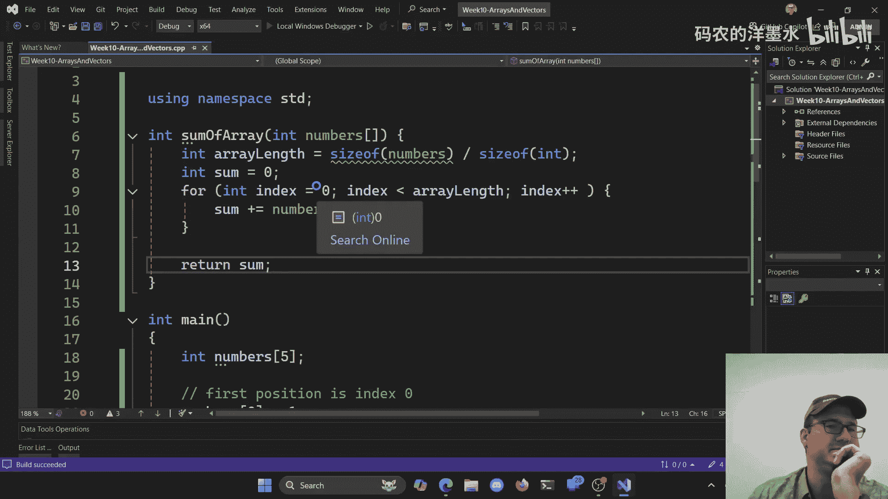

Oh I thought we outputed that some of numbers。

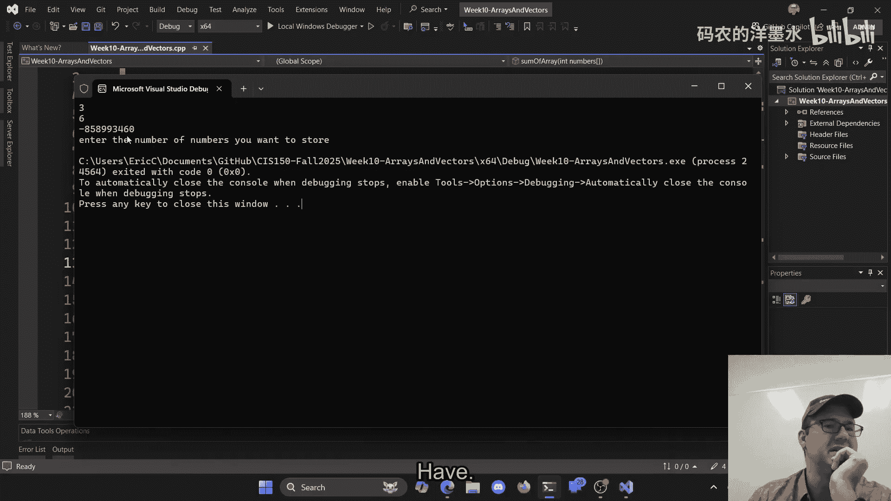

Let's see， I think that this morning here is telling us what the problem is。

So we get to here and we're going to try and compute。That。really like this， too is not correct。

 So size of numbers。Didn't give us the right value here， Ti said。

Doesn't actually know how long it is here so we got to go back and pass size so if we were doing this in the main function we probably could get away with it here once we've passed it it does a funny thing it mentions pointers we'll get to that later don't worry too much about it here so we'll stop this we go back to size。

So we'll take an in for size。Okay。And we'll loop like this， give that a try。

See if we get 5 oh goodness， build errors。 Oh， I didn't pass it here。 That's right。Nope， there we。

 numbers and F。

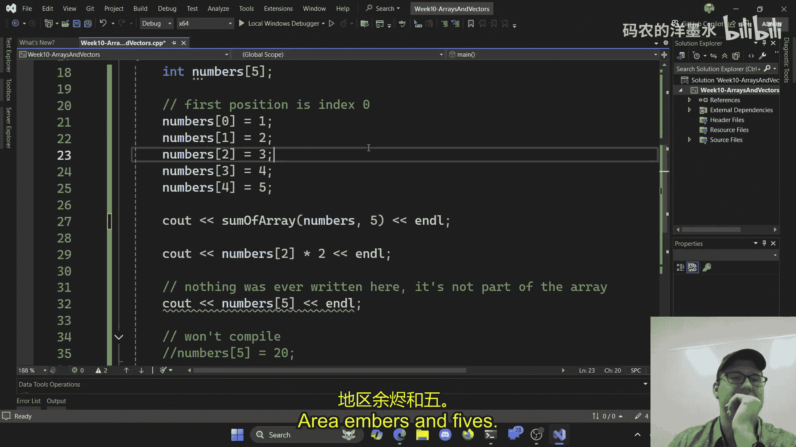

Because it's size five。Now we get our 15 back out。

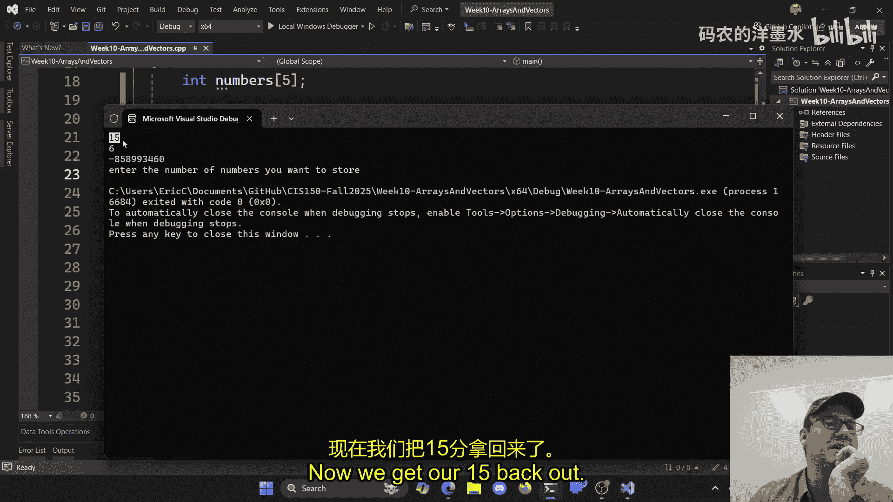

Life is pretty good。What happens if we give it six？

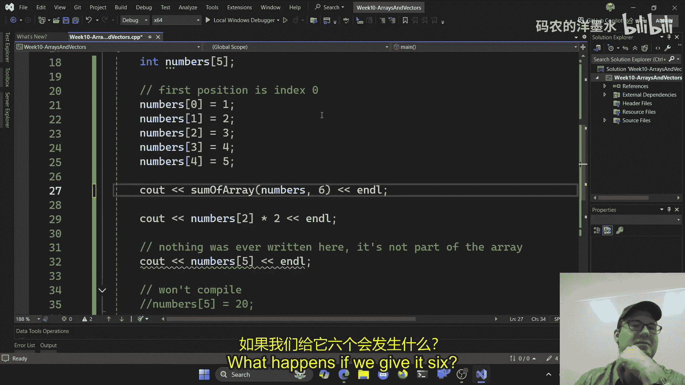

Okay。We got garbage plus 15。Right here's the garbage value that was at index5 and we added the 15 actual something to it。

 so again， it's not great here。

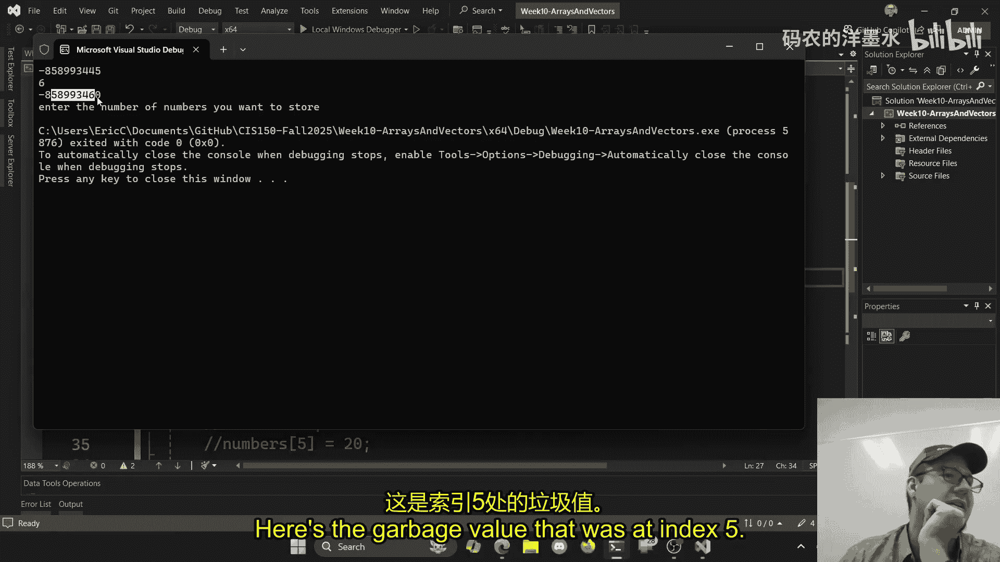

Trying to deal with the indexes and sizes， yeah if you're passing an array to another function because the function is going to have no idea what size that array is。

Okay。So you have to tell it。Okay， so arrays are kind of stupid。 I don't really like it。

 They're super fast though and people love them all the time。 but that's fine。

 What I like is vectors。 so you had a little bit of exposure to vectors。

 sorry we got a little off track there with vectors and files and whatever we were doing there。

 but we'll come back now so a vector same idea as an array。

 but it's resizable and it knows how big it is amazing so you can make a vector now of numbers So the syntax is a little funny for vectors though so we're gonna say hey I want a vector and then I use greater than a less than here and inside of that I say it's an end。

 So instead of saying integer array。😊，Here it's a vector of type hint。

This will make a whole lot more sense next semester we'll get into doing these sorts of things with the braces ourselves don't worry about it right now we'll just say hey it's a tight end you can put any type you want here which is really cool you can have a vector of anything but it just has to all be the same type same with the arrays they're all the same type you can't mix and match doubles and integers and strings and floats and things right they're all all one type here because it has to know how big to size that array how much memory it needs so it needs to know the type to know how much size it needs so vector integer we'll call this my better numbers here。

Now， when we make the vector， we can give it a size so I can say， hey。

 I want to put 10 things in this vector here。Or we can leave it empty。Either way is going to be okay。

 we've got options here so we'll do one more vector event preized。Numbers。

 and we'll just do five here。Okay， now with vectors， you've got two choices for how to use them here。

 and I'm going to recommend you don't use the array notation。So we can say， hey。

 I want my presd numbers。Index of zero and assign at 42。Perfectly fine。

 you can do that or you can say， hey， I want my presse numbers。 at。Index is 0。

And Ill do index of one here and assign a 77。So the at notation is much better not everyone likes it。

 it's okay， I really like it。You can use the array notation。 You can use the notation。 Now。

 if we mix and match here， right， we'll just keep on going。 So let's do index of  two。

 index of three。And we'll just do four。I'm sorry， four and five right we don't have an index five does not exist right we only have five spaces so there is no index five。

 we have0，1， two，3，4， let's go back when we do 1 hundred and0 and6 or something and let's put a seven here。

So let's go try and put some values in here。When we run it now。

It breaks so it still compiles and runs here， so it lets us compile， but as it's running。

 we get a standard exception out of range at memory location so this will just hard stop that hey you try to do something at an invalid memory location is a bad index and still not a great error message that we're working with here it's a bad index。

So it just stops working here and crashes。This is not ideal。

 but it doesn't let you do dumb things here so instead of setting how will we just try to give a see out let's just go get this value so you can use this a notation for setting and forget getting just a little bit weird。

 but that's okay so you use。And line there we go at to get the value for setting or getting just like we do there our braces here our indexes go set the value or go get the value works the same way here。

 so same with the app function here。 So if I try and read the value at five。

It crashes on me now weirdly I prefer this because I' would rather not get a garbage value。

 I'd rather have my program crash and tell me， hey。

 you did a dumb thing rather than just continue on with garbage because if you're continuing on with garbage values you might not have noticed you did a dumb thing depending on how big your program was like and if you're doing anything that actually matters using a garbage value screwed everything up and it's not happy so it's probably better for it to crash and be like oh。

 okay， I need to go fix this here so weirdly I' like the crashing here so this gives us a crash。

The program。Getting an invalid。Index now that's with the app to function here if I use my index here。

Let's do this here， so he， we'll comment that one out for a second and let's use our index notation。

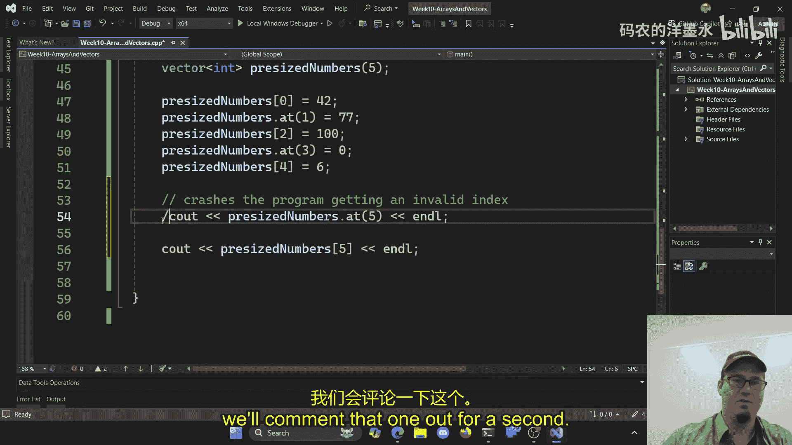

。Still crashes。Whi is nice so we still get the error checking with the at notation or the index notation here。

 which is fine， so we're just going to just abandon here so both ways we still get the checking here。

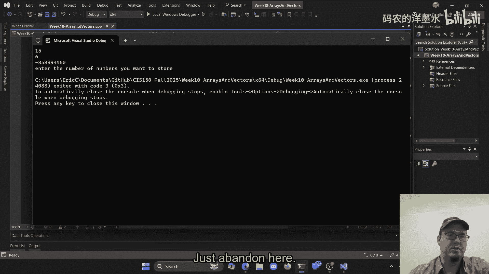

I just like using at I don't know I use this in other languages a lot other sorts of functions here now the other cool thing we told presize numbers it was going be size five here let me come this one out but if you wanted to add more values here vectors are resizable so we can go add more things so I can take my presized numbers here and I can use this pushback function so presize numbers do pushback hey let's go add a7。

I know I started that size with five values here， but I want to add a sixth value here。

 let's go push it back。Now all of a sudden this one's going to work for us here because we've added something at a fifth index。

 we've added a sixth item here。

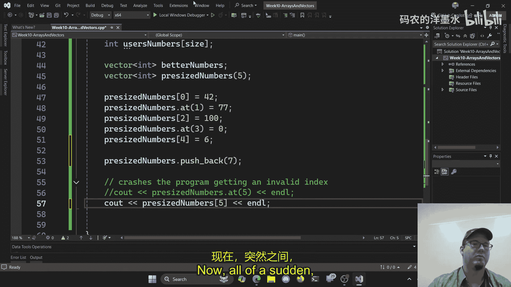

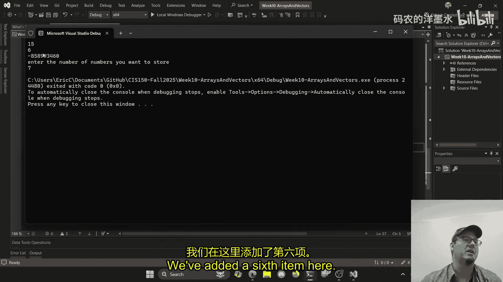

We had at the seven。Right so they're flexible， you can size them here and re go and add items。

 you can remove items out of vectors。 Now that one's a little bit trickier。

 It doesn't look like there's a place so these are all the different functions you add a dot you can see all the things you can do you can get at you can get the last item out。

 you can get the first item the beginning so this is actually an iterator we'll get to those later you can see a capacity how large how many numbers we can put in here before it has to resize that's a little bit more complex you can in place。

 you can empty it to clear it out here， you can get the end， you can get the front。

 you can insert something at a given index and say hey。

 I want to put something at index3 and everything else will shift down which is really cool you can get a max size。

 you can resize it here you can get the size of it this is the most important one here I can get the size of the vector so if I want to go get my values out right or get the sum here。

 so let's go right in another function so this is a。

Integer sum of vector here given a vector of type integer， we'll call numbers here。

I don't need to be past the size because the vector knows what size it is so I can use this same notation here。

And instead of size I can say my numbers dot size and now that's a function call so it gets the set of parentheses it's not an attribute and going make more sense in next chapter。

 don't worry too much about it it size needs parentheses as we're actually calling a function here right so I can get the sum of all the values in that vector。

So， it's the sum of。OfAll those values is。And we can take the sum of my vector。

Given my pre size numbers。Yeah。I wanted that come out to be 10070s 177 plus 48 is oh my goodness。

 I don't I'm just going to use my calculator because I'm feeling lazy， sorry。

 42 plus 77 plus 100 Nlock， 42 plus 77 plus 100 plus 6 plus7 should be 232 if we did it right？

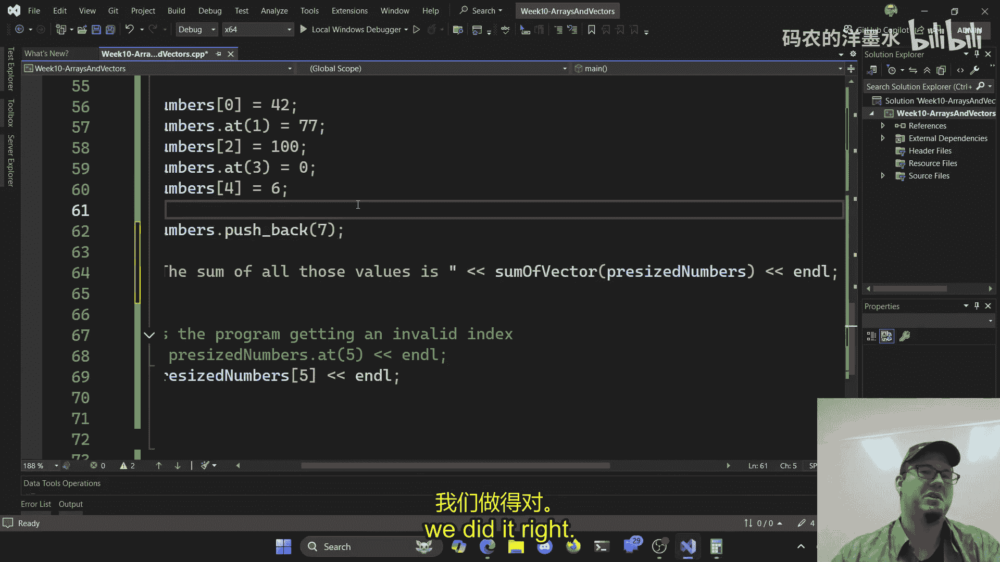

Do you think we'll get 232， let's try it。You probably will。

232 look at that C++ can do math occasionally。

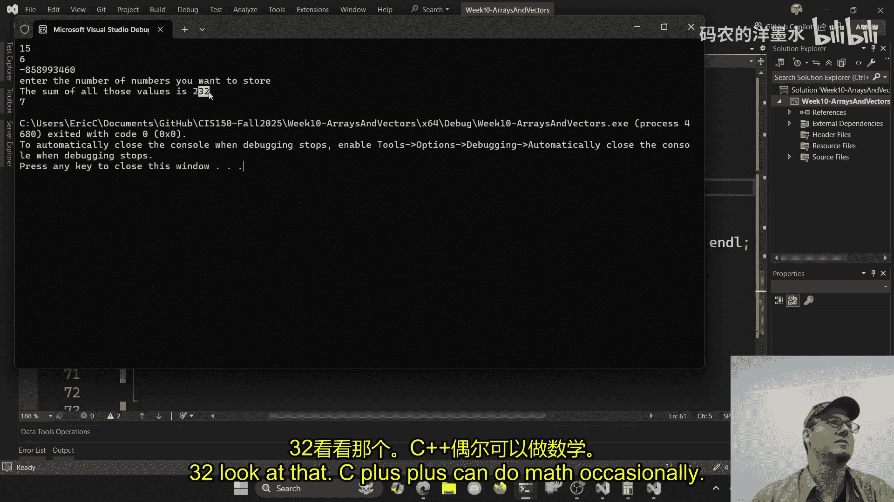

it's halfway decent a math right so you don't need to tell it the size and this is another reason I like vectors they're just easier to use now they're ever so slightly slower because they do all this other stuff that as don't do。

They're a little bit slower。For everything we're going to do this class for next class probably even beyond that。

 no one's gonna notice right but if you start doing something at millions of time scale and you know exactly hey it's always going to be a fixed set of values you can use the array and'll be slightly faster that's the scienceency part of computer science I like the software engineering I like making things go people bo and my computers really fast your computers really fast no one really cares for doing something 10。

000 times if it's microseconds faster。Doesn't matter， right。

 but eventually it might matter when you do something at large scale。

 so just keep that in your back pocket ever so slightly slower。Okay， so that's the basics with。

Our vectors and our arrays， so arrays are fixed size。

 you have to presize them with a constant value vectors are not you can add you can remove we'll get to removing later。

 I don't think we need to do there right now we can save some stuff for next time。

 How's my battery doing I've got 20% left It's going to die pretty soon that has not lasted very long。

Really should have checked my backpack I thought it was packed already。

 but I did a bad job with that。

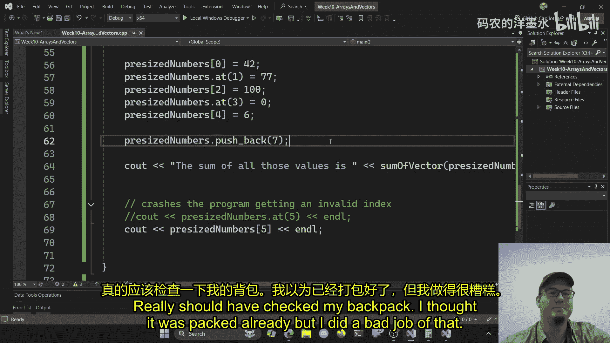

So let's take a look inside bookss real quick。Let's see how we're doing on all their chapters here。

 So our rays and vectors。Not a super long chapter。 I mean， it's got 15 pieces here， but。

Not too much here， so。Vectors， itite。Iteration going over item by item by item。

 the other cool thing we don't even need to use this notation either we don't have to get stuff out by index right we can use that enhanced for loop so instead of doing it this way here we'll leave this commented out for a second。

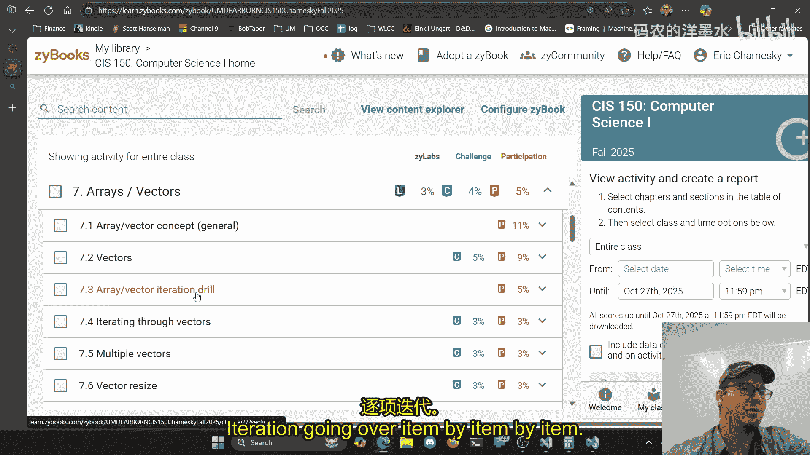

We can do the quick little shortcut and say， hey， I want four int number polling numbers。

 take my sum。Plus equals the number。Right。If you're not setting values。

 if the only thing you're doing is reading， you can use this little enhanced for loop。

 so really this is like a read don't label loop。Okay。

 if I change number it's not going to change it inside the vector so I don't want to be doing any sort of arithmetic and expecting number to stay changed if you want to change the values。

 yes， we want to use the index notation where I can assign to a given index I think we'll have some more practice with that later but both ways are nice and again this is just super fast and easy to type。

And I like that。 makes my life a little easier here to just get the sun return， oops， I did not。

There's a weird place for that comment supposed to be there， okay。That's why， excuse me。All right。

 so we can return the sum and life is good。I with this one here。Let's see。

 so initializing if you know the values here， so we just said， hey。

 this was a better number if we didn' ever used it here。

 you could just push back and push back and push back。you can ask the user， hey。

 let's add some numbers， add some numbers， add some numbers。 Just keep on going until you're done。

Because you can keep resizing your vectors that you can just keep adding stuff is great for that one here。

If we know what the values are going to be here， so let's say hey， I want it to equal1， two，3，4，5。

 I can use Hurley braces。Which is the weird thing here， but sure。

If I know what the values are ahead of time， I don't need to do it one line， two line， three line。

 four line， five lines at every index here so you can use the initializer here。Isitializer。

Take this faster I going by index。Okay， so this is we'll give you sets this up sets up with spaces for five values where this one just says here's the value of your values here Now I think we can do that with our array notation as well so if we did that a size we'll just go back to three or something here equals one。

 two and three or I don't know 20。30 and 40。Okay， the notation。

 this initializer works for both for arrays and for vectors here。

It's okay if you know what your values are。Again it's not just an advantage of vectors。

 you can initialize this way so you don't have to do it one index at a time。

But you've got that choice right both ways will work they're going to do the same thing for you here so we can initialize them the same way。

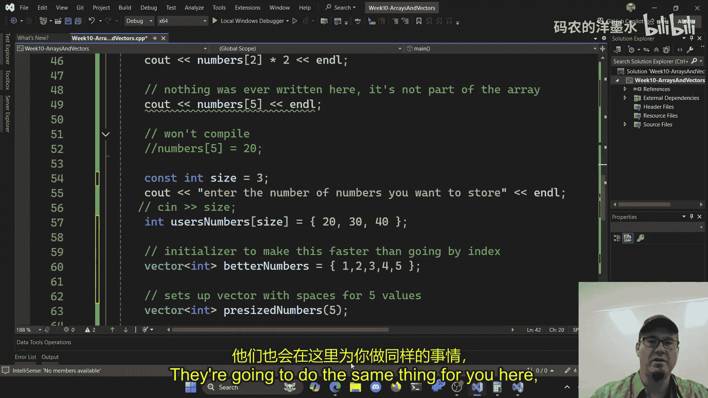

We can iterate through vectors， have multiple vectors， resizing vectors。

Hop back and get the back will give me the last values here using loops compare vectors here。

Swapping， reversing a vector。Two dimensional arrays and vectors is really fun here。

 we'll get to those in a while。Character arrays and C strings are the older style。

 how we used to have to manage strings right now we have a string variable in the precursor to C++ we had C which was not object oriented。

 you had a C string which is just a character array。So I had an array of characters。

 maybe we said a string is really like an array of characters a collection of characters。And see。

 they actually are actual array types here and it does some funny things there we've got a bunch of sea string library functions we can use if we have to deal with sea strings。

Hopefully you never have to because they're miserable but that's okay we've got some options here and we got a couple labs to work through so we got quite a bit of time which is nice to work through some of these but my battery's about to die here y at 16% now it's going to cut off soon。

've seen a little bit I think we're in pretty good shape why don't we plan to meet back up Wednesday we'll get through some more of this year we can talk about our next project on Wednesday and I'll add my power record for sure then that sound good all right I wasn't going to go over the midterm questions because they thought they were pretty basic if you'd like to see them I'd be happy to go over with you。

Can definitely do that I can probably do it on the other computer here if anyone wants to see any of those and then the solution to project two I was due this morning right we can go over that on Wednesday as well I don't thinkll be able to get that done in the next couple minutes here before the battery dies and hopefully that went pretty well with Hman for everybody they had our functions again part of the goal was just here's using functions passing things around with functions a lot so we don't just have a bunch of stuff all chunked in main one of the nice things with functions is it can make main nice and small and we can do our functional decomposition know you're going to throw that around at your Halloween party it'll be really fun you'll sound really smart people give you funny looks here and we can make a big problem smaller and solve them much more easily hear one function at a time All right sound good I'll see you folks Wednesday then。

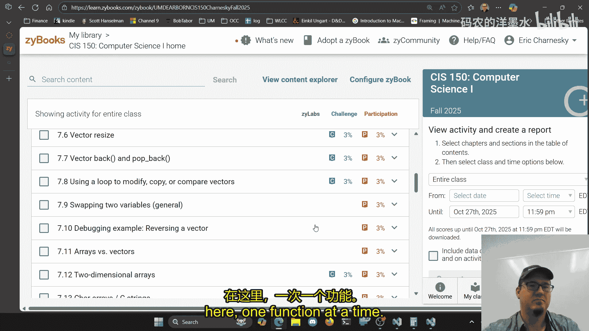

对。

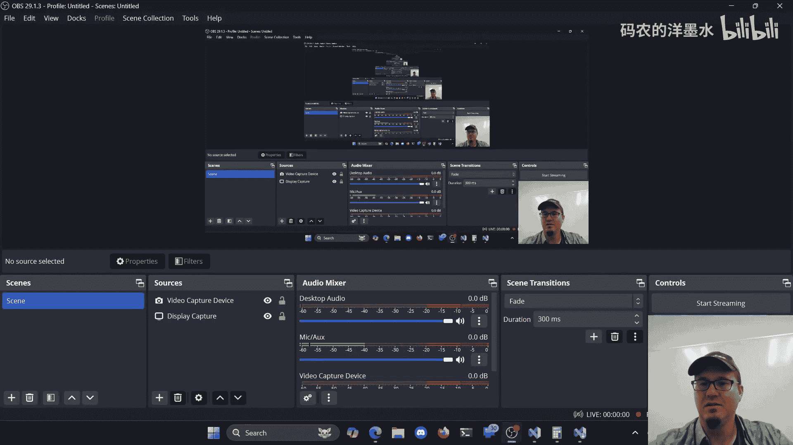