# 【全集】密歇根大学 C++编程 中英字幕 1080P p10 Lecture 10 - 数组与向量 part2 -BV1TsAZzAEHX_p10-

Alrighty， so let's start with project two here， I think I should have been to be able to copy this and we'll see how well that works and we can write the functions for it。

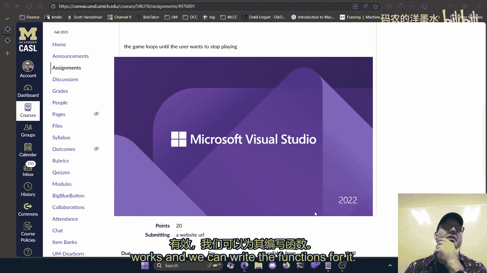

是。S。They make a new project。To。All right， and that was essentially the main loops。

 I'll drop that here in Maine。嗯。Yeah。Standard string letters guest。String for the hidden word。

And here。😔，That's our example gal is we're going to move。对。Good word。Okay， think。

The other ones are probably okay here， let's try it。

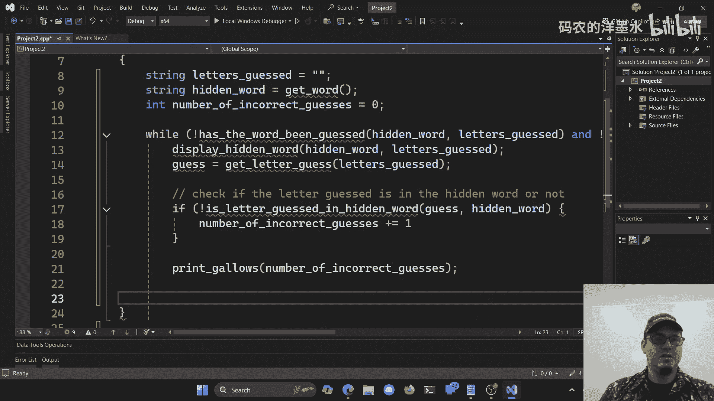

We always got to get the word right to give you the。

Way to get a hidden word I didn't give you that did I？Okay， so we have to go get word from the user。

 making sure it's four characters lo。

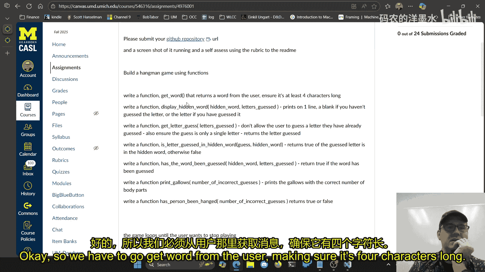

Okay， so we can go。Let's go。 add a。This doesn't have any function signatures， really。😔，Re definition。

 extract function。All right， we can drive it ourselves then that's fine， so string get word。

So we need a string for the word。他。And we can ask them enter a word。I at least four characters long。

Yeah。And we can see in our word and then we need to start checking right we'll check the length of it so while。

Sa it weren't。Size is less than four。Keep on asking again。

 I guess we could just start it here as like nothing。

And that's an enter word and not even tell them invalid。

 just write at something less than four and we're done， we be able to return the word。Great。

Should just check for me。 right Strings can tell me what size they are。 Strings are pretty handy。

 Okay， so please feel get a word out。 And now has the word been guessed given the hidden word and the letters guessed。

 this one's a little bit trickier here。 So this one's a booleing we're gonna this is a true or false。

 Yes we' guessed or're not。 has the word been guessed。Given a string for the hidden word。

And a string for the letters guest。Oh， I'm sorry， I'm doing the Python formatting here with all my underscores。

Probably use the for cases here， Campbel casing， that's a little more。It doesn't matter yes。

 I'll leave it otherwise I got to read a bunch things。Yeah。

 it's just a convention and there's tools that will automatically fix up for you here。

 it's just something you can pay attention to。So。I know that the word has been guessed if every letter in the hidden word has been guessed。

 so what I want to do is Im going to loop through the hidden word。

 take every letter out of it and see if it's been guessed or not if that letter hasn't been guessed I know right away you haven't guessed the hidden word excuse me so we can do for char letter in my hidden word。

And then we loop again， so for the char guests in the letters guest。If the letter。

So if the letter equals the guess。Then that letter was found right so what we need to do is that the start of each one of these we need to assume it hasn't been found right so matches starts off as false here and if we find a match。

 then I can set matches true。If I've gone through every letter in the letters that you've guessed and I didn't find a match so if the matches is false。

 or you could say if not matches whichever way you like here。That's probably a little more eniomatic。

Be can return false。We didn't find a match doing matches。Well。

 so this is only going at the first letter， so I don't want to return true that the entire thing matched if just the first letter matched。

 so I need to check for every letter， if it didn't match。

 then I know it's false here because if I'm only returning at the very end。

 maybe just the last letter matched。So I need to make sure I'm checked every time for every letter in my hidden word that I've got a chance to return false and then if I haven't returned。

A false， by that time。I can just assume I'm going to return true。If I get down to here。

 I didn't return false。 Everything must imagined。 And that's sort of my default case here。 Excuse me。

So they should check every one of my letters in the hidden word if it's any one of the letters that I've guessed here。

 that match to true， you could break your loop here。

 some people like a break't you've saved three extra string checks or character checks。

 no one really is going to care and I just don't like breaks so yeah it's a little faster to break here。

Like it's slightly faster but I dislike them that much I just won't use it that's okay i'll be i'll be a little slower actually has's the word been guess right？

And has the person been hanged， not has the person been hanged， so this guns another booleying。

 given the number of guesses。Now this one was pretty easy here we're just going to return my number of guesses is less than or equal to five。

So yeah so greater than or equal to six right so if it's six or more you shouldn't be able to get past six。

 but just in case right yes true you've been hanged game over what a lovely children's game。Okay。

 so we've got that one， give our number of incorrect guesses， so to display the hidden word。😊。

So this one's just avoid void function here。 It's just going to show something。

 so it's going to show the。Hitden word and the letters guessed。Letters。

So it's a similar idea to our loop of did we match it here。

 so we're going to go through each one of these， but we're not going to return something at the end here。

Right？So at the end of whether or not we found a match here。

 I'm either going to print the letter or an underscore like a blank。so if you've guessed it。

 I can print it if you haven't guessed it， I'm going to print a blank so at the end of that。

 so if my matches。We can see out。The letter。Probably a space here。

 I mean it's a little easier to see if you use spaces otherwise。Wow。

 my ss are not working very well right now， we'll see out the underscore。

 the blank and a space I just keep them a little bit separated and I don't want in the endline。

Until I get to the very end， I've done all open them。对。Here。

ve I either printed the letter in a space or a blank in a space。

 and after I've done all of my letters in the hidden word， I'll printed it my blank。系。Co。Okay。

 and then we need a whatever。😊，The guess here is your get your letters guessed。

And that's probably just a char then， right？And then specify， sorry forget get letters guest。

 get letter guests。So we can have a char function get letter guest。

 and then we need to make sure we're not repeating any of our other letters here as we go。

So we probably need to be adding the guests to the letters guest at some point here。

 you could if we passed to by reference。We could modify it if we didn't pass it by reference。

 then we'd have to go do another step of adding the guess to it here， either one's okay。

Should we pass on my reference to practice that because that's fun。

I guess sound like it looks like a lot of fun， right？Very exciting。

 If I can pass the reference to my string， I can modify it here， right。

 So we'll go do that because I we don't have to change the original loop here。

 So to get the letter guest， we need to ask for letter and if it's。😊。

In the list of letters we've already guessed。Tone， you already guessed it。so yeah a letter to guess。

We need a string for the guests or a char for the guests right see to guess now if we're just using a single char you can't even enter more than one letter if you used a string we should have to make sure hey the string size is only one right but by using a char I don't have to do that because they can only ever hold one character anyway。

So it's just a little shortcut for me that if they type in more than one letter。

 my loop's going to be a little funny because C will just read the next one without waiting for a prompt because like if you type in five letters and hit enter。

It's going to read the first one and then it'll throw it away， read the next one， throw it away。

 read the next right if you have repeats so the prompting it's a little weird doing it this way again at this point hopefully we can assume people will do probably the right thing it doesn't happen in the real world but we're just going to assume people will do the right thing for now。

All right， so we got the guess and then we want to check if that guess is in my letters's guest already。

Because then I'll have to do it again。 So I'll say， I don't know Google for already guessed。

It's false and then for Char letter and my letters guest。Letters fist。Yeah。

If the letter is equal to the guess， my already guest is true。And as long as this is true。

 I want to keep on doing this thing here， right？Kind of give them a message， I guess。

 so maybe we see out here。I've already guessed that letter。An then line。

So we could even tell them about the start what letters they've already guessed in case they forgot。

 some people forget when they play hangman and they're bad at it like I am， this is probably okay。

 so we'll spit out the message here。But then all of this then can go in a loop while already guessed。

Is true？Yes， that's a little bit ugly， but we'll try it here so we'll set it to true just to make my loop run because I don't like do loops already guessed。

That's a little silly here， but that's okay and then inside my loop I'll set it to false。

Unless I do see a match here。That way it runs once， that's a lot of work to make it run once。

 so we do a do loop， I hate do loops， but that's fine we can do a do loop。All right， well do do。清本。

'reJust so obnoxious。Bing for already guessed and then we say while already guessed。Gsed。Oh。

 I still have to declare it out here though I don't have to set the value， I just have to declare it。

Semicolon。St loops so dumb right and then we can return the guess and at some point we want to good。

Everything has to be out here then。That's annoying。That's right， I need that。

Return the guest and then we need to add that guest to these letters guess and we'll take my letters guest string and we'll add the guest to it before we return。

I want to take the string you gave me and add that gas in so I don't have to do it down here。

 A little weird， but sure。 Again， we're writing the coat。 It's up to us。Okay。

Then is the letter guest in the hidden work， this is not a very helpful comment， is it？

So ideally the function tells you what it's doing I don't know why put that there。

 I'm sorry I'm offended right so this is a true or false， right？

Given a char for the guess and a string for the hidden word。Now this one's pretty quick， right。

 we're just going to loop through our。Letters in the hidden word。

 let's go copy that and if my letter is equal to the guess， we can return true。At the end of that。

 if we didn't return true， we're going to return false。That' was just checking a single letter。

 right？But that ones not too bad we could actually use this in these other places where we're doing the other checks。

 right？If we want it。I don't think it saves as much time。

 but that's okay right because we're doing that same idea is this letter here or not？Okay。

 we got that one and。😊，Oh， I was missing a parenthesy there shooting okay。

Number of my correct guesses goes up by one and then we have to print the gallows right so that's another void function print the gallows given an int number of incorrect guesses。

Now， lots of different ways to do this one here。

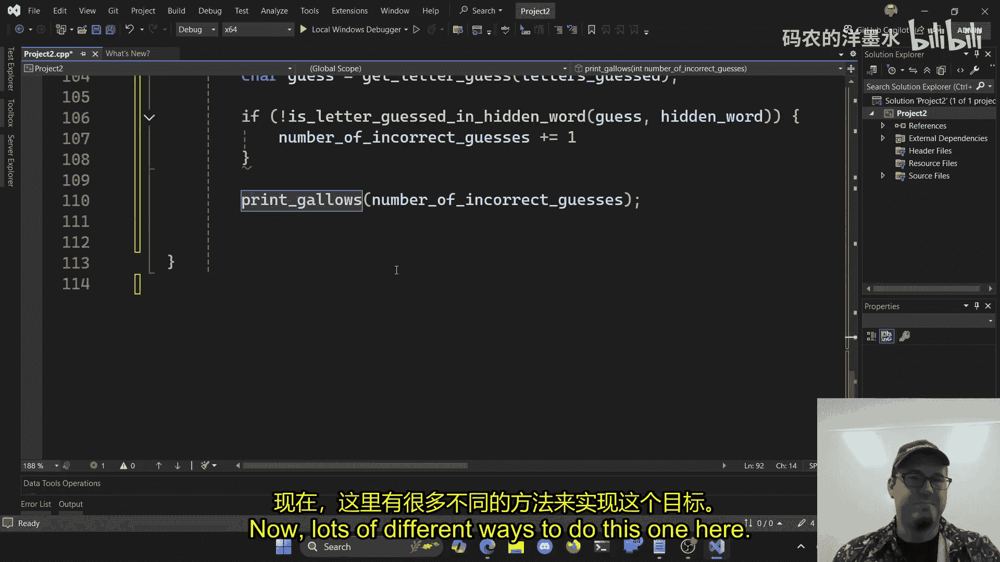

Another semicolon， sorry。Let me go back to grab my sample gallows here。 This is the full one。

 the lazy approach is we just have a bunch of these here so we can say， hey。

 if my number of incorrect guesses。

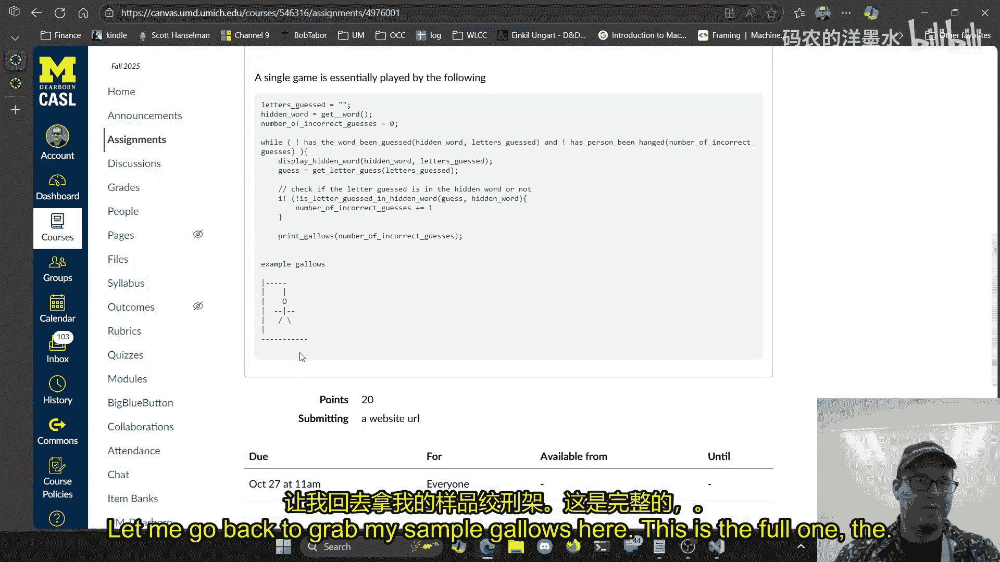

Its zero。We're going to see out。This right， but with nobody， so we just have。Okay。That right。

 that one， and then we can add either at the start of the end here。

 either way you want them to do them here is fine。Right。

 and we just keep on adding in all of these here， but we need our end lines， that's right。

 plus an end line。嗯。And line， plus these。There we go and then。That's the one。

Now the formatting is a little awkward here， so I'm going to like have those over so they're not in the way of my gallows。

 I don't know if that makes any sense or not but。ItM look a little bit nicer here。Os， quote。W。W。嗯。

All right， having a head doesn't work here， that's fine。嗯。Oh， that doesn't work， forgot。

 really want that to work and then probably just an endline after that one。Oh my goodness。

 what I do quick dance up there。Yeah。No， and moved it。All right， I tried getting formatted nice。

 it doesn't want to。That's ugly， right， but that's zero， right？是。

Else if my number of incorrect essays is one。Yeah。Then we add the head here。Right， otherwise too。

You could do a bunch of eel inside of each one of these prints here。I' that feels complicated to me。

 I don't know if this is actually easier or not to than what do we have the body。And then three。

We had an arm。So do we have an arm。I forget what I put there， yeah。

 two arms like that right or two two dashes for an arm。And at four。It's two more。And then five。

 we got a foot or a leg。Slash， right， and then six。And the other one。

Now you have to do doubles because of the backslash right that's the escape character。

 it looks a little funny， but it's not the end of the world and really。That's it。

 as all this one does here。I should print the yellowlos think I is missing a curly brace is I missing。

There we go。All right， without having to change much。

 I think I fixed a semicolon and a parenthesy and a curly race， do we try it， think it'll go。

I'll be amazed if it works the first time。Bless you。

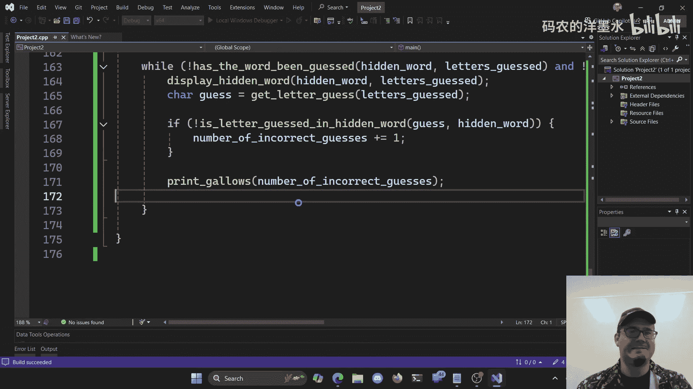

So dog。Lasts my four characters long， Okay， well， that seems to be going okay so far， tackle。Right。

 what letter should we guess？嗯异议。Very found the knee。好。No。行。Yeah， look at that。

 the principal of them。 So， what's next。See， see， no。Oh no。嗯。好。Lost a couple， but again。

 the way it does the inputs here， it just keeps on eating them。All right， one other letter。诶诶。No， no。

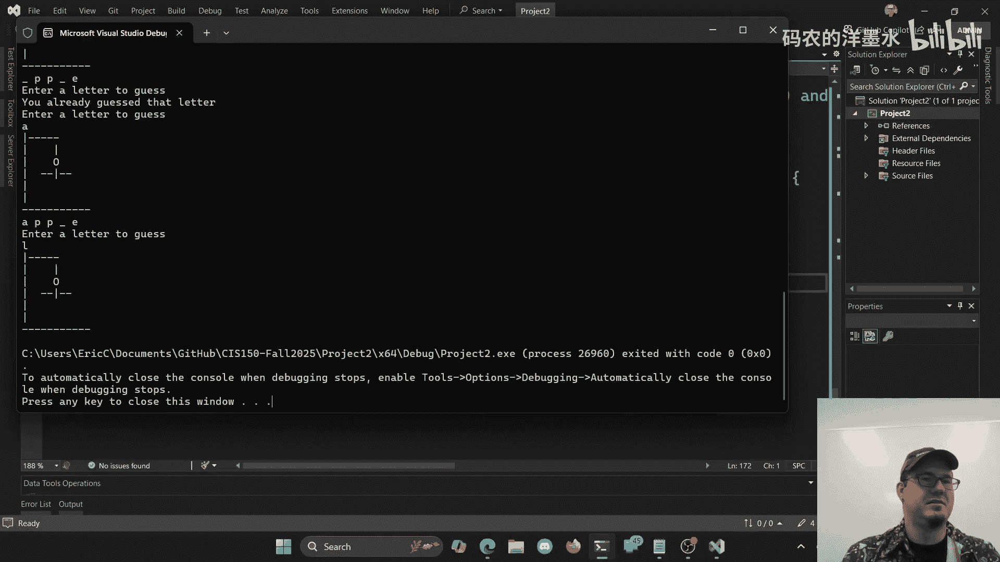

I guess maybe we want to print the word at the end here that's kind of okay。So at the end。

 we can see out。I say in word。AnUn line or say I don't know the word was。Was。

I mean you just entered it so it's not very exciting to tell you at the end， but sure， why not？Yep。

 that's hang， man。When okay for you？And just a way to use a bunch of functions。

And not use global variables and things and try and keep them all around here and just breaks it down relatively nicely right made is pretty small。

 it's a nice nice little goal there works out pretty well。All right。

 let me go commit that before I forget。Excuse me， Oh yeah， good project too。All right， sweet。And。

Should talk about the next project？Could that one first？We'll do that let's go。

 I got a get a new classroom good humblling for you。

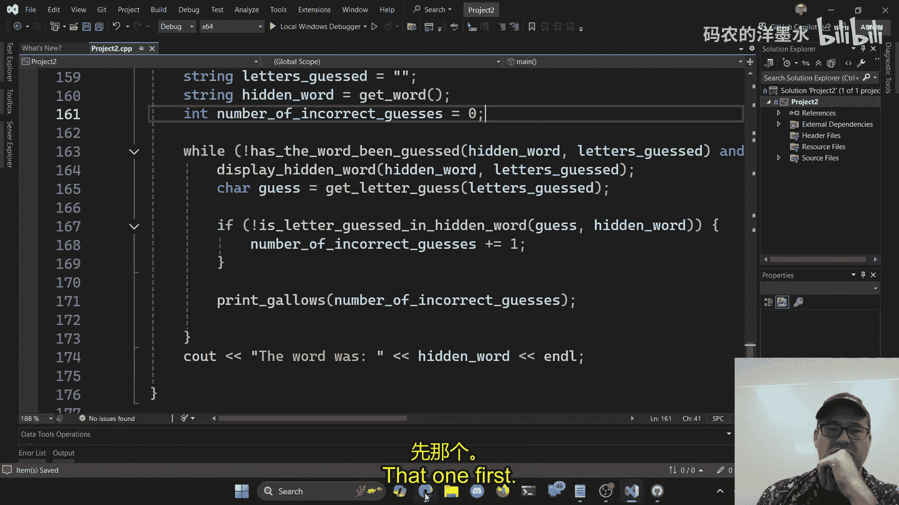

We're getting good at repositories now， right？Practice， we're getting there。We。Plus templates。

All right， cool。No， shoot， not public。 A I in fact。We have the new private repositator。

 that's a weird default。Should and private。All right cool。This will be our last individual project。

 you're very exciting。Pect three， so two weeks from today then puts us out to the 12th at 11 a。

And how many points was the last one I forgot right， so we should do 30 for this one？All right。

 and I've got it stolen from here or reused from here so we're going to build essentially a ticket master program。

But there's no website。Because all we have is console input right eventually you can do the website stuff for now so we're going to be able to do great shows and sell tickets for shows sugar' is a little high right now。

Yes， unfortunately， anyone else I。I didn't take in some with my breakfast， that was smart。2。

So we're going to be able to do three different things。

 so this program runs in a loop with the menu we've got three options， so one is to add a show。

So to add a show， they need to tell me the name of the show and what we're going to do is we're going to make a file using that show's name so hey。

 if you want to sell tickets for the AIS Tourer， we'll make a file called AISTer if the file already exists。

 tell them it already exists and go back。Because we already have it we have already sold tickets for it we don't want to blow it away and mess anything up here we'll ask how many the number of tickets available for the show we're not doing like particular seats we just have total number of tickets like hey there's 500 tickets great so now you have ticket one through 50012345 right we're going to write that X number of blank tickets to the file with a ticket number a blank for the name and a zero for a confirmation codes we're setting up a file with 500 empty seats essentially。

😊，So option two then says， okay， let's sell tickets for a show。

So you ask enter the show name if the file doesn't exist， Helen it doesn't exist right， Oh。

 I want to sell tickets for errors to。 Okay， great， I found that file here。

 read all the tickets into a vector。We don't want to bother with array vectors are much easier here ticket name or I'm sorry ticket number name confirmation code so we can use。

Three different vectors it's not ideal， but we don't have a better way of doing it till next week so next week no no do vectors for two weeks we'll just do three different vectors a vector for ticket number a vector for name vector for confirmation code and。

At index 7 for the ticket number， index 7 for name and index 7 for confirmation code are all the same ticket。

And you just have to read three different spaces here， it's not great， but'll it'll be okay。

 don't worry too much about it。I will tell the user the highest ticket number they can purchase and ask what ticket they want。

 hey， we've got 500 seats， what ticket number do you want that way they're not just guessing random numbers here and then we'll check and see if the ticket is available。

Quick easy way of doing that is seeing if the confirmation code is0。Right if it's not available。

 tell me think again， oh okay that you can't have that seat try another one if it's available ask for the name for their seat and we're going to generate a random six digit confirmation code between 100。

000 and 9999999 and then we're going to add the name of confirmation code to the appropriate place of the vector and rewrite the file。

😊，we're not going to mess with trying to change files in the middle there's ways to do that it's hard right now and these files are not that large we can just blow it away and rewrite so if I've got all my information here you know if I've got 10。

000 seats I can write 10000 lines pretty quick it's going to go pretty quick for us here so that's the option to selling tickets for a show。

Then option three runs the report Okay it's show time here as people show up here print the show name display all the ticket information I'm sorry get the show name what show you want to run report for display all the ticket information for the ushers to check people in so you show up hey。

 here's name here's my confirmation code we'll see if you match on the list here do you get it right that sort of thing so。

Wting a file。Reading and writing a file and reading a file。Lots of file practice。

 I'm going to use vectors to do it here because they can be x number of tickets。

I don't really care how many tickets are there， I'm just going to read all the tickets out。

It should work pretty well。That make a little bit of sense。All right， so let's do for 30 points here。

 let's turn this on in online with the URL。Yeah。three， let's just do。Option two and option three。😔，嗯。

Great files。Sure right， let's do 10 points， two option two， sell tickets。T0 points and option three。

A report。10 points。Two is obviously the most amount of work here one and three aren't okay I'm going to change it here because now I feel bad go5。

5 and 20 that's just writing this is just reading and here's reading and writing doing all the work here we'll do it that way。

All right。That's our next project so what we've done with files so far， let me go back and open up。

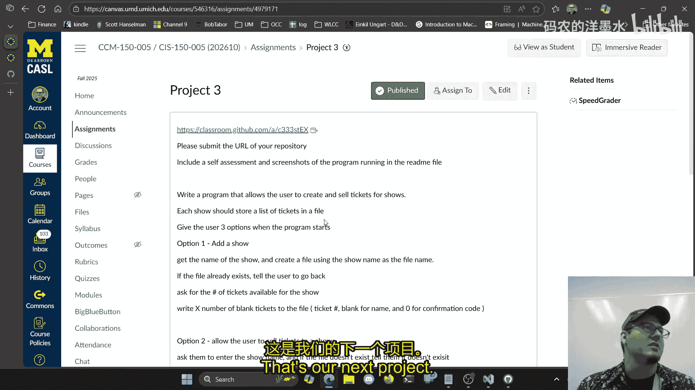

In my recent list。I want to go。That's fine。We did a little bit with files right at our shopping list？

Or is it the sales register， I think it was the shopping list， right？Where we said， hey。

 let's use a delimiter here。I then I just will read out files， read lines until I'm done。So。

If you put the ticket number and a delimiter and a name and a delimiter and a confirmation code。

You can just read line by line by line until run out of lines， works really well。

 that's probably a nice easy approach for that there。So similar idea， what we didn't look at is。

We did check to make sure files opened right， so we did。

 I don't think we actually checked any of these though did we。Thoset the other one， let me go back。

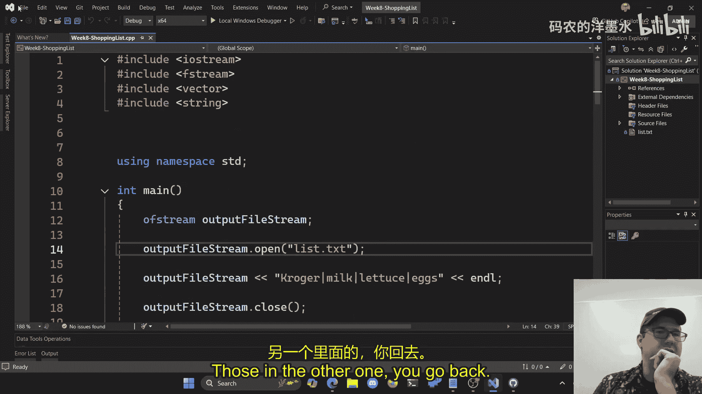

好。Or it' let's open it there。是。Our sales register。😔，Oh， hey， if it opens， we know the file exists。系。

That's a quick little way to check open the file for reading， if it opens， it exists。

 if it doesn't open， we didn't have like it doesn't exist， right and I'll open the file。

So as you're checking to see if the file exists， they're not try and read it。Yeah嗯。

Well so depending on which option we were doing right so for option one if it exists。

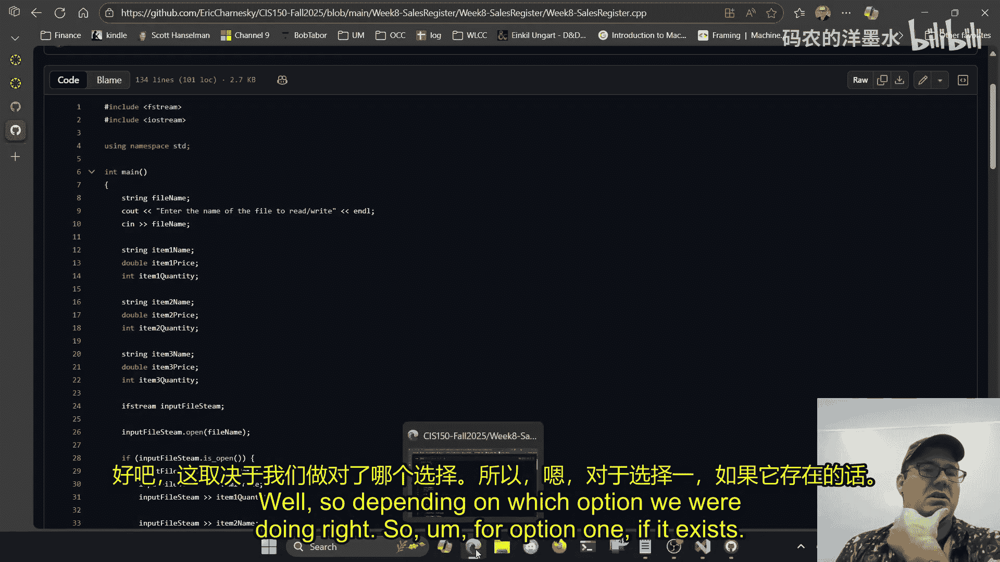

Don't make another file， just tell them hey， you already have a file for that or already have that show。

For two， if it doesn't exist， we can't sell tickets for show that doesn't exist。

 we have to prop it again for another name and then for three， and yet if it doesn't exist。

 we can't run the report。Right。Yeah so this one if it doesn't exist is good。

 then we have to go write it， this is if it doesn't exist it's bad right so it just kind of depends on our situation there right so we've got ways to check if files exist or not right。

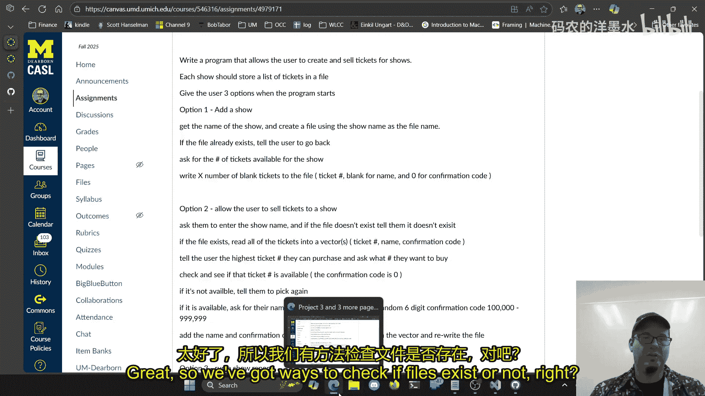

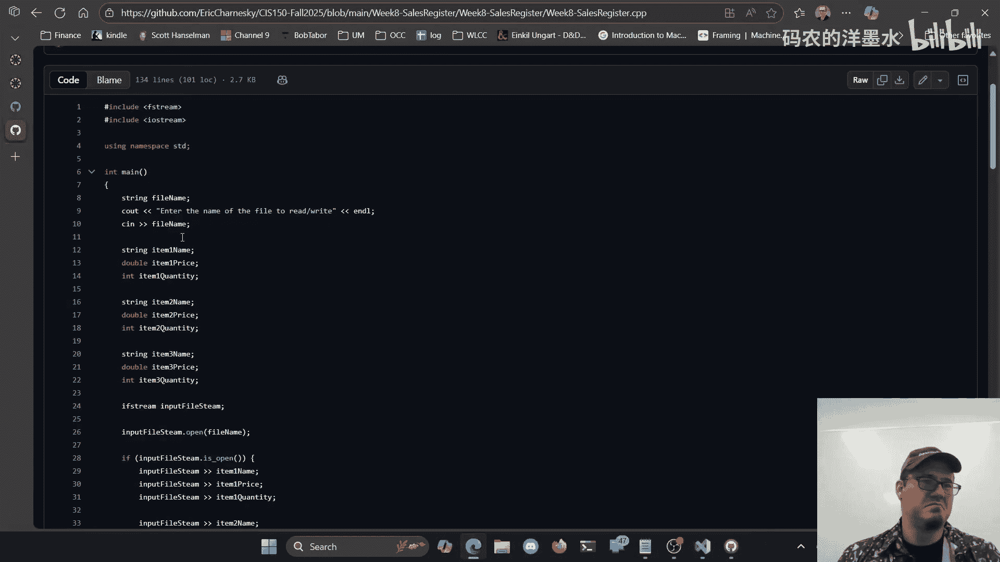

Try and open it pretty quick here for that one。I think that's all you're going to need and then we did our vectors on this one right he said。

 hey， let's open up a vector of string here and we'll go get the line again we're using the delimiter right one of my target I define that oh yeah yeah up here I define that as the thing I was going to look for right finding a character in the string split it into the pieces that we need to or you can use input string streams。

Rather than trying to do substrs。You got you got some choices for how you want to handle those so we can split it apart right but now we're going to read the ticket number be an integer the name might be blank right if there's it's a ticket wasn't sold the name is blank so we're just going to have delimiter delimiter。

There's nothing in between them here and then the confirmation code should always be an integer。

 either zero or the actual six digit number， right？Okay。

 so I think that hopefully we'll go pretty well， we should have everything we need put together our files and our sectors and don't use array。

we don't know the size until we've asked the user so we can't even make an array of that given size it's just not going to work well eventually we'll get to how we can do that we don't get to this chapter though if I recall that's there's some fun silly things we can do in。

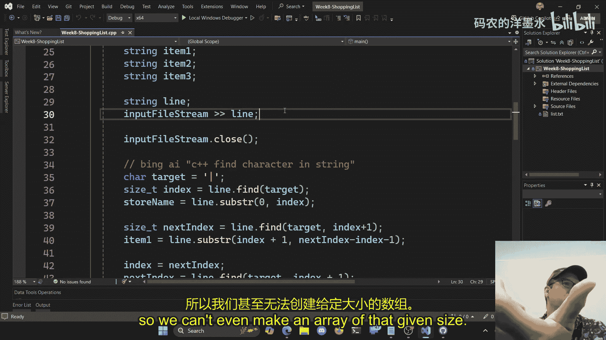

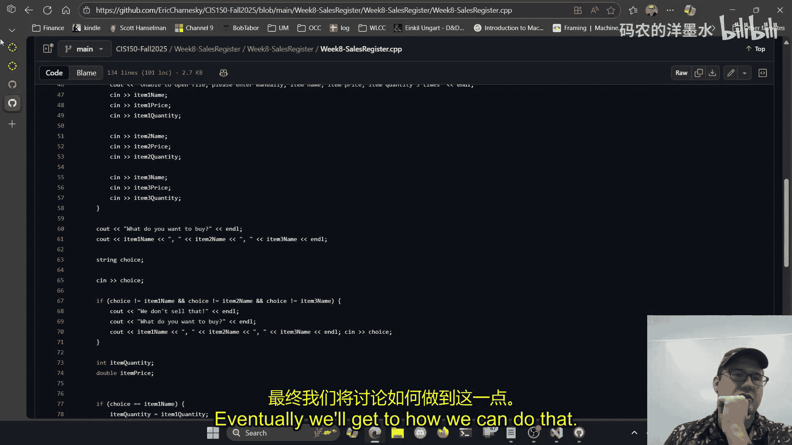

Pointers。Where you can make arrays of dynamic sizes using pointers because they're kind of magical so let's look at arrays and vectors again here so let's look at multiple arrays here because that's something we're going to do here so let me open up。

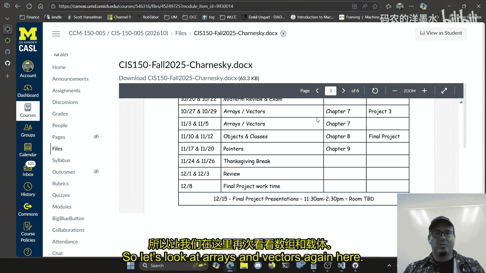

Rraaz and vectors，ll come back here。Okay， so so far this was all。Numbers here。

 So if I wanted to do something silly， like， let's keep track of sports players。

 Let's get their name and their jersey number。Is that that's a thing， right。

 So what'll like a vector of type string here。For names and a vector of type int for numbers are。

Jersey numbers， Jerseyersey numbers。Right。And we can either preize them or not right we don't know how many are going to be here so we'll just ask the user hey enter a player's name and their jers number or something to quit right so we'll get a string for some input see out sort of player name。

Hey， what your name？😔，Wt to stop。And we can see in our input， so we're going to assume right。

 while my input does not equal width here， we can keep on going。Okay， there we go。

So if it's not quit， we're going to take that name we're going to add it to name so name stop push back right to add to the end here will I have the name because it wasn't quit here。

 I'm sorry input input right now we need to get the number so now we've got a white infer number up here。

Jersey。Number。And then we'll ask for their number to。Jersey number。For。that name。

And then we can see in the Jersey number。And then we can take our jers numbers。

And we can push back that jersey number。And then enter player name or quick to stop。

Right and just keep on going so eventually we'll have a list of players that should be the exact same size as the list of Jerseyers numbers so the player in index0 and the Jersey number in index0 match。

So we're just going to use parallel indexes here right so then I can ask them we can look them up right so let's say see out。

En a。Theres the number two lookup。And sure， we'll grab this one here。Now to go find the matching one。

 right， I need to loop through so I can go for an index is zero。

Index is less than now I don't know jers numbers or name either one they should be the same size right index plus plus so we're going to look through every single number and see if we found a match or every item in this vector。

 So if my jers numbers。At the index is equal to the Jersey number you just entered。Then， oh， hey。

 that one belongs to， we'll since see out。That number belongs to we can go back to our names。

At the index。Index here。Right because the index of my player number is the same index as the name index right so I can use the fact that they're parallel to go grab that player's name。

And you just entered all these things it's not very exciting。

 but's let's give it a try see if we can find it and at the end if we haven't found a match right。

 we could tell them we didn't find a match that maybe we have a booleying for。

Match starts off as false。Here and then match equals true。😔，Okay。And it not match。

Yeah didn't find or couldn't find。😔，That's。Jersey over。

just a way to give him a little message at the end in case we screwed up somehow。

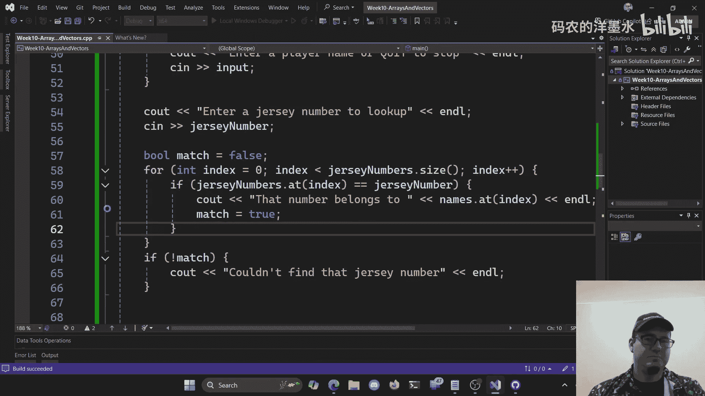

So some playerss name。Hell me out here， I don't use words。Michael Jordan， Michael Jordan。啊。

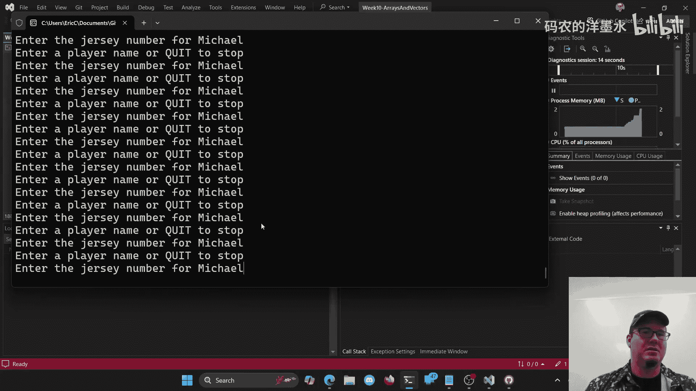

Shoot， I broke it， hang up。Why had to break input， input to not quit？Add it。

 seeing in the jersey number， seeing the input。 Oh。

 because we're mixing and matching strings and ends。 I think that's why here。So。

Should have worked for， the right， string and in， wow。Oh， I had a space。Right。

 we're using Gitline there we go and Gitline given CNN and input。对。呃。好。W strings？So there we go。

 so hopefully Giline will work here。Goodbye。That might have been， we'll see。We can help。

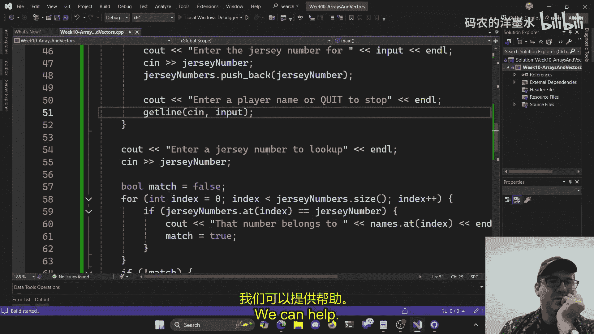

All right。Michael Jordan， there we go， okay， Jersey number， Michael Jordan。23。

 right another point name。我。Mss see。E I。Just I， okay？

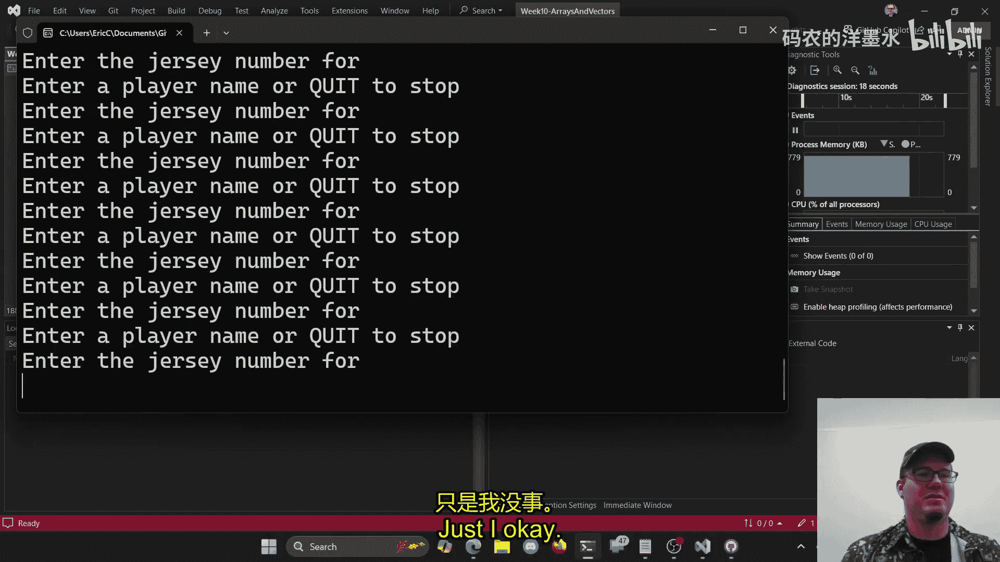

Oh man， he broke it again。C of gotten。Bless you， worked once， I got the next name， it wasn't quit。

And it broke on。Jersing no prompt makes me matching input sold notches here。Let's see why。H。

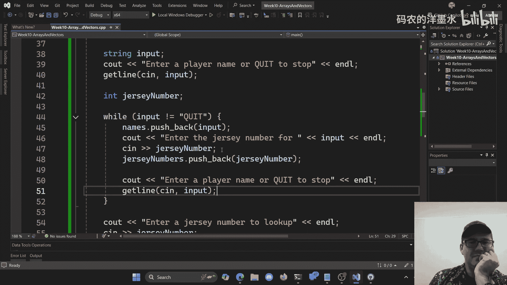

Think this is the problem here。So if we do a gi line。

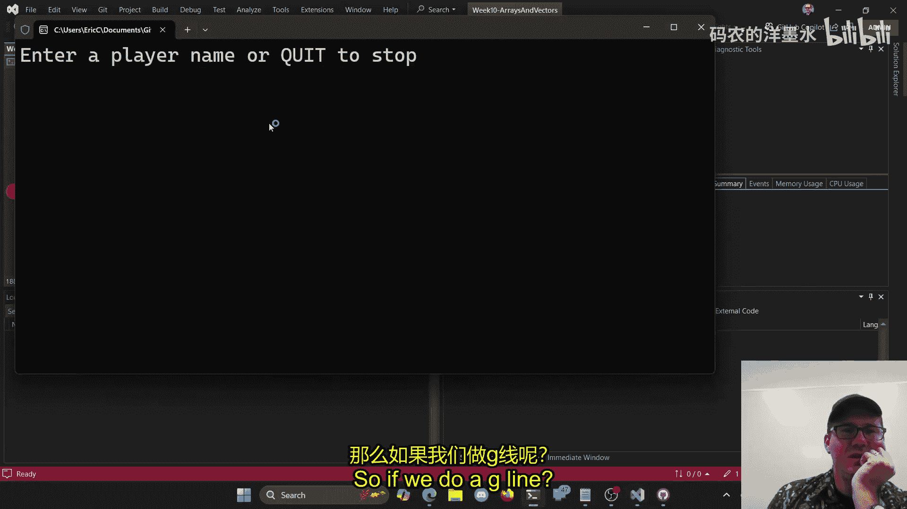

Michael Jordan。And let's step over。And he said 23。Okay， it's got the Jerseyersey number。 That's good。

Wescome Michael Jordan and turn play your name。Oh， so giline。

Grab the enter key that was left after grabbing an integer。Because when you ask for an integer it。

Just grabs the number but the enter key is actually a character there as well。

 so Giline is going to read that that's annoying so let's try it twice。

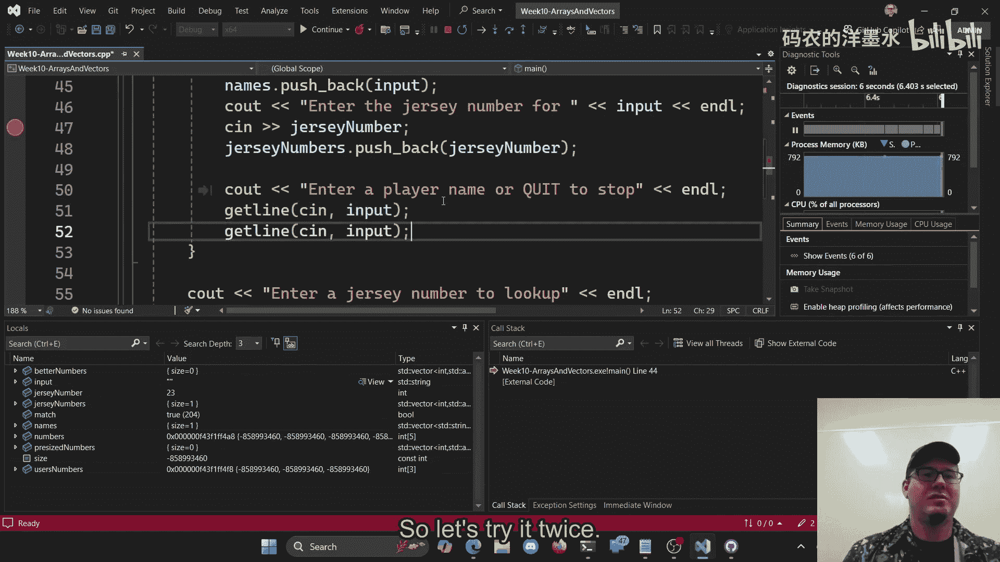

See if that works for us。

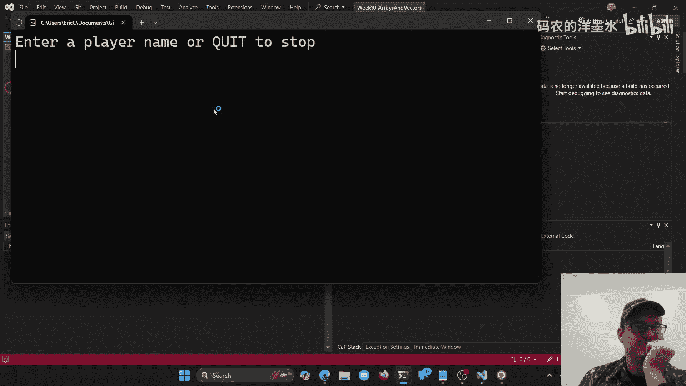

是。Michael Jordan。Let me take a great point here。

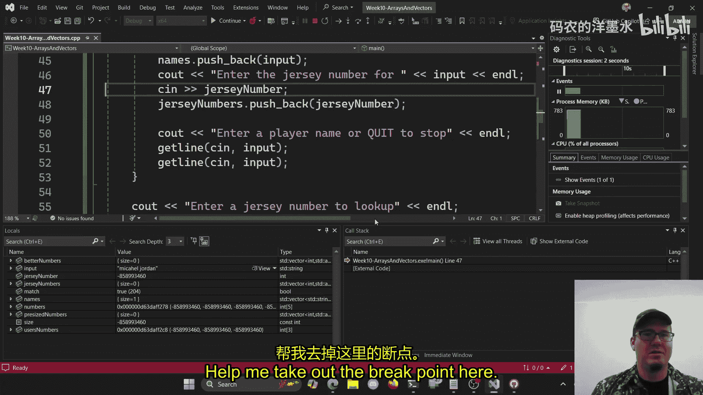

And 23 and messy。What number is messy10。All right， another player name。To Tom' Brady。

numbers 123 sure， all right， and we'll try  quickz all right， so what numbers should we look up？But。

Couldn't find that j number and we didn't enter a seven right now we' got to do it again。😀Yeah。😊。

Like a Jordan。23 messy you set was 10 and Tom Brady 123 and quit all uppercase there Oh oh all right。

 Jersey number to look up， let's look up messy 10 number belong to messy。

So I was able to look it up here so if we keep our vectors in parallel right where the first indexes match and the second indexes match are going this way right match and match and match and match。

 we can just find the one whichever one we're looking up here。

 hey I want your ticket number or I want this one or whatever it happens to be and then find the name and find the confirmation code。

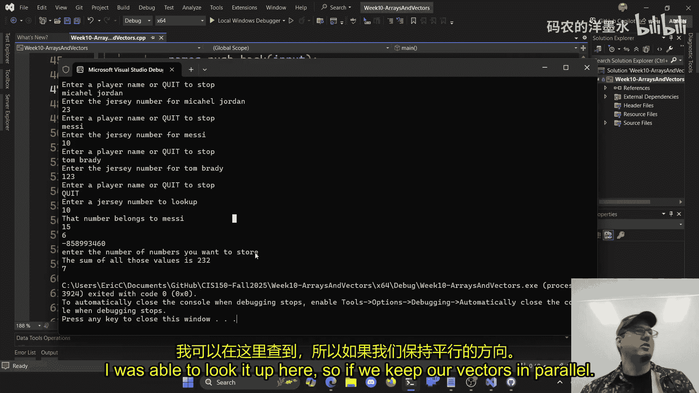

again this is not ideal， we just don't have a good way of working around this yet。

 so two more chapters or the classes chapter will' have a way to work around this year yeah。

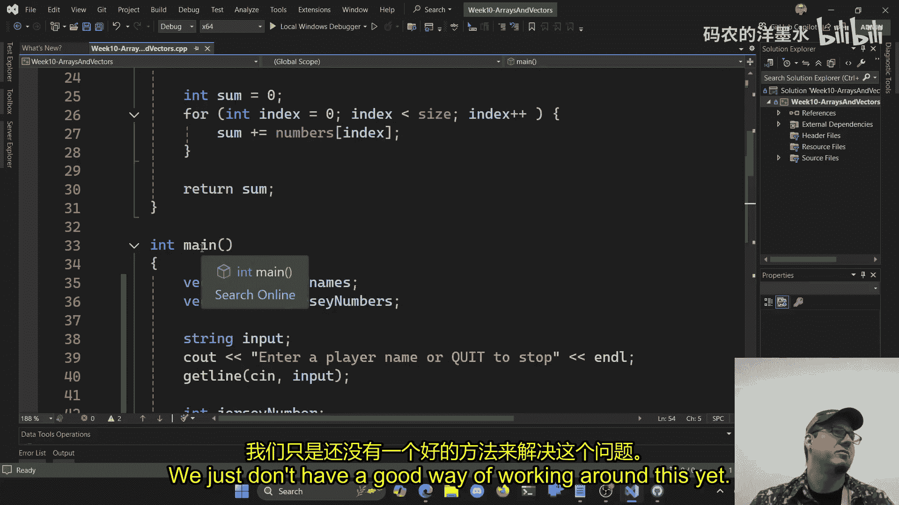

Big size than that so just over。

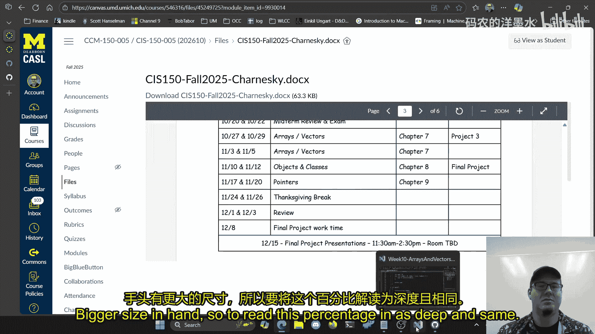

There。感就这个责任去对。So you'd have to like resize it or presize it and say， hey， I want 100 spaces。

 we could。And then you would know there was no name if it was blank。Yeah。

 you could do something like that that could work， you're giving up using a lot of extra space to make it a little easier to use and that's a trade off like think those are valid choices to make sometimes。

Oh。Next morning。All right。

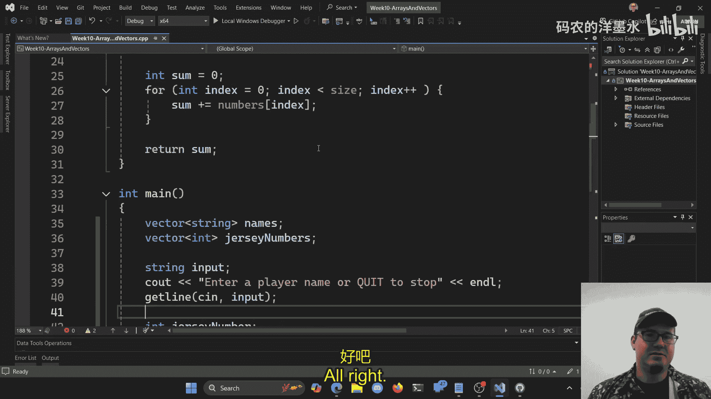

嗯。All right so those are parallel ones。There's more。

 I think we're going to save so you can remove stuff from vectors and add stuff like to remove items from given locations let's wait till next week here I don't think we're going to have I don't think we'll run the whole hour 15 either of these next two days here we'll spend more time practicing。

It' it's a weird concept the first time you look at it so spending time practicing going through the Zoc exercises and spreading this out is going to help again。

 the index notation is a little funky。

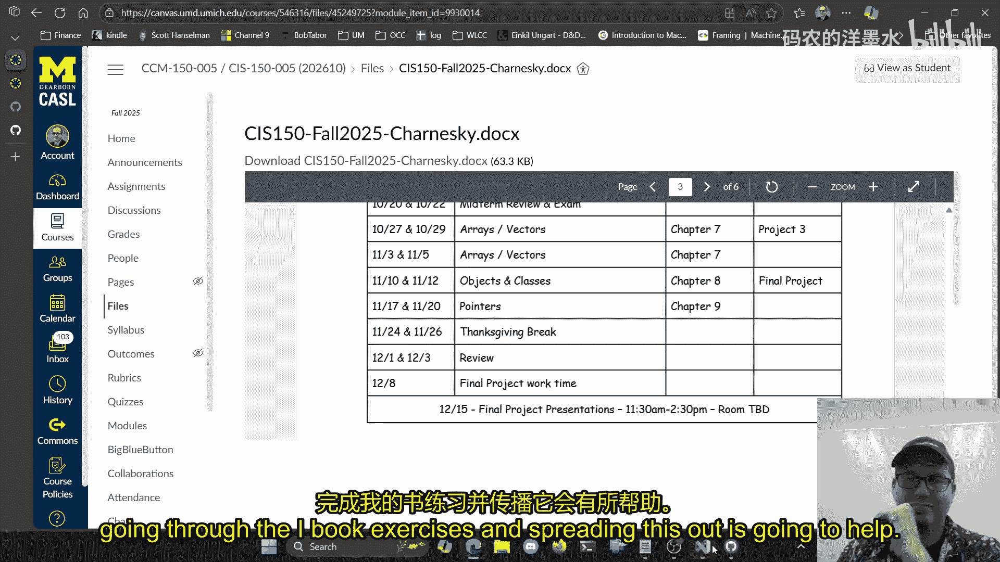

I practicerac that and I was like using the app notation with my vectors。

 you don't have to you can use the same index notation with vectors as well。

 whichever one you prefer is perfectly fine excuse me。Yeah。

 I think that's probably pretty good for today it's not okay。

 we we get started on the project let can go from there okay。😊。

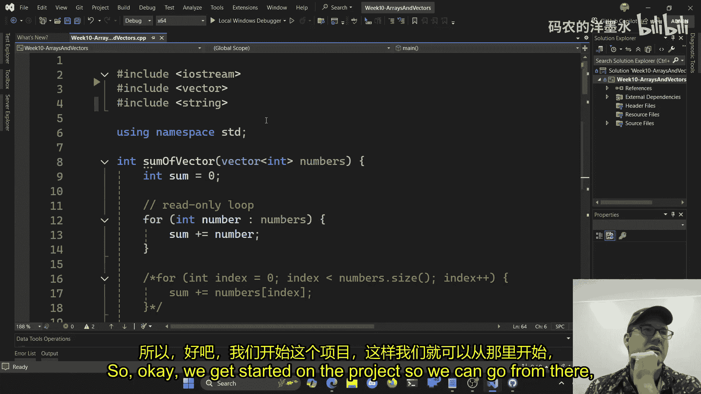

All right， thanks， folks。