# 【全集】密歇根大学 C++编程 中英字幕 1080P p12 Lecture 12 - Streams part1 -BV1TsAZzAEHX_p12-

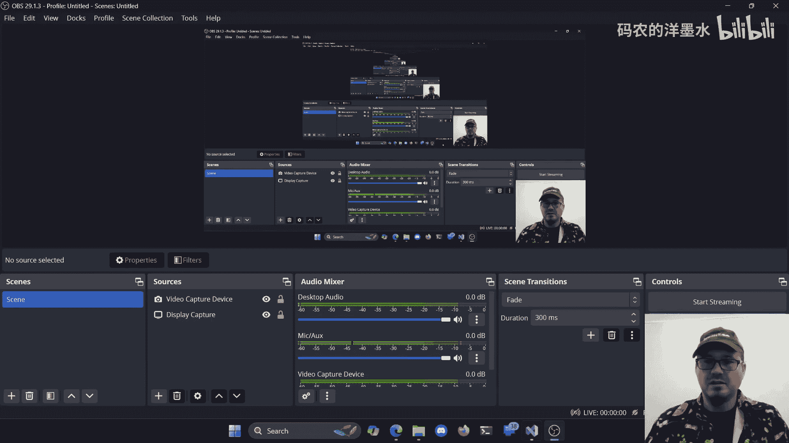

Happy Monday， our friends over in the engineeringing Learning Center are doing some mid term review dates as well。

 Be fun。Check what other 150 classes they're doing。Might be fun， we'll do our own review。

 but always good to get a little bit more review in there。We a favor。

Don't tell everyone that I'm giving you an open open notes test you're welcome to say it。

 but like don't go go broadcasting it everywhere I don't want the other profits to giving you a hard time。

Is that okay， I guess it not a secret， but just for like shouting at at the rooftops of these sessions here。

 it's not that you can't say it just。You know， don't advertise it quite too loudly if you wouldn't mind。

I don't know what they do， but again， I think testing any of you memorized stuff is stupid。

 so I'm not going to do it and I'm allowed to as far as I know they haven't told me I can't yet。

 so we'll just we'll stick them with it that way。All right。

 so a couple dates here check those out should be a lot of fun and we'll do our own。

 but it always good to see whatever everyone else is doing and get in on that review as well so。

All right we've got new stuff this week very exciting we're getting into the streams chapter which doesn't really sound very interesting but it's files so we're finally be able to save information to a file it's as of right now we only really have information when our programs running and then when it stops we have to run it again and we enter new stuff we don't get to keep anything around between runs so getting into streams in chapter6 is going to be awesome so let me put the due date for that。

Yeah， we should have that do by the 20th right， that should be fine。

 that'll keep us on track because streams will be on the midterm。

 so you want to have that done and practiced by the midterm here。

 So let add that as an assignment for chapter6 here。

Don't forget your chapter five stuff is due tonight。So this says hundred points。😔。

And make sure no submission， all right， I think I had chapter four set wrong。

 but then I was able to go change it so if you didn't need to submit anything I did that all automatically sorry about that。

And I think all those scores should be in if I did that right on Wednesday I had to grade your projects sorry for the delay there I'll get those in today I should be get at least zero in today for you get through those and see how they went for you oh the syllabus quiz make sure you take that again you're just agreeing to the academic integrity policy I need this paperwork for when I fail people so please do that ahead of time and then the pretest give those in at some point as well it's just the two questions really and it's just quick it's not even graded so just give it your best shot again don't spend more than like 10。

15 minutes on it it's just a quick little try with that one okay。

And then we got Project two we're working on。That should be I think oh nice one person got it in already so let' should be fun with functions here playing with that again very specific layout for the functions just to practice building in certain ways and going from there so let's jump into streams we'll have a little bit of funds we pull up the chapter here 43% okay not great on the chapter5 we still got today that number probably come up looks like we're averaging a little less than 80% completion that's okay on the labs and stuff but the labs are worth more points than the other stuff the labs tell you how many points each of them are worth so for what it's worth their weighted heavier So if you're gonna focus your time the labs are worth more points on the other things but the other ones you just kind of have to click so they should go pretty quick here I don't know why we don't have 100% for all of them but。

No that's okay that's up to you folks as we get into streams so streams are dealing with input and output so we start up a new project here。

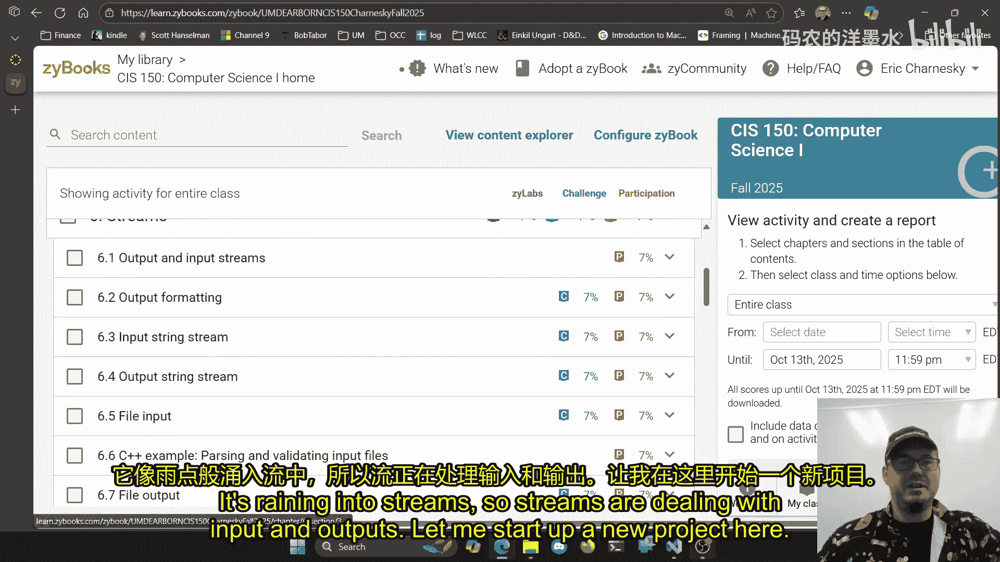

This this week eight， now I believe the way we're counting kind of funny，'s console app eight。

Streams。

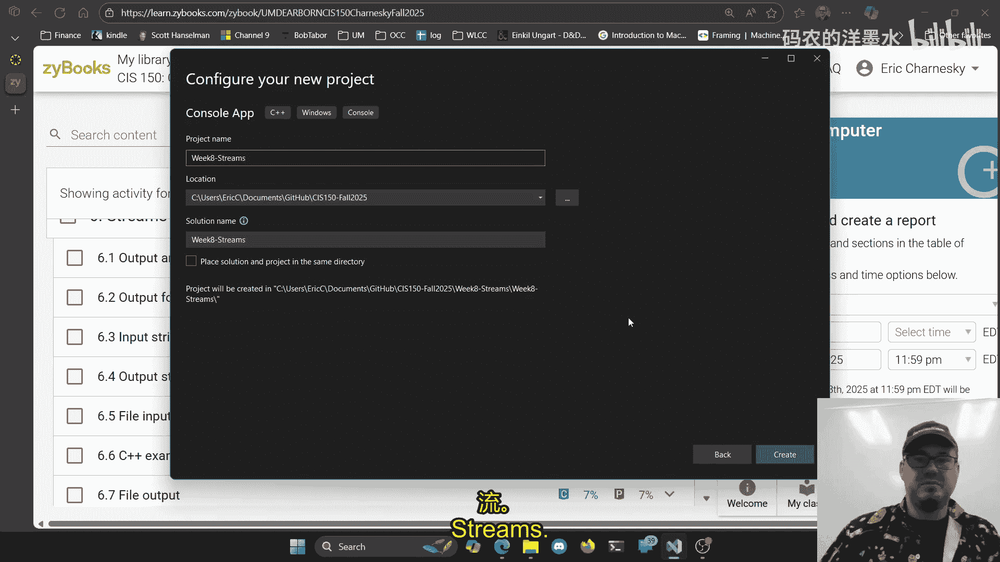

And we've been using streams already， that's the C in and C out we've been using for input streams and output streams。

 that's our standard input and standard output streams here。

 so we have included input output stream as part of the library already。

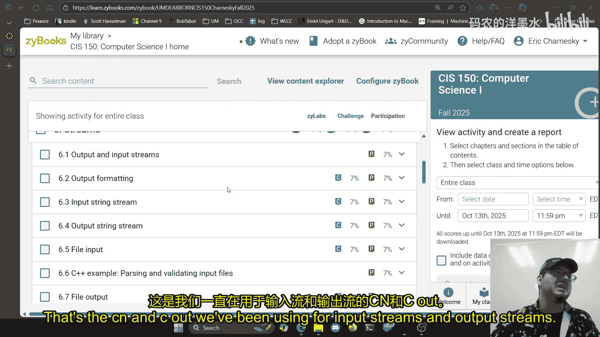

Space standard， but now we're going to look at how we can use those streams to work with files。

 which is really nice because then you get。And the ability to save information between runs to load information prepulate hey I need to keep this information around we can do lots of really fun things with it here so a couple things that we start with here when you output a stream you can do all sorts of formatting this is like if we're doing see out sorts of things here these manipulators。

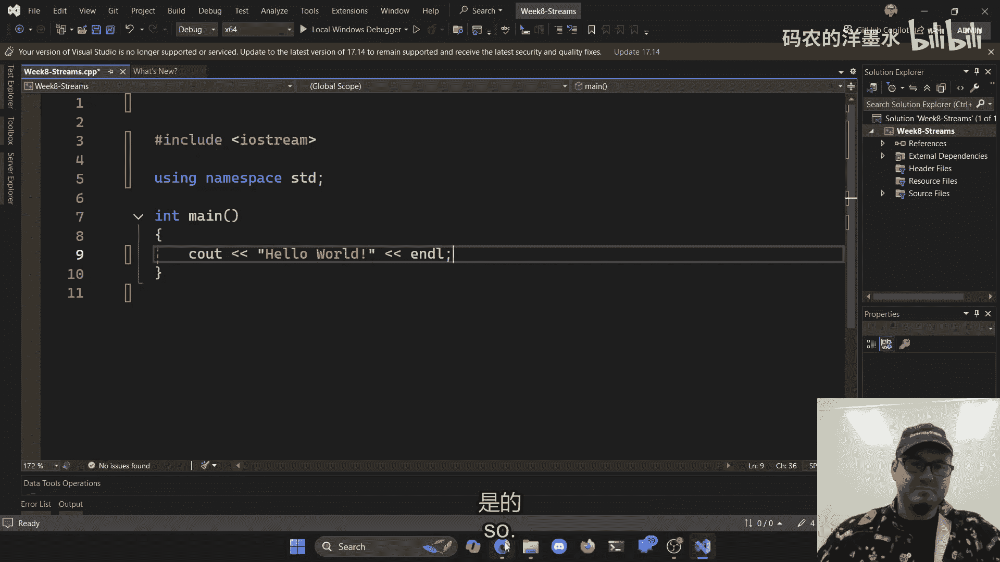

It's all fun and interesting， you can set precision to say， hey I want some number of digits here。

 this is the IONP library manipulation， IO manipulation， you can use scientific notation。

 fixed point notation， we've got different ways we can do our notations here。

I'm never going to ask you to do it I don't particularly care you can show certain points here you can get the scientific if you like this E notation here。

 go for it it's not too hard you can just set them however you want to do them here。

 you can set the width of a given output。So hey， I want at least this number of characters here you can fill with a given set of characters so it'll fill that space with a given number of characters you can left a line or write a line here so it just ways to make your output look pretty it is just nice to know you can do these things go look them up it's not worth remembering here and then we've always used this endline character as well flushing not too important here the way that input and output works is it's really slow compared to processing so what the computer does behind the scenes is it's essentially buffers things which means that it loads it into a temporary space and then every so often it will read and write from that buffer so that way of not every single character saying output and weight output and weight output and wait it's gonna to build up a certain buffer of output and then output it all at once it's gonna to be a lot faster that way so if you want to force it to clear the buffer you can flush the buffer。

For our purposes not that important here you know if you're doing things that you really need very precise input and output timings and things like that you can flush it yourself here most of the time it does it pretty well on its own right so for inputting when we want to input here you can also input off of a string。

So we had the C and the standard input you can use a input string string so if you were given a single string string here you can go get the pieces off of that string and it will grab hey here's the first part here's the second part here's the third part right anytime it sees a space it's gonna break here so give it a single string string you can turn that into a string and break that into chunks here which is kind of fun if you know what your input looks like now git line is useful to get the an entire line of input here so if we ask the user to enter something all on one line instead of doing C we can use this git line which is hey get the entire line of entries so ignore all the spaces wait until they enter the enter key and get the entire line of input here and then turn that into the string here and from there you can do whatever you want with that string sometimes you might turn into a string string or you might just keep all of that so like hey。

 I want to enter your name here so if we see out into your name。

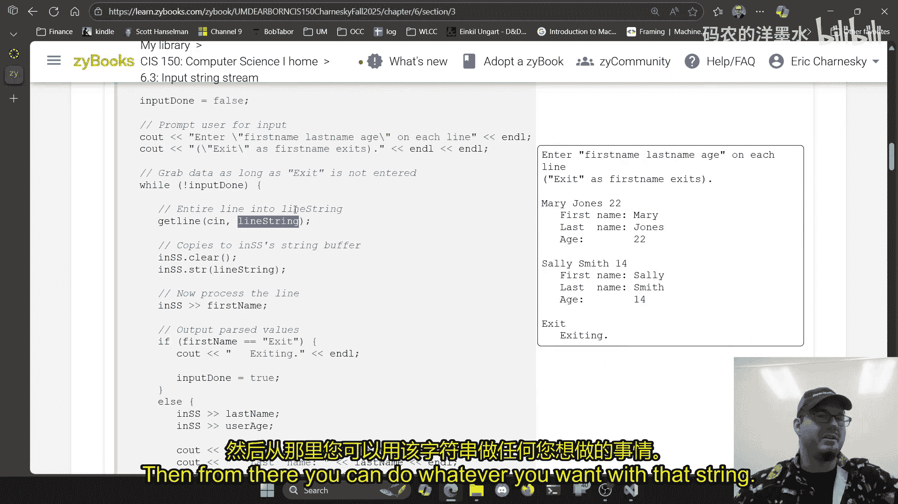

Inter your full name。Let's see this include string。

Here and then so I can't just see in on full name right so we have a string for name or we'll say full name here I make that clear。

ItBecause CN will break as soon as I hit a space， so what I'm going to do instead is I'm going to use git line。

 and I'm going to say CN so get the line from the standard input here and I'm going to store it in the full name variable here。

 and then I can see out your full name is or something。没。And full name。

Not a very interesting end of that line。But we'll see you can get the spaces with the gi line this way here。

 which is really nice。

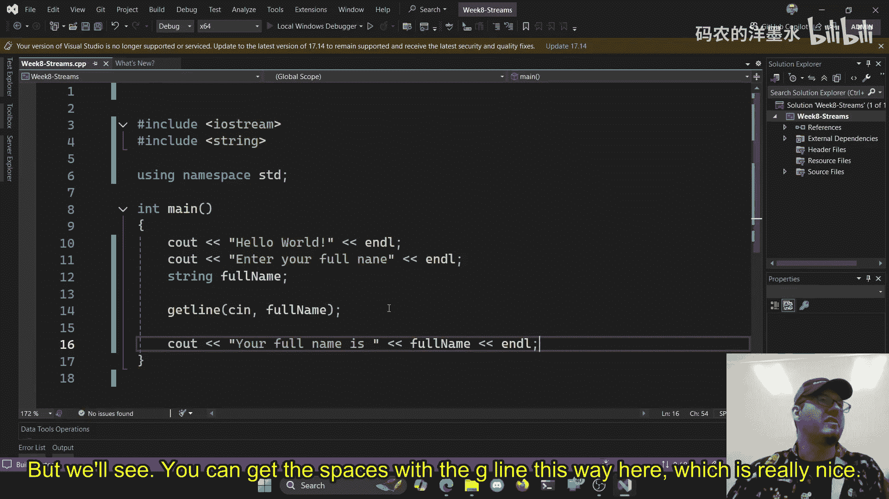

Oh， Eric Chernsky， and we get Ericsky back out it don't just stop at Eric， right？

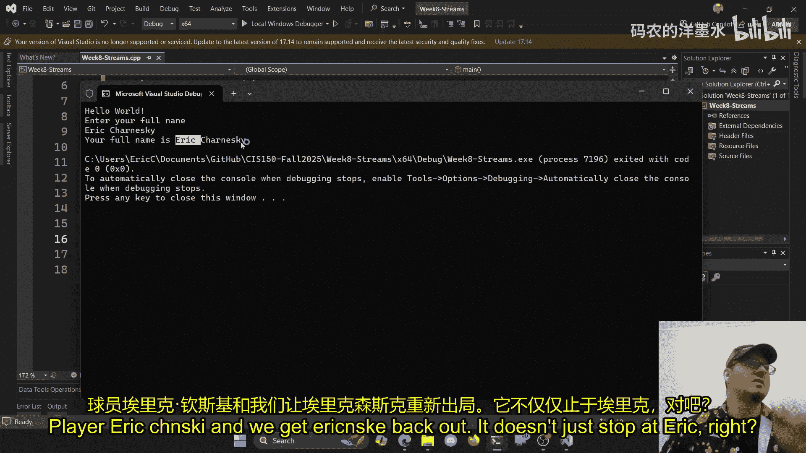

So if we know we're going to have spaces in our input， or even if we're not sure。

 Gitline is a safer way of getting input in case they give us spaces， hey， what's your favorite food。

 it might just be one word， but maybe it's pineapple pizza。

You know some people like a traditional pineapple pizza here the best way to have it obviously so it might have a space in it when we're asking for their favorite food so you have got to be a little bit careful so you can use the gi line for that one as well which is really nice。

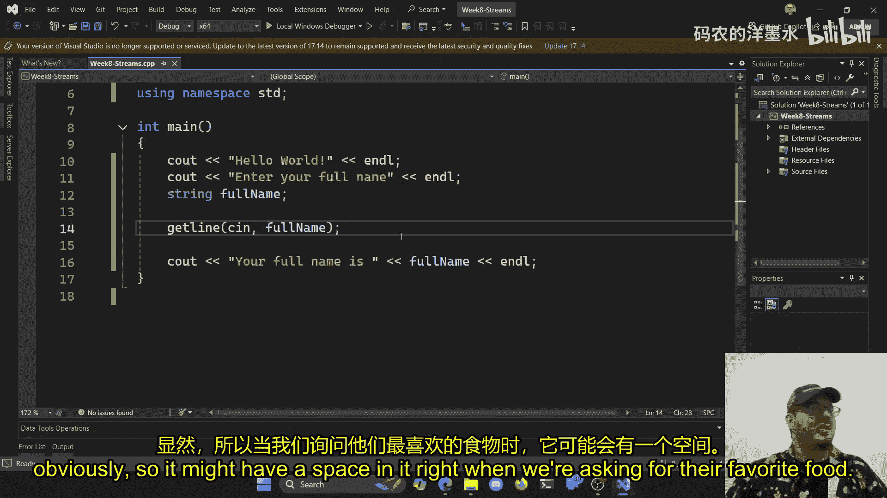

When we're reading data？When we get to the end of the stream， it gives us this end of file。

Mark to know hey we're done here， so if we have some sort of stream here that are using this input string stream in SS hey they don't use good words here。

 but that's okay。As long as we can keep reading， we can do something with it。

 So if I have some n number of tokens in this string here just hey。

 enter a bunch of numbers until you're done I don't know how many you're gonna to have。

 we can loop at the while loop and say okay as long as I haven't reached the end here which is really nice so you can keep on going and this will be false when it runs out of data so you can essentially get that piece of data and then do something with the data。

 get more piece of data， do something with the data， get another piece of data。

 do something with the data and then when there's no more data to read。

 you can stop so when we work with files we can use this as well we can keep on going through the file till we're out of data in the file to read so it starts with string streams because that's what you might you know kind of worked with this there's formatting。

The output string stream， so if we' going to output to a file so writing into a file first here。

 this O string stream here。Nope sorry that's goodness this is more formatting here so if you want to format that's right so in sort of an input string string string I can't say string anymore it's lost all meaning it lets you build out a string and get a single string here so you can essentially output into it here like we did to see out to build up a given string that's always fun and interesting now whichs not very file input fine okay now we get the file the good stuff here so to open a file。

We're going to use the F stream for a file stream here， so we include our file stream library。

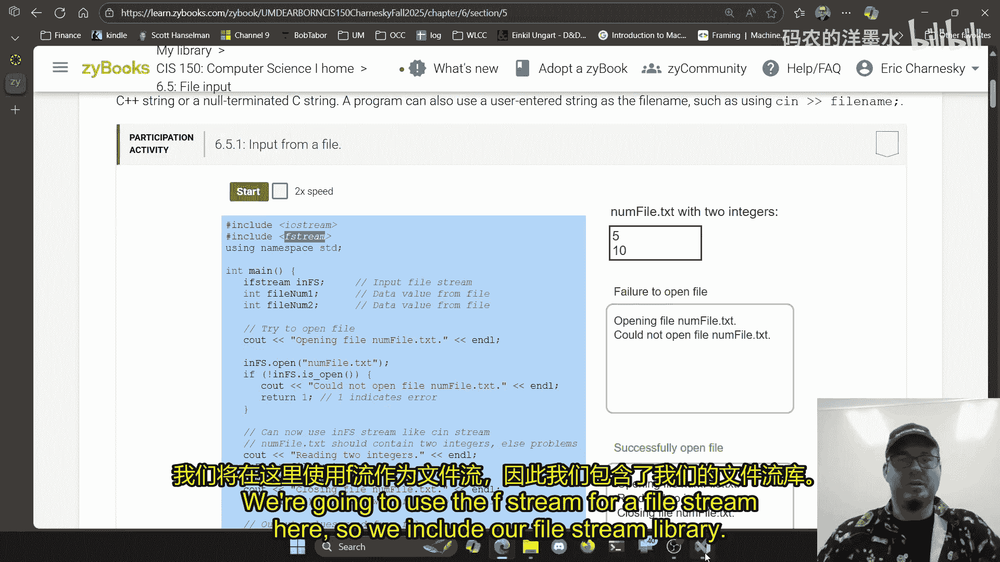

They include F stream for file streams。

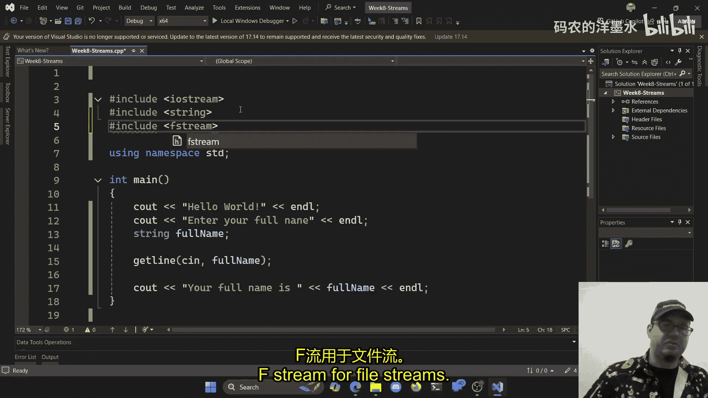

And then we just have to say open， so we give it。This input file stream。Here。

 so we just declare one and then with it， we just say open and we give it the name of a file。

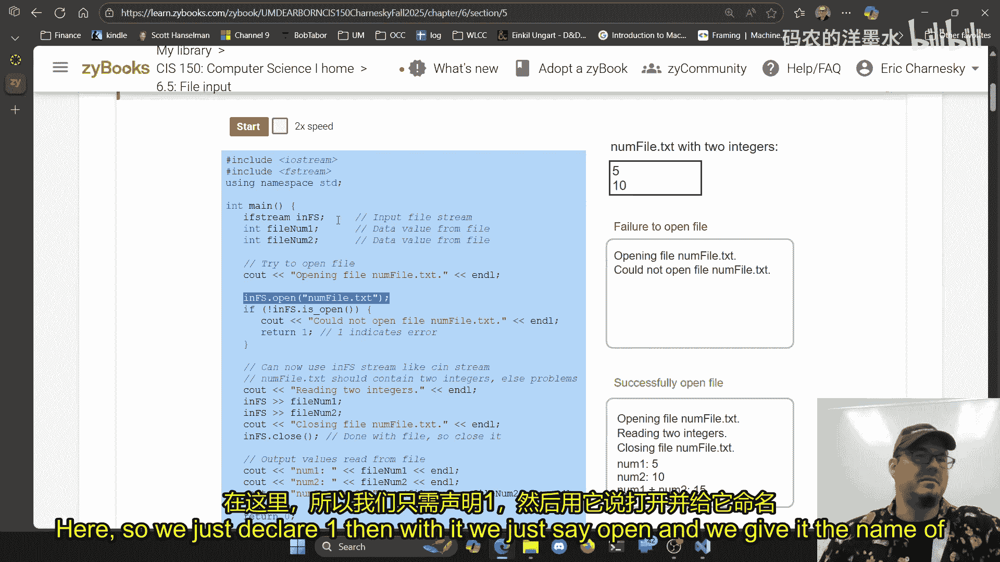

So we need to have an input file stream， IF stream here my input file stream and I like spelling it all out here the book's lazy。

 that's fine we just say open and you give it the name of the file that we want to read from so if you say like test。

txt。Now I don't have a test。txt currently so I'm going to go add one here so I can right click on my project and I can say I want to add a new item now I don't want any of these things here。

 I just want a plain file here so I think it's under Hity here is a TxT file。

So I want to test dot Txt and just if you want to pick the text file。

 you can give it the dot Txt extension as well， and now it adds a test file here。

 so we'll say hello world from file。Okay， so this should open a file named test。TxT。

Now when we run our program here， it's going to look for files in the same location where the program is running so this path here is a relative path。

 so it's relative to the folder this is running in， I didn't give it a full path here I could say。

 oh hey it's in this where is it open file Explorer。C users， ER C documents， GitHub。

 like you could give it the whole path here that's a full path or absolute path， it could。

 those aren't very flexible。Because if I try and give this program to someone else。

 they're probably not going to have a user's folder named Eric C and trying to get them to put it in that exact directory is not very useful so relative paths are very handy so that anytime someone runs the program it'll just look in its own folder which is usually what you want here that's a good location for defined stuff here so relative is flexible nice and easy the absolute paths really awkward and tricky to use most of the time here so this is good so now that we've opened it we can say okay if it didn't open we failed here so input file stream it has an is open flag we can check hey did it actually open here and we couldn't open the file test txt here and then we return finally with something other than zero usually we have this return zero at the bottom we so that's a good practice here indicated all is good。

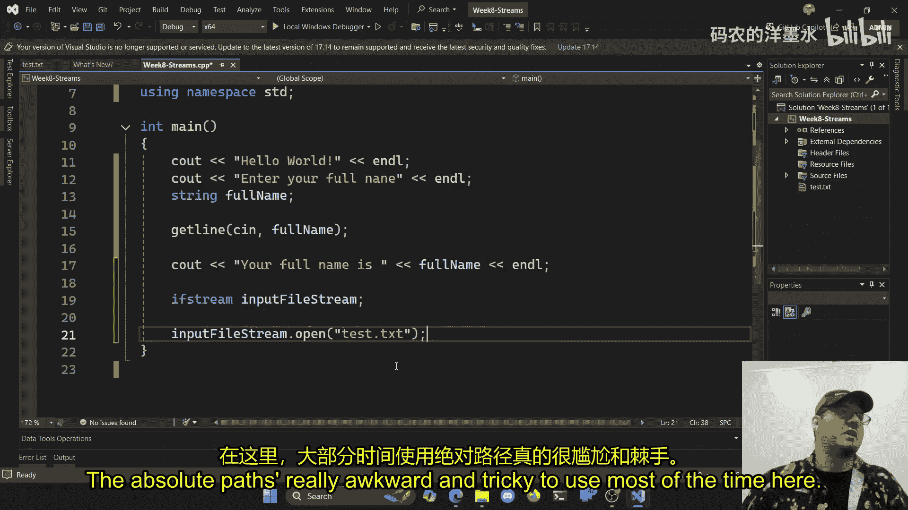

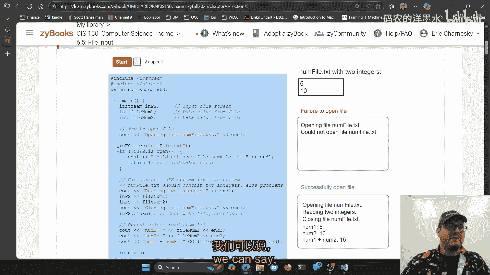

If you return anything other than zero it's bad a bad thing happened and we just want to stop our program because if we need that file to be open to do our processing and it didn't open nothing else is going to work so we just bail out early so if it did open then we're good now we don't need it else because it returned it would have stopped anyway so having else here is redundant then we can say okay now we can go get something out of the file either just get one thing out or we can use that while loop and say while there's more data to read we can go read it out here so I like those while loops here so we might have a string for the line。

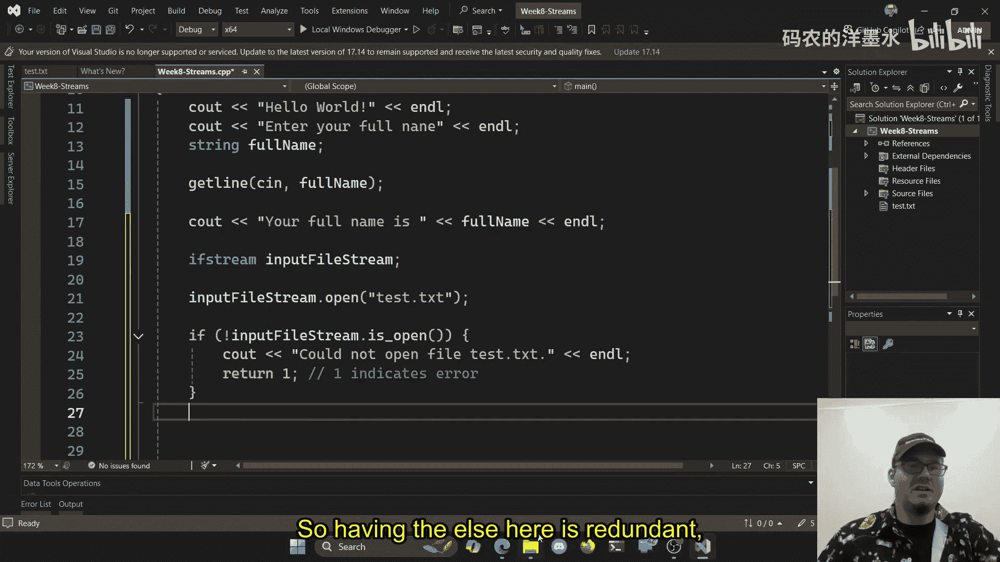

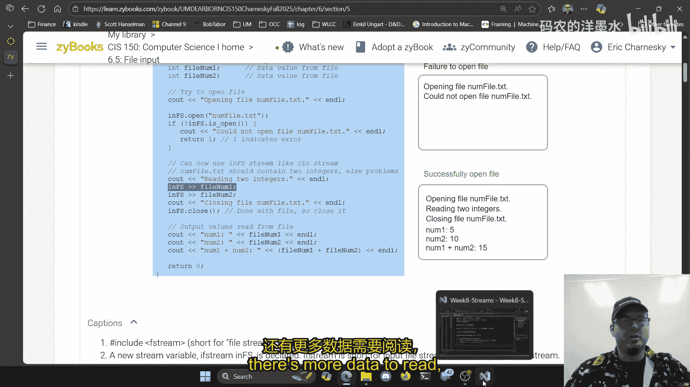

And then we can say。While input file stream。 EOF。While it's not end file here as long as we haven't reached the end of the file。

 we're going to keep on doing something right so not the end of the file， I want to go get the line。

Now I'm not going to get the line from C I'm going to get the line for my input file stream here and I want to store that as the line so whatever the line of text was here I can get that line out of my stream here。

 store it in the string for line and again we're just going to see outline line here we're going to add our own lines not a very interesting file let's go ahead and one more here so here's a second line of the file。

So we can least read more than one line here。

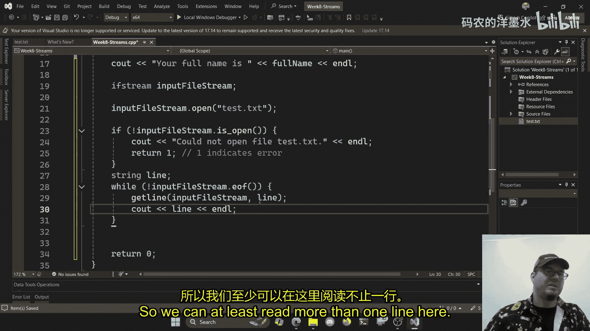

And then when we're done， we want to make sure we close the file。

 so anytime you work with the file you're going to open it。

 you're going to read orw writeite it and you're going to close it。Now when the program ends。

 it's going to get closed automatically， but we don't want to rely on that and some programs will run for a long time and leaving the file open is a bad habit。

 it makes it harder for other people to edit and modify that file here。

 so want to make sure we're done we close it here close。

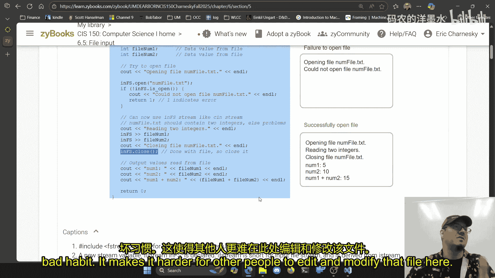

So let's give it a try， so it should read our test。txt file if you did it right。

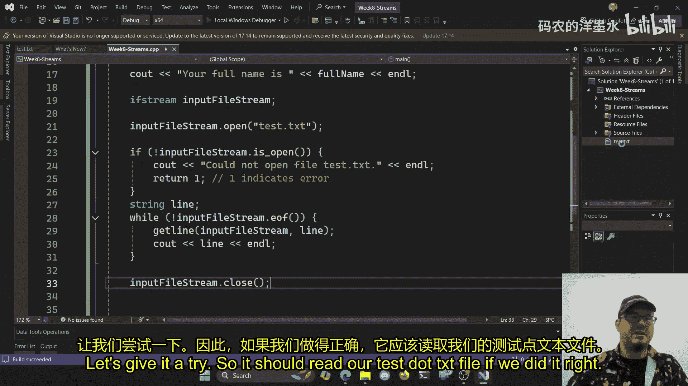

On the world and yourful name Kchsky。Your name is Erchinsky and hellello World from the file。

 second line of the file。

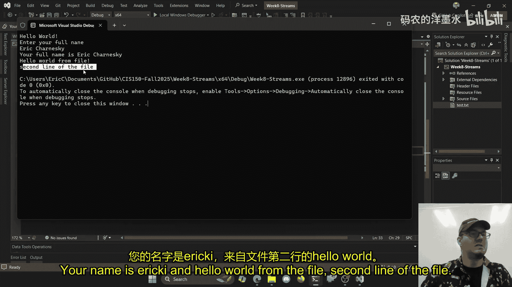

And it finished， so we're able to read out contents of that file here。

Which is pretty cool so and when we were done reading when there's nothing else to read。

 it finished nicely， didn't crash or anything and we were able to close it。

Now reading just text out is kind of boring， but sure that's what we have so far not the end of the world if we had like some bunch of numbers right what if we wanted to store like a bunch of receipts here some people would go add a new。

Oh my goodness the ads's in the middle it's a weird place and a new text file well have this is our sales。

txt maybe and in here just shout the numbers out of me here and I'll throw them in oops imagine this is like the cash register receipt。

 five。1010，20， 200。🤧，4545420 about $420 and we can do some floats in here too right everybody loves pennies I't they gonna stop making the penny finally like that was going be a thing when I was a kid and're like no one uses pennies anymore we should stop making it and it took them another 20 sal odd years to say let's stop not making a penny。

Okay， I thought they're going to stop minting it because it costs so much money to make a penny。All。

 so we got some some numbers here， right， feel pretty good。

 so we should be able to like total these up and say this is what should be in the receiver drawer。

So。All right。Let's give that a save， so we'll come back here so we did this one here we'll do another one。

 why not， so let's take our input file stream we'll call open on sales。txt here。

And then I need a double for the total right starts at zero until we know otherwise and。

Now if I know they're all numbers， I don't have to do the string and if I know they're all just single numbers without spaces。

 I don't have to do all the Giline stuff here right I can just have it double for a number。嗯。

And then while my input file stream is not input file stream is not the end of file end of file。

 there we go。Let's take my we can not see in we're going to take our input file stream and extract number from it right so the same like we would do a C in and get a value out it's not the standard input anymore it's here's the file stream it's a stream we can pull something out of the stream here let's extract the number let's take our total plus equals the number。

And we're done， we can see out total sales are。And maybe like a dollar sign， right。

 make that output look a little bit pretty for the total。And that line。Let's give that a try。

 Do you actually know what the total should be here， I forget what we。15， 35， 235。280。28420。

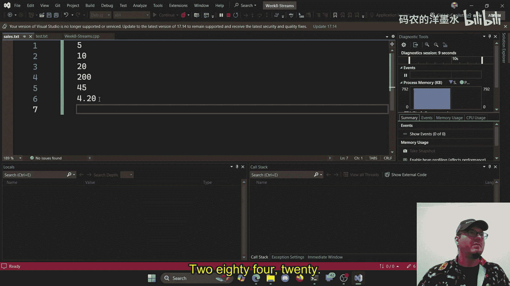

So that's on rate 28420， let's see。ki。28840。嗯。😊，We had an extra 420 there。

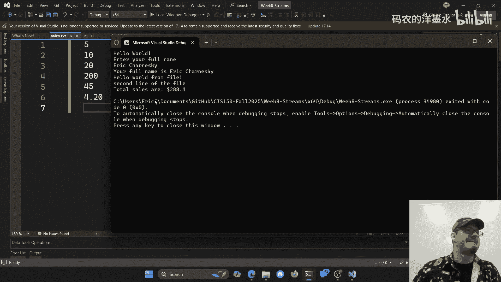

When we got to this last enter here。It's still round。So if we put it in debug mode here。

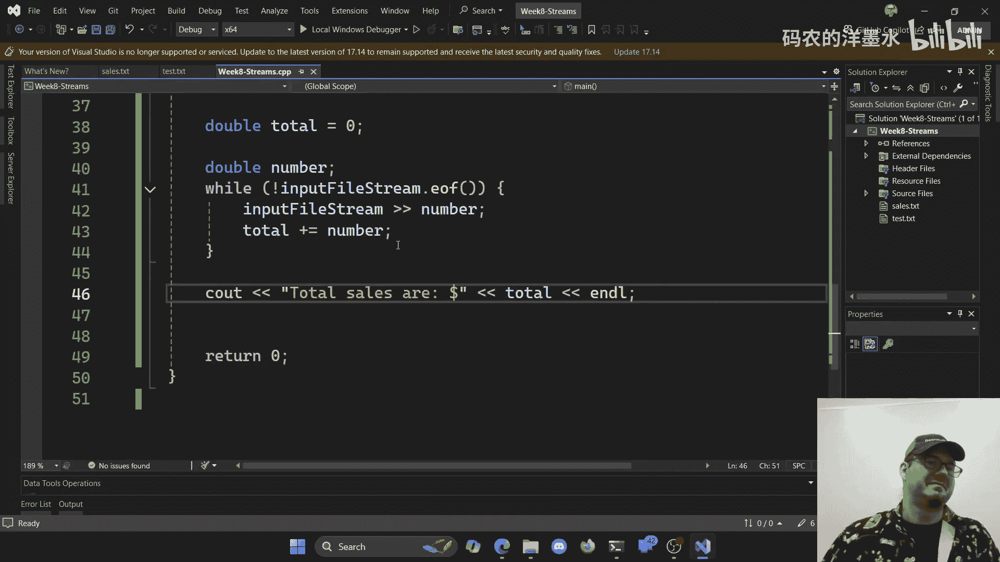

Let's show you what happens in Ebuger because this is。

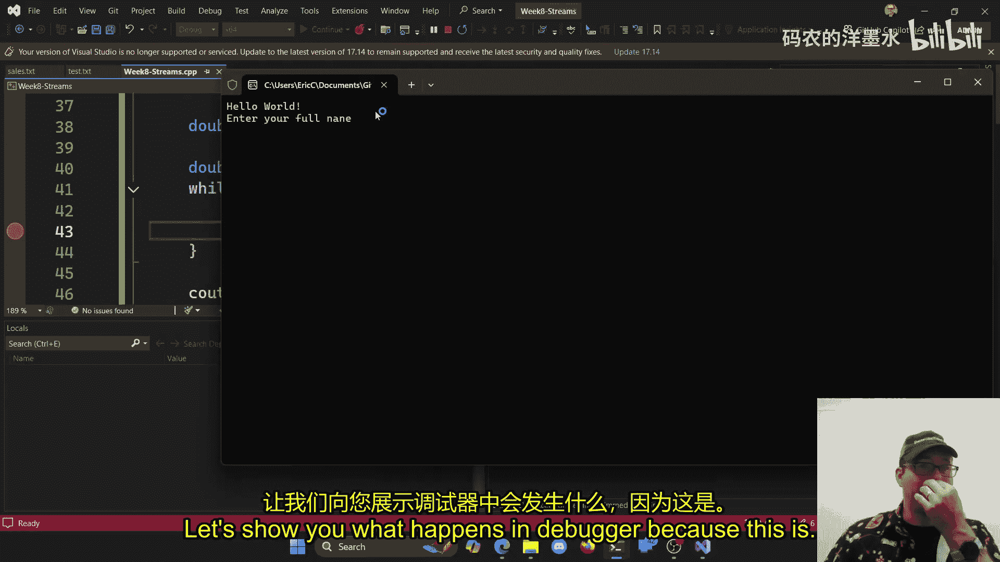

Weird thing that happens so Eric Chnisky。And here we go。

 so we've got our files open right it's going to grab the first number was five right looks good so we're going to do step over and then the next number was。

10 looks good。 The next number is 20 good。Next number is 200。

 right you can see it changing down here as well。200 next number is 45， great。

Next number 420 added to the total， we're not at the end of file yet here。

But there's no number to read。It didn't actually read a number。

 right because what was in the file here。Was the new line character。

There was something else to rewarn at the end yet here。

The number didn't change it didn't actually successfully read that as a number here。

 so we need to go and see if we successfully read our value or not here otherwise we're going to get some weird stuff and let me go。

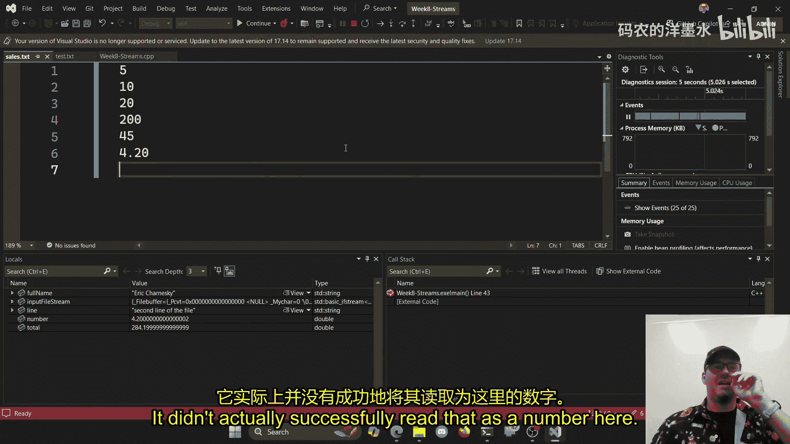

Thats continue run to the end here so we could just back that off here if we don't have the new line now。

 it should be successfully run it。

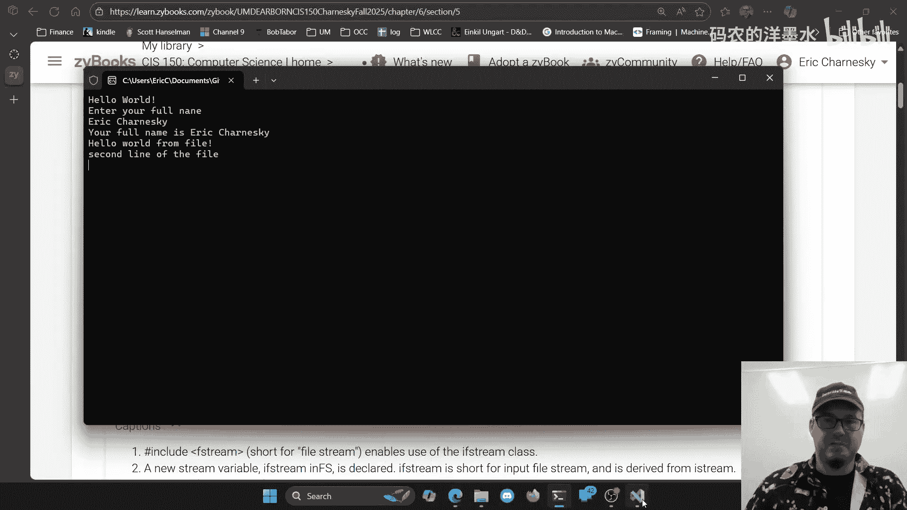

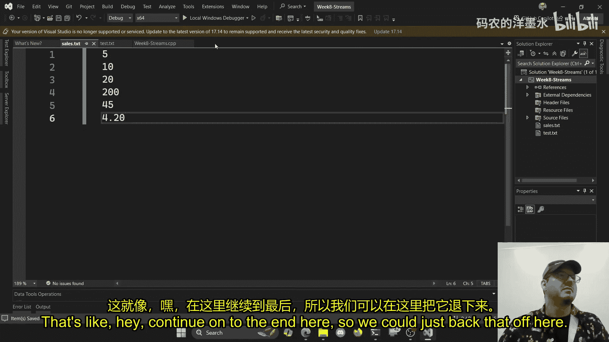

Trusee。

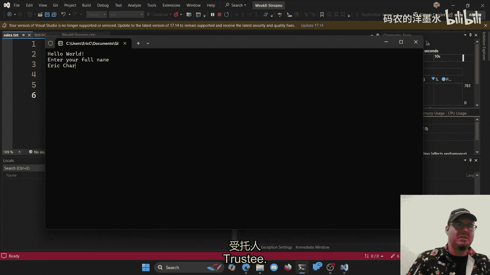

I've got to take the break point out and continue and now we should get the correct output to 84 20 Okay。

 so that's one thing here， but it'd be nice to know hey， if it didn't read a number。

 don't go add another number here。so we could either just say， hey， number equals zero。

That's probably the easy way just put it back to zero and then if it gets read to something。

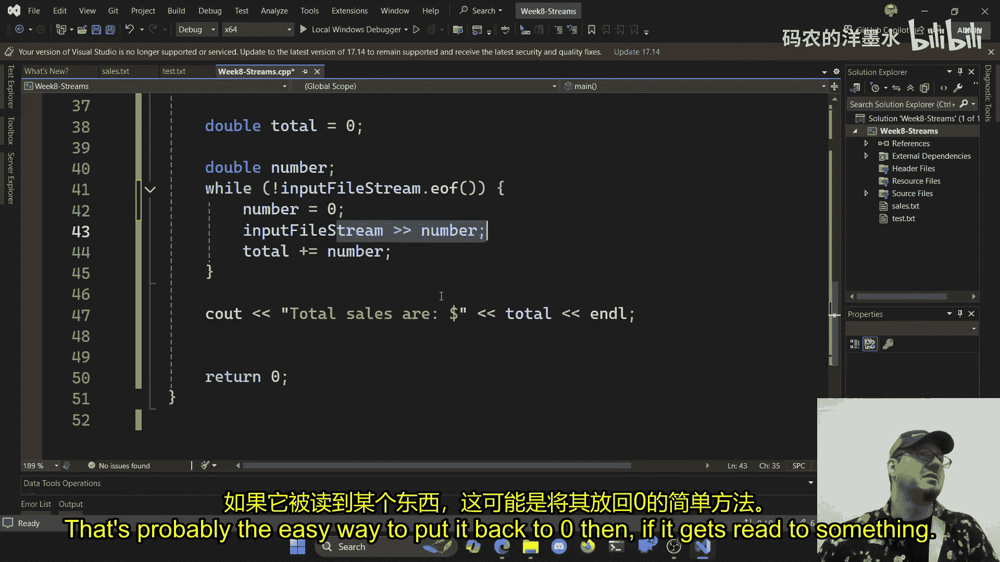

Great， if not， it stays at zero， that's probably a nice easy way to do it。

 but there's also we can check to see if a value was red I think it shows us in here。Yeah。

 if it this is if it didn't fail。Here is an option。

 so instead of it getting to the end of file if it didn't fail reading here。

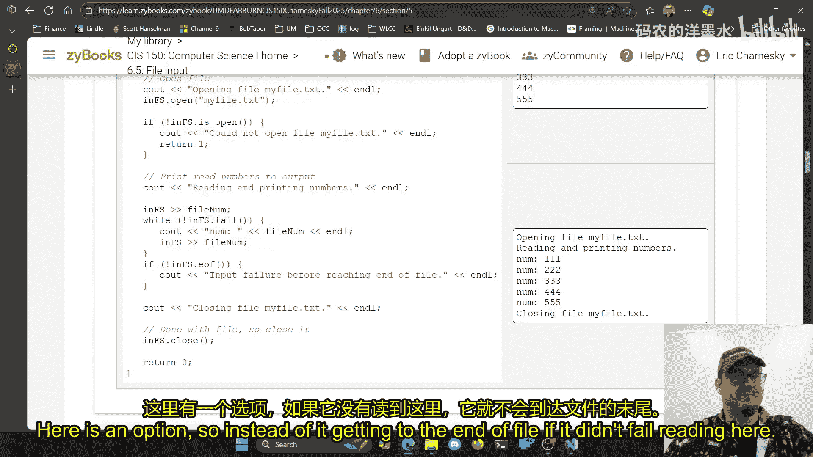

So we can change our loop and say， okay， if it's not a fail。

So let's's kind of this out for a second and put our。New line back in。

So if it didn't fail on the read， then we can keep on reading。

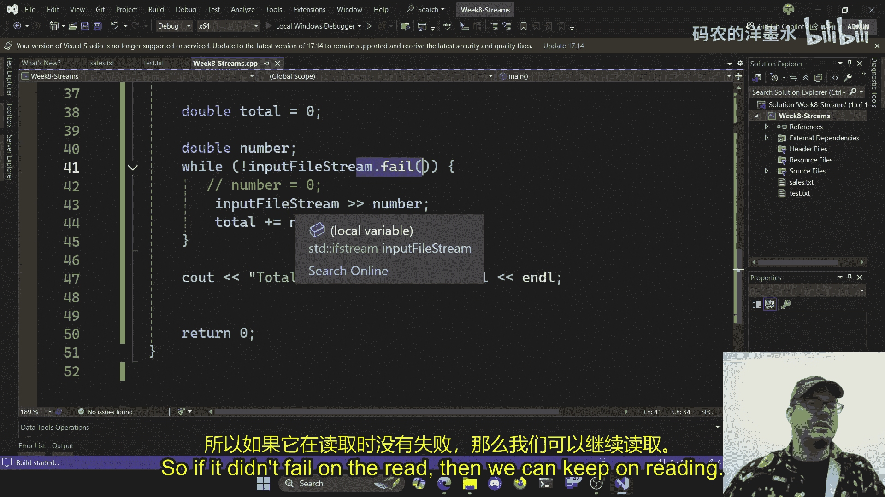

チky。

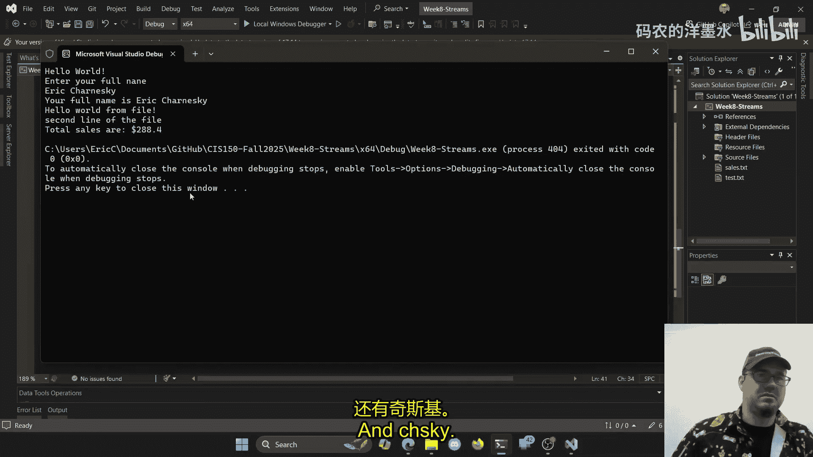

Nope， all right， hang on oh because I think we're doing it on the wrong bit here so we want to read it so we got to reverse our order here so we'll start number at zero。

And then we try and read it if it didn't fail， we can add it， read the next one。

 if it didn't fail add it， read the next one right our order was a little bit off here。

 I think this ought to fix it now。

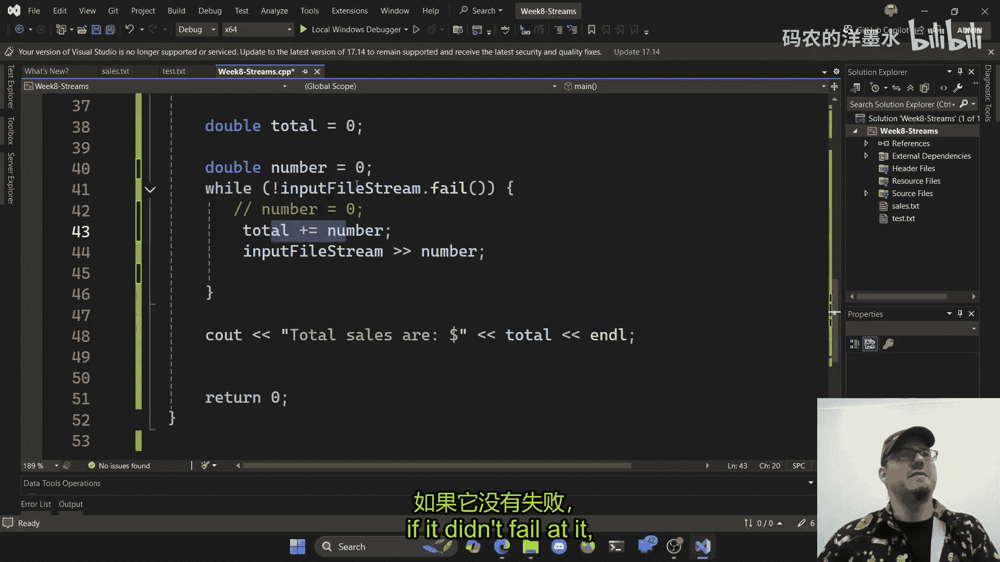

Yeah。Ssky there we go so if we're doing in the correct order where we try and read it and then if it didn't fail we can go add it to the total we're able to successfully do that without having to set number back to zero every time it's kind of obnoxious to do an extra operation every time so this is probably better this way here now it gets weird though like if we were to skip it here and add another I don't know。

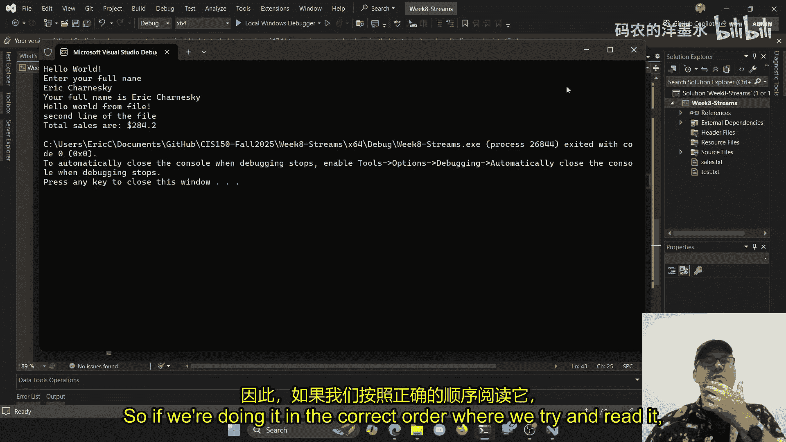

ALi bit here。And we run this one here， it's going to fail and stop。

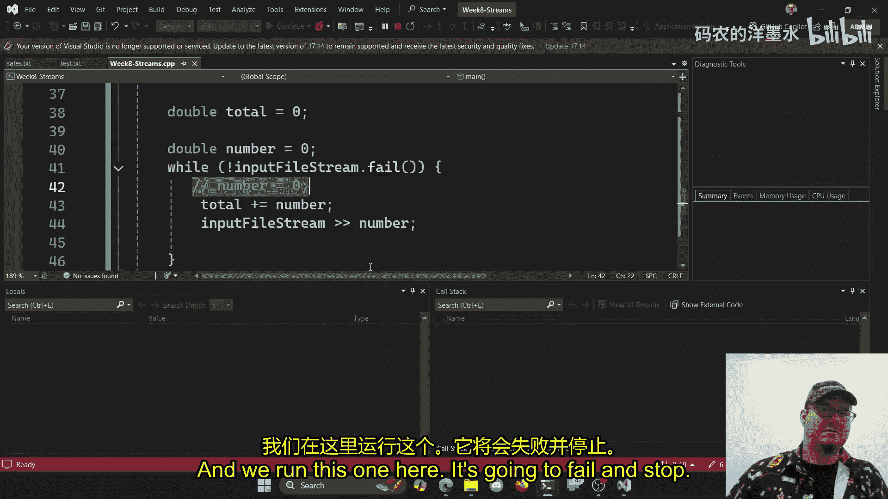

was my。There's line here， there isky。Oh， it did read it nice， okay。

 we were able to successfully get through that nice。

 so we are able to add in the last one here and life is good。

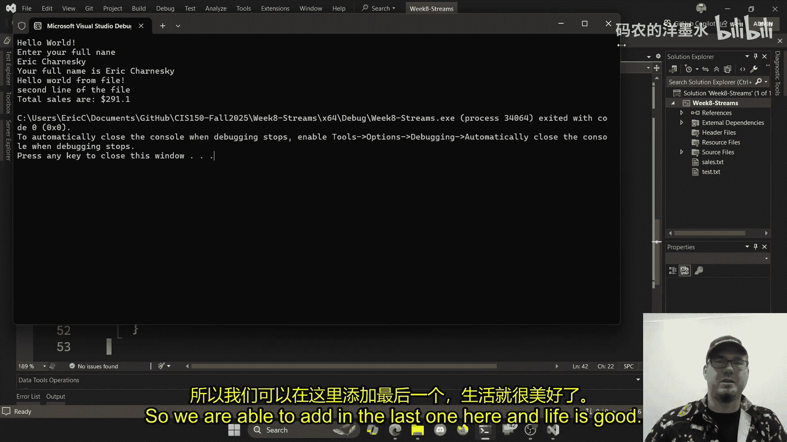

So we read our value， kept on going because we didn't get to the end of file， so it just。

 it failed and we kept on reading。Cool。

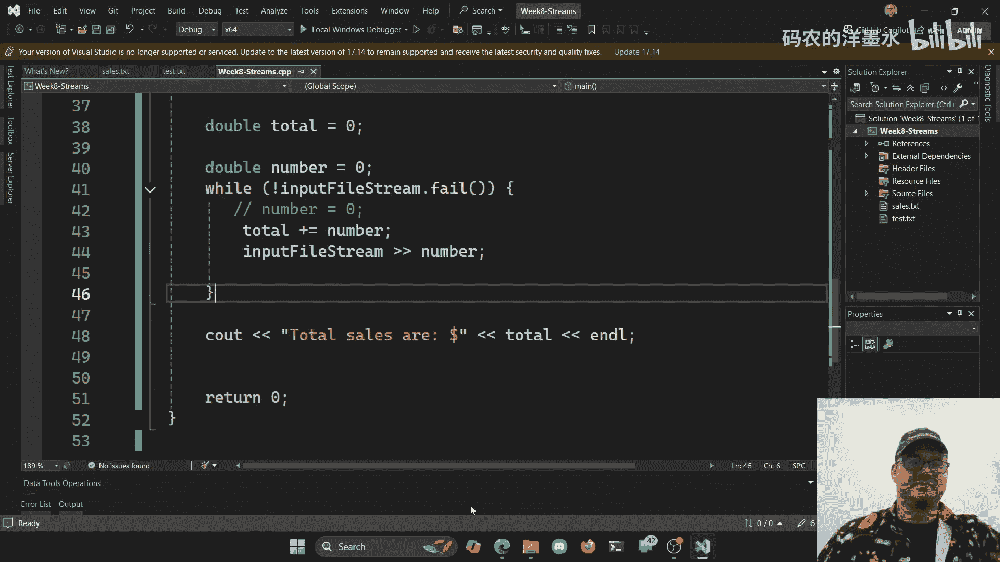

Yeah。Yeah， I started a little laugh for counting words， that's fine。A more formatting here。

 that's all fine。So checking to see if the input was good is like the opposite of fail。

Faied if something it was bad if there's a bad bit was set for the end of file。

 usually we'll do the end of file here， but if we're doing some processing or parsing。

 it's nice to check to see if we failed or not。

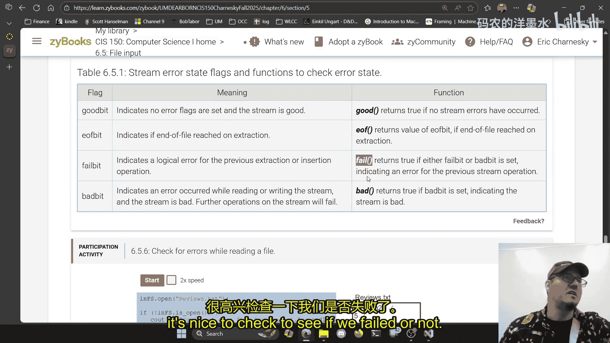

All right， so if we want to do something more interesting than just this though just a bunch of numbers like if we have a particular format that we want here we've got a couple options so let's say we wanted to store like here's the items we're going to sell at our store I need to know what the item is how much it costs and like how much we have in stock I want'm going know couple pieces of information so that someone can then go by that amount of things here so let me go let me start a new project here'll just leave it so here's like our shopping cart8 or those are our sales register。

Okay， we'll make any project here to keep it all a little separate。

So going to include our file stream。Here use namespace。😔，Standard。Hello world。

Oh we don't even need a that's right me get rid of that。

So we want to go read a file to see hey here's the items we have for sale right so we need a don't know item a string for item one name maybe a double for item one。

Price， and I in for item 1。Want to D right now again。

 there's a better way to do this we just haven't got to the next chapter you yet here so I'm going to just have three items for now。

To item three， I promise once we get into the next chapter， this will get a lot easier。

 we'll go add a new file。Item， here's our utilities， text files， I call this like It。txt。Okay。

 so what three things should we sell？Our store。 Should we be coffee。

And feel like it's always coffee that's okay， all right。

 so we'll have coffee and how much does coffee cost？5 guys they're awful all right。

 and how many coffees do we have available we have like we just made a pot， right？Right。

 what else we sell at our store， Coke， all right， and how much does Coke cost？299。

 right and how many Cokes do we have available？20，All right， and the last thing that we sell。He okay。

 and how much does he cost？399， okay， and how many keys do we have available？😊。

22 available okay so if I know this is the format， each item then is on three different lines I'm going to read three lines for the first item。

 read three lines for that next item read three lines for the after that right it doesn't have to be in this format but if this is the format we want to use we know we can read it in this format right other times we might do like some sort of comma delim to limited I can have a value of comma value of comma we got options and we can then go split our string on commas and that gets a little bit trickier because we won't look to how to do that yet like spaces are a little easier we can use the input string string and turn spaces into the tokens so individual lines is probably easiest right now。

So let's go read this file here then， so we're going to we've got those then。

 so I need my input file stream。Youput file stream。嗯。So a capital I， that what I forgotten？No。

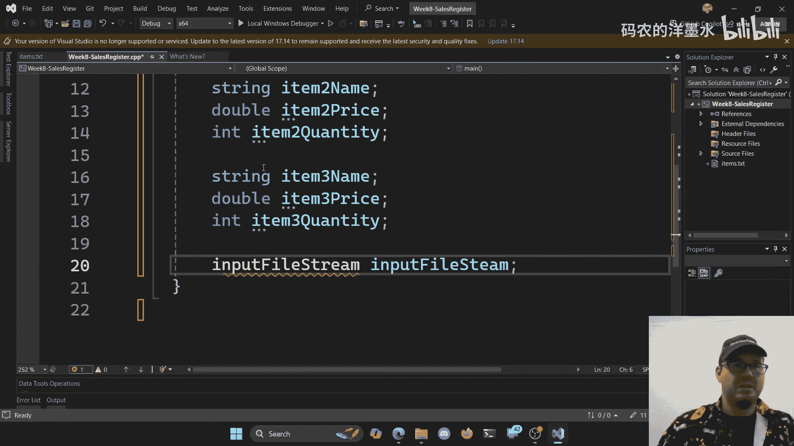

My goodness， I just did this here。Input file stream， isn't it？

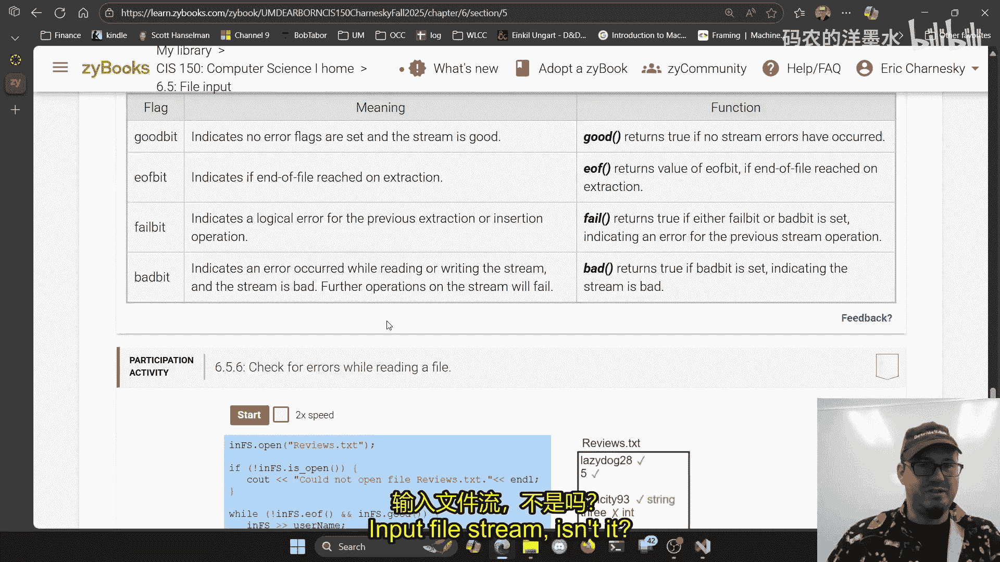

Okay。Input IF stream oh my goodness， it's IF stream okay。

 it's because it's short in the library I add input file stream and then we're going to call open on A。

 Txt。Eventually we're going to close in here， so I like to add my clothes before I forget because I always forget this thing here。

While my impof file stream。Dot end a file。WellIt's not the end of file here。

I can't even use like a while loop right because I need to read the three different things here right I don't even need to because I know there's only going be three because I only have room to store three so'll just grab all three right so I can take my item take my input file stream。

We can input to my item one name。And rice and quantity。one price and item one quantity。Right。

 and then we'll do it again for the second one and do it again for the third one。Now。

 making sure I change all of them here is easy to type it when you copy paste if that's okay。

Right and then we should be able to close our file， we should be able to ask them okay， hey。

 now what do you want to buy right so we can see out。What do you want to buy。是。And。

You can get a string for their choice and we can see an on Joice and if my choice。

Does not equal my item one name or my choice does not equal。Its not equal my item 2 name。

Or my choice does not equal my item  three name。See yeah， we don't sell that。8。Sell that。

And then maybe we just we make this little validation loop break， we don't need that one here。

Should we tell them what we buy though， like or tell them what we sell。

 maybe we tell them what we sell？See out item。One name。😔，I want a comma or something， item two name。

And a comma。Item three name。We tell them at least what they can buy here right。

 maybe we put that in our menu。All， so hopefully they give me something that they want here then right。

 and I have to ask them how many they want to buy so I need an infer quantity。Aty？See how many？

Whatant to buy。And then we can see in on the quantity。And then if my quantity。

Is what greater than Oh Well， if it was item 1， Oh my goodness。 sorry， if。

Choice is equal to item one name。All right， this is getting ugly here right。

The quantity is greater than the item one quantity。If that's the case。

 right or if choice is item two。And the quantity is greater than the item two quantity。

Right or the choice is the item three name。And the quantity is greater than the item three quantity。

If any of those is true， see how we don't have that many。Yeah。That many。Otherwise it's probably fine。

 goodness， gracious， and then what else it was good now I need to count how much it cost。

 I need to see which what the item was， oh goodness， made the skin a little notxious here。

And we have the。But and for item quantity。Quant of be and a double for item price。Okay。

 let's do this and I can just go through these ones here。If it was the item one name。

 then my item quantity is the quantity， item one quantity。Right， Elsif。It was the second item。

Then my item quantity is the I2 quantity oh we should set price as well right item price price equals the item one price。

promise there's a better way we just haven't got to it yet item price is the item two price。Right。

 and then if it wasn't that one， it wasn't that one， it wasn't that one， it's got to be the。

Third thing， right because I know we only sell three， so my item quantity。

Is the item three quantity and the item price is the item three price。All right。

 now we got through all that so I know what the item price are so then I can check if the quantity is greater than the item quantity。

Quantity。Once the I guess we could do that in the validation loop then right let's do all that so we'll ask them figure out what item it is and then go get the item。

And then we'll go see how many they want to buy， and we can validate it。

So how many do you want to buy will say， I'll start that office， I don't know。Zero。

 I don't know if that matters。And while my quantity。Is greater than。You in quantity。The quantity。

How many do they want to buy？Guess we need an error message to all right， so we'll just do that。

And if it was greater， we don't have that many。Only have and add the quantity。What the。

I'm going want buy okay， so eventually we get out of that one， then we can calculate the price。

 see how your total price cost is the dollar sign right it our item quantity。

 R quantity times the item price。Why does it not like quantity？嗯。

Oh more arrows there there we go quantity and price were able to get all of that so eventually we should be able to sell them something right we go read out our items sell them right but then we need to update our inventory we needed to go write our file again。

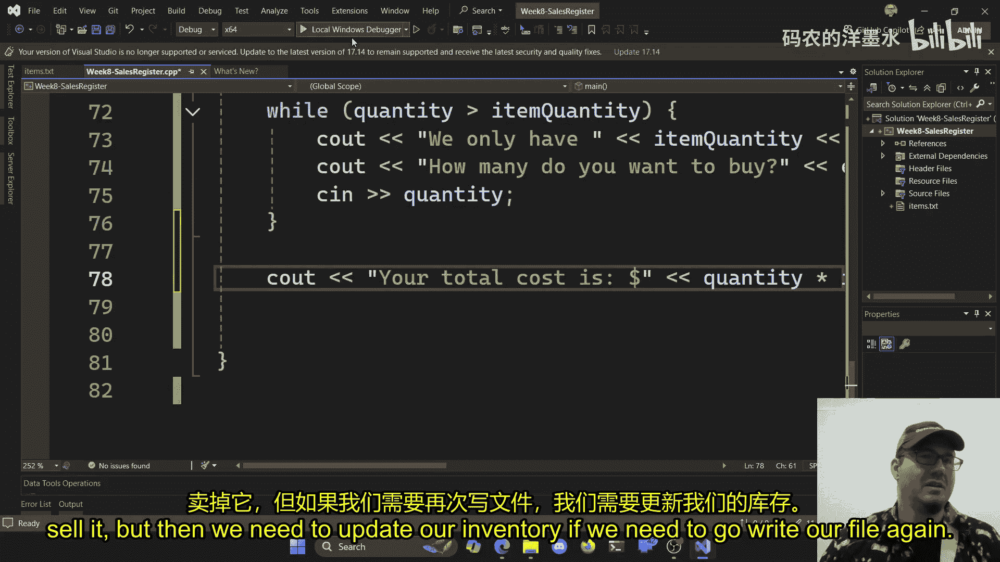

So to write a file， that's the next section here for an output stream。Ping out。

 skip the paring validating， that's fine file output。It's an OF stream for output file stream。

 so we open it， check if it's open or not， and then you just write to it like you would a see out and we were done。

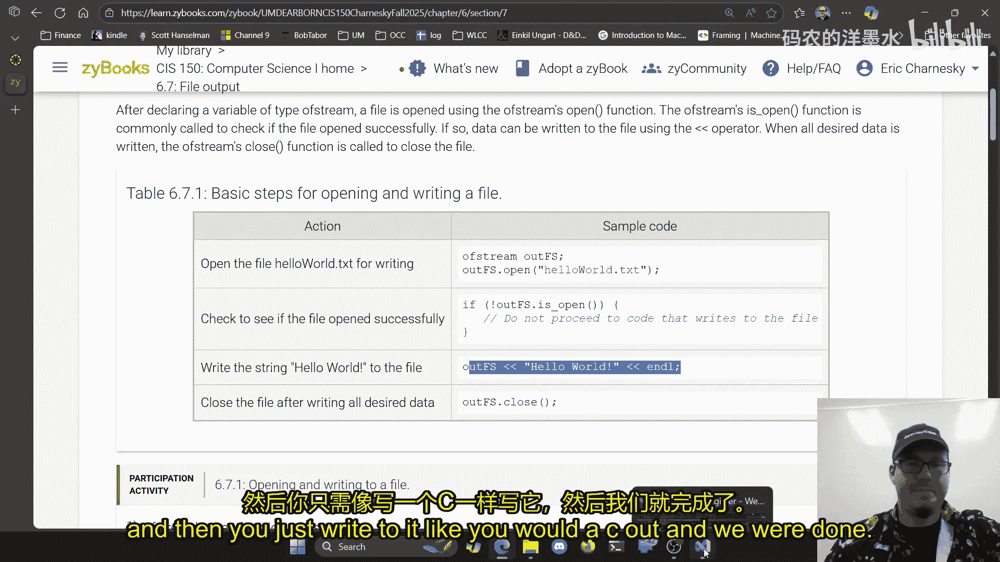

So we need an output file stream， OF stream for my output。Bilestream。

My output file stream oops output。嗯。Filestream。 open is myitems。txt。Now。

 if I want to just be able to write this data here， the name and price and quantity。

 I need to make sure I update it here so after we've sold it， then I can take my。

I need to know which item it is。All right， I guess we're doing this thing again then。

If the choice was this， now let me know what the quantity is here。

So we'll take our quantity minus their quantity， right？嗯。出去出。Minus equals the quantity。Great。

So that we subtract from the correct quantity， and then we go format this edit。

Advanced format code where is it here format there we go that fixes all my tabs the spacing wheel awful little bit so now we've updated the correct quantity so now I can go write all those things here so i'm just going to copy this one here i'm just going to use the other direction。

Theres my output file stream。Anim will output。These here now I do need to add in my own end lines。

 though， which is a little bit of a bummer。 that's okay right。

 so I'm going to reverse the direction and output all of these here。

I think there's a way to highlight multiple lines here， how do I do that said shift note shift down。

 it's like K or something there's some weird keyboard shortcut you can highlight multiples。嗯。Oops。

 and I all， and then we got to add the inline。Yeah。Oops。All right。

 so output'll put all of it and then when we're done， we close the file。

So now it should update the file， right？Let's see if it works。

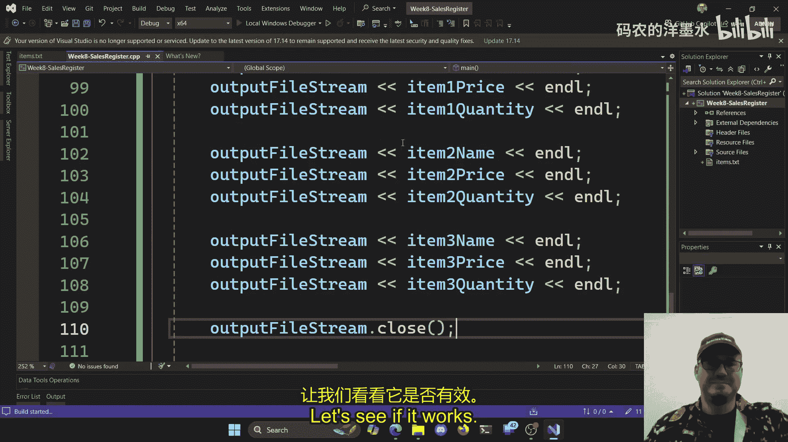

All right， so what do you want about coffee Coker tea？嗯好。Right， oh we don't sell that。

oh I think our loop is， this validation loop is bad here if it's not this and it's not this and it's not this。

 my bad right， those are ands not our。

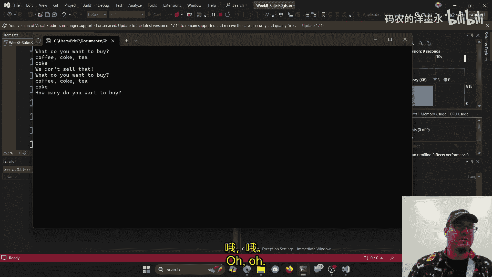

Come on， this was like earlier on here， right？Try that again。

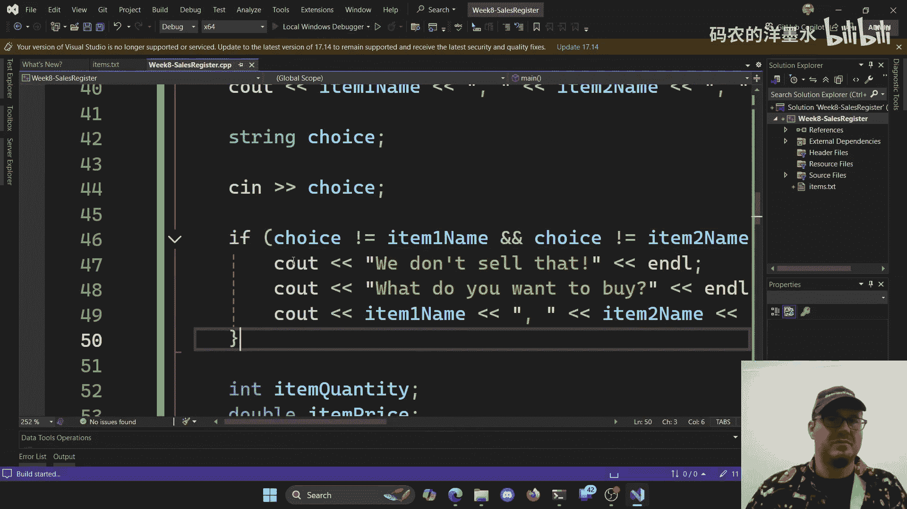

All right， Coke， all right， how many Cokes do we want to buy two， great， 598 cool。

 so that item should have two less Coke now we're down to 18。

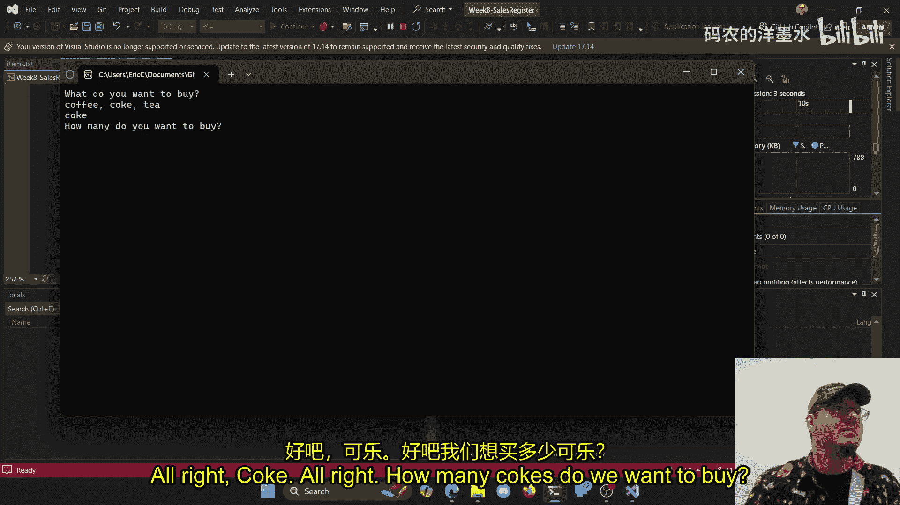

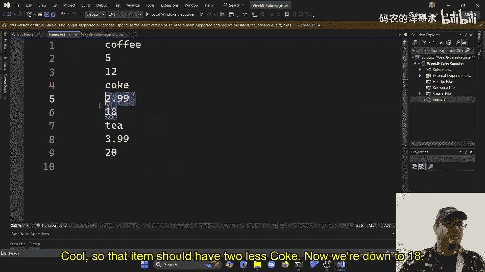

Cool， right again。我 by。Coook， oh coffee， sorry， let's buy 20 of them， we only have 18。

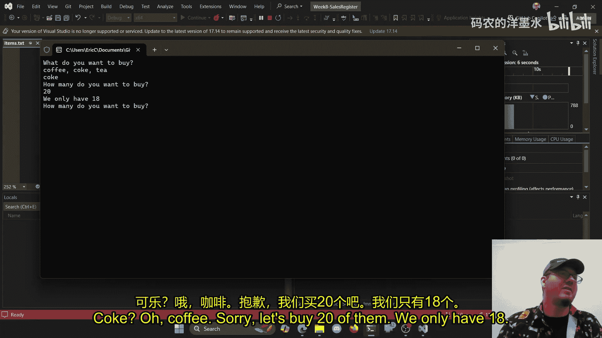

Two more，598。And we're down to 16， so we're successfully reading the file， writing the file now。

You might notice here that when I called open。Here， we didn't like erase anything。

 but somehow when we write the file， it only has the new versions。

 so you got to be a little bit careful when you open a file here， this will delete the contents。

So if there was something already in this file it gets blown away so you have to be a little bit careful when we are writing files now there are ways around it here we'll get to those eventually but for now it's a little bit bad to do something like that okay now and it might be nice if our store like give us the option of hey what are you selling today and we can give it different files。

Right so this item。Txt is just a string， so we can ask them， hey。

 what's the name of your file you have here in your store？

 so we could ask that you have a string for the file name？We go through the name。Of the file to read。

And write， I suppose， read and write。And we could see in on the file name。Right。Now。

If it doesn't open。When we try and open。We'd have to go ask them right we got that option here。

 so if my input file streamed is open。If it's not is open。I or really， like if it does open。

 sure either way is okay in this case here， if it does open。Let's go do these things here。

If it doesn't open， make my else case here then。Well， let's go and ask the user forum them， right。

 why is it not like my house？Oh， too many there。That better， Okay， and then go format， edit。

 advanced format。There we go， fix my ta a little bit here else。So if it opened， great。

 let's go read it here and then if it didn't work， we can see out unable to open file。Please enter。

Mannually。Having we go ask for those pieces of information here， right， let's go。

Do all these again here， but that's all off of C now， right， so C。CN， C， C， CN， C， C， C， C。

 and then when we write our file， right we're not going to open items。tx。

 we're going to open the file name。Here， we can write all those back out。U。

So maybe we'll say item name， item price， item， quantity。

Three times I don't know is that we can just do the three inputs here it's not not the pretiest thing in the world。

 but that's okay how bill errors what we get no matching tokens found I lose my extra curly race。

I did， one more quickly race there for Maine， all right。

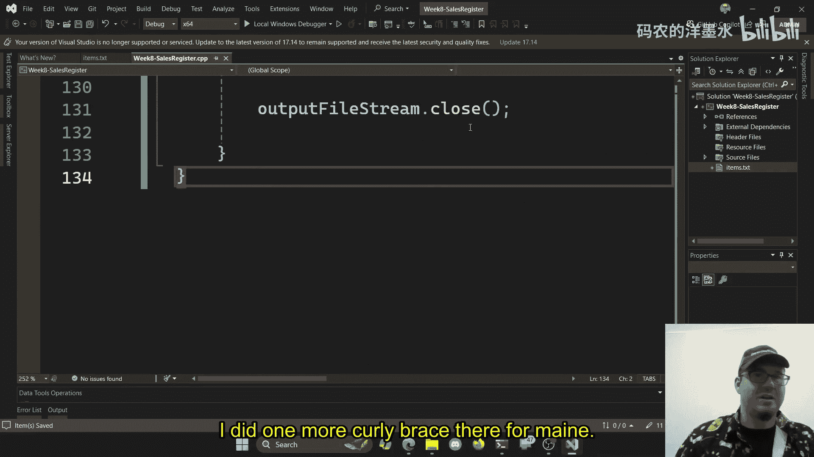

No， let's try it。All right， so if I give it something that doesn't exist here， like store。txt。哦。

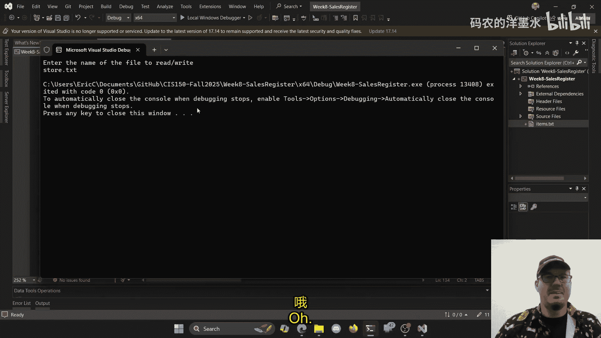

It just crashed what happened here it should have。If it's not open。Should have gone anything else。

Did it not to I didn't go to the else。That's unfortunate here。You click file stream。

Why didn't we go to the house， we broke it， That's all right， let's try it here， Oh。

 and it's not item that Txt。Smiling。In an else， oh。

 I don't I only want this to be in the else here then， right？Right just where I manually enter here。

 so the rest of that should be in here， that's why I add too many。

There too many clearly races we want everything else in the program to run just we're going to manually enter or we're not。

No， what was it edit format？Control ED， there。All right。

 hopefully that works a little bit better now so we're either going to read it out of the file or we'll manually enter our items。

 our three items here then we'll go， hey， what do you want to buy and one， two and three？

嗯。right so if it's store。txt unable to open， okay， let's manually enter so a different store。

 how about we sell some like groceries， what kind of food should we sell？比子。😊，All right。

 and how much does pizza cost？And all right， and how many pizzas do we have to sell？😊，115 pizzas。

 all right， what's the next item we sell？Watermelon all right and how many how much does the watermelon cost599 and how many watermelons we have seven watermelons all right last item what is it avocado toast i'm only see any so I can't have any spaces I did that bad I should have done giline so that's okay avocado toast we'll just do it all in one word here how much does that cost。

12， you have expensive avocados and how many of those do we have？10 of those， all right。

 so what do you want to buy pizza watermelon or avocado toast？Pizza， right。

 how many do you want to buy？2 all right， $20 and now we should have if we so oh goodnesss not if that was the wrong button here it's not going to show in the project。

 which is sad， but it'll be in the folder here so you have to manually add stuff to your project right it's not a folder view so you can go you can say add existing item if you want here to go see。

 hey now there's a store TXT。

It's a little obnoxious have to do that in Viual Studio， but the file was there。

 right and it has all our details。Look at that， pizza， watermelon， avocado toast。

With two less of the pizza that we sold right， so now we can actually read and write data and save it rep for the next time we run our program。

And it can be even based on what the user enters right they can pick the file name and we either open it we don't right it might work it might not and you could just completely bail say hey。

 could open the file try again it doesn't have to make a new file all the time so you know you ask them which one most people don't like typing file names but again we're kind of stuck with their black box you don't have a nice file picker we can do anything yet that's later on you can learn how to use those。

But for now we can look for a file again with the relative path here。

 if you give it an absolute path。You can do that。 it just it's a little bit harder so but if they're entering the name of the file。

 they could enter an absolute path here and that could work。 So let me go to my C drive here。

I think I've got a oh right look I got a log folder， sure why not let's make a new。啊。

Test do TXT oops not dot TXT dot TXT just one here and let's go put some items in it。

 Why not we'll just go steal these ones here So this is。See。Logs。Testa TXT。

That's the name of the file， so that's the full path to the file hyper software run my program。

As I enter the name of the file to read it right， when you're in the terminal。

 you can right click to paste， which is really nice。And it brings up my file。

So you can give it full paths here， nothing wrong with that。

 but if you give it just the name of a file， it's going to look relative to where that program's running。

Right。And it's let me bail out of this one here for a second。

The other thing you can do is you can have a sub folder。 right， So relative to this folder。

 we can have another folder inside of it。 Let me add a folder。And not a filter， oh goodness。

 maybe I can't do it here。I thought I could add a folder。Maybe not in visual studio that's fine。

 we'll just open this in explorer。Let add a folder here。Called items here。

 and I'm just going to put my items inside of the items folder。So when I run it。

 the relative path for that is the folder name items slash， and then items。txt， the name of the file。

Right so if you don't start with like see colon slash it's not it's not absolute so it's always going be relative so here's the folder slash file name which is fun and again I could give them that as well right if I wanted to put something in an items file or an items folder we said like items or slash we'll call this one。

呃。What。More。 Txt。it doesn't find it to read， that's okay。

 but we can go give it something so test one，1，1， test 2，2，2， test  three， 23。Test one， one， sure。

 and now in that folder。Not the logs folder， sorry this one in my items folder there's the more dot TxT right it wrote to that folder path so if it exists right because that folder exists that works here otherwise we have all sorts of trouble。

 we won't be able to create the directory and things like that。

 but we can do some fun stuff with our relative paths or absolute paths。

All right， awesome that's our output files you can even write your own HTML that's super exciting to do in C++。

Sure， if you wanted。All right， and then there's their example of actually， we did pretty good here。

With this one here so a couple different labs a lot to work with this one here and then overloading the stream operators here。

 the insertion operator to insert something or the extraction operator so if this doesn't mean a whole lot actually have't done classes yet。

I don't know why this is a little bit out of order， but that's okay。

 we'll actually do this when we write our own class here in a couple weeks right that's coming up in after the midterm right so what youre do raise ins first and then I think we get to classes。

Yeah raisein vectors and then we get to classes so once we do objects in classes this will make a whole lot more sense here。

 but we can say hey， this is how you can output yourself or insert yourself into a stream rather not it's the output stream or a file stream you can do this sort of thing here which is really fun so you can write your own version of how do you represent this class as a stream same with the extraction operator how you get a version of this out of something out of a given stream here which is really cool so don't worry too much about this one here we'll get to it in later chapters as we go we got the labs to work on we'll do some more practice with this on Wednesday。

 probably won't take the whole day Wednesday we'll do another input and output I'll do a different version of input and output rather than one line in a time we'll do some parsing if you write a bunch of things to one line that's a nice way to do it too so like every item like be a single line and we just go parse that one as we go dealing with spaces gets a little awkward so spaces seem easy。

Because you could like separate things by spaces， but if you wanted to sell avocado toast。

 you're going to be in for a bad time because it's not going to read the entire thing and then it'll try and turn toast into your price and you can't charge something the cost of toast right so you have to be a little careful on how we do those when we do those sorts of things so validating our files is pretty important here as we go I think we did pretty good。

How do you feel。So knowing the format either for reading or writing one determines the other right if you know how you want to write it。

 you know how you want to read it， if you know how you want to read it。

 you know how you have to write it right one will determine the other so they both work off in the same format is whichever one you want to work with you know that that's how you're going to do the opposite great awesome we're in pretty good shape have fun and lab today and I'll see you Wednesday then thanks folks。

