# 【全集】密歇根大学 C++编程 中英字幕 1080P p14 Lecture 14 - Streams part3 -BV1TsAZzAEHX_p14-

Alrighty， happy Wednesday。That's a。不好的。Assumue new project here， right。

 we did the sales register already， but we'll make another one here。

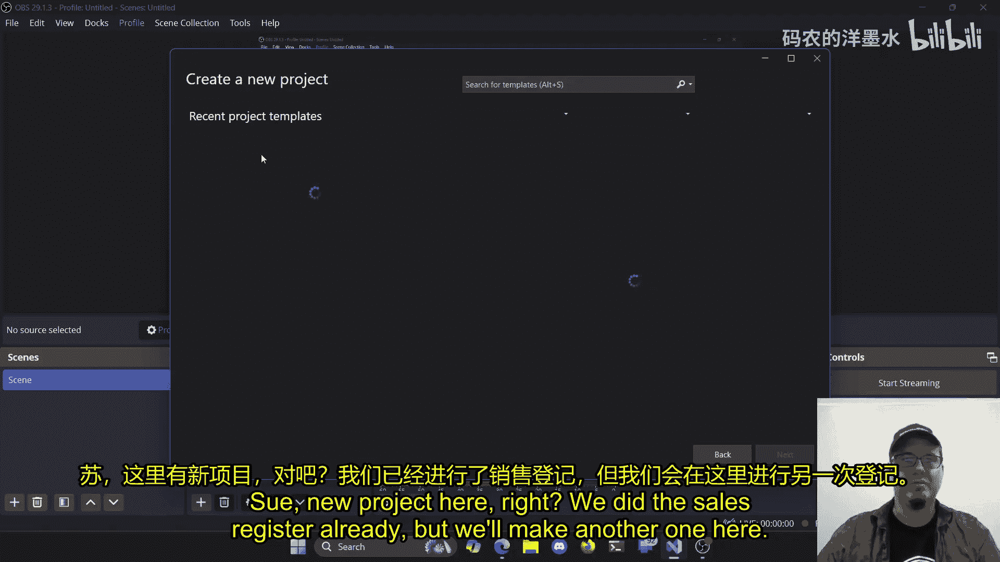

So we're gonna keep on going with our files here and then don't let me forget before we leave I want to give you last time I taught this class is midterm so that you can review that go over the problems before we get to midterm review on Monday where I actually solve them for you that way you've had a chance to try them out it's usually better practice than just watching me solve it that's not very exciting so having done it once is good and then we've got project two coming up do what was the due date for that that they put it out to the 27 that's right okay so we got a little time on that if you could have done before the midterm great if you've done after the midterm great whatever you want to do that's fine it's up to you。

嗯佢。All right， so we'll finish up our file streams today shouldn't take the whole time so you've got a little bit of time to work on Project two if you don't have that done yet so the midterm will open 1022 you don't have to be here you can just take it whenever you want it's on Can it's a Can quiz and then on 1027 it'll be due so it's long as you get it in by 1027 I'm great and we can go from there and then we got just a couple more chapters of new content after that so we're like two thirdds of the way through now right we got the first six chapters in've got three more chapters left we don't go crazy deep when we get to pointers because that's the big topic for next semester when you continue on so but there's a lot two pointers which is really cool so we'll kind of intro the topic talk about it how we least objects and classes and then ideally we've got some catchup review time 121123。

I don't plan on talking the whole session then either so you'll have some time and work on your final project well it' just reserved for the final project work time again ideally it's done by then I'm going to say this all the time because I want people to get it done early and sometimes it doesn't happen so it's up to you can set your own schedule but you'll have a month right from 1112 to 1215 to work on it so should be able to get that across the finish line it'll have some specific requirements here so using Git as we've been doing we'll be making checkpoints along the way so you'll have to have a certain number of commits throughout that period of time that's again to encourage you to start early and not give it to me the last two days and also to help make sure you don't cheat because it's very obvious if you find someone else a solution and you just give it to me in one commit。

Like no one writes code like that that's just not how that works and you never get it right the first time you're always going go back and change it so we're gonna be making commits along the way showing incremental progress on the project I promise it's not hard and we'll talk about when we get there that is another reason we have lots of time that you're going have to spread your workout over 10 days at least 10 days is the goal there so a little bit of work over 10 days you're making your commits building up that commit history it's for your own good it's a good way of working on it and then it helps make sure people don't cheat as well so it benefits both of us right so let's talk about files here so let's make a new project。

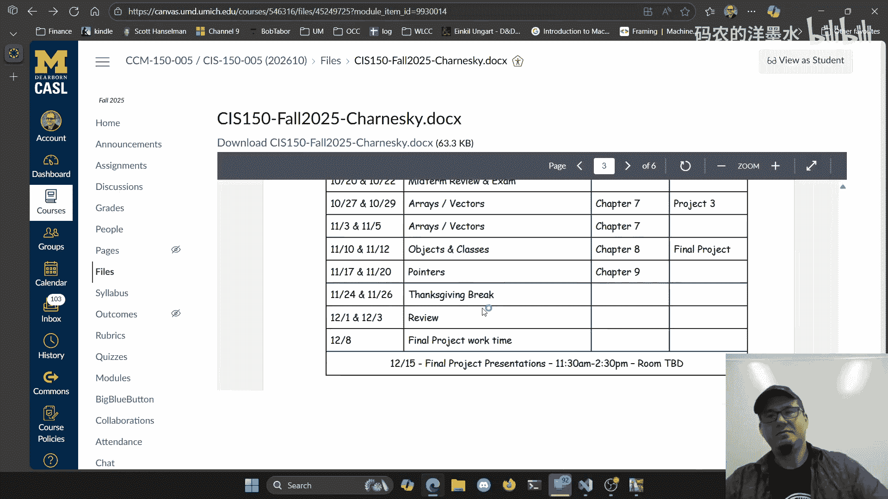

So' week eight so we did the sales register before let's look at one this might be our like our shopping list here so we want to look at a way we can have storing data so we did this line was our item this line was the price this line was the quantity and then the next one was this this was the name this was the price this was the quantity and that works but it's。

Little bit tricky here to maybe have to read three lines Wow that was neat I have to read three lines every single time so we can do it differently if we wanted so let's use namespace standard and then I'm just going to go copy paste here。

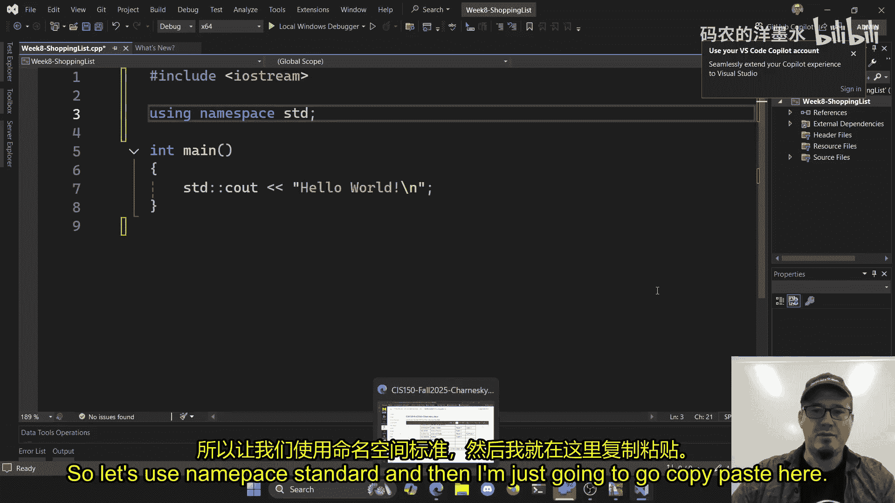

50 I forget all the was it F streams or something they have to use？

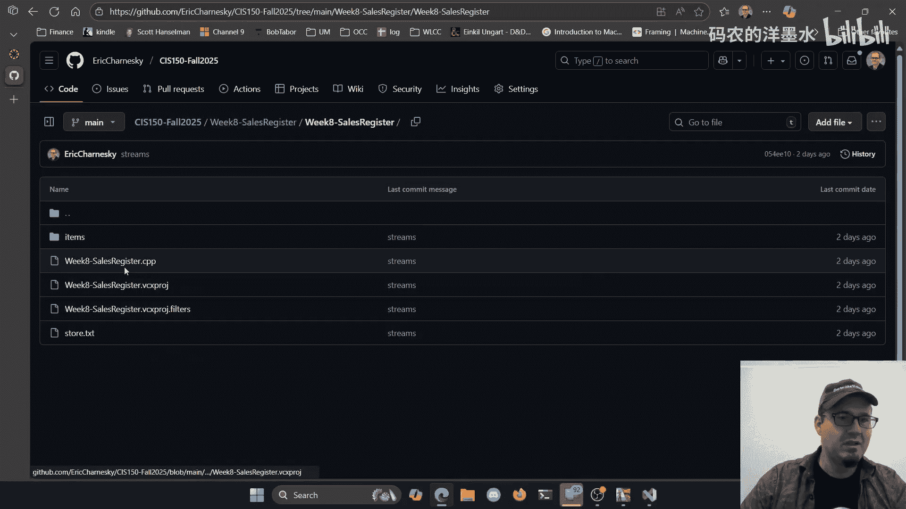

Let's go grab those imports here， yeah F stream， okay。I couldn't remember original of this。

 but I think I got it right， so we'll get our F stream。So if we wanted。

 we can put all that information on one line。And use something we call a delimiter what separates them here。

 So what what is separate， So do you want to figure out how you want to read the file first or do you want to figure out how you want to write the file first。

first right at first， Okay， yep， so so we'll figure out how we want to write so we need to open a file for writing then right so that's our output file stream output file stream。

Stream。Output mile stream is Android OF stream。Stream there if we spell it right it works better and then we're going to go open our file we want to look at a couple different ways of opening these as well got open and we give it the name of the file so notice here it says hey there's one of seven there's seven different ways you can call open here and one of them happens to be the mode here which is the important one so what do we want to open and how do we want to open it what is that mode here。

So if you want to open a file for writing， if you want to ask the user what they want to call it or should we just。

We can to start with list dot Txt you don't need to put the dot Txt here that just it's an indicator to your operating system as a text file so that it knows how to open the text file。

You can open files anyway and you can open it as a text file anyway。

 it's just this helps it here to know how to do that we'll go open this which will blow away any contents previously。

Or it should make the file for us which is nice if it doesn't exist like right now we don't have the file right and then we're going to output into that file so if we had a couple things for our shopping list here。

 maybe we have the store name first so we'll take our output file stream and what store do we want to make a shopping list for？

Kroger Kroger all right， Kroger you can do Kroger right and then what character do you want to use to separate these items so we probably want something that's not in the names of things。

Right so commas are pretty popular but sometimes you do have commas in words comma separated is a little bit awkward sometimes so there's other fun characters you can use I'm quite fond of the pipe character it's the shift backslash they use this for healthcare messaging here so I got very familiar with the pipe character years ago mean I've never seen a pipe character in anything ever in my life so I think that's a pretty safe delimiter here that's the shift backslash that's a fun one here right and then what things do we want to buy at Brorogger what's on our list for Broger。

对。lkMilk all right， and then we'll add another one of those pipe characters I guess we don't could just put all on one line。

 I guess we don't have to separate it all here'll do milk。

What else do we want to buy crroger letuce lettuce， okay？

And X all right so we got three things sure so and then we probably want to add our end line here don't necessarily have to。

 but it'd be nice then just one line there has all of it for us。

And then we want to close our output file stream when we're done so if we just give this a quick go run it should make a file for us again it's not going to show in Viual Studio we have to go add it to Viual Studio if you want to be able to see it here and open it here。

 you can always go open it outside of Vi Studio， but it's nice to have here so we can go add it's an existing item。

And then we can go see， hey， here's our list about TXT。

 so it's cool this makes the file if it doesn't exist for us here and then we see Brorogger milk。

 let us X。Works out pretty nice， so if we want to read our list then。We can go to similar idea here。

 we'll go use our input file stream， our input file stream。

I guess that probably should be a enough year， let me go rename that。

That was F2 to rename so I don't have to rename each one ass my little let's see our shortcut or you can right click and rename it's F2 you don't want to have to type it seven different times or four different times here。

 so we got our input file stream and then we want to go open our input file stream file stream open this is our list Txt。

And now we need to go and read these things out so we're going to have a string for the store name right store name。

 a string for item one， string for item two again after we get back from the midterm it's be a lot easier we can have just n number of items we just we' not there yet so don't worry about it and I' need to go read these things in so when we read it in here。

We can get an entire line， but then we need to go and split that line into smaller pieces。

So we had a couple different options when we were doing that。But we can take our like our string for。

 I don't know the line。Right， and then we can go and get that line from the input file stream so we can take our。

Line。input file stream into the line。Instead of C if we're using our input file stream and we'll get the contents of the line now we need to go split it right so we need to go find essentially where these characters are。

And go take everything in between them。sadly there's not a nice easy way to do that， but that's okay。

 we can go fine remember， there's ways we can find characters in our strings here。

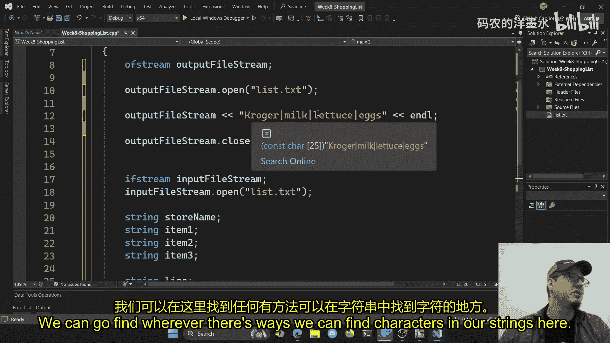

Oh。You know， I'm actually just going to Google it because I don't even remember here that let's find character in string。

It is。Fine， oh yeah okay， that is easy just to find。

 So we'll go find on that now it gives us the position here and this is the first occurrence of the position。

 I feel like we've did this in the Zy bookss Does this bring any bells when he did strings it's been a little bit since they were read through the Zy books。

If not it's new， that's okay， and we'll use this anyway here。All right。

 so we can go copy this off here。 that's finding the character。 Yeah， look at that。

 So this was all in。C++。com I think was the actual link for it here， right？Okay。

Pro that's not even the same one here I want the one that loops。DoesThis one give us a loop？Right。

That's a fun scroll window there。 Okay， that they just stole the same code from down below。

 We at that in their AI answer， finding all occurrences。 Here we go。

 This is what we're looking for here。We're going to find all of the occurrences of it here。

 and then we find again， given the position plus one， the index plus one。

So this is the piece we want here， so we'll go steal this one here。

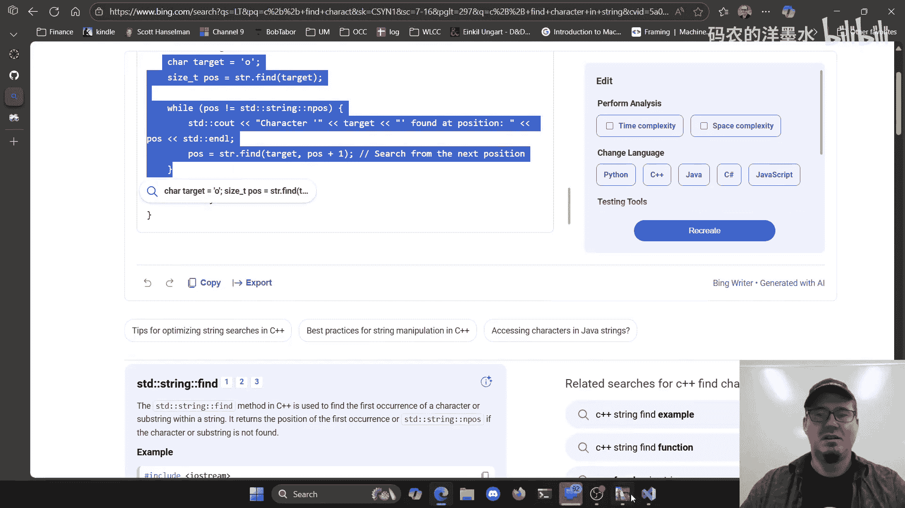

And this will be from our。Being AI answer， what do we ask here， he said。Find character in a string。

 we'll cite our source。So we want to find the pipe character。And that is off of the line。

 we want to find that target character。We don't need that stand， so this is if it's not found。

 it's no position。I don't know why they end pause it was not found here so as long as we did't not find it right as long as we did find it somewhere here we found it at a given position and we know what the position is and then we want to go find the next time we find it。

At that index plus one right， take that index plus one so really。

 I think I like calling this index call this one in oh my goodness， index， not index， there we go。

So as long as the index is there， let's go find it。

So if we can find the given indexes of those characters， we should be able to go and split it。

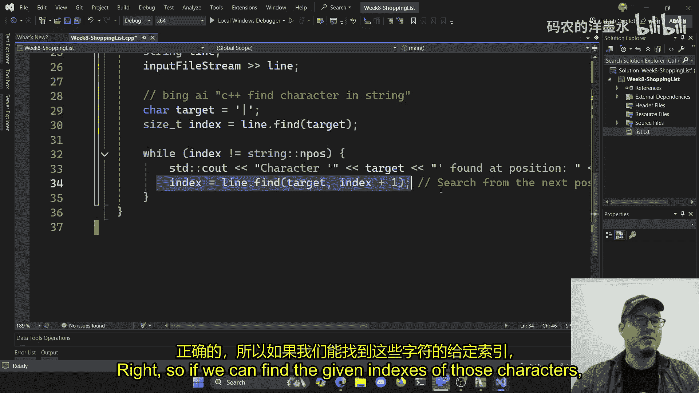

takingking substrs， taking pieces of our strings here as we go， so at 6，11 and 19。

 we found the pipes。

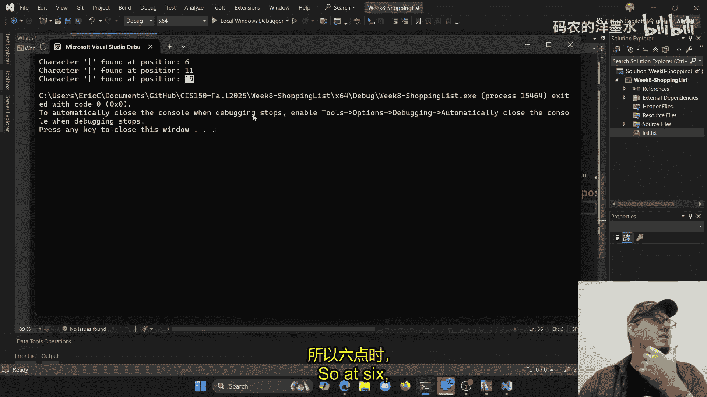

Right， so we can kind of see we're building it out here so everything up to the first one。Right。

 becomes that first character。Great， so we know the first time we find it here。

 then so our store name。Is going to be a substr。 So our line dot substr of， well。

 where do we we' going to start at 0。 We're going to go up to the index。

And that'll grab a piece of it right we did sub strings。Griving chunks of strings。

I really thought we did that one no， okay， thank you。

 sometimes I forget because we do a lot of stuff。Yes。

Now I don't actually need to loop to the very end because I know there's going to be three things because we put three things in here and again we're not doing this based on some variable number so we don't need to go。

Necessarily loop here I can just find every time we can go do this next year so we'll take that at the。

Index plus one。Right， but now I need。Where store name ended。

 so really I need like the previous index， I mean， this is the next index。

Because then my item one now will be my line substr starting at the first index plus one because I don't want the pipe character itself and I want to go up to the next index。

And then we'll repeat that so then my index equals the next index。And then my next index is。

Same thing， go to the next one。Let's break this up a little bit here， right？

So let's find where the first one goes， grab that chunk， find where the next one ends。

 go to that chunk， right， and then reset。Index to the end of the second one。

 go find the next one here and then go grab that chunk again， so this is item2。

And then repeat this one more time for item three。Now item three here。

 we can find the last pipe we just want to go to the end here， so we I think we just say。

Starting up next index。Right。😊，I think that's right。

Because I don't think you have to find the last one for items three， right？So the first pipe。

 the second pipe， the third pipe， yeah， there is no last pipe after that so we don't need to go find again because we're not going to find another one here。

 we just need to go grab from that point to the end。Right， the last pipe to the end here。

Because there's no and we could， I guess we could have added it ending pipe if we wanted here。

 that would keep all the code the same if we wanted。Should we do that， put a paper in our output？

Or just leave it。Either one Okay， just leave it right， that's how we wrote it。

 So let's see now if we can get those values back out then。So we want the。Your。List from store name。

And。Mim1。Item two。And item three。All right， do you think it's going to work find out it'll probably be pretty close sometimes we're off on our indexes here oh。

Size redefinition， oh thats right， we don't need to tell it it's a size again we can just say it equals that right we don't need to redelar it's a type of size tops that one you know the other time we don't have to。

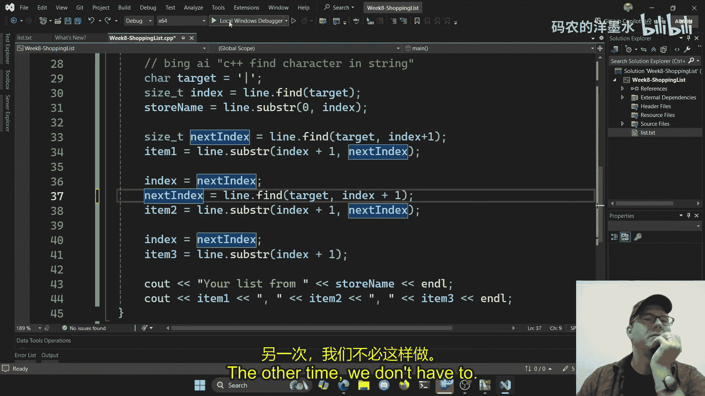

Oh， we're pretty close， we got milk lettuce， lettuce eggs， eggs。

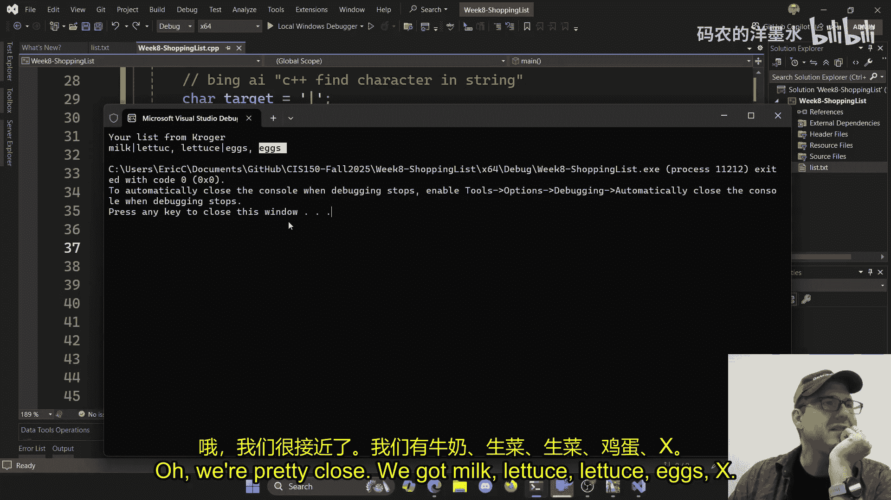

So we're off a little bit here。We got the first one。This must be。So subing。

 that must be the number of characters， yeah， that's count is the number of characters， we want that。

Minus the index here。minus the index。Because this is how many characters to go grab from this position。

So we were grabbing the number of characters of the next one and that wasn't what we wanted to do。

 Let's try that。 We were using substr wrong。 Okay， we're close， so milk is too long here。

 Lettuce is too long。

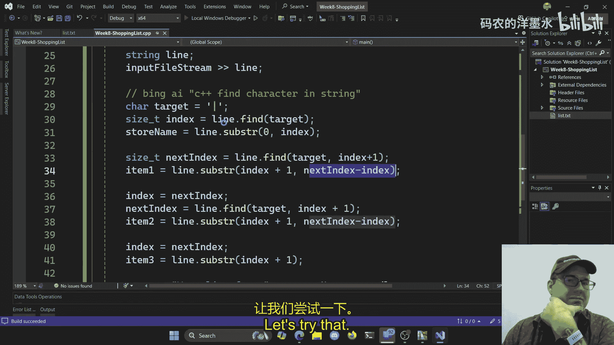

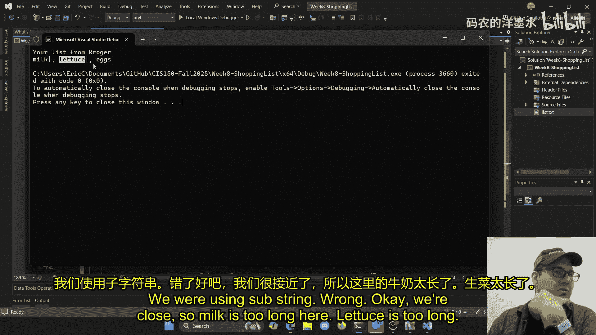

Eggs looks probably okay。So what are we grabing， so because we're adding one。

 we weren't subtracting enoughtract one minus one？Minus one more all right， minus one more。

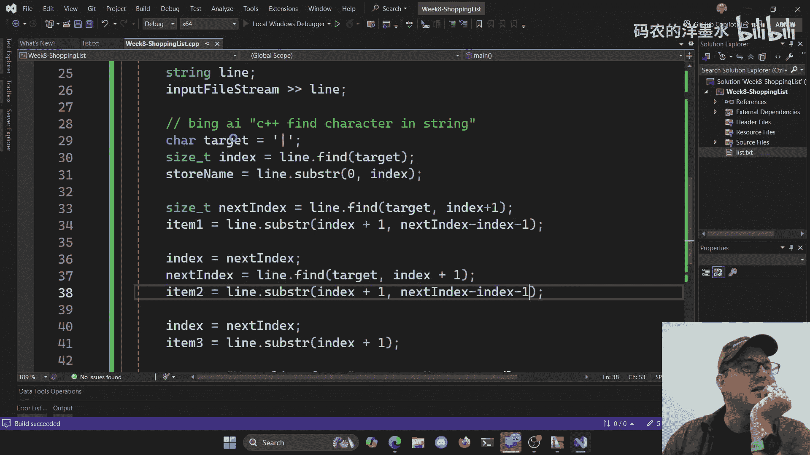

Well look at that， milk medicineison X。

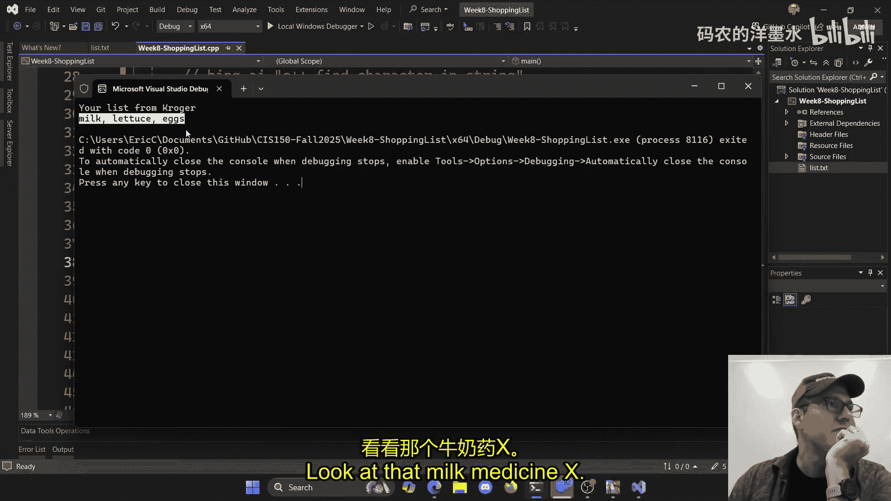

All right。So if you wanted here， do you think this is easier to put everything on one line or do you think it was easier to do one line for one piece of information。

 one line for the next piece， one line for the next piece like this is not really the most friendly way to have to go and read it。

 but writing was pretty easy。And then if I had multiple stores。

 we could just have more stores with more lines。We got different ways of doing it right it all just depends however you want to format it。

 it's perfectly fine。And if we wanted， we could add in quantities right I could have here's the name and here's a quantity right we could use more delimiters or more separation of pieces here right hey。

 what else do you want to stay what else do you want to save here？It all would still work， right。

 We just have to go and split more things。Right。So as long as we know the format。

 we'll be able to do it okay。That's really the hard part you have to decide on what it's going to look like either for reading or writing。

And then you just do the opposite right for whatever we're going to do here so we said。

 hey we're going to write it like this first we have to read it like this right Spting is not too bad here。

I。

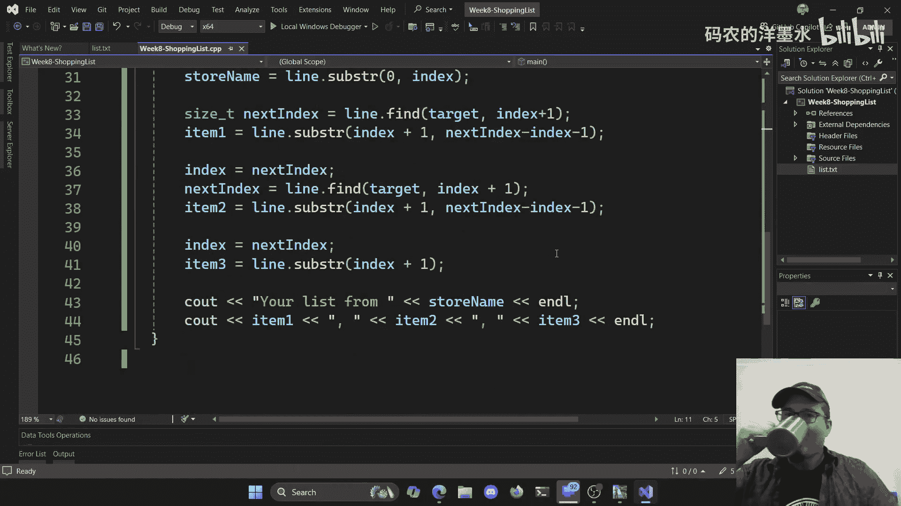

think didn't it give us I think there was stuff on the input string stream。Yeah。

There might have been helpful。 inputput stream is stream。 Did this one let us use delimiters。No。

 that's all one line。😔，We did a thing reaching the end of a stream。Phone number format。

Other are just checking if you actually read a number or not okay。

 that was not what we wanted now this didn't have any helpful hints here that's okay。

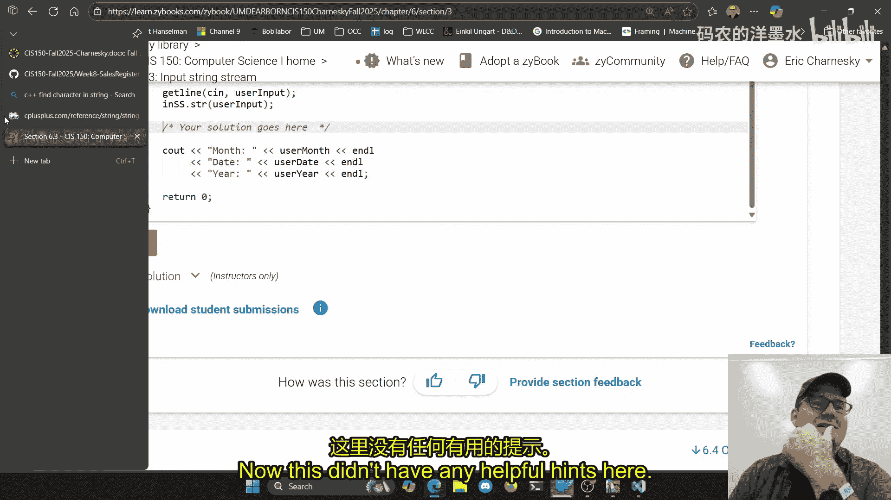

Okay。So lots of different ways of reading our data or writing our data the other play thing we want to do was the different modes here so this was in essentially it will blow away it'll overwrite the file here so a different way we can open our file here which is nice so let's go add say we want to go。

Open this file again， and we want to change the mode of it here。 So we want an open mode。Co and coal。

 how， What is it here， Open mode。It was space。Yes。It's one of these flags here。

I have a space and it though。

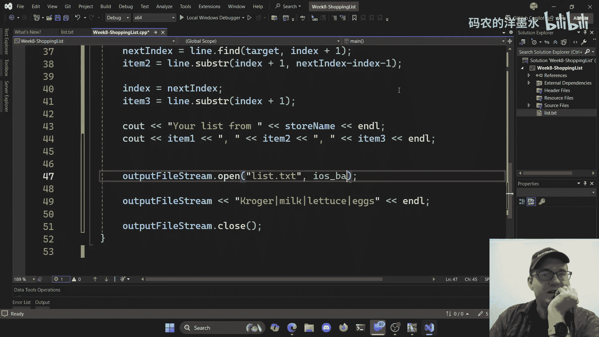

Let's go Google it here now， remember what it was here， a C+ plus open file， we want append mode。

So append mode is how we can open it for adding to it， not just blowing it away here。Yeah， okay。

 open for a pen。Ha。嗯。Open for app pending so we can say， hey， I'm going to open。

Well that's a different utility shoot， that's flock， no， I won't flock。

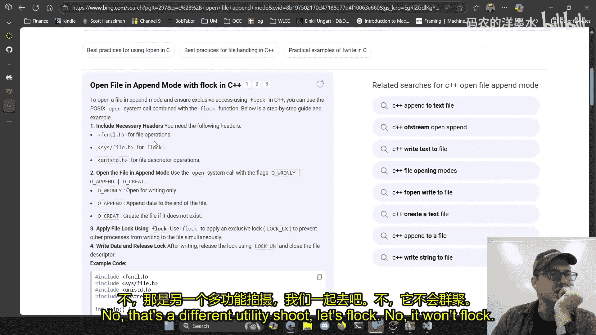

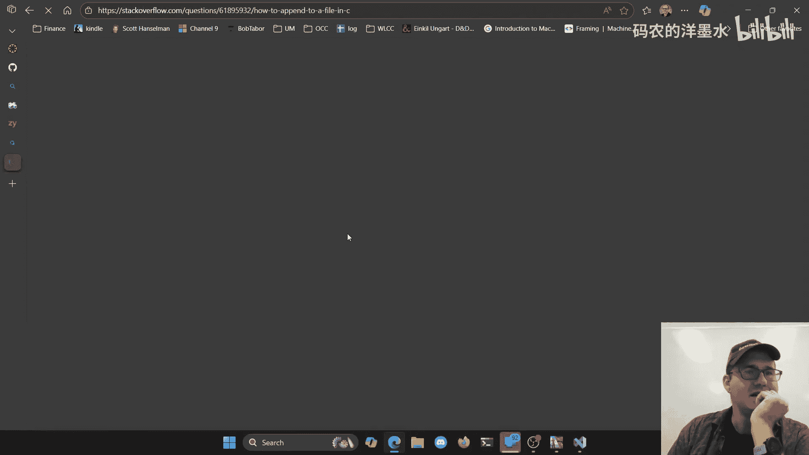

Maybe this for Fl better。Yeah。Yeah， okay， Iowa Space app。😊，Had it there。 Okay， apt for a pen。

 There we go， Ios base。

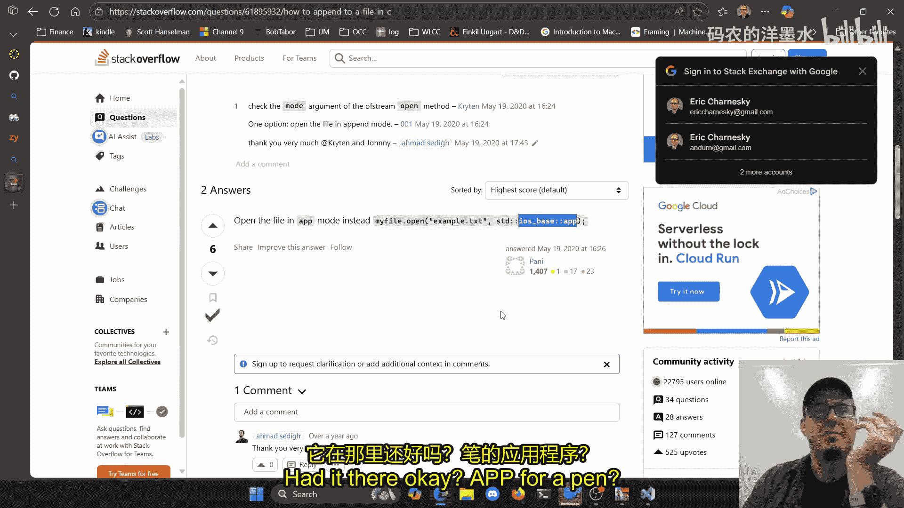

Input output stream base。IOS。Pace。App sure， this is pen mode， apparently it's the number eight。

 but we have like a nice name for it here rather than knowing you have to tell it， hey。

 I want number eight and now let's go add another line here so how will we add what do we want maybe from Gametop what do we want to fight Gametop？

I don't have battlefield。Cattlefield， what was we going to buy a Gametop？GTA， is that version6 now。

 what is it doesn next next fall， Oh my goodness， All right。

 ghost of yote Yo T E I heard that was really good that's just play it Okay。

 but it's for PlayStation only and I don't own a PlayStation and I'm not gonna go buy a PlayStation just to play this game。

What it would come okay， so you think of just a for now it'll be on the it okay。

 I don't like is it a contract thing that they only release on a certain console like yeah it's like Okay。

 but eventually it'll be non exclusive maybe okay。fulYeah I mean they've done a pretty good job advertising it too I think very I've got ads for it so all right。

 so yeah let's try that so let's go open this with a pending here so this is aend mode。😊。

So the file isn't erased。So now when we run our program。对。we don't actually see any content yet。

 but we can open up lists and now we see we've appended to the file。

Which is nice so we didn't destroy it so we might then in our program open it and say oh hey do you want to start a new shopping list or do you want to open a previous shopping list and then they can tell us oh yeah。

 I want to open a previous one， we can open it for a pending or no I want to start a new one okay what' blow away so we can have different options with our file reading and writing based on what they want us to do here and again if we don't have a variable way of adding all these things yet which。

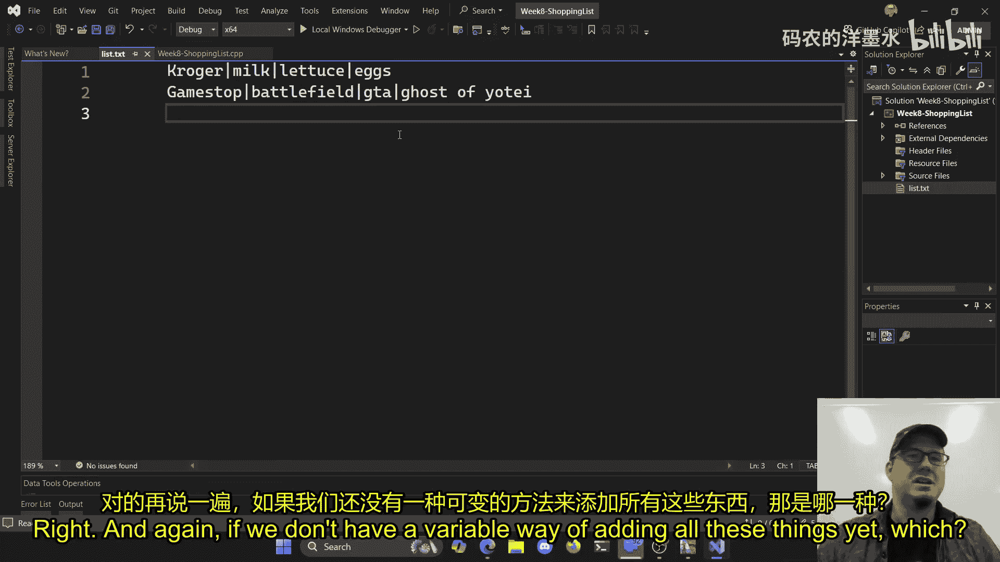

That's really dumb here okay let me let me just go let's go back and steal our looping code here and we'll go do this here because this is it will make it a whole lot easier here so after we've written that here we'll read the next one we'll go back to our ugly loop thing here and we'll go fix this so what we'll be doing here the next index。

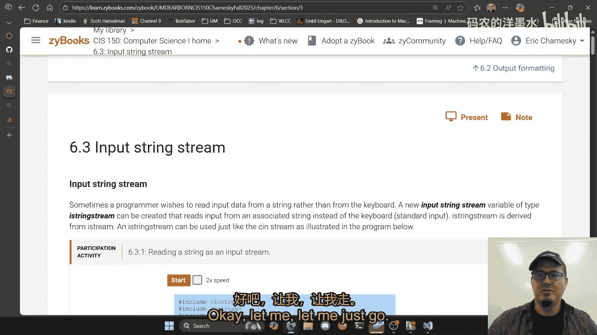

嗯。Whilelow was not and pause， right， so we need to go open our file again here， oops open。

We never closed at， oops， we probably should have closed it here， so an input by stream close。

All right， and we'll go open it again here。Before we do this， let's go open it so I don't need。

This item nonsense here。 So what we do is we use this thing called a vector。

Don't worry about we'll get to the next chapter here but this is items and we' gonna go include vector so if about already you did all I gave them the syllabus and I said this is the order in which we're doing it I'm sorry okay and it's all good sure yeah great so a vector lets you store and number of things inside of it which is very useful because we don't always know how many things we're going have it I don't want to have 10 different variables for 10 items in your shopping list here so we'll go read out so we don't want to read we don't want to close it till we're done with all the lines here that's what have a store name andll of the items。

So we got the first line and then we want to go get that index right of our target character。

So we can just repeat this one here。And then the store name， I'm sure that's the same one here。

Is this one， let's actually go read out another line here because we want。throwrow away Kroger。

Right throwaway the Kroger line we really want the game stop line is what we're looking for here so we'll go get the game stop line。

 go get that one out and then we want to go find the next type character。

 so we're going to go get the next type character next index。

I index then will be by line find the target。Starting at index plus1。And while my next index。

Does's not equal that N pauseuse string N pauseuse。

 then we can keep on going because we found more pipes， more things to read here essentially。

 we've got more data to go read out so I can take my It vector and I can add something to it I can push back says add something to this vector here I'mre going to go add my lined up substring。

 starting at the index going to the let's at next index。Minus the index minus1。

So go read that out here and then we'll go find the next index again。Here starting at， oh。

 I we need to change index equals the next index。Next index。Right， and then go find the next one。

 find the next one， find the next one， eventually the last one。😊。

will'll be just reading from the index right when we run out of pipes here。

 we know we hit the end you just read that last thing。We'll go it to our vector。

And because this is a vector of strings， I can say for。I dont what is it a string。Item in items。

See out the item。And probably what a comma as well。 is it'll be a little bit ugly， but that's okay。

 And then eventually we can add。嗯。A new line。对。And mine， although we need the store name， so see out。

List for new store name。And then we'll loop through our vector of items here。

And we should be able to go read oh bill errors， what do we do here Oh。

 we don't need to tell it's a string again for store name so I don't need。Tell it that。

 and I don't need to tell it it's another line， we already have line， okay。

Two different redefinitions nope okay almost there， almost there input file stream redefinition okay。

 so we just have to go open it again here there we go you've already told it it's an input file stream we just go reopen。

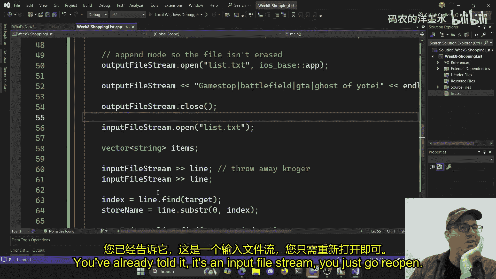

Oh， it's so close， so close， what we mess up here？

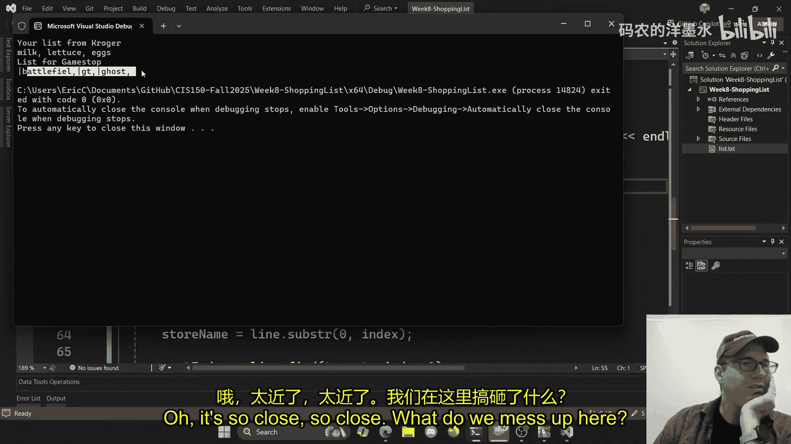

Since it's not what we did before， the next index minus the index， minus1。

 next index minus index minus1。From the index， oh index plus one， there we go。

 we forgot index plus one。

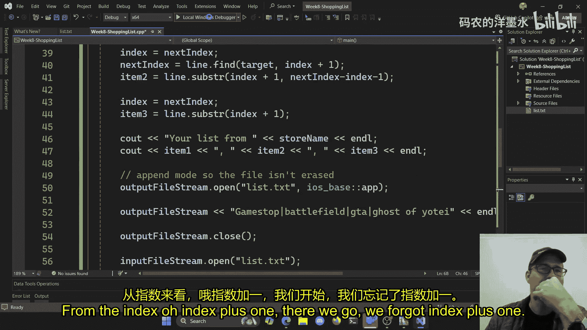

Let's try that。Battlefield， G TA， Oh， R。Spaces got to us here， we did a bad thing with our spaces。

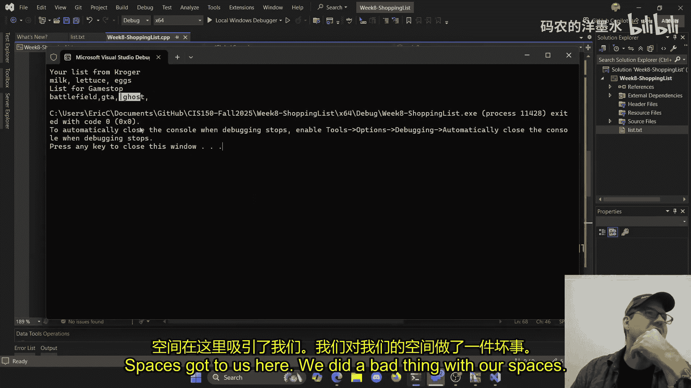

嗯。Should have been fine。 Oh， because when were we need to gi line here instead of use the line so let's do。

A gi line。From the input file stream。To the line variable here。嗯。It not。Se ice stream。

 Can we just use Git load。😊，It's another the re format。Let's try that。 Does that work now no。

I did the。No。And it doesn't like that either。Basic ice cream。

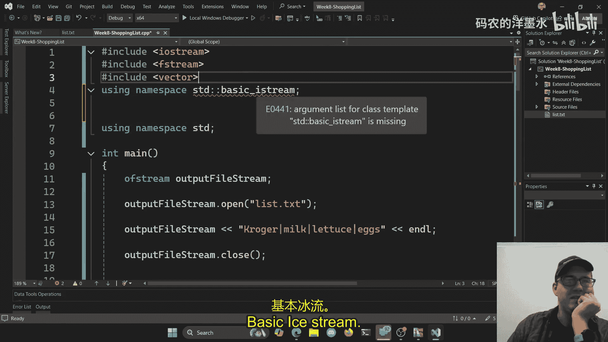

嗯。Thought we just did get lines。Yeah。I it in the that wish I just Google it， I should just Google it。

 C+ plus get line from file。😔，She。You get line with a file。是。Can I。反好。

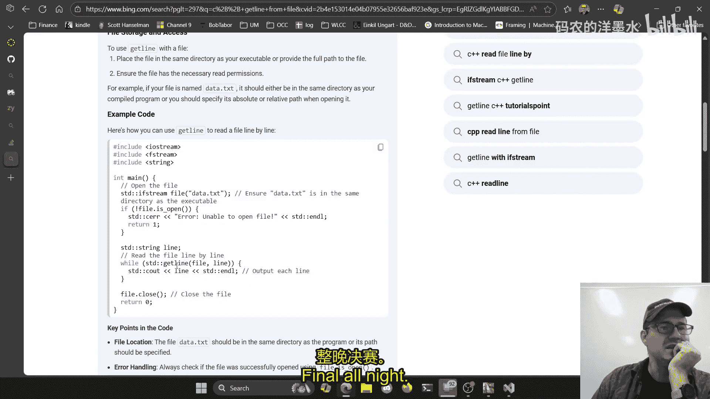

You know what they did。Get mine。Given the file on the line。It the inclusion stream。So。In drinks。Haha。

 thank you， yeah， all right， thanks， you get a bonus point。All right。Let's try that。

 So if we get the line rather than using CNNs， we won't stop out of space， right， our usual。

 oh invalid string position。 Okay， we'll broke it。At where Line 75。The indexdex is invalid， really。

Oh， because the next index became invalid。Well next index is not in files。It should have stopped。

All right， What do we do here， We've got our items。Yeah。We're so close， we're so close。Okay。

So let's put a breakpoint in and we'll watch it。We'll do it item by item。Really。😮。

I put a break point in I never got there。Next it。Next index was invalidin。Okay， sure。

 next index was invalid， so index was invalid finding pipe in my line。Oh， line is blank。

So Giline didn't work here。Getitline。All right， All right。 let's see。

 So something didn't work with Git line like we expected。 So we get the line。

And line is the first one。 Now， gi line。Its blank。 Let's try a second line。

 I think it might just be getting the new line character at the end。 So when we get the line。

 it stops at a new line character。 And I think this read the new line character。Throw away。Wine。

 because that would give us a blank one here， and let's try that。Now we get。

 let's see line is blank and now line， Okay， yes， so it captured the new line character at the end。

 when you mix and match these， it can get a little upset doing mixing and matching。

 So I guess we probably should have done gi line first。And then did that one here。

 That's probably okay。 Al right， so now this hopefully will work here with our indexing here。 yep。

 and then we can get our items， get our items。Get our items out okay。

 and now let's just continue and see if we get the right output。

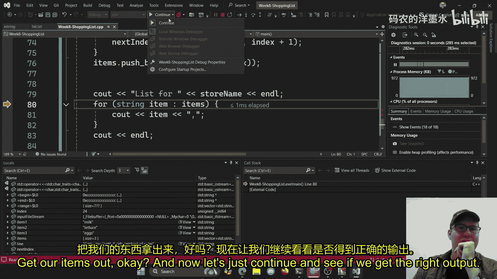

WhatHow does their output look？Battlefield GtaA goes to Yoote。 Oh， everything but goes to Yoote。

 so we had an extra。 we forgot the plus one at the last one here。

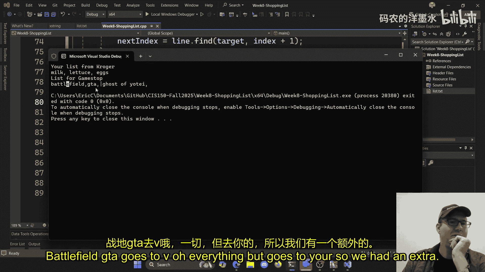

Index plus one。All right， almost there， just take out the red points here so it just runs。

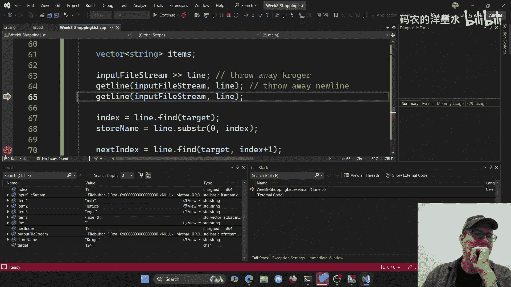

And continue。And now we can have n number of items finally。

 so I can run through as many items as I want in my list here and read them all out because I can just keep adding to a vector eventually there's a limit we're not going to hit it right with the shopping list I promise you know。

 somewhere in the millions or billions mix size E+ plus。

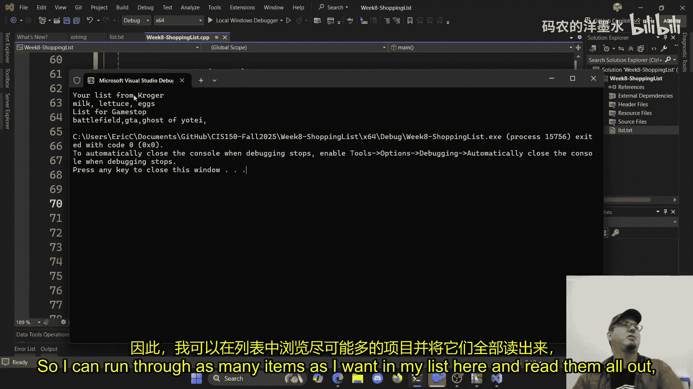

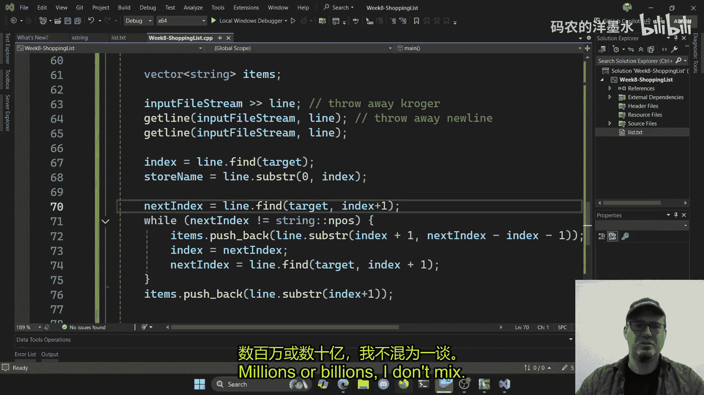

How many itemsom can a vector have？对。嗯。Depenent on your hardware and operating system。

 somewhere around2 to the 31。We're not going to hit that Okay， I I can， yeah。

 that's a pretty safe thing that。 we won't hit that one。

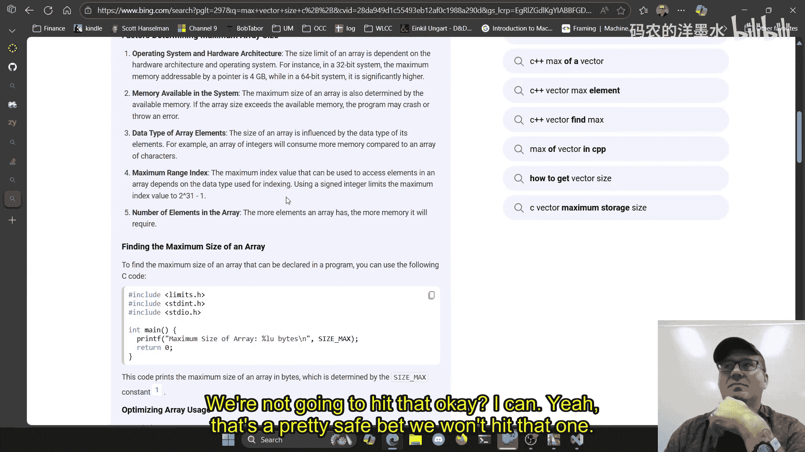

So okay， so I'm curious if this one works real quick， though。

 can we just throw away the first line and have a work？

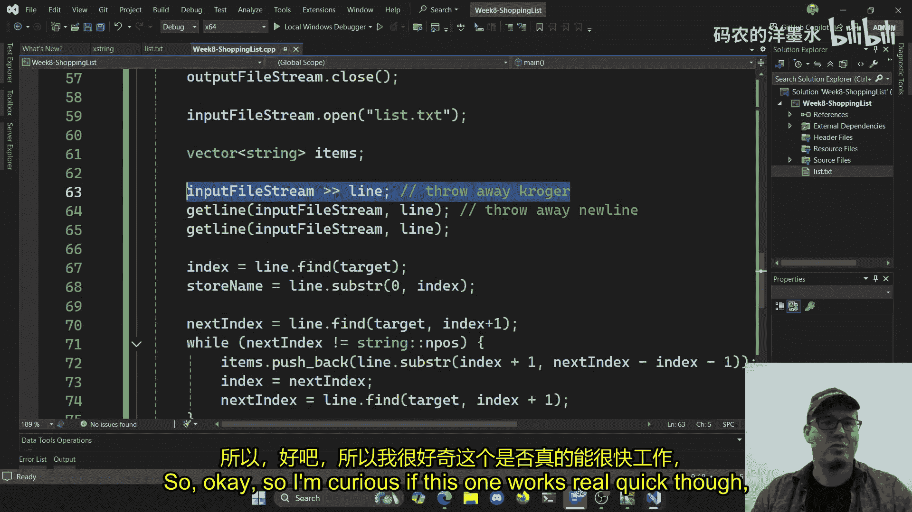

Yes， okay， so don't mix and match here， so let's throw away Rover line。

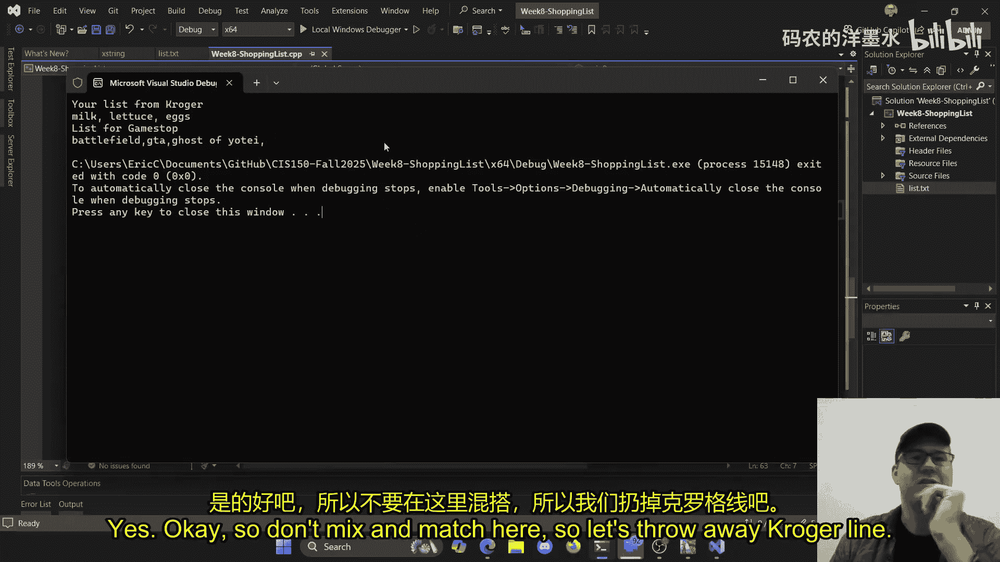

He that way。Right so this way we just get the entire line goes all the way it get to the new line character I don't to mess with any of that nonsense so hopefully you've had a chance to play with the debugger here I've used it a few times when I run into issues here but that really is the best way to find out what's going wrong right I obviously did that all on that purpose to demonstrate for you what happens when your program doesn't work the way you expect it you just put a breakpoint in you say what does my variable look like what's happening why is it like and you kind of work through it step by step by step by step。

So you're learning from my pain here and it's okay it's going to happen to everybody it happens all the time and we just take it through step by step I think it should do this and it's not doing it or what's happening right and we just kind of inspect and see what's going on there。

So be okay so far？Feeling good so again， this is a little bit awkward with this format。

 but now that we've at least mentioned vectors， I think this format is much more flexible because if I have n number of items on a shopping list。

 I don't know how many lines to read if I was reading one line per item until I get to like the next store。

I wouldn't know when to stop。Right so with this formatt， you're like， okay。

 read the first thing is the store name and then read to the end of the line。

 you can have 50 items for Kroger， you can have three items for Gametop。

 you can have seven items for my whatever you want here。

If I don't have just a line to read to the end here。

 I don't know when I'm going to stop and get to the next game or the next store name if I read here's an item name。

 here's an item name here's an like line by line by line so while this seems like it's a lot more work at first now that we've talked about vectors and you can have n number of items。

 this becomes the preferred format。As otherwise you have to do a lot more and you could you could say。

 hey， there are going to be three items to read and one of the things you read out is the number three。

 so like you might have the store name and then you might have a number three which indicates there are three items saved and then you go read three lines。

And you've added those three lines， so there's ways to do it both ways。

But this is a little bit easier because it's just you just read to the end of the line and you're not you don't need to do any extra work and say oh how many items did you have initially here but you can do both formats it's just whichever way you want to do it here so when we get to our final project and we're reading and writing files here and it'll be some flexible number you can pick which way you want to do it whether or not you like the single line or you like you know I'm going to tell you there'll be seven lines to read you just go read seven lines okay？

All right， we good so far。All right， should we call today day？

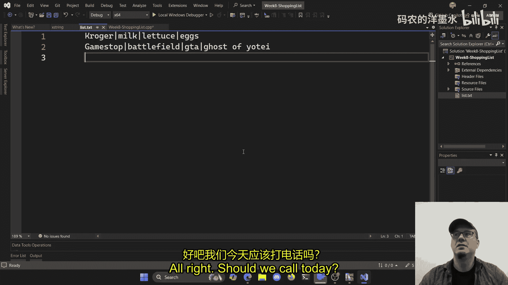

We've got the project to finish up。And then， oh the midterm。

 I got to give you last semester's midterm， that's right， I'm me go find it here。50。D。Oh 150。

All right， fall of 23， oh， it's been two years， okay。Quzzes。The term。Preview。All right。

 so first one you get a free point for agreeing to the academic integrity policy and I mentioned this before。

 someone actually did a study and turns out if you ask people beforehand they're less likely to cheat than if you put the question at the end to be like please sign here to certify you didn't cheat because then you've already gone through the whole test and you're like。

😊，Oh， I guess I'm just going to lie rather than oh。

 I'm going to agree not to cheat and just not cheat here。

 So I tell you the story about U of M and Ohio State。

That's a good one so someone else did a study because human behavior is interesting and I find it interesting even if it baffles me I much prefer computers because it make a lot more sense to me than humans but they had a bunch of people come into a room and the idea it's a math test and you would essentially score yourself on it and you go up front and then you tell them how many questions you got right and they give you that many like hey I got $19 out of 20 right they're like okay here's 19 thanks for taking the test so they had a group of people from probably Ann Arbor I don't I don't know the actual city here and then they had someone dressed up in Ohio State gear get up after like three minutes when obviously you couldn't solve 20 problems in three minutes go up to the front be like hey。

 I got 2 out of 20 right。And everyone in Ann Arbor saw this。 and they're like， oh。

 those dirty Ohio State people they're a bunch of cheaters and they were less likely to cheat because dirty Ohio State people were cheating and they're better than that。

 And then they ran the study again and they just had a random person not in some sort of swag。

 get up and cheat。 And then that made people more likely to cheat that like oh。

 someone got away with cheating， I can cheat too。 I can get 20 bucks for free and not have to take the test。

 So if there was someone in your opposing group who you think is dirty of a cheater and they're awful people because Ohio stinks。

 you're less likely to cheat because they cheat it。 But if they're just some other person like， oh。

They're like me， I can get away with cheating too you're more likely but cheat so human behavior is really weird like that So if you see someone Ohio State gear taking the midterm。

 you can assume they're cheating and you're better than that， right？All right。

 so again open book open notes open internet， you're going to cite your source right all work submitted is your work unless otherwise cited okay。

 but it's still English paper rules apply， you can't just give me one quote be like， hey。

 I found the answer。You didn't do any work right that doesn't work so like oh hey I found one little piece here that's fine ci it that's great here so other than that's 15 quiz style questions true false but with my true false questions you have to correct the statement to make it true I find it much more interesting this way here so variable names can be anything you want them to be as long as they only use letters numbers and the underscore character is that true or false。

😊，Again， you would say true or if it's false， you would correct the statement and say， oh no。

 they you know have to be this this or whatever it happens to be here true or false using the percent sign operator gives the decimal remainder from integer division of the operas。

Right， so true or false again here this one's a bit of a trick question here it's not a decimal right so you'd say the integer remainder right false it gives you the integer remainder for example that one so some other questions here。

Mostly true false， I think there's like one or two fill in the blank this what's two reasons to use functions。

 just a short answer， two reasons functions are great。

Right just short answer here and what three things must you do with file streams and you work with them。

 you open them， you rewrite them and then you close them right technically it gets closed automatically when you're done with the program but you have to be closing it and it's good practice to make sure you're closing when you're done here and then we'll have three long answer questions those just write some short bit of code here shorter than a lab exercise the idea here is these take I imagine about 10 minutes each so that if you needed twice as much time on it。

You could have that much time on it so like five to1 minute teach is just my best estimate here this is really hard to gauge here so it says write a program that ask the user enter scores 10 scores from0 to 100 ensure the values are between0 and 100 inclus of both head for every value valid value entered count how near greater than 80 print the number of values greater than 80 at the end loop validation loop and we're just counting something along the way right pretty short this is like six lines of code。

But we just you know work through a little bit here。

 please do this in visual Studio and then copy paste into the submission box。

 don't write your code here。Right， because it's likely your code won't work if you write it here。

 right use Viual Studio， hit the run button， make sure it runs in Vi Studio and then copy paste it over。

 okay。Perfectly fine。 Use your tools Next one， write a function。

 It steps to1 in3 x plus one sounds like a bunch of nonsense。

 but it's really fun here that accepts an integer value。

 count the number of steps it takes to get to the value one by following the rules below if the numbers odd multiply by3 and add one if the number is even divide by two there's a whole video here I don't know if it's the standup math guy or the veritassium guy some fun YouTube or did a video on this here and then amused me So eventually you always get down to one but it's unproven mathematically they just haven't disproved it yet。

 but they can't prove it mathematically apparently but any number we want to put in。

 you'll get that down to one eventually so if you put in five， it's odd so you multiply by3， add one。

 you get 16 and then divide by two divide by two divide by two divide by two it took five steps to get from5 to1 is what you'd print out。

Right， I'm sorry。Yeah I think it would return oh it doesn't count the number of steps yes I think you're going to return the number of steps I would probably clean it up so function right so some sort of validation loop question some sort of function question right and then the last one here。

Read a file so to file based question here， count of letter in file that accepts two arguments。

 one for a single letter and one for file name， attempt to read a file with a given file name。

 sound the number of times the given letter appears in the text of the file。

so you got to read through the entire file， count how many how you find that character in every line of the file。

Okay， so three questions again not too long here， these are like five10 lines of code not too crazy。

 but you should take a couple minutes of each one of these so that it's if we wanted to you could sit and take it in class I don't want to you don't want to no one wants to right but we could if we if we had to I don't even know if I can do that because not everyone has a laptop I don't know how to give it as a canvas quiz and I refuse to make people write code on paper because。

Oh that's we we can do better it's 2025 right we should not do tests on paper。

 but at least coding tests on paper I don't care what the other classes do right questions。

 thoughts concerns that all make sense let me print this one off I think if I。

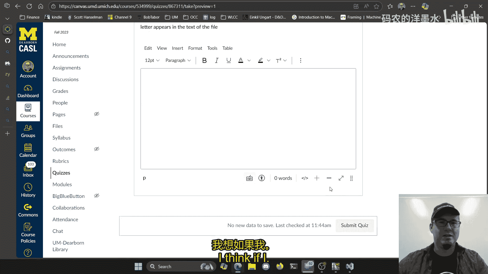

Select I think if I just hit print it works right， and preview， let's see。

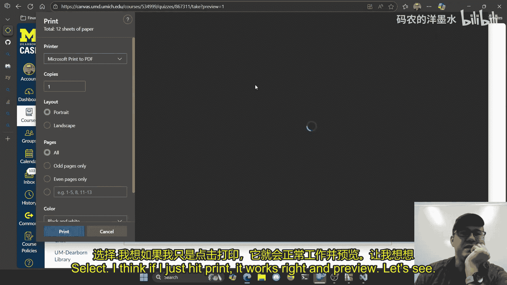

Yeah， okay， I got all thequi。 It looks really long here because they're all the like essay style questions here Let me do this and call it。

😊。

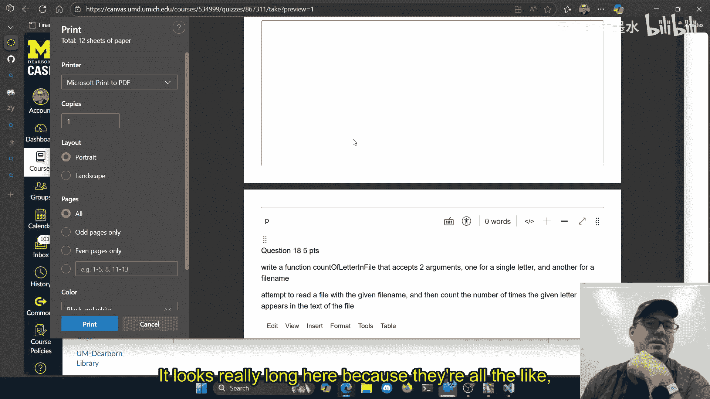

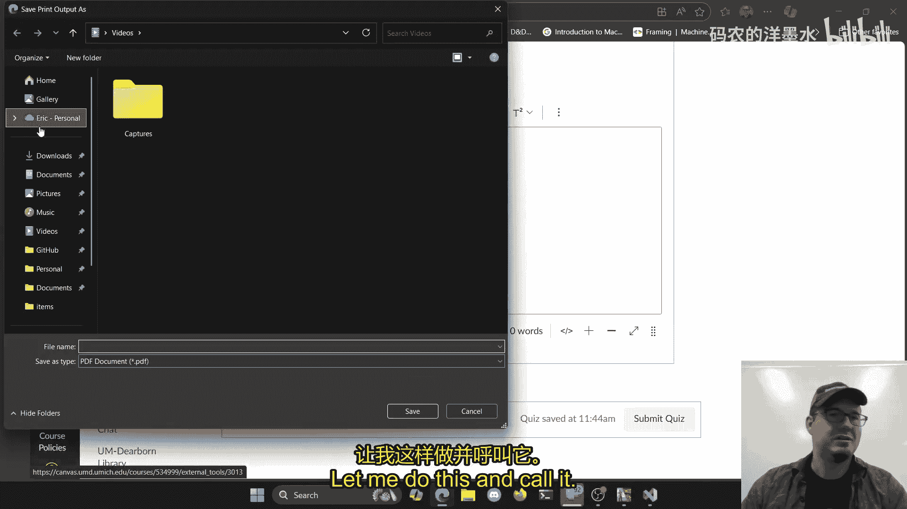

So we up 150， practice midterm。😔，And go back here and i'll go add that as a file here so i'll go over the solutions on Monday。

 that's the only plan I have to do on Monday is just go over the solutions that answer any last minute questions here will not be a very exciting day。

Comload loads， practice midterm， Okay， so there's the practice midterm。Feel free to check that out。

And we should be in pretty good shape。Overall， here let me double check what I put down I think it's。

10% of your overall score will come from the midterm。Yep so mean I can plug that in here too as well。

 let me add another category here for midterm。Midterm edit。I never did the great， and I'm sorry。

 I never did the weights here， shoot。That was what 30 and 10 and 10。Great。😊。

took go back and look and see what I wrote down， if I don't remember， I just looked at it too。

Labbs are 10， Oh that's right， your labs will be10。And then final project 40。 Okay。

 so then the lab score。 I'll just get from doctor。对。Saed， no， Dr。 Sa， okay， good。

He'll just tell me what your score is at the end of the semester I have it's 10% of the grade here。

 and this is a manual。At score。Let's do what end of the semesters like the 8。

 I think is the last day， we'll say that's 100 points。Right， if you get 95% or whatever here。

 so there you don't have to submit anything for that， I'll just plug in the score。

So this will make Can work a whole lot better for you here too I'm sorry I should have done this earlier。

 Zybooks was 10%， midter 10% and then the final project。Final project。It's 40%， okay， right。

 that hopefully totals up to 100% then。Yeah， I think that does， right？

good awesome that's all I got today folks take care I will see you Monday then if you want to come for a review if not midterm opens Wednesday Monday after that it's due so for sure why'll we see you in a week from Monday。

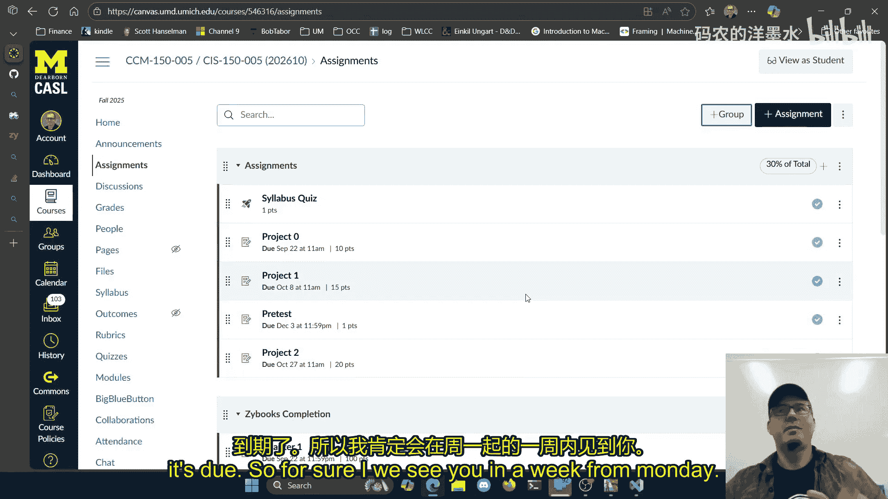