# 【全集】密歇根大学 C++编程 中英字幕 1080P p15 Lecture 15 - 指针 -BV1TsAZzAEHX_p15-

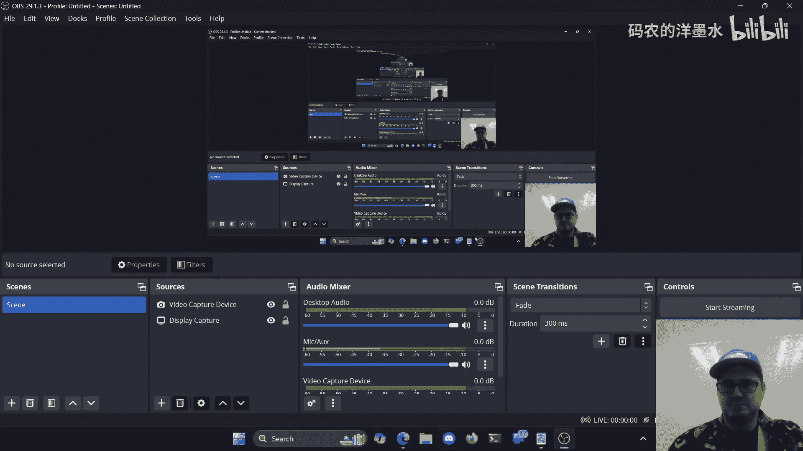

All right， I start recording because I was talking a bunch here and I forgot so check out the standardup math video if you didn't watch it in class it's very exciting that's the sort of stuff we can do again if we have code that simulates real life without actually having to go through and do all the hard mathematical stuff because real life math is hard here and it's easy if we can just write a little simulation is like this is what it should look like here and let's just do it a million times and see what happens so we can do that sort of stuff which works out really nice so that's one of the benefits here being able to write simulation code we can just run a bunch of times now our version is meant to be played but you can imagine instead of asking the user putting some sort of input and output like who you want to buy this property we just pick a yes or a no randomly or we say hey if you have enough money or if one of this theories was if you should keep you some of your cash and reserve some of your value in your properties。

 these sorts of things here we could write the code to make those decisions based on the current。

Of our player we've got lots of ways we could go about doing fun stuff and fun， you know。

 maybe in quotes here， if you don't enjoy monopoly or this sort of game theory stuff， that's okay。

But game theory is also really cool。Not just for actual games here， but used in real life stuff。

 but using these sorts of simulations here， economics is really big in political science。

 psychology this is supposed to be really big in Poci， go talk to some of the Poci people here。

Like apparently around the Cold War sort of times here。

 we did a lot of game theory stuff there's a lot of cool rabbit holes you can get into on YouTube。

You know， instead of getting real work done， you can watch fun stuff on YouTube， so just be careful。

Well game theory is really cool， I think we even have a game theory class don't we？

I really thought we had a game theory class hang， this is worth looking up here now。

I want the class descriptions catalog。😔，Of course it is， there we go。Serious。Okay。

 these mention game theory so discrete mentions game theory discrete two we look forward to that very interesting cis based math glass computer game design and implementation talks about some game theory stuff and computer game design too okay so not it own standalone class but we do get into these topics very exciting stuff here and it is fun and。

Again I like the applicable side of software engineering computer science。

 I don't really like the whole theory side of computer science。

 but that's just me it's okay everyone has their own stuff they're interested in and I am so glad people like writing the vis。

Because I don't want to write my own compiler， that sounds terrible。

 I want to click a button and have the computer run my code and run it efficiently。

That makes me happy so we can take advantage of all that， so we play a visual studio in here。

We unsuccessfully。

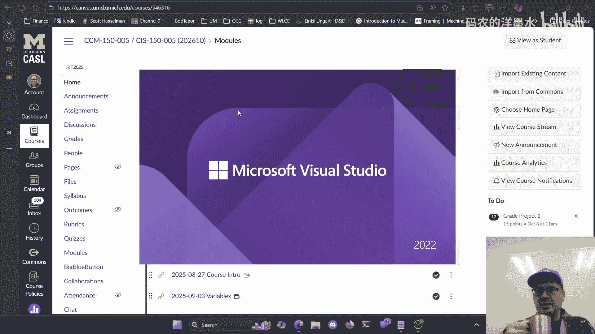

Tried to crash my computer on Monday， was very fun using pointers and dynamic memory。

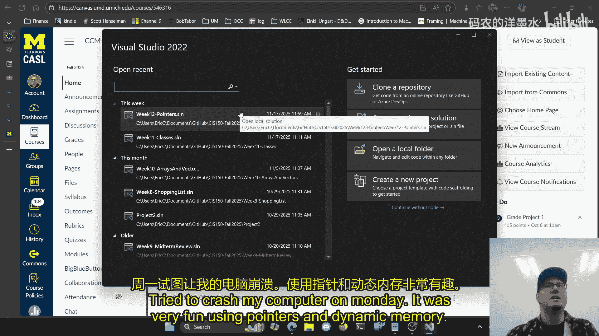

This is why C+ plus is a little nuts here。 Oh Viual Studio 2026。That's exciting。

 I will click that button another time because that will probably take a little while。

So the big hurdle we run into when we use dynamic memory is this new keyword。

 when we use this new keyword， we're asking the operating system to allocate memory on the heap。

whichhich is the bigger pool of memory you have， not the stack that's pre allocateated ahead of time when we start and build our program。

 we know exactly how much space it's going to use right it's as it's running it's going to ask for more memory。

If we ask for more memory， we have to tell it when we're done with it。

 If we don't tell it we're done with it， the operating system assumes that C plus bus is still using it。

 even if it's not， right， we grab 10000 into Georgeworth of space， right 40000 Btes。

 It is not a huge amount， but it adds a pretty quick here。And we just hold it。 and we never let go。

 we hold it。 We never let go。 We hold it。 We never let go。

 So we saw it was using more and more and more and more memory here。

 So if you want to get rid of that memory here， you say delete。No。

The delete keyword will delete a single pointer if we have an array or a dynamic array here。

 you have to say delete square races， delete the array。Pointter。

You'd think you'd be smart enough to figure it out here， but it's not。So be super careful here。

 be sure。It was square bases。On releasing the array okay。

 if you don't bad stuff happens then we can show you right why not this was fun we'll put a breakpoint in。

S。And we should be able to watch the memory being used in our little diagnostic tool here。

 which is really cool。 This is one of the reasons Vi studio is really nice。

 It does a lot of cool stuff。 you don't get all these other things other places。

 So right now we're not using a whole lot of memory right but as we continue on and do this 10000 times but 10000 times。

We're using more memory。And more memory， let's see， is it， oh， did it stop for me， maybe it？Oh。

 it is。Looks like it's not going up， okay， that's handy。没。Let's try that， delete。I use this soul。Ray。

 delete it with scar delete。好。Maybe it's working for us。Did not expect that to work。 it worked for。

 though， that's good。It might be a newer feature a little puzzled。

 but that's okay we're deleting so delete is the keyword to release the memory we've used and you can do it with individual pointers as well right you can delete this singular pointer and you're supposed to even though it's only four bytes here hanging on four bytes when you don't need them it's considered bad form right we don't want to do that sort of thing。

So let's we output at number pointer， so the next thing we do， if I delete my number pointer。

That's just deleting the pointer here right is not deleting the number itself。Because number。

There's a variable that has some value and memory pointer points to that same address。

 so I have number and I have number pointer pointing to the same location here， right？

Deleting the number pointer just says， okay， I'm done with number pointer。

 It didn't get rid of the other thing that existed in memory。

 So if I go and output number pointer here。Let's let's actually just skip over this for a second here I guess I can。

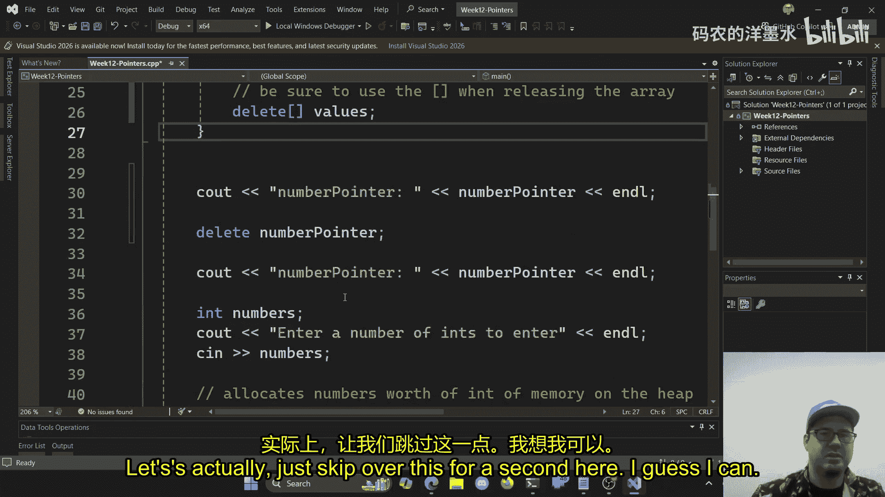

Just run it， it should be pretty quick。

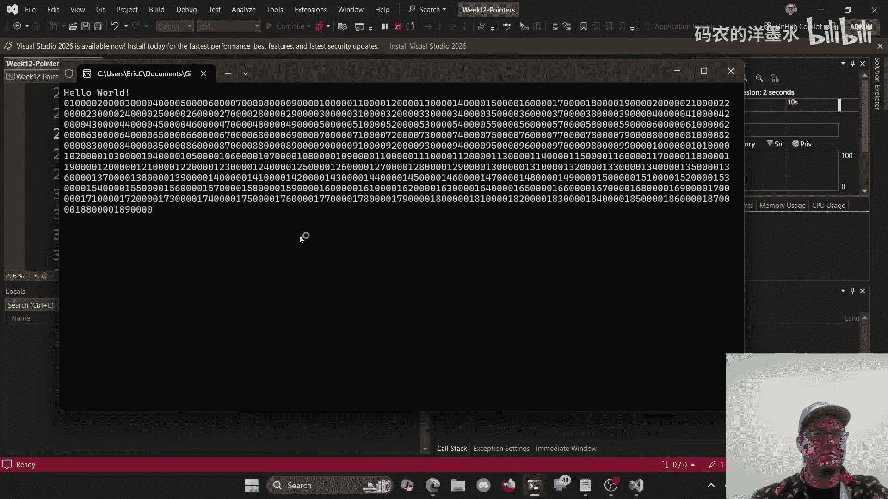

Oh no， it's not that quick can，m sorry I'll just skip it。Okay。Let's do it like once。I make it faster。

哦哦。That stuff happened， we broke our program。This looks like some ugly thing here。

 but here's the stack trace， this is where it broke so somewhere at line 32 like for my main program line 32。

It died。And if we continue on。that。It failed， oh goodness， I can't even click that。It's real sad。Yes。

Come on。Debugging the heap here， they problems in the heap。Valid heap pointer。 Come on， Come on。

 just let it die。嗯。It broke real bad。HeDoes't like it。But you can see it's warning us down here。

We've used uninitialized memory。 If we go delete this pointer here。The compiler knows， hey。

 you just deleted something and you're trying to use it。Bad stuff happened。Right。

 so and to be careful with your deletes， then we deal with pointers。Sounds complex and it is。

 it's one of the reasons you can do really cool stuff with C++ and also you can shoot yourself in the foot with C++ is it will let you do bad things here。

 like accessing bad values， those of all sorts of trouble we get into here。

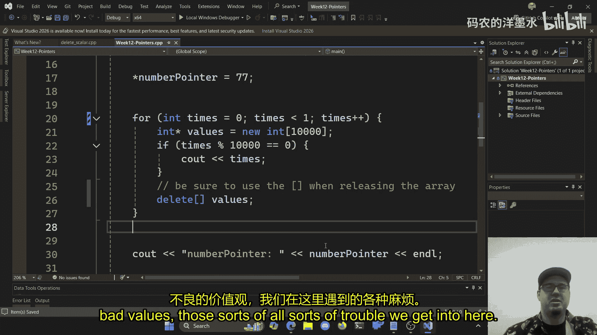

Can be sort of。riskky， you really have to know what you're doing right again another plug for we don't just copy paste code in。

Because we don't really know what it's doing right you have to know what the code is doing here to make sure we're doing it the right way and not running your issues so this is dynamically allocating objects so not only can you do pointers for say like integers but you can have a pointer for an object of a class like we spend a bunch of time writing classes here so you can make a pointer to the instance of a class。

Now that class will be allocated on the heap。Here。It doesn't seem like we've gained a whole lot here。

 that's okay， it's not all that interesting to do it that way。

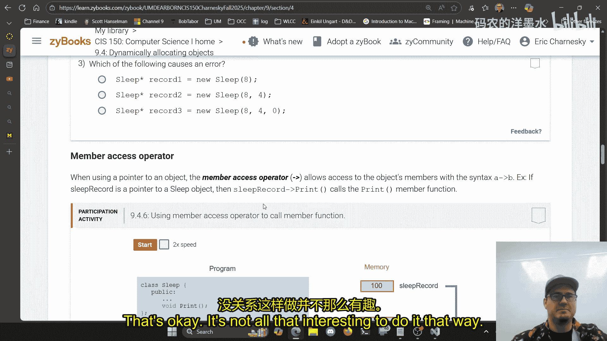

When we start using pointers。We have to write our code differently it's real obnoxious。

 but that's okay， so let's go copy let's go copy paste like the chair class here。

 so that'll be a little bit faster。

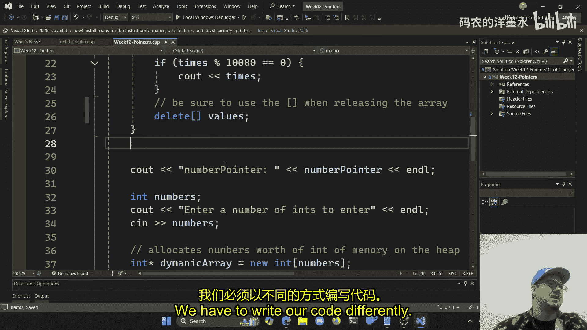

LetSee， it'll just steal it out of here。I don't know let's yeah let's do share。

 I think chair was right in here， right？So here was chair， gets and sets。

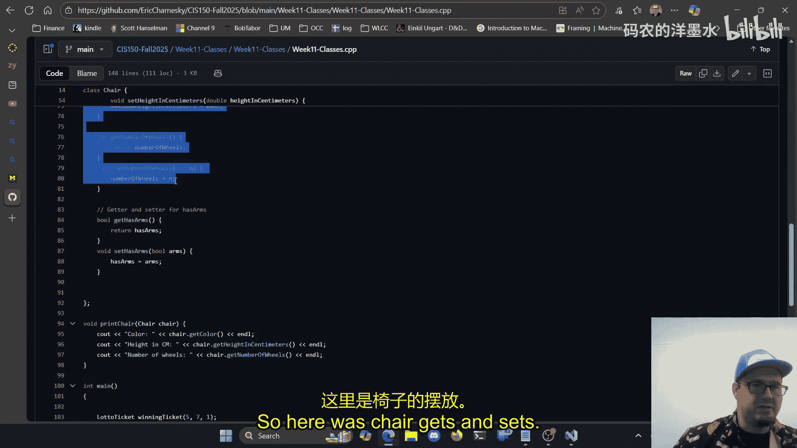

Rightい。And we'll just go dump this on top here。Okay。B last week。

 close enough you know where that was coming from， right？

If I want to make a pointer for a chair here。So hey， I want a chair pointer called Eric's chair。

I've created the pointer， if we've allocated space where we haven't assigned any values that is still uninitialized。

 then we can go use that new keyboard or all on the same line except it equal to new chair。

We use the new keyword， allocating new space and memory that didn't exist before。

 there's no constructor for chair right we didn't add anything here we have to go set all these values。

 but because it's a pointer now I can't just say Eric's chair dot。Oh no sorry when I hit dot here。

 it gives me the suggestions because Vi Studio knows what I'm trying to do here and it's going to auto convertt for me so when I say hey。

 I want to set color here。Notice it changes it to a dash greater than sign。

 this is the arrow notation， so if you're using pointers with functions。

 you have to use the arrow notation， not the dot notation。If we created objects on the stack。

 we can use the dot notation and not the arrow notation。

I don't know why someone came up with it here， but right this is a pointer and we're pointing at this function is the way I like to remember here so if you're using pointers use an arrow to point at the thing。

I don't know that's the best I got here so we'll set that to blue right great now if I just again if I make another chair some chair。

 I don't know Jep's chair。Right。Actually， when only need the parenthess right。

 Jub's chair dot set color， right black。And the syntax is a little bit different right so dot with our regular objects。

 arrow notation with pointers right？Again。Doesn't seem super useful to make these pointers here。

 but being able to put stuff in the heat memory is useful。

 we can do more things in the heap here eventually our programs will get bigger and more interesting。

Eventually right we're just not there everything will fit perfectly fine in the stack。

 but you do run out of space eventually in the stack and need to move over to the heap here I I think it depends on your operating on it looks much。

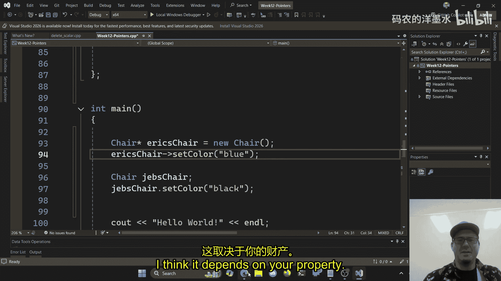

Thank you you so。You was in the stack。😔，let's see if there's a good answer for it here。

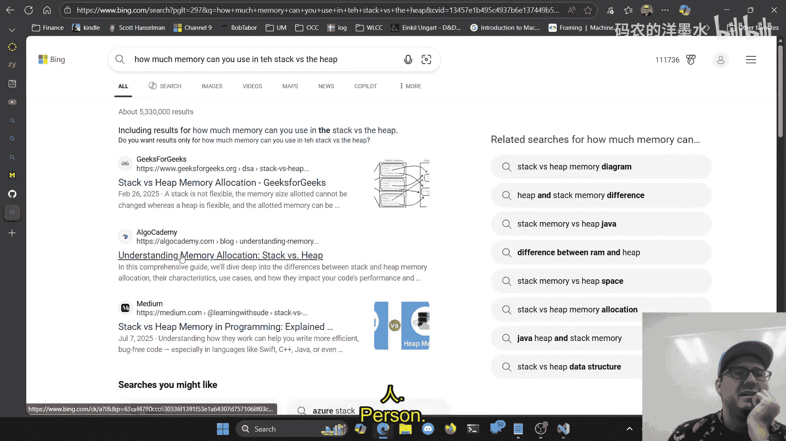

。Does that give us anything？😔，嗯。Yeah， stackle。You get a stack overflowss in Java， but。You know。

 there might be a website namedtack overflow。Okay， you've heard of it， okay。

 it's named after that happily here so heap dynamicically。诶。Yes。

You can get out of memory that's fine， that's Java though。No。

 that doesn't really give us a whole lot of other stuff here， Sta memory heat， there's a fun diagram。

Sure。吓。You have to do it manually， right？Costlier。But more likely to run out of memory in the stack。

we talk about that less space， it doesn't tell us how much room though， then give us a max number。

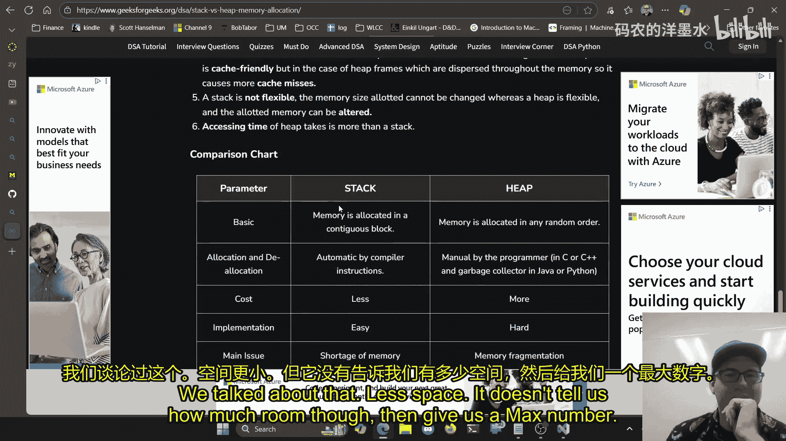

I don't know how much it is。It's less， though。

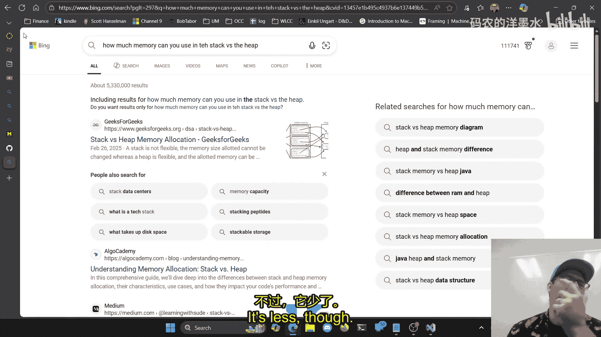

All right， that was very exciting， sorry， we did not find a good answer。

Maybe the AI bots will answer that for us better right i'm sure it won't make up anything。

And then they never make up the stuff all right， the last bit here that's cool with pointers and this is one of the key reasons that pointers are better for us to use。

We haven't got to it yet and I'm just going to show you a silly little preview here。

 it's the next chapter here。

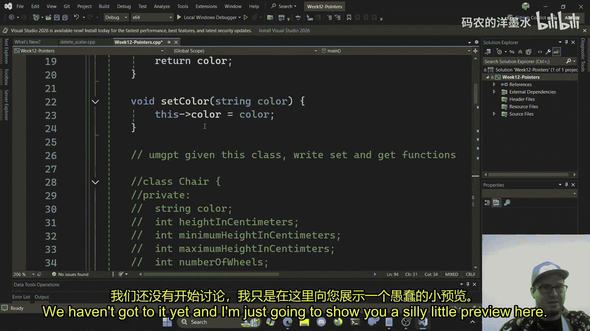

Is on inheritance inheritance is a core fundamental principle of object orient of programming it lets us take something and make a custom version of it inherit from it we're familiar with inheritance if you're like biology right we inherit things from a parent here or this parent class you inherit from it in a child class so you can be one of these things here but you're a specialized version of it。

So instead of having to rewrite someone's code that says hey their chair class was great I love everything about it except this new chair class has a motor in it because why not stick a motor on things so I can drive my chair with a joystick because that sounds like a lot of fun right I don't want have to rewrite chair it already has a color it already has the number of wheels that already has all this attributes I can go up and down all I care about now is I can drive it right I don't want have to reinvent the wheel so I'm going to inherit from chair to make a specialized version of chair that's a motorized chair。

😊，So we're going to use inheritance lots of places， it's a good tool， we don't use it everywhere。

 but it allows us to make custom versions of things here。

 so we can make another class that inherits from chair that is a chair。

 but it's a special version of chairs so I can make a motorized chair given chair。

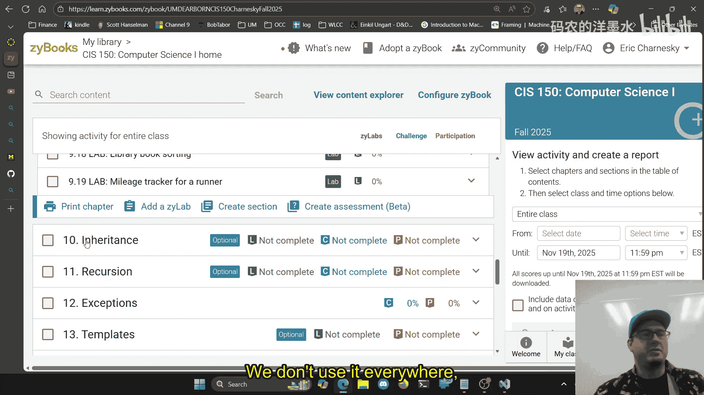

诶。Oh get this。

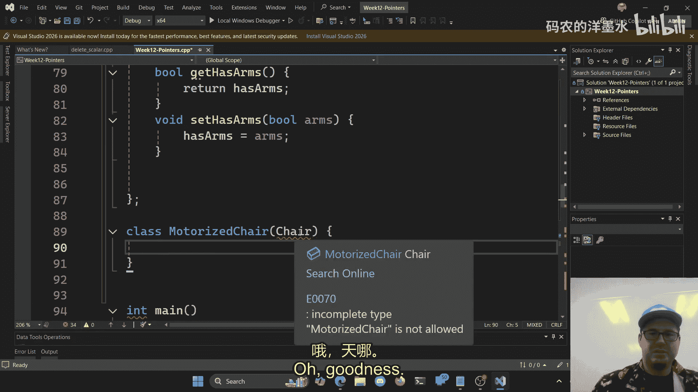

Oh。I hate the syntax here。You you read it？对。Oh， sorry， colon， of course， C plusus is silly。

 that was Python syntax， that's what I'm doing wrong here。

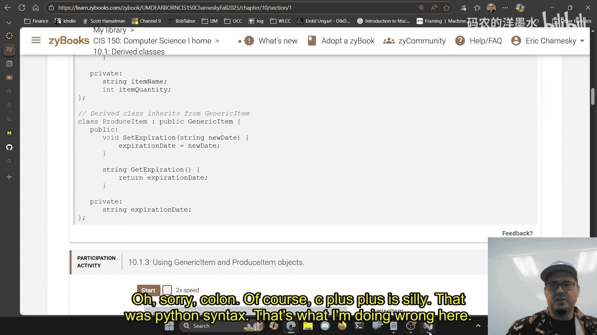

Pt chair。All right。This class itherits from chair， it is a chair。

 but it has all these functions here the chair has， but now I can add special stuff。

 I can have my own private section， I can have my own public section here like Ld Drive。

And we're just going to， I don't know。The out room。Terrible example here， my apologies。

 but that's fine we're just going to output from that's the only thing motorized chair does so and the semi colon thanks if I make a motorized chair now motorized chair。

Pointer， we'll call it a， I don't know， fancy chair。Equal to new motorized chair。Now fancy chair dot。

I get all of the things that came from chair because I've inherited from chair。

 I have all of its public functions。 It is a chair。 It does all these other things。

 but it can also drive， which is fine。 So I've got all the things that it does here。😊。

And my special version， so I can call drive whatever I want to do here and that'll just room when we call drive。

Right。Now we can make another kind of chair here， let's call this I don't what a floating chair。

 I guess there's a funny video someone like， hey we're going to improve our office productivity so we put my office workers in a pool。

To make them happy。 And they' was like， they're working on laptops in the pool。

It was some dumb video it was really funny though right and this one is when you drive it says splash instead of room here right because you're a floating chair now you can splash instead of room and we'll do this again we'll make a floating chair。

 I guess。With a floating chair。They called it floating chair。

And we'll take our floating chair and we'll drive that one here and that one should splash。

So we'll room the motorized chair we' splash the floating chair with our pointers doesn't seem very interesting yet。

 we're getting there to the magic part here Okay， so now this will room this will splash。

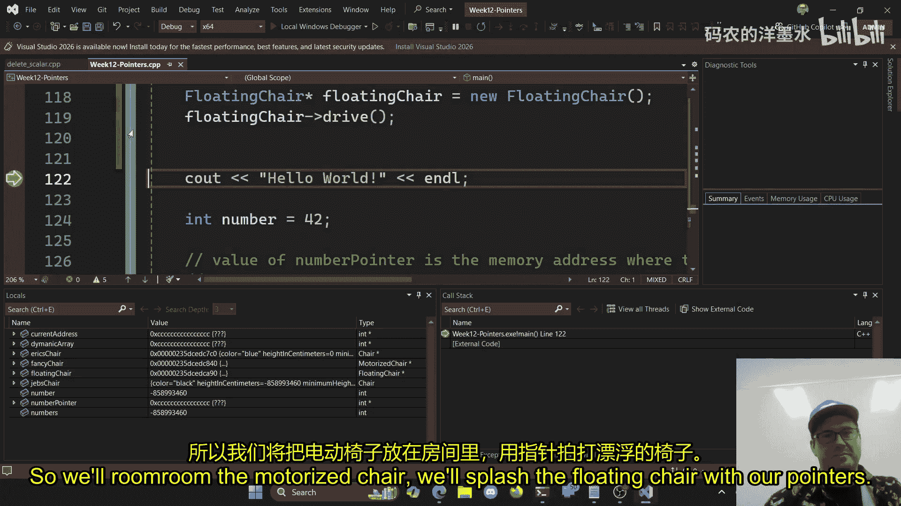

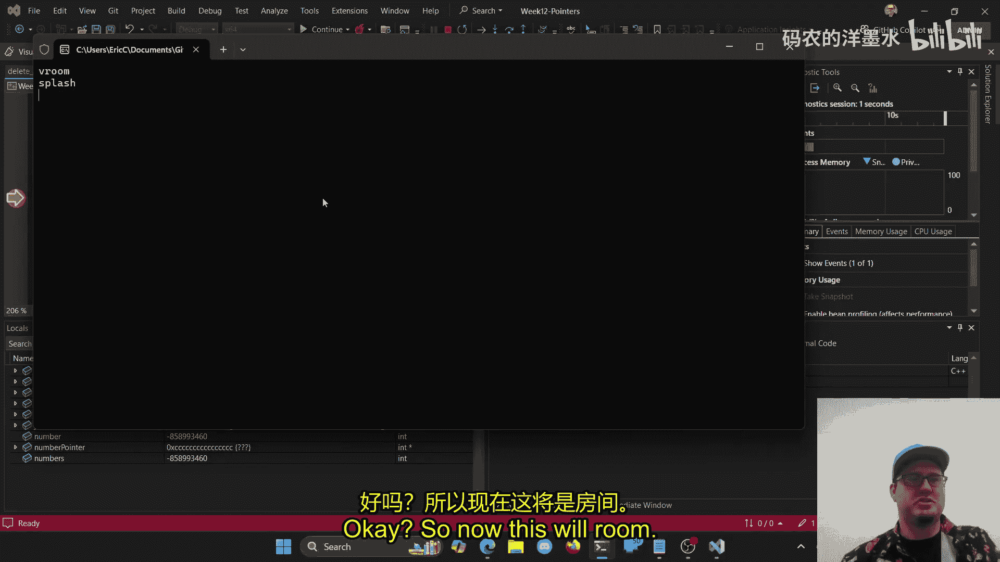

， the last thing I'm going to do here。Is I'm going to add a drive function to chair。Vlod drive。是。

That does nothing。you can't drive a regular chair it's not motorized and it doesn't splash so what I can do is I can write a function here we'll make a void function we'll call a Thr chair given a chair pointer here called a chair and all this is going to do is say chair do drive。

Aero drive， right？So if you give it a chair。It will call the drive function on it。

 given a chair pointer。Okay， so if I call my drive chair。On。Eric chair。Nothing should happen。

because chairs don't drive okay， the other cool thing that inheritance lets us do is because motorized chair is a chair。

 I can give a motorized chair in place of a chair。So I can call drive chair given the motorized chair。

 my fancy chair here。And I can also call drive chair given my floating chair because it is a chair。

And what's going to happen is it's going to call the drive function。

So when I put a breakpoint in here。We're about to drive the chair this was Eric's chair here。

 and if I step into my code here， we get nothing chairs don't do anything。

 They don't know how to drive。Now we're going to drive the fancy chair。

 I step into this one here and step into drive， and it goes to。Nothing。好。

It's a chair right it' called the chair version of it here， we try our floating chair。

 we call drive on our chair。

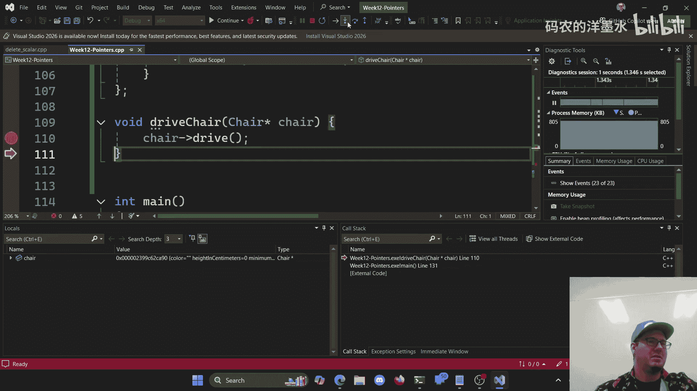

Nothing happens。We got nothing on them。

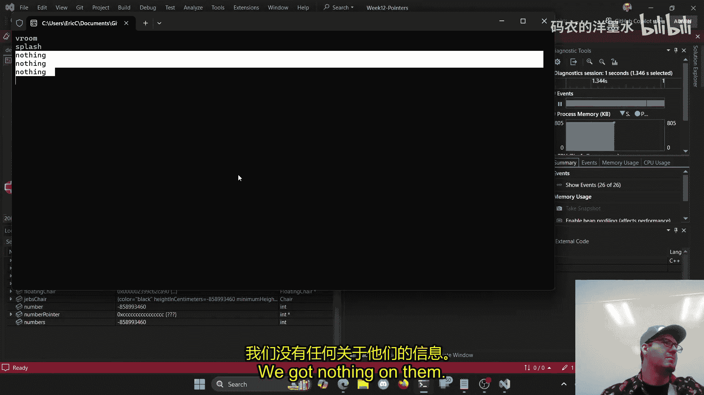

It's not calling the right version here。Right， we told it， hey。Here's the chair。

 you should go do your chair thing。It's calling the nothing version。Right。

There's a way we can fix it。When we write our functions here。

We need to tell C++ that it's okay to do something different。

And we'll get into this more next semester just kind of in the topic because it's interesting and one of the benefits of why we have pointers here。

 we're going to say this is a virtual function here and then when I make these functions I'm going to say they override override here。

alwaysway try it over， is it on this side？Al。Over it there it is。Right。

So now when I run my program just by adding some keywords here， by telling C++， hey。

 this thing is virtual， which doesn't really mean a whole lot here， but that's okay。

We get nothing for the Eric's chair， it doesn't know how to drive。 That's fine。

 We drive my fancy chair。Now it says， oh， this was virtual and there's an override。

I'm going to go do the thing that it actually is so while the program is running。

 C++ can understand that。This function asks for a chair pointer what it actually is in memory has an overridden definition for that function here。

 I'm going to do the actual thing it's supposed to do， not the chair version。

So it's able to at runtime figure out which type of pointer it actually is and run the correct version so it's very exciting I promise so in the floating chair we go drive it and it says splash hey。

 I've found an overridden version here so we get some cool keywords that let my program while it's running figure out what actual kind of class this is here and do the right version of it without pointers。

 it doesn't work So if I just say hey， I want to drive regular chairs here。

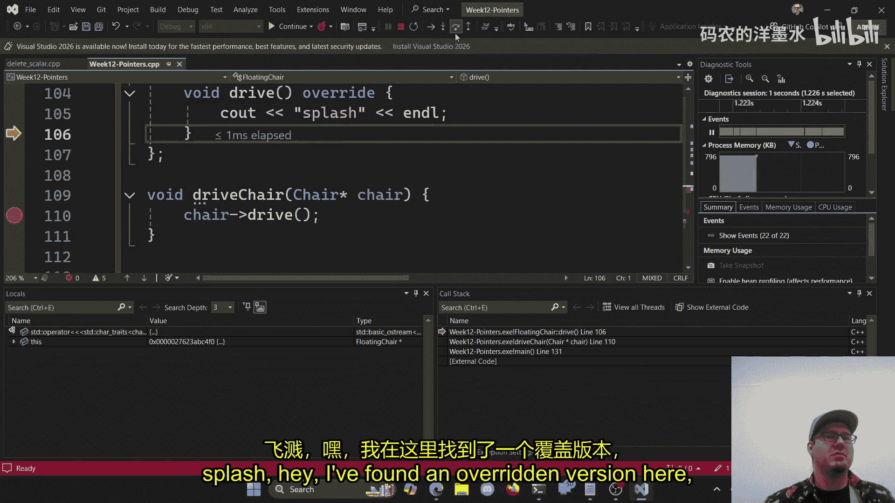

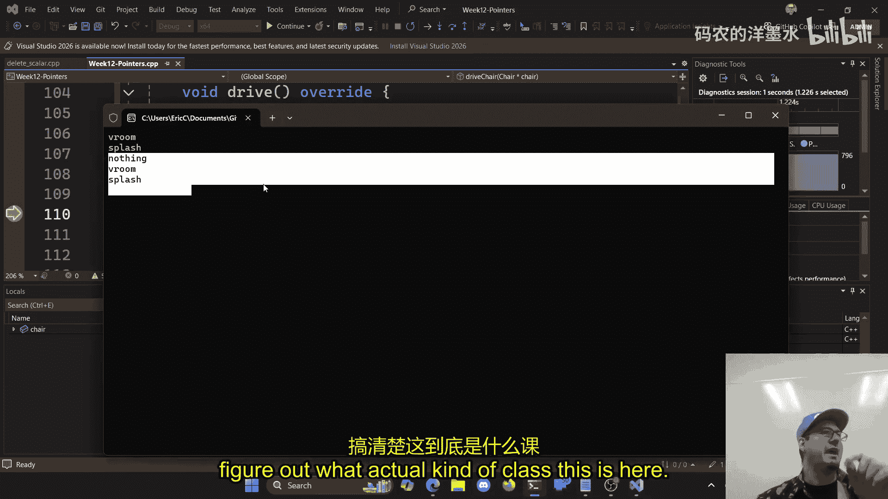

So this is chair dot drive。And then I can dereence my pointers right so de referencing a pointers is give you the memory address of where it is right so now when I run。

Using my objects here， let's drive， drive， drive。We get。

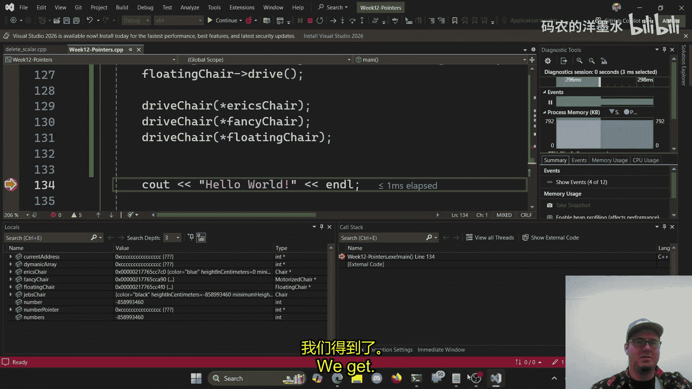

Nothing's again because we're using。Objects， not pointers， two objects。

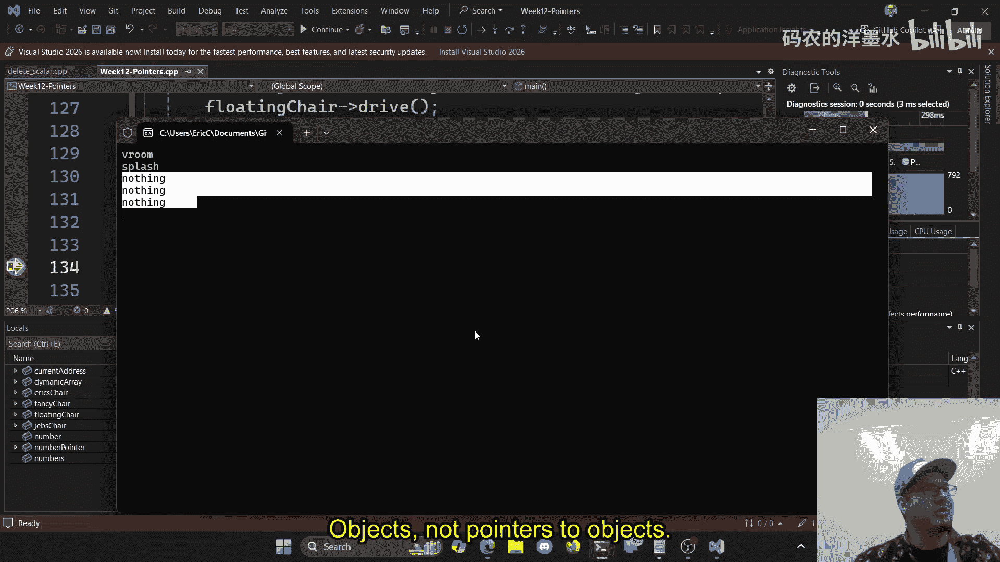

seemsms a little silly here， this is one of the cool features of C++ here that it will do the right thing and our technical term for this here is polymorphism。

So a big fancy word here， but it' a lot of fun means we can treat child classes as their parent class。

We can treat a different type as its parent type here， and that's why。Things can always see out。

When we were to see out an object here， when we wrote a chair。

 right if we just did a sea out on chair。On Jeb's chair， right， remember see how it works here。

 but you get garbage。Remember we did this one here， didn't we？Oh goodness。

 Now what you have to dos how we try convert it to a string。

Two string or something oh man I forget there's。

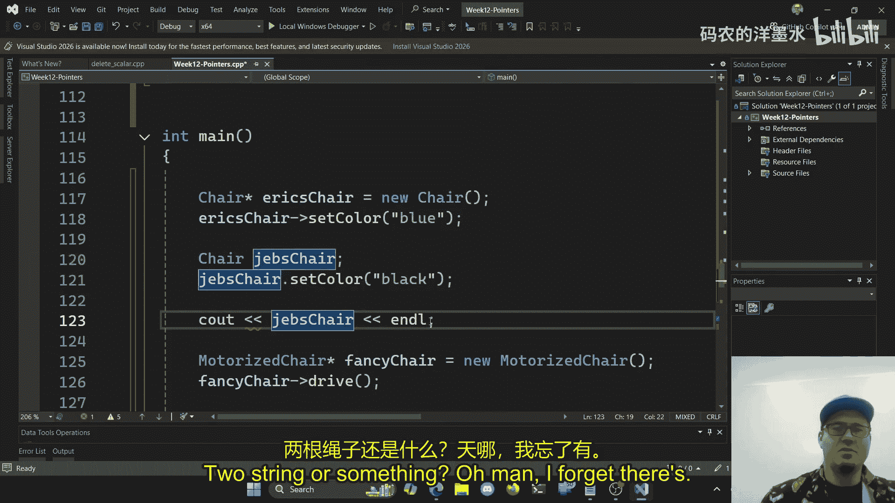

I much with your out。That。Where's my sea out here？

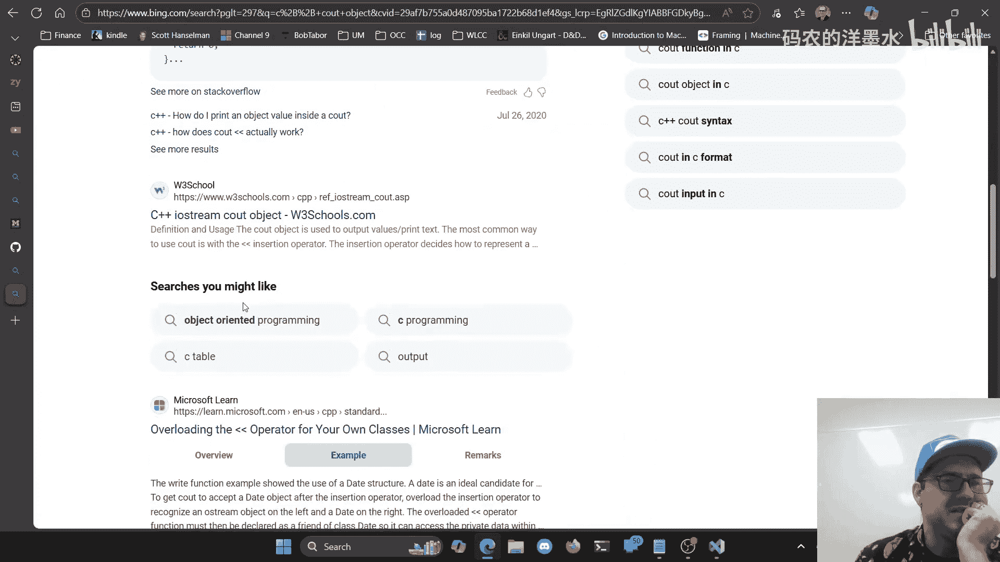

Yeah。That's fine， I have a mind， you get garbage。Because it doesn't know how to do it。

 but it knows how to see out eventually。All right， that was very exciting with pointers here the rest of the chapter here go go ahead and read through it there's not too many things to do with the labs so two little practice labs should be fine here give them a try I think you can get them done if you get stuck on something and you just are frustrated and you want to give up that's fine attempt them and I'll give you the points for it。

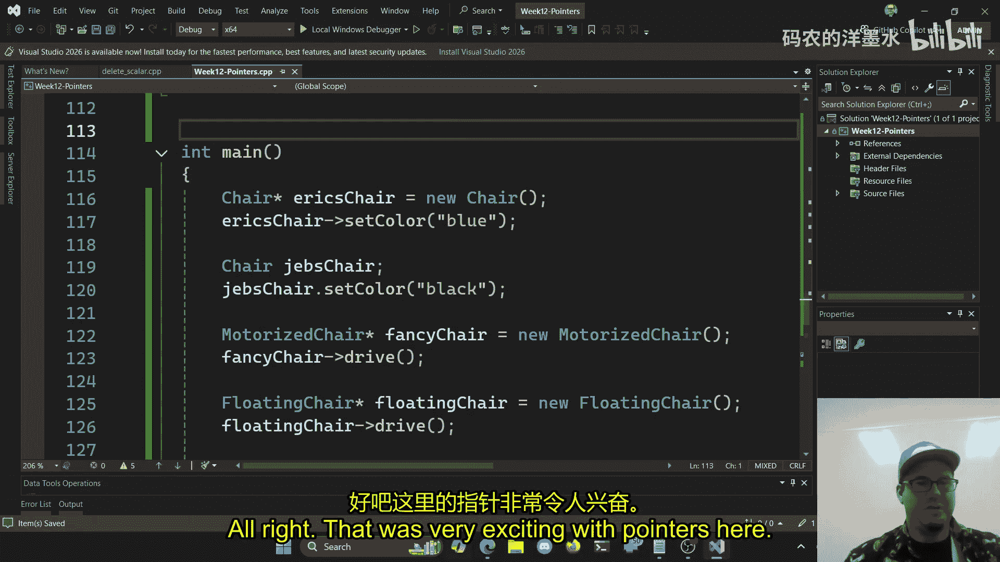

That okay ideally you can get it done to be good， but on I won't hold you to it too much here smart pointers clean up after themselves right we don't have to go delete them thankfully someone realized that's a big pain we've about to have to do here not everyone has shifted over to using smart pointers yet。

So we still have to teach how to do it the old way and remember to delete them the new ways we just use a smart pointer and when we're done with it。

 it deletes itself thankfully computers are kind of smart at least a little bit here Other things like destructors will get to next semester copy instructors will get to copy assignment operators will get you next semester this rule of three will get to as well next semester so I think just the first little bit here some dynamic arrays its fun deleting stuff and then further down the road know that it works with this inheritance stuff and we can do really cool things with pointers that you can't do without pointers so if we're not using pointers you can't take advantage of polymorphism which is a big downside here because that gives you a lot of advantages。

 a lot of nice cool shortcuts here。

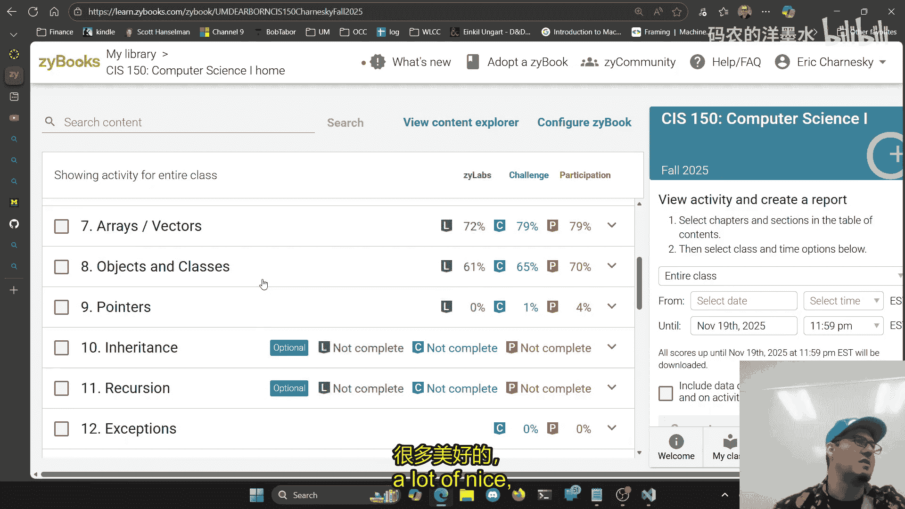

Okay。I might not sound super cool， but if you can imagine writing a large project here that lots and lots and lots and lots of people have to work on hearing more than just you and a partner maybe。

 right， I can say hey。You give me something that has a drive function？

You figure out later how what drive is supposed to do， right someone on another team somewhere。

 someone else that I probably might never even talk to will write all the stuff for drive。

 but I want to make sure that their version of drive works and I don't want to have to write a different function。

RightThat's why polymorphism is important right so that someone else can define something here we just say hey I know it's going to drive I don't care the details this idea we want to work with things abstractly I don't need to know all the details of how a class does it I just know it does what it's advertised it drives someone else can figure that out here and then pointers and polymorphism allow me to make sure I do their version of drive so they can set all that up here。

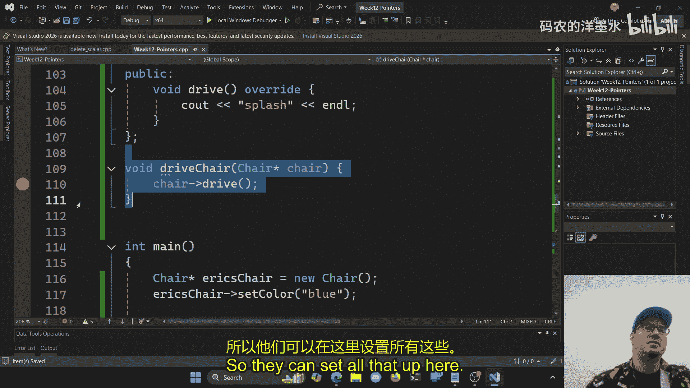

All right。I think that's actually pretty good， so we got through pointers here as much as we need to for this purpose。

嗯。thanks break next week， don't come， you'll be lonely here on campus。

The week after that a couple last minute topics right we got a hip recursion we got to hit some UML stuff here I'll talk to Dr。

 Saed hopefully we can get a practice in for that one and then 128 I have no plans to talk about anything I'll just show up and answer questions here if you have questions about your final project again you're welcome to work with a partner if you want。

If you don't， that's okay too， you'll have plenty of opportunities for group projects in the future or much about it if you can get it done by 128。

Good for you。 And then you can focus on your other classes。

 other finals that you have to memorize much of crap for All youll have to do on the 15th is show up and run it。

 show us you can play a game。 You can save it。 you can load it these sorts of things。

 I might have a question to。 It takes less than five minutes for most people here，5。

 if you like to talk a whole lot here。 And if you something cool， show us。

Right I want to see the cool stuff right what did you do that was really interesting in your project it's a lot of fun talking in front of your peers is something you're going to want to get used to that's one of the reasons we practice it right if you work in a group of developers one of the things you'll do is show them your code Hey this is what I worked on this is what it does here and you'll get some feedback。

feedbackedback is good it helps us improve it's okay to make mistakes right I get this is a little bit high pressure because there's a grade attached to it but hopefully you'll know what your grade is going into it because it works I'll get add the rubric for you that's right if did not add a rubric yet let me go add that in for you here so we'll do the same idea so tell me how you did with your rubric here so were refer 40 points this is final project。

Excuse me。So we have variable number of players kind play the game。清水。Ps。Use it classes or。

But players and properties。Okay play works here。And then saving it load。Loing again。

If you want for save and load， it could be after every player， if you want to just say。

 hey before player one goes， we've had everyone has an in turn now you can save and load or save the game and quit that' signed to that makes it easy because then you always know player ones the first one to go when you load。

That's okay， that's a nice easy shortcut right rather than oh。

 it's player seven's turn I need to remember to start with player seven instead of starting back in player one right both ways can work but。

If you start with a some number of player， you have to tell the save game which players turn it is。

There's just one more piece of information to save So if in your menu of when you play the game you only let them save before player one that's fine that's perfectly acceptable That's probably a nice easy shortcut here So when you load the game I just read off some number of players start with player one right I've got my properties I'm good to go so we got some choices figure out how you want to write the file or how you want to read the file。

Either one of those two will determine the other one here。

 whichever way you want to go perfectly fine so some number players we've got our classes here。

 nice object oriented programming。Private attributes， public functions。

 right those sorts of things here， the gameplay actually works。

 we can go through do those things here and saving it loading。For the 40 points。

 so hopefully you know how you did well in advance， right？

It's got to have 10 commits over 10 separate days， someone did ask me in my other class if they're like really in the zone and just working at it eight hours straight could they make more than one commit？

And sure， like if you're working that long， give me two or three commits in a day。

Once or twice is probably okay， but we want to spread it out here。

 We want to show the commit history is the goal here that I've built incremental working code five each it's fine if you're working with a partner that's okay five each just to show you've split it up you've done some work here and it should be runable at each step of the way it doesn't have to do everything but it should run in like when you have the menu you just don't do that part yet。

 I hate you want to buy a property Sure I want to buy oh I don't know how to do get that's okay at least that shows up in my menu I can have a list of properties I don't know how to make you buy them yet。

 but I've got this part working that I can test it out here。

 I can move on the board I want to think about how we take a big problem。

 break it down into smaller and smaller and smaller steps here。Save the harborbars later。

 that's okay， right， just do little bits at a time。 I can do this part， I can do this part。

 I can do this part， I can do this part here。 Hey， I'm going to charge you rent。

 but I'm not actually going to take any money from you。

That's fine right it's cost $10 but we'll figure out later how I take ten from you and give it to someone else right those sorts of things that's good incremental progress right and that's the goal it's a good habit to learn to develop like that here so I'm going to make you do it。

Right， okay， sounds good， awesome， so I will see you in a week and a half or so。

 have a great Thanksgiving and take care。😊。

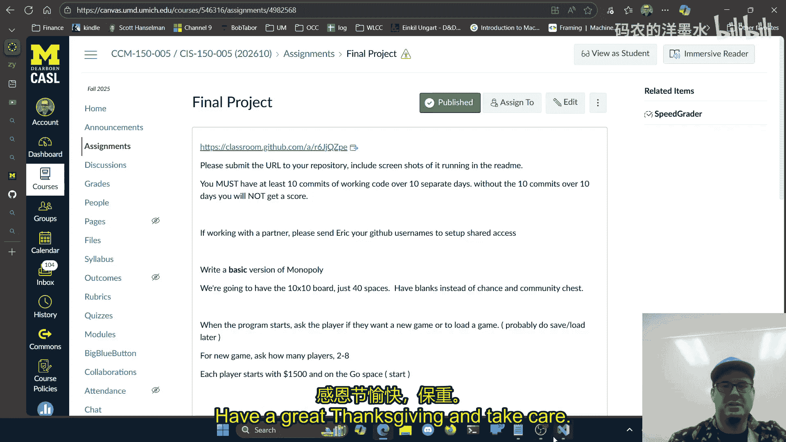