# 【全集】密歇根大学 C++编程 中英字幕 1080P p16 Lecture 16 - 面向对象编程 part1 -BV1TsAZzAEHX_p16-

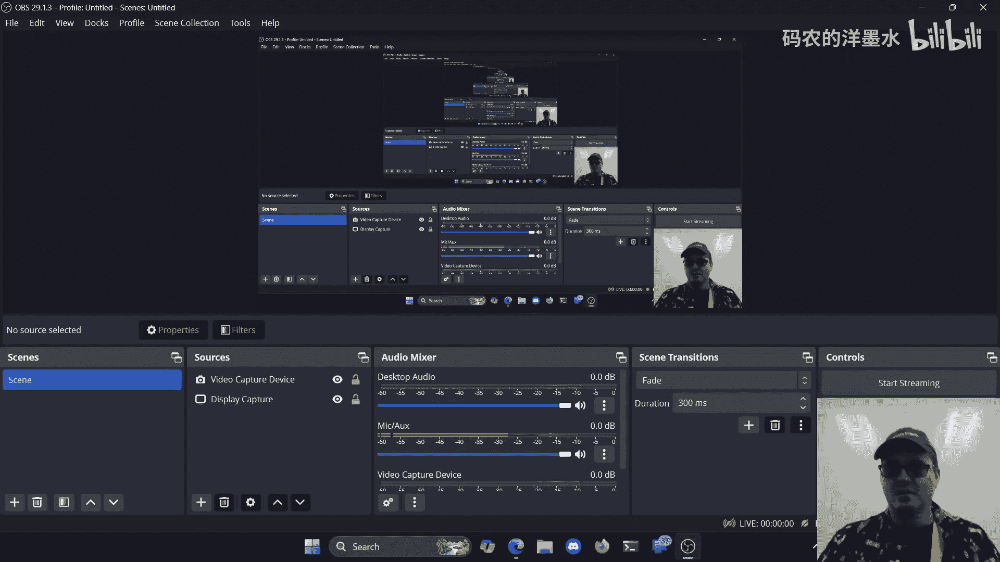

Alrighty， chapter 8， objects and classes。This has got a bunch of pieces here。

 and this will be a topic we dive deeper into next semester as well。There's a lot of pieces here。

 right， so we're going to hit。All the topics we're not going to go crazy deep on all of them so he'll have done some practice and we're gonna to come back and do more of this next semester as well because this is a foundational component of object going to programming this is our objects what is an object what does that mean when we say object going to programming here so were using our own classes here which is doesn't allow us to do anything we couldn't do without it but it allows us to write code in a way that's a little more natural for us a little easier for us to talk about and discuss and design here。

 which is great again code it's really meant for people。

 the computer just happens to have to understand it as well we want to write the code that we understand that we can modify that we can maintain and that someone when we move on to bigger and better things will come after us and have to maintain our crappy code and hopefully they won't hate us because we've done a halfway decent job of it so be to design good clean code starts with using objects and that's a lot。

So we'll do the separate files here unit testing is my favorite topic here because any code that's worth writing。

 I'm going to say is worth testing that it does what it's supposed to do if you don't care if it does what it's supposed to do or not。

 then why did you write the thing？Right it should do what it's supposed to do right and the way to test it is we have to figure out did it do what it's supposed to do and sometimes we have to test it does it not do what it's not supposed to do which is much harder so there's a whole field of specialty called quality assurance here generally that's testing our code and making sure that it doesn't do what is's not supposed to do and it does do what it's supposed to do that's lots of fun so the way they do their tests here is ugly and I don't like it here I don't do these sorts of things i'll show you the better way it just takes a little while here。

But their stuff is ugly here， so I'll show you the better way to write tests。

It takes a couple more steps and we have to do one little thing to cheat but it's a good practice and you'll like it here and we'll get into this constructor overloading constructor initializers the this parameter I'm a big big fan of this we're gonna to see this a lot here because I like using variable names that are nice and meaningful we'll look at operator overloading operator comparison the vector 8T namespaces and lastly static data members and functions we'll just kind of touch on we're not going to do much of anything with static stuff in this class and there'll be another big topic you'll play with more next class but we' going to have introduced you to it so you've seen it once the sort of cyclical learning that we like to do so you'll see a topic and you'll dive in deeper later you'll see a topic you'll dive in deeper later we do a lot of that here in computer science because there's so many different ways and different things we can do with code we're not going dive in super deep all the time on every topic we'll do a little overview and then we'll pick kind of selective ones and there's a decent number of labs to work with you。

Not a crazy number of labs here， but you know six labs and you know they take a little bit of time here with these so I'm going to put the due date for next Monday。

 but if you need a little more time because this is a big chapter。

 feel free to take a couple more days on it。We're moving on to more new stuff the week after so you don't want to get too far behind on it here but feel free to take a couple extra days on it we've got the whole week off for Thanksgiving break so if you're inclined to work over break Sure get the stuff in then if you'll just want to take the time off take the time off we should be pretty good and then after break we just have review so we've got a couple special topics we got talk about UML I mentioned this one of our course outcomes we talk about here we'll get into UML use case and activity diagrams it's lots of fun we got to talk about recursive procedures it's not hard I promise here we're just going to do very small ones again that's another big topic for next semester doing more interesting stuff with recursion but we are almost done which is really cool and then Wednesday we got to talk about project three our files and arrays project and then we'll talk about the final project and get started on that。

ok。😊，Awesome， so let me play a visual studio here。Okay。

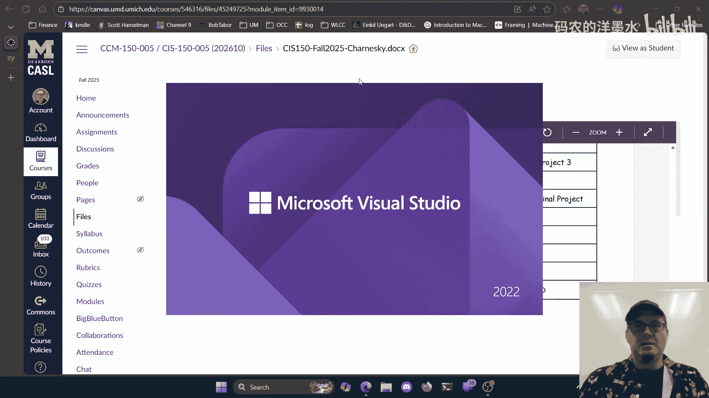

Now objects are actually pretty easy conceptually here， what week is this is this week， 12，1，2，3，4。

 five，6 11， okay， I'll just count to those 11 then。

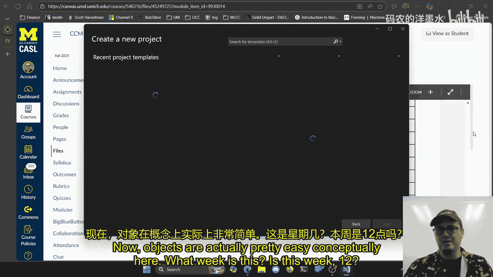

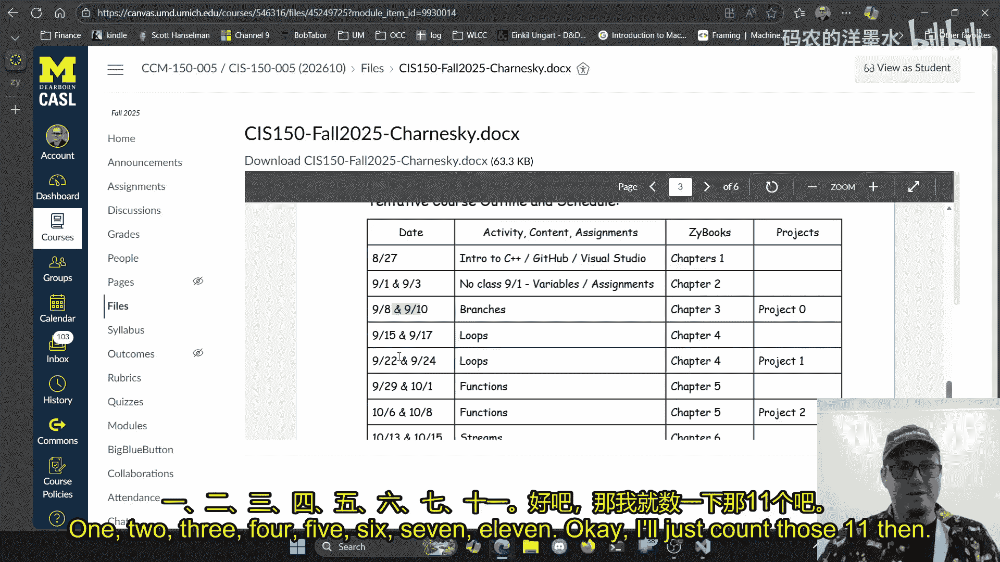

Week 11。This is classes。

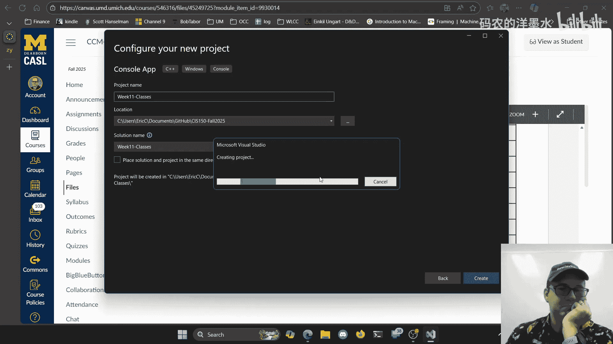

So。Objects are instances of a class， which sounds like a funny distinction here， but if I say chair。

You' all probably know what a chair is， right？Yeah， so okay， thank you。U。Now， if I say chair， though。

 are you thinking of a particular chair or you just thinking of， oh。

 this is a generic something someone sits on， are you thinking of the definition of chair or are you thinking of a particular chair。

 the definition of chair， okay， never had anyone say that before。Okay， interesting。

 so not like the one you're particularly sitting on with four legs and wheels。And a back， okay。

 all right， did anyone think of the particular chair they're sitting on with four legs and it's gray has a small pad that's not very comfortable and it's got a back so you can lean back。

 but it's it not very flexy or you think about your home office chair。

 maybe you have one of those nice gamer chairs that are overpriced because they target gamers who have want to spend money to look like a gamer here。

 but they're actually worse than an actual office chair。Actual office chairs are much。

 much more comfortable the gamer chairs。So youre thinking of a specific chair， right。

 what color was it？Black， and how many wheels did it have？

did you put the little rollerbl casters on or do you keep the stock casters the rollerbl casters are really good upgrade if you've got a hard floor in my basement it made world the difference being able to move around and not be like stuck on everything it's so nice but a class is the definition of something so the definition of chair you know something someone sits on it has a color it has a number of legs。

 it might have wheels or not it might have arms it has a certain height that it's at that's the definition of a chair but a particular kind of chair particular instance of a chair。

 your office chair or the chair you're sitting on is an instance of that class it's an object。

That's one particular chair， one specific one， so when we think about writing classes。

 we're writing a blueprint or a definition for something。

 and then we're going to make instances of them。😊，To make distinct。

Versions of that in memory so we can define a chair so you can say。

 hey I want to class for chair and we should use capital letters here。

And now when we do our class definitions， we get our set of curly races， me zoom in a little bit。

 actually my screen's kind of dark， that's weird， there we go。

And then you have two sections inside it， there's actually a third we're not going to get to that for a little while here。

 but you have a private section and you have a public section。

So one of the concepts and one of the things we want to do when we write classes is we want to protect our attributes。

 we want to have private attributes and we want to have public functions。

 so the way we want people to interact with our class is the public functions。In our fancy terms。

 that's our API， our application programming interface， it's the， hey。

 you can do this thing with our code right and we've actually used lots of public functions before we've used a lot of APIs here so like we included vector。

I can make a vector。Of tight ins or something here numbers is。

Right and then numbers dot when I put dot here， I get a list of all of the public functions a vector I can get something at a given location。

 I can push something back， I can get its size I can get the beginning of a vector I can get the end of a vector I can a bunch of things about our vector here these are all the public functions what I don't have is access to the private attributes of vector I don't know how vector stores things behind the scenes。

I don't know what private attributes it has， I just know it's public functions。

 so that idea of interacting with its public interface， its application and programming interface。

 itss API， we're going to call abstraction we get to work with things in an abstract manner。

I don't need to know the details of how it does what it does I just need to know it does what it advertises it has a public function for pushback it will add something to the vector that's all I need to know next semester you'll be so lucky you'll write your own version of a vector and you'll figure out how it actually works' very exciting I promise。

Sure， it's what it is， just bring your coffee that day for that lecture。

But we want to take all of the details about a class and we're going to encapsulate them together so all of the things about chair we're going encapsulate into one nice little chair package so we're going to encapsulate we're going to use abstraction I'm going to give you public functions not access to my private attributes here so that here's the API you work with to protect all of my details so I'm going to have a private section here if I could spell that would help private and I'm going to have a public section so private and a colon public and a colon I don't know why this is what someone came up with and we just do it here so the list of attributes now so every chair has a certain set of attributes things that make this a chair it might have a string for color。

It might have an int for height。Now anytime you're using a unit of measure。

 I would argue you should include what unit you're measuring it。

 so if you just say height someone might tell me 15 inches。

 but there's no room to store inches here in height because it's an integer you're going to give me 15 and someone else who uses a s measurement system like a metric system is going to say 15 centimeters that's a tiny chair。

And that will make a whole lot of sense right so we should specify height in CMm or。You know。

 using abbreviations is probably bad， I think everyone knows CM is for centimeters when we're talking about height。

 but if you want to spell out centimeters， you can as well。Sure again。

 it doesn't really matter we're never going to type this entire thing right we're going to use our type ahead or in sense。

 I'm going to type a couple letters and hit tab and it will type the rest for me so。Sure。

 it's a lot of letters to type one time。Other than that。

 it's the same amount of typing here whether or not CMm or centt okay。

 other things about chair is like number of wheels， maybe number of wheels that it has。

Does doesn't have arms， right， so that might be a booleing， has arms。That's true or false。

 yes it does no it doesn't right and I'm sure we could come up with more attributes if we wanted about chair here like if we had an adjustable chair。

 we might have a maximum height and a minimum height。

Those office chairs that go up and down are really nice here I'm really sad I can't go up and down on this one here。

 some people we have an in for minimum height， minimum height in centimeters。

And an in for maximum height in centimeters。Centimres while， I can't spell at all， centre。Centimeter。

 so that's probably close。Okay， so we've got a bunch of private attributes。😊，Here。

 but now I need public functions， I need ways to get at these attributes here and generally you can do two things of attributes。

 you can get them and you can set them depending on who you're talking to。

 we like to come up with other fancy terms like accessor and mutator you can access and you can mutate or change it I like set and get but sure accessor mutator they sound really fancy so if you want to sound fancy use the fancy terms if you want set and get they're much easier。

So for all of our attributes， if you should be able to change the value here。

 we need a way to set the value right for a chair you can change the chair's color it might not be very easy but we can throw some paint on a chair right so we might have a string function called get color here you don't need any arguments for get color you're just calling a function here right when it's the same as when we define our functions right when we wrote our own functions it's here's the return type here's the name of the function here's the argument list right。

Now forget color， all we're going to do is return color。

So this attribute of color I'm just going to give to you。So when you have a chair。

 I'll tell you what color that chair is。Okay， and then we'll have a void function that doesn't return any values we'll call set color。

 you're going to give it a string for color and what we're going to do is I'm going to set my color equal to your color so I can say color equal color。

😊，And now a bad thing has happened， so you'd kind of notice here depending on how well you can see the grays and whites here。

 this is gray as an argument， and now they all light up that I'm setting an argument to an argument。

I haven't changed anything。 I'm not changing this color， which happens to be in bright white。

 not gray。 So if I want to access this color， I have to use my implicit this pointer。😡。

Doesn't make a whole lot of sense。 okay， we'll talk about pointer next semester or next week。

 but I'll say this and then an arrow， which is a dash greater than or less than greater than right D greater than makes a little arrow。

 I'll say this arrow color equals color。 So this instances color。 Now it's the white color here。😊。

Equals the gray color argument。 So now I'm sending this argument to my instance attribute Every time I make an instance of chair。

 I love its own set of values so I can make a chair that's Eric's chair that's gray with a blue seat you can make Bob's chair that's red with no arms。

 I don't know five wheels， whatever want to call it here。

 we can set different sets of values for different instances of chairs and have different chair objects because all this stuff has to get stored in memory somewhere if we want to use it So we have sets and gets。

 Now this is super boring to write a bunch of sets and gets。

 I get it here no one likes to write all of these things here。😊。

And there's not a lot of good options at the moment if you have enabled copilt or anything like that。

 it will suggest all of these things for you again I don't recommend you use it because it's going to recommend too much here and really what we can do is we can have our little chatbot right most of it for us here so if we go out to chatbot here。

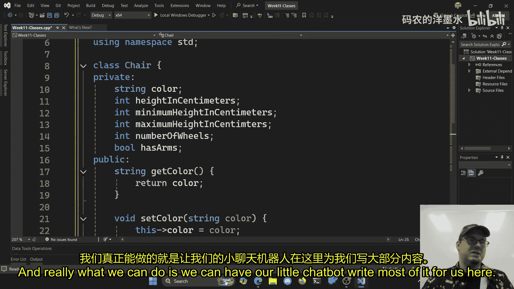

And you can probably use any of them here， it shouldn't matter， this is given this class。

Right set and get entrance。

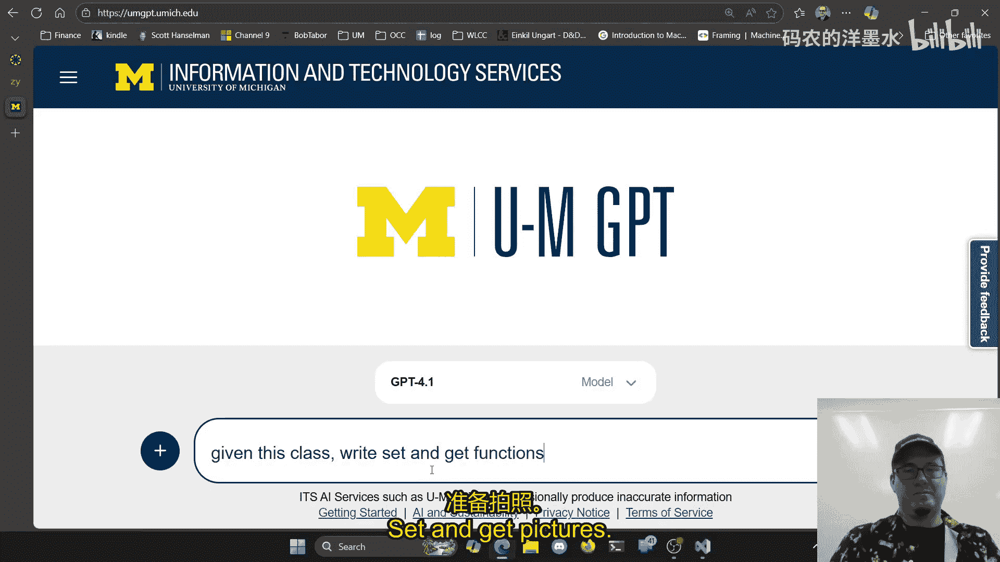

And I'm going to paste it in here and then this is what I asked here。

 so I'm going to come in my project。I'm going to leave a little comment here。That this was UM GPPT。

 which I got to comment all of this out here， right， oops， slash。Controls that。ok。

I can't comment edit。Vanced con selection， con。 Oh， control E and C。

I don't know why I didn't remember that。 Sure， Okay， there's all that in here。 And now Chapbo's like。

 oh， hey， I know what you want to do here。 Here's a bunch of getters and setters here。

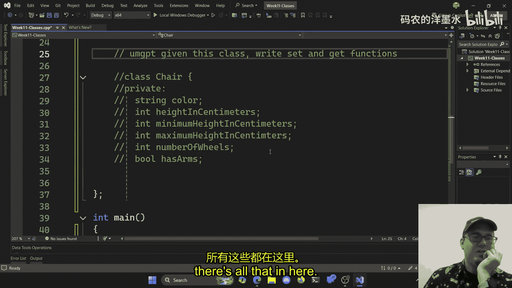

Look at that， how fun is this？

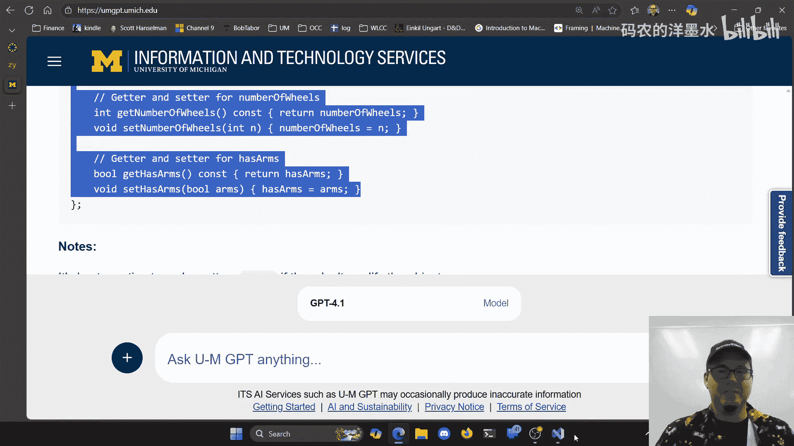

It used some awful looking notation here where it's doing stuff on the same line here that drives me crazy。

 some people like it here。I'm just going to go and change the formatting because it irritates me here。

And it also did a bad thing， which I don't like here。

 but it's okay chatbot code is not always perfect for us。 It added a bunch of stuff we don't want。

That's okay。We'll get there all right， so let's go reformat all this。

 it looks a little prettier here， this one and this one and this one here okay。No。

Is this a helpful comment？Getitter and Cter for height and centimeters。

I that useful no we'll get rid of it not helpful is this a helpful comment get her andter no this is why I think comments are stupid。

Comments that tell you what the code is is doing generally are stupid comments telling you why it's doing something can be useful right give me some context around why it's doing it here that's nice here but I can tell this is a get method and the set method or get function and a set function right I don't need you to write a comment telling you that this seems a little silly here Okay the other thing I don't like here is this being H。

So set height in centimeters， given an in for H now。

 what you don't have to do is use your this pointer。

 I don't have to say this height in centimeters equals height in centimeters。

So that seems kind of nice， but now if we want to go use chair。

 so let's go ahead and actually use our chair here， so we're going to say hey， I want to chair。

 we'll call it Eric's chair。Now when you create an instance of a class make an object here I have to use my preheses this calls a constructor we haven't talked about that don't worry about it。

 but I can't just say chair chair I have to use my predses okay now I can say Eric's chair。

 nope Eric's chair。Chahare。Eric's chair。Chair dot。No。Can't。

My bra I don't give up parentheses really Okay I don't need the parentheses I'm going to have this is next week sorry dot and here's all the public functions get sets these are the only ones we wrote here I don't have access to the attributes I just have access to the functions anything listed in this public section here we'll have access to it those are the public functions so now if I want to set the height here。

So we're going to say Erics chair do set height in centimeters。And right in here。

 so I get this little Inence based on the function I wrote， it says int H。

Now you're probably thinking to yourself， yeah， I know what H means H is heightened centimeters because this function is heightened centimeters here。

I think that's lazy and when we write functions that have more than one parameter and do more interesting things。

H I and J don't really cut it for variable names here。

 So I like having the full names in the parameter list because you see that in your Intelence。

 That's why I like it here。 So I would rather do a little bit more typing here。

 and then am I this arrow。So that when he use my telescentense， it says， hey。

 here's the heightened centimeters。As the argument you're giving it。

Okay now again it's a little silly with the set functions。

 but eventually we're gonna to write other functions that do more interesting things and having nice full name attributes is probably pretty helpful but you can do it any sort of way here so my chair is probably what 30 centimeters in the air I don't actually know for sure but we'll just call it 30 probably a fine estimate here and let we say Eric's chair do set color my chair color is gray and blue I guess the string we can give it anything to want gray and blue and Eric's chair dot set maximum height 30 I can't go up and down right has no adjusting so Eric's chair do。

Set minimum height is also 30。What else and then has arms Erics chair do has arms。

To false now we don't have ours Okay， so now I've made an instance of my chair。

 it exists in memory and then I've went and set values for them here that I have my instance here and we can make someone else's chair right so we can have a chair for Bob's chair。

And then we can say Bob's chair dots set height centimeters， maybe Bob's chair is at 40。

 I don't know， and maybe Bob's chair is adjustable so we'll change them in in the max here because why not we'll say max is 50。

And min is 30， sure， leave it there。 What color is Bob's chair？Black， okay。

 Bob's chair black and the above chair have arms。Yes。Has arms， no step has arms。Is true okay。

 and then I got to make sure I'm doing Bob's chair here。 not Eric's chair。

 I would have set my own again Okay so now I have two different chairs and the existing memory。

 so if I run this in debug mode I can actually inspect my objects right those are instances of my classes here and I can see all their attributes。

 I can see Eric's chair and I can expand it here and I can see hey， the color gray blue。

 the heights 30，30，30 number of wheel I forgot number of wheels and a set number of wheels here So Eric's chair do set number of wheels is4。

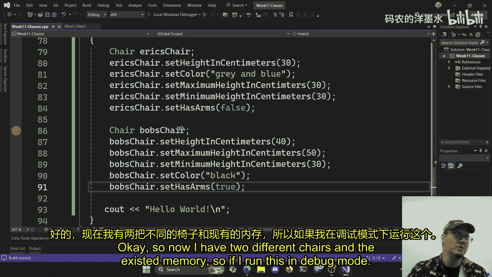

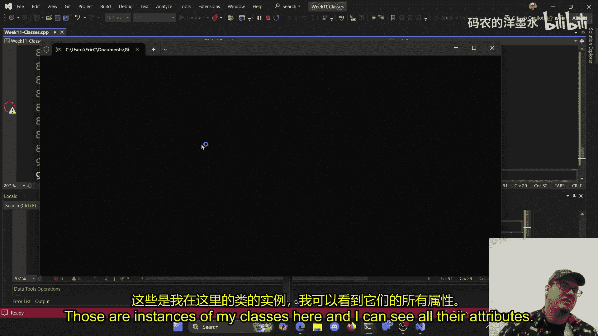

There we go， I think I can drag this back here， does it work？Look at that。 It works。

 I could change my line and make it run the new line。 How fancys Vi studio。

That's really neat it can edit live code that's currently running。That sort of stuff。

 like people who do that sort of really full stuff that's really neat。I don't care about it at all。

 but I just like that it works right so if you're interested in how you do that sort of stuff go take like the compiler design class and do stuff like that school stuff。

 but I'm just going to make my program do other things。Anyway。

 so now we see though Bob's chair is garbage right until you set an attribute here。

Its values are garbage now color， the string is just blank， so it's not a completely garbage value。

 it's just empty， it's blank， which it might be okay here。

 but all my numeric values defaulted to something right。

 if we don't set a value for integers they're dumb here， but our has arms looks like it's true。

That's an interesting default Sure so you' gonna to be careful that you don't keep your default values you want to make sure we go and set them because that's kind of nice thing to do here so and we'll see all the values for Bob's chair and if we wanted to we could go and print out all the details about a chair here and the other fun thing is once we have a class you can use that class and pass that class around so I can write a function like print chair give it a chair chair So if you give an instance of chair you give a chair object to this function it can go print it Now whatever chair you give it it's gonna call it chair you could give it Eric's chair you could give it Bob's chair you could give it。

Any chair and it's just going to call it chair in this function right so we can just say see out。

Shared color and we're just going to say we're going to say get color and an end line or I don't know。

 maybe we add some details here right color。And get color and we will do the height。

Height and Si get height。And centimeters， I don't know， and maybe one more， how many wheels see how？

Number of wheels。Chaired up getting number of wheels。

And we should probably set the number of wheels for Bob's chair too， Bob's chair at five wheels。

 right？W be Eric's chair， so you got to be careful your copy paste here。

 then I can call print the chair and I can give it Eric's chair and I can call print the chair and give a Bob's chair。

So if I run my program now， not in debug mode。😊。

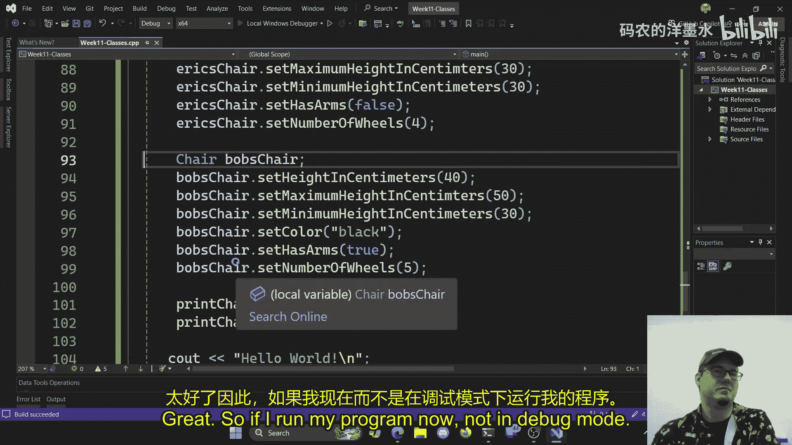

Ering go， here's the details for Eric's chair。And here's the details for Lovech。It's very exciting。

You guys don't seem thrilled it's okay， so what we've been able to do is take。😊。

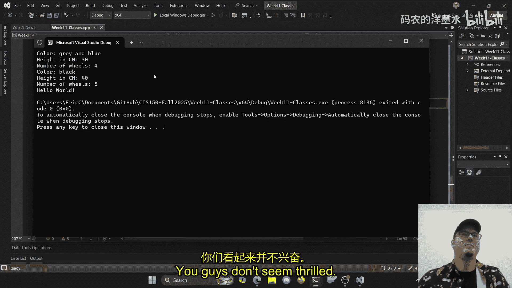

A noun and generally classes are nouns， they don't have to be。

 but when we design programs and we write stuff with object oriented programming。

 our classes tend to be nouns because those are the things that are kind of natural for us to be like。

 oh， that noun has a bunch of attributes。Right， hey， that's a table。 Hey， that's a computer。Right。

 hey， that's a。I dont know lottery ticket。And they would have a set of attributes right so we can use classes to write code in a way that's a little bit more natural for us because we understand the idea of making instances of objects。

 instances of classes you understand that not all trees are the exact same one tree right we've got dozens and dozens and dozens and hundreds of different instances of tree。

 each one is distinct。So it kind of mirrors the natural world so we can write our code in a way that is familiar with us and we can use the same sort of language。

 which is really cool so if we wanted to write another class here。We'll wait on for lotto ticket。

Now we'll do a boring model ticket here，ops I got capsstock there。

So we're going to have a private section， we're going to a public section here。

 so let's just do like three numbers right so maybe we'll just have number one number two。

And then end number three。Okay， and then we'll have ways to go and get these numbers here。

 but now once you pick your lotto ticket numbers， should you be able to go and change them？No。

 that seems like a bad idea to let someone change their not right so if we don't want someone to change them。

 we need a different way to set them here。 So we're going to look at that。

 So we'll write there get functions here So I get number one。sAnd this returns number one。

And to get number two， get number three， right， we can get out our numbers one， two， and  three。

 that's pretty quick here。But I don't want someone to go and set them。

 so what I want to do is I'm going to make a special function called a constructor。

 a constructor's function， its job is to make the instance of the object to construct it in memory so we're going to write a constructor for a lot of ticket now constructors are special。

They don't have return types。So I'm just going to say lotto ticket。

And then a set of parentheses so what arguments do we want so if you can't set the numbers aside from the very first time you're going to have to give them to the constructor。

 so I need to now give three numbers here， number one。

 number two number three as arguments to my constructor and now the constructor can go and set them so when I make a lot of ticket。

 hey， it's numbers one，4 and 7， it's always going to be numbers  one，4 and 7。

 there is no code that lets you change it。Which is ideal like once you give someone a lot of ticket。

 don't let them change their numbers right so we can write our code to mirror the same behavior that we want in real life。

You don't need to give people access to things they don't need access to so I can say my this number one。

Equals the number one， am I this number two？Eals the number two oops。

 I probably should make sure I get the right numbers here。

 otherwise some' to be a little upset when I to give them a lot of ticket。Number three。Okay。

So this is a construct， it will set the values here， and because I don't have set functions。

 you can't change them。They're going to be stuck forever right which is good now the other thing we can do is we can have a function here that tells you whether or not this ticket is a winner。

Right so I might have a Booleying value here for is winner now to know if you're a winner or not。

 you need to know what the winning ticket is。For the winning numbers。

 but we already have a instance of ticket， we have a ticket class that has three numbers here。

 so why not just give it a lotto ticket？We'll call the winning ticket。

so if you give me a winning ticket， I'll tell you if you want or not so you tell me what the numbers were on the winning ticket right so we can return my number one os number one。

Number one equals the winning ticket get number one。Now。

 you can actually use number one here as well。This is a little bit frowned upon。

 but it works perfectly fine。 we're accessing a private attribute。

 but because we're in the lotto ticket class， we can do that in a different class。

 you don't have access to private attributes， but because we're in Loto ticket。

 we can access lotto tickets numbers So this works out okay here so we can do that I'll say that one and my number two matches the number two。

And the number three matches the number three。Yeah。Great。

That's our winning ticket right that's all we do So remember we don't need to say if it's true return true else return false。

 we can just return the thing that's true or false already right save yourself a little bit of headache here Okay。

 that's our level ticket。Now the other nice thing we can do is we can add some sort of sanity checking here。

 let's see how far did we get。

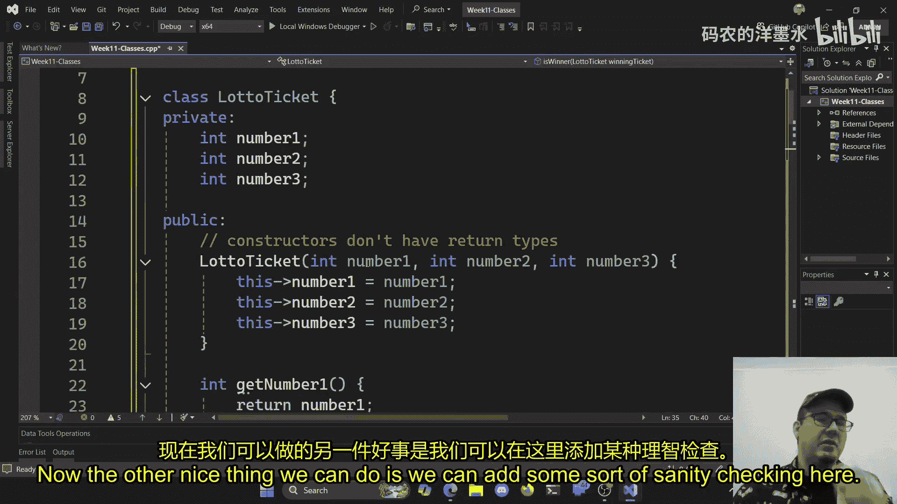

A。Did't do exceptions yet。 Okay， so I don't really have a good way to tell you if you pick invalid numbers here。

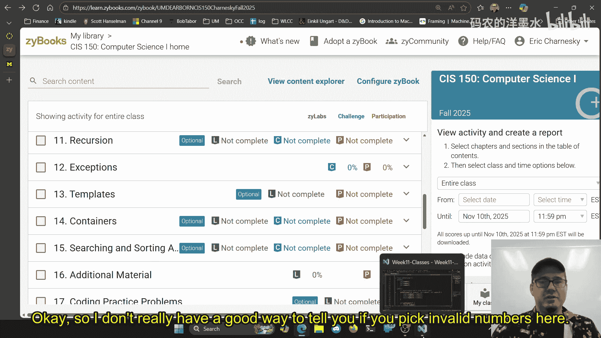

We haven't talked about how to do that yet so if you give me a number that's not one two three four five six seven8 or nine。

 we should probably puke we don't have a good way to do that right now so we'll just hope we get the right numbers here get valid numbers。

They don't know how exceptions work。Okay， we'll come back to that next semester it's another topic of things you get into remember how our code crashes if you do if you give it bad values like hey enter a number and you put 10 and it crashes on you that's an exception。

 we can make that happen with ours which doesn't sound like a good thing but it actually is a really good thing because someone shouldn't give you the number 27 if you want the numbers one to。

Right， that's all okay， so we've got that。So now we can go and use our lato ticket class here right we've got our chairs。

 we's do a lot lato ticket up here， so our lottto ticket。We'll call this one in the winning ticket。

And then we to'm sorry， now now we have to use the constructor here。

 so that's what numbers here so what are the winning numbers for our lot of ticket。继续。5，7 and，1。

 Okay， cool。There's our waiting ticket and then let's say I don't know four inch。

Or I'll have an number of tickets。Equals zero and let's make a lotto ticket。I don't ticket it。

Equals and let's pick some random numbers here right so we'll say it's import random。Random。

And what is it C time， I think you have to do with C time。

So we could see our random number generator we'll say s ran given I of0 or something does that seem right All I didn't have to Google it this time look at that we'll pick three round numbers so number one equals random dots。

啊是。Rand。Band mod 10 should give a zero to9， but actually I want mod9， so I get zero to8 plus one。

Well， mod 10 could give me 0 and zero is not a valid number or no is zero valid Okay。

 solid zero to nine， okay。If for somebody reason that I thought number one deny I， but yeah。

 you can have zeros can't you we start counting at zero， of course， all right， so mod 10。

 chi me  zero to9， great and we'll do that three times right number one， number two， number three。

I should just copy the whole one， sorry。Number two and number three。

And makes the ticket given number one。Number two， number， come on。And number three。Okay。

 and while my picket dot is winner given the winning picket。And while it's not limiting ticket。

Right let's keep on picking new numbers here， making new tickets。

 actually I think guess the start pop at one in here， we've had one ticket so far， right？

And then we'll make new numbers here。As long as that's not the winning ticket。Keep on trying。

 we'll take our number of tickets plus plus。And then we can tell you at the end here。It took。

Number of tickets。Number of tickets。Number of tickets to it。All right， should you try it？

See if we can win here。

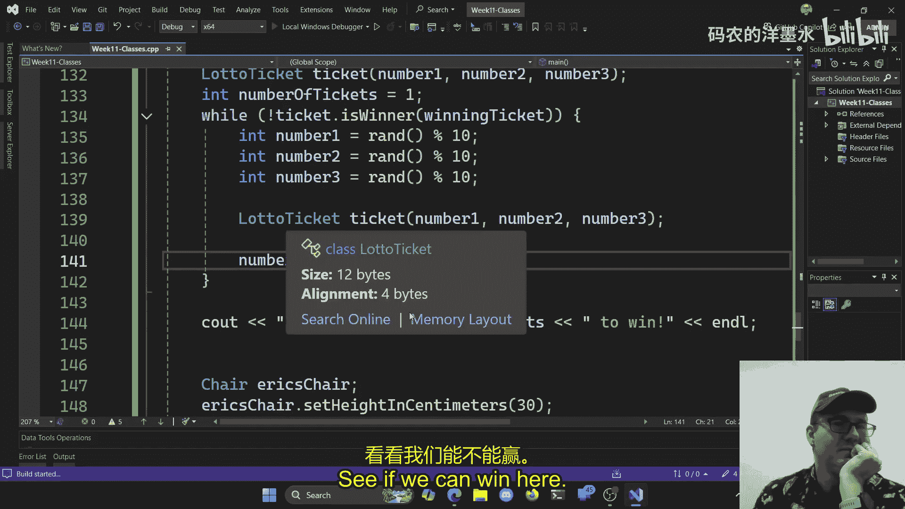

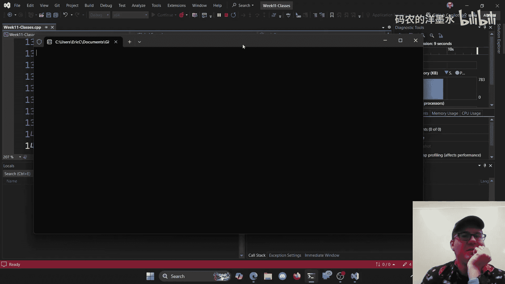

You did a bad thing here。Over how scope works， that funny word scope。

 I've got a variable called Tet here and I've got a variable called Ticket here。

 this ticket is not this ticket。Right， so I don't want to do that so I want to make。

Ticket be the lot ticket。嗯。Ticket equals model ticket。Number one， number two。Number three。Yeah。

This looks really ugly here， but now I'm saying， okay， make a new lotto ticket。

It change the value of ticket to that new lotto ticket here now I can see， are we a winner here？Okay。

Ho now that I'm not creating a new variable that's shadowing the outside one。

 hopefully we can find a winner here。😊。

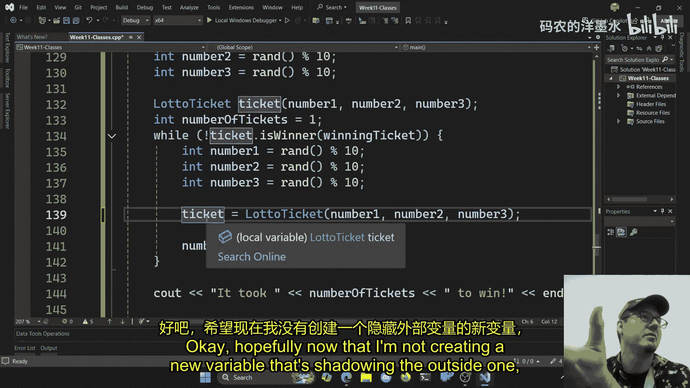

Hey， 442， that's better than what I was expecting， I was thinking it'd be about  a000， right？

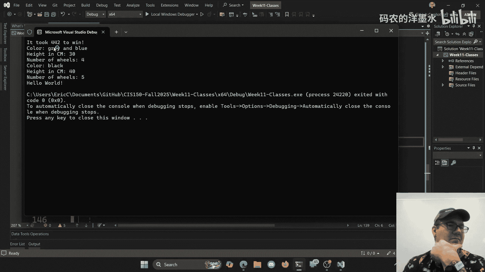

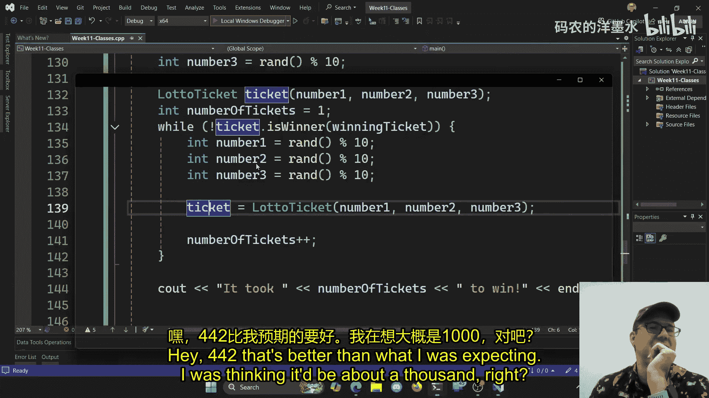

There we go， a little more than 1 thousand00， Okay， all right。Wow， way more than 100。 Okay。

 we were really unlucky today。83 to 20， okay， see， it feels pretty random here。

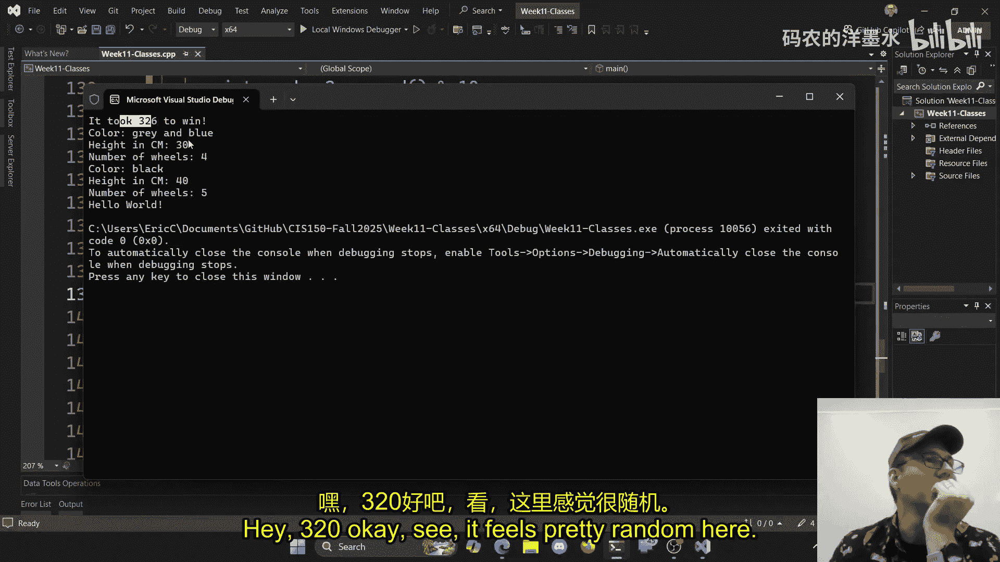

Definitely， so we can use my class to represent some noun we have our list of attributes。

 things that make this instance， its unique instance here now we've had more than one model ticket with the same numbers right we had the winning ticket and the regular ticket they both had the same numbers but they existed in different spaces in memory。

When we make an instance of an object or an instance of a class we make an object it gets its own memory space right so every time we make a lot of ticket we're storing three new integers somewhere else now eventually is going to get cleaned up here right because we're using the same space here so wherever we're using before is going to get thrown away garbage collected and thrown away and garbage collected and it's not going to impact anything here we'll figure out how to break that next week and we can make our computer almost crash we'll crash our program essentially when we run out of memory which is fun。

😊，But we can use our class to represent instances of that class right we create new instances。

 we create objects from the class， which is the blueprint that's like the definition of what this class is。

 we can have public functions right we can have private attributes technically you can put these in the public section is just consider really bad practice here we want to follow this idea of encapsulation we're going to hide away all of our details and just expose that public interface through abstraction here's the public functions you get and what's nice is if you shouldn't be able to change these things we just don't give you a set。

RightIf it doesn't change， then you don't change it right so something like if we're going to make a car here。

 we got a class for car or vehicle， maybe vehicle。I a private section and a public section。So。

 just some really basic ones like to make in the model。And then a string for color， right？好。Yes， yes。

 so class gets's a set of curly braces and then a semicolon is really weird。But yeah。

 Maine doesn't of the classes do， isn't that funky？It doesn't for you。

 Viual Studio it doesn't for you， so I never really think about it。Yep。

 so if we have a make and a model of a vehicle， did those things change？No。

 but can the color change Yeah， okay， so we're going to make gi functions for all these things here so string git make。

Turn make sometimes it takes more time to just go to chat GT than to just write these， but model。

Return model。And a straight and get color。Turns color。String with a G， there we go。

 the color can change right， so we want a void set color。Given a string for color。

And we'll save this color。Equals the color。RightBut now if you have attributes that don't have a set function。

 you would have to include them in the constructor， you don't need constructors for chair。

 we didn't have one and they're just nice to have make life a little easier here and you can include things like color even though you can set it outside of that in the constructors。

 we can say， hey， this is a vehicle。第二个。Give me a string for make， a string for model。

 and a string for color。Right， and I can say my this make。Equals the make。

 by this model equals the model， and my this color equals the color。い系こ。Help if I can spell it right。

Okay， so our constructor can set the color。Doesn't have to because we have a set color。

 but generally you want all of your attributes to be set by the construct。

 The constructor's job is to give values to your attributes。

 give them either good defaults or the arguments right either way is okay here。

 so we can write it one way or the other for us here。

 just makes it easier to use if you can set them all at once here。

 right if we had share wouldn't have to say set， set set， set set set set。Every time I make a chair。

 I can just put it in my list of arguments。系。It's okay， though right either way。

 depending on what you need to do here is perfectly fine either way you want to write them here。

All right， so we've got these， let's see all these suggestions here。

 so they they want you to use this constant keyword here。

Which is telling you this value doesn't change。It's not very exciting I usually ignore them and I just pretend like those couple dots don't exist here so like when we got these。

Once here they were telling， hey， constant values， constant values， they don't change。

 they don't change， they don't change。don't worry it's it's okay， don't worry about it。

 I usually just get rid of them actually because they bother me。

 but eventually you can do cool stuff with those， but we're not going to bother。All right。

 so we've got some basic classes here。That we used。They didn't do a whole lot here。 Now。

 what if chair， right， instead of being able to just set。Our height here。

We didn't do any sanity checking here that if you have a min and you have a max。

Should you be able to change your height。Separately from the men and the max。嗯。

If your chair can go up and down and I say， hey， on a set height to zero。

 should our class let that happen？No， right one of the reasons we write classes and we encapsulate all those details is so we can protect the integrity of our attributes if it shouldn't go above a certain value or below a certain value。

 let it right so in our set function here we can say hey。

 if my height and centimeters is less than or I'm sorry greater than or equal to the minimum。

And by height and centimeters。Is let's bring this down the line here it's good too long。

 less than or equal to the maximum。Then I'll go ahead and change it。喂。

If it's not I'm just going to ignore it right hey you tried to set to zero nothing again we don't have exceptions yet I can't do anything really to tell you it didn't work or that's fine generally our classes don't use C in and C out。

One of the reasons why is that when we write our classes we want this idea of our code to be reusable and that's the big dream here we're going to write amazing code we're going to be able to keep on using it forever because it's so good here。

 I'm never going to have to write chair again I can just go use this class but I don't know if the person using my chair class wants to use it in a consolebased application or in a mobile application or in a web application or in some sort of graphical user interface I don't know where they're going to use it and if I start using CN and see out it doesn't work unless it's in a console-based application with's a big black box and I don't know about you guys but I haven't use my console apps in a while。

喂。not really very interesting So classes shouldn't be communicating with users here and we'll talk more about that how that works。

 So everything happens with the arguments right you tell it here's the argument。

 If I write a console app that hey ask the user how tall is their chair， what's their max height。

 what's their minimum height using a console input and output Sure I'll use console input and output if I want to write a graphical user interface that has text boxes and buttons and things I'll write that if I want to write it as a web application。

 I'll write it like that but the chair class itself doesn't care where it's used it knows hey。

 I've got my attributes I encapsulate to all the details of chair I've given you this abstraction here to work with my API here's all my public functions。

 use it anywhere you want it doesn't matter so we're not going to do scenes and see outs in our classes here unless it is specific to dealing with user input and output and that's a little bit more specialty sort of thing here so we should be pretty good here。

For number of wheels。Again， we might want to make sure it's not negative you can do all sorts of sanity checking with our attributes here because we want to make sure our class doesn't get in a bad state here want to make sure and then let me show you this fun t-shirt here。

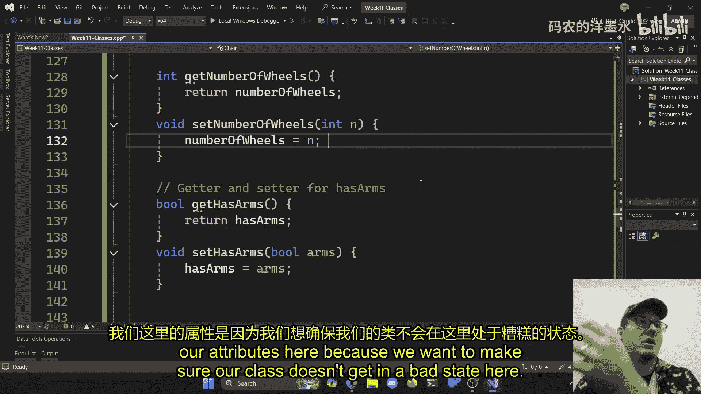

J care walks to bar T shirt here， one of these days I'll get it here zassal really。嗯。No。

 that's not even good。This one。So the Q8， the quality assurance are the ones in charge of testing here。

 although I would argue as a developer， you should test your own code。

 too to make sure it doesn't break， but they go above and the on。 So they order a beer。 Okay， fine。

 They order two beers。 Okay， that should work rather 9，999。99 beers。

Hopefully our register says something right our point of sale system should flag that as please don't let them do this right they order minus 11。

11% beers， they order null beers， they order dash dash blank blank dash dash beers。

 they order bunch of stuff here。And then the next joke is an actual customer walks in the bar orders the water and the bar catches on fire。

Cause we did all the handling for beer but nothing for long so testing is hard making sure code does what it's supposed to do is difficult because users are interesting right they do all sorts of things that we might not expect with our code here I once had a poor person get their laptop reloaded and imaged because we thought they had some sort of security vulnerability that was exploited because they kept trying to log into our website and it turned out the cat walked across their keyboard and got on the enter key and our website wasn't filtering that so they sent a thousand login requests in two seconds because the cat was standing on the enter key we had to go fix our website so I'll see you folks Wednesday。

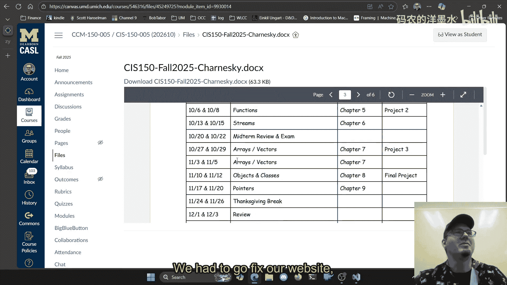