# 【全集】密歇根大学 C++编程 中英字幕 1080P p17 Lecture 17 - 面向对象编程 part2 -BV1TsAZzAEHX_p17-

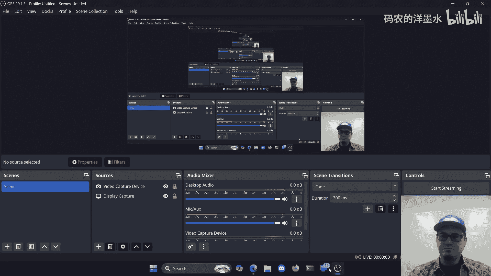

I got a couple things to get to here we got to finish up last little bit with objects and classes。

 sorry to miss you Wednesday here and we can talk about the final project。

And then we got to get to pointers we don't have to go super deep on pointers because this will be a major topic for you next semester we just kind of want to introduce what a pointer is what are some of the basic things we do with it and then you have all sorts of fun with pointers later here but we got to hit some of those highlights this should be pretty good so for Zybooks we'll have chapter9。

Do probably 121 because we'll pretend the week of Thanksgiving doesn't exist。

 so take the whole week off if you want to work ahead if you want whatever you want to do。

 but I'll plug that in for 121 for chapter9 here。Yeah， that'll be the last th bookss chapter。

 are you all excited？Very， okay， I mean， in terms of it being a textbook， how does it compare。

To like other actual textbooks that you have。哦要息馆。You use it more。Okay， oh yeah， yeah， yeah。

 sometimes you can get away without buying textbooks yeah， I know how that goes。No submission， sweet。

And then a reminder， we do use the rest of this for CIS 200。Most everyone， as far as I understand。

 doesn't give you points for doing it anymore in 200 and there's no labs。

 so you'll want to go through and print every chapter to PDF so you don't have to go buy it again。

Because that would be dumb to have to go and spend money again here so。

 but you can't print the entire book， but you can print one chapter at a time。

Sure it takes a couple steps， but it's not too bad and then all of the cool。

Interactive stuff isn't there which is a little bit sad you can't do anymore like you don't have access to the website anymore but you've got all the content there Oh did I not work this as okay don' worry it didn't mark these as optional sorry for exceptions and stuff but whoa oh thanks all my notes that。

Why are you just loading now？My computer's being crazy here， but we'll finish up。This one here。

We didn't get to separate files yet right and then we want to get to unit testing so it's constructor overloading some cool stuff here operator overloading you'll pick up this again in 200 you'll do more operator overloading I just want to show you what it looks like and then static is a big topic as well wow my computer is having fun I should close my phone though right I don't have that。

All right， and then we'll get to our pointers exercises here there's a lot to pointers。

Again we're just going to kind of we'll breeze through most of it here。

 but we won't do a whole lot with it okay so we'll play a little bit with them and you can kind of see what they do which would be kind of fun let's see so objects classes yep so you'll get to inheritance later we're supposed to talk about recursion at some point because that is one of the items on our list right？

I think there's an item in our list here that you can write。

Recursor procedure we don't need to go over the whole chapter for recursion。

 but i'll talk about that in our review week we'll pick up that last topic and then the ul stuff that we haven't got to yet either there's no chapter for that。

It's drawing a picture if you can write code， I assume you can draw a picture。

 but there's a correct format to use for drawing this picture so that if everyone draws it the same way。

 we can all read it the same way and life is good for all of us so it's a good tool for communicating when we're designing software。

 which is a lot of fun。 and I think that about gets us through the glass。

Aiming to be done by Thanksgiving， essentially， with just last couple miscellaneous topics after that。

 and we'll talk about the final project。We'll do presentations。

 you're welcome to work with a partner on the final project， you'll do the same thing。

 whether or not you work by yourself or work with a partner because it's actually more work to have to coordinate with someone。

And then make sure everything works and like they don't screw up your code and you don't screw up their code and if you want to work partner great。

 you don't do it individually at the school too yeah so I can set up a shared repository that you both have access to and you can both commit and pull and push to it or you can do it separate you could send files to each other。

 you can use Google Drive。I would recommend you use Git， but again。

 cost only up to you however you want to go about it here。Yeah。

 but if you'd like the shared repository， that's easy enough I can just add one of you to your partner's repository。

so you can both commit and push to it。All right， sos fire out Visual Studio。

Maybebody to go to Comic Con this weekend？然。

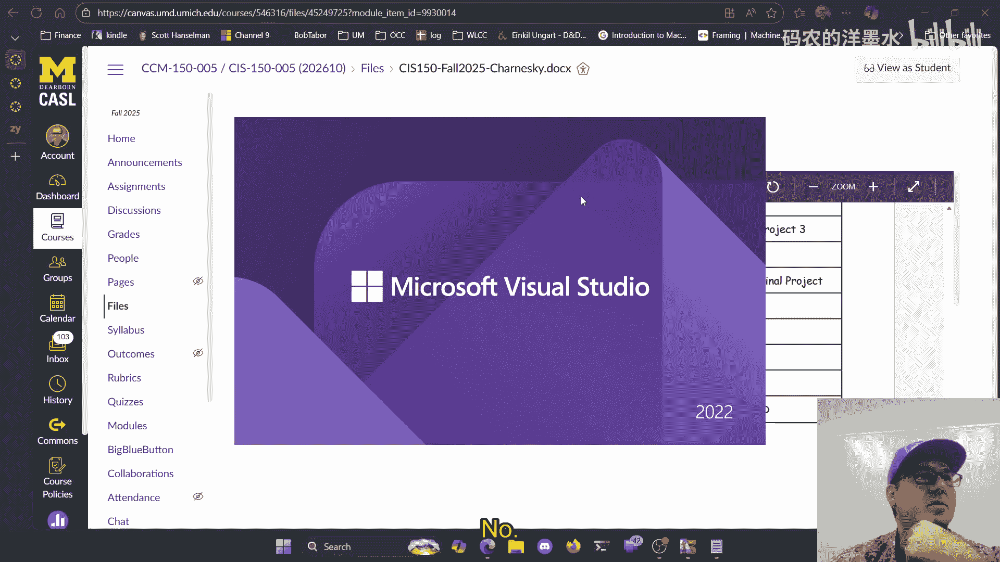

Aren't too much in nerds？No， okay。Go。It's just down the street from my house， so it's not bad。Yes。

 yes it did I almost stole it apparently and one of the vendors like wasn't angry at me。

 but I they were like a booth and they were next to the booth and I thought it was for this booth so I took it over to that booth and the guy like chased me over。

It's like， oh， I， you know， it's like right in front of this booth， I'm sorry， it's like oh。

 it's okay， just want to make sure you're going to buy it just fine that's good they're looking out for each other。

Because some people are crazy。

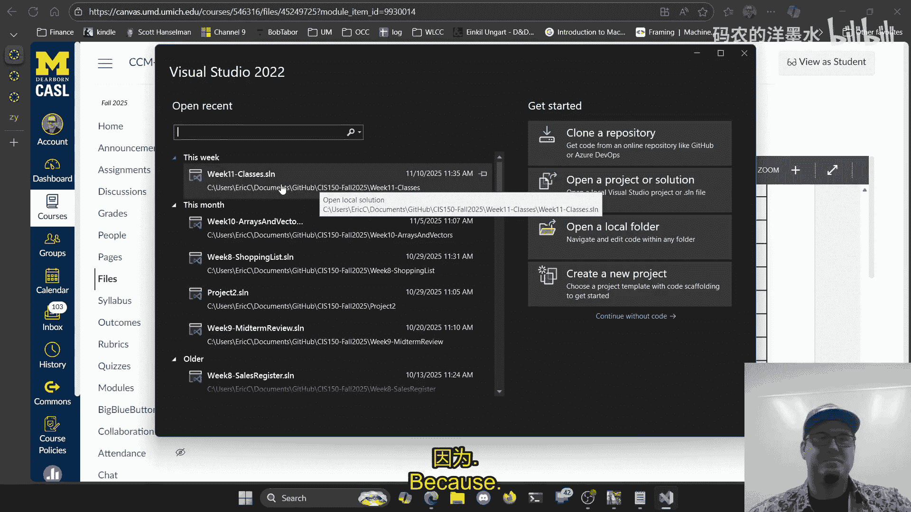

YeahI was really excited he's my favorite Pokemon。So we had a couple classes here。

For vehicle we had chair and we had monoto ticket right we did a couple nothing super interesting with these。

 but the piece that we got to is does it do what it's supposed to do？

And the only way we're able to figure that out is by putting a bunch of code here and running it and then looking at our output and seeing doesn't look like what I expected to look like right this idea software shouldn't be this sort of black box that stuff goes in。

 something magical happens and something comes out right we need to understand that process in the middle here。

Forget large language of models to pretend they don't exist for now。

 but we need to understand what code is doing so that we know if this goes in。

 this is what comes out it should be a predictable process So if we understand it well enough to write the code to do it。

 we understand it well enough to say okay I put7 in。

 I get 22 out Sure and whenever our stuff happens to be here we can go do that here so I get one lotto ticket and I get another lotto ticket this one wins I get this lotto ticket and a different set of numbers this one loses that's sort of code I need to be able to test here Now it turns out have you guys ever written in English paper are you good at proofreading your own papers。

Oh， because we know what it's supposed to say， so it's really easy to just miss when it doesn't say what it's supposed to say because we think it says what it's supposed to say and we're not actually fully reading it。

I don't know if that makes a whole lot of sense， but we the same thing happens with our code。

 if I run my code and I look at the output， I know it's supposed to come out and the chances of me not reading the output correctly me be like。

 oh yeah， that's good。That's pretty likely， right， we be honest， we're likely to screw that up。

 So you know who's really good at taking an expected result and comparing it to what actually came out。

Who's really good at that？Computers， exactly， so we can make the computer do that for us。

 so here's where it gets crazy， we can write code that tests our code。😊。

It's actually really cool I think it's really neat that code will test itself or you know code test other code but sort of thing codeception to do that we have to do a couple things okay one of them we're going to cheat here there's ways to put code into different files right as you can imagine here this gets kind of ugly having you know 200 something lines of code with three different classes that have nothing to do with each other right chair has nothing to do with a lot of take coach has nothing to do with vehicle it'd be nice to separate these things right and keeps them distinct so all the chair stuff goes over here all the vehicle stuff goes over here and all the lot of stuff goes over here。

have a nice little bucket for it and then if we have a nice little bucket for it。

 when that changes I can see that in the gett commit history。

 which is my next favorite part here so did I show you BS codes。

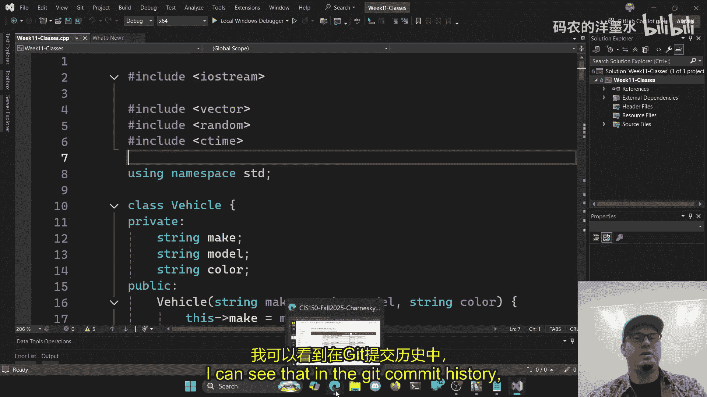

Repository。this is the repository for VS code not Vi Studio VS code is their other tool。

 again Microsoft is bad at naming things as much as I love them， they're terrible at names。

 but that's okay， so you can go and look at this and we can see hey there were 141。

150 commits this tool in the last I don't even know how long this has been now。Sure。

 but you can go into their source code here and we can go say hey。

 I want to look at maybe the typings bit here sure and let's look at the edit context。 D。

ts I don't even know what this thing is， but that's fine I can see it was last changed 10 months ago so if something all of a sudden doesn't work right with tool。

Is it likely that it's the file that changed 10 months ago or is it likely to be the file that changed none of these were changed recently we'll find a different one here。

 how about the yes。Caught the editor4 hours ago。RightProbably the file that changed four hours ago right and it just recently broke so we can keep our history nice and clean by breaking things up into different pieces right I don't even like here's the core but sure it's got a lot of files here this is all Typescript JavaScript files best I can tell and some don't change very often and some do so if we've broken things up into their nice little neat packages which is one of the benefits of classes right I'm going to separate and encapsulate all those details and have one nice little package I can have one nice little package in a file。

And it's separate and distinct。 Now， in C plus plus， there's a couple ways to do it here。

 There's a good way， and there's a lazy way。 We're going to do it the lazy way。

 I'll show you the good way。 It's a big pain in the butt。

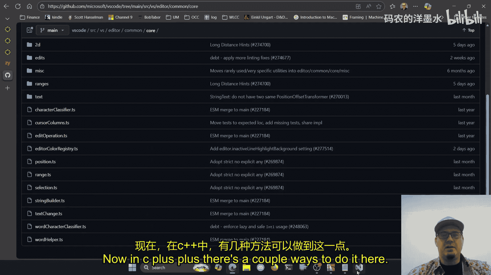

There's good reasons to do it for our purposes we don't care when a project gets big enough。

 then it starts to be important to do it the good way。

 nothing we do is big enough for it to matter Okay。

 so we'll just be lazy for now and just acknowledge that we're being lazy So what we do is we make a header file header files define classes and then source files implement the classes so we're going to make new header file We'll call this one。

As a dot H for header header file， it can actually be HPP if you want to be specific for。

Plus plus right dot c and do cP c plus plus do C files H is the original header files from C HPP is a it really doesn't matter in the default to H anyway。

 but you might see HPP files somewhere here， we'll call this lotto ticket。Now I have a lot of ticket。

h file now if you're using visualual Studio， you get this cool pragma once。😊。

It's important later on if you're using another tool。

 you have to do it differently using if defined and if and defined。

 I think they've got it here in ZyBooks for because I can never remember what you have to actually type here because I never do it because I use Vi Studio so let's look at their separate files but here。

 separate files for classes。

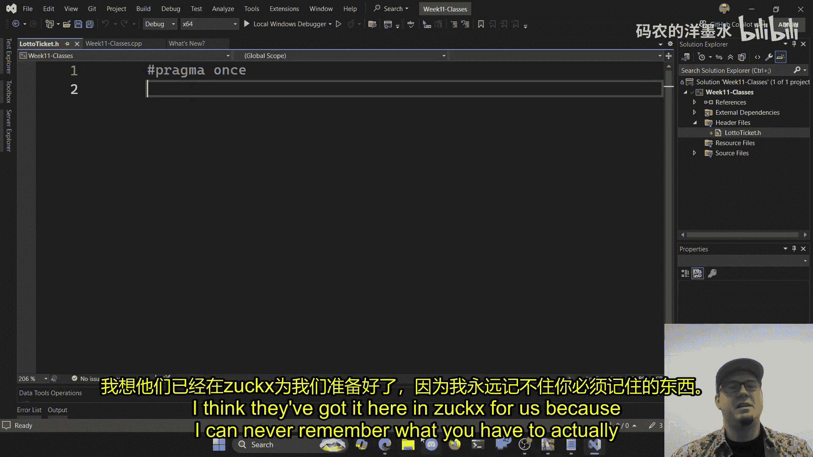

Yeah， this if and death。Here's the name of the file and define here and then end if。

If you don't have visual Studio with the pragma ones， okay。

 the whole reason we do this is essentially when we've gone and used this include here， we said， hey。

 I want to include Iostream。

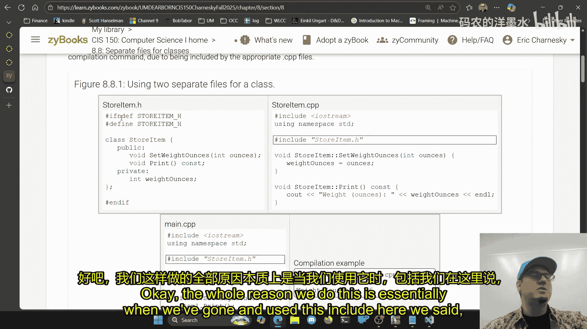

Mostly what's happening it's not exactly 100% but we can conceptually think it's going and finding this library and copy pasting it here。

 so everything that's in the IO stream library that file here is essentially put into line two through whatever so it makes our program bigger so。

And then we include vector， we've taken all everything from vector jammed it in there。

 so our file gets much larger than it actually looks here because we're pulling them in and essentially copy pastsing them in。

 say。If you have lots of different files in your project here and some of them use Lato ticket and some of them don't use Lato ticket。

 but two or more use Lato ticket you might copy pasted in there twice or three times or four times or five times or as many times as using lotto ticket and that's a big waste and then things can get confusing so the ifN defined if it's not defined if it hasn't already been imported here please go import it here's my definition for it' it's a little safety thing it's not too big of a deal but Pragma once does the exact same thing but Vi Studio gives us a shortcut for it here。

Okay， so we're going to have our H file here and we can write our class for Lato ticket。

So out to curly races and it's Simon Colon， now let me show you the lazy way here so we take all of Longo ticket。

And we'll cut it， paste it in here。Okay， now when we try and use Lato T。😊。

My program's confused and says I don't know what this is it's undefined I haven't included it yet right so the potential fix is include a lot of calculation that's the nice one here again you can type it by hand but it's nice one the tool does it for you so if you're importing one of your own header files you use quotes not the greater than less than science。

So we're saying， hey， go grab this file。and it's lives in the same location as here so I don't need to give it a path to it it just it's in my same project life is good it can go include it here okay so now this is the lazy way where I have just a header file and I'm going to use this because it makes my testing easier。

You don't have to follow this way if you do a bunch of extra steps when you make tests。

 but it's a bunch of extra steps and no one likes to do that。

 And again for our purposes we don't particularly care。

 So the next thing that I want to do is I want to make tests so I want to test my La ticket class here separate from just running this main function and looking at my output I want to write code that the computer will run to test my code so to do that we're finally going to add another project to our solution a solution is one or more projects。

Pro is where we keep code okay， so this solution now I'm going to come to the solution in solution Explorer。

 I'm going to say I want to add a new project now for Macland there's a way to do this and I don't know how because they don't own a Mac and the college didn't buy me a Mac。

嗯。There's ways to do it， I'm sure we can Google it here。

 it'll probably work somewhat similar toly I have to imagine because everyone unit tests their code。

 but that's okay。So we're going to do is I'm looking for C++ projects。

 I want to search for test here and when I search for test projects。

 I get a native unit test project。 Don't use the Google test。 It's cool， but again。

 it's more complicated than we need。 This is probably what you have to do in MacL。😊。

I don't actually know again， sorry。So the native unit test project right C++ unit Test using the native Microsoft CPP unit Test Tra that's the one we want again we're using Vi Studio I'm using Vi Studio that's fine。

 what do you want to call it probably give it a good name here unit test one I don't care it's fine but if we've got lots of projects with lots of things you want to name your test nice here unit test1 is fine for now we'll create。

Okay。So you get a bunch of cool stuff here so we get hey， we're going to use this namespace here。

 we've got a namespace we're including here， and then we've got a test class called unit test1。

 and then weve got a public section with a bunch of test methods Okay with a name it's all bunch of boilerplate stuff here but we're going to do in our test code here is we're going to go I do something wrong I just added。

I didn't that's weird I had't no I think that was there so the first thing we have to do is go get our lotto ticket coat right so we want to include。

Now， when I just put in quotes here， it doesn't know where lot of ticket is because it's not in the same folder right。

 if we look at this folder structure here， they go show an explorer here。 We'll see I've got my。

Project here I've got a week 11 classes folder and I've got a unit test one folder right projects generally get their own folder if2 of you check that box or not here。

 so unit test is looking in the unit test folder there's no model ticket file here for it to import So what we need to do is we have to tell it hey。

 go up a directory look up a folder and then look in a folder here so to do that you say dot dot here and then a slash。

And then we want our week 11 classes now I'm not typing all of this here like as I type a couple letters here。

 it suggests something。Le 11。Come on， slash。I'm just hitting tabbed autocomplete the same as the rest autocomplete works here and a lot of ticket os classes。

 lot of ticket H so it says hey go up a folder， go into this folder。

 import this header file and again the reason we're being lazy putting everything in the header file is so that this copy paste just works when we look at the split approach here this doesn't work and it makes me sad but it's okay so now I can make lot of tickets right so this test method one is we'll do a winning ticket I'm just going to leave test method it's a convention it just named this way it's fine not going hurt anything we'll call this the winning ticket but what we're gonna do when we write tests there's a convention we can follow that's a pretty popular convention a lot of people like it not everyone does but again if we all follow a convention it makes life easier for everybody here so we're gonna to do this AAa convention here。

So we're going to arrange。Then we're going to act and then we're going to assert okay。

 all this means is we're going to arrange， we're going to set up the variables we need。

And then when we act is we're going to call the code re testing。And then we assert。

 we're going to check did we get what we expected？确。And that's all we do。

 so each of these sections we just do something separate here right so as I'm looking through someone's test。

 if I just want to see the code they're testing I go to their act section right？

It's just ways I can look through pretty easily and organize this stuff here so set up the variables we need well I need two lotto tickets right so lotto ticket。

😊，Ticket one。Given one， two， and three。Right， and modelto ticket。Winning ticket。

Well just call them a ticket ticket and a winning ticket， parenthe， one， two and three， right？

Two different lot of tickets， but with the same set of numbers， they should win， right？Okay。

 and then we'll actually haul the coverbra testing I'm testing the winnings here， right。

 so ticket dot is winner given the winning ticket。Now that's supposed to return a booleing though。

 right so I need to save this right result。So check， is it a winner or not store my result。

 and then my assert did we give what we expected here， so this is assert colon colon is true。

My result。Did I get what I expected is result true， they will test it here right？

This is our unit test， this will run code and it will check for me。

 did it do what it's supposed to do or not here and I can go and I can run my test so to do that。

 we don't run the program here， so we go to the test menu here and we go to test Explorer。

And the test explorer says， oh， hey， I'm going to look for tests to run here。

 we have to build it first。 Sorry， so let's go build a solution。And then I should show the test。

There it goes， and it says， hey， I see one test in your unit test project。

 unit test class unit test namespaces is the test winning winning ticket and I can run my test。

I'm going to get a nice green check mark or a nice redx or sad redx actually， so if it passes。

 I get a green check mark。IfIt doesn't pass， I get a redx so I'm going do another one here。

 So generally each test tests one small piece here。

 we're testing units here we call the unit test because it tests one unit of code at a time there's different levels of testing which is lots of fun you can get bigger and bigger and bigger you can do integration testing and system testing and end to end testing and user acceptance testing and all sorts of fun stuff。

 but unit test is one small bit of code at a time we've done our functional decomposition。

 We want to test each function at a time essentially make sure that one small piecework so I'm going to copy paste all of this here and I'm going to do another test for not winning ticket。

So if it's a one， two， four， I should say， I'm going to leave it as true for a second here unless we'll go run all my tests here。

And you'll see it fail。We get a redx， says， hey， a failed， where did it fail here at line 42？

It didn't work。Right okay， so is true was not true。So well， I mean。

 we expected that because we thought this should be false here。

 so if I change that is false and I run my tests， now it should pass。

I again not the most interesting test here， but we're looking at how we write code to test our code so like don't have to rely on me looking at the output every single time here。

 okay？Right and now they're passing， which is really cool。

 so I don't know if you guys knew this or not here。

 but software developers generally make a good amount of money。

Maybe one of the reasons you wanted to get in the field perfectly fair， that's okay。

 so if you're a company paying software developers to write code for you。

You want to get a return on your investments right you're paying them for their time。

 their salary benefit， all these sorts of things here to write software because that software should make your business money or make you more efficient。

 which saves you money its something like that right that's sort of the premise why we have jobs right so the longer software works and we keep using it the more return on investment we get。

Right that follow， so if they pay us and it takes us three months to write a big piece of software and they can use it for five years。

Because it a sixth year a seventh year and eighth year great。

 that's pretty good right they' they're making money off their investment Okay。

 so most of software's life lives in what we'll call this maintenance phase it's relatively rare。

Not all the time， but a lot of times software needs to be updated。

 right so it's rare that software just is written， done is never touched together。

RightA lot of times it needs updates， we have to change something in it we have to fix something we have to go。

 you know business says oh now I need to do something else with it here we'll go and modify it existing software getting modified it's being maintained so maintaining software is where most people spend their time。

Right it's not bad it's not a bad gig here sometimes the stuff you're working on is kind of old。

 but that's okay we're maintaining it and keeping it up and running so that's a smaller investment than writing brand new software right you can pay someone to make a small change rather than start from scratch life is pretty good so having unit tests and tests in our code makes it easier for us to make changes and feel like we didn't screw it up。

Because hey， a bunch of behavior has been codified。This goes in。

 this comes out and we have tests to prove it。 So as I go change something to add a new feature or modify something here。

 if the tests pass， I'm like okay good， I did a good job didn't break anything。

 life is good so unit tests help us feel good about our code here and turns out but like unit tests and we run them all the time now this only took a few seconds here and test explorer。

 It's not terrible here， but can you imagine a larger project with hundreds and hundreds and thousands of unit tests what might take a little bit of time here and this is a pretty common industry practice here so because developers don't like wasting time here。

 we found a way to make someone else's computer run it Why would should I run the tests on my computer。

 when I can make someone else's computer do it and I can keep on doing productive things because they don't want to pay me to sit around and watch my computer for half an hour so we can see there are tests running。

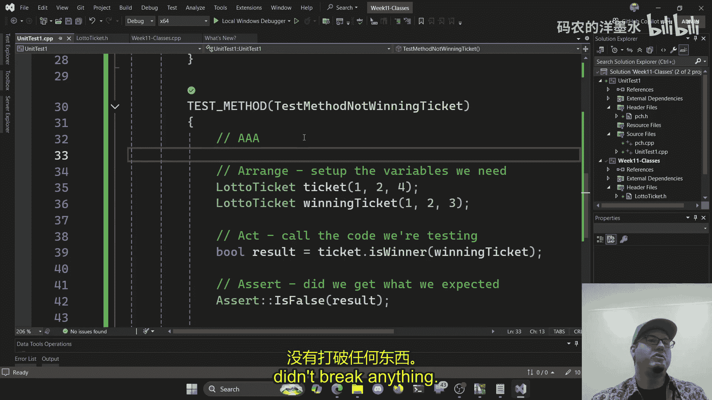

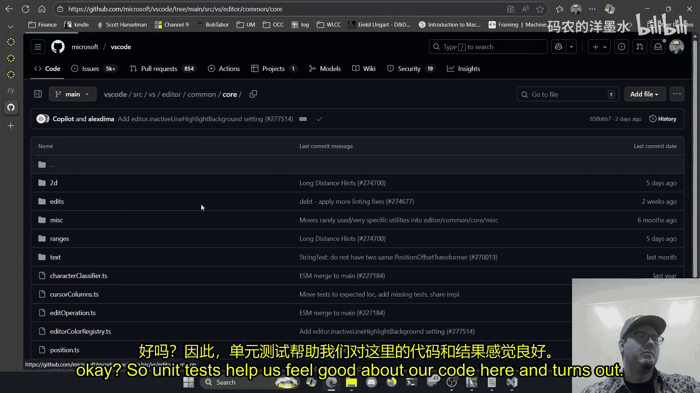

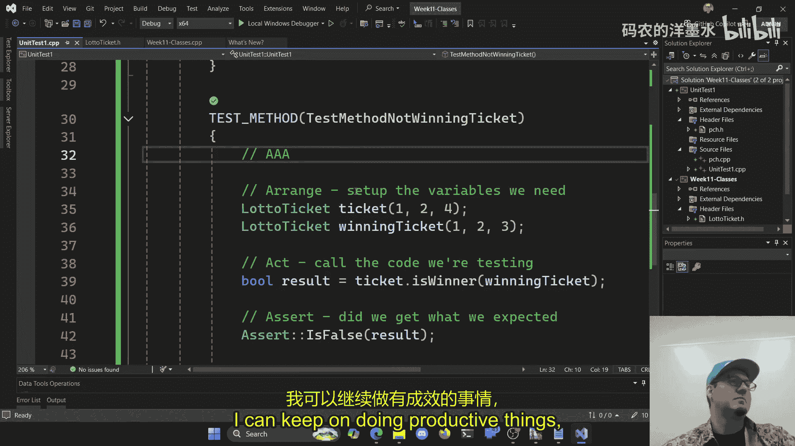

Built into Github workflows or Git workflows。 So this is called continuous integration testing。

 It's one of my favorite things here。 So as code is integrated into your branches into your source control that tool can kick off tests Now Git itself isn't running tests So this is one of the cool features of why people like Github。

 but all sorts of tools will do this feature here as code gets committed it will go automatically run tests for me So again。

 you have to set this up， you have to configure it and you write code that does this that runs the code that runs the test that runs it's a whole fun process don't worry but you can see hey。

 15 out of 15 tests passed when this was committed there's some tests that have failed only 23 out of 28 past when this one was committed and you can see every step of the way oh there're still running right now here every time code is committed。

 you can see the tests here and how many are passing。

Which is a pretty good feeling right Okay all my tests pass。

 I feel pretty good about this here so if you've gotten to the point where you think you have enough tests that give you confidence that nothing broke and it must be working here。

 you can go to the next step so if you have continuous integration testing。

And depending on your tools and things like that here， you can move to continuous deployment。

 So as the code is updated and all the tests are passed。

 the next thing we can do is kick off a process to deploy the code into production。

So I can go update my website and go update my tool。 and now everyone gets a little notification。

 here you have to go download and update or whatever my update process happens to be。

 I can roll that out。 So the my buddies who work at Khan Academy， they told me。Their website。

 KhanAcademy。com or。org， I think it's org， their nonprofit is updated dozens of times a day。

Because every time you commit your code and it passes all the tests。

 it will go and update the website。So it makes developers more productive and faster to get features out into the hands of people who are going to use them。

 so there's a lot of creative process that happens when you write code here and if I have to get some idea from somebody and say okay。

 you want to go add this feature add this tool， whatever I'm doing here I'm changing something and my product。

And it takes me a week to work on and then it has to get tested for a week and then it takes another week for someone to go and update it somewhere and then someone has to go look at it on a week later they tell me it's been like a month since I've done it。

And they're going to tell me something about it give me some feedback and I'm not going to remember what it was because I've moved on right。

 but if the very same day I'm finished with it， I can get it out in their hands and they give me feedback like that。

I've got the context still and I am familiar with that piece here。

 we can get it in the hands of our users and get feedback sooner so that helps businesses be more productive to have the shorter feedback cycles right because it's hard to get new things in your head and move on to other tasks and bring up old stuff here so being able to continuously deploy is a huge advantage because we're keeping things up to date and I can get my。

Test my stuff right away right it's a lot of fun。 So if you have continuous integration testing。

 you can do continuous deployments technically， you can do continuous deployment without continuous integration testing。

But no one recommends that。 That's probably a bad idea。 You want to test your code first。

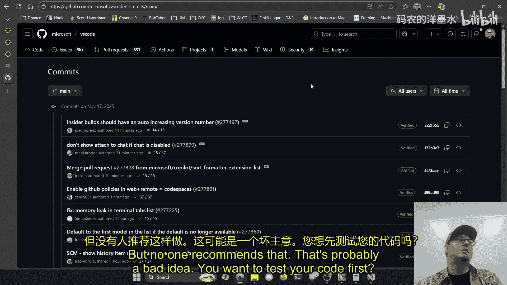

Okay， so all of this to say， if we write a bunch of tests now。

 we can go and make someone else's computer run them here。😊，You can do this with GitHub actions。

 there's a cool thing we can do。Probably not worth our time it's just fun to know that you can do it you can go look about how to set it up in Github and do it yourself if you so care to it's not too hard you have to give it a little configuration file and then you get your own little green check boxes and you're happy you're like how I testpa yay you're kind of excited all right。

This was with lotto ticket。 So the other thing I wanted to show you when we're using separate files here。

 the other thing we can do， let's do with a different class here， actually， and let's go add another。

Class here， let's add a vehicle header。Vhicle， I didn't spell that right at all。 Wow。

 that's terrible。Vehicle， there we go。And let's go move vehicle over。

 so let's go grab our vehicle class。Here。OhNow it doesn't know what strings are okay， sure。

 so we need to include string。Okay， included string and using namespace standard。There we go okay。

The other thing and the more proper way to write classes here is when we define an H file。

 all we do is we give it the definitions of the functions。

 we don't have any implementation of our code and it looks really crazy but that's okay so we're going to let me actually copy this for a second here so I'm going to make a matching source file。

Called vehicleh。cpp。

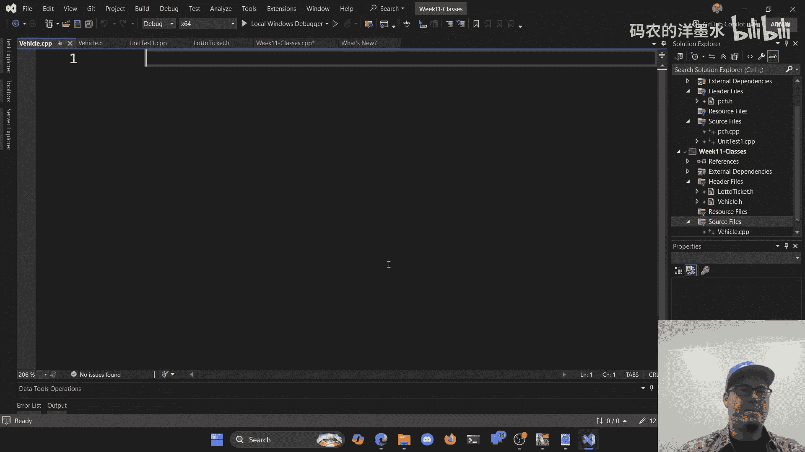

And I'll put this one in here。And you know， I have to look this up because I never do this because I hate it yeah。

 we include， there we go。

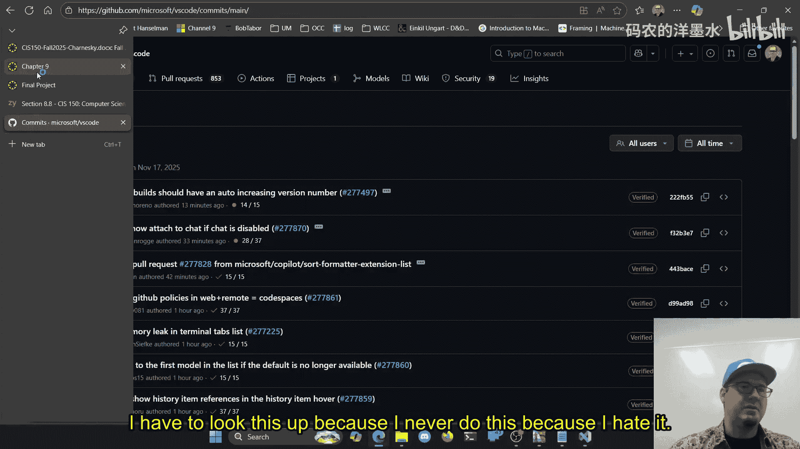

So in my H file then。None of these have any code， so I just have a semico and the end of my functions here。

呃。Seummicoons， semicoons。

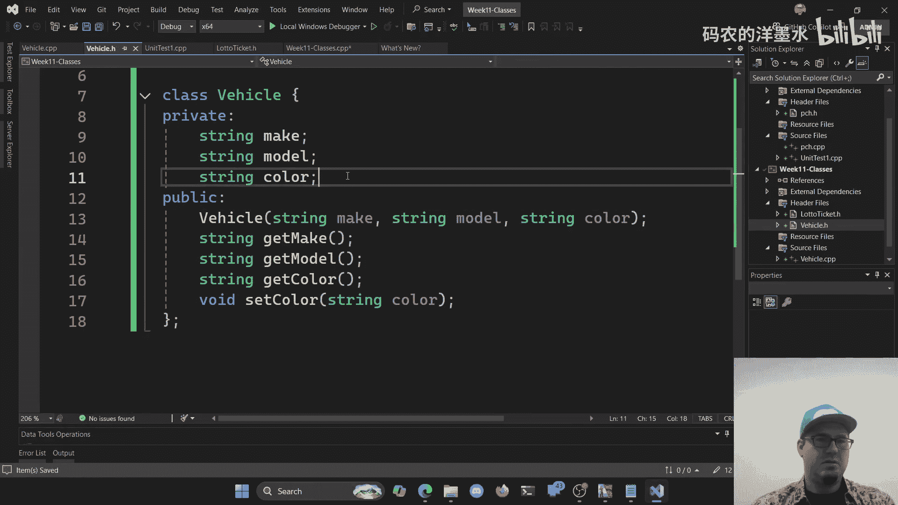

And I even have my private section， I really don't even remember here。

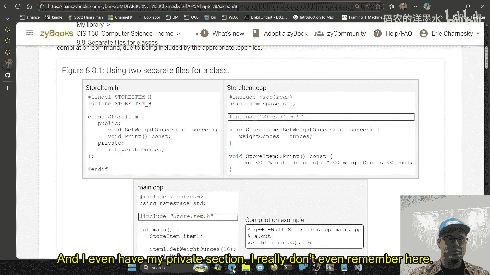

ok 一条 ok 。So I've defined。The attributes and what the functions look like here。

 This is just their signature。 which is their name and return type and parameters。 right。

 Then in the implementation file， the CPP file， I'm going to actually go and flush these out here。

 So we're going to include。Iclude vehicle down H here now。With this one。

 we have to go use so we don't write last， which is the weirdest thing here。

 so we don't have class here， we don't have public。

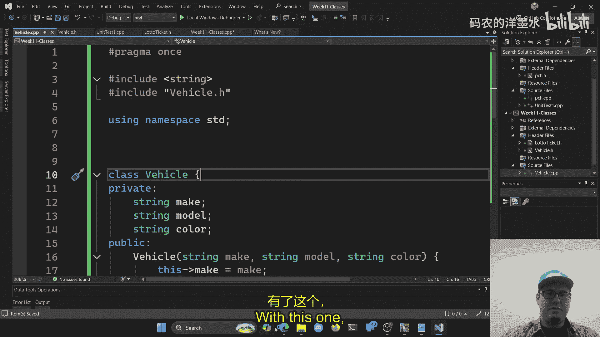

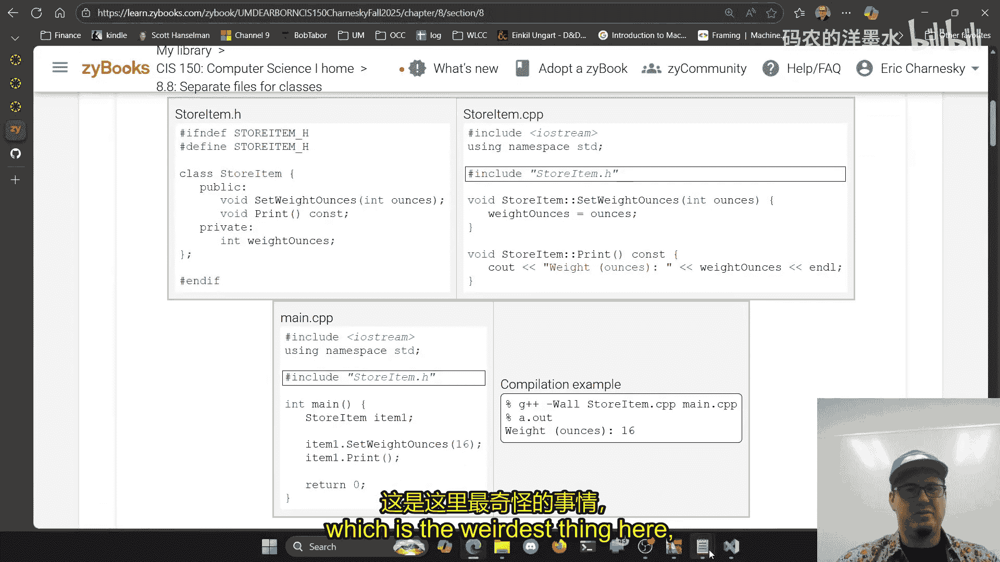

Okay， so all we do is we define。These functions and we say hey， this comes from the vehicle class。

 here's the vehicle， oh my goodness， I can't spell be the goal。Constructor， so name of the class Col。

 colon here。Name of the class colon colon function， name of the class colon colon function。

 name of the class colon colon function。系。All of that and then we have to back up this up one here so I don't think I need the standard because they already have that I don't need to include string because that came from vehicle H okay so it's as a copy paste that in right I've got the using namesspaceake standard and I've got the include for string already now why this is helpful it's a really long story but the short of it is it's faster for big projects okay the cool thing that C++ does when we take code and we turn it into an executable it' the compiler process compilers do a lot of cool magic。

In big projects， there's lots of files for them to compile okay so one of the shortcuts that it does is it says has this file changed or not？

And if it hasn't changed， it doesn't have to recompile， it can use the last version that it compiled。

 So if we have separate CPP files here， it can mark these as previously compiled。

I don't need to recompile this for my project okay if we put everything in the H file。

 it will recompile it every time because that H file is essentially getting copy pasted into the other file。

Okay， so if I only have some definitions， it's like， oh， okay， you don't actually have any code here。

 there's nothing to compile， it goes and finds where they were compiled。

here's what it looks like here and it will go find the matching stuff that's been compiled。

W those are really cool， there's a whole class on compile design and you could take a graduate class in compile design and the pros who teach that stuff are really crazy smart。

I don't really care how they work， I just like that they do work。

 but these sorts of things matter for big projects。

 you don't want it to take 20 minutes to compile because it has to go compile a thousand different classes right if you only touch two。

If youve only touch two you wanted it to compile the two you touch everything else you'd be like oh。

 I already have it right so that's why this is the right way to do things now the downside if you do it this way。

 we can't unit test the code without doing a bunch of extra steps。😊。

So I don't like doing it and I will try and avoid it because it just irritates me so in the real world you'll do the extra steps here and it's not a big deal。

 but for us learning how to do it it's just pain but and we don't want to have to do it okay。

That's okay， it's not the end of the world。

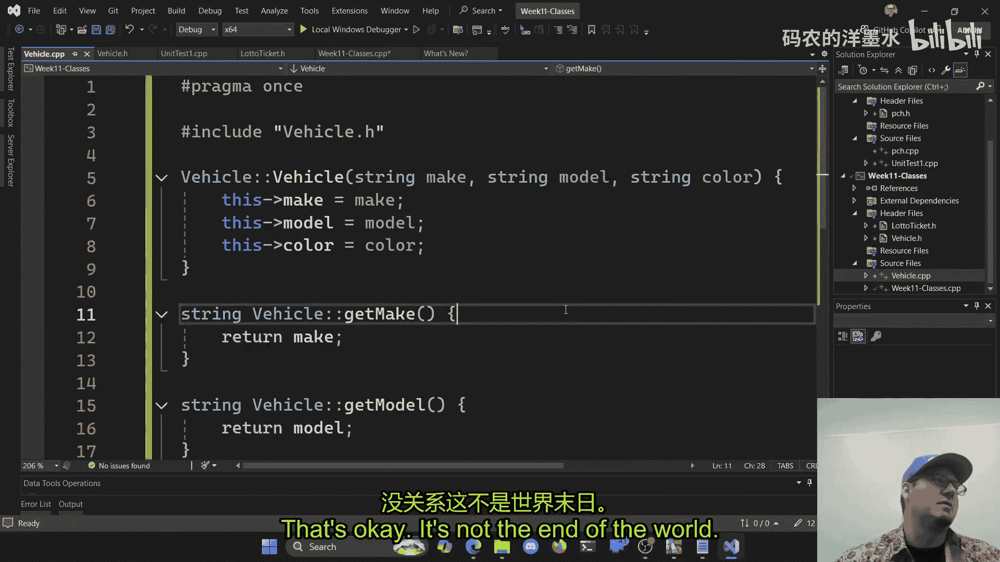

All right， so that is classes and unit testing in separate files。

 very exciting with separate files here。Yeah。Unit tests so their unit testing here。It's hey。

I'm going to output failed。And I still have to look at the screen and notice if I get a failed message that the output failed。

系。Still relies on human error， right， And then I still have like code somewhere。 And I don't know。

 it's a。It's doing the same sort of idea right it's testing did I get what I expected and if I didn't now I'm outputting a message versus my tool giving me a nice redx showing me stuff fail here。

 but this is not a very friendly way for us to do it here。Right。

 and you can still make mistakes right if it's possible to screw up your own tests here。Right。

Not as likely， but it's possible right you can make a mistake in your code you make a mistake in your test and you think everything's working。

 but it's failing incorrectly， right？Sure， so not perfect。

 but generally any code that's worth writing is worth testing because。If you don't care if it works。

 right， why did you write it in the first place？Right if it's garbage if you don't care if it's garbage then it wasn't worth writing Okay other cool things we can do are we can do these overloading options here so let me go to lotto ticket here。

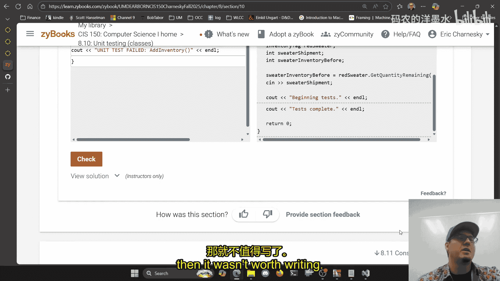

So we'll say how about instead of passing three numbers here。

 what if I want to be able to pass a vector of numbers， right？

I can do that so I can make another function with the same name here with a different set of parameters so I can say。

 hey I want a vector of end here for numbers。Okay。😊，Then I can just say， hey okay。

 my number one equals numbers dot or at zero。Or maybe I need to check first like， hey。

 if my number dot size is equal to three。Sure then we can go do this。Else， we're just sad。You know。

 we haven't got two exceptions yet， that's the whole chapter on the right thing we're supposed to do here。

I don't know classes shouldn't input and output anything because there's no guarantee that this class will be used in a console based application。

 no one could see the message if I use it in a mobile app or a web app right or graphic user interface application。

 but right so we got number one we'll do number two number at one。

N no nubner I got this number three numbers at to right so sure I can use two different functions here as long as the parameters are different C++ will know which one i'm trying to use based on the parameters I give it right so when we go use lotto ticket right I could go test that one too if I wanted lotto ticket test here so we'll test。

So instead of winning ticket is a one， two three， we can say hey winning ticket when I give it a set of parentheses。

 you notice I get a couple。😊，Options here right these ones are a little silly don't worry about them we'll get to the next semester but here's numbers one two and three here's us says error but thats the vector I think after we recompile it'll probably work but I can give it a vector of numbers if I wanted right so I can have。

Vectctor of event numbers equals one， two， and three。because we didn't include vector。

 that's why I' going to include vector。Now I can give it numbers。I can use the other constructor。

 really。Oh， this is the namespace right using namespace standard。That it standard Okay。

 now it's all happy with me here now we should see yeah， vector of of numbers Okay， now okay。

 we can run our tests using a different constructor Life is good in here。It should pass。

 we'll see it's possible I screwed up。Oh goodness。Build errors， wow。It's real mad about vector here。

The vectorctor。Game space standard it looked like it lit up， okay， that's weird。Right now。

It was throw the in everywhere， I guess。Okay。Okay。No。

It's running okay now Ram life is good so we can use a different construct so not only can you do that with constructors。

 you can do it with different functions as well so your functions can have different arguments now with this one is not very interesting let's see。

😊，Vehicles probably not very interesting。 Those are all strings。 What about chair。

 Do we have anything fun with chair。Let's see chair。Yeah。

 what if we wanted to have this as maybe a double？Right。

 one is an and one is a double we could do that right so we got to avoid set height in centimeters。

Okays'll just copy paste to that with bad idea centimeters， given a double height in centimeters。

Sure， so I can give it an int or a double now if you give me a double。

 but I can only store integer of then I'm going like truncate it， I'm going to lose some precision。

 it's probably not the end of the world here。嗯。And it even lets me set it， that's funny。

Se an in to the double。Sure， but now I've made this function a little bit easier for whoever wants to use my class because they have different options for what they want to give me rather than making the person use my class have to do all the conversions I can handle how I want to do the conversions in my class it's just an option you don't have to do these overloaded methods functions but you can if you want to or if it makes sense to have different sets here do we do a constructor we didn't do a constructor for share so maybe we want to have a different constructor for share that defaults some values be nice like oh hey if you don't tell me if you have arms or Ill assume you don't if you don't how many how many wheels you have I'll assume it's for or that should be legs right now wheels I name that badly。

Great I guess all of our chairs have wheels， but probably some chairs have legs not wheels so so you can overload them right so we got options for overloading our functions here for。

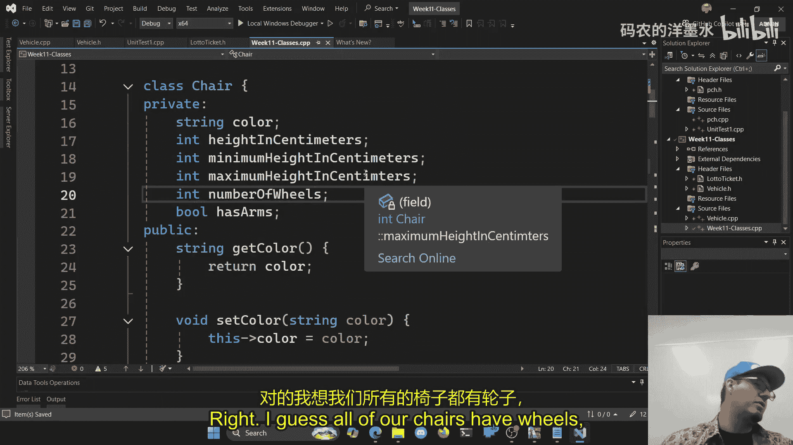

嗯。The operator overloading， if you want here， you can say， hey， how do I define。

Adding two classes together here， this doesn't make sense for most classes。

 but occasionally for a class it makes sense that this this instance plus this instance gives you something。

Right it depends on what we're working so in this case they're doing time here you can add two times together and we just add their hours and minutes and seconds together sure you can do those for operator overloading so you can do addition you can do subtraction you can do multiplication you can even do greater than a less than we can say hey I want to say is this one bigger than another one here。

Here's the list of overloadable operators， how exciting here。Any of your operators you can overload。

That's a lot of them。But again， if it makes sense for your class to do that。

 you can go and define what that looks like and that's something you'll do next semester as well。

Let's see。Static data members and functions， so so far what we've looked at when I say this is a private attribute。

 it means every instance of chair has its own set of these right because these are instance attributes right so every chair gets its own unique set of these values。

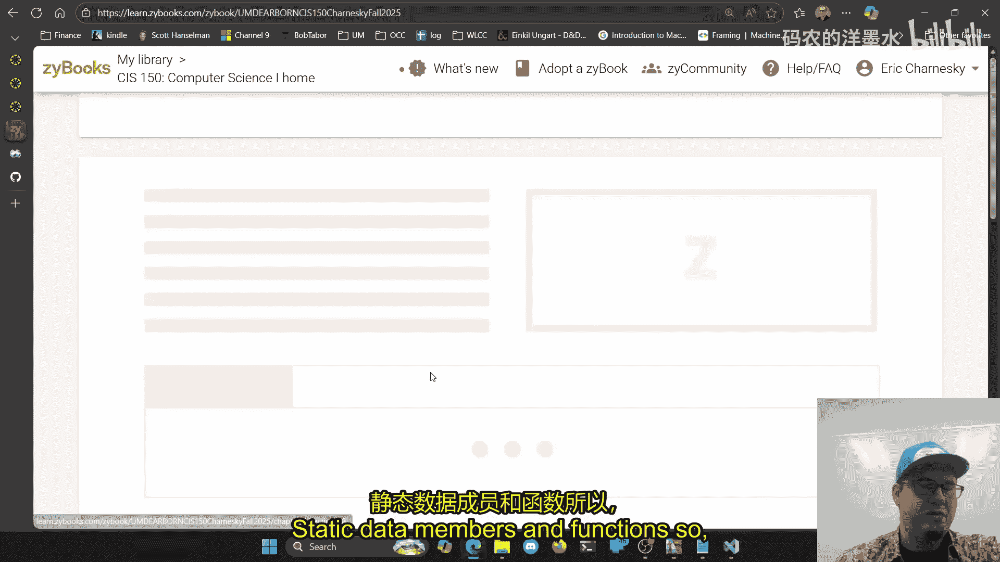

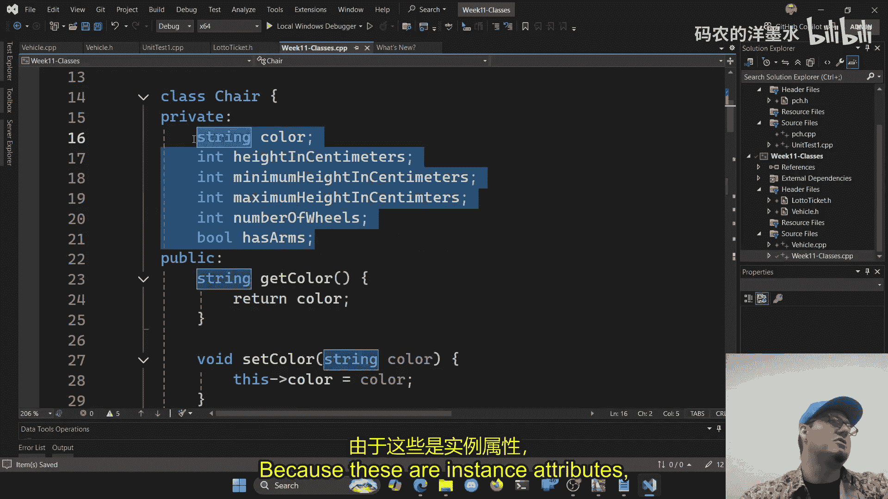

The opposite of that is static， so static means it is defined once at the class level and all instances of the class share that value。

Right so depending on what we're writing， this can be helpful here。

 so something like lotto ticket here， let's go to our lottto ticket class here。

 it might be nice to know the cost of a lottto ticket。

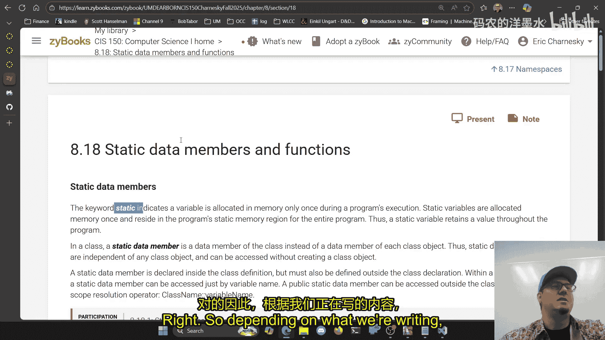

And depending on what lottto you're playing again I know it's not always the case here。

 but usually this same lotto ticket costs the same amount right so defining it once at the class level makes sense because I don't need to store it a thousand times in memory if people buy a thousand tickets right I only need to store it one time because every ticket costs one dollar that sort of thing here so we can define attributes as a static here。

Ors it not like a lot of ticket？Uninitialized。Oh， because I have the F here， that's why。That's fine。

 so to do that， we're going to define a static attribute。

 so it's a static data number where we say hey it's a static something here。

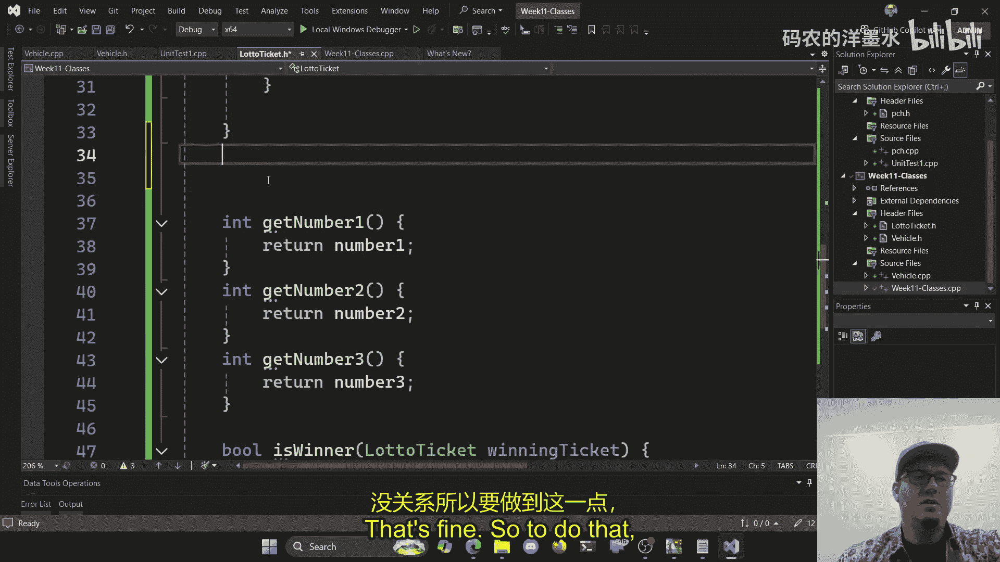

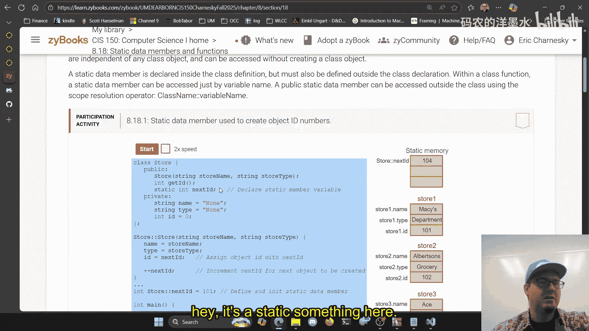

With the static keyword no。It's probably a public attribute， it could be private。

 but it's more useful it's a public attribute。 here so I can make a static constant and ticket price。

Now I want to mark this as constant because I don't want it to change。Let started。

So so static means it will exist once at the class level。

 so not every instance of lotto ticket will get its own copy of ticket price is is just defined once in memory so I could have 10。

000 tickets in memory， but ticket price only exists once， so I haven't wasted you know 4000 bytes。

So it's a good practice if there's some value that doesn't change that belongs to the class the other example here they give you is like the next I so every time you make one we can increment this value so inside of its code it just increases the next I by one increases the ID by one because all the。

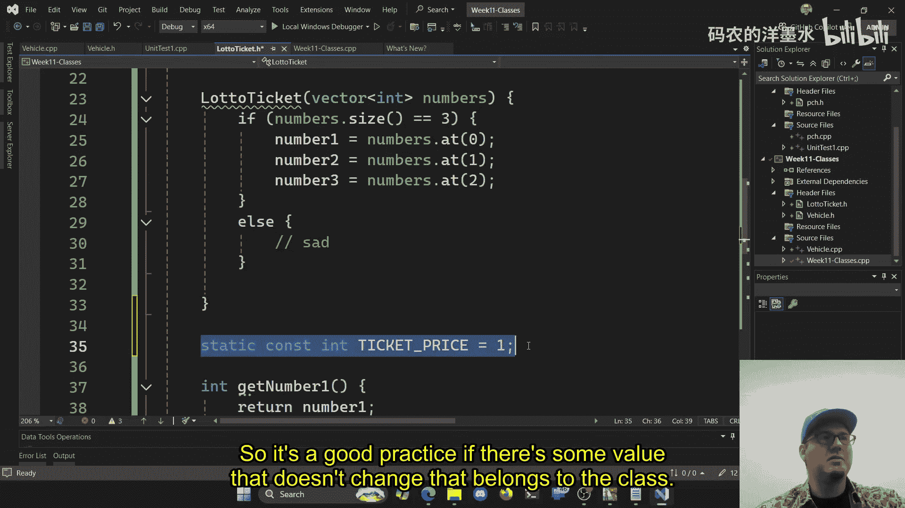

Classes all the instances have access to it and they can modify the value so it says okay i'm going to make a store it gets an ID and then i'll add one to it i'll make a store add one so it's the way to like it counts itself how many of these i've made here it's kind of handy that way most of the time you don't want your code doing this though so it's not all that useful。

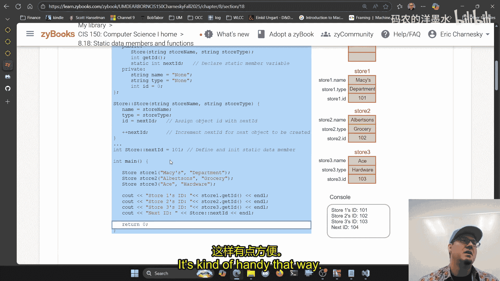

But this it defined once。It's stored once at the class level。

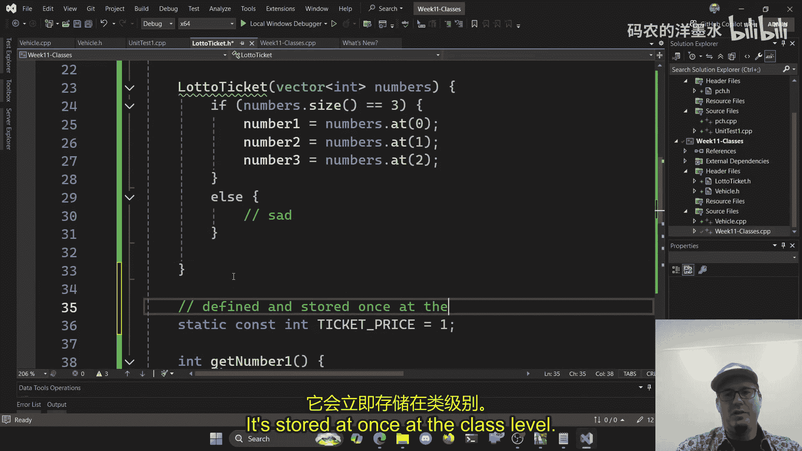

Not for instance。All right， so that static stuff I think that covers it for classes here yeah I think that's pretty good。

Yeahep。こol。This is the inline member function we define them there that's in line。

 we've defined it in line like in the H file here rather than the separate files right you know we can get to pointers Wednesday here that should be okay。

 we want to talk about the final project Okay， so let's get to the final project here make a new GitHthub repo for you here。

Yeah。50。哦。Myile project。Go。Private。Yeah。So one of the cool things Gitthub classrooms can do if I so care to。

 it could add， you know how we did unit tests， they can do a very similar thing with auto grading。

 they could say if this input goes in this input should come out or this output should come out but if this goes in this comes out you can set that up with a file here to define that。

The problem is it has to be very specific and everyone has to take the exact same input at the exact same order and the exact same output letter for letter case for case that's a big pain in the bottom but you can do that same sort of thing here and it's that common they're like oh you can use that same framework to do auto grading tests and you could say hey you got 10 out of 10 points like the same way your Zybooks does with Zyabs hey I ran all these different inputs I got these outputs same idea that's all kind of based on you tests。

Yeah。H。嗯。All right， hit the link here。Final project， very exciting here。You guys like games， right？

All right， good。And this will be due oh my goodness， was it the 15th？And what time were we？

We need 1230， but we can change it if we need to here， so for 40 points for this one here。All right。

 please submit the URL of your repository。They self assessment。Sassment using the work。All right。

 and forgive me a shameless copy paste here。Oh， and look at it oh we go and。

Screenshots of a running in the region as well。For this final project， for a couple reasons here。

 youll have to have at least 10 commits of working runnable code over 10 separate days。

To get a score， okay， it's good for you because you're going to have to start early。

It's good for me because it's really hard to copy paste something from chat ET and cut it into 10 chunks that work I'm just going to be honest right that that's one of the reasons I do this and it makes you start early right it's not just for that it's a good to force people to start early here so we've got close to a month here so every third day or so get a commitment in right this should not be unreasonable is that okay。

All right so 10 commits 10 separate days and working code so every time we make a commit here we're going to add a screenshot of it running to the readby file so hey commit number one here's what runs right now commit number two here's what runs right now。

Again， copy pasting working code from chattEPT is really hard to do to take a tenthth of it and a tenthth of it and tenth0th of it and I've seen like when I used to do this。

 I didn't require working code， I just got here's 50 lines。

 here's 50 lines and like they even like did the middle of a function because they were super lazy how they copy paste them like you didn't commit half of a function and finish it。

And they're like， oh yeah I just I figured I finished the function later。

 it's like come on I not my stupid I have stupid rubberry in my face， I guess I have a snorx hat on。

 but I'm not stupid， right？All right so10 at least 10 commits more is okay here10 separate days working code the idea we're going take it chunk by chunk by chunk let's just get it up and running here with some menu right it doesn't have to do anything when I click the options here right Okay now I've added this function here now you can do this option Okay now you can do this next thing right we're going to break it up into small pieces here okay。

If that makes sense， all right， if you're working with a partner， that's five each。

Or seven and three something like that right so it doesn't need to be 10 per person if you're working with a partner let me know your GitHub username and I can set up shared access if you'd like to work with a partner you don't have to it's up to you you'll get into forced group projects eventually you'll love it it's actually good for you because working as a developer without having a team is really sad and lonely here and working with another person makes you better and makes the product better and if you to pick your partner is even better it kind of sucks to get forced through people but that is sort of how the real world works you get hired for a team and you didn't pick your team so you know both ways are good。

So it's a basic version of monopoly here。Not not every single feature of monooppoly。

 have you guys played monooppoly before， if you have not， you want to go play it。

Okay you can play for free online somewhere i'm sure to Google it here I can bring in the board game at some point here。

 but it takes a little bit long to play the game here so that's why ours is a basic version here so our 10 by10 board40 spaces we don't need to have the chance in community chest they're just blank spaces here because pulling a card and picking what happens when you get the card is complicated here is' the feature we don't need to have that's okay right so。

What we're going to do when we start our program， we're going to ask the user do you want to start a new game or load a game。

So one of the things you should say for later is saving and loading。

Right don't do that at the first thing right that's a feature you can add in later right one of your later commits that makes sense okay ask for a new game ask 20 players two to eight players two players。

 three players for any sort number of players is fine each player starts with $1500 and on the go space the start space right so if you have 40 spaces you probably have a vector。

Right of spaces， these sort of things here we've got options right and then。

Things to added later like they go to jail space。Space number 30 I think is go to jail。

 you go to space 10 to jail space okay you go to jail for rolling doubles three times in a row。

 usually when you roll doubles， you get to go another time you get an extra turn if you've done it three times in a row though you don't get your third turn you just go right to jail okay so add it in later right that's a nice feature to add later doesn't have to happen right away。

Okay all these sorts of things we can think about okay。

 I can get a basic version working then I can add more interesting stuff okay for when you go to jail just have them pay $50 and get out it's more complicated to make sure they have to roll double ticket out of jail so just when you go to jail you pay $50 bucks that's probably the easy way to tackle that okay。

Classes we should use。You should use classes for this， you don't necessarily have to。

 but it's going to make life a whole lot harder because classes let us encapulate all the details and talk about these things as now it's right a player。

It's prettyt easy， they have a name or a number， player one， player two， player three， player four。

 feel free to use numbers or you can have by name any way you want that's okay， right。

 how much money they have and what space they're on or what index they're on in the vector。hey。

 I'm a space zero I'm at start let go I'm at space 27 right that Marvin Gardens I think 27 or is that utilities might be waterworks that's okay right and then properties right the space is on the board right they have a name this is what the space is they have the purchase price they have a rent amount so when you land on the property if you don't own it you have to pay someone rent。

Great。😊，Okay， so whoever owns it？Right you pay that amount of rent。

 we're not going to worry about building houses right worry about building hotels don't worry about doubling rent if you own on the whole thing again this is just a basic version here。

 so it's going to be really hard to lose because every time you pass go you get $00 bucks and it's hard to lose $200 it's just basic rent。

Okay， that's okay， yeah， so each property has a different rent number。But it'll stay the same rent。

 right？Oh there's a list online yeah yeah if you want to come up with your own property names at school too you don't have to use the the canonical ones or you pick your favorite edition that's fun too yeah。

the commits are just， you've got a commit of this is what is's working so far。

Right did start since you own a new game load game load game doesn't work new game says two to eight players Sure that's day one you want something that works and runs like then you can test that little bit here right so all these little pieces here maybe you don't charge rent every time you land the property just as you landed on this space we haven't figured out how rent works yet that's something we could add in later right so lots of ways we can break this up into small pieces here so yeah make your list of properties。

Have your list to players and figure out saving and loading later。

 that's a whole other thing right when we looked at files。

 we have to write lines to files and figure out what's in there so。

The easy way to do it is probably tell the the first line is like how many players and then you know how many players go read right and then you know there's always 40 properties because properties need to know who owns them。

 right？Or maybe people the player has a list of properties there's there's ways you can store that information however you want to tackle that couple options there Okay that makes sense cool so that's what we're doing for our final project again just a pretty basic version here you don't need all the fancy features but it should be enough to do a small little project off of this here the 15th to 1230 just double check that's the right time yeah dice so you roll two six sided dice so you'll no two six sided dice。

RightIf you roll two side dice， you're much more likely to get a seven。

 a sixth of the time you'll get a seven and it's much like a 136， you'll get a two。

 136 you'll get a 12 and you get a nice little distribution curve there。Yeah。

 don't get me started on dice。Yeah 1215 oh 1130 so 1130 think we'll fix that for you we'll probably in this room again they don't publish the schedule to the week before so if you see it there that's fine。

And need to do 12，30。Or 11 30。All right， cool， we got 15 minutes。

 so we should talk about pointers then because you probably will have a lab on pointers because I've not yet talked to。

Dr。 So andso。Really should't remember his name， I'm sorry， Saed Dr。

 Saed to tell him I didn't do anything Wednesday I behind。This。I forgot all right。

 but we'll talk about pointers it goes pretty quick， let start a new project。

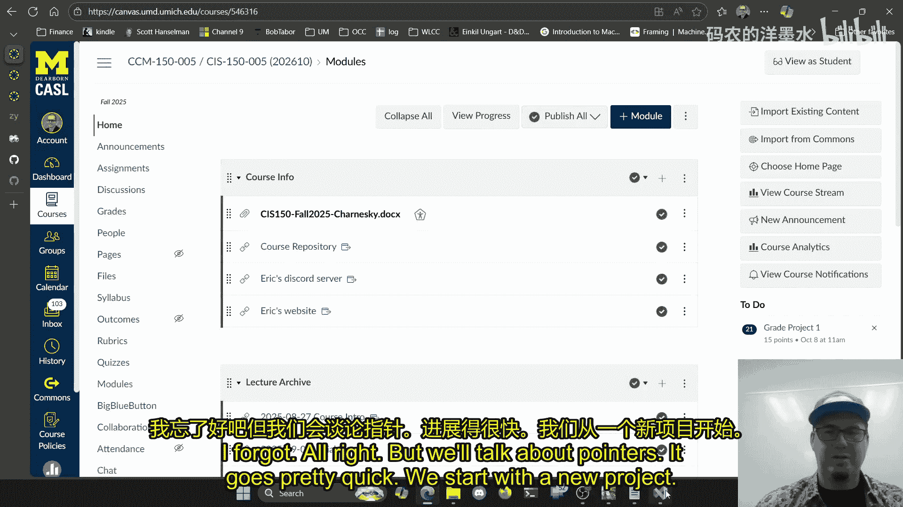

At least the basic stuff here so let's be。Oops， I wanted a。Console there we go， week 12 pointers。

Rot and facts yeah， so instead of taking a final exam。

 you'll get up and run your code shows you can play a game， save a game。

 load a game takes maybe five minutes。If you'd like to talk a lot a whole five minutes。

 usually three。Yeah yeah yeah if you work with a partner and you present togetherep so I can either you can plug in if you've got an HD appcor on your laptop you've got a USBC adapter that usually works or I could even just clone your code from Gitthub and hit run from my laptop we got a couple ways we can make it run and that way everyone gets to show off the project they ran I might have a question or two about your code。

Right， again。You should be able to explain what's happening in your code。

 I think that's a pretty fair requirement so if you want to get one small piece here and there。

 a specific focused area from a tool that's great right hey you know how do I go do this part I'm okay with that ci your source right but English paper rules apply the bulk of the work has to be yours。

And if you can't tell me what the code is doing。It's not going to fly right you can't cite some work and not know what it's doing that's incredibly dangerous when it comes to writing code in the real world because you're likely to screw something up you don't know what it's doing right don't trust the machines please right be smarter than that yeah。

Oh okay， cool， so pointers。Using namespace standard。Now pointers are fun。

 they are the bane of C++ here。But it's okay， we'll make them work。

 so so far all of our variables have been。A certain type。 And we said， hey。

 this is an integer for number， right we set a value to it， right。

What's different with pointers is we create a variable and that variable is just the memory address of where the actual thing is in memory。

 so it's a pointer to where it lives in memory。It's a weird very weird distinction here。

 but it's okay again， we'll dive deeper into it next semester。

 but we want to start talking about so I say an int star so star is the keyword for pointer here this will be my number pointer。

Okay。Number pointer so the variable sorry the value of number pointer is a memory address of where that integer is stored in memory right the value of number here。

Is the number 42。Right， the value number pointer。Here's the memory address。Where the number restore。

Where it is stored。Okay， to set the value of number pointer here。Number pointer。

 I don't want to say equals 42 here， it not even going to let me do that it's going to say。Oops。

 there we go， number pointer。Since。Value of number pointer is the M。Okay。

 sorry that that was my comment there this you want to hear a value of type int cannot be assigned to an entity of type int star。

You can't assign an integer to an integer pointer， it is expecting a memory address here。

 so what we need to do is we will dereence our pointer and say hey。

 the thing that it's pointed at set the value to。So we put a star in front of it here。

Say take the place it's looking at， take the place it's pointing at here， assign at the value of 42。

Okay， and then I can see out number pointer， number pointer。And I'll put a upper pointer in here。

Okay， so what do you think when I output number pointer， what am I going to get？The memory address。

 yeah， not 42 because it's the value of memory address。Oh goodness， bill errors， sorry， this one。

Is that working？Goodness， uninitialized， sorry， equals。New interpointer。no。Why am I failing here？Wow。

 I need to go look at ibooks， I guess I hate pointers。

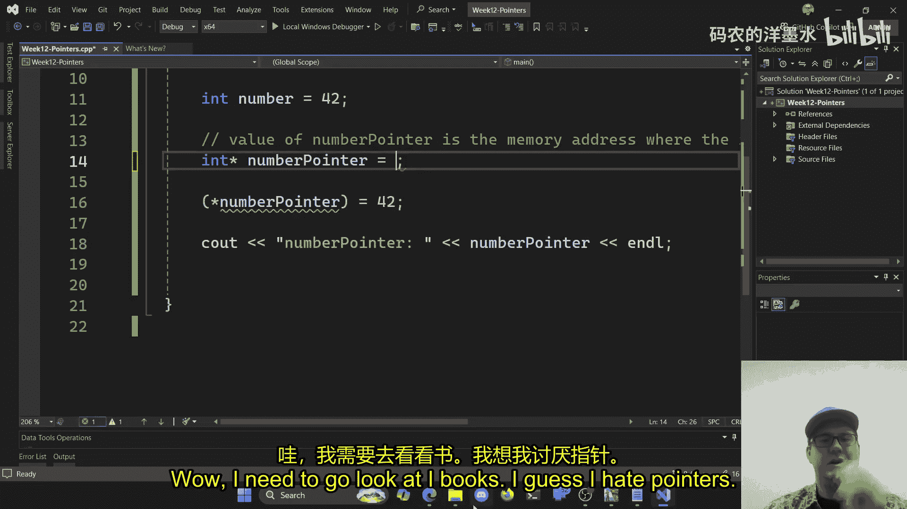

That should have worked， sorry。Oh， I don't want that one。I just want a single pointer。

 Why am I so dumb。

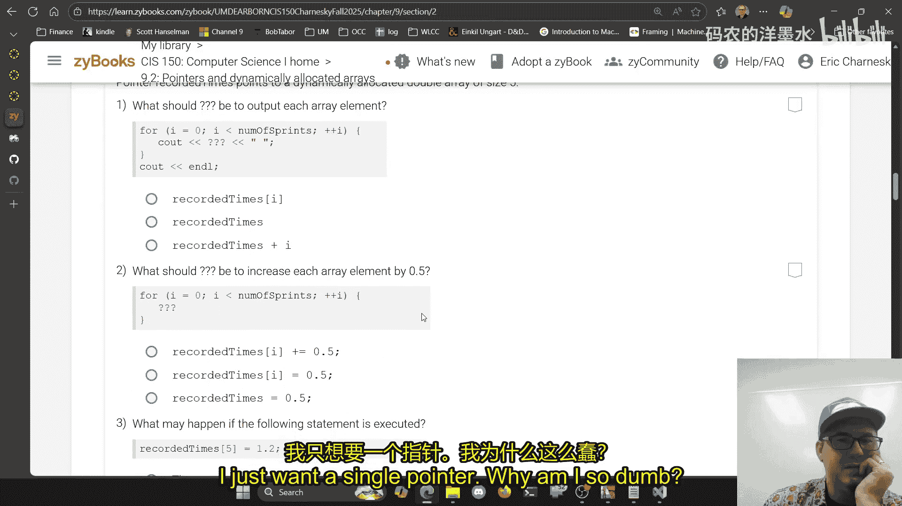

Number pointer。in pointer。まマよです。Back to Googleogling， I'm so sorry， C+ plus older。

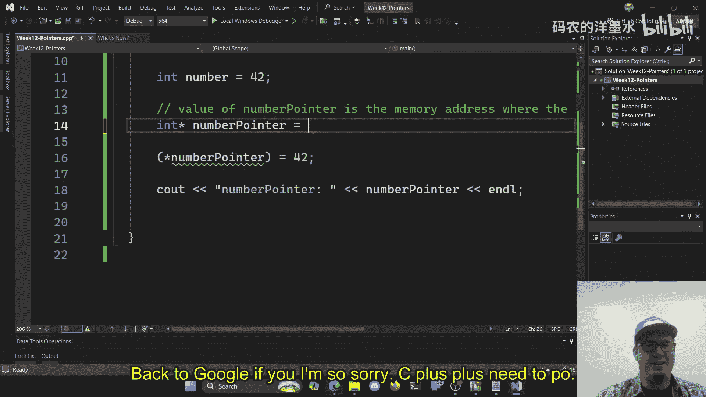

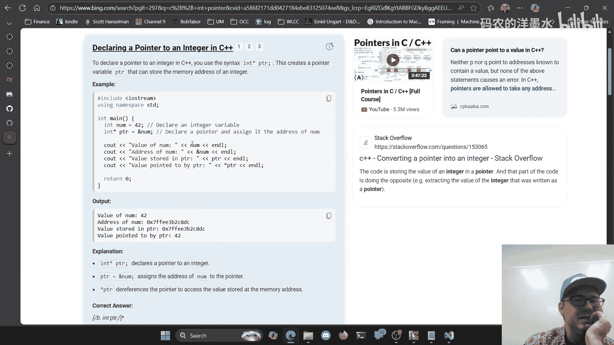

I want to make a new one。

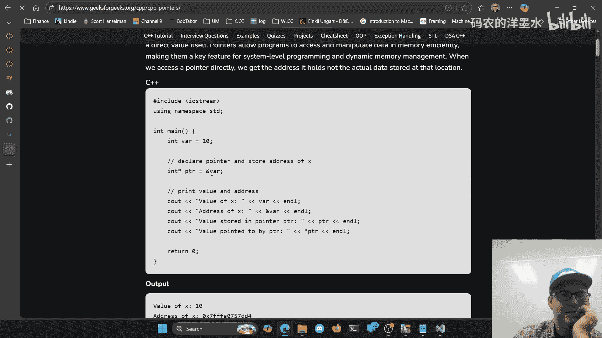

Okay， sure。We can do that， so。When I set the number pointer here。

I'll leave that line alone for a second here。It's expecting not an integer。

 it's expecting an integer pointer or the memory address to give it a memory address。

 I have an integer memory， I don't know what its address is。

 I just know its value there's another fun character and uses the ampersand so it means the address of so it's the address of number。

So my number pointer points at the address of number。All， so that's the ampersand sign stored。

Adddress of。佢。So then if I wanted to change number pointer， again。

 I still have to do that de referencing thing number pointer。Equals 77。

 I can go change the value a bit if I want here from 42 to 77。

And if I put this in debug mode and run it for a second。对。We're going to see number 42。

 number pointer is x00。 this is some hexodadeimmal memory address here。 the value is 42。

 So if I'm about to change the value。That number pointer is pointed at。To 77。It also changes number。

Because number was stored at that location and memory。

 so I have a pointer to where this thing is stored。

 so I really have number points at this and number pointer points at it。Right。

 I've got two things pointed to the same location here。 The when I output my number pointer， right。

 we get。

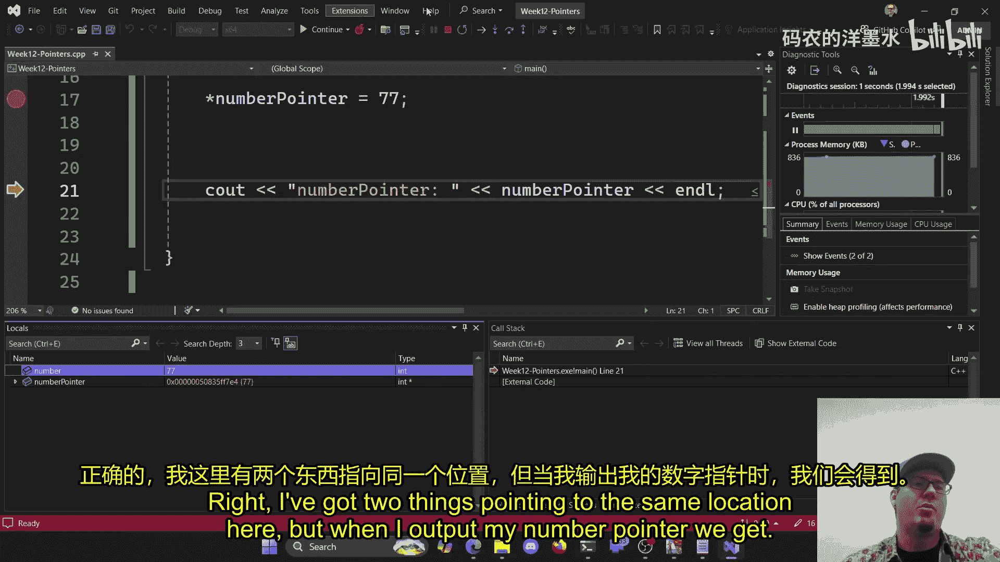

Memory address garbage， not a very useful variable。

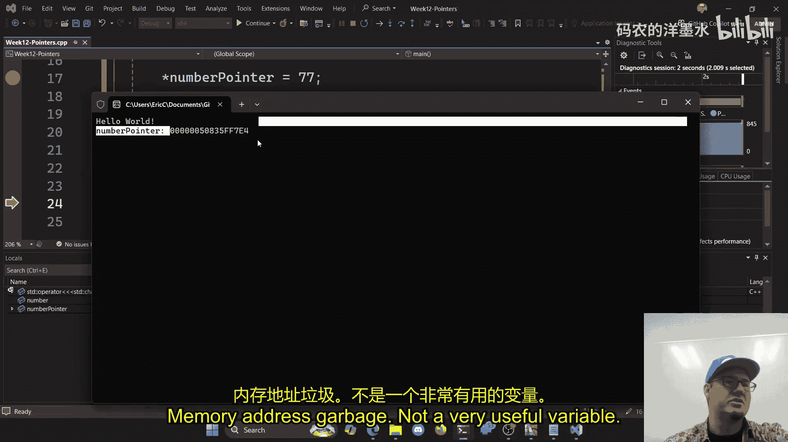

It's not super helpful here， we get the address of it。Okay， so that's a single pointer。

Not very helpful yet。 The next cool thing we can do with very with pointers is I can have dynamic arrays。

 We can make arrays kind of work。😊，Almost like a vector， but they're still not resizable here。

 but I can make one without knowing the size ahead of time Hoay finally we can do something fun so I can see how enter a number or a number of ints to enter。

And I can have a int number of ints， sure。St will the same numbers。And I can see in our numbers。

Now I can make a pointer。To an integer as an array。In dynamic memory。

There's a lot of fun stuff happening there so everything we've done so far with arrays when we compile it ahead of time。

 we know how much memory we need and all of that memory is allocated on the stack。

Don't worry too much about it here， but it's a smaller space。

 we don't have as much memory on the stack to work with。

If you want to get at the rest of the computer's memory that's known as the heap here。

 we have to use dynamic memory。 So as the program's running。

 then it will dynamically ask he operating system， please give me a hunk of memory。

 We don't know what it is before we run here so I can't allocate it on the stack from my program starts The day when I hit start from my program。

C+ plus goes out of the operating system and says hey。

 I need 59 bys of memory to store my entire program right I know ahead of time and they can allocate everything ahead of time on the stack here then my program needs to run if we need more space than that or if we need to know while it's running we can use the heat memory there everything else we can store which is really fun so I can go out and say okay now I have an integer array or inte your pointer we're going to call this number dynamic。

Aray equals a new int。Pointter new interray size of numbers here。

So I have a pointer here to an integer， but I'm getting this number of integers space and memory allocated on the he here。

So allocates numbers。Or its of int of memory on the heat。佢。😊，Now。

 the pointer itself is still just the first location where it starts。So all that same arithmetic。

 like when we looked at， hey， you know， we start index0， we go to index 1， we go to index 2。

 you can jump around here because it's that memory address plus whatever index you want times the size。

 Same thing happens， right， our pointer。😊，Is used as the starting address and that's why it stores an address。

 here's where this thing starts in memory here so that I can then go through out don4 int。

Value are index is zero， index is less than numbers， index plus plus。You can see out。Enter number。

Index， and I don't know， coal in。And then we can see in。A value to my dynamic array， dynamic。

Aray index of index。Andmic array index of index enter the next number enter the next number enter the next number here so however many of they told me here I can start adding them into that location I've sized it ahead of time。

 but I don't know what it is when it's running here。And then for I don't know， L in dynamic array。

Like array。Yes。Is that not， I spell it wrong again。Oh， I can't loop through it though way shoot。

It's zero。Le than numbers。 Now， you don't know the size of it， though。

You can't ask it size some vectors are still better here， but that's okay。

We can see out the dynamic array。Ray at the index。And that motion oh， because I goodness gracious。

 dynamic。Yeah。Okay。There we go。 So if I spell it right the first time， that can I not hit enter。

 really？Dynamic。Aray， apply。Why。All right， whatever， that's fine。It didn't work。

And it's being cranky with me。Oh， that's where we don't need the breakpoint， we'll continue。

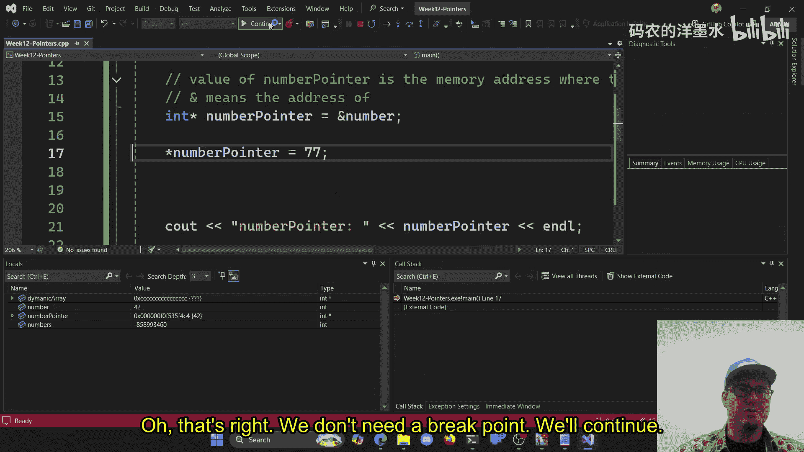

All right， so we can enter five numbers here， so one， two， three， four and  five， one， two， three。

 four， five very exciting now if we put a breakpoint in here and we look at it here。

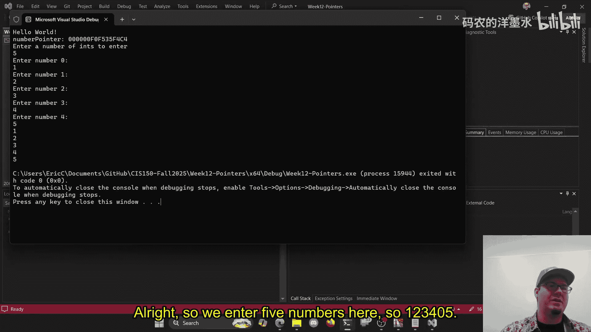

嗯。Read four and5。My numbers， dynamic array here， I can't see the values of it I only see the value of the first number。

 so it even sucks for debugging because you can't see the contents like you can vector and vector you can open up and see all the values here kind of size but。

Silly things you can do with this now instead of this kind of loop here， I can say， hey。

 I want an endpointer but the current address starts at dynamic array， dynamic oh my goodness， sure。

 right？And now I can go through and print out just that value here right if I wanted to see out my current address。

Current address be referenced right I want the value there， not the memory address there， right？

I can get out the value there， so this will give me one。

Then the next thing you can do because these things are silly here is you can add to it， I can say。

 hey， take my current address plus plus。This adds the size of one integer。To the memory address。

Right， so when I add to this address here。It adds then four bytes。

 right and we'll move it on so that I can see how the next one。

And I can add some and add some and add some， right？Keep going and keep going here。

 we'll just copy paste for a little bit here so it's two， three， four， five。Right。

 I think I got them all one， two， three， four， five， right if I do it again though。

What am I going to get at the sixth address， there's nothing there right。

 or am I going to get hot garbage？

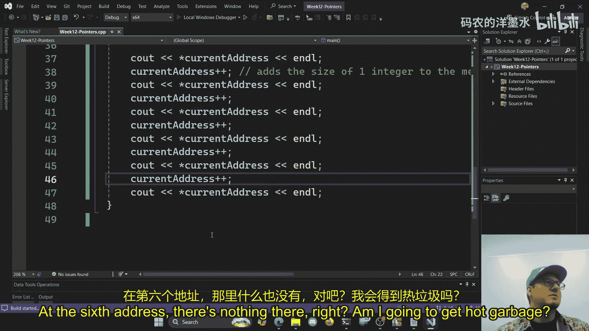

If you're a trash pando， you're excited for hot garbage。Garbage so again。

 you can still do bad things with it just like we go with a array here got to be a little bit careful there's some cool things we can do to find the starts in the ends and do the sort of arithmetic it's okay we'll get to all that fun stuff later here but we got most of that in our pointer so this is dynamic arrays dynamically allocated a arrays。

😊。

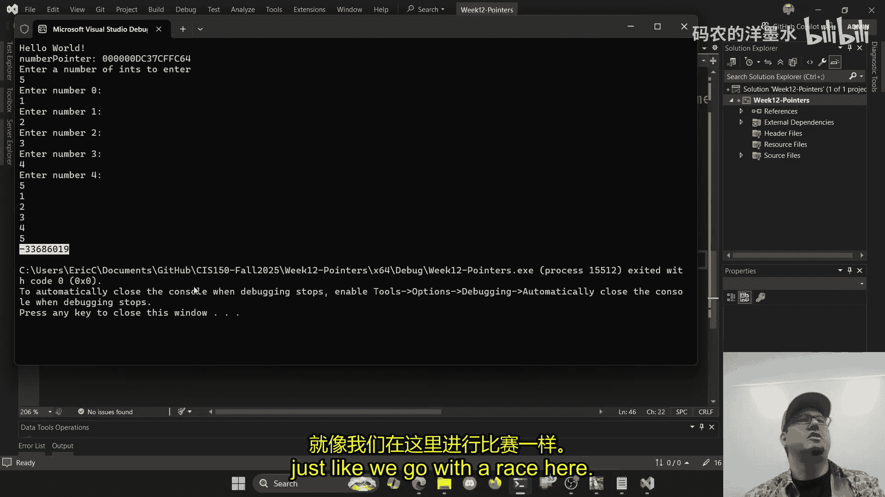

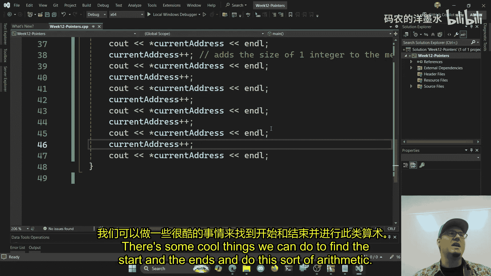

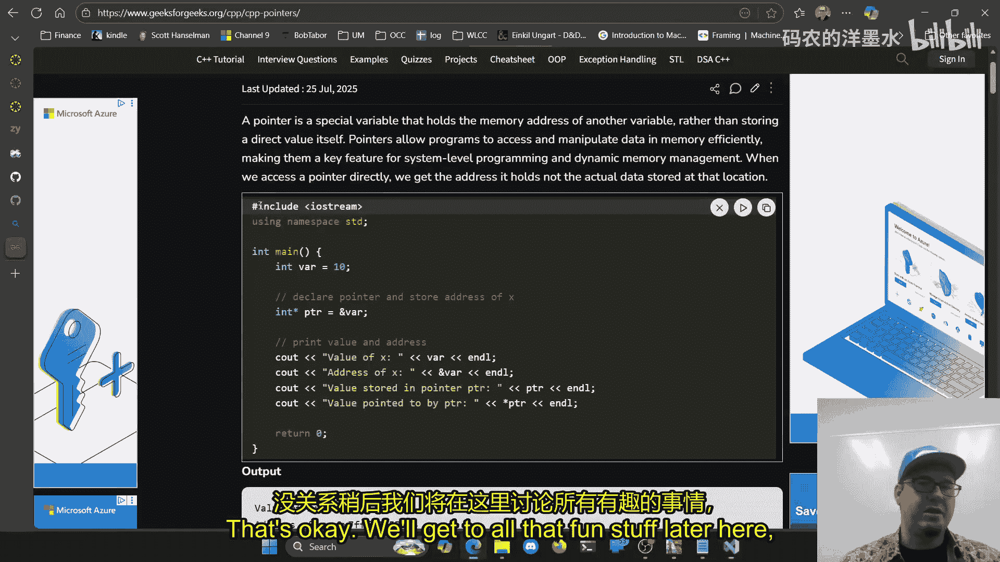

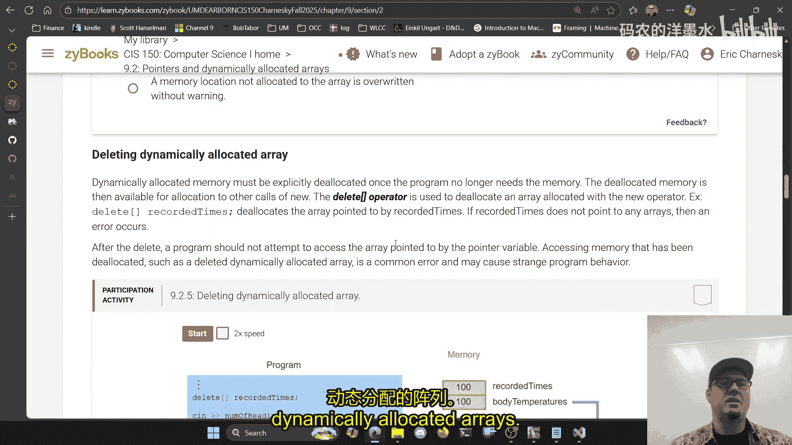

Now， the other thing we have to do is you have to delete the memory when we're done。

If we don't so when the program ends， C++ gives memory back to our computer。

 but if our program is a longrun program and we don't tell it to delete here。

 we're hanging onto that memory and not giving back to the operating system。

 bad stuff happens so what we can do real quick here for fun so we'll say for int I don't know。呃。

Times it's zero times less than we'll do like a million and a million1000，t we'll do a bunch here。

Times plus plus。We'll go and allocate a new array here， So we'll say integer pointer。

Values is a new int array， let's do size， I don't know， 10000 here。

and I don't delete it here i'm going to be taking 40，000 bytes， 40，000 bytes， 40。

000tes 4000 bys a bunch of times here right we do if times mods thousand0。Equal0。

See out times I'm going to put a breakpoint here so while it's running in debug mode。

 little think like 30 seconds here to show you。Your program has your visual studio has the school diagnostic tools that tells you how much memory it's using。

 so as I continue on here we can see。I' am now using。Two gigabytes of memory here。Now I'm using 2。

2 gigabytes of memory here and if you look at your task manager， it should show。

Some process using a whole bunch of memory here， we'll see if I did it right。

Yeah two as guess it' not exactly two gig but there it goes yeah my pointers here it is two gig of memory I never deleted it here。

 so C+ didn't give it back to my operating system so eventually it will crash either my computer or the program when it runs out of memory right just keep on going on this here。

Take out the Bpoint and continue。

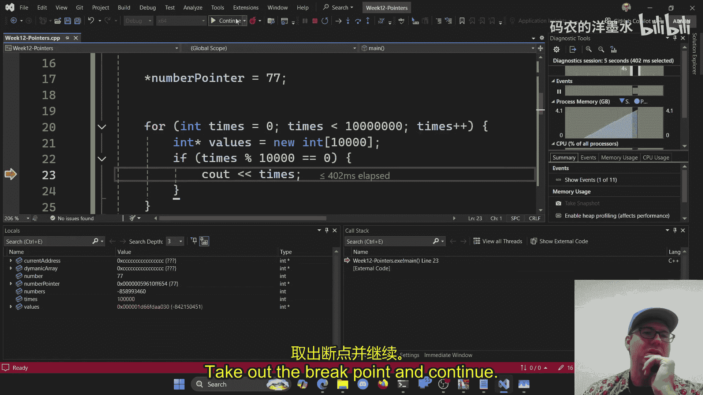

S，7， eight，9，10，11，12。2 and a half。So。12。5， did it stabilize， I might have stabilized。

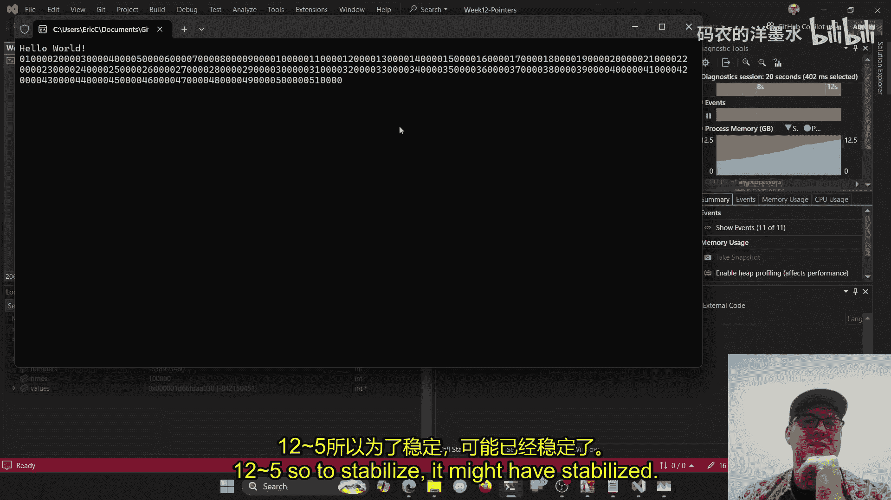

All right， I didn't make my computer crash， that's probably okay to not make my computer crash。

 but oh there it goes oh no， that's because we stopped it sorry but that stuff happens that's called a memory leak here right thanks I'll see you folks on Wednesday。

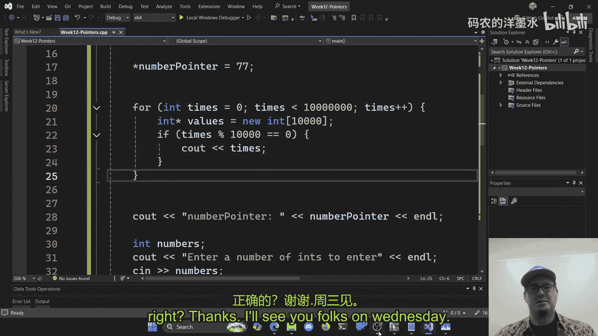