# 【全集】密歇根大学 C++编程 中英字幕 1080P p18 Lecture 18 - 项目 1 -BV1TsAZzAEHX_p18-

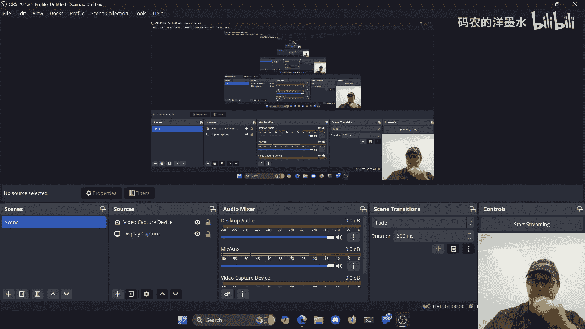

Sorry again about the late start。Yeah should be good so we've got to talk about project zero today。

 I'll go over solution with how I would approach solving it I'm going to add in some bells and whistles for fun like you didn't have to do any sort of validation loops。

Well we've learned them right， so why not try them here though you get to see it another example of it here and hopefully we can get to project one will be based on loops。

You guessed it you guys are so good at guessing stuff and then I don't know if we'll have too much time left over now to get into the rest of the loops chapter。

 but we can definitely finish that off on Wednesday som good。 so we flare a visual studio。

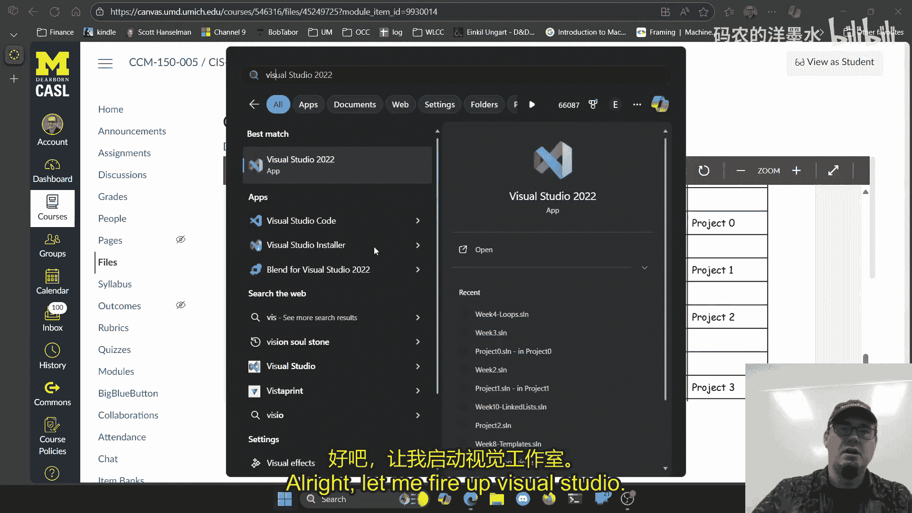

And start。F the assignment here and we'll go through that what that would look like。

 you I'm going to skip the repository step， have a repository it you would flow the repository so you have the folder on your computer。

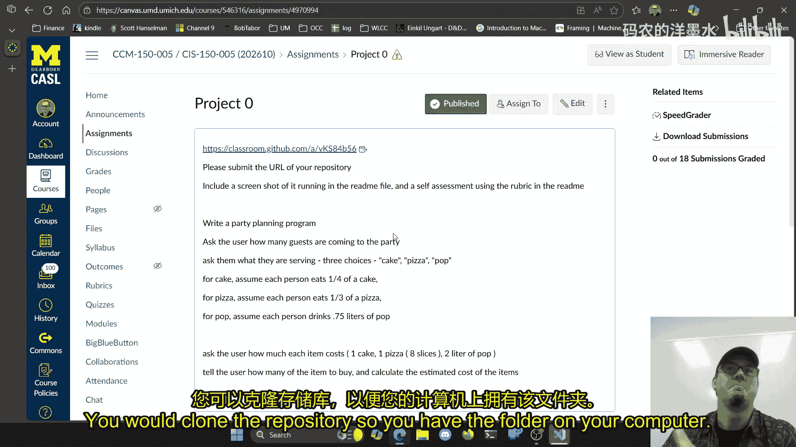

Right， that's the only step I think I showed that two weeks ago when we first looked at it here。

 I want to make a new project。Yeah。I like the console app right and then make sure it's in your repository folder again i'm putting in my public one that's fine it would be in your project zero folder when you start project one。

Just clone it first to make the project there right before you start any the visual Studio clone it first crazy and you'll be good to go。

 you can always cut and paste it， you can copy paste。

 but I don't recommend that because then you have two copies and you're likely to open the old one in Viual Studio and then none of your changes will。

Be showing up in Gitthub you have to copy and paste to get so cut and paste if you need to。

 you can always move it into the repository folder here。

 but it's just easier if you just start there and life is good。

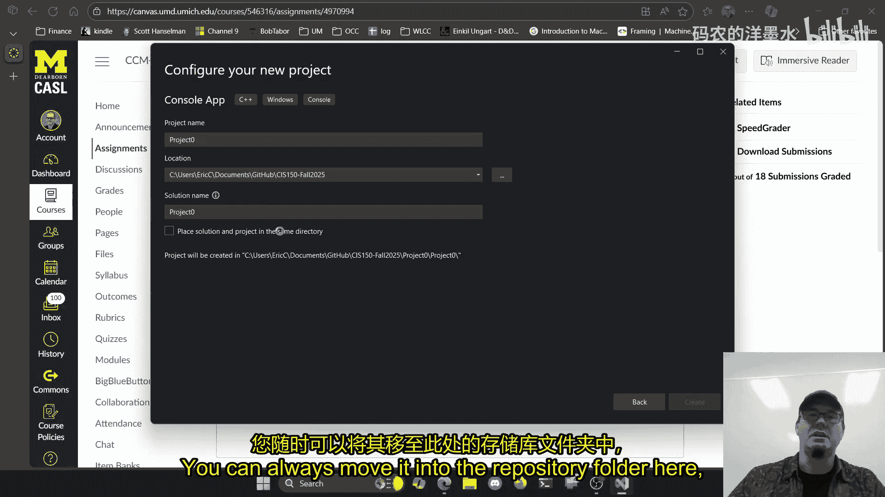

Okay。

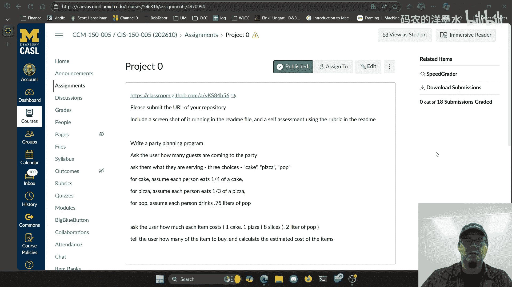

All right， and again， I'd like to get rid of all that garbage here and only have my using namespace。

Standard there we go and we don't need a hello world actually I can give rid of that one too probably should return zero it it doesn't really matter here。

 but i've done it so often I just sort of like having that so our little party planning program here so we need how many guests are coming to the party right and then we need to include ourselves so I did see someone was like how many guests including you。

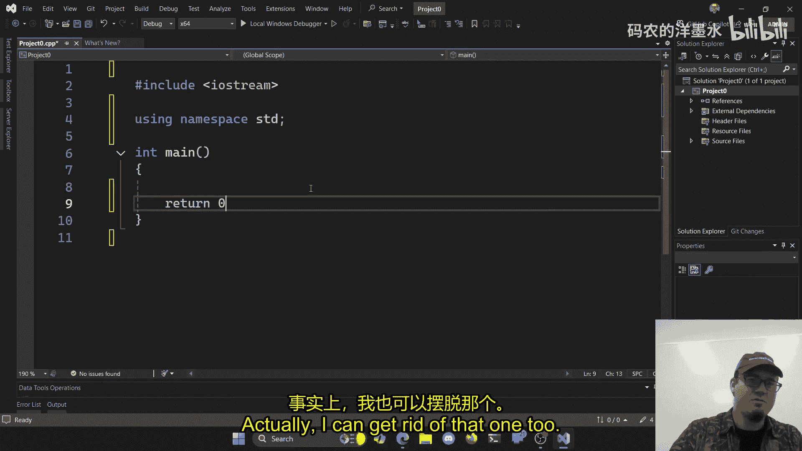

That's fine I assumed you would just ask how many guess and then add one to that both approaches you get the correct number so that's perfectly fine we can say。

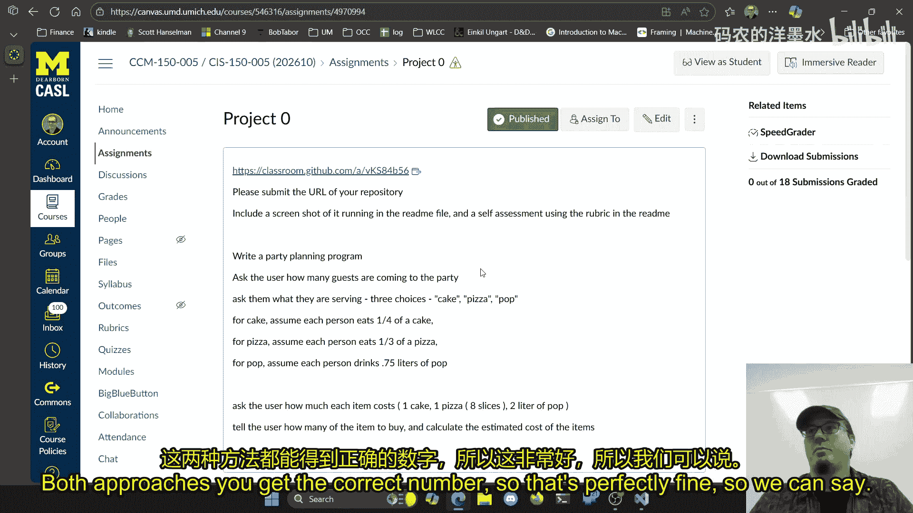

How many guests？Are coming to the party。And then we need a place to store that so we might have an end for a number of guests。

And then we can hand put into that in number of guests and then we could take that number of guests number of guests really there we go and add one to it add one for ourselves great。

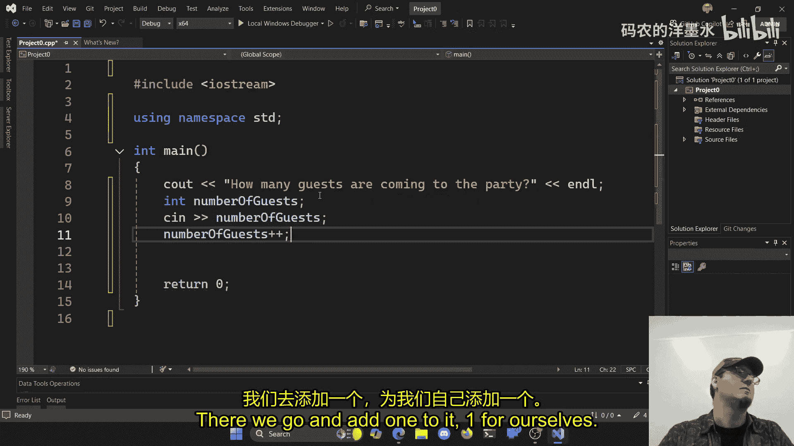

Then we need to ask， what are you' serving， we're going to have cake， pizza or pop？

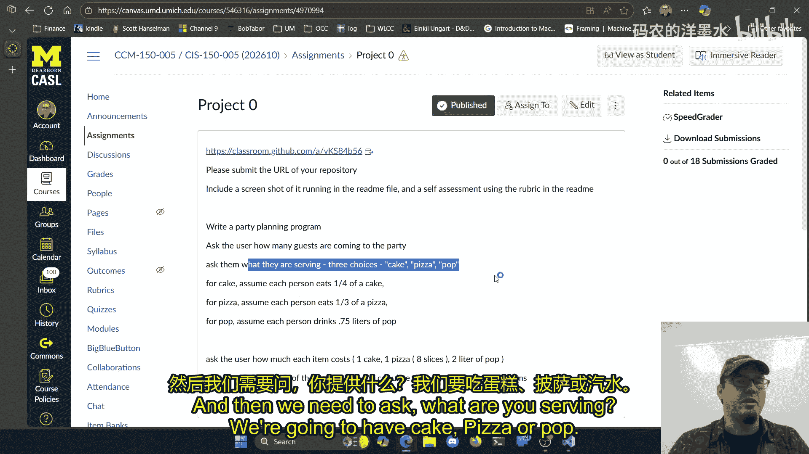

， so I'll ask them。Are you serving？Take。Pizza。我吧。And then we need a string to store that。

 I don't know， their choice or something or their。What are you sir I't know that one sounds a little funny here。

 we'll just leave it as choiceice and we can see an onjoice now if we want to keep them here until they've given us a good result。

We could do that again we didn't need to and we could just check hey if the entered cake。

 do the cake thing if the entered pizza do the pizza thing。

 if the standard pop do the pop thing that was perfectly fine。

 but I like the idea let's do the validation that would not let them tell me anything other than cake pizza or pop you getting no no other choices here bless you this is all we get to serve here。

So we could。Now start a loop if we wanted， we could do a do loop so it runs once。

 however you want to do it's perfectly fine。You know I like not having the same code twice so I sort of like the idea of having it be a loop here so we can say let's start choice before this then and we'll assign it some value it really like empty is perfectly fine here if it's not cake not pizza and not pop then my loop will run because we're going to loop as long as it's not a valid choice here so we can say while choice does not equal cake。

And oh my god， this cake choice does not equal pizza。Two Zs and pizza， there we go。

 and my choice does not equal pop。As long as it's not cake and it's not pizza and it's not pop。

 so if none of those。We matching， it's going to be true and true and true。

 because we're ending together。 Tru and true and true。 It's true。

 The whole thing is true and my loop will continue to run。 So starting off is nothing。

It's not cake true， it's not pet right， so if they give me something that is。

I guess I'm a little bit worried about casing here so I'm going to put these back to lowercase there's other things we could do we don't need to worry about that at the moment here when I'm asking for full words instead of like C for cake P for pizza P for pop that doesn't work because you have two peas then right so if we can't do just one letter at a time we can do like one for cake two for pizza three for pop that's fine too it's lots of different ways about going going about making menus however you'd like to do that's perfectly fine。

And we just keep entering the Joist here。Now， with the loop here。

 we don't really have a chance to tell them hey you enter the wrong value without repeating this one again here。

 and I feel bad about that。So either way you'd like to do your loops。

 I think you probably get the idea here if it keeps asking you can pizza hop when you type something in that you entered the wrong thing。

 but it might be nice to tell them。Again that's just a style preference at this point here so eventually we'll get cake pizza pot there's no way out of it from there so then I can say okay hey if my choice then is equal to cake。

Then I'm going to do it the cake thing right else if my choice is equal to pizza。

 we're going to do the pizza thing and now because I used a validation loop。

 I don't need another else if if it was pop I can just say else because if it's not cake and not pizza。

 the only way you got out of this loop here is by telling me pop。Right。

 so I don't need an else if you could， it's not going to hurt anything to be there。

 but this way's fine。So if you didn't have the validation loop。

 you probably didn't have an else or maybe else was you picked the wrong thing don't we please run the program again that's fine too any way you want them to go about that。

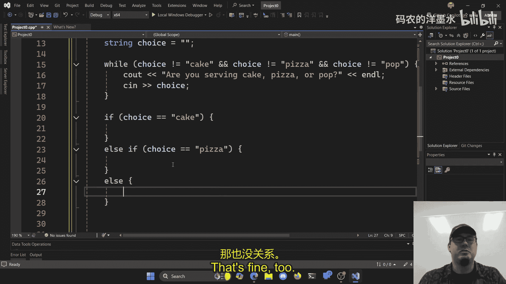

So now we're going to ask。How much each of the items cost here？And then tell them how much to buy。

There's a couple ways to go about this here I'm going to show you what I'll call like the cute shortcut way here with the least amount of code here so nothing wrong with having more code here but you've did more work than you need to and like all good programmers i'm lazy I don't want to do more working on any two I don't have to have the same code repeated and the only thing is different is this little calculation here right so。

If's a quarter of a cake， a third of a pizza or 0。75 liters of pop out of a two liter。

 I really can't do any math right now， so that's like what three out of eight。Right， three/ eighths。

Right if you divide those into quarter leaders okay so we can know you get a quarter a third or three eighth essentially of that individual item here so if so I need a double then right this i'm going to store my like I don't know the servings per person servings。

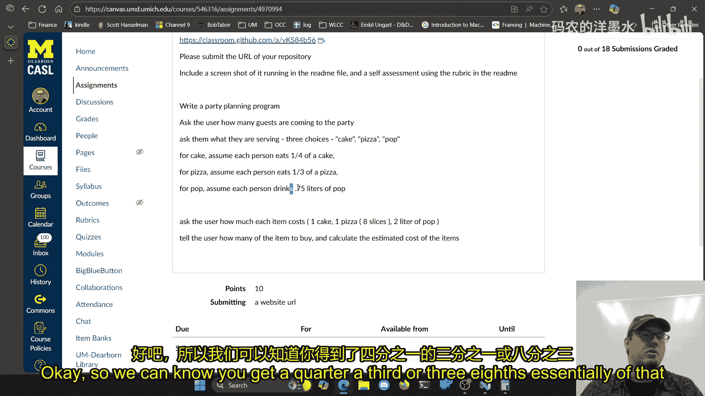

Her person or is that that's backwards right how many amount consumed I forget here amount of whole。

Item per person。That sound a little bit better here， I'm going to start that off at zero。really。

 I could start it with nothing here because I have an else it's okay if you don't have an else。

 you need to give it some sort of value here， so if it's cake， then we know that is one quarter。

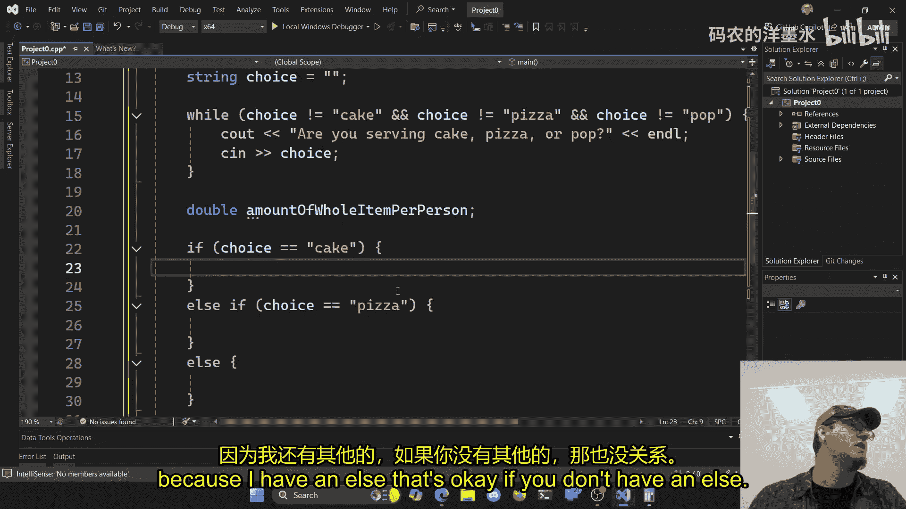

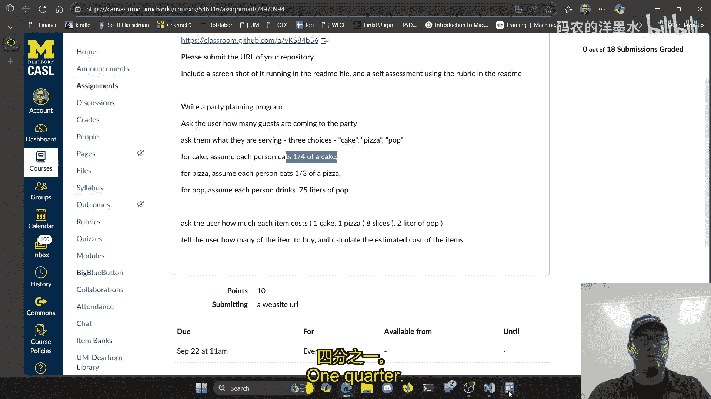

So if it was cake， then we'll say this is 0。25。Right if it was pizza then we had or was that a third of a pizza so like 0。

33333 I mean as many of these we want to put in here like we're going to round eventually so unless you're serving like what 10000 people I don't think we need very many decimal places and if you're having a party for 1000 people。

I mean， sure， go for it， but you guys have more money than I do so I don't know why you're in school。

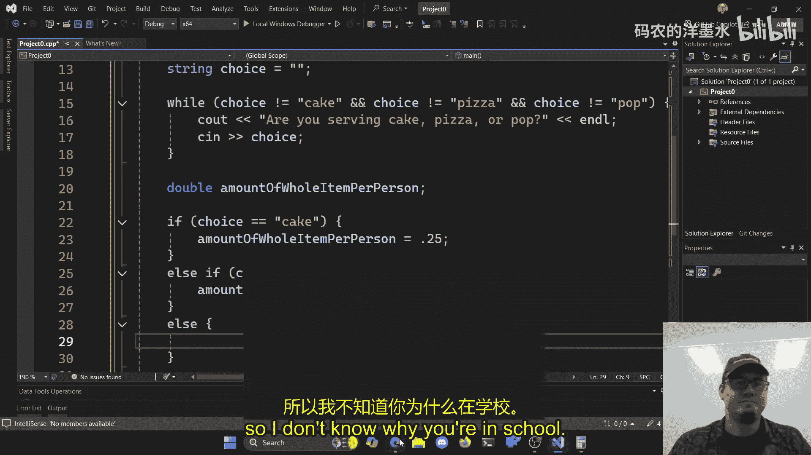

And then pop so three8s or 0。375。

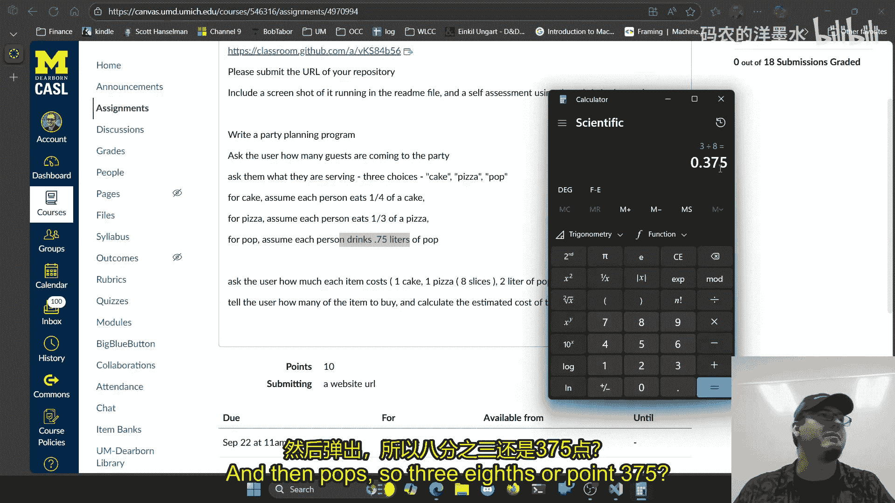

so amount of full length and per person。啊。0。375 here if you wanted to put notes。

 you could put 38 so that when you come back to this， you might remember that。Not too worried here。

 we could put these in as like some constant value somewhere that might be nice。

Again not the end of the world here because we can sort of tell that's what it was right here so then we need to ask how much this item costs and we know what the item is because it's their choice right so how much does it cost for we can see out。

How does it cost？😔，To buy one， my choice。And then I don't know。

 we'll put it down a little question mark here because it's cute。

 you know don't necessarily me that right and then I have a double four price per item。

And I can see in my price per item。With the arrows here right so if they said cake i'm asking how much does it cost by one cake now how much does cost to buy one pop it sounds a little awkward here。

 but again you know don't sweat it's okay if it looks a little funny just for the sake of the exercise and maybe ask if they're serving two liters of top。

we could change our prompt too we've got choices here。

 or if you think it looks ugly just throw the anything else perfectly fine you've got lots of different ways to go about it here。

We have a price for item， and then we need to find out how many of each thing to buy。

So I know how many guests I have。I need to figure out how much。

They're going to eat or consume of these whole items here to calculate how many I need。

 I have a double for my number of items needed， then that's going to be what's that arithmetic here right my number of guests times's this。

Right， so my number of guests。Number of guests， oh my goodness number of guests there it is times my amount of whole item per person here。

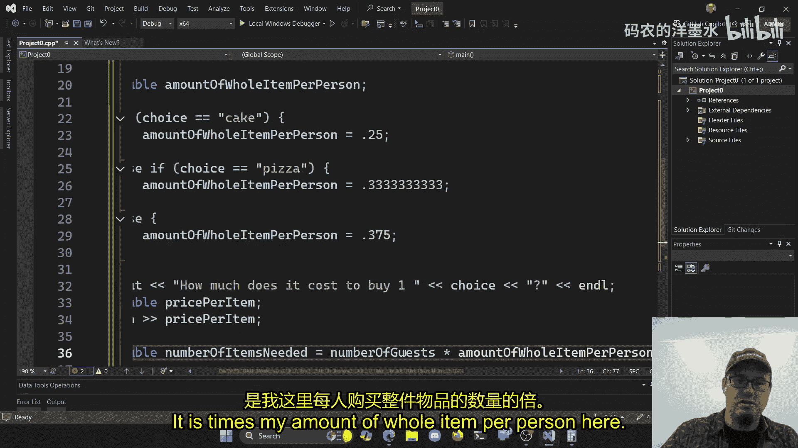

But now we want to round up。Right， and。As I recall。

 I told you this was up to you to go figure out and cite your source。

 did I I remember that right or did I not？I don' say that？

Pretty sure I told you you can't buy three quarters of a pizza。

So don't tell them to buy three quarters of pizza。ImNot getting enough head shaking。

 that's concerning。I'm pretty sure I said it， but I don't really want to go watch myself talk for 45 minutes to find it。

Does anyone remember？那个人 say的 source。Okay， so I didn't say go go find it okay but figure out how to round you knew need to route it okay great so if it wasn't out of the Zbook here was it insidebooks I don't actually remember if they had that the it might have been their legal look there was we went over some of these quickly here。

UmWhere was it here？Don't know if we got into the gut， let's see， where is that？😔，Well in chapter 2。

 the CMath Library。Okay。Carroute power， fabbs。N worries， can't take care。Not giving other ones。

 more math functions。😔，It really didn't give you the other ones here， okay， well。

If you are a curious fellow here and looked at the math library，20 math operations here。

 you could have found those。If it's from the textbook find， I'm not going to be too particular。

 but in general， if you find something。That I didn't tell you in the textbook didn't find telling you。

 you should probably cite your source that。Right like a the newspaper okay。

 if you didn't on this one， don't sweat it， not the end of the world here。

 but if we just Google how to round up in C++ here。

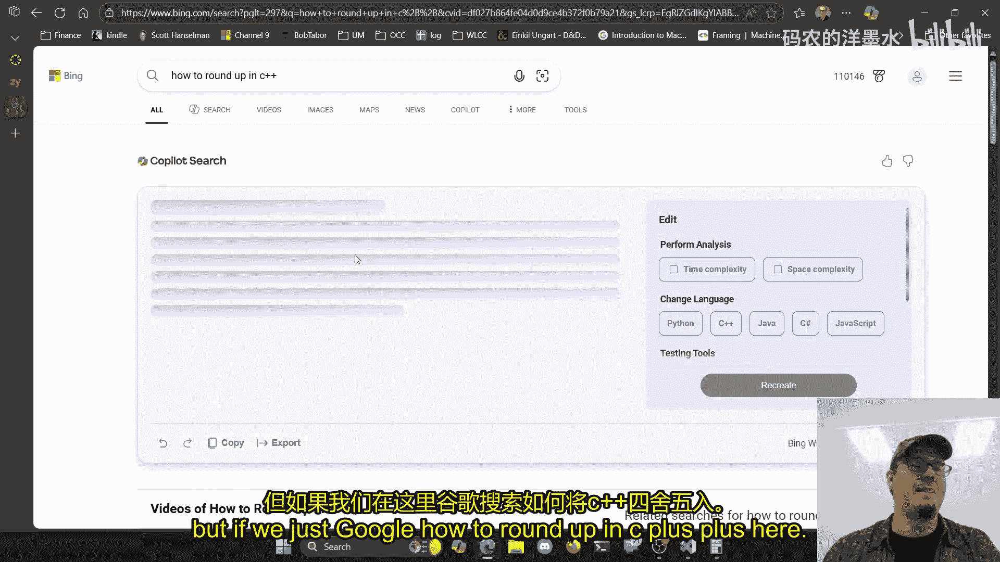

We'll get rounding up and down in CMM， sure let's find this one here。

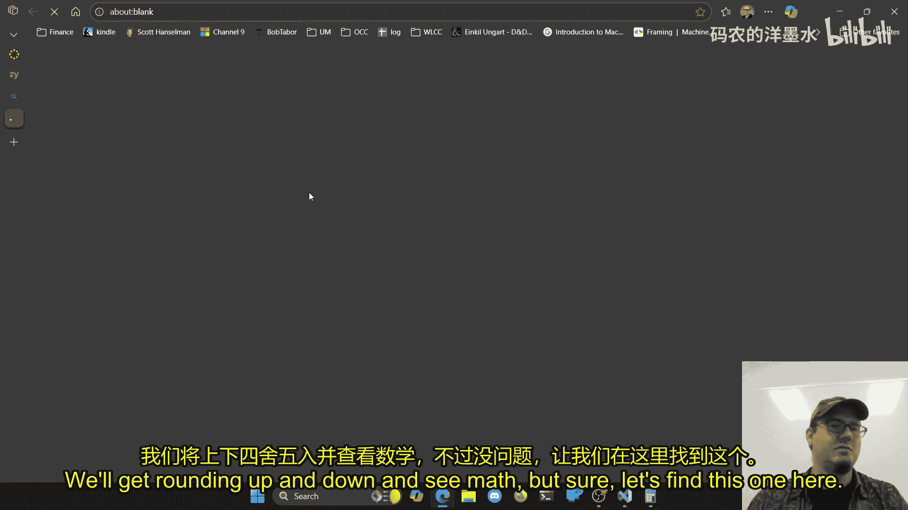

Seal， a seal function。I don't know why they didn't type seal。

 apparently three extra letters is too hard here， seal is to round up。

 so I would come in here and say hey。

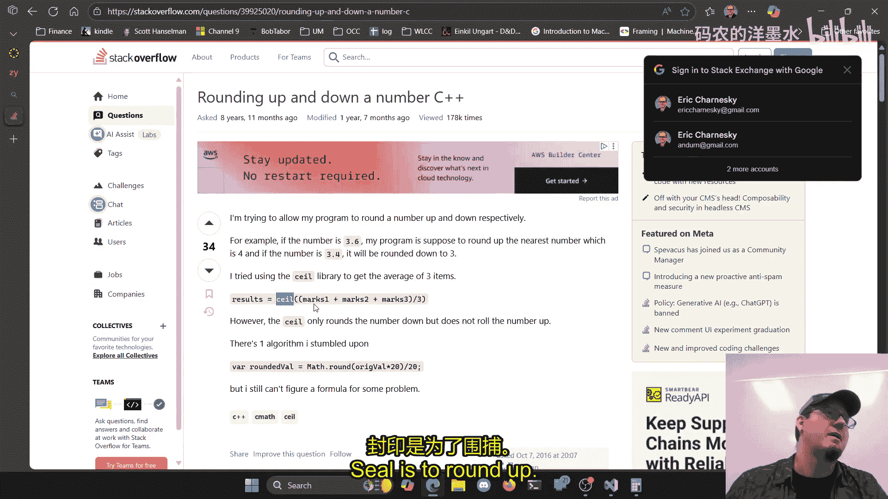

Fund。嗯。I to round up apps here， and I've cited my source。

That's it I'm looking for just leave a comment where you found it for anything but again， you know。

 the bulk of it still needs to be your work you like， oh， hey， I asked alaud。

How to serve how to plan a party and Cla gave me all of this here and I wrote the return zero obviously that's not cool right Okay so little bits at a time perfectly fine with it again at this level you want to be that focused here right' don't have it do too much because we're still learning and trying to figure out how to make it work here I know ChagBT and Claude can write this it's not hard at all。

 I promise you right super easy for it to the goal is for you to practice and learn a couple things so that when you get to the point when the AI tools can't get the code completely correct you can step in and shine and hopefully all humans still have a job。

Right。Because the robots aren't perfect yet。You know go talk to the actual smart faculty who research AI sorts of things I don't think robots are going to get smarter than us they're good tools but they don't actually have creativity and problem solving is a creative process how do you make a dumb computer solve problems is a creative process of how do you break a problem down into small enough steps right and there's lots of moving pieces here a bun of mine who really likes to play with the tools and he's building his own sites and stuff and he's just having fun five coding and he's talks about it all the time to irritate me because I hate that term it's like oh yeah and it's having trouble now that I've got more than 10 different files in my project。

And he's like a one man person doing this a one little project here like projects get big so anyway。

 so we flip sightted our source fantastic if you took the I don't know being AI answer just be like hey you know from。

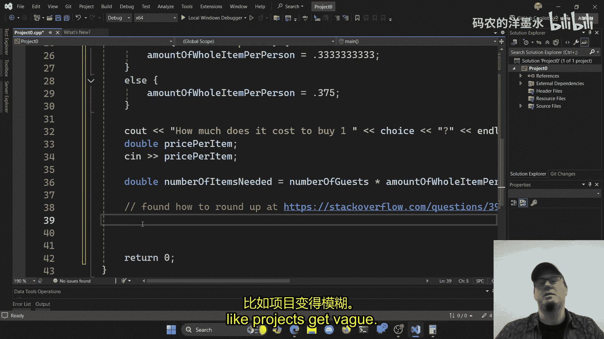

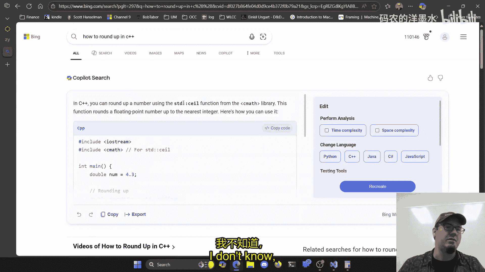

From being AI。

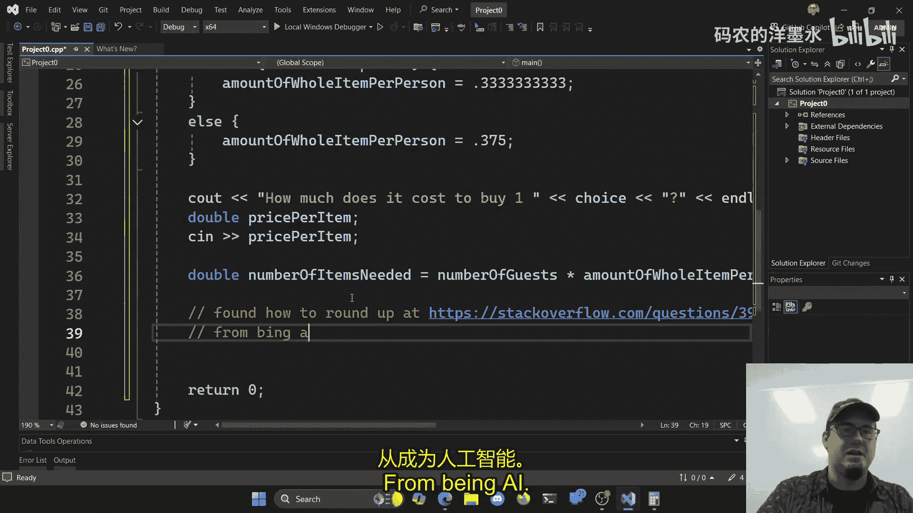

Just tell me what you asked here because you don't really good at good。

 I guess you could give me this URL， but that's sure， that's probably fine but。

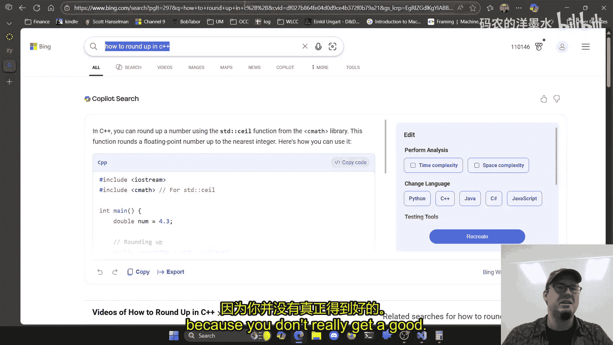

This is sufficient here without having a， you know， gazillion character URL stuck in here。

 So either one's okay。 So we'd say my number of items needed。

 then is equal to the ceiling of my number of items needed。

Or you could do that all in one step and just do the ceiling here when we do that arithmetic that's probably even easier。

 right， So we'll comment that one out and just throw a seal right here。Throw this in。

And I should again， this is one of the reasons comments are stupid， I mean not stupid， but stupid。

 I moved the code that I was commenting about， but I didn't move the comment。

Cause you don't have to move the comment if you move the code。

And you often that happens all the time， and then you have weird comments in places that make no sense anymore。

Right， so again， comments are stupid， but sure， I'll go I'll try and remember to move them here。

 but nothing makes that happen so。 and then we can output here。To serve my number of guests。

 number of guests。And then what is that the choice here， choice？U。

That your leanme party will cost about。And I should ask we can move the down the line， right。

 we don't want to have to scroll left and right here。

And we can throw on a dollar sign if you want to make your output look pretty。

 that's my price per item， high my number of items needed it。And probably an endline， right。

 we like endlines。Okay， and eventually we can return zero。That's about if for the project。Now。

 I'm hoping because I asked for a screenshot， you ran your project and it ran。

I've had people in the past turn in code that doesn't run。

 and I'm always super confused like why would you turn something in that doesn't run here？

Like if I can't hit the run button， it's really hard to give you a score。

 now I'm going to try because I'd like to think of myself as a nice person。

 I know I come off kind of like a jerk。 but， you know， I'm going to try and be like， oh。

 you you were pretty close here。You should at least be able to run your programs， right。

 is that a good expectation okay？I'll still score them if they don't run to the best of my ability。

But just don't do that。 That's a bad habit。 bad plan here， okay。

Let's try it so any code that's worth writing is worth testing to make sure we did it right because if you don't care if it's right or not。

 you row garbage and no one wants garbage so。If we're to test this， we need to know if I put A in。

 B comes out， if I put C in， E comes out， if I put F in， I get Z。

 whatever things we want to come up with， so we need to be able to figure out by hand。

To know if our code is doing it correctly， right？Okay so that's testing so we have to come up with a couple inputs and what the expected outputs should be right so we want to do a cake we want to do a pizza we want to do a pop right and figure out whatever these factors are do we get the right number rounded up right so for this one if we do four people plus me I should not get two cakes that's pretty quick for pizza if I invite three people plus me I should get two pizzas making sure it rounds up for pop I invite eight people no。

Three people， two people， plus me。Three people will put it over the edge， three， ninth，3 eighths。

9 eighth is more than one I can't math right now and it should round up right and then the。

Price per item pretty straightforward math here for that is that sound okay for a testing plan？

Some people really like you to submit test plans when you turn in your code。

We'll talk about that later， it's okay， but I want you to think through it right how do we test it to make sure it's right we'll get to that。

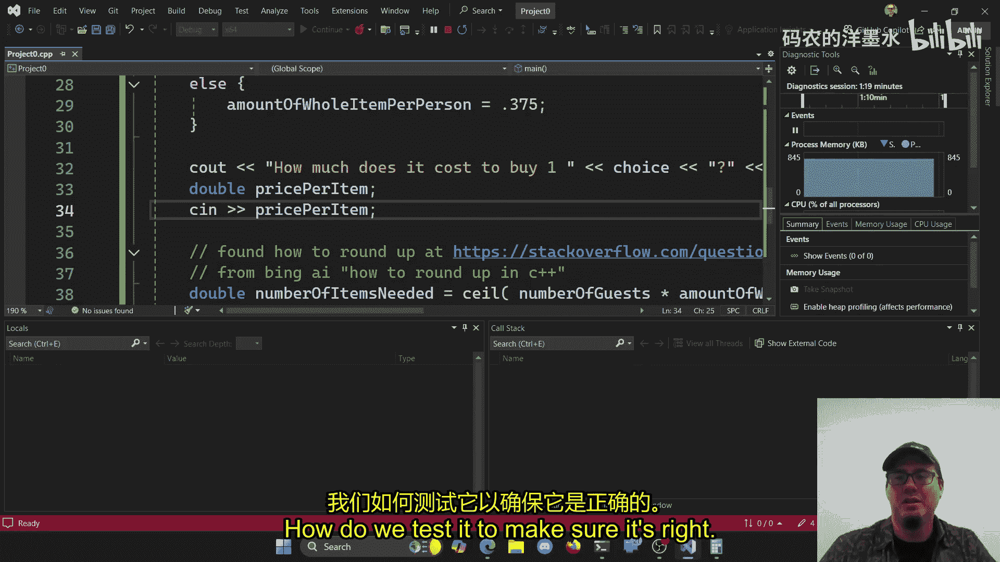

It sos our program here is so how many guests here so we said for cake I need to have like four people serve for some cake and let's just say it's $2 a cake it should cost me about $4 of my lane party here very exciting I think that jack right round it up here。

We're supposed to tell them how many cakes to buy， I think we're supposed to tell them how many cakes to buy。

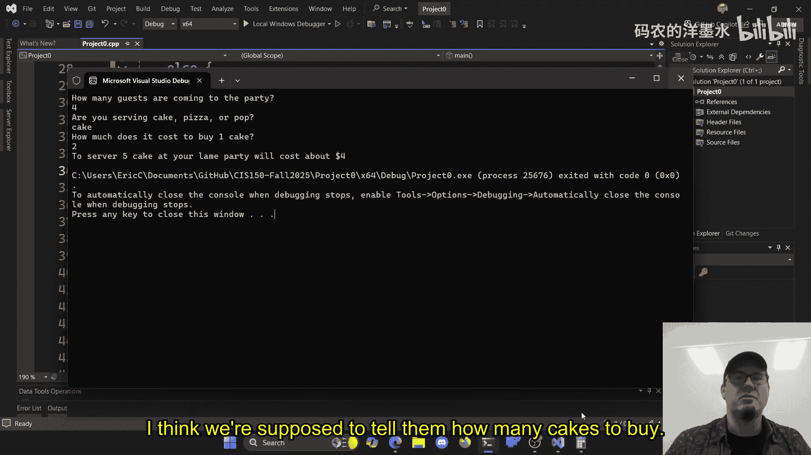

How many items to buy， That's right。 Okay， to serve server， Oh I going to serve。嗯。

That's your lean party by。And there's my quote here。

My amount of whole item per person I'll go this what I needed number of items needed there we go I this many。

Oh no， should we can throw it over here。 How about this， we'll put it number of items needed here。

Serf。Like three。Cakes。so then we can throw in a space， you know， and then we can throw in our choice。

嗯。Two and then。Meumber of guests， there we go， that's probably pretty close。cost okay。

 let's try that so hopefully it includes all the information here that we did cake the number was good we're just looking at the output here so for pizzas we said we needed three people and for pizza it should round up here so for pizza。

 what is it 575 a pizza now or 675。

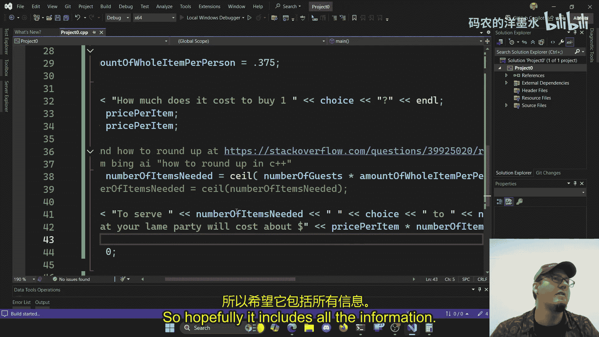

So if it's the cheappot and readyies， it's I think 675， so serve two pizzas to four people。For pizza。

 Oh my goodness，2，4。

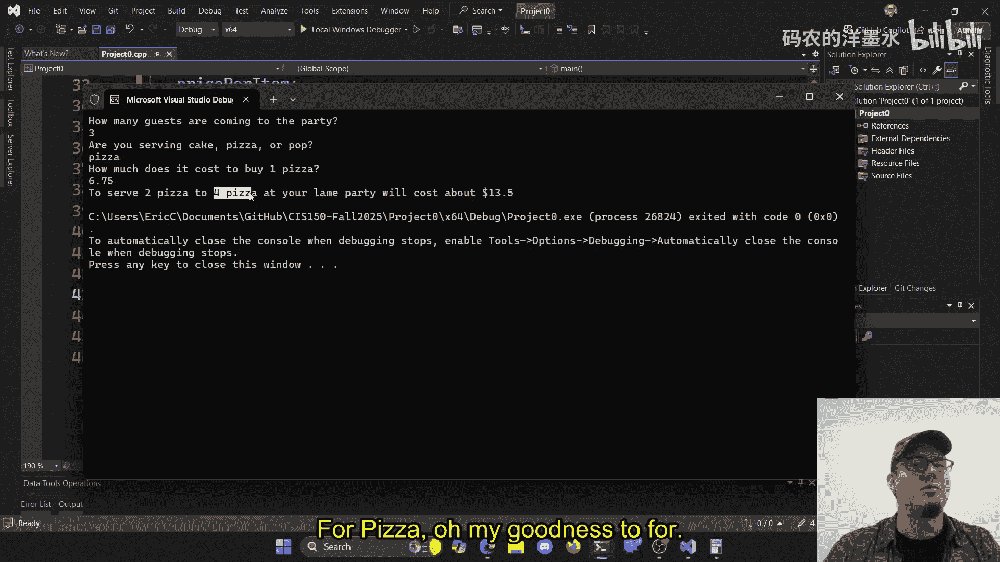

We don't need choice over here。跳啊。😔，People。Friends， I don know。

Sure people at lane party oh I could have put that out that's fine right so I think we're good that one checked out right math was good 1375 was 675 times two。

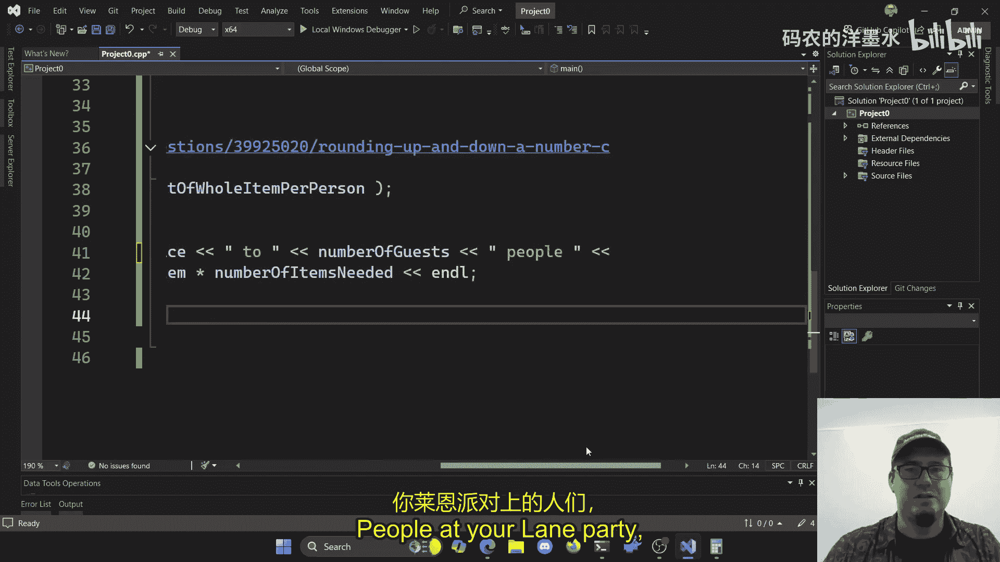

我说。Lost my trains all already。Pretty sure that the rhythmth and tank was good there let's try pop so for pop we only needed two people right and then us then would round it up to two two liters one which is cost to one5 one pop it's like 299 now right unless you get them on sale。

So 598 looks good， sort of two pop to three people at your lane party， very exciting。こ去。可以。佢会老个岁。

For what？你为咗好心所。A whole number， yes， so the math seal does that， the seal function we did here。

 this rounds up。

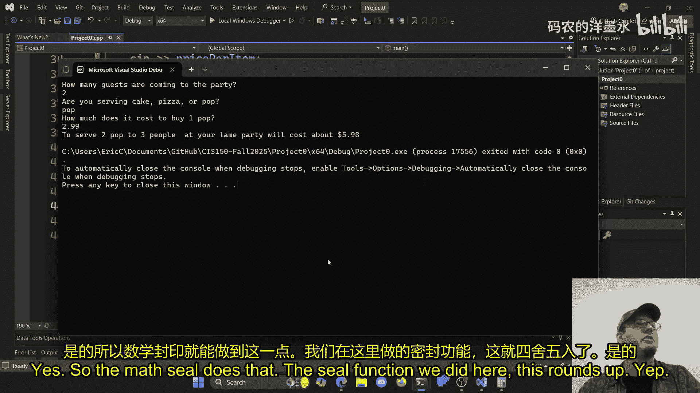

Yeah， and we probably should test that it doesn't round up if the number actually works here。

 so for serving cake and I want to invite three guests to have the fourth person。

 we should only need one cake。Right which we might actually have some problems with because C++ is data math when it comes to decimal places let's see so if we serve three more people and we serve cake here。

 let's say a dollar okay that worked out he didn't get the weird rounding error so I think that's more we do division than multiplications we're probably safe here with that。

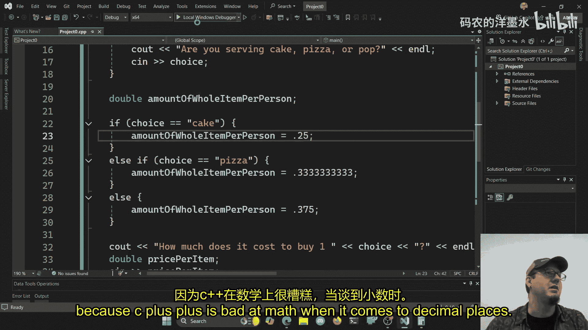

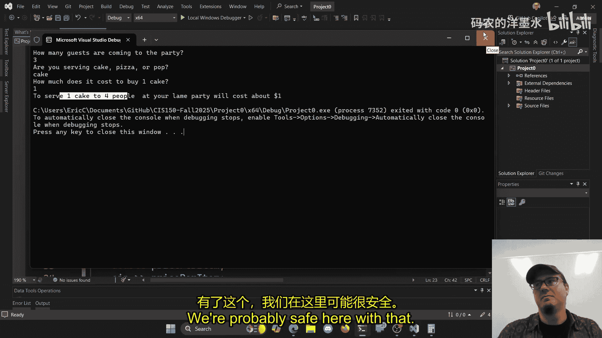

I think we're doing pretty good。Makes sense。It you know， again。

 if you had like a lot of this part in each of these blocks， perfectly fine， nothing wrong with that。

But it's the exact same thing you just the only thing that's different is your factor here right I'm out the whole item per person that's the only thing that was different so and I'd like to have less code here。

Sure， gets the same job done， not wrong if you have。The exact same thing in each Gv blocks here。

 right nothing wrong with that right first project。Not too not too bad here 45 lines of code right。

 but if you actually count the actual lines and all of my spaces and stuff it's much less right just a quick quick starter。

 making sure Gitthub works for you， get used to that workflow。

Next ones will be slightly more interesting again we're starting slow here because we've only gotten to loops now so we added in the validation loop for fun a couple of people had asked do I need to ask them if they want to serve different things or like okay are you serving cake yes do the cake calculation are you serving cake yes do the pizza calculation great。

You can do more work than you need to right if they want to serve cake and pizza。

 they can it run twice。

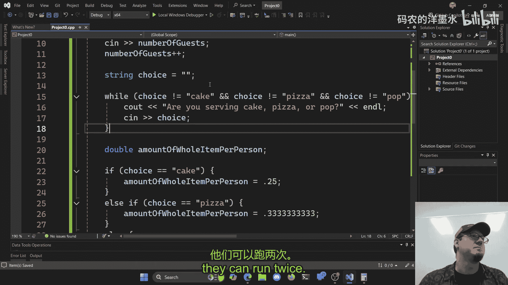

That's fine too either way was okay， not the end of the world here so。

People have told me in the past that the descriptions and things are a little vague。

For projects and I'd like to tell you that is on purpose here because in the real world。

 you don't get people telling you write this line and then write this line and then do this thing and then do this thing。

 you， a very detailed explanation of what they want from you， they say。

 write a program that you do this。that's all you get and then you have to go ask a bunch of questions to figure out what this actually is and this what entails you know the subpart of this and all that fun stuff here and that's why I have meetings with the senior design groups when they asking what do you really want Eric like well I told you like not like any more details it takes some practice here of learning how to do all that stuff so these are vague on purpose you can implement them lots of different ways right I don't particularly care what the output look like as long as it makes sense here and make sense to you might be different than makes sense to your neighbor that's all right there's。

I don't think we could say there is one right way to do user input and output now there's better ways to do user input and output better yes。

 but not right necessarily as long as it works， I'm happy you can get points here so the last bit was the selfassesment I said just tell me for each of these items here。

How many points you got， some people took a screenshot， some people just typed it in。

 whatever worked for you great just post that screenshot in the Readme file and we were happy。诶。😊。

If you didn't， you can add to the read me， that's okay， no worries。

Yeah the readme file changing Sure add your screen Chlator it's my one last attempt to get people to look at the rubric because I've had people submit before without looking at the rubric and it always confuses me they're like I think I got everything it's like did you look at the rubric because I'm literally scoring you for this this this it's not the rubric there's no points for it。

There's no points for the validation I just did it for fun。Right， okay。Cool， next one。

I go to my classroom link， I'm going to make a new repository link for you here because it just keeps things nice。

 neat and organized and it's pretty good 150， all 2045 project one。Aitatory。😔。

me see plus plus template， there we go。😔，So why do you change the public？That was weird。S。是。Oh right。

 awesome。Here is project one， so two weeks right， puts us out to looks like October 6th if're not we're looking at October already。

 it feels like September just started， but。11 am start a class here we's do probably 15 points for this one here so just like a math class you don't get to forget anything you've learned before you're just going to keep on using it so each project will be worth more points because there's more things that you're doing。

Right，You just have all these tools in your toolkit we're going to be using okay。

Please submit the URL of your repository。Pository。Had a screenshot， a little bit running。

And the self assessments using the rubric。To the readme file。All right。

 so we're going to create a little lunar lander simulator here。Just for fun。

Lunar lander simulator so a couple things need to happen here so when our program starts here we're going to have to create some random values we look at random yeah maybe look at random right Okay cool so when it starts。

Pick random value， negative 10， positive 10。Two， is the dasher confusing， is I you someone else here？

2。Through including， including events。Okay， negative 10 to positive 10 here。

 so this is going to represent。I represent the X axis tilt So with a lunar lander。

You're trying to land on the moon， so imagine you you've got some sort of thing here with legs on it and it tips and the X axis and it tips on the y axis and the Z axis if I remember things right is how far away from the surface it is。

You guys look at me like I'm crazy。Is like crazy， okay？Right， you can dip this way。

 you can dip that way， and then you start down。Okay， a little worried now。

 and I think it makes sense here。And then again， for the Y axis tilt。So two different random values。

 negative 10 to positive 10， so that's our tilts here， so as we're trying to land。

 the goal is to land perfectly flat and level here so we don't crash a billion dollar lunar lander。

Right， that be sad。Okay， so all is to get。The lunar lander safely to the surface。Of the moon。

Should be a Marslander or is lunar cool enough？I was cool enough， all right。U。With both。

X and Y tiltil。Being zero so if we can get level and land then we're in good shape here so the game starts with the lander。

Being 10 units away from the surface， I don't care what unit you pick here essentially it's a turn so you have 10 turns to land this thing without crashing it you have to call it kilometers cool if you have to call it inches cool you got to call it meters well I don't care some unit here right whatever you pick here。

Wayve from the surface。 So each turnn。The user can pick a command。To send to the lander。

They can change the X axis tilt， so commands you can change X axis tilt by negative one or plus one。

RightSo if your tilt is negative， you want to increase it if it's positive， you want to decrease it。

 you only get to zero right you can change。The Y axis is tilt。By negative one or positive one。

 same thing here。Change y axis is tilt they get to one positive right they can use thrusters to increase the distance from the surface。

Service。By two units。So whatever your units are， sure you activate thrusters and you go up to units here。

 okay， we can do nothing here。Just let it get closer to the surface so if you already got your alignment set you don't have to do anything。

 you just slowly start falling。There's every turn， right you're getting one unit closer。

 essentially each turn the lander gets one unit closer， should say that to the surface。

Another thing they can do is they can activate the self destruct sequence。Then we watch Star Trek。

No I know it's a really old show， I watched it it was old show when I was a kid。

 but the funny thing they did it was really funny， but the thing every time they got invaded by aliens and people were going take over their ship they're like oh。

 I'm just gonna blow it up then ships self-destruct and the aliens were like no。

 don't kill me we' run away and then they turn off selfdestruct' because they don't actually want to blowlo up the ship。

It's just a ruse， a bluff right， so it worked every time I don't sure， aliens are done dumb， I guess。

So you can activate the self constructstruct sequence here。Yeah。嗯妈。

So those are a couple things we can do。So。😊，Then if the self destruct sequence is active。

Instruct sequence is activated。Do not let the user。

Enter any commands other than the secret cancellation code。You pick this。

 you pick some random code here that they have to enter here so it's not。

 you know change by X axis tilt it's not used thrusters it's not do nothing。

 it's some secret keyword here。Some input they're going to type in that will deactivimate the self constructstruct sequence here。

Right。And then if they enter an invalid command。Or a command not on the list。

 allow them to try again and do not decreasease。The distance from the surface。

Distance from the surface right so invalid commands don't make you get closer to the moon here only valid ones。

Or you assume， okay。Somehow it's magic， sure。And。Don't make them get closer to the moon as they're selfdeing all they're going to do is cancel here right I guess it could be you know one close to the moon every time you get it wrong and it increases the stress right as you' try and cancel here that's fine so they would still you will still go down by one。

Still get closer to the service。The surface。He it out。Okay。

 but essentially the only reason this exists is for you to deactivate it here and bluff people。

 but I guess if you are bad at it， you'll crash and blow pro landander here， okay？So in the distance。

From the surface is zero。Tell the user if they。Successfully landed or not。啦。

X and y axiss tilts are zero， tilts are zero and self destruct is off。It not active。Sure。

 that sounds good， so you successfully landed here， right， and then the entire game。

Its put in a loop that allows the user to play again。So do you want to play again， yes or no。

 that way they don't have to hit run again， but we're going to make it easy for them。however。

 you want to do your menu only up to you。😊，You've got options， got lots of ways to go out of here。

Some people like numbers， some people like words， great you pick up to you right， so let's do this。

 you're going to turn in the URL here， got the due date， let me add the rubric here。Okay。

So we've got oh so with thrusters increasing by two and every successful command decreasing by one means your net gain is one。

Great。So thrusters goes up by two and you go down one thrusters goes up two and then you go down one right so you only gain one at the time here。

 right？That makes sense。So you go up to， but you're still because it was successful。

 you get one unit closer here to the moon。All right， and the rubric here so says for project one。

We'll do probably three points for each of these， this is a random。

X and y tilt now these should be different each time they want to play again， right？

So its really like at the start。Means like at the start of the loop。

Not at the start before the loop starts， right， so you don't think I'm telling you to do the wrong thing here。

 right， X and white tilts list of。Ed commands is checked here and oh we should tell the user what is valid rate。

Help is displayed。So if it's not valid here， tell them to try again so we should tell them what is valid here。

 just in case you weren't here， we' be specific and tell them here's your valid options。

Oncet we do that。X and oh my goodness， okay， it's just low and slow sure。To' try again。

 display a help menu with the list of valid commands。一。Rubric can away， that's fine。

Random X and vital tilts。Each time they play again。It' be nice and specific here。

Then you have options and。H menu if they they're in invalid command。X and come on。

Like X Y tilt changes， thrusters work。And self destruct。

Bocks of other commands until the cancellation code。was entered。

So three points for that working here and then three points for game。

They checked for successful landing。Core students for lending and allow them to play again。是。

That's unreasonable。T and not。Super difficult here， but a couple pieces。

 lots of different little things here we're going out of time here。And a lot to practice the loops。

 right we got several loops here already， you can see right and you can put loops inside of loops inside a loops and that's fun。

So good all right have fun at lab I will see you Wednesday then again sorry for being and late Im not scheduled documents appointment Monday morning again that was a mistake。

😊。

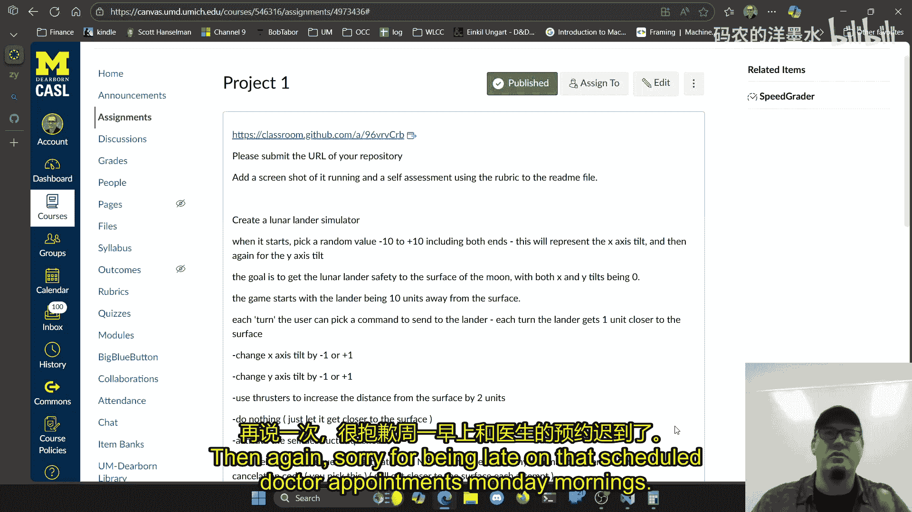