# 【全集】密歇根大学 C++编程 中英字幕 1080P p19 Lecture 19 - 项目 2 -BV1TsAZzAEHX_p19-

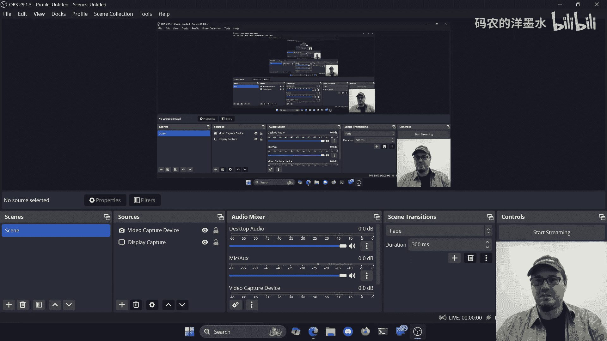

Alrighty， happy Wednesday。Dont let me just talk and talk and talk about Project 1 and not tell me you was supposed to do Monday。

Okay， that's fine。 I'm on cold bits， so I moved the due date out to this morning because I really thought that was what it was when I was here on Monday。

And as I go， we'll talk about it on Wednesday， everyone's like， okay， sure。So okay。

 talk about project one and then we'll get into project two and I think we picked up everything we needed to。

As far as we needed out of our chapter， right， because we finished up our functions chapter。

so our next project will be based on functions Should should be a lot of fun so。

 let me pull up bit studio。I'll go over project one。

 I'm going to do it with functions just for fun and kind of illustrate again how I might use them。

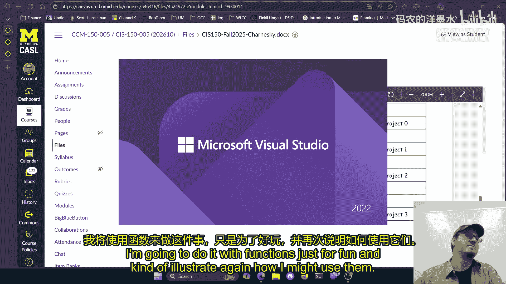

So let's call this Project 1。Make sure it's in the repository folder。

 Do I already have something called Project1。No，'m really confused， guys。

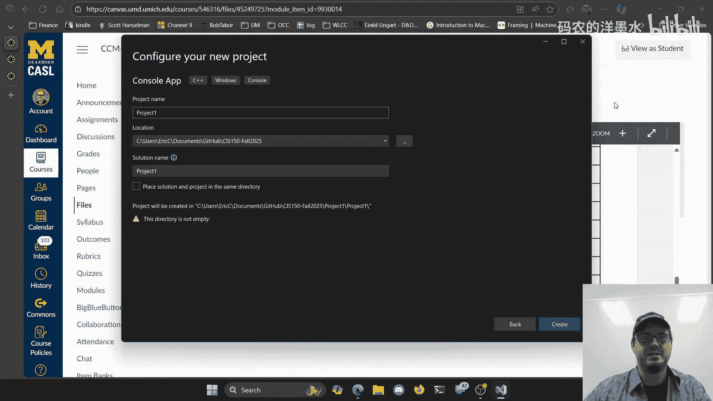

All right， let me just go what I have out there。What we have out here is much forward。What do we do。

Oh， okay， okay， okay。嗯。When you create new projects it justs to name them here， okay。

 so the default was going to ensure， I'll go open that one why not。Yeah。ness openpen a project。

 go for it。We'll go find that one， hopefully。Addic one open the solution。

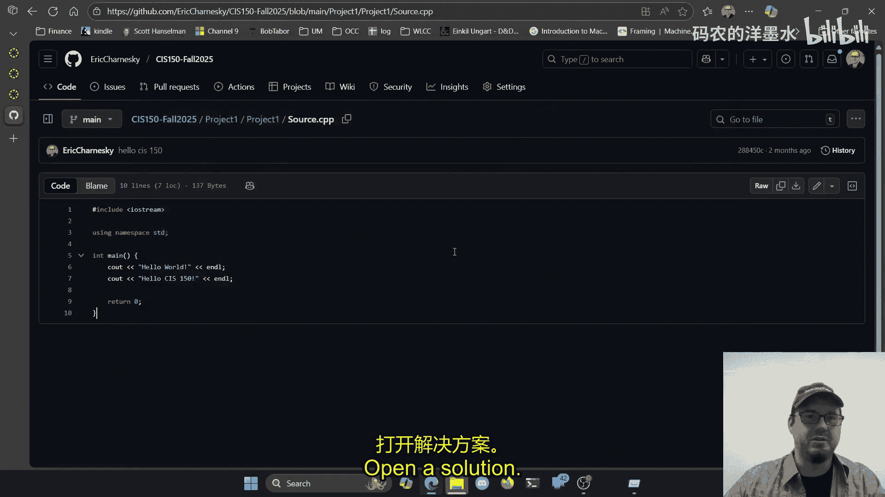

All right， cool， wait minute， we got a project already。

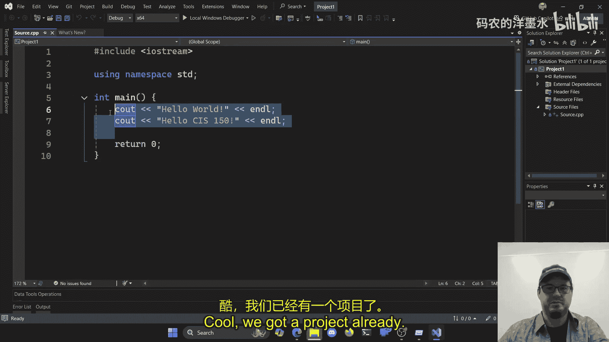

So the idea with this one here， right， we wanted to。Make a little silly little game。

 not a whole lot of interesting stuff happening here， but that's okay again。

 which is just to get started here with using a bunch of loops。So。

What do we want to do when we think about how we would solve this problem if we want to practice our functional decomposition we're going to take a big problem and break it down and do smaller and smaller and smaller problems here so I want to just kind of talk through and think about well what are these steps that are going to happen here and if it's a step we want to turn into a function great if not that's okay too。

So picking a random value negative 10 to positive 10。

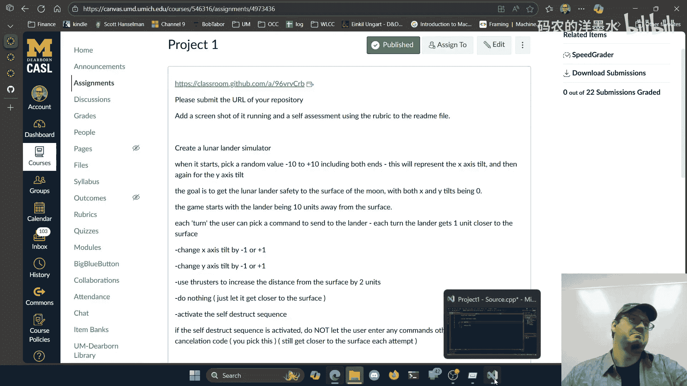

Sure， that can be a function right， So maybe we have a an need for X axis tilt is and if it's going to be a random number one to 1。

 we can say get random number。Negative negative 10 to 10。Sure， why not？

You can make your function aid as long as you want here right nothing wrong with that here and said oh。

 that's not defined well that's fine that we need to go make that function eventually so we can in and then I don't want have to type it all again here。

Right for now， I'm just going to return a zero right I'm going to kind of stub this function out here。

 I'm going to put something and come back and fix it later right to do fix me or something Ill see myself a note。

 but this way I don't get red lines the red lines make me sad Im loving in it for a y axis tilt do the same thing。

 get random a number。

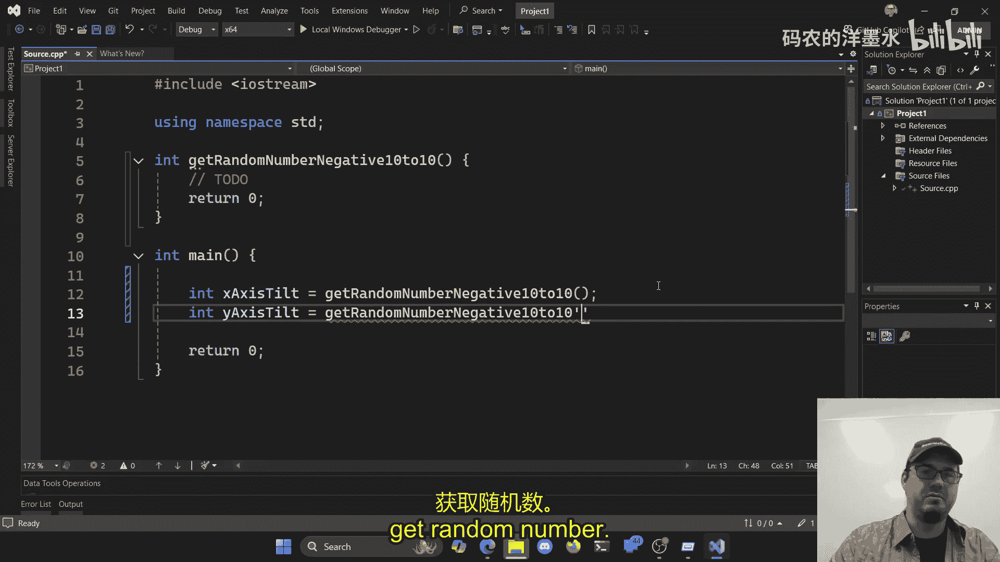

They get it 10 to 10。So we got some numbers and we want to get safely to the moon here with our being 10 units away from the surface。

 Okay， so our in distance from surface distance。

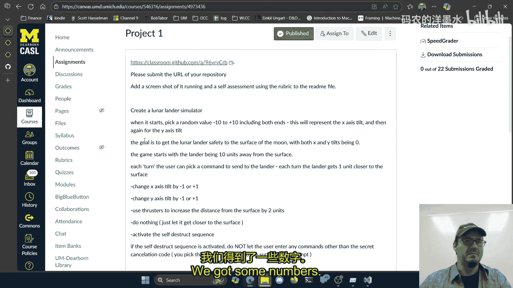

Service starts off at 10， that's probably fine if you wanted to make that like a constant value that's cool to to start at because we're going to reset this every time we play。

 we're just not quite there yet。That's okay， sort go that。

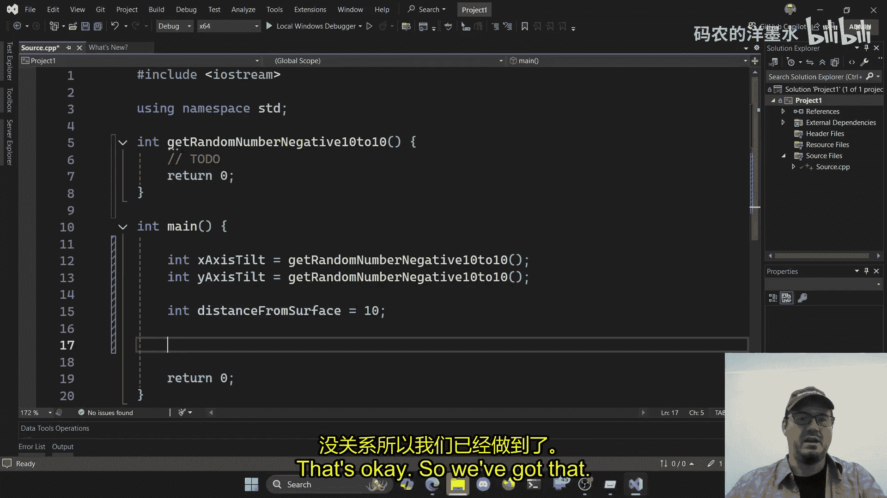

And then we have some sort of menu here right， so it might be nice then to get their menu right so we got a string for their choice here is get choice。

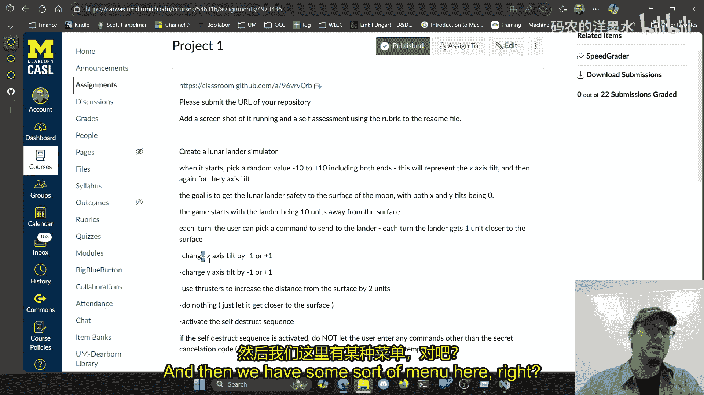

And then we have some sort of menu that returns a string of Gi choice。And for now。

 I'm just going to return nothing， right， just an empty string。Andll come back and fix this here。

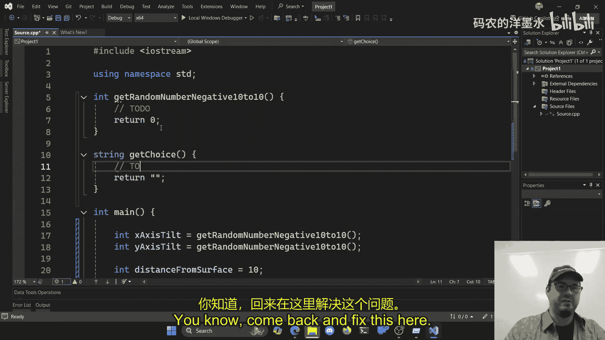

Right。Okay we have got our choices here and then if it's this， we do this， if it's this， we do this。

 if it's this， we do this， it's nothing we do nothing， it's this when we do this one here。

 if it's none of those we tell them here here's our help menu here。

This could be part of our getting the choice menu or it could be part of after they return any choice I do it here。

 probably up to you either one we want here， I think that makes sense to put in the choice here so we've got some sort of validation loop you get some input if it's not good I'll give you here's the list of choices you can do So I think that's fine to leave outside of there so really we can just say hey now if my choice is equal to now we could do like a menu 1。

2，3，4，5，6 we can have them actually type in some characters here do you guys want to do numbers or you want to do words。

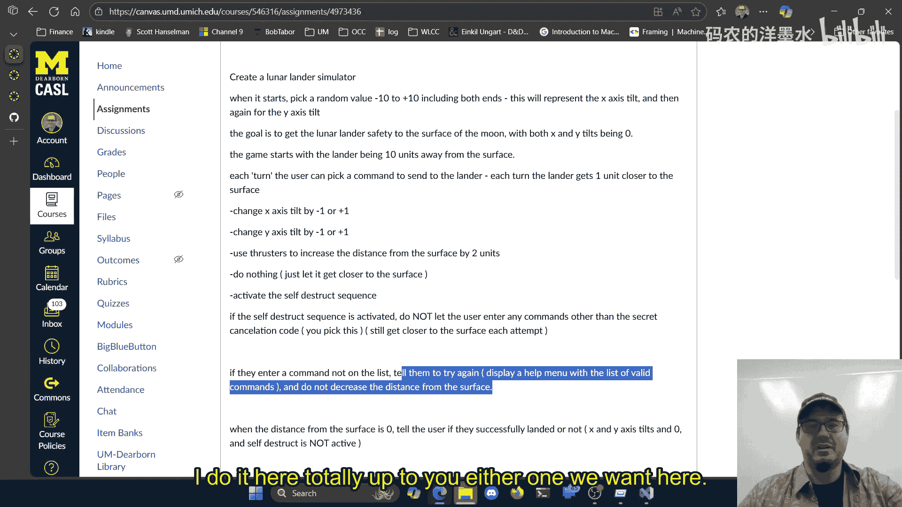

Numbers， okay， so cool， so if choice is one， then I'm going to we'll say， I don't know what X tilt。

Plus， plus， right axis。Tilt plus plus。Great， else'll see if。Choice equals two Now， oh。

 that should be an in then right， so if we're going to do numbers instead of strings， sorry。

There we go， they'll be a little heavier though。Just having like one and two is not all that great here。

 like this would make a lot more sense to have these be constants here so I can have a number。

Associated with the work right because otherwise I just I don't really know what a one means here。

 so you might say I might have a constant end x。Tilt， positive。Equals1 under something like this。

 and I can I should add in underscores here。This gets a little bit more wordy here。

 but now I can see， oh， hey， this is the number you meant to give me here， right？Ex is tilt。

 negative。Right and I can put all these through。excess tilt。Minus minus。

And we'll just keep on going there for the Ys then， right else。It's a Y tilt or a Y tilt。

Or why tilt or Y tilt。So make those wise。 Is that dog or something。That was weird。

We've got a puppy at home。 I hear it all the time now。Right， lower case one， here we go。Why why okay。

 so I think our tilts are done like I don't know if that really needs to be a function at all that's just we're just adding or subtracting if you wanted to make a function for that you could。

 but again that's probably a little bit overkill at that point here。

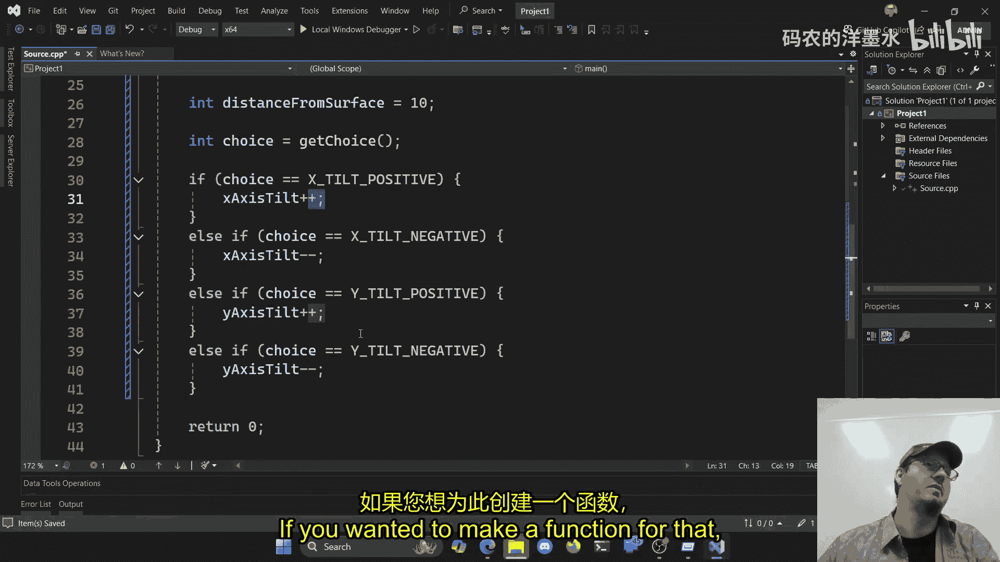

Created those ones， if it thrusters increases our distance here。 so then else if。

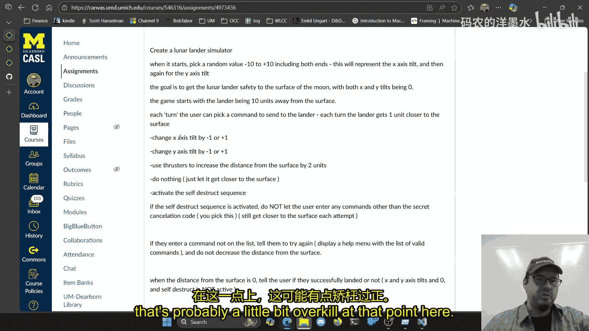

Our choice。Is equal to thrusters。Then it'll take our distance to the surface。Plus two， right said。

 go up by two and then we' going add constant here。Brusters。I guess that's a5 in our menu。

 I we can return a0 for now。

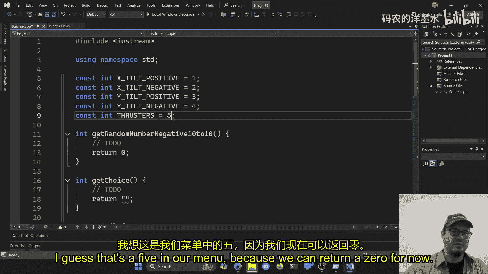

嗯。

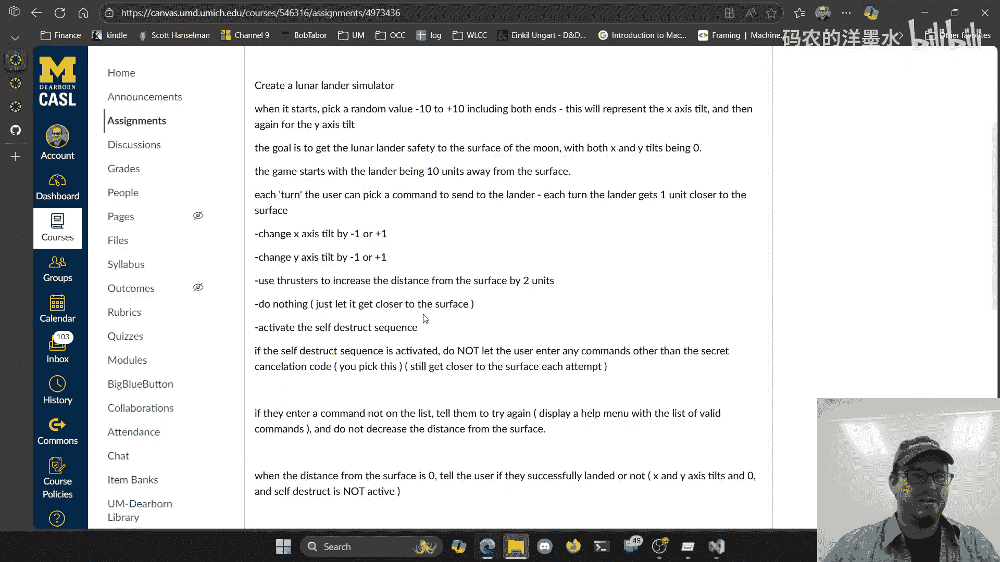

They do nothing option， sure， so we had another constant for nothing。It must be a six。

So then semicolon。Else if our choice is nothing。Just nothing happens really。

 I don't even know if we need an if here， that's okay。And the self destruct， yay。

 that's a foot one here， so then option seven， I guess， comes to ends。Sub destruct。7even。

I'll if my choice is seven。And then we do this self destruct thing。

Proably that needs to be a function right because that's a whole other something that happens here。

 right， And that doesn't even need to return anything。 It just does something。

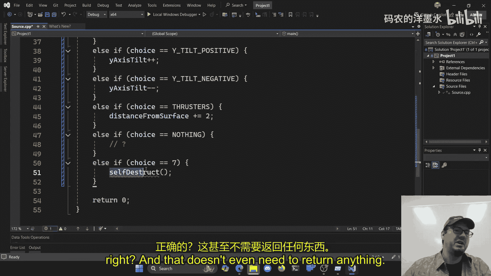

I think。嗯。Other than command， if we still get close to the surface each attempt。

 we might have a little bit of trouble here， but we'll figure that out。

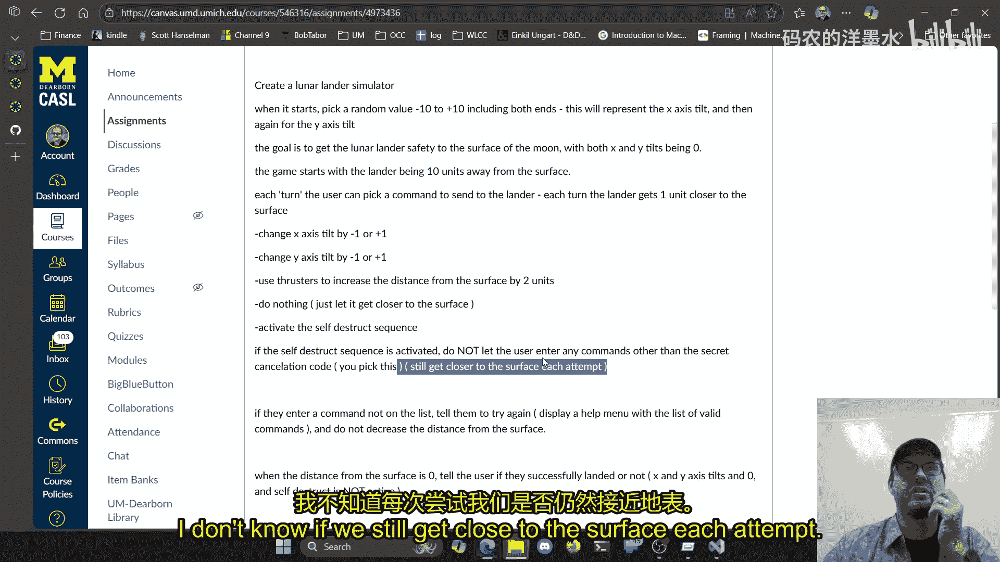

So we'll make a little function for self constructstruct。Or it's self abstractstruct。

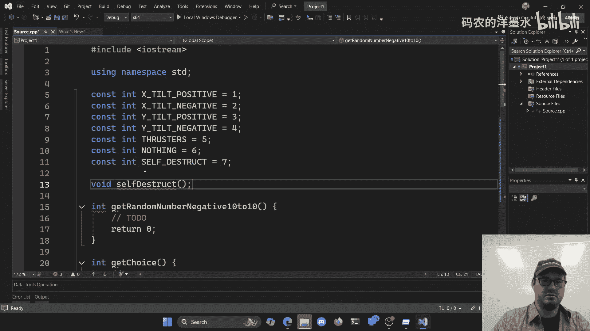

All right， and then。Hep again we're going to put that in the menu。 And then when the distance is 0。

 we tell whether they landed or not。 So like then all of this sort of happens while the distance is not zero。

 right， So why while my distance from service distance。

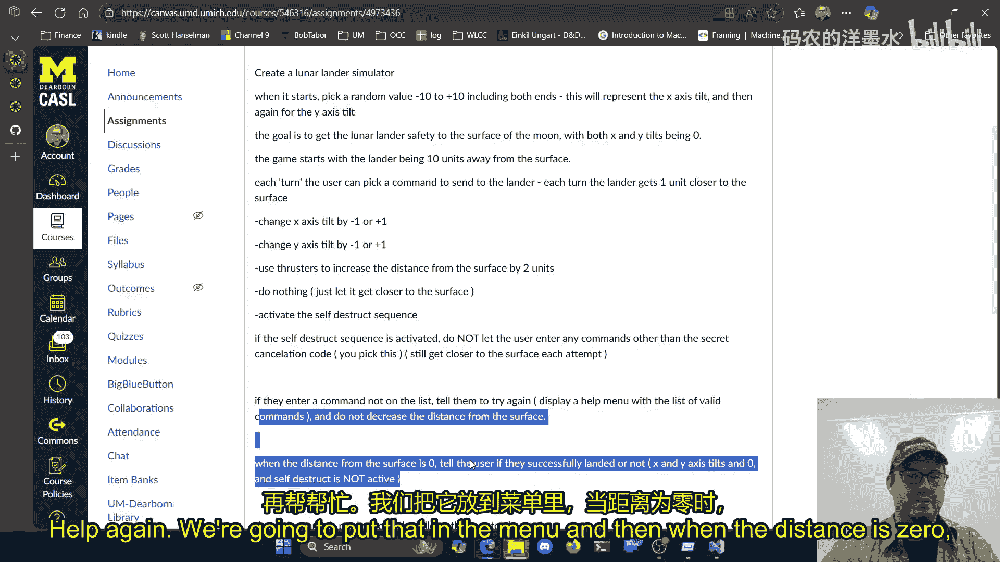

Surface is greater than zero， working on。Do this thing here。

And each one of the times when you do this， right， we're probably going to take that distance from the surface。

Minus minus。As we go， so get their choice， do the thing based on their choice。And they get closer。

 we probably should print out。Like， show them the details here。 So again。

 that could be a function avoid print。Details， so that would need the int X tilt。Why tilt。

And in distance。So if you give me the X to y the distance。

 I can print it out for you right again doesn't really need to be a function here， but sure why not。

 so we could say print。Details， details， given the X tilt， the Y tilt。In the distance。

Wow that was not why tiltils。 Nope， still why tilts。My access to Okay。

 the suggestions were not helping to here I again just kind of breaking it up here。

 just moving this out to some kind of function here。Okay， I think we got all those there then。

And then all of this happens whether or not they want to play again。 Okay。

 so we need to have this be in a play again， loop， so we'll have a stringboard play again。

Equs to y to start here。RightAnd while I play again equals a y。

We're going to do this whole thing here。And at the end of all of that， men。We need to ask。

 do they want to play again？You want to play again or and we could even have， you know， play again。

Equals， asked to play again。And have a little function for that。Strange。Asked to play again。

Turn just nothing for now and we'll come back to it， right？

To do so now the piece we're missing is whether or not we landed。

 right so when our distance is done here。Then we can print out if we landed or not， right， so print。

 landed or crashed。Right or something， I don't know， given the ext tiltt and the white tilts。

Tilt no goodness， ex tiltilt。X axis is tilt， Y X tilt。

I should have forgot the word access here a little easier， and we can write a function for that too。

喂。TheOid print crash related， given an X and Y tilt。Thats probably a little bit silly here。

 right to have another function， but why not right。This does something。 This does something。

 This one does something。嗯系清成。These are really like one liners。It's probably fine to leave in here。

Right，Pretty close do you think so now we just need to figure out the functions right we've taken a big problem。

 broken it down step by step by step by step by step。

 we didn't need these functions to do it here they just lets we break it down step by step and then now we can solve small functions here。

This what we just see out。Your ex tilts。Is。The ex tilt。Keep an online。And then they're white tilts。

Is the my tilt。And。S trip service is。I don't know。 Sure， all on one line， three separate lines。

 there's no whatever you like here。 probably fine if the crash or landed because the hey。

 if the X tilt is 0 and。But Y tilt is zero。And then we can see how you landed successfully。嗯。Sfully。

If it's not that， then you crashed， right， yeah， you crashed。Trashed， there goes， a billionna。

Dollars。I don't know what lands actually cost， but I feel like it's probably a lot of money， right？

All right， that one's got it here， get random of number one to 10。 So we need to import or include。

Sorry， see time。You can see the random value here。So to get around the number， we can。

 we don't need to。 We probably just want to see it once， right， So we we're going do。

SRA given time of zero， we'll do that once at the start of our program。

 and then now we can get around a number。嗯。So if we take a random value， we can mods it by something。

To get0 to that number， but not including that number， and then we can subtract。

Right to offset or we can add to it to increase it here。

 So if we need numbers between negative 10 and positive 10。That's。10 numbers in the negative。

10 numbers in the positive and a 0。 There's 21 possible numbers。 right， So we need demand by 22。

 So we get a number between。0， no， I'm sorry，0 and 20 would give us 21 numbers。

 21 possible numbers here， so we'll get  zero to 20 that we can subtract 10 from that So if we got zero all the way to negative 10。

 if we got all the way up to 20， we'll subtract 10 get to positive 10。Right， yeah minus9。

Then you're never going to get to negative tab。If you can't with the mod。

 you can't get less than zero。So if you surfrac 9， you'll never get to negative1。

I'm not worried about it at all， like that's a small little math thing but that's not the important thing to here。

But yeah， so this's all we can just recur that， right？Here's arithmetic。

That should probably give us a number negative 10 to positive 10 we could run it a bunch of times to see what those results look like。

Ask to play again this one's pretty easy， you can see how do you want to play again？Like Y N。

 and then。Oh goodness。 we' going a string for play again。Then we can see in on play again。

 and then we can return play again。Now if you wanted to add some sort of validation loop and make sure they only gave me a wire and then cool。

 we could， you know， in this case it's pretty easy if it's anything but a why we're going to stop anyway。

 so it doesn't really particularly matter for the choices the menu like one to seven might be nice to be like。

 hey， you can't pick that number because we we actually need to do that right if it's not valid or to tell them hey。

 here's the valid things。

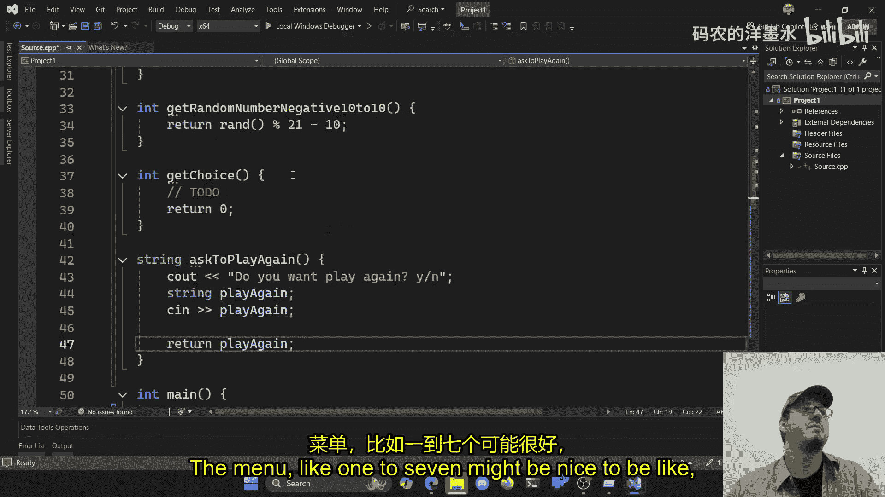

Right。Oh sorry。 That was this one here。

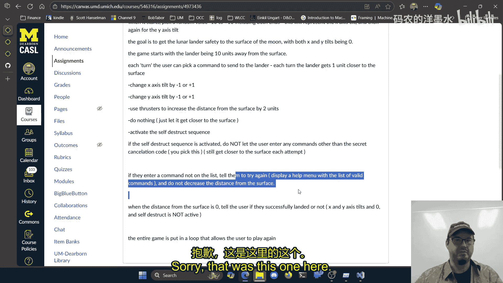

Excuse me， so for choice， then we'll see out。I don't knowWhat you want to do or enter one for this。

 two for this， three for this， that sort of thing。1，4。Ex tiltilt。I don't want to increase。Itt。

I'm terrible menus here， sorry， I will end that quote。就是。An then line。We a bunch of sea outs here。

 I guess。1 to increase the X tilt。And mine。Oh no， I'll need that one to two。

To decreaseecre still then we probably should use our。Things off here， right so we can add。Plus。

That one， there we go。Extiled negative。Decrease the X tilt there we go。

 so that's probably a little bit nice right because we've got the values as we'll use them here。

It's our Y tilt and Y tilt。喂喂。What else do we have here， thrusters do nothing in self destruct？

Trusters。Activate thrusters。See out nothing。do nothing咁 sure。You can't even spill nothing。

And see how it's substruct。To activates。Ostruct。Sure。

 and then we can get their input so in for input or the choice here and we can see it on choice。

And then while it's not one of those right， we need to keep on looping right if it's not valid。

 tell them try again display the the help like sure it's the same same display here So we might even just have。

Maybe we could set choice to zero and wild choice。Is less than zero。Or less than one。

Or choice greater than seven。We'll do this menu here。嗯。So it's not available entry。

 we just keep on going， not available entry we keep on going， right。

 eventually we can return the choice。Lots of different ways we can do our loops here。

 but if you like your do loops， you don't have to set choice to zero to start because it'll do it at least once。

 but again I will try to never use them because I don't like them So sure we got to you do strings as well Strs you just have a lot of them it's not this and its not this and it's not this and it's not this and it's not this It's a little bit more verbose。

 but that's okay still works the same way here。All right， so what are we missing in here then？

Missing the self destruct piece here。This one's a little bit unfortunate if we want the distance from surface to keep decreasing。

 we're going to run into problems here with this one。

Now really nothing doesn't have to do anything here， it just nothing happens。嗯。

So we need some sort of way to say， hey， we've activated self destruct and now we need a different kind of input rather than they're getting a choice here。

We need to do something different and this is where using integers makes us a little bit harder if we want the distance to keep decreasing。

That's okay， we can make it work here， right？I think it's easier if we have strings， but that's fine。

 So we need some way to say， hey， we've set the self constructstruct sequence so something different needs to happen。

 So in our loop， then we can have some sort of boying value for self destruct active strips。Active。

 and we're going to start that as false。Right so it's not active currently， so if it is active。

 we need to go do something right so we can say， hey， if my self destruct。Is active。

 We do a different thing。Otherwise， we can go get our choice out here。嗯。

And then sure I guess all of that's part of that else， right？嗯。So then if we choose self destruct。

 then we can say self destruct active is true。And something different is going to happen then inside this loop while we're looping。

喂。I think this one's going to be a little bit harder to put it into a function just because we won't be able to change the distance from surface very easily。

We could pass it in as a reference that we want to come back to this loop every time。

 So if we're in a different function， we're not going to be checking hey is my distance more than0 we could be modifying it。

 we've got options。 we've got the tools， We could modify it。

 but we need this loop to be running to make sure we're checking， hey did I crash yet。

 Did I hit the surface yet， Did I hit the surface yet So trying to put that into a function makes that a little bit trickier here So I think leaving that separate。

It's nicer for now。So if we activate a self construct， then。

We can see how what enter cancellation code。En line。

 and then we can have a string for the cancel code。Or you want to be an integer？

We were doing an ins before， right so cancellation。colold。We can see in the cancellation code。

And then if my cancellation code is equal to， It know we need some other constant here， right？

Conbstant and salt。Dt cancel code， what should be the code for canceling？One， two， three， four。

 all right， awesome。So if they gave me the cancel code。Then we'll say， hey。

 myself destruct is active as false， we've turned it off here， but every time we do this， right。

 we need to be taking our distance from surface。Minus minus。

RightAnd now I feel bad I have that exact same code twice right hey look I can get rid of it。

 I don't need to do it twice， so I'm going to move it from here。

 I'm going to move it outside of the else here。that it happens regardless of if or else we are doing self destruct or not。

 because they want to have the same code twice， right？So I just do it once here。对。

I think that's all we need to do then right so if we got the code。

 we tell them maybe we tell them invalid code， that might be nice， right？Invalid code。Here。

 and maybe we tell them he successfully canceled。Successfully canceled， self obstruct。Good job。Right。

 something like that。So that the only thing that they can do if we've activated it is cancel but you can't do the thrusters anymore and you can't change your tilts anymore。

 the only thing you do is cancel your ship from blowing up。 again。

 doing that in a different function is a little bit tricky because we don't have access to this and we want this loop too running。

 So it's just the way we're designing it at this point here。

 we don't really have the tools to check if somebody else is happening。

 So a couple functions at least it's not all functions but you know there's definitely decent bit of code here main still。

 but we've pulled out some of it at least which is nice。That sound pretty good Should we try it。

 let's see。It works the first time I'm going to be amazed。

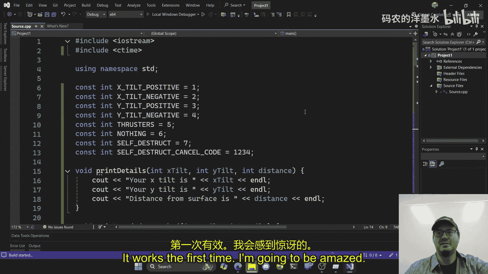

2。Hilt is 10 and 5。 Our distance is 0。 What do you want to do。right， tilt is nine。

 distances or five distance is9， right， it looks like it's working so far。Oh， sorry， four， four。

 four， four， four， two， two， oh， we probably have to use some thrusters if we don't crash， right？

And then oops， I increase。 I need to decrease。 I can't use whale menu。

What an exciting game it's thrilling， right？Should we try self destruct？哦哦。

Enter our cancellation code， 1，2，3，4， and we successfully canceled and we landed yay。

 we won you play again Yeah， why not？And our for negative force。

 we're getting different random values。 That's good， right。

 That's what we wanted to have happen here。 So if we just do nothing every time。We crash。

 there goes our billion dollars。Wherese I。对。I think that's doing everything we needed it here， right？

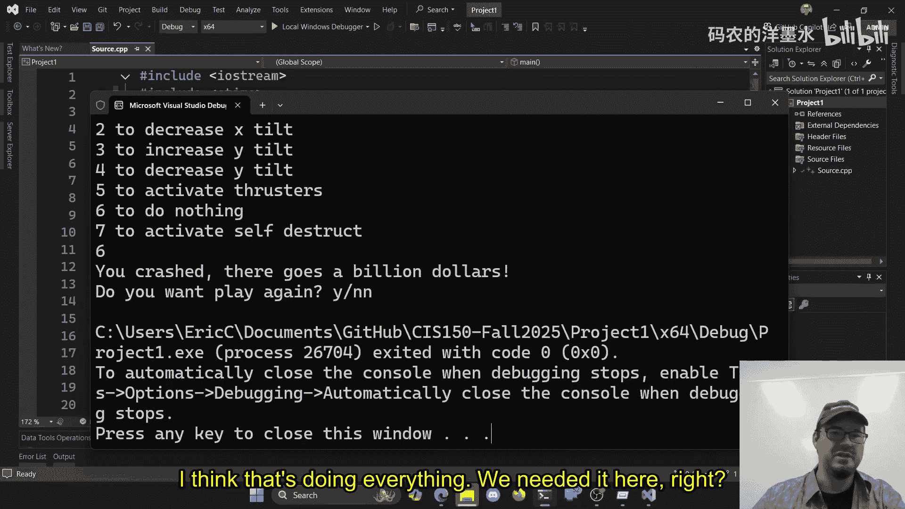

So we take a look our random tilts every time we play our menu or help， X tilts and Y tilts work。

 self constructstruct blocks other commands until the codes entered right if that's the only thing we could do and check the letting and let them play again。

I think we got all the pieces we're looking for there， fantastic。ok。😊，All right。

 let me go over to GitHub。I'll submit that one for you。

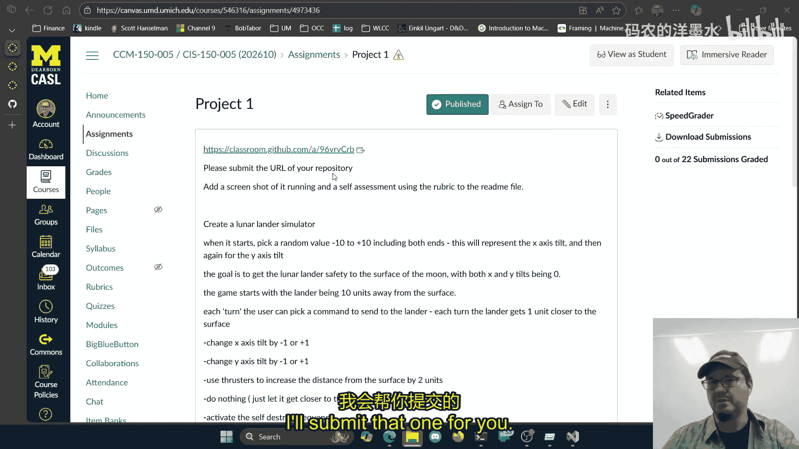

Again didn't need to have functions or just practicing them for fun right it's a nice way to kind of break it up and then even think through it you can say hey。

 this is the stuff I'm going to do I'll come back to it later I don't have to solve it all all at once here as we go。

So here's Project1。Solved。

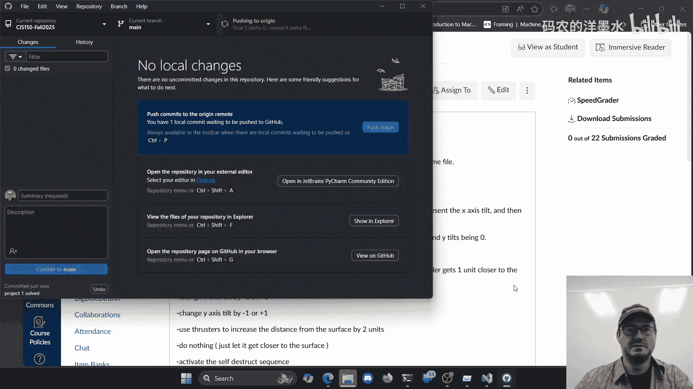

Maybe we' going to talk about our next project here， We'll make a new link for you here。

New repository。Do you guys like repositories yet？That's okay。2。See bus complete。

That's probably right。The search here is bad lately。They have too many repositories。Oh， you know。

 I did it wrong， I did it wrong， see plus， plus。Ter。That's my last name， right？确认。

I strongly misspell it all the time。N letters is a decent number there， goes you found it。

I't know what I did wrong。 sorryrry， it's going a little slow today。Yeah。ba。It's not even Monday。

 no why it's so slow。All right， we going can come back to that part。

 I guess I'll get you your code in a second， come back and make the assignment。

 just let it keep thinking。For project two。As everything's just slow， it is my computer。Project 2。

Please submit your。GHub repository URL。The screenshots。running。

And a self assessment using the rubric。To the read me。All right， make sure to see this online。

 looks like you're all awesome， we're going to build a little hangman game here。

 I'm going to do a little copy paste to my apologies with functions。啊你个 pop up here。All right。

So a couple different functions。U。Ipologies， this is the Python format with underscores。

 the snake casing rather than camel casing。It'll be okay， it's just different。Instead of upper cases。

 right's just。Just the format looks a little different as all we're going to build a handmanag game using functions。

 so we're going to have very specific functions I'm well aware there are lots of hangman solutions out there。

They don't all use these very specific functions right so the idea here is to make you practice writing functions in small pieces here I'd like to give you this little bit of help essentially saying this is what main looks like you go do the rest at this point here to make you practice those functions that's the goal with this one here so I actually give you a main loop here and it will go。

Like your code should just work if you wrote the rest of the functions is the idea with this， Okay。

 so it's a lot of functions， I guess， so our function get word turns word to the user making sure it's at least four characters long。

We need to make sure it's at least a certain length here for a hangman， it could be longer。

 it can be fine。No。We haven't done anything yet where we dealt with spaces。

 So this will just be a single word。 if the user enters two words。

 we're only really going to get the first one and that's just a fun piece with using C。

 Eventually we can get an entire line。 But for now just know if you put a space in your word it's going to be kind of weird and it's going to cut off the second word right only take the first one。

And then we're going to have a function for display the hidden word that accepts two arguments。

 One is the hidden word， and one is the letters' guest。So what we're going to do is on one line。

 print a blank。 if you haven't guessed the letter or the letter。 if you have guessed it。

 here's your underscore， if you haven't guessed the letter or the letter， if you have guessed it。

 So'll display the hidden word with whatever letters we've guessed， We're going to write a function。

 git letter， guess， give in the letters guess。Okay so we don't want them to be able to guess the same letter more than once。

 so if they've already guessed it， make sure it doesn't work and make sure that the guess is only a single letter so this function has to do a little bit of checking here as well and the return the letter that they guessed。

We're going to write a function is letter guest in。The is letter Gu is in hidden word。

 I think that's too many is is there。He is letter guessed in hidden word。 That looks better。

 given the guess and the hidden word。 So this is the letter they guessed。 This is the hidden word。

 Is it in there。 We're just going to return true， It it's guess， If nots false。 Again。

 with breaking this up into lots of small pieces here。

 and the we' going function has the word Ben guessed。

 given the hidden word and all of the letters guessed your turn true。

 If you've guessed the entire or all of the letters in the hidden word。

we're going to write a function print the gallows， given the number of incorrect essays。

 so print the gallows with the correct number of body parts This is such a weird game to teach children I don't understand why this is a thing。

 but we just go with it right and then we're going to write a function has person been hanged given the number of incorrect essays returns true or false whether or not they you know games over essentially at this point right so the loop keeps on going long until they want to stop playing。

So something like。This ought to run here think。He is letter guest。In hidden word， there we go。

 So essentially this ought to work for us here。 We're going to say here's the letter' guest is nothing。

 The hidden word is a get word。 The number of incorrect guesses is 0。And all of that will wrap up。

 I figure you can do the play again a bit here while not has the word been guessed。

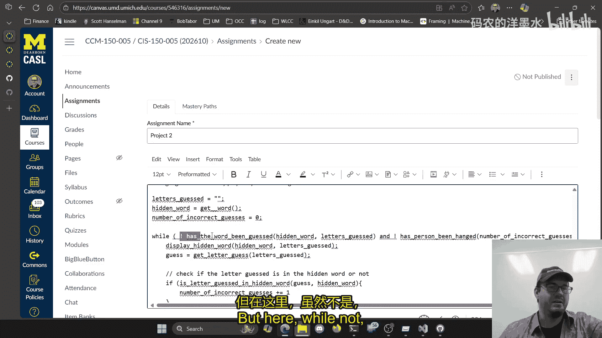

Maybe we haven't guessed。 Aunt can we use Annes， can we。you use the keyword and plus plus。

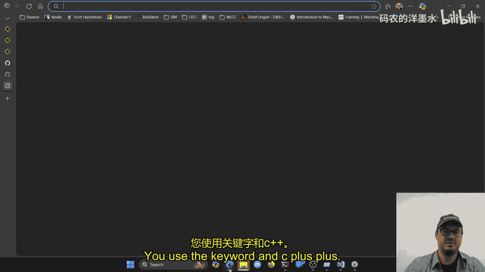

Sfa bus。So。Can you use and。Oh， you can now。That's exciting。 This is a slightly newer feature C++。

 I guess， so you can actually use the word and instead of the ampersand ampersand。

That's very thrilling when did that come out？At some point in release new versions of C++ every now and then okay。

 that's why I have the and keyword here sorry so that looks weird it's it's just the you know8%8 percent so。

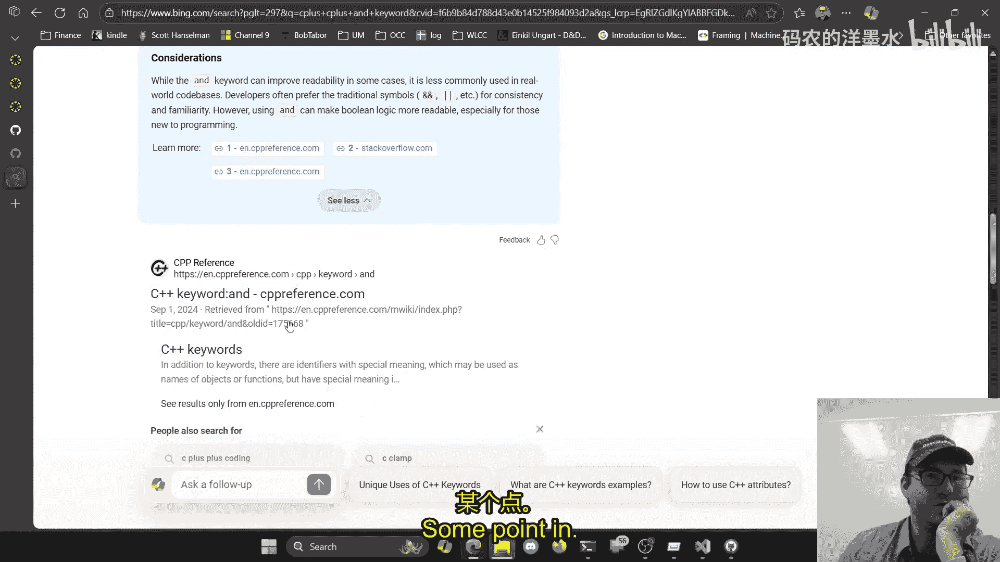

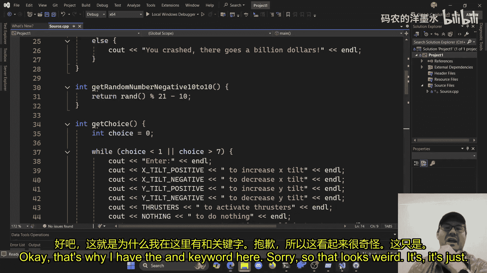

If it's not been guessed and the person's not been hanged。Right so。

We haven't guessed it we have a won， and we haven't lost。

That's essentially we're still playing if the game's not over。

 then we're going to display the hidden word。Given the hidden word and letters we've guessed。

 we're going to get the letter guess。Great， passing in the letters guest， store that as our guests。

那有呢。If is the letter guest is in the hidden word， then we'd say。嗯。

Numb of income grass plus oh thats if it's not， sorry， if it's not。In the hidden word。

 our incorrect guess goes up by one。喂。And then we print the gallows given the number of incorrect guesses。

And it just keeps on looping。Goes back， goes back， move back， great， displays it。

goes on so for gallows here， you might use something like this here， we don't need the triple code。

 sorry。Right，Here's the body or here's the head， the body， one arm， two arms， a leg， a leg。

 So that's 1，2，3，4，5，6 incorrect guesss into your hanged。ItSuch a weird children's game。

I don't understand。😔，I don't know。 Do we need like some sort of like warning on this here？

okay so that's an example for what we can do with the gallows right so the functions are going to be rather particular。

 but essentially this loop ought to work here that's your job so again。

You're just going to write all these functions， so we're going to get points per function here。

 What did I put this How many points did I have this one is。Three points was our last assignment。

15 so this one should be worth more so we got one， two， three， four， five， six， seven functions here。

Let's go 21 points， why not？And let me publish this one， oh， I need that link did it finally work。

 did work， hoay。Atit， sorry， put that link back in here。Get her a repositor， so。

There's a whole thing， which is fun。Okay。Our digital accessibility guidelines here say you shouldn't have links。

 you should have， I'm sorry you shouldn't just put URLs in。

 you should have the link that goes to a URL because it's better for screen readers makes a lot of sense here。

 I have a very strong distrust of links and I like to see the URL。It's just。

 I've done a lot of security related things here， and I never click on the link without knowing where it's going。

So sure， but that's the guide， so I'll try and do that because we actually get scored now I don't know if you can see this like these little scores like these ones are yellow and all this one's happening in thes green and it's more accessible now because I didn't put the URL there。

All right， name， so the rubric， so we got to add a rubric here。This is the Project2 rubric here。

 we'll use this when we're scoring。And we're going to add some criteria here。

 so we'll get do three points per function。Get word function。Get word function。

For three points and then the next one here display hit it work。

 but you'll have to specify what type of parameters these are。

I'm just telling you it should accept these two things so it's not like fully C++ code there the word function。

嗯。Get letter guest here and it's missing some pieces here depending on how you write your code it might be missing pieces here right because as you guess letters we need to be saving like adding those to the letters guest here so depending on how you deal with letters guess you either need to go add the guest to it or this part takes care of it right totally up to you we've got different options for how you want to handle that as you go right。

That was the get letter guest， whenever now we want a is letter guest in get in word here。

Munction for three points。And then the next one has the word of a guest。Yeah。O，3 points。

And print the gallows this one's really long， unfortunately。

 but it' it's not the end of the world to be a long function here just because you've got all the different kinds of gallows you print based on how many incorrect guesses you have right we got the empty gallows with one guess what two with three doing arm so ways of going about that it's up to you that one ends up being a little bit long。

Pri the Gallows and has the person been hanged， this ones shouldn't even be three points so that's fine here because that's super easy。

You know what here， let me let me make that one worth two points here。

 and then the whole thing can be worth 20 instead the 21。喂。They get 22。It doubled， oh， thank you。

 There we go。 All right， so lets would make it 20 because that's just。

If the number of guesses is six or not， that's a really boring one here， all right。

 so we make that change to 20 points。There we go， so its still increasing points here。

 so we got more loops right， we've got functions got some sun with strings looping through strings and those sorts of things here and the due date。

Goodness guys。 the cold Bens are really。Leaving a number on me two weeks from today then right that puts us out to the 22nd is that are we doing something on 22nd。

 I feel like we're doing something at the 22nd Is that the day of the midterm。Alright。

 so let's have a do then the following Monday。27。So you can get it done before your midterm。

 you can get it done after your midterm， however you guys want to schedule that's fine to you for。

Here。But that'll be at least because I'm not going to over the solution the of the midterm。

 so that should be fine， so we'll have a little extra time for that。That's so good。Right。

 and then I got to run the Zybook scores for。No， we didn't even finish function that's not due till next week。

 right， so I think we're good there。要不时。II got to do chapter four， okay， put that one in， thank you。

I'll run that today when I go back to my office yeah。

 so chapter five and then due till Monday day for functions， okay？Questions， thoughts， concerns。

 doing okay， I have theyre going well。I wish smell， Okay， cool。 Well， it's all I got today。

 We got time。 You can start on the project， if you want。And we can go from there， okay？Great。

 awesome， thanks folks。

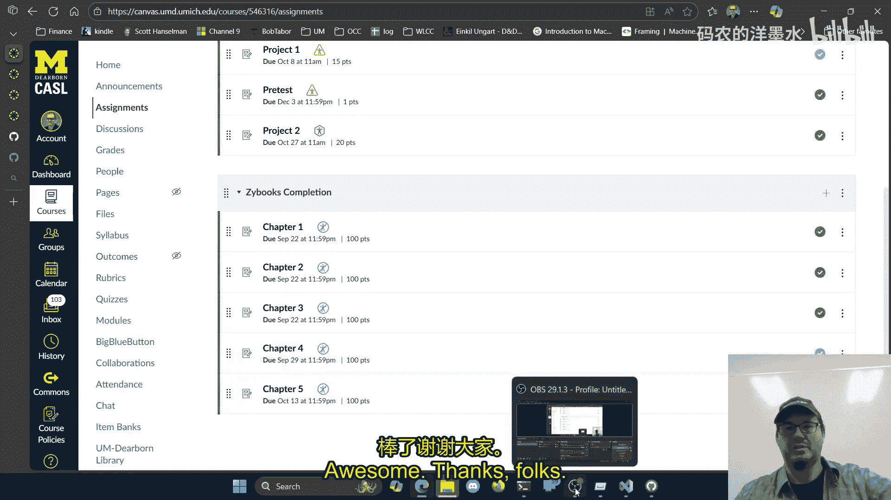