# 【全集】密歇根大学 C++编程 中英字幕 1080P p20 Lecture 20 - 期中复习 -BV1TsAZzAEHX_p20-

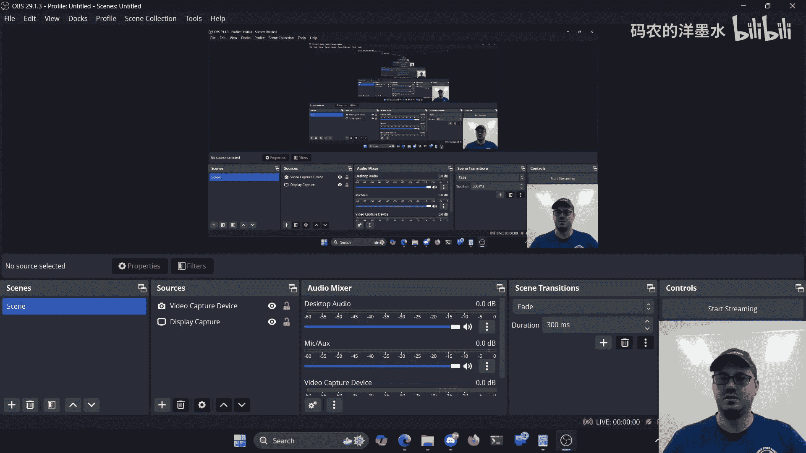

Think all we had was midterm review planned for today if I remember right I think I have the syllabus downloaded to locally but it should be it for today a little bit of catch up time I started grading project one I didn't get to all of them hopefully I'll finish that up for you today Ze looked good for almost everybody again I think public go to set submission issues nothing wrong with their code and then someone had mentioned。

I pointed out that in Canvas I wasn't clear that you had to be rounding up for the number of items to buy and that it probably wasn't fair to take off a point of each of them that's like okay that's probably fair so if I took off a point of each of the calculations for you because you didn't round up and I didn't go fix it let me know。

I it I said it in class， but it wasn't listed in Canva it wasn't。Implicitly in the rubric。

 it just said calculate。And didn't mention that you should round out I sort of assumed but I suppose that's fair if I didn't put it there then I wasn't very clear so I get a couple points aren't going to matter all that much here but happy to give those back and just take one point off instead of three for the rounding bit there so I think that was fine right so we're going to go through these so expect similar questions but please do read them I'm likely to go change some of the words。

Okay， so that will affect some of these questions right the first one， do you know your name？

Awesome and agree to the academic integrity policy and we had the fun stories about these things。

 but i'm going to trust you guys not cheat it's open book up notes you really don't need to work with someone else on it right like。

You saw it right it's not hard there's no reason that you'll even need to go ask someone else right if you can't do this。

 you and I need to have a conversation because something's not going well。

Right that's their chance to check because things are only going to get harder in CIS classes right so if this isn't good by this point here。

 we really have to talk and figure out what's going on and get hooked up with other services and things like that so again it's meant to be easy that my goal is that it's easy you've got basically unlimited limited time on it here right everyone should get 100% on it。

And if you don't， then we'll have that conversation。Number two， variable to be anything you want。

 is this a true or false statement？False and why is it false and what is it a correct statement yeah。

 so we can't use any of the reserve words okay that's a good catch so this is a bit of a trick statement here yeah so correct it。

Ideally， more than just can't be anything you want。I mean。

 sure that's technically true but like give me some detail would be better I'll be much more happy with that the modulus operator gives you the decimal remainder from integer division of the operarans false it's the integer remainder using RAN will generate the same sequence of random numbers every time you run your program unless you give it a unique see value。

True， so that's why we use the time， which is our clock time right and if else if else。

 if else chain can always be replaced by a switch。Okay。False， right， so what's a true statement？

It cannot or maybe switches can always be replaced by Felis。Yeah， either one at this point can't。

 I suppose yeah， that's fine， but really it's the only way around right every switch can always be replaced with an F else and not else can be replaced by a switch。

Switchches can always be replaced by the look at that I didn't even read my own questions。

 is this one true or false？True， right easy so got to past this to the one above sometimes they randomize the order depending on how it works in Canva four loops and my loops are completely interchangeable。

😊，Okay。Technically true right it's going to look weird in a for loop but sure right you can completely replace it all you really need you can just put just the test you don't need to have an increment。

 you don't need to have a declaration right you can leave them all blank that sort of stuff we can completely change it now sometimes we want to use a for loop because we know like it's better for counting it easier or we're not going to forget to increment things and get stuck in infinite loops but that's up to you。

While。Sorry， while break and continue， are valid options to views in a loop。

 they generally cause programs to be more confusing and should be avoided， Eric thinks this is true。

That true or false。True， I generally think that makes them more confusing sometimes they're helpful。

 sure， but in general， if we can avoid it， it's probably better。That's fine。

 we'll use them every now and then， but if you can avoid it， probably better。

Two reasons to use functions， any two reasons。NextEasy to read the code， sure， reusability。

 definitely great， right putting a name to what we're doing。

We want code to be readable because we care about reading it。

 the computer also happens to have to read it， but really we write it for us。Yeah。

In passing arguments to function， they are passed by value by default。True， yeah。

 if unless let use that ampersand sign， right， we're going to pass by value。嗯。

Functions can only return a single value or object。

It's true now once we get to array an array a container that has multiple values but it's still just one thing。

 you're just returning one thing even if it holds a bunch of others。

 so this will always be true for us other ways we looked around it is if you pass objects or if you pass variables by reference you can set them but you're not really returning anything so the return keyword right is only returning one thing we just have tricks and ways to get around it。

If a parameter has a default value， you must always include an argument for it when calling the function。

Fse， because it has a default value， you don't always have to include it or if it doesn't have a default value。

 you always have to include it a couple ways we can make that statement true。Great。

What three things must you do with file streams when working with them？You open them， read or write。

 close them done now closing usually happens implicitly when our program ends。

But if our program is doing lots of things， you always want to close it out when you're done to make sure we're not holding it open for other processes and things and some programs just run and they just stay running like if you're running some sort of server process。

 it just is always on。You don't want to leave your files open。

 so always make sure we're closing when we're not。True or false。

 my default when opening a file for writing it erases any previous contents of the file。

we have to specify append mode if we really want to append the vial and not load away。

When reading writing files， you must always use an absolute path to the file F， No it。

 The default is relative， you can， if you want to。Okay。

 so lots of ways to make that statement true right right and then the long answer questions here let me open a visual studio。

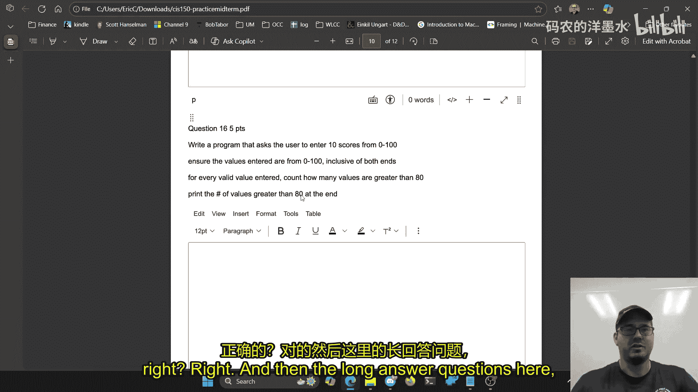

Not code oh my goodness you can do C++ in code it just it's a little bit of a pain to get set up here it's not actually not terrible。

 but。Viial Studio is a little easier。So maybe we can new project one of these days maybe we'll use code for stuff。

 but。We'll call this midterm review。Do is this week nine is that for me really in week nine。

 I guess the first week didn't really count like eight and a half for something。

Or this is the end of week8， sure。Okay。

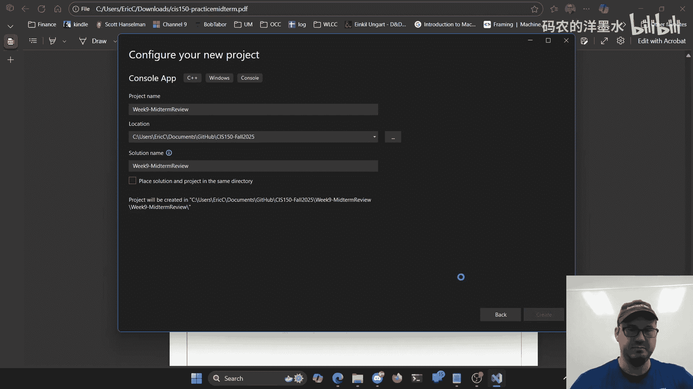

All right， and。Is this， I can't select the text here， really。Really thought I could select the text。

 that's fine so ask the user to enter 10 scores from0 to 100。

 ensure the values entered R from0 to 100 inuss of both X for every valid value entered。

 count how many values are greater than any0。rintThe number of value is greater than 80 at the end。

So it doesn't sound like you have to return anything we're not even writing a function or' just writing a little bit of code here Okay。

 so a little validation loop。 now this is not very clear here and this is I wrote it like this on purpose my apologies。

 but in the real world you don't always get very clear nice directions on every single step of the way here。

 So do you think that the validation loop should ask them to try again or it should just throw away numbers that are not zero to 100 asked Drgan I think that's what most people do。

 but it says for every valid value entered count。So if you just threw them away， instead that it。

But not within range， I' mean just go to ignore it。 I'm okay with that， too。 right。

 It was not super clear here， right， I expect most people to validate and say try again， But again。

 it's open to interpretation there。 So that's fine。

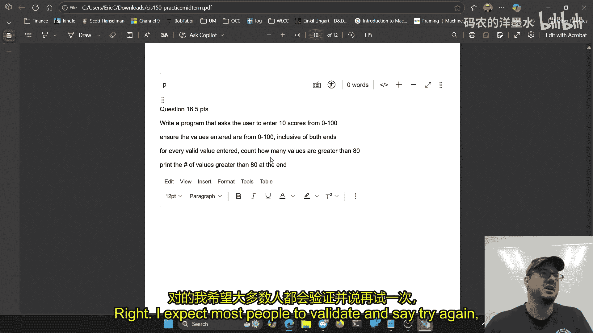

All right， so do a silly little loop。 So 10 numbers， right， so for。It number equals0。

Oh this number is less than 10。Number plus plus， okay we'll ask them 10 times。 Sure。

 so we need a ask them for a number to a number。Between zero and 100。

And we have an in I don't know entered， I guess that's。Numbers， okay， let me go with numbers here。

 I'll call this one number。The namespace， right， using namespace standard。And we can see in a number。

I move this one that one， I don't know。All right， see out C and then we can do a validation which the wild number is less than zero or number is greater than 100。

Y out invalid。And then copy paste this right here。Tgan， sure。Once we get through this。

 we know it's valid so outside of our loop here we need the count right so this is our number values greater。

T 80。Great， starts up at zero until me know otherwise。And then we can check， hey。

 if my number is greater than 80。Plus plus。When we're all done with all of that， we can see out。

 I don't know you entered。对。And third。We're very good of the meeting。Numbers greater than 80。

And an that line， a little long car'll just take this down to one， so it all fits。

Think that's everything we needed。 So that's what 10 ish slide the code。8ight to 25， okay。

Probably longer than it needed to be you know depending on how you set up your loops and stuff。

 but that's fine， I guess we could have put number。

invalid to start here right that would save us two lines of code if we have the same code 2 should go out about ourselves。

 so we need to set number negative one。So the the lurt。

 I guess it's going to tell you invalid and that's a bit of a bummer so maybe we don't do that。

It's okay right anyway it's going to work here counter valuess spit out at the end。

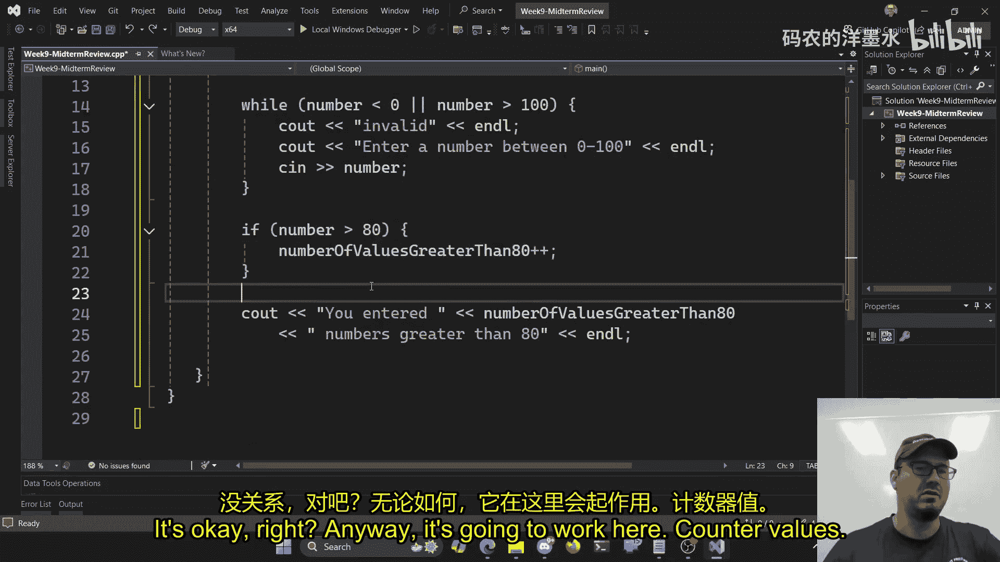

Okay， I think that's everything here， a little validation loop， go some counting。😊，Right， cool。

All right， write a function steps to 1 in 3 x plus 1 that accepts an integer value。

 count the number of steps it takes to get to the value to one by following the rules below。

 so the number is odd multiply by 3 and add one if the number is even divide by  two。

So far as best we can tell every integer in the world does this。

 we just can't prove it mathematically this is fascinating here if you pick too big of a number multiplying by three does bad stuff don't worry about that we'll assume they're going to give me smaller than the billions for numbers here and we'll probably be okay right。

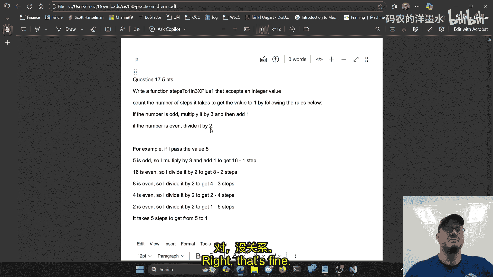

That's fine。Great， so we need a function。😊，And the function is supposed to just count the numbers here。

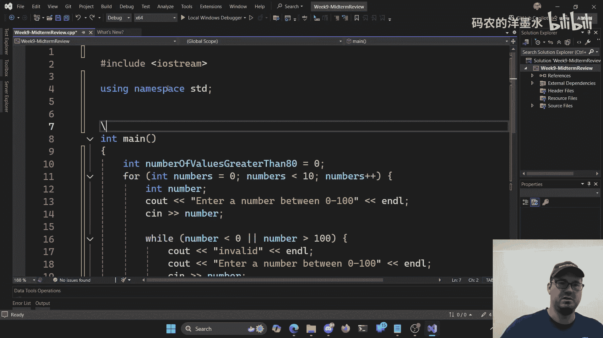

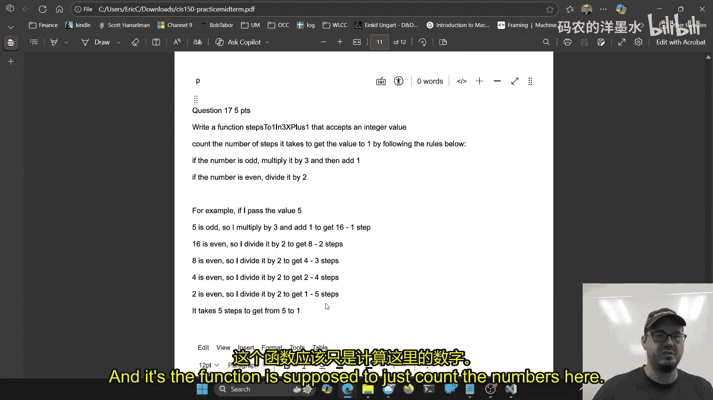

はい。Probably should return the number of steps here。 I I'm making an in。 it's not very clear。

 I'll make sure it's clear on what it should return here。 So this is steps do one。I don't know。

 in3 x plus one， something like that， give it an inch for a value。So we need a number of steps。

 right， so an in steps starts off as zero and while my value does not equal  one。

We're going to keep on doing something。Eventually we'll get to one and we'll stop so when we're now making return steps。

Here， so what do we do， And we said if my value is odd。 So if we modulus by 2。

And the remainder is one， it's odd。 then we need to go multiply by three and add one。

 so we'll take my value。Times equal3 and then value plus plus add one to it。 Sure， otherwise。

Make my value divided by two。喂。And then we just keep on going and that either one of these cases。

 right I'm going to take my steps plus plus， you've added a step。And now if for not one， do it again。

 for not one， do it again， for not one， do it again， for not one， do it again。

So eventually we should just be able to output。My number of steps， what I call it no steps two。对。

What was the example here we said five。Andone。对。So that gave us。

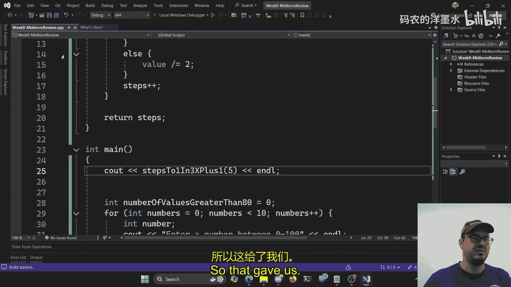

Five steps。

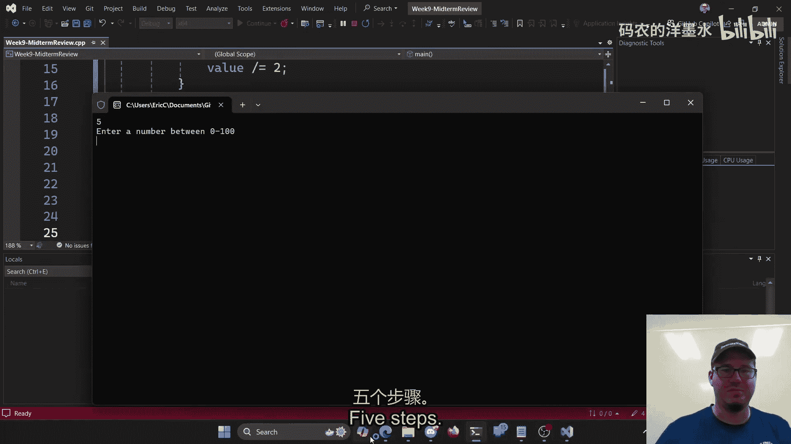

Took five steps。That one checked out， we could try other numbers as well， right？

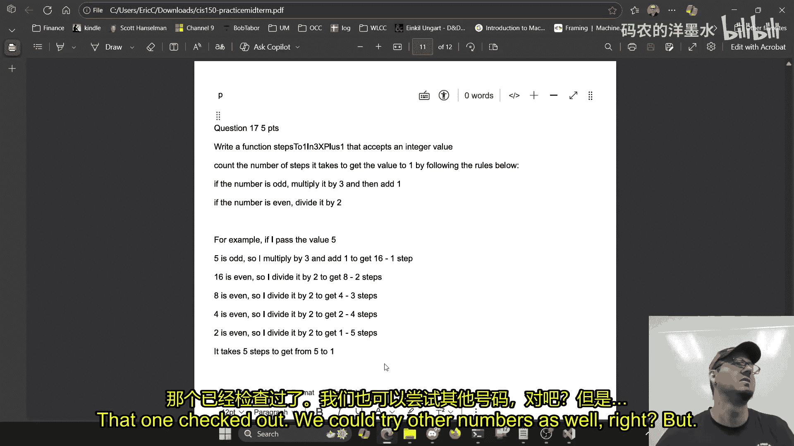

Any number we give it eventually we'll come back down to one。

 which is really fascinating you put it in a loop if you're bored right to check it out like loop up and see how many steps it takes they're looking for a pattern in the number of steps too that's kind of a fun fun thing to do。

Numbers one。Numb less than I don't know what you're onlying up to like 100，000 just to check it out。

And maybe we can make this a little bit prettier too， so number of steps。Get to one from。Numb。

诶 probably我 call。Thank you。Too many of these。都晒佢。Oh yeah， thank you， so it's number awesome。

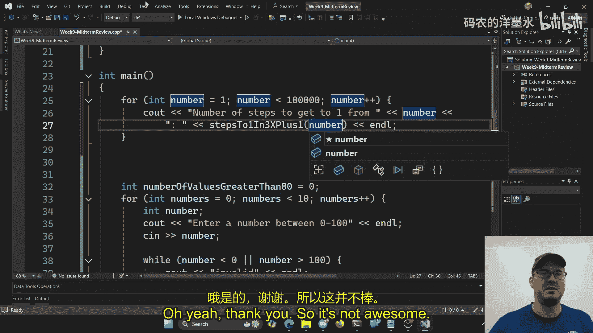

C putting is the slope part here。doesn't seem to be a whole lot of a pattern here。

43 steps and 43 steps it's kind of on 43 steps again。It's kind of neat。

 there's like some repetitions in here trouble69s， 118s。

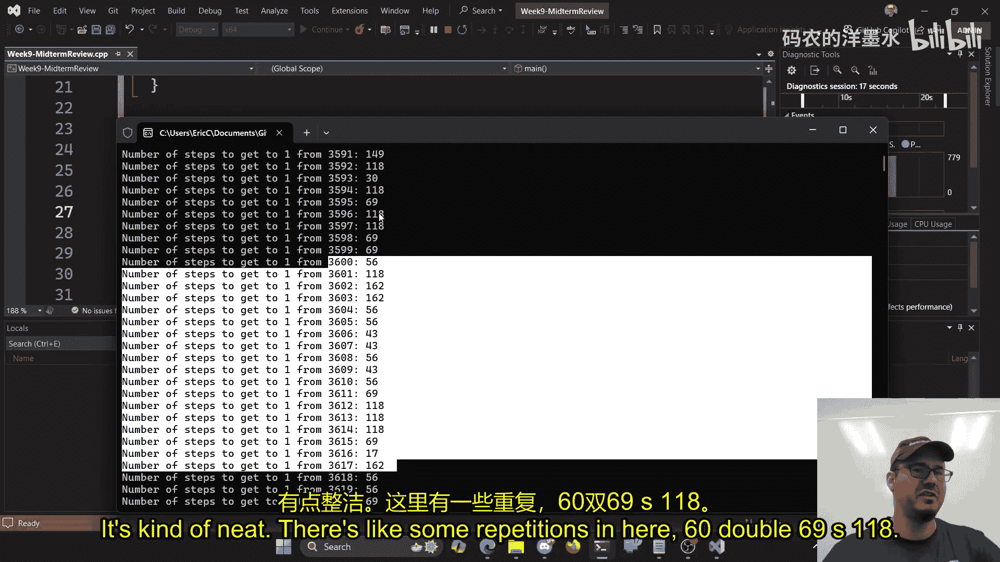

Com onOh， pause， I'm highlighting， oh， you're supposed to pause when I highlight oh over。Really。

 it did it the first time。All right， but that's and we don't have to run at the very end here。

 but like a lot of 41s show up here， it's kind of cool， just a fun little math button here。

 I feel like that sort of stuff。

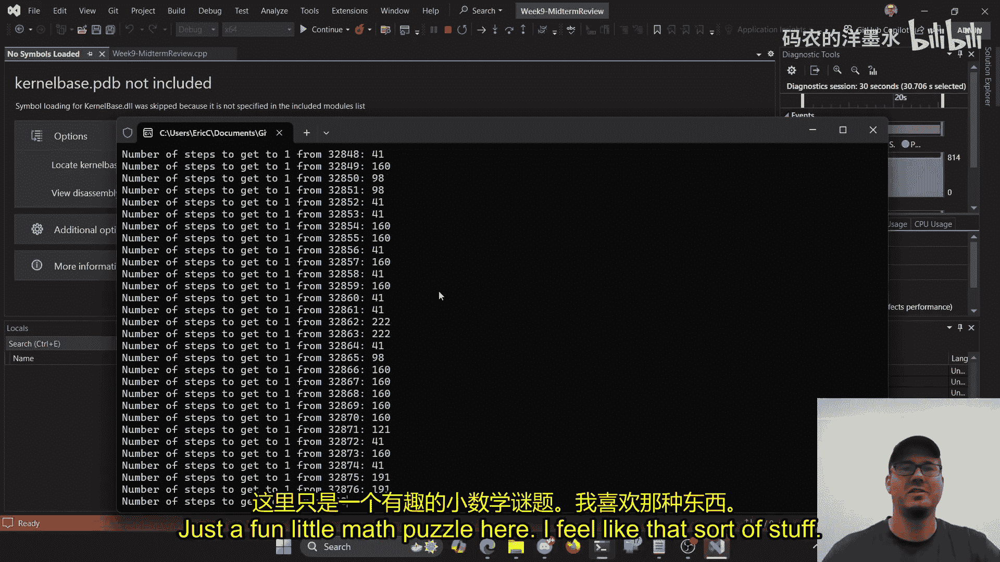

Great。The function good， The function does something silly with some kind of loop period All in the last one。

 Read a function count with letters in a file that accept two arguments， one for a single letter。

 another for a file name。 attempt to read the file with the given file name and count the number of times that letter appears in the text of the file。

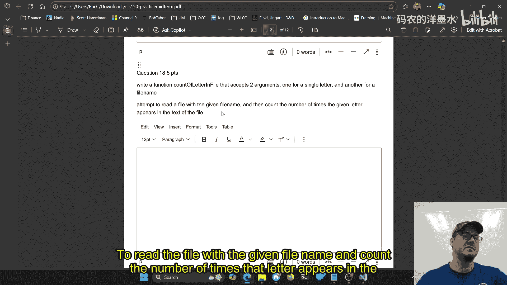

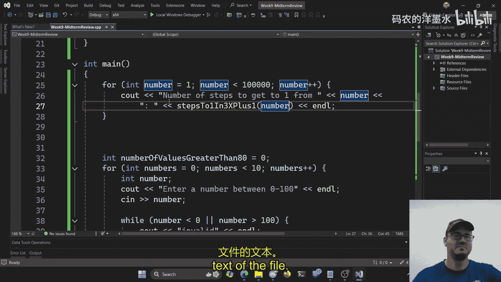

All right。

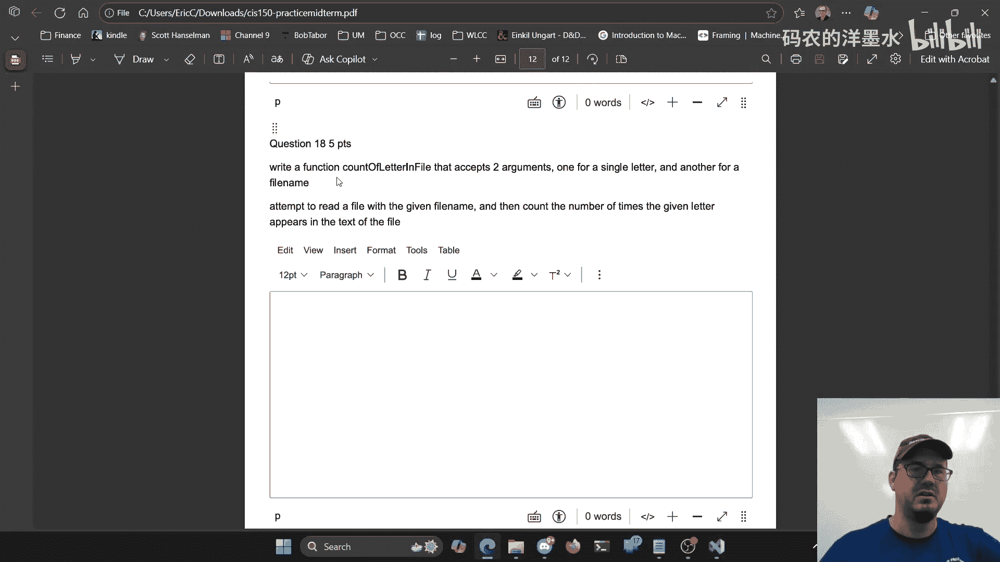

count of letter in file， so we need another function。

Returns the count right so count of letter in a file， given so if it's a single letter。

 that's just a char right letter and then a string for the file name。

So we need some file IO stuff here， food。F stream。Right， so we can open our file Oh it straight。

 thank you。String awesome and we want to go make an input file stream， right my input file stream。

 input file stream。 open， my file name， file name and oops I guess I did that all lowercase， sure。

It's probably two words right， should be name， file name versus file name， I don't whatever。

If my input file stream is open。Right we can do something good。

 if not we can probably just return zero I don't or some error I don't know whatever it happens to be but we want to enter here so we have to go count so we want to go get the line and count how many times that letter appears in the line。

In every line， right， so we'll have a string for the line。

And then we can I don't know use git line is probably easiest or we could just use a CN right both ways can work however we want to do it here it's going to do the exact same thing every time but why not use Gitline so we use Gitline given our input file stream and the line here so now I'm going to get the line。

And we want to now we can loop while my input file stream dots。En of file。

 well we have not reached the end of file。I guess we should do that star here， right？

While it's not the end of the file， go and get the line here。

And now we need to loop through every character in that line， right， so we can say four cha。

Character in the line。Nope， that's the wrong place。

 There we go for curly races if my character character。Character。Is equal to the letter。

We need some kind of count， right， so we need a count count of letter。Starts off at zero。

 Take our count of letter。Plus plus that's just loop through every character right get the next line get the next line get the next line get the next line get the next line right so we' work with CN as well we'll just do it one so the only time that this will not work well with a C is if the character was a space right because we're gonna to ignore spaces with C again I don't particularly care and I'm not going to mark you down if you don't make it able to count spaces but without using git line we wouldn't be able to count spaces so just keep that in your back pocket right so Gitline is probably a little bit better for this just in case I don't know why you want to count a number of spaces but you could that's fine and eventually then when we're done with our loop here we can return our count of letter。

And actually this we could just say count letter here as well so I guess we don't even need that right look at that we can just use count of letter because it will just stay at zero if it never opened。

There we we save one line of code， we really pretty good about ourselves。 So in what is this。😊。

One0 lines of code here for that one。Right。This one was。15 is so again they're not super long。

 but the goal was these I'm aiming for these to take you about 10 minutes or so so if you was gonna take you 20 right you'd still have time to get this whole thing done in an hour and 15 that's sort of the the aim here if it takes you longer that's okay nothing wrong with that if it's taking you hours let me know that shouldn't take you hours I feel okay so again I'm going essentially take these questions and just reword them so you'll have a question on validation loops you'll have a question on functions and another question on functions and that deals with files So really that's like a files question but you just happen to use a function like a math bias you don't get to forget anything that you've done you're just going keep on building on and using it as we go。

Okay。😊，You feel all right？Get all these done beforehand。

Awesome cool so you should be ready again the midterm will open 11 o'clock on Wednesday and it'll be due the following 11 on Monday it's on time so you can open it close it save it come back to it yeah no and I'm not planning on coming if you'd like me to come and watch you take the test I can do that other than that i'm not going to plan to show up because no one's ever asked me to watch them take a test。

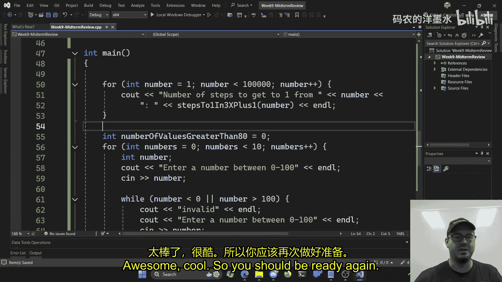

And you don't even have to finish it so you can come back to it the next day or the next day or the next day or whatever works for your ontime。

Oh。

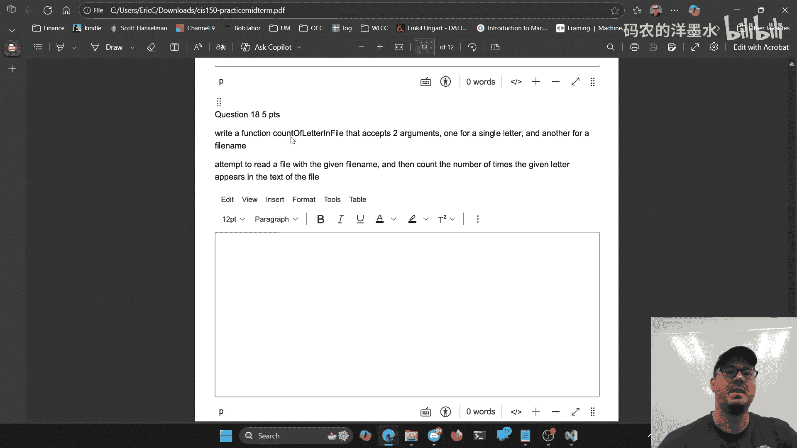

One last note here is please use Viual Studio and then in Canvas， copy paste。Okay。

 don't rate your code in Canva。Use your tool actually hit run make sure it runs right do all that good stuff and then just copy paste it over for me that probably the easiest way to get me the code okay I had someone from my other class ask me like do I really have to type in canvasva was like no please don't type in canvas that that sounds awful use your tools I love tools so。

😊，All right， that's all you got today if you got any other questions， feel free let me know if not。😊。

Good to go。And we'll see you next Monday then。

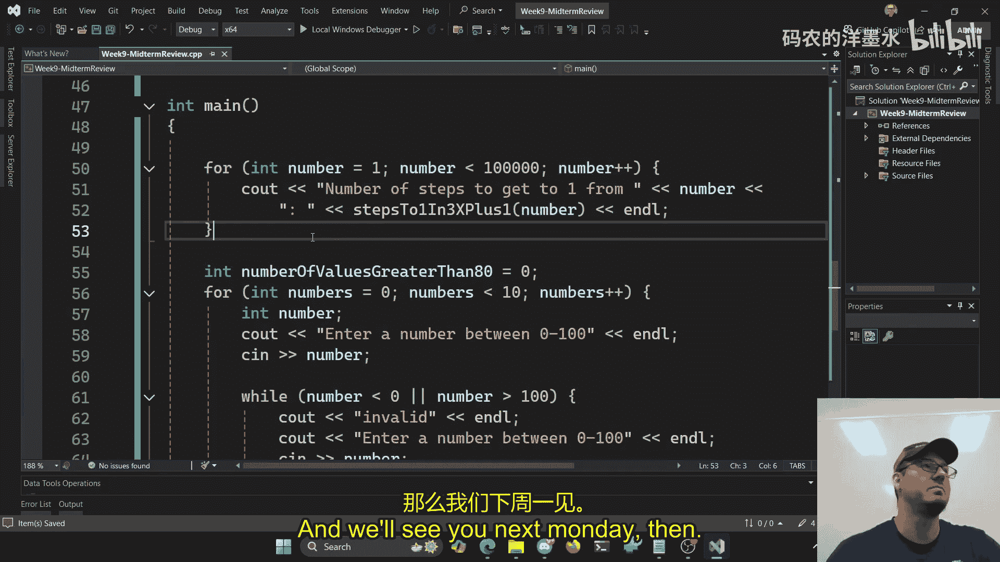

Thanks everybody。Okay。