# 【全集】密歇根大学 C++编程 中英字幕 1080P p21 Lecture 21 - 期末复习 -BV1TsAZzAEHX_p21-

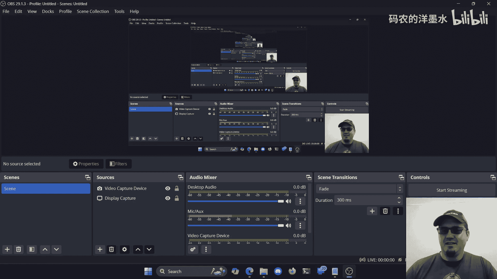

All right， happy Monday， sorry to have missed you last week。

 spent six days in the hospital with my little guy he's doing better since we got home。Yeah。

 so that was a real long week to get a little bit of grading done。

 but not as much as I wanted to that week'm sorry so I'll work on getting those in for you as soon as I can you guys have a good Thanksgiving it's been that long hasn't it。

Ohow。😮，Do you remember C++ so hopefully I had a chance to work on the project and get some of the commits out of the way a little bit by a little bit by little bit just。

Add a little bit test run it add a little bit tested around it right We want to make sure we've got a working software。

 even if it doesn't do all of the different things， if you don't ever run it。

 you don't know if the little bits that you did work so that's a good way for us to design it and build it and we're gonna do that with all of our software projects as they get bigger and bigger you have to have something you can start with and try and see if that little bit works so again my favorite plus word our functional decomposition take a big problem。

 break it down into small ones it's okay if you have a menu and it doesn't do anything yet but okay I've got a menu now I can pick some choices and I can start tackling okay let's do this choice let's do this choice let's do this choice a little bit out of time hopefully you saved the saving and loading for last because everything else sort of has to work so that really to make a lot of sense to know like what space the players are on who owns what properties。

 those sorts of things otherwise you're gonna have to do a lot of rework with your saving and loading there。

But yeah， hopefully that goes pretty well。 so we've got， we're not even。Next Monday， right。

 This is next Wednesday。 It is Monday，128。Did I get the day wrong？That is plus seven I can't okay。

 I can't do a plus seven in my head I didn't sleep much i'm sorry over the last week。So yeah， okay。

 so next Monday I we'll meet 1130 right notice the time change a little bit there。

Probably in this room， but they'll put out the exam schedule， the room schedule。So assignments。

 usually they put it out pretty early， let's see。😔，嗯。No。This is not study days。😔。

This is the wrong page again， right？Sa to this last time。Yeah。

The other catalog I don't know we'll put out the rumor probably in this room but I have been moved once before。

 so I'll post an announcement on Canva if it's not here once I figure out where that is usually I think you usually email me。

All right so the last couple things we had to tackle here that we didn't get to these use case and activity diagrams。

 I promise you they're not bad at all there's some fancy tools people like to sell。

 we don't need to pay any money for any sort of stuff for any of these things here they're just pretty pictures what it lets you do is you can draw a picture of your design and you can share that and communicate that and work with that picture with teammates and other people and other collaborators here so we can get this idea of what does our software do these use cases how does someone use it this is okay there's some person and they're going to do this thing with my program and there's a different person and they're going to use the software a little bit differently。

The stuff I do in the web banner registration system is different than the stuff you do in that system right so we have different use cases depending on who is acting in that system and their actors is the term for that right so you guys register for classes and pay for them and I put grades in。

I can see my roster does a couple different things so the same system but has different features for different users activity diagrams are looking at the flow of what's the sequence when I'm using the software right what step happens and what pieces have to communicate there。

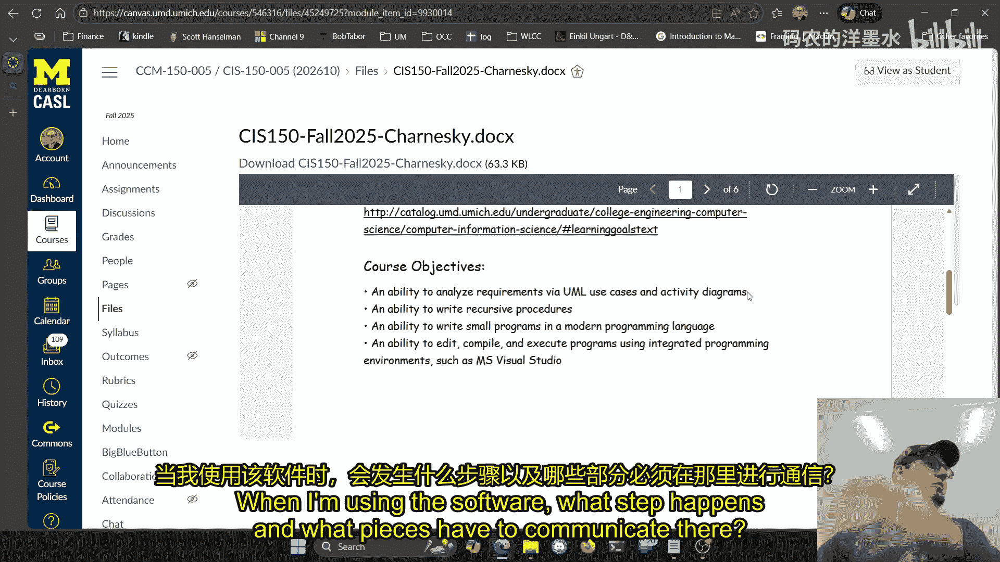

It's actually not bad to just Google in here the Wikipedia page isn't too bad。

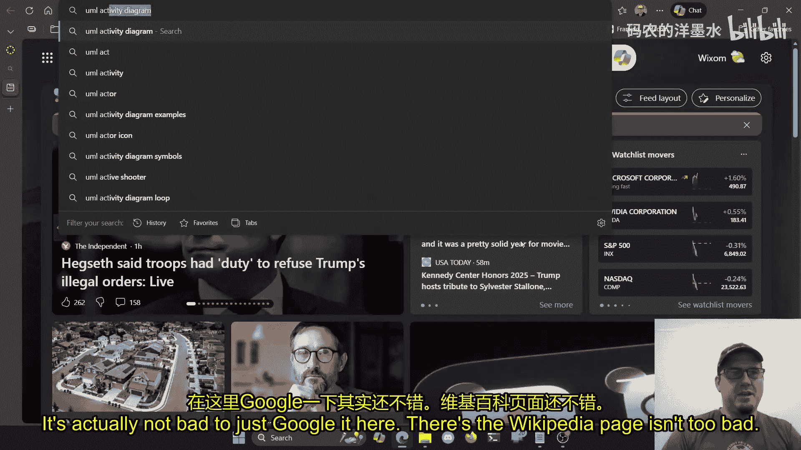

lud charts is good but I think you can get some free with them。

 it's been a little while since I looked at it here。

 visual paradigm is always really expensive evil diagramgrams。

org nice I just want the Wikipedia page。Where's my Wikipedia page， no。Okay。

That's fine so there's lots of different notation that you can use again if you can figure our programming you can figure out how to look these things up here so flow of this step to this step to this step here you thought usually like a nice page with an example here。

You little diagrams。g maybe this one here， I don't remember which one we usually use。

So to do online shopping you start here and you're gonna end here and what happens along the way Okay well you have to get authenticated log in right and then you can show varying levels of details here so that like if there's a decision something is going happen a yes or no we know eventually that'll get turned into f else but just in a picture here and we're gonna to log in it worked in your login or no it was bad you failed and you're not log it it's different options can happen here as we look at these and then you can show these swim lanes。

 another fun term here for the flow of activities with different groups here so hey once it customer order something the next activity has to happen with the ordering department but whoever's gonna process the order the shipping department whatever happens to be here so lots of fun things you can do with pretty pictures here and not super exciting but it is fun to look at UL diagrams because it gives。

A common way of showing information to other people a picture is worth a thousand words。

 much easier to look at a picture than to read three paragraphs， right？

You can imagine that it works out pretty nice diagrams are pretty handy here。

Yeah activity diagrams so Visio is a pretty common tool we have that installed in the lab you probably don't own it no one else buys Visio ever I do them in Microsofts Word because I already have word and its works out it' takes a couple more clicks to do your diagrams a word here but it's not too bad right and then recursive procedure I think was the last little bit right to talk about recursion this one's actually a lot of fun it'll be a big topic for next semester which you should register for by the way in case you haven't yet。

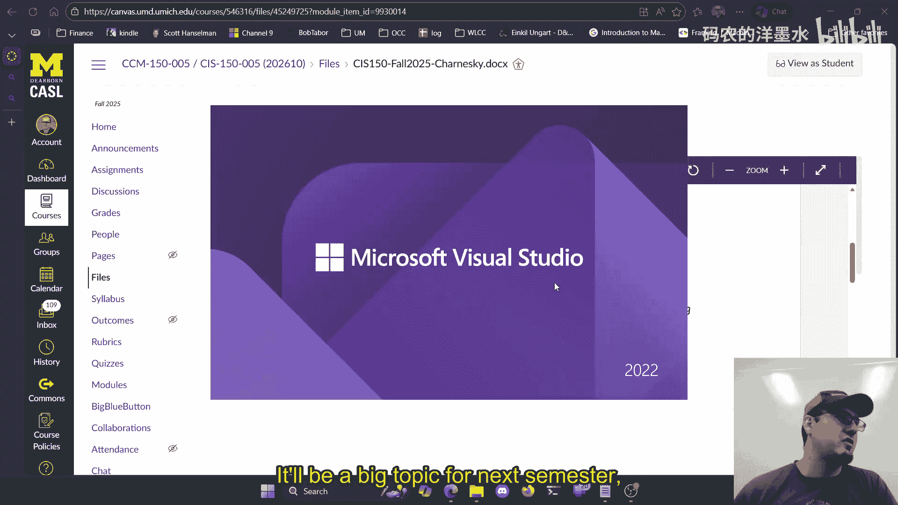

嗯。I don' even know what week this is we 14， 15。Not count anymore。On' a visual studio。

 it's tired like I am and need more coffee。All right， week 14 review。So recursion。

 you can do a lot of really cool stuff with it， we're going to do the really basic stuff that's not very cool and we're going to save the cool stuff for next semester。

 but you want to see what it looks like here and the quick basic definition for recursion is it's a function that calls itself。

不 said。So that doesn't mean a whole lot yet， but if we write a function like we'll say void for countdown。

That takes an int for some number。Okay， so all countdown all countdown is going to do is call itself but it's going to change the value of numberpper so when you write recursive functions。

 you have to have what's known as a base case that's how it ends if you don't have a base case it's just going to loop forever and eventually crash right？

What we want to do is end at some point here so our ending case。

 our base case is if number gets to zero we're done right we've counted down right so that's how we're going to so we can say hey if my number is less than I'm going to do less than or equal to zero just in case you give me a negative number because if I just say zero and you give me a negative number this is going to loop forever and that's also a bad thing here so if we get to less than or equal to zero。

 we'll see out done。Or have a blast off there we go blast off that's funny everybody like rockets。

 right？And if it's not less than or equal to zero， we're just going to see out the number。

And then we're going to call ourselves right recursion means it's a function that calls itself here and we're going to use number minus one。

So when you start with some number here， if it's not less than equal to zero。

 I'm going to spit out the number and then do it again with number minus1 and do it again with number minus one and do it again with number minus1 do it again with number minus1 so this is recursion because it's a function that calls itself this is a really basic one here。

So I can then call， countdown。F'll say 10 right or you can even ask the user， hey。

 what number do you want to count down from here， but now we get a nice little countdown 10987654321 blast off。

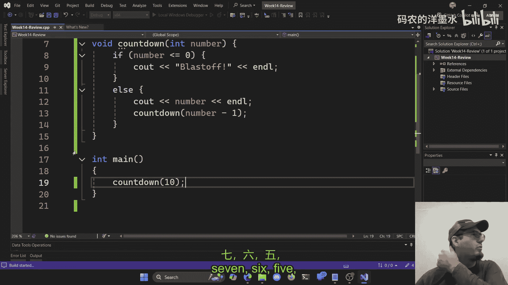

Get last enough now if you put a breakpoint in I'm going to put it in this spot here because I want to show you what happens behind the scenes and this is why recursion is really cool here so when we put a breakpoint in。

 you remember you can see where we came from here what functions being called from what line and what line is that I've written this little stack trace here。

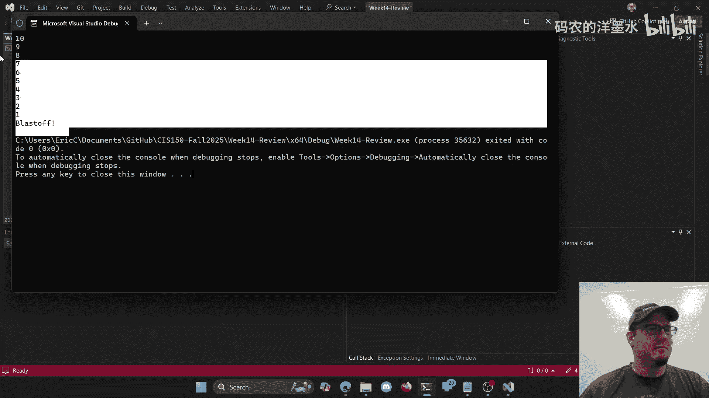

I think we looked at this it's been a while here so you can see at each point here this is where it's going to come back to once the code is done so because countdown calls itself and countdown calls itself and countdown calls itself we have 10 calls to countdown on the stack here or 11 actually right because we got to zero right so at this point here if I click on this one here I can see I'm at countdown at line 13 here。

Right。And I can see the value of number is 10 because when I called countdown the first time I passed it to 10 now at this one here。

 the value of number is 4 right at this one here， the value of numbers two at this one here the value of number zero so each function call along the way on the stack here has to track its own value for number。

Because we've passed it some value to work with here， and it has to track that。

So it can handle that and it can count it and it works out pretty well here which is fun and you can see all those calls on the call stack now you guys like math right and you're like numbers this is your math folks right that's why you went into computer science because you wanted to do a lot of calculus and linear near algebra。

No， or jokes on you， you have to do it anyway。Sorry， do I tell you my pro tip。

 you can take the credits over like Henry Ford across the street and adjust the credit transfers。

 not your GPA okay， good。It's hard to be full time though because they only I think they only count one institution。

 so it might double up because give you a little extra work if you're trying to do it at the same time。

All right， so Filibonacci。Theres a fun sequence in math and actually around the world and lots of things like biology and stuff turns out which is really cool。

 So for Fibonacci numbers here there' it's a sequence So we're going to return an integer value here for and I don't actually know how to spell Fibonacci Fiacci there's like two C's or two Bs。

 I can remember which one here that's probably close Okay usually I just say fit but and you tell me which nth Fibonacci number you want so you want the first number in the sequence。

 the second number in the sequence， the third number in the sequence， the the n number。

 the 27th number and I'll calculate it and return it to you Okay now。😊，The base case for Fibonacci。

 the easy solution here， we know that the first and second number are one。

 that's just mathematical definition for Fibonacci。 So if your n is。Less than or equal to。2。

So the first number and the second number， we're going to return。

 we're going to give you back a one I know just right away， I know it's one。

Right if it's not that right now I could use an else。

 but it's redundant because once you hit a return your function stops， you don't need the else here。

 otherwise I'm going to return Fibonacci。Fbonacci。I think I'm spelling that wrong here。

 is it two C's and1 B not she？

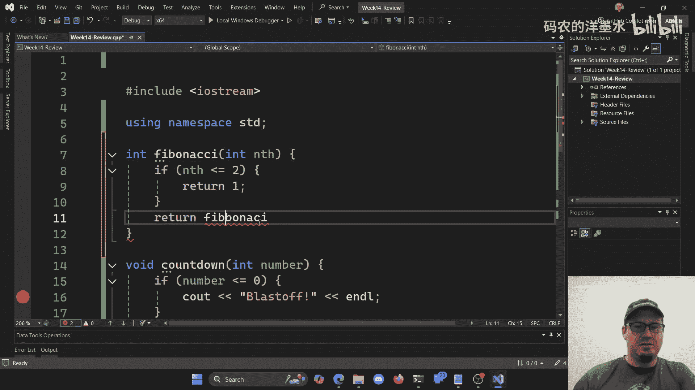

I don't remember here。Does it like that one any better like， okay， let's Google it forbon notci。

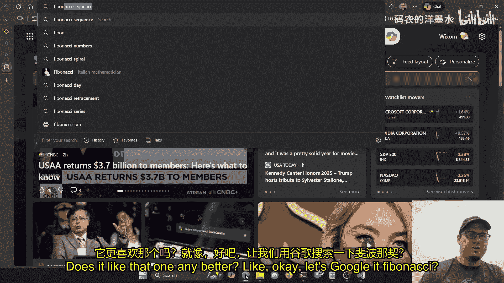

Yeah，1， B2 Cs。 Okay， I can never remember which one is the double Otherwise。

 we're going to give you right the definition of Fibonacci it even gives you code。

 Look how fun that is here。 Go look at the code example here of。😊。

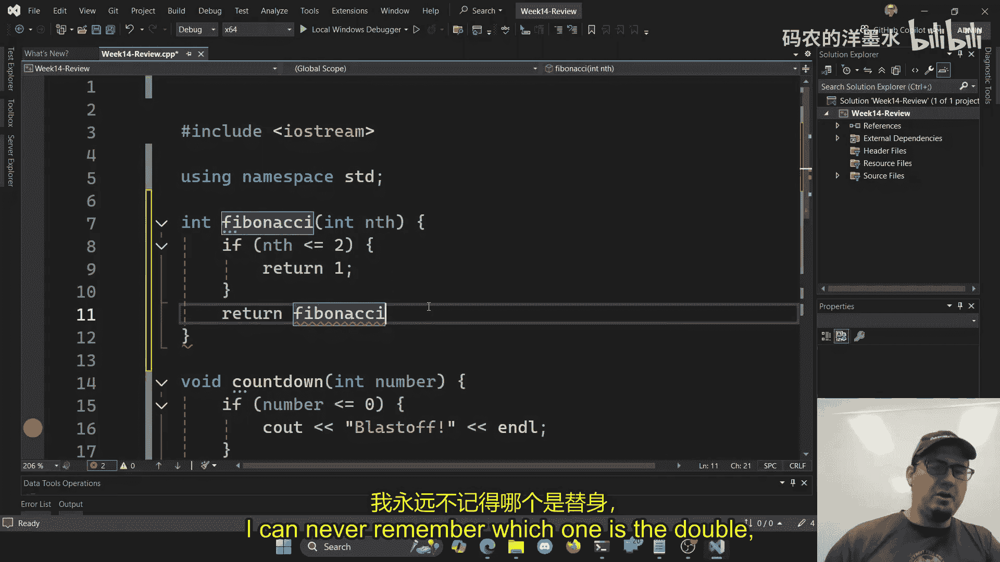

The n minus 1 plus the n minus 2。

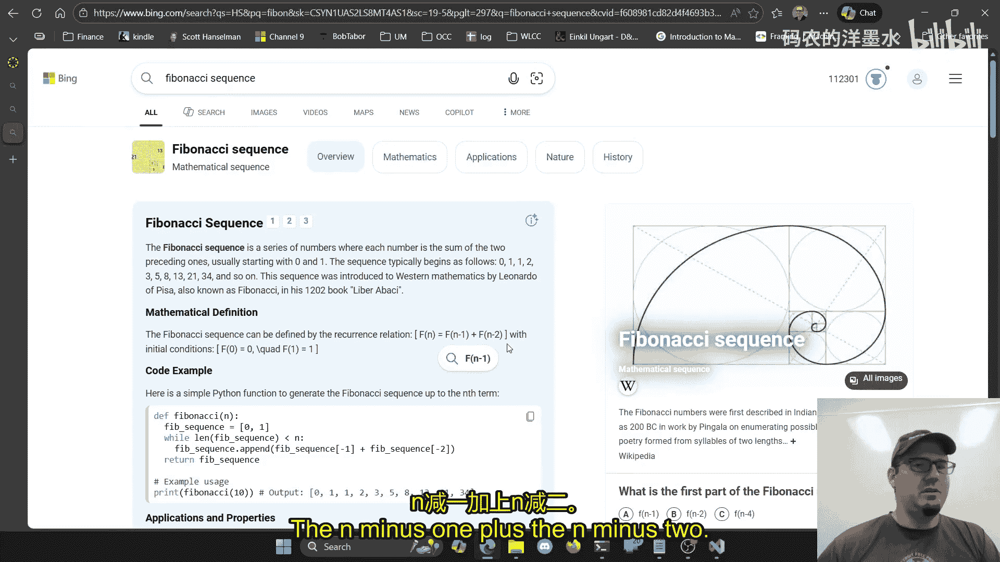

RightThat's the mathematical definition for this。 So if it's not one or two。

 then it's got to be n minus1。Plus Fibonacci。Of1 minus2。

This function will call itself it's a recursive function， now this is terrible。

please don't do this that too I'm really bad at English guys and i'm extra tired so I'm extra bad at English here but this is a terrible recursive function we'll look at that in a minute and this is something we'll get into next semester as well but this is a fun example here so。

If I call Fibonacci of three， right and we just work it out before we actually run it here。

 it's going to say okay， three is not less than or equal to two。

 so it's the Fibonacci of two plus the Fibonacci of one。Okay。

 then both of those will call the feminacci function and say， okay， here's a one and here's a one。

 we'll add them together and I returned， then one plus one is two。

We figured it out great now the problem gets to be as you get higher and higher and higher。

 you want larger n numbers here， Fibonacci of seven。😊，I can actually use the whiteboard for here。

 which one's fun。I don't know if it'll show up in the minute， but that's okay， so59 of7 is。6ix plus5。

Sth is。5ive plus four five is four plus three。Right five is four plus three， four is three plus two。

 three is two plus one， four is three plus two， three is two plus one， right two I can solve two。

 I can solve one， I can solve。F is three plus two， three is two plus one。

 three is two plus one and this is only the set of the number and that's。Just this secret， right。

 So I'm going to say， okay， one plus one plus one plus one plus one plus one plus one plus one plus one plus one plus one。

So the seventh network Okay is that very efficient no no this is terrible right but it works and it's fun and it takes the mathematical definition and gets it for us here so we could say for int and is we'll say one and less than oh let's go to like 40 maybe。

And plus， plus， we ought to see out。And。P in。In a space and then Fibonacci of andth。

And then a new line。So I'll want you it to be able to calculate here behind the scenes so my laptop's not super slow。

 but it's not the fastest thing in the world either。

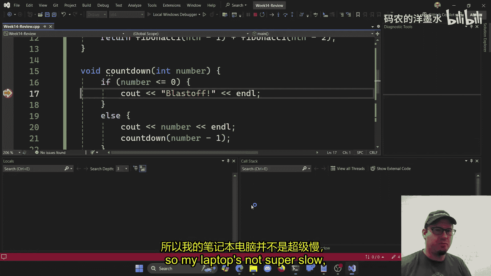

We'll continue。So okay， the first 40 were pretty quick。 Sorry， I guess a little higher here。

 which calculates seems like it's doing pretty good here。 and we we should check it here。 What's the。

39th Fb number here。Great。😊，See， is that 632 million or so？

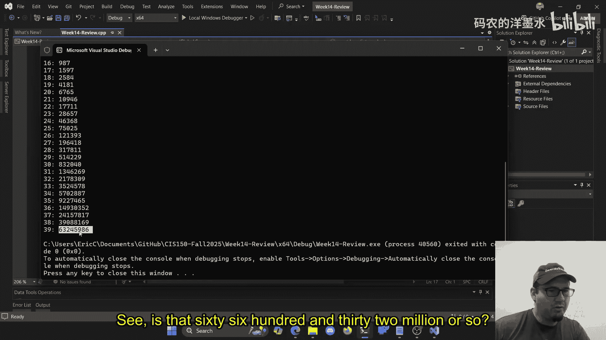

No， 63 million， right？Maybe night two。

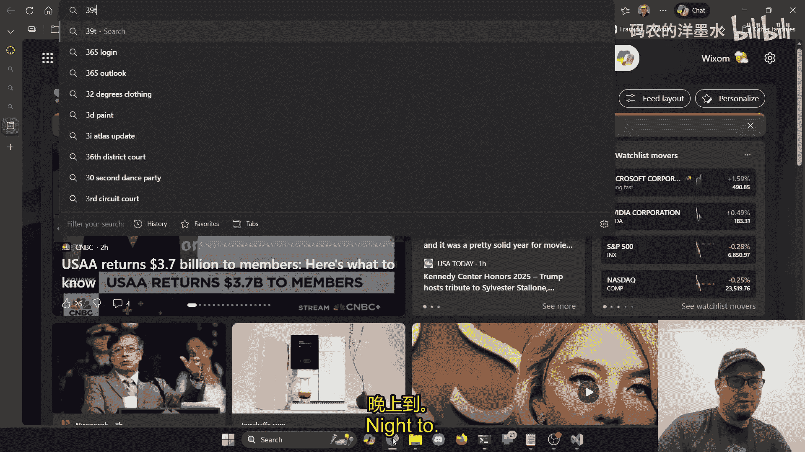

Bb。She's big。Some of the two proceeding numbers， what's the value here， okay？Planet mouth。Oh。

 you can start at zero， okay， I started at one。I don't know Okay。

 so then we're off by one then right， so 63 million。Is that right？Starting， oh， no， okay。

 so zero is 0。 no， no， okay， so we're good。 so just。

0ero starts at zero math people are weird all right， so we calculated okay。

 let's go up a little higher here， so let's go up to say 50 right。

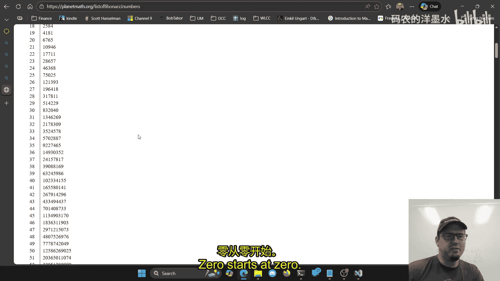

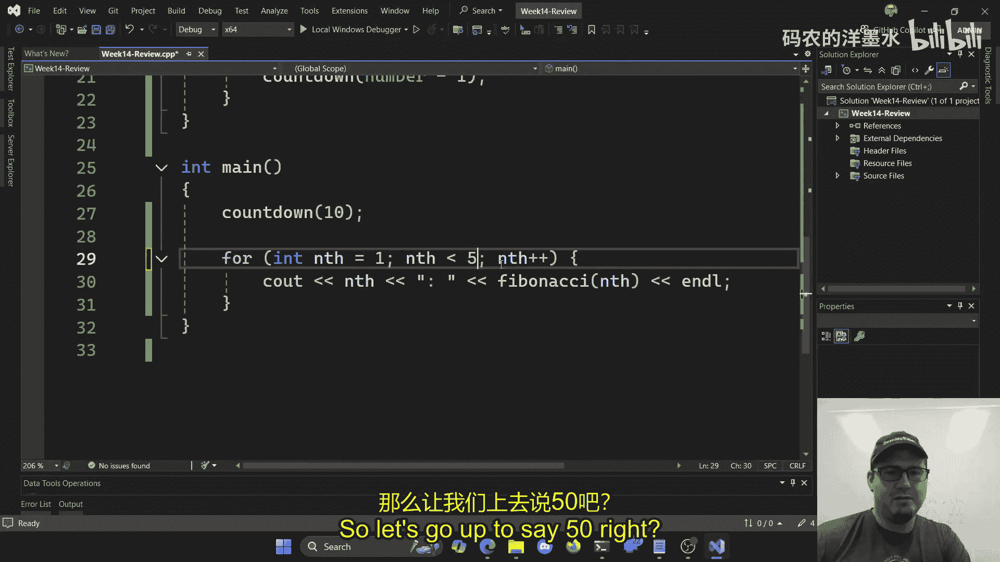

对。And now we're going to watch it start chugging here。

 so each one's going to take a little longer as we go。Yes。

Because it's literally adding one that many times。Right。

 so each one's going to take that much longer plus a bunch more ones as we go。

Now it was not using a whole lot of RA， right， we're not leaking memory or anything。

 it's just adding a bunch of ones here， not anything crazy。

But it's pretty slow to add a bunch of one here。Not a good solution here。

 but it's recursion and it works so again you will'll look at better ways of doing this next semester and hopefully in your head you'll like just use a loop right and we don't need a this recursion we can count up instead of counting down to one and then adding one together right and that works out much better I promise。

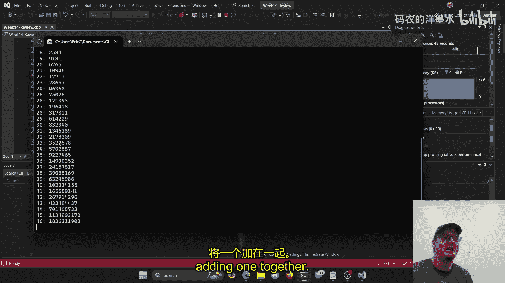

That's a basic recursion for you here。

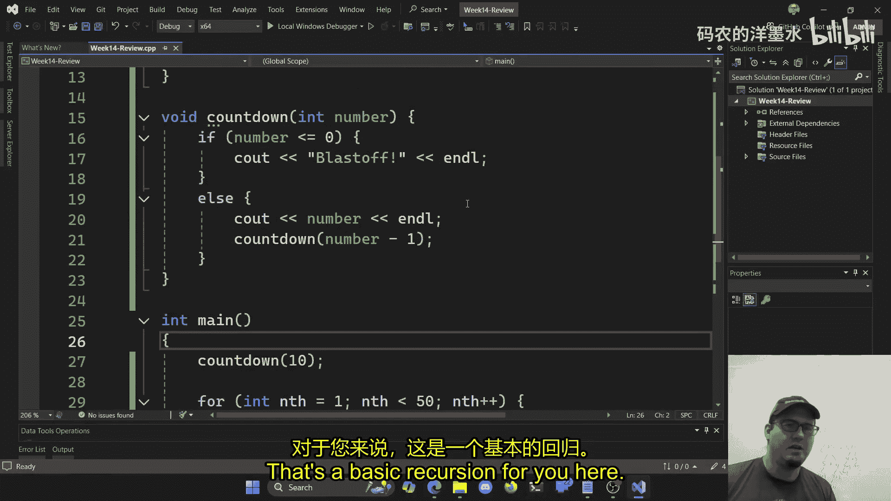

And then our UML diagrams， again， we can use the Vi tool in the lab， it's not hard。

There's other online tools I think is Lucya charts free？Any don know Tiffany diagram。😔。

Let's see if we can make one here。结开。嗯。Yeah。Sign up for free。Okay。

 what's their pricing oh you get so many diagrams for free right for free you get three charts Okay。

 yeah， so the free one's not bad with three three basic charts here。

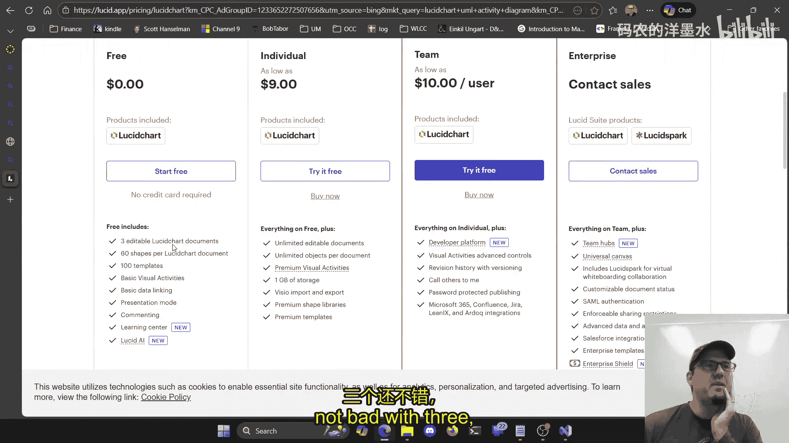

And then you can make little charts and they give you all the nice flow chart tools it's much easier than doing in a word because the stuff will actually like drag and drop and connect here my dumbway and Microsoft word is you just use the shapes and use arrows here so we can make a little shape say insert shapes and we have all of these different shapes you want you can get you little rounded rectangles and things that they want here and you know here's on one activity and you can insert arrows and but you just have to do it by hand。

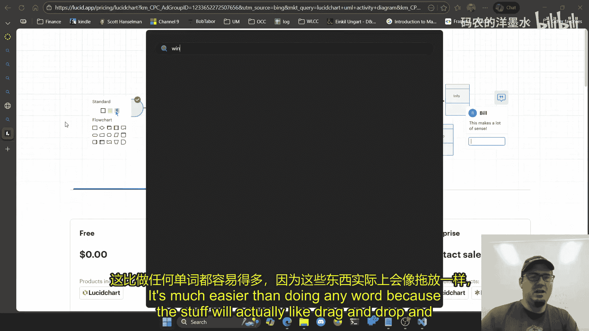

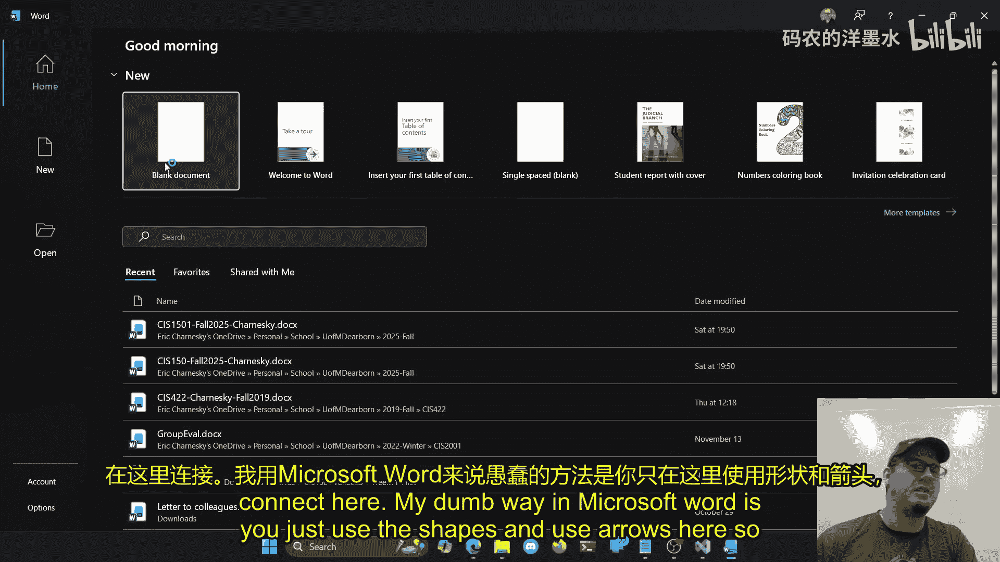

Right that's all and then like these things don't really connect here where the actual tools like they have little anchors that connect those different pieces to make it a little easier for you here。

 but that's all so the activity diagrams are bad so if you think of what happens in the sequence of our monopoly game。

Right， as we're drawing out our diagrams here。Right well it's really just one person I guess you guys probably aren't old enough to remember you to have to hopse video games when you play multiplayer that I'm a really old person so you'd sit down and do your turn and then the experts would sit down and do their turn and then you'd sit down and do their turn and then they would sit down and do their turn that's how you did to embrace video games on a PC。

Promise is a lot more fun than it sounds。But that sort of thing So it's all the same person here but is what's that sequence of events right so the player gets their turn。

 do you want to buy the property yes or no or if you don't even get a chance to buy property it just goes right to the next player the player twos turn they can roll the di or save or exit or again it's probably easiest if you just let the game save at the end or maybe the beginning a player ones turn。

If you let any given player save， you have to know which player is going to start next time you load the game。

RightIf you just wait for player one， then you always know player one is just gonna start no matter what it saves you a little bit of time here So wherever you put that in your sequence。

 do you want to save or load or do you want to save Yeah sure， that's fine。

 and it just kind of goes around in a circle and some of the things we have to check or do you have money to buy these things or not so we have our little decision points here So if we insert our shape that's our diamonds here do you have the money to buy this property yes or no if you do do you want to buy it if you don't have the money we're just going tell you you don't have enough money to buy this property there's no interaction that has to happen here。

 we're not waiting for the user to give us anything here So it's just a way to draw out the flow of events here so that you can show that as a picture and with a model you can kind of work your way through it。

Without having to actually write the code we can say does this work here。

 will this model fulfill all my requirements I can just imagine going through the step by step by step by step is it doing the things it needs to do and that's a lot easier to do it with a picture than it is with writing a big paragraph here or just trying to keep it all in your head is having the picture shows you those individual steps we can break it down okay here's a yes or no hey you're now out of money you're out of the game we have to set you out of the game we have to return all of your property or whenever we're doing give all the property the person who went bankrupts to or all those different steps here they happen different ways we're just's well this just illustrates what the steps are that the program will do right ideally you do these things first and not after because it's supposed to be a tool to help you build your software。

Yeah， but again we've introduced supposed to do this last week when you might not have been done yet。

 I know we're kind of cutting it close here so and you don't have to do these I'm not requiring these for the final project。

 this is just an illustration to say hey， we've gone over our UML activity and use case diagrams here it's not hard to do but the coding is the harder part。

 but this is a good piece of good software engineering practice is being able to visualize and diagram and plan what we're going to write before you write the code because you've probably experienced if you just jump right in and start writing code but you don't really understand what you're doing。

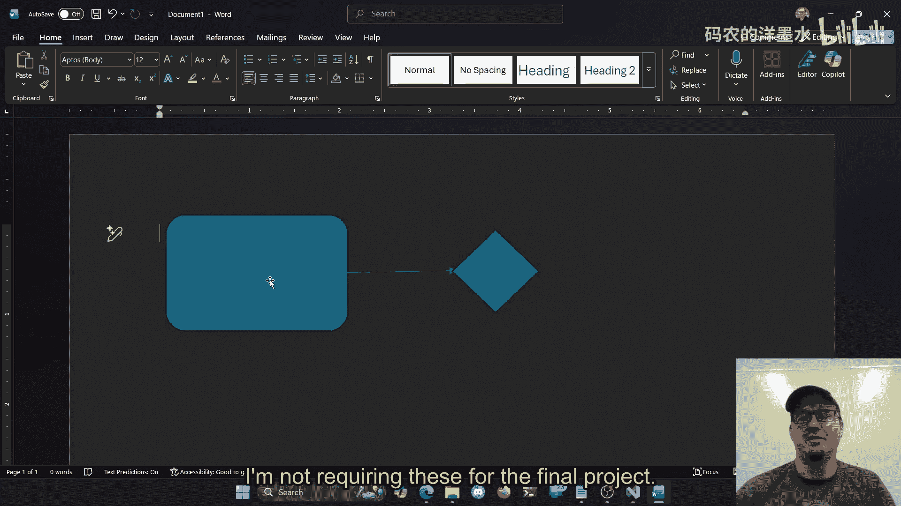

It's just really frustrating and you get stuck really easily and then you go back and have to change a bunch of things and it's not a good process and that only gets harder as software gets more complex。

 which by the way， this is the first classes is the easiest stuff we're ever going to do right it only ever gets more interesting I don't want you to feel bad about like we can actually do interesting stuff here like nobody does a little textbased lunar Lander game and like thinks that's all really fun。

That's not very exciting so being able to do more cool things is great that' that's the fun stuff be able to make cool things with software but you want to plan it out right and as you work on teams you have these tools that you can use to communicate hey what my plan is and I can show my plan to a senior developer who has a lot more experience than I do and they can quickly look at a diagram you' like oh hey you forgot about these things here or this is going be too too much trouble you should simplify it over this way give us a way to communicate。

And that's what they're useful for here so you'll get into using them more and more as we go there's other UML diagrams i'm a big fan of class diagrams we'll do those next semester yeah check you can put so anything this is represents there's some sort of decision that has to be made so it's like okay now it could go this way or this way or it could have seven different branches off of here if you want it it's just now the code will do different things yeah it's just a way to picture it that's all so it's a helpful tool we don't do them all the time but you know it's good for planning those sorts of things here。

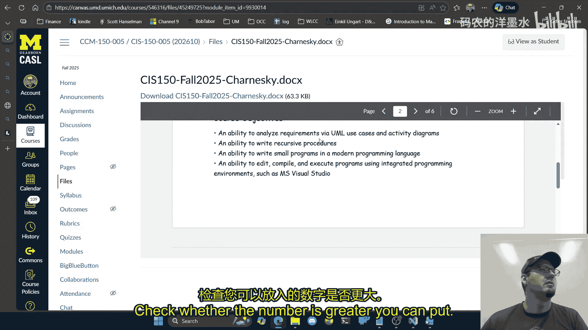

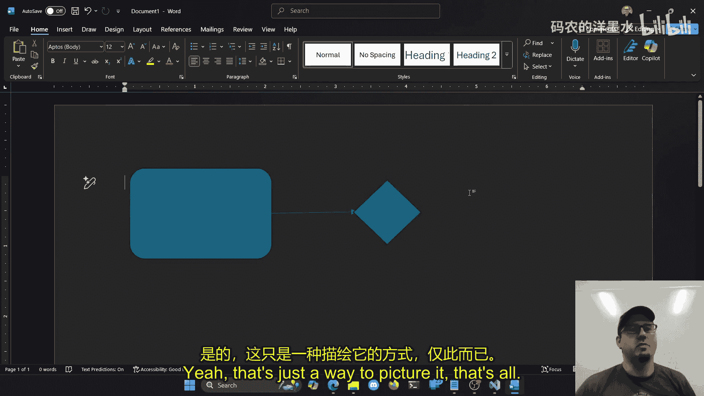

Said everything， we briefly got into pointers right before things even me break some of the cool stuff we can do with it with inheritance again it another big topic for next semester and being able to get the runtime polymorphic behavior。

And that's the big benefit so I can give it anything that is that type I mean and all of the child classes。

 all the subclass are of that type but'll get the correct function using my override and virtual keywords it's fantastic we'll do a lot of fun stuff with that next semester as we get into it。

let objects in classes and they didn't really let us do anything we didn't do before。

 but it lets us design our software in a way that's a little easier for us to visualize it makes a little bit more sense from our experience。

 hey I know what a table is because I understand I interact with objects all day long here that just makes it easier for us and this p gets more and more complex be able to break things down into smaller objects that seem understandable。

Make it a whole lot easier for us right and we can simplify these things and pass them around and work with them in that way there yeah I think we've done it other questions thoughts concerns。

I'm probably missing something here but that's probably not the end of the world here Do you talk to Dr。

 Said did you plan for a lab today okay all right， I didn't talk to him at all last week because I forgot half of everything that was happening because being in the hospital's draining and you just want to sleep on a terrible pullout couch。

Okay， cool so I will get with him to get your lab score right and I'll just plug that in for this lab score portion here。

 so whatever score you have overall from all the labs I'll just plug that in right here that makes up the 10% of your grade here I got through about half the midterms sorry。

You're probably better if I grade than when I'm tired for you guys。

 but at some point it's just hard to look at your Zybook scores。

 I think I need to plug in one more chapter chapter 9 I'll plug that in for you again shoot me a message if you want to reco one。

 two three， I would really rather not resco all nine of them here if you want to reco one or two。

 three of them that's fine， Ill just shoot me an email I should be able to do that for you here。

 I'll work through getting the rest of your project scores in again 95， 96。

 97% of the time you get your assessments score you guys are pretty good at saying yeah I did the thing on the rubric。

 I did this thing on the rubric。Occasionally， I get someone who just lies to me and they're like， oh。

 yeah 100% on everything and they turned in half project and like。

Did you run a different thing and actually they were running different code like the code that they。

Haad just didn't make it to GitHub for some reason。

 so most of the time you'll get that score so I should be able to get those plugged in for you。

 I just have to get of a quick look。As we go from there so they'll finish out your project scores the syllabus quiz if you didn't finish that yet it's one point I think a lot of people got it in but I started this one late and didn't put a due date on it so it might not have shown in Cans for you that you had to go do it this was just you agreed to the academic integrity policy of the class it's just the one question thing here。

And I think that'll be it then so for final project presentations， you guys will sit up front here。

 we got an HDMI cord， have an adapter somewhere I'll double check that's for USBC so that it works for almost every laptop and then you'll run it。

Play the game just a round or two， you know， start a couple of players buy some properties。

 land on things show you pay some money so you can save the game and load the game it takes maybe five minutes here I might have a question or two about your code yeah。

Yeah so you both if you worked with the partner you both give me the same GiHub link thank you yeah it should take five minutes or so for you to present it's not too bad it's something you're going to want to get comfortable with because you'll want to show your software to your team when you're working in the industry right and ideally you'll solicit some feedback this is not really a good venue for that but other classes you'll have more chance to get feedback and things from your groups and peers but just a chance to get up and talk go through it again it's five minutes or less you've all done it here so it goes pretty well。

And then at the end， we will collectively vote on the best version and the best version whoever had the best version on automatically gets an A in the class here just as a fun little thing。

Not that it's not that hard to get A anyway， but that's an automatic game if you were the best monopoly game in the class。

 so you'll stick around we'll vote on which one is best at the end and it should be fun okay。

All right， questions， thoughts， concerns， though a great fall。

 thanks so much and I look forward to seeing you for finals and then hopefully around after that。

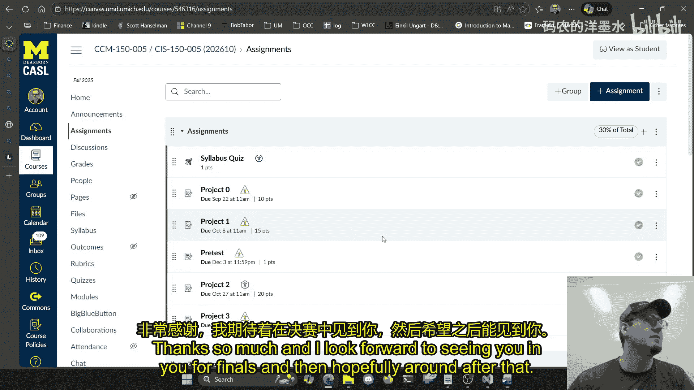

thanks， take care。