# 001：课程导论

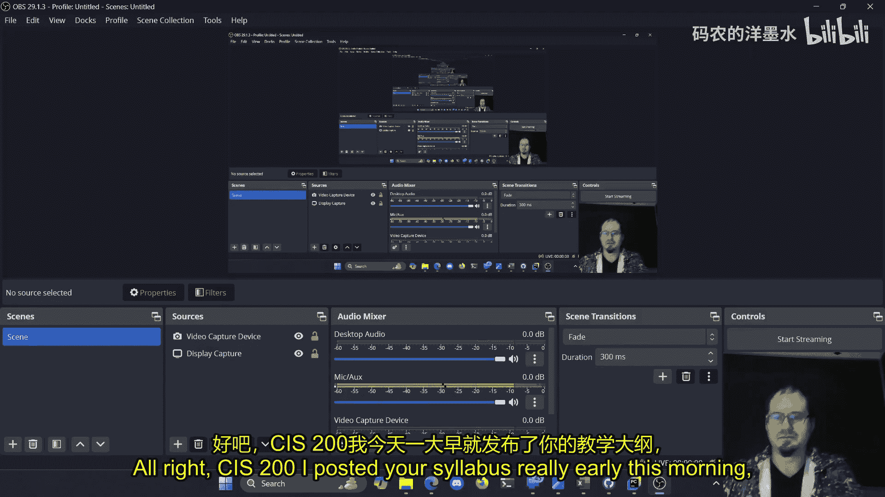

在本节课中，我们将学习CIS 200课程的整体安排、学习目标、评分标准以及课程中将要使用的核心工具。课程将深入探讨C++编程和数据结构，为后续高级课程打下坚实基础。

## 课程概述与教师介绍

我是Eric，这门课程的讲师。我自2012年开始教学，2016年加入密歇根大学迪尔伯恩分校，主要教授Python和C++课程。在投身教育之前，我在工业界有20年的工作经验。

我的教学理念是“帮助学生学习”，而非单纯“教授知识”。学习是个体行为，我的职责是提供信息和指导。

**联系方式与办公时间：**
*   **邮箱：** 请直接发送邮件至我的工作邮箱，避免使用Canvas站内信。
*   **办公时间：** 周二和周四的课间，我通常在CS 237办公室。欢迎随时前来讨论问题、技术或任何话题。
*   **Discord：** 我会提供一个Discord服务器链接，用于更现代的交流。
*   **响应时间：** 如果24小时内未收到回复，请再次联系我。

## 课程目标与先修知识

本课程是CIS 150的延续。我们将深入探讨在150课程中仅初步接触的主题，例如类和对象，同时也会为后续的350课程（数据结构与算法分析）奠定基础。

课程的具体目标包括掌握面向对象编程、理解内存管理、学习基本数据结构，并培养问题解决和代码协作能力。

## 教材与工具

**主要教材：**
*   **Zybook：** 在线互动教材。如果你已拥有上学期的版本，可以继续使用。

**推荐参考书（非必需）：**
*   *C++ Primer*
*   *A Practical Guide to Unix* （建议在图书馆查阅）

**开发工具：**
*   **集成开发环境（IDE）：** Visual Studio Community（免费），或Mac上的Xcode。
*   **版本控制与协作：** **GitHub**。我们将使用它来提交所有作业和项目代码。
    *   **GitHub Desktop：** 我推荐使用此图形化客户端来简化Git操作。
    *   **重要性：** GitHub是业界标准的代码协作平台，掌握其基本使用是必备技能。

## 评分标准与课程安排

以下是本课程的评分构成：

| 项目 | 占比 | 说明 |
| :--- | :--- | :--- |
| **实验 (Labs)** | 15% | 每周一次，旨在练习课堂内容。我会在实验课上提供帮助，目标是让每位同学都能完成。 |
| **个人项目 (Projects)** | 25% | 共4个，每两周一个。需要独立完成，我会指导方向但不直接帮助编写代码。**务必尽早开始**，以便及时提问。 |
| **期中考试 (Midterm)** | 10% | **开卷、开笔记、开网络**。重点考察查找信息和解决问题的能力，而非死记硬背。 |
| **测验 (Quizzes)** | 10% | 开卷，旨在检查对教材和课堂内容的掌握情况。 |
| **期末小组项目 (Final Group Project)** | 40% | 课程核心，通常两人一组。无法通过此项目则无法通过本课程。我们将用约一个月时间完成，并在期末进行演示。 |

根据美国联邦标准，一门4学分的课程每周至少需要投入12小时（课内4小时+课外8小时）。请合理安排时间，主动学习。

## 核心知识点路线图

上一节我们介绍了课程的整体框架，本节中我们来看看本学期将要覆盖的核心编程与数据结构主题。

以下是课程的主要知识点演进：

1.  **对象与类：** 深入探讨面向对象编程的基础。
2.  **异常与指针：** 学习错误处理和动态内存管理。指针是实现多态行为的关键。
3.  **数组与向量：** 进一步学习`vector`等容器，包括二维向量。向量比传统数组更灵活。
4.  **继承：** 通过完整项目理解代码复用和类层次结构。
5.  **数据结构入门：** 学习如何高效地在内存中组织数据，并引入**时间复杂度**和**空间复杂度**的概念。
    *   **时间复杂度公式：** 通常用大O符号表示，如 `O(n)`， `O(n²)`， `O(log n)`。
    *   **空间复杂度公式：** 同样用大O符号表示算法所需的额外内存空间。
6.  **递归：** 重点章节，学习函数调用自身来解决问题的方法。
7.  **模板：** 学习C++中创建通用函数和类的技术。
8.  **链表：** 构建基础数据结构。
9.  **栈、队列、搜索与排序：** 学习更高级的数据结构和算法。
10. **文件流：** 学习读写文件操作。
11. **科技伦理：** 讨论软件开发中的伦理责任和职业操守。

## 学术诚信与人工智能工具使用

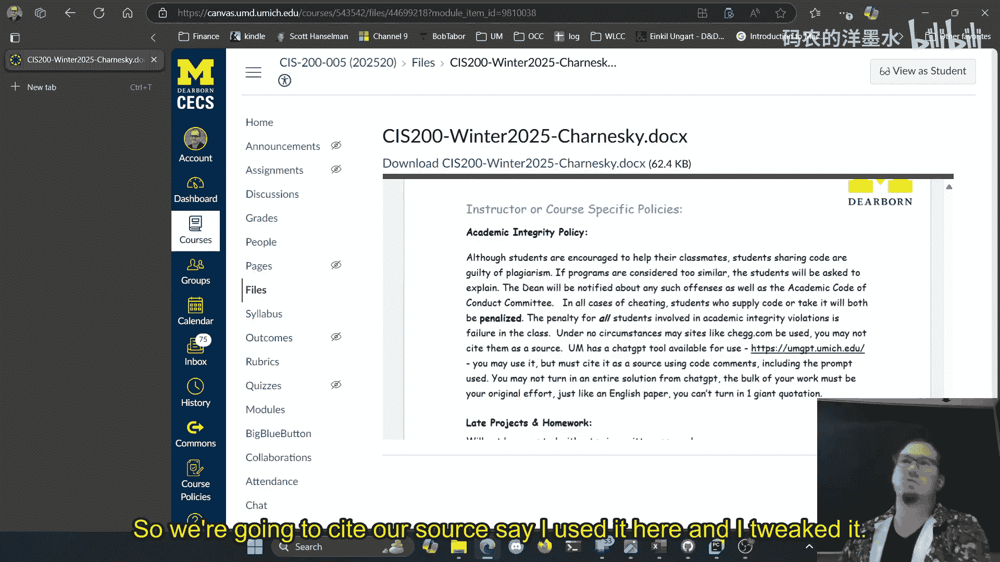

**学术诚信政策：**
作弊行为（包括代码抄袭、未经允许的合作、使用禁止的网站获取答案等）将导致该课程成绩为**F（不及格）**。保护学术诚信关乎我们所有人的声誉。鼓励用英语讨论思路、分享伪代码，但**必须独立完成代码编写**。

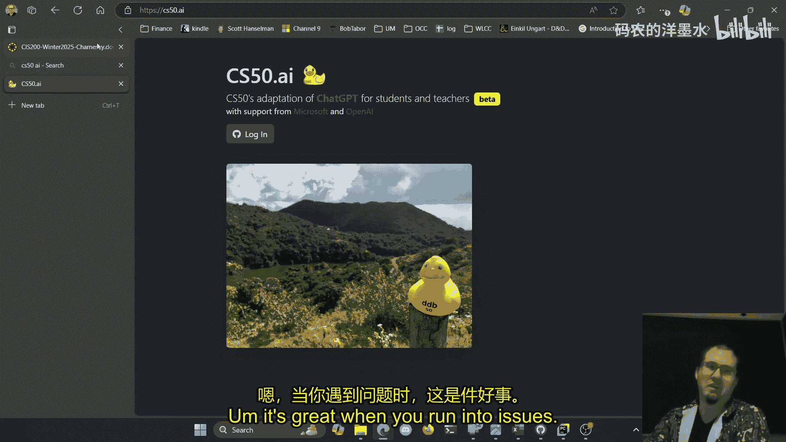

**关于人工智能工具（如ChatGPT）：**
我认识到AI编码助手的存在并被广泛使用。我的政策是：
*   **允许使用，但必须引用。** 如果你使用AI工具生成或大幅修改代码，必须明确引用。
*   **核心必须是你的工作。** AI应作为辅助工具，用于处理繁琐任务或获取灵感，而不能替代你的学习和创造性解决问题过程。
*   **示例引用格式：** “部分代码结构参考自与ChatGPT的对话，对话链接：[URL]。我已对其输出进行了修改和集成。”
*   **推荐工具：** 哈佛CS50课程开发的 [CS50.ai](https://cs50.ai/) 是一个优秀的“辅导模式”AI工具，旨在引导你思考而非直接给出答案。

## 问题解决与求助指南

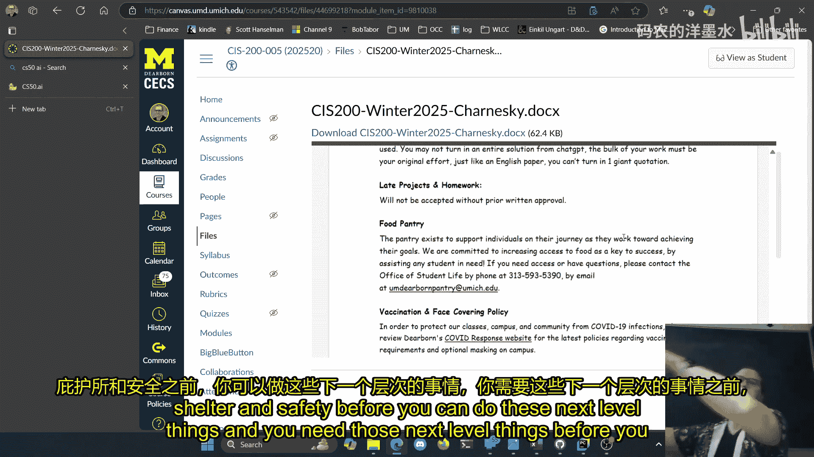

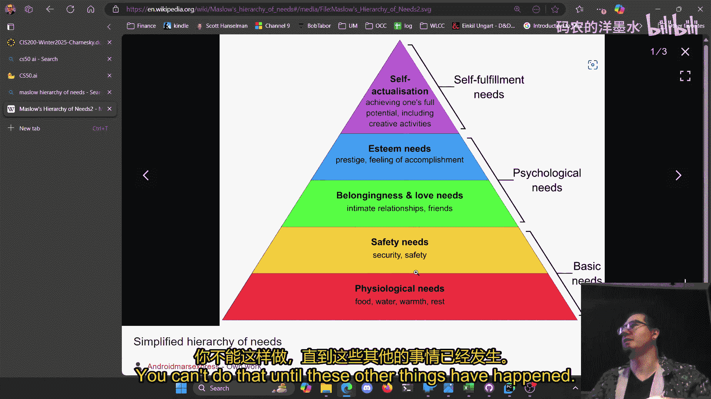

培养解决问题的能力至关重要。遇到困难时：
1.  **先自行尝试（约30-60分钟）：** 理清问题是“代码未执行预期操作”还是“产生了预期外的结果”。使用**调试器（Debugger）** 逐行检查变量状态。
2.  **适时求助：** 如果一小时后仍无法解决，请及时联系我。拖延只会增加挫败感。
3.  **明确描述问题：** 提供错误信息、你已尝试的方法以及相关的代码片段（通过GitHub链接分享最佳）。

## 其他行政事项

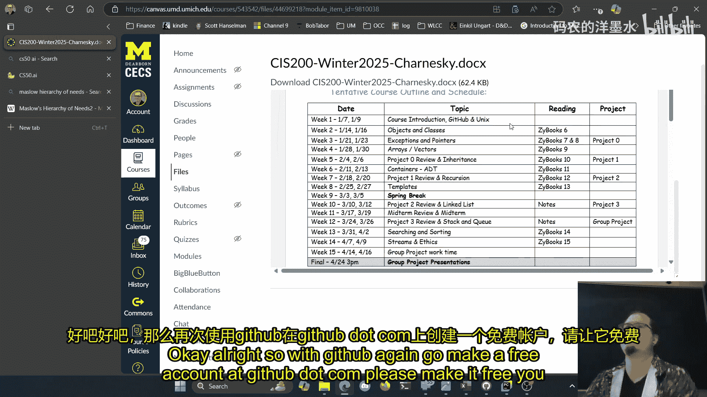

*   **迟交政策：** 个人项目**不接受迟交**，因为我会在截止后立即讲解答案。实验如有特殊情况可协商。
*   **校园资源：** 如果你面临食物短缺等基本生活需求问题，请利用校园食品储藏室等资源。马斯洛需求层次理论表明，基本需求得到满足是有效学习的前提。
*   **大学政策：** 课程遵守大学的COVID-19政策、性暴力防治政策等。我鼓励大家对认为不合理的政策通过适当渠道提出意见。

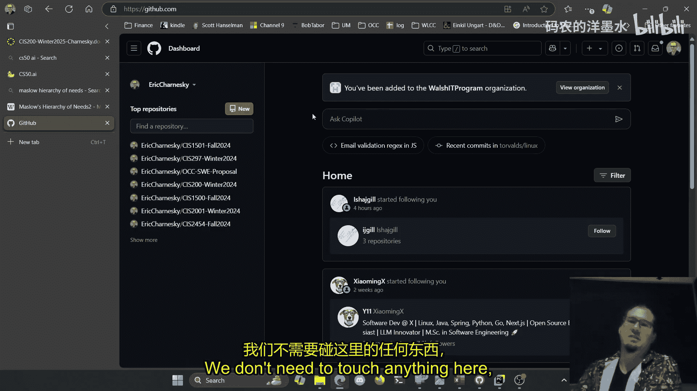

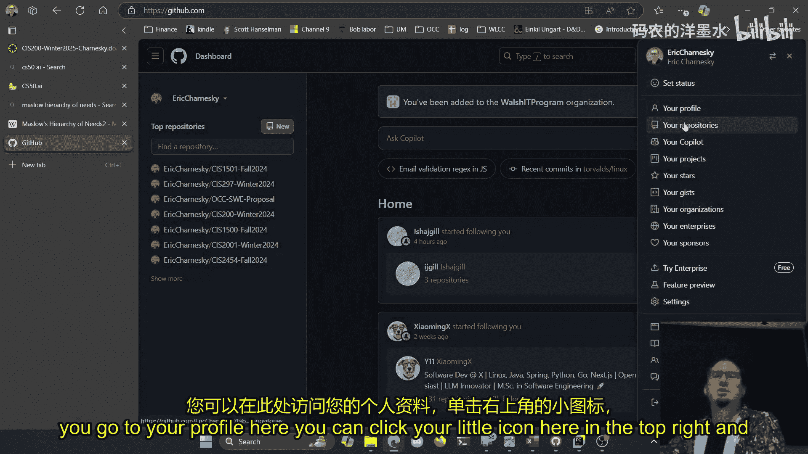

## 首次实验预览：GitHub入门

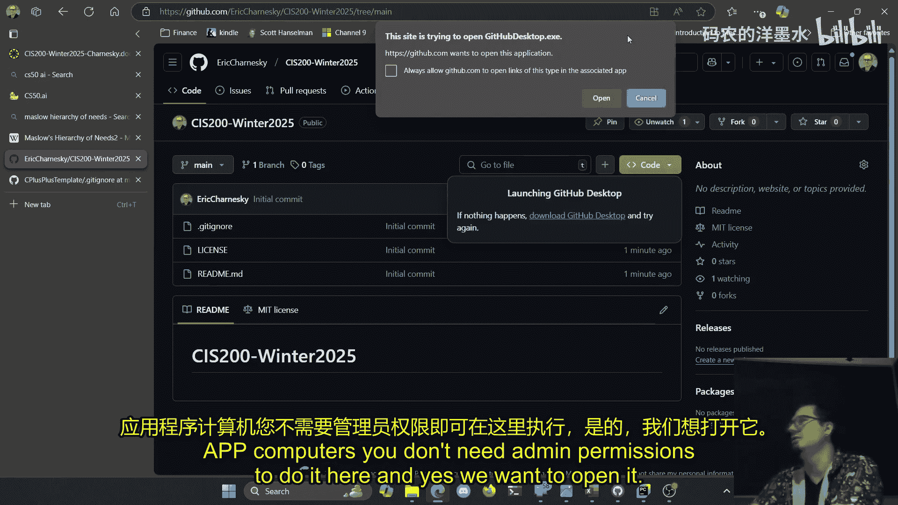

在接下来的实验课中，我们将进行第一次动手操作，核心任务是建立你的GitHub工作流。

以下是实验的主要步骤：
1.  **创建GitHub账户：** 访问 [github.com](https://github.com) 注册。
2.  **新建仓库：** 创建一个**私有（Private）** 仓库。仓库名可设为 `CIS200-Winter2025`。
3.  **初始化仓库：** 创建时勾选“添加README文件”，并为`.gitignore`文件选择 **VisualStudio** 模板。
4.  **克隆到本地：** 使用GitHub Desktop将在线仓库克隆（Clone）到你的电脑。
5.  **在本地仓库中创建项目：** 用Visual Studio在克隆下来的文件夹里创建一个新的C++项目，并编写一个简单的“Hello World”程序。
6.  **提交与推送：** 使用GitHub Desktop将代码更改提交（Commit）并推送（Push）到GitHub云端。
7.  **添加协作者：** 在GitHub仓库设置中，将我的账户（`[你的教师GitHub用户名]`）添加为协作者（Collaborator），以便我查看你的代码。
8.  **实验任务：** 在实验中，你将与一位同学配对，编写一个程序来输出你搭档的姓名和专业。

## 总结与预告

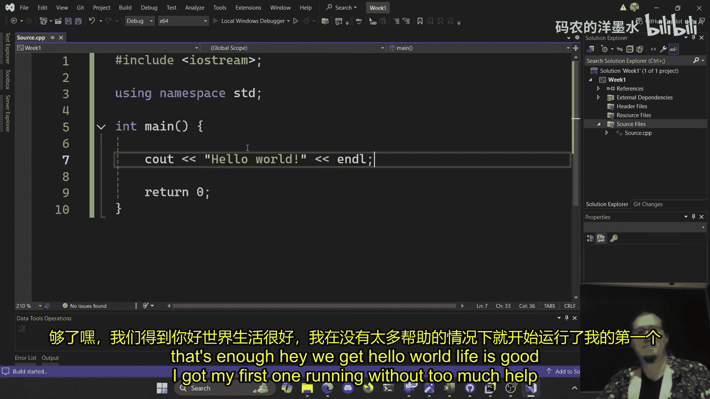

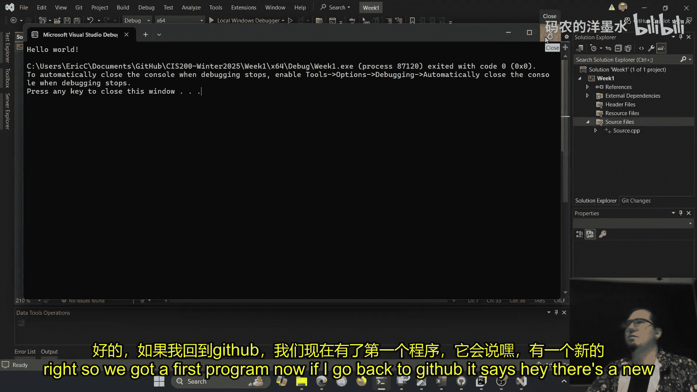

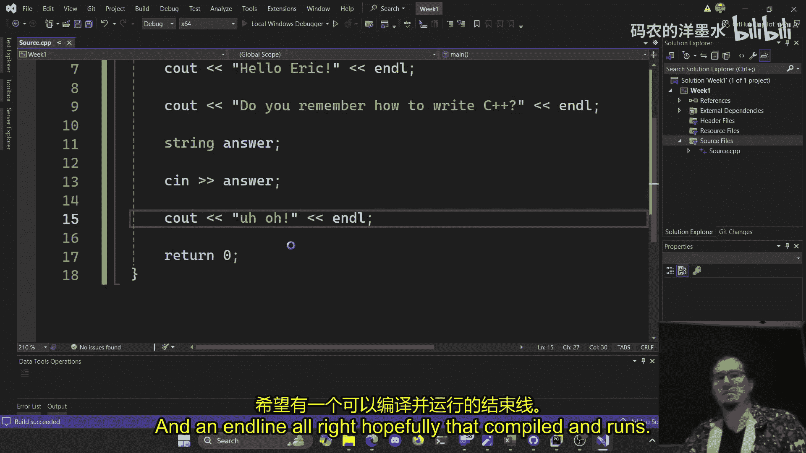

本节课中我们一起学习了CIS 200课程的总体框架、期望、工具和重要政策。我们明确了使用**GitHub**进行代码提交和版本控制的核心工作流程，并了解了在**允许并引用**的前提下使用AI工具的原则。

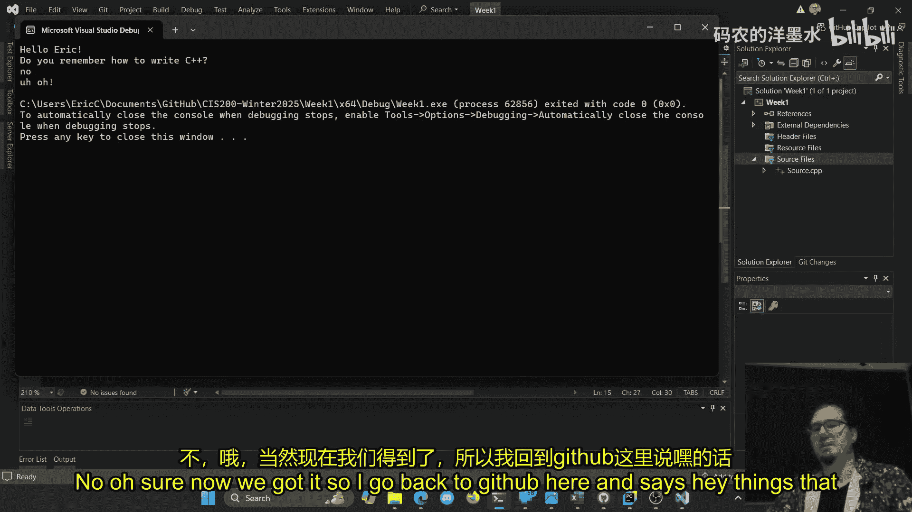

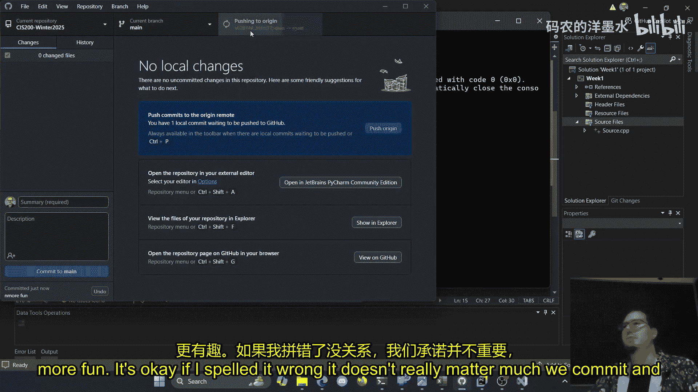

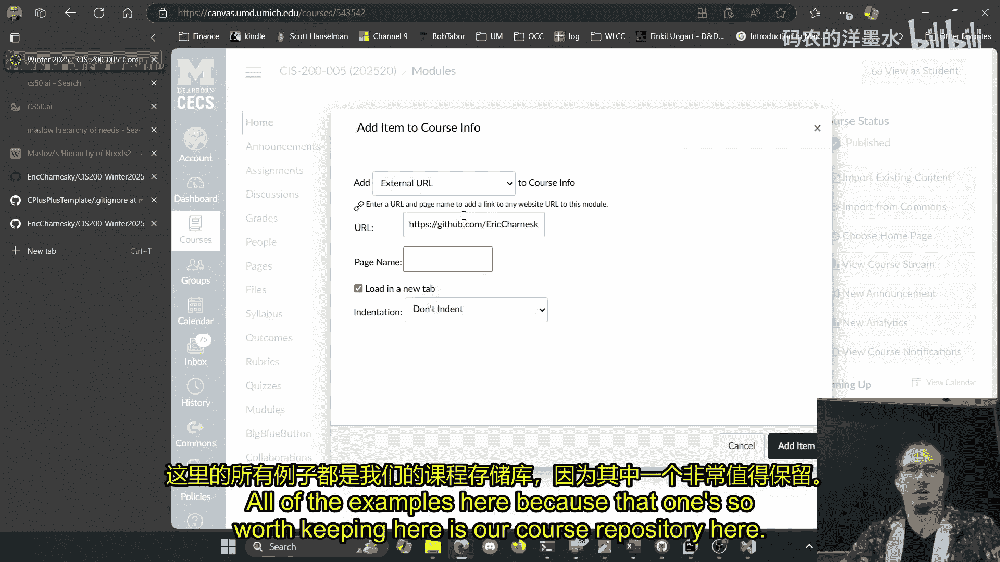

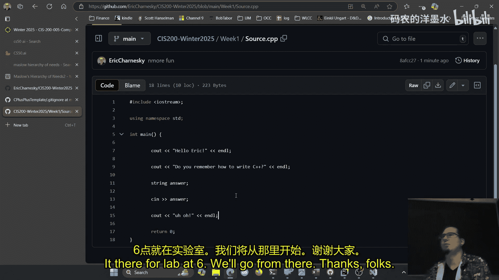

**下节课预告：** 在周四的课程中，我们将暂时离开Windows环境，进入**Unix/Linux**世界。我们将学习基本的Shell命令，并体验在无图形界面的文本编辑器（如`vim`）中编写和编译C++代码。这将帮助你理解代码如何在远程服务器上运行，为处理更大规模的计算任务做准备。