# 004：数组与向量 🧮


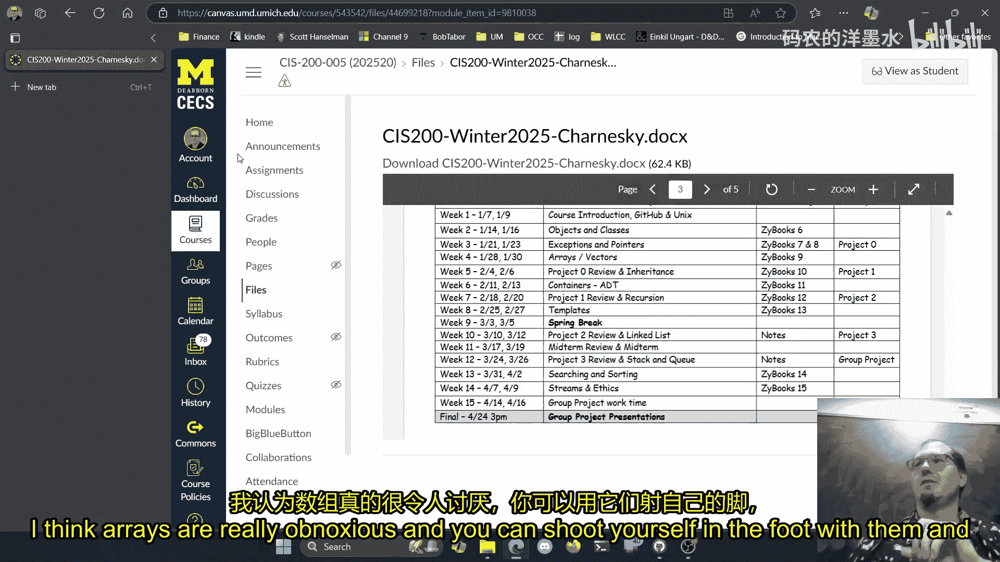

在本节课中，我们将学习C++中数组和向量的概念，特别是二维向量。我们将通过构建一个井字棋游戏来实践这些概念，理解如何声明、初始化和操作二维数据结构。

---

## 概述

数组和向量是C++中用于存储数据集合的基本结构。数组是固定大小的，而向量是动态的，可以灵活地调整大小。本节课将重点介绍二维向量，并通过一个井字棋游戏的实例来展示其应用。

---

## 向量与数组的选择

上一节我们提到了动态数组。向量是标准模板库（STL）的一部分，它比原始数组更安全、更灵活。虽然向量在技术上可能比数组稍慢，因为它在幕后需要做一些额外的工作，但对于我们处理的数据规模来说，这种速度差异可以忽略不计。

因此，在本教程中，我们将主要使用向量。要使用向量，需要在代码中包含相应的头文件并指定命名空间。

```cpp
#include <vector>
using namespace std;
```

---


## 构建井字棋游戏类

为了实践二维向量，我们将创建一个井字棋游戏类。这个类将使用一个二维向量来代表棋盘。

### 类的结构与构造函数

首先，我们定义类的私有成员：一个二维向量 `board` 来存储棋盘状态，以及一个 `char` 类型变量 `currentPlayer` 来记录当前玩家。

构造函数的作用是初始化这些属性。我们将棋盘初始化为一个3x3的网格，每个格子都是空格，并将起始玩家设为 ‘X’。

```cpp
class TicTacToe {
private:
    vector<vector<char>> board;
    char currentPlayer;

public:
    TicTacToe() {
        // 初始化一个3x3的空棋盘
        vector<char> row(3, ' ');
        for (int i = 0; i < 3; ++i) {
            board.push_back(row);
        }
        currentPlayer = 'X'; // X先手
    }
    // ... 其他方法
};
```

### 显示棋盘

我们需要一个方法来将棋盘状态转换为字符串，以便于输出。这样做的好处是使我们的类不依赖于特定的输出方式（如控制台），提高了代码的可重用性。

以下是 `display` 方法的实现，它构建一个格式化的字符串来表示棋盘。

```cpp
string display() {
    string result;
    // 构建第一行
    result += string(1, board[0][0]) + "|" + string(1, board[0][1]) + "|" + string(1, board[0][2]) + "\n";
    result += "-----\n";
    // 构建第二行
    result += string(1, board[1][0]) + "|" + string(1, board[1][1]) + "|" + string(1, board[1][2]) + "\n";
    result += "-----\n";
    // 构建第三行
    result += string(1, board[2][0]) + "|" + string(1, board[2][1]) + "|" + string(1, board[2][2]) + "\n";
    return result;
}
```

### 在棋盘上做标记

`markBoard` 方法允许玩家在指定位置做标记。它需要接收行索引和列索引作为参数。在标记之前，方法会检查该位置是否为空以及游戏是否已经结束。如果条件不满足，则抛出异常。


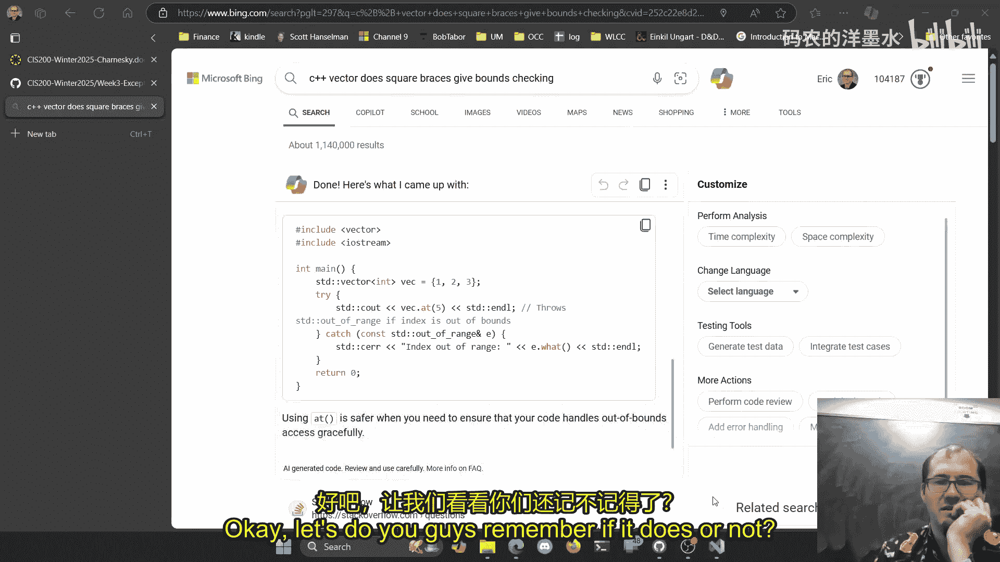


```cpp
void markBoard(int row, int col) {
    if (isGameOver()) {
        throw invalid_argument("Game is already over.");
    }
    if (board[row][col] != ' ') {
        throw invalid_argument("Location is not empty.");
    }
    // 标记棋盘
    board[row][col] = currentPlayer;
    // 切换玩家
    currentPlayer = (currentPlayer == 'X') ? 'O' : 'X';
}
```


### 检查游戏状态

游戏结束有两种情况：一方获胜或平局。我们创建了 `isGameOver` 方法来综合判断。

```cpp
bool isGameOver() {
    return hasWinner() || isTied();
}
```

`isTied` 方法检查棋盘上是否还有空格。如果没有空格，则视为平局。


```cpp
bool isTied() {
    for (const auto& row : board) {
        for (char space : row) {
            if (space == ' ') {
                return false; // 发现空格，游戏未平局
            }
        }
    }
    return true; // 没有空格，游戏平局
}
```


`hasWinner` 方法通过检查所有行、列和对角线来判断是否有玩家获胜。它将这个大问题分解为三个小问题。

```cpp
bool hasWinner() {
    return hasWinnerByRow() || hasWinnerByColumn() || hasWinnerByDiagonal();
}
```


以下是检查行获胜的辅助方法示例：

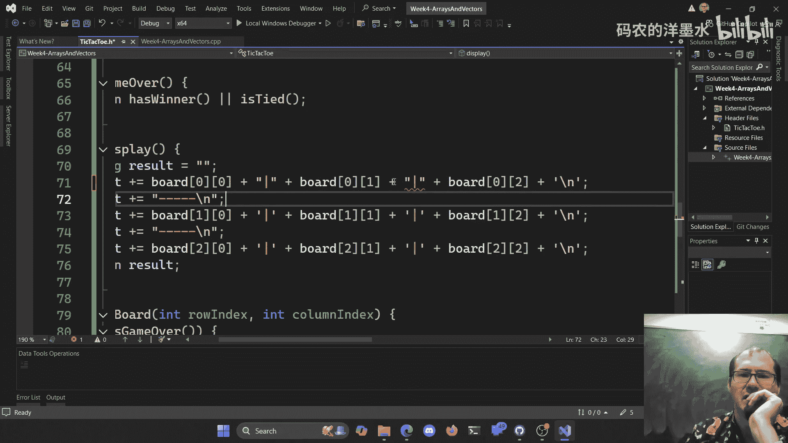

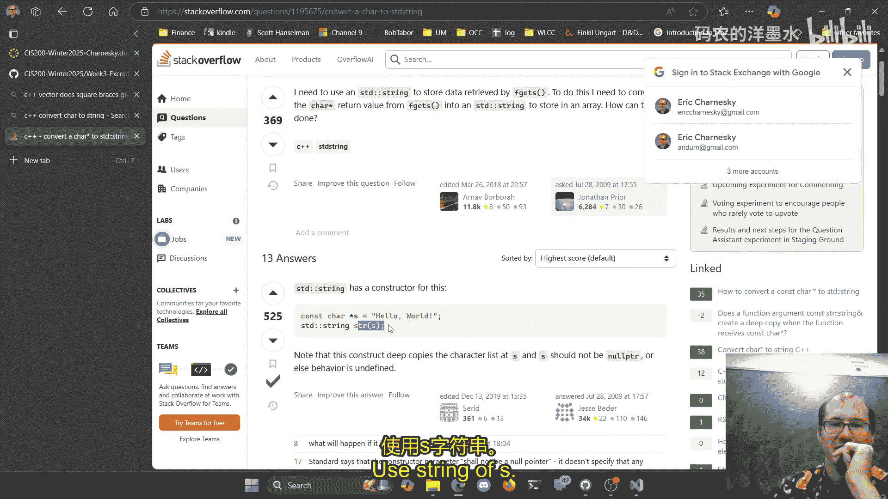

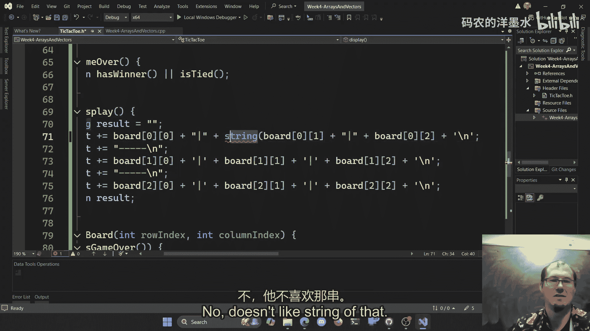

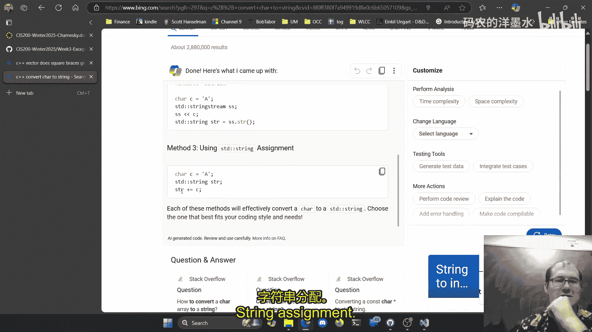

```cpp
bool hasWinnerByRow() {
    for (const auto& row : board) {
        if (row[0] != ' ' && row[0] == row[1] && row[0] == row[2]) {
            return true;
        }
    }
    return false;
}
```


检查列和对角线获胜的逻辑类似，但需要更仔细地处理索引。


### 获取当前玩家

我们还需要一个简单的方法来告知外部代码当前轮到哪位玩家。


```cpp
char getCurrentPlayer() {
    return currentPlayer;
}
```

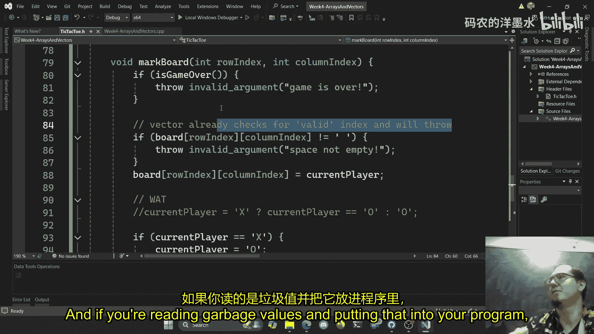


---


## 边界检查与安全编程

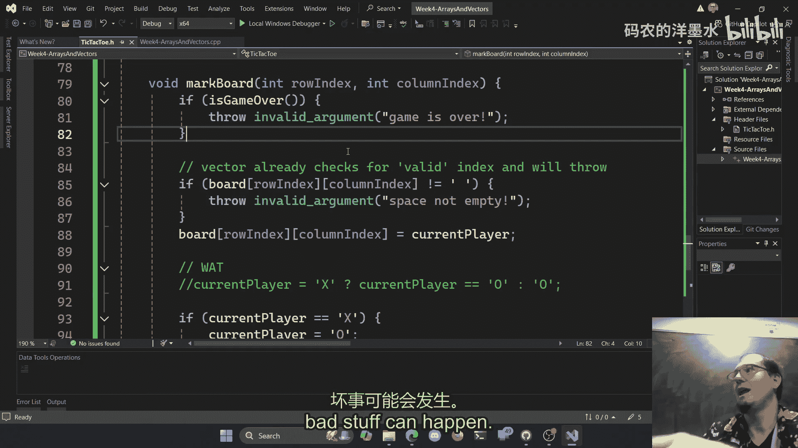


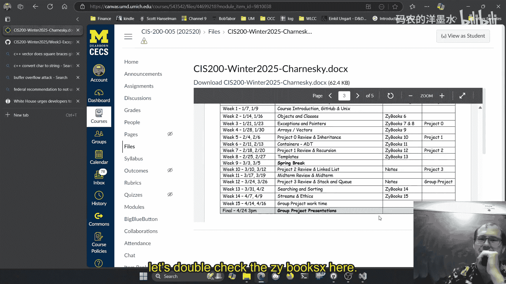

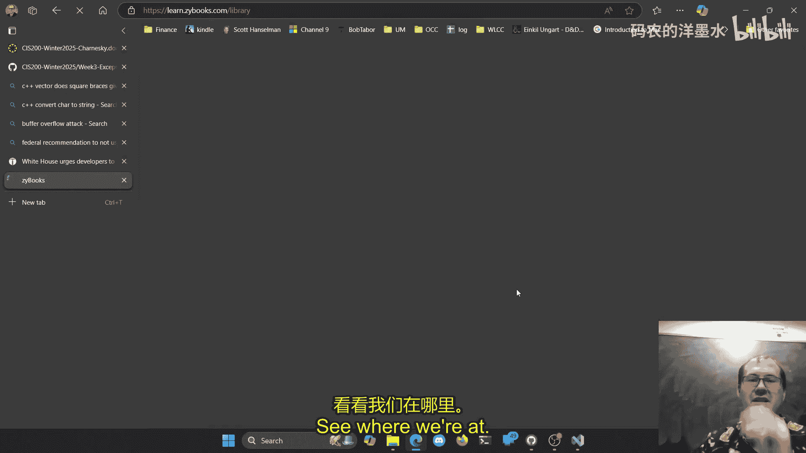

使用数组或向量时，必须谨慎处理索引，确保不会越界访问内存。向量在访问无效索引时会抛出异常，这提供了一层安全保护。然而，良好的编程习惯是永远不要信任外部输入，应在使用前进行验证。

这种“零信任”安全模型有助于防止缓冲区溢出等常见安全漏洞。虽然我们的课程项目规模较小，但养成检查边界的习惯对编写健壮、安全的代码至关重要。

---

## 总结

本节课我们一起学习了C++中数组和向量的核心概念，重点是通过构建一个井字棋游戏类来实践二维向量的使用。我们涵盖了：

1.  **向量的优势**：动态大小和内置边界检查。
2.  **二维数据结构**：使用 `vector<vector<char>>` 模拟行和列。
3.  **类的封装**：将游戏逻辑和数据封装在 `TicTacToe` 类中。
4.  **方法实现**：包括初始化、显示、落子、状态判断等。
5.  **错误处理**：使用异常来处理无效操作。
6.  **安全实践**：强调了边界检查的重要性。

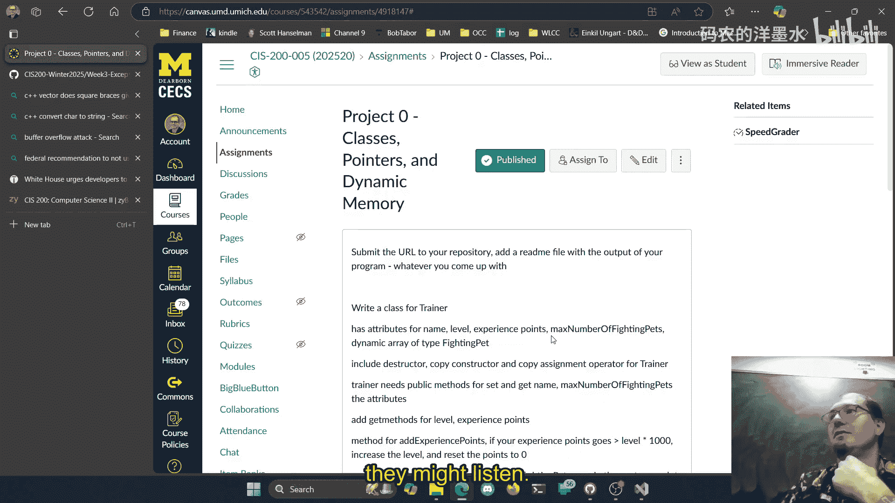

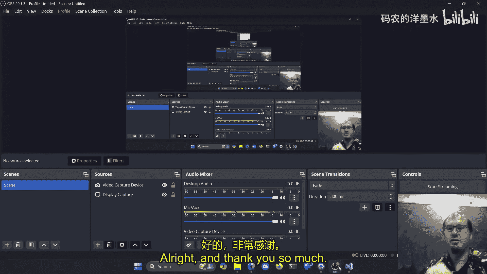

通过这个实例，你将二维向量的抽象概念与一个具体的、可运行的程序联系了起来。理解如何组织和使用这些数据结构是学习更复杂算法和应用的基础。在接下来的课程中，我们将探索向量的更多功能，例如使用迭代器进行遍历。