# 008：循环双向链表 🌀


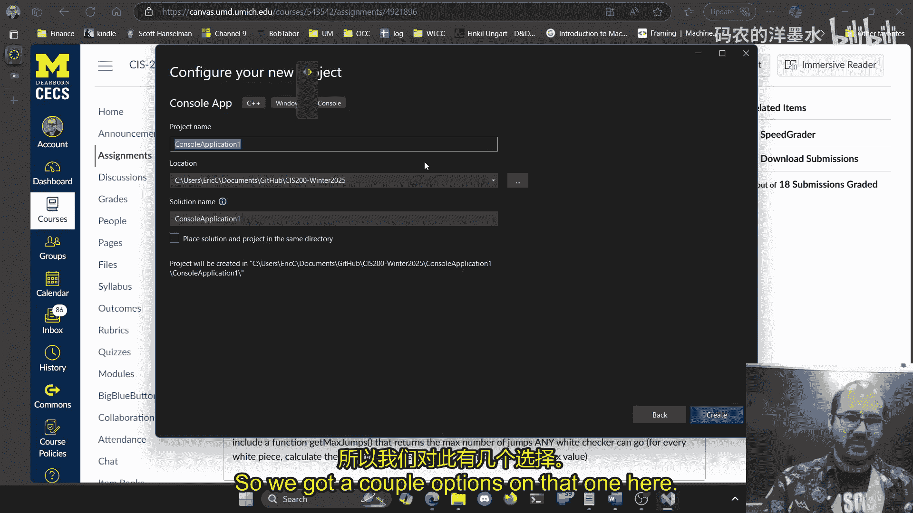

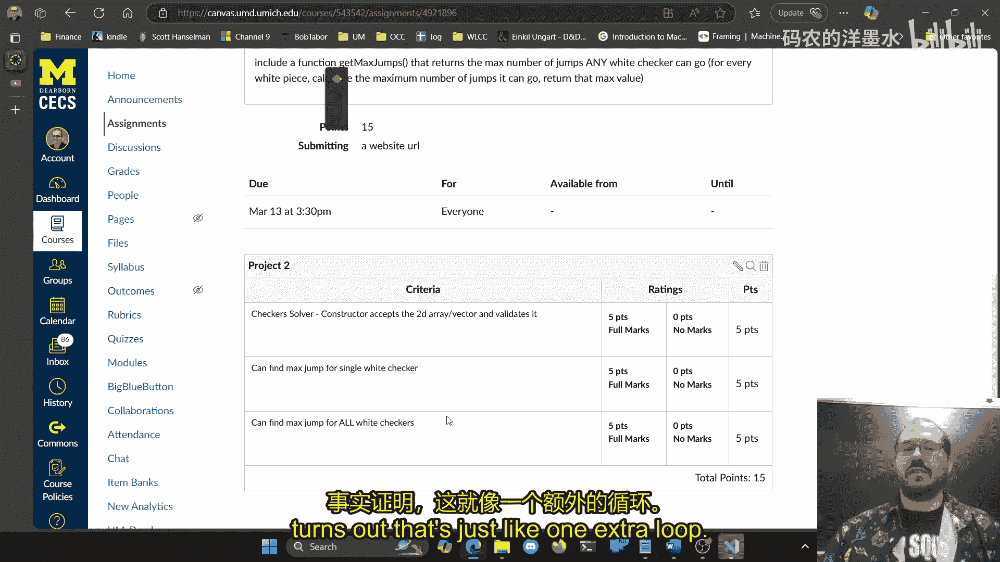

在本节课中，我们将学习如何实现一个更优雅的双向链表——循环双向链表。通过引入一个“哑元节点”，我们可以简化代码逻辑，避免处理空指针的麻烦，使链表操作更加直观和高效。

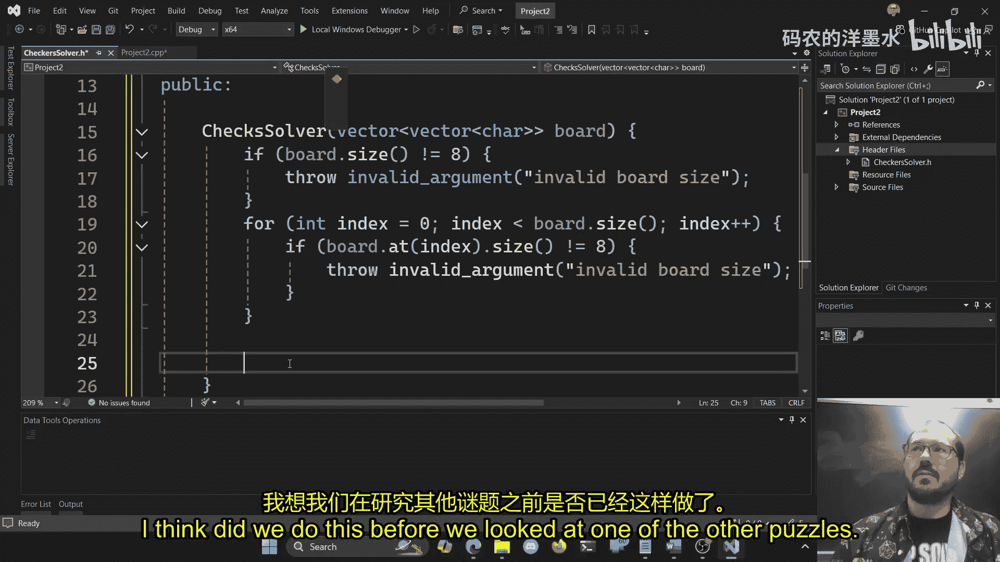


---

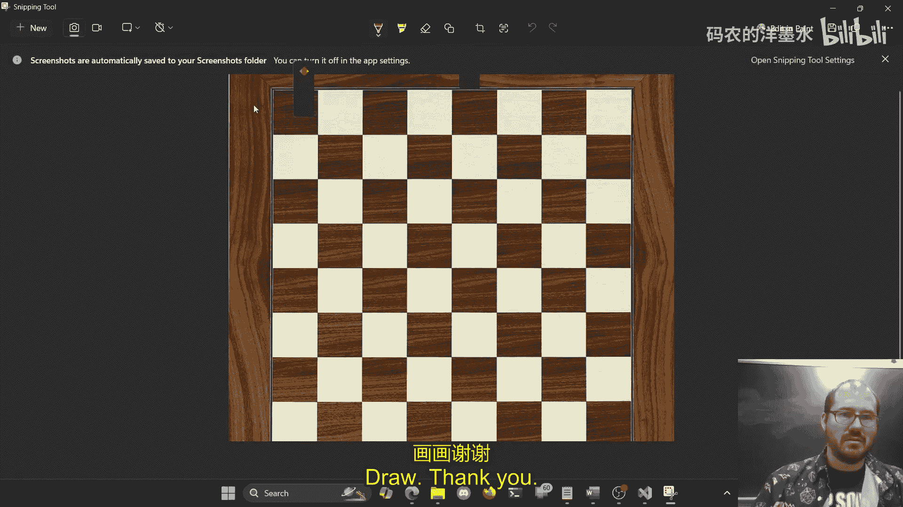

## 项目回顾与介绍

上一节我们介绍了递归和回溯的概念。本节中，我们来看看如何将这些概念应用到实际项目中。

### 项目二：跳棋求解器

本项目要求我们编写一个程序，计算在给定棋盘上，一个白色棋子通过连续跳跃黑色棋子所能完成的最大跳跃次数。核心是使用**回溯递归**算法。

**核心算法步骤**：
1.  尝试从当前白棋位置向四个对角线方向跳跃。
2.  如果可以跳跃（目标位置在棋盘内、中间有黑棋、目标位置为空），则执行跳跃，更新棋盘状态和跳跃计数，然后递归尝试从新位置继续跳跃。
3.  递归返回后，**撤销**跳跃操作（将棋子移回原处，恢复被跳过的黑棋），以尝试其他路径。
4.  在整个过程中，记录遇到的最大跳跃次数。

以下是实现中的一些关键代码片段：

**构造函数与棋盘验证**：
```cpp
CheckerSolver::CheckerSolver(const vector<vector<char>>& board) {
    // 验证棋盘大小为8x8
    if (board.size() != 8 || board[0].size() != 8) {
        throw invalid_argument("Invalid board size.");
    }
    // 验证所有棋子是否在同色格子上（通过行索引和列索引之和的奇偶性判断）
    bool pieceOnEven = false, pieceOnOdd = false;
    for (int i = 0; i < 8; ++i) {
        for (int j = 0; j < 8; ++j) {
            if (board[i][j] == WHITE_PIECE) {
                if ((i + j) % 2 == 0) pieceOnEven = true;
                else pieceOnOdd = true;
            }
        }
    }
    if (pieceOnEven && pieceOnOdd) {
        throw invalid_argument("Pieces must be on same color squares.");
    }
    this->board = board;
}
```

**递归尝试跳跃的核心函数**：
```cpp
void CheckerSolver::tryJump(int curRow, int curCol, int destRow, int destCol) {
    // 计算中间位置（被跳过的棋子位置）
    int midRow = (curRow + destRow) / 2;
    int midCol = (curCol + destCol) / 2;

    // 检查跳跃是否合法：目标位置在棋盘内、中间有黑棋、目标位置为空
    if (destRow >= 0 && destRow < 8 && destCol >= 0 && destCol < 8 &&
        board[midRow][midCol] == BLACK_PIECE &&
        board[destRow][destCol] == EMPTY) {

        // 执行跳跃
        currentJumps++;
        board[curRow][curCol] = EMPTY;
        board[midRow][midCol] = EMPTY;
        board[destRow][destCol] = WHITE_PIECE;

        // 更新最大跳跃次数
        if (currentJumps > maxJumps) maxJumps = currentJumps;

        // 递归尝试从新位置继续跳跃
        getMaxJumps(destRow, destCol);

        // 回溯：撤销跳跃
        board[destRow][destCol] = EMPTY;
        board[midRow][midCol] = BLACK_PIECE;
        board[curRow][curCol] = WHITE_PIECE;
        currentJumps--;
    }
}
```

### 项目三：链接对象（指挥官与生物）

接下来是我们的最后一个个人项目。这个项目将帮助我们练习使用**链接对象**来管理数据。

**项目概述**：
我们将创建一个简化的游戏模拟。有两个指挥官，每个指挥官拥有一系列生物。生物以**单向链表**的形式组织，每个生物节点包含攻击力、防御力和指向下一个生物的指针。链表按照防御力降序排列（防御力相同则按攻击力降序）。

**核心操作**：
1.  **添加生物**：将一个新生物插入到链表的正确位置，以保持排序。
2.  **战斗**：两个指挥官的链表从头开始，一一对战。
    *   双方生物互相造成等于自身攻击力的伤害。
    *   如果造成的伤害 **>** 对方生物的防御力，则该生物死亡，从链表中移除。
    *   如果一轮结束后，一方有生物存活而另一方没有，则所有存活生物的攻击力将直接对敌方指挥官造成伤害。
3.  需要实现**深拷贝**，确保在添加生物或复制指挥官时，数据是独立复制的。

这个项目重点在于操作链表：遍历、插入和删除节点，同时维护排序属性。

---

## 循环双向链表 🌀

现在，让我们回到数据结构本身，看看如何改进双向链表的实现。

### 为什么需要循环双向链表？

在普通的双向链表中，添加或删除节点时，我们需要处理许多边界情况，特别是当链表为空或操作的是首尾节点时，需要检查空指针 (`nullptr`)。这使得代码冗长且容易出错。

循环双向链表通过引入一个不存储实际数据的 **“哑元节点”** 来解决这个问题。这个节点始终存在，它的 `next` 指针指向链表的第一个真实节点，`prev` 指针指向链表的最后一个真实节点。当链表为空时，哑元节点的 `next` 和 `prev` 都指向它自己，形成一个环。

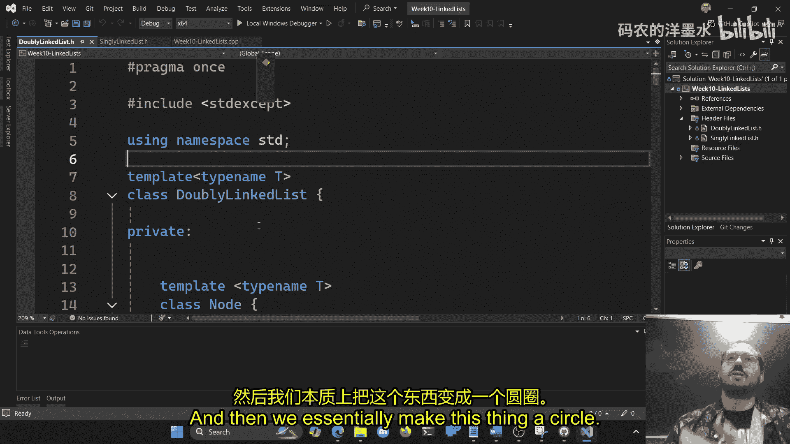


**优点**：
*   **代码简化**：永远不需要检查 `nullptr`，因为哑元节点始终存在。
*   **逻辑统一**：在链表头部插入、尾部插入或在中间插入/删除，代码逻辑几乎相同。

### 结构示意图

对于一个包含数据 A、B 的循环双向链表，其结构如下：
```
    哑元节点
      ^   |
      |   v
... <-[Dummy]<->[A]<->[B]<-...
      |                 ^
      |_________________|
```
（`Dummy` 的 `prev` 指向 `B`，`B` 的 `next` 指向 `Dummy`，构成循环）

### 核心操作实现

以下是循环双向链表关键操作的简化实现思路：

**1. 初始化**：
```cpp
template <typename T>
class CircularDoublyLinkedList {
private:
    struct Node {
        T data;
        Node* next;
        Node* prev;
        Node(const T& d, Node* n = nullptr, Node* p = nullptr) : data(d), next(n), prev(p) {}
    };
    Node* dummy; // 哑元节点
    int count;

public:
    CircularDoublyLinkedList() {
        dummy = new Node(T()); // 创建哑元节点，数据部分可以是默认值
        dummy->next = dummy;   // 初始化时，自己指向自己
        dummy->prev = dummy;
        count = 0;
    }
};
```

**2. 在指定节点后插入（通用方法）**：
```cpp
void insertAfter(Node* predecessor, const T& data) {
    Node* newNode = new Node(data, predecessor->next, predecessor);
    predecessor->next->prev = newNode;
    predecessor->next = newNode;
    count++;
}
// 在头部插入：insertAfter(dummy, data);
// 在尾部插入：insertAfter(dummy->prev, data); // dummy->prev 是尾节点
```

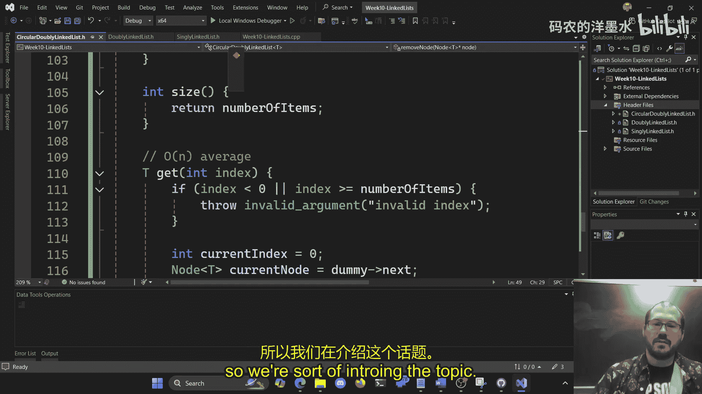

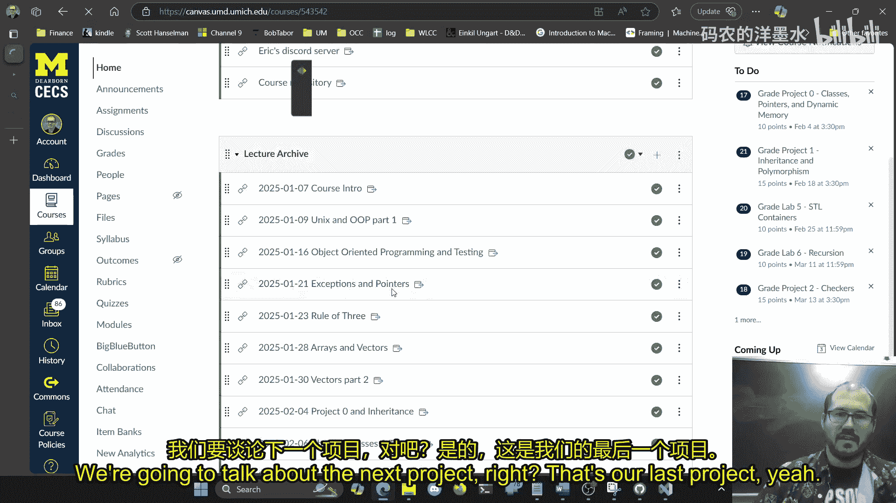

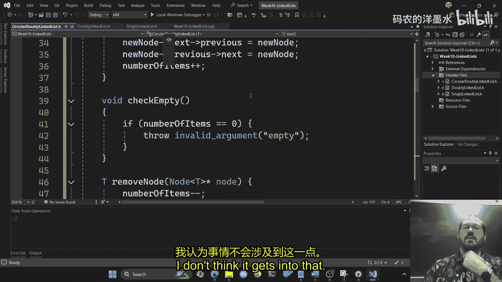

**3. 删除指定节点**：
```cpp
T removeNode(Node* nodeToRemove) {
    T removedData = nodeToRemove->data;
    nodeToRemove->prev->next = nodeToRemove->next;
    nodeToRemove->next->prev = nodeToRemove->prev;
    delete nodeToRemove;
    count--;
    return removedData;
}
// 删除头部：if (!isEmpty()) removeNode(dummy->next);
// 删除尾部：if (!isEmpty()) removeNode(dummy->prev);
```

**4. 遍历**：
```cpp
Node* current = dummy->next; // 从第一个真实节点开始
while (current != dummy) {   // 回到哑元节点时结束
    // 处理 current->data
    current = current->next;
}
```

通过这种方式，所有操作都无需检查空指针，代码更加简洁健壮。

---

## 总结

本节课中我们一起学习了：
1.  **回溯递归的应用**：在跳棋求解器项目中，我们实践了通过递归探索所有路径，并用回溯法撤销选择以尝试其他可能性，同时记录最优解。
2.  **链接对象项目介绍**：预告了下一个项目，我们将使用单向链表管理一系列游戏生物，重点练习链表的插入、删除和遍历操作，并涉及深拷贝。
3.  **循环双向链表**：我们探讨了如何通过引入哑元节点来简化双向链表的实现。这种结构消除了空指针检查，使得插入和删除操作的代码逻辑更统一、更清晰，是实践中常用的一种高效链表变体。

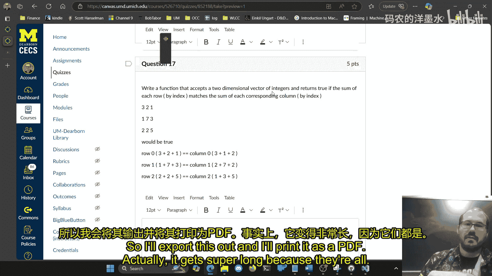

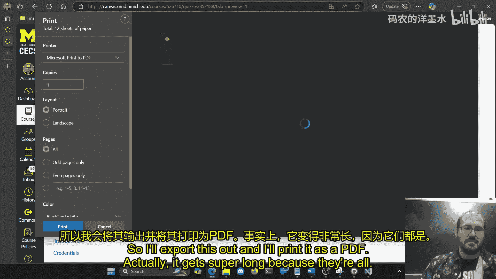

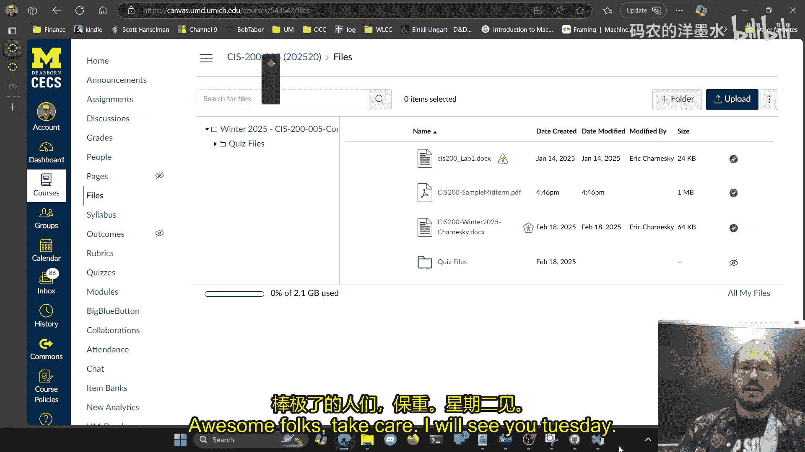

掌握这些链表结构及其变体，为我们后续学习更复杂的数据结构（如位置链表、迭代器）和算法优化打下了坚实的基础。