# 009：选择排序与插入排序 🧮


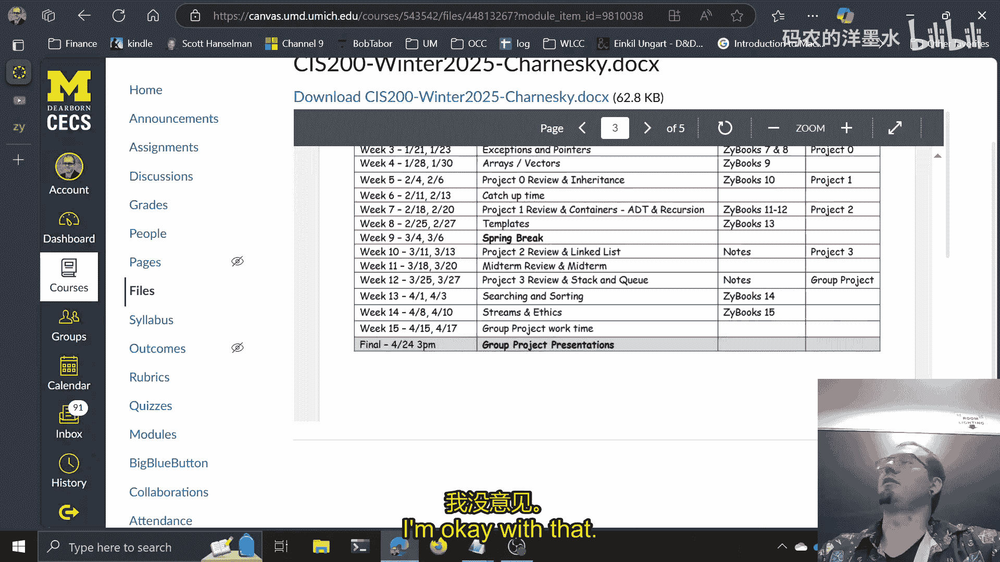


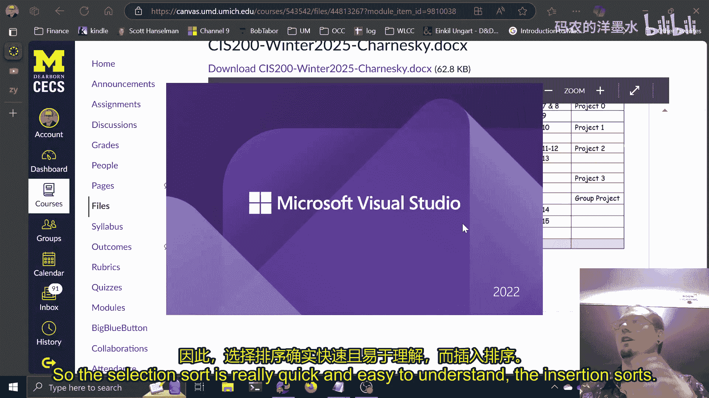

在本节课中，我们将学习两种基础的排序算法：选择排序和插入排序。我们将理解它们的工作原理，分析其性能，并用C++代码实现它们。这些算法是理解更高级排序技术（如归并排序和快速排序）的重要基础。

## 概述

排序是计算机科学中的一个核心问题，它涉及将一组数据按照特定顺序（如升序或降序）重新排列。我们将从两种简单直观的排序算法开始：选择排序和插入排序。它们虽然效率不是最高，但易于理解和实现，非常适合初学者入门。

## 选择排序

上一节我们介绍了排序的基本概念，本节中我们来看看选择排序。选择排序的核心思想是：反复从未排序的部分中找到最小（或最大）的元素，并将其放到已排序序列的末尾。

其算法步骤如下：
1.  在未排序序列中找到最小（大）元素，存放到排序序列的起始位置。
2.  再从剩余未排序元素中继续寻找最小（大）元素，然后放到已排序序列的末尾。
3.  重复第二步，直到所有元素均排序完毕。

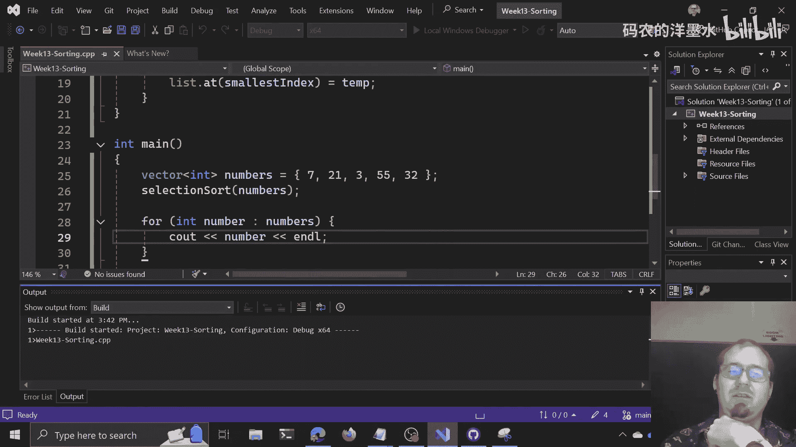

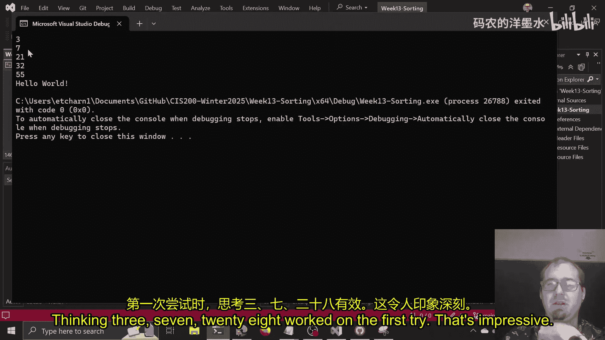

以下是选择排序的C++模板函数实现：

```cpp
template <typename T>
void selectionSort(vector<T>& list) {
    for (int index = 0; index < list.size() - 1; ++index) {
        int smallestIndex = index;
        for (int indexToCheck = index + 1; indexToCheck < list.size(); ++indexToCheck) {
            if (list[indexToCheck] < list[smallestIndex]) {
                smallestIndex = indexToCheck;
            }
        }
        // 交换元素
        T temp = list[index];
        list[index] = list[smallestIndex];
        list[smallestIndex] = temp;
    }
}
```

**时间复杂度分析**：选择排序在任何情况下（最好、最坏、平均）都需要进行大约 `n*(n-1)/2` 次比较，因此其时间复杂度为 **O(n²)**。

**空间复杂度分析**：该算法是“原地”排序，除了用于交换的临时变量外，不需要额外的存储空间，空间复杂度为 **O(1)**。

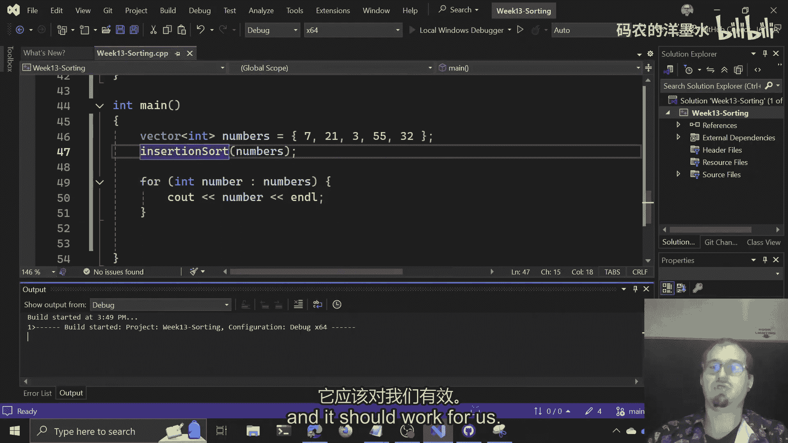

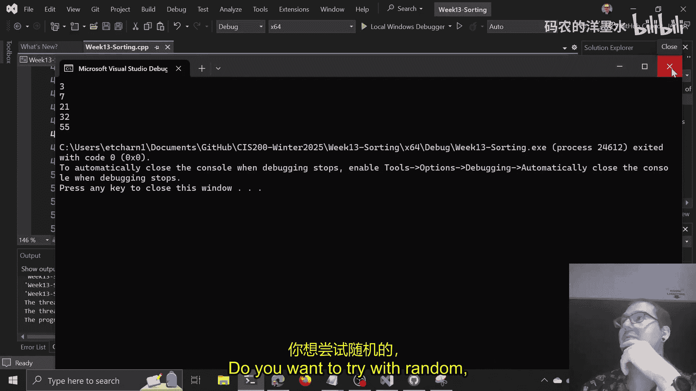

## 插入排序

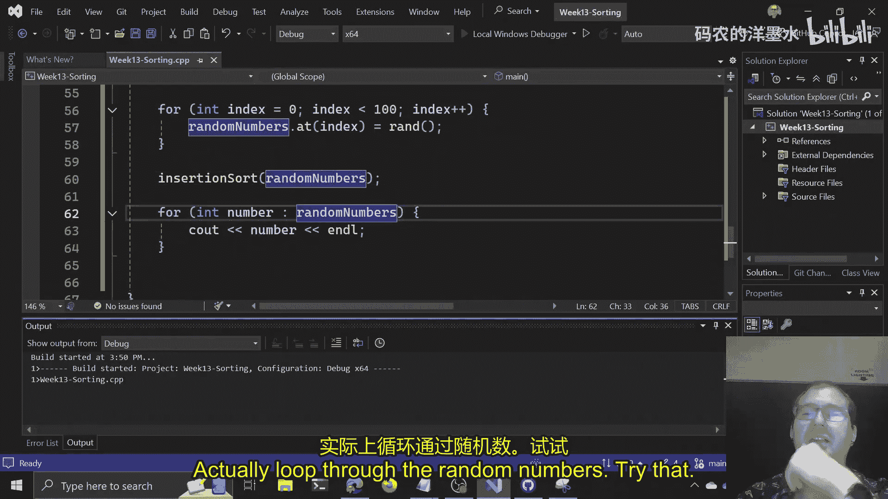

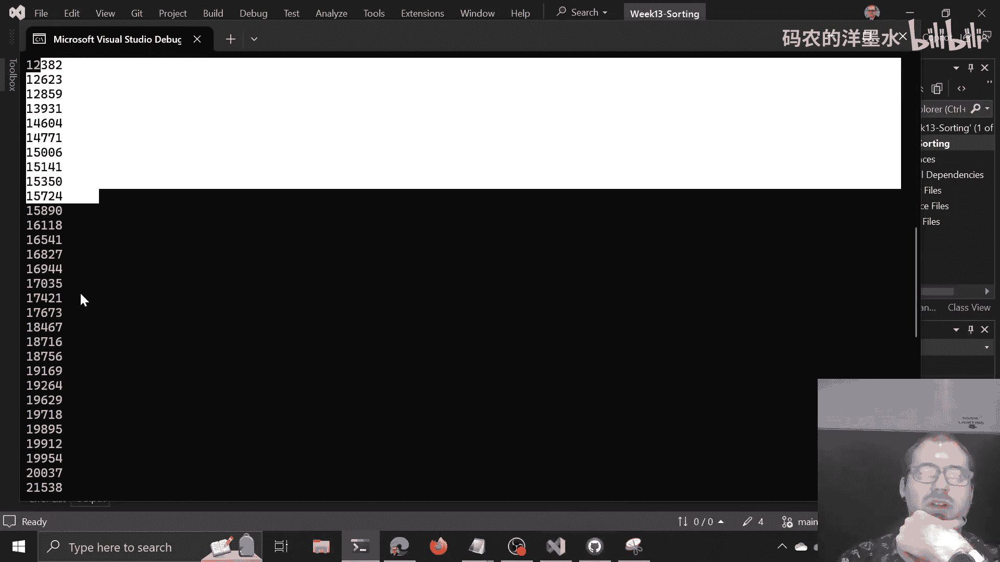

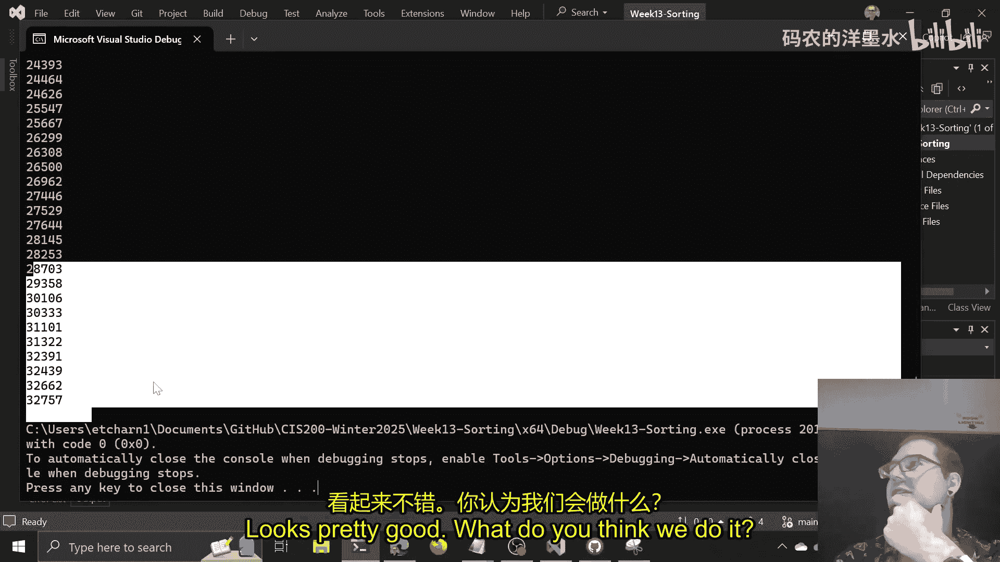

了解了选择排序后，我们来看一种在某些情况下更高效的算法：插入排序。插入排序的工作方式类似于我们整理手中的扑克牌。它将数组分为“已排序”和“未排序”两部分，每次将“未排序”部分的第一个元素插入到“已排序”部分的正确位置。

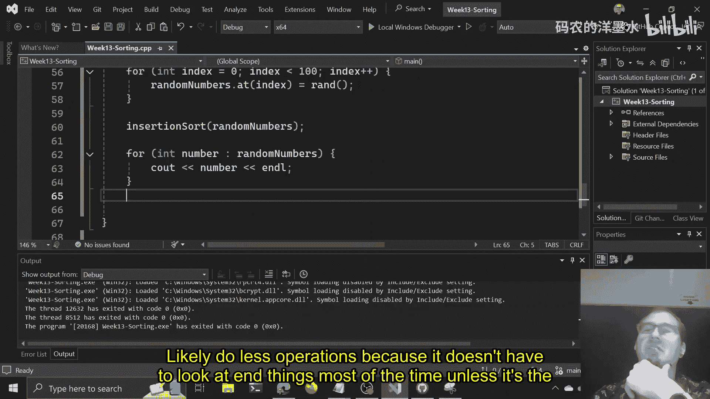

其算法步骤如下：
1.  将第一个元素视为已排序序列。
2.  取出下一个元素，在已排序序列中从后向前扫描。
3.  如果该元素（待插入）小于已排序序列中的当前元素，则将当前元素向后移动一位。
4.  重复步骤3，直到找到已排序元素小于或等于待插入元素的位置。
5.  将待插入元素插入到该位置。
6.  重复步骤2~5，直到所有元素处理完毕。

以下是插入排序的C++模板函数实现：

```cpp
template <typename T>
void insertionSort(vector<T>& list) {
    for (int index = 1; index < list.size(); ++index) {
        for (int indexToCheck = index; indexToCheck > 0; --indexToCheck) {
            if (list[indexToCheck] < list[indexToCheck - 1]) {
                // 交换元素
                T temp = list[indexToCheck];
                list[indexToCheck] = list[indexToCheck - 1];
                list[indexToCheck - 1] = temp;
            } else {
                break; // 已处于正确位置，提前结束内层循环
            }
        }
    }
}
```

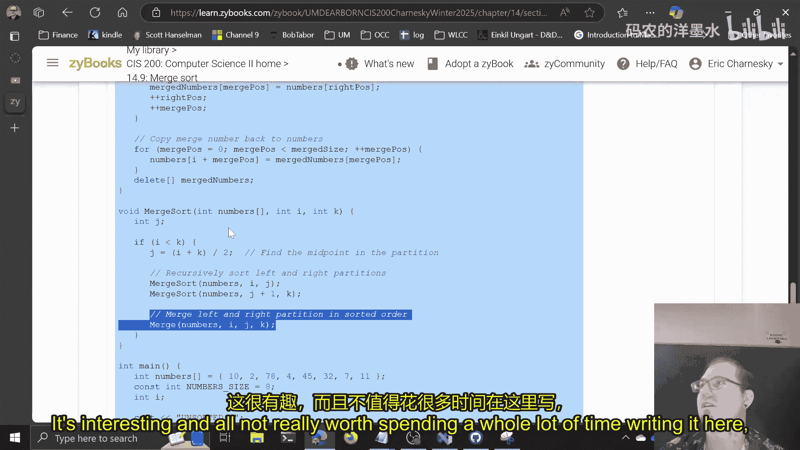

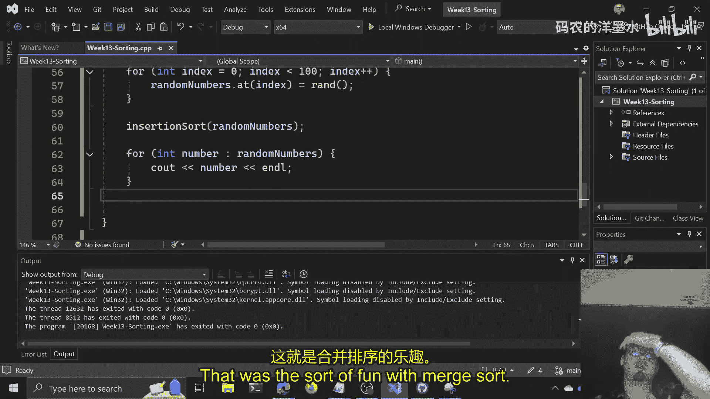

**时间复杂度分析**：
*   **最好情况**：如果数组已经是有序的，插入排序只需要进行 `n-1` 次比较，时间复杂度为 **O(n)**。
*   **最坏情况**：如果数组是逆序的，每个新元素都需要比较并移动到最前面，需要进行大约 `n*(n-1)/2` 次比较和移动，时间复杂度为 **O(n²)**。
*   **平均情况**：时间复杂度也为 **O(n²)**，但在实际中，它通常比选择排序执行更少的操作，因为内层循环可能提前终止。

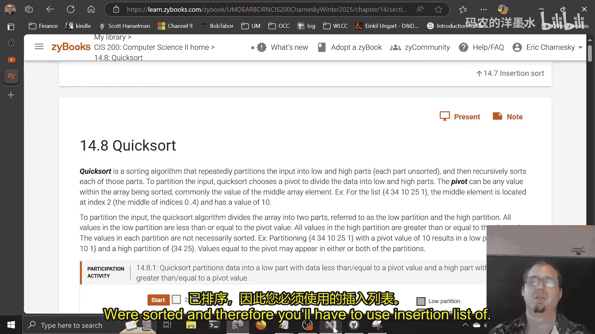

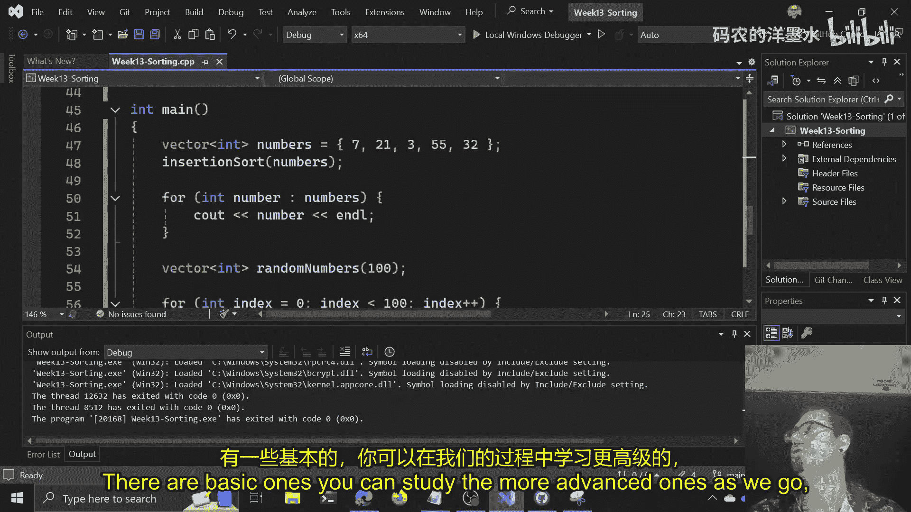

**空间复杂度分析**：与选择排序一样，插入排序也是原地排序，空间复杂度为 **O(1)**。

## 算法对比与总结

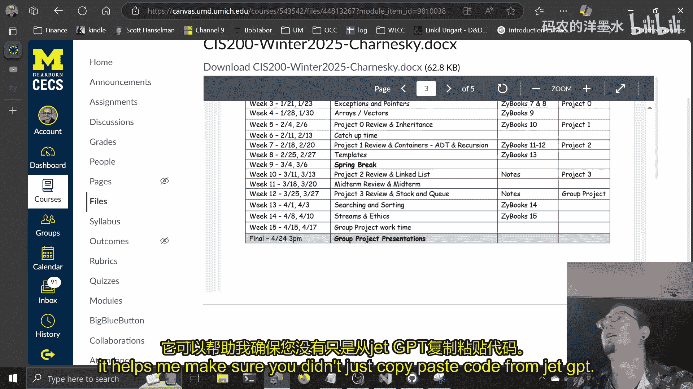

本节课中我们一起学习了选择排序和插入排序。

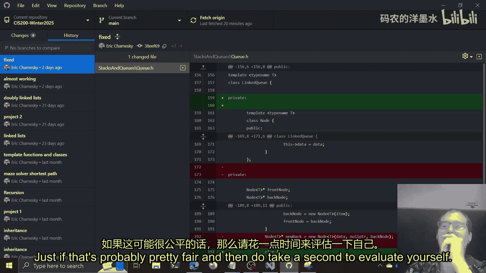

*   **选择排序** 简单直接，通过不断选择剩余元素中的最小值来完成排序。它的优点是交换次数少（最多 `n-1` 次），但比较次数固定且较多。
*   **插入排序** 则通过构建有序序列来工作。它的优点是在处理近乎有序的数据时效率非常高，并且是**自适应**的。在小型数组或部分有序的数组中，插入排序的表现往往很好。


虽然这两种算法的时间复杂度在平均和最坏情况下都是 O(n²)，不适合大规模数据排序，但它们是理解排序算法思想的绝佳起点。在接下来的课程中，我们将接触更高效的算法，如**归并排序**和**快速排序**，它们采用了“分而治之”的策略，能将平均时间复杂度降至 O(n log n)。