# 010：递归（第一部分）


在本节课中，我们将学习递归的基本概念。递归是一种函数调用自身的编程技术。我们将探讨递归的定义、如何识别递归问题，并通过几个经典例子来理解其工作原理和潜在问题。最后，我们会介绍一个使用递归解决迷宫问题的实际案例。

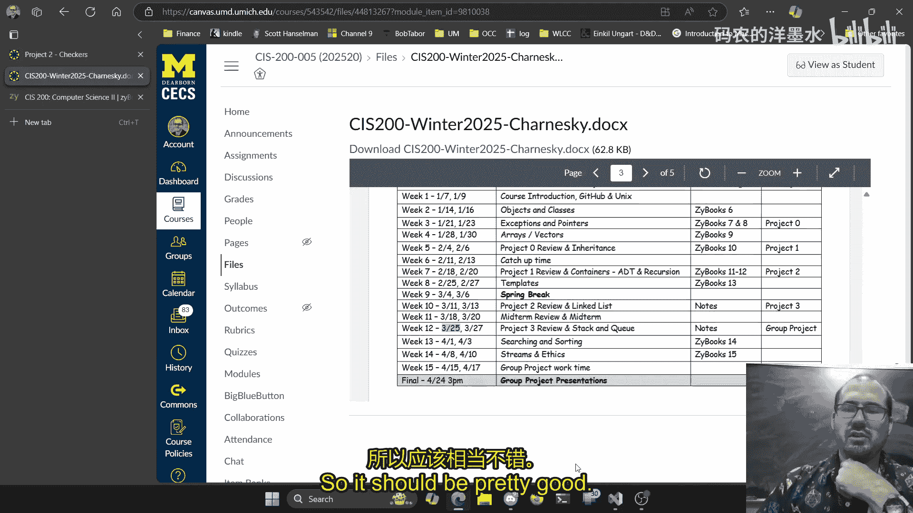

---

## 递归的基本定义

递归的核心定义是：**一个函数调用自身**。

为了判断一个问题是否能用递归解决，需要识别两个关键部分：
1.  **基准情况**：这是问题已解决、无需进一步递归的情况。
2.  **递归情况**：这是将复杂问题简化为一个更接近基准情况的步骤。

如果一个问题能分解为这两个部分，就可能用递归解决。递归是一种强大的工具，但并非适用于所有问题。对于某些特定问题（如遍历文件系统），递归能提供简洁优雅的解决方案。

---


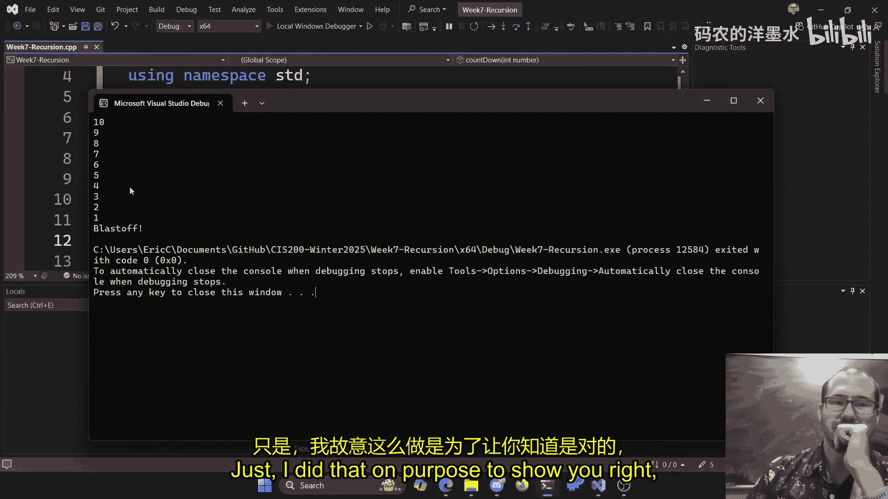

## 递归示例：倒计时

让我们从一个简单的倒计时函数开始。以下是递归版本的代码：

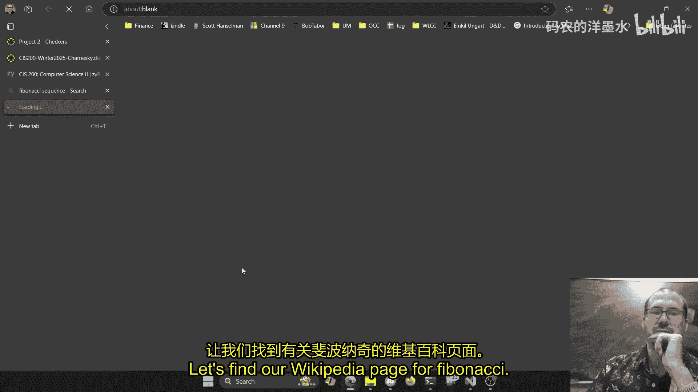

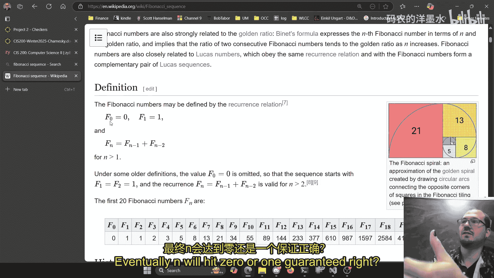

```cpp
void countdown(int number) {
    if (number <= 0) { // 基准情况：数字小于等于0时停止
        cout << "Blast off!" << endl;
    } else { // 递归情况：打印当前数字，然后调用自身处理更小的数字
        cout << number << endl;
        countdown(number - 1);
    }
}
```


这个函数的工作原理是：如果数字小于等于0，它打印“Blast off!”并停止。否则，它打印当前数字，然后调用自身，参数为 `number - 1`。


需要注意的是，如果传入负数，函数将无限递归，最终导致**栈溢出**错误。这是因为每次函数调用都会在调用栈上占用内存，无限递归会耗尽栈空间。

实际上，对于倒计时这种简单问题，使用循环的迭代方法通常更高效：

```cpp
void countdownIterative(int number) {
    for (int current = number; current > 0; current--) {
        cout << current << endl;
    }
    cout << "Blast off!" << endl;
}
```


迭代版本避免了多次函数调用的内存开销，是更优的选择。


---

## 递归示例：斐波那契数列

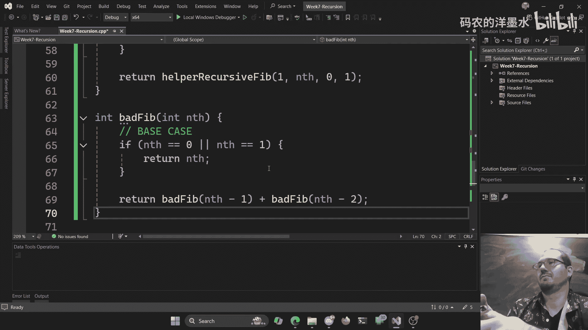

斐波那契数列是另一个经典例子。其数学定义是：
*   `fib(0) = 0`
*   `fib(1) = 1`
*   `fib(n) = fib(n-1) + fib(n-2)` （当 n > 1 时）

一个直接的递归实现如下：

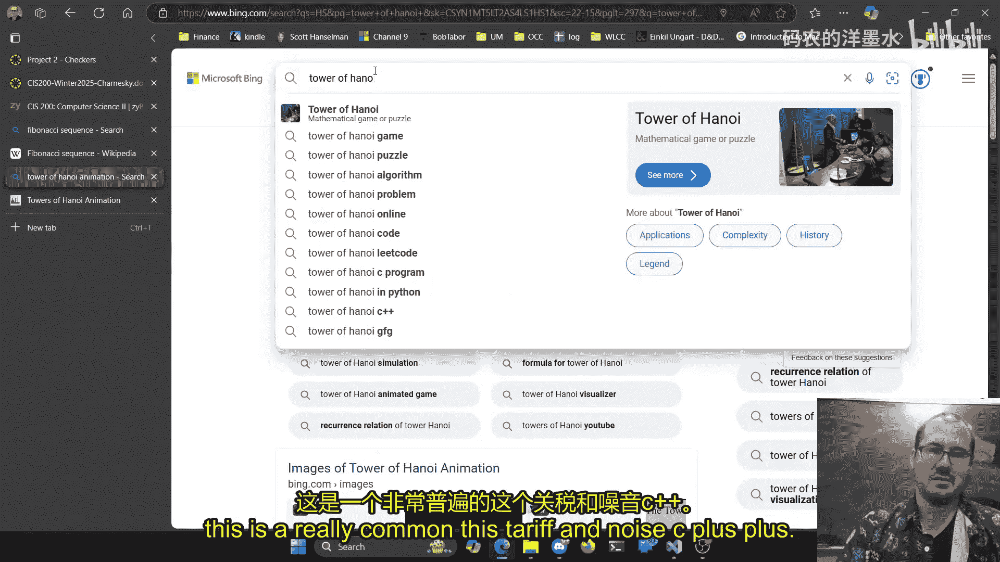


```cpp
int badFib(int n) {
    if (n <= 1) { // 基准情况
        return n;
    }
    return badFib(n - 1) + badFib(n - 2); // 递归情况
}
```

然而，这个实现效率极低。计算 `fib(40)` 时，需要进行数亿次加法运算，因为它重复计算了大量相同的子问题。

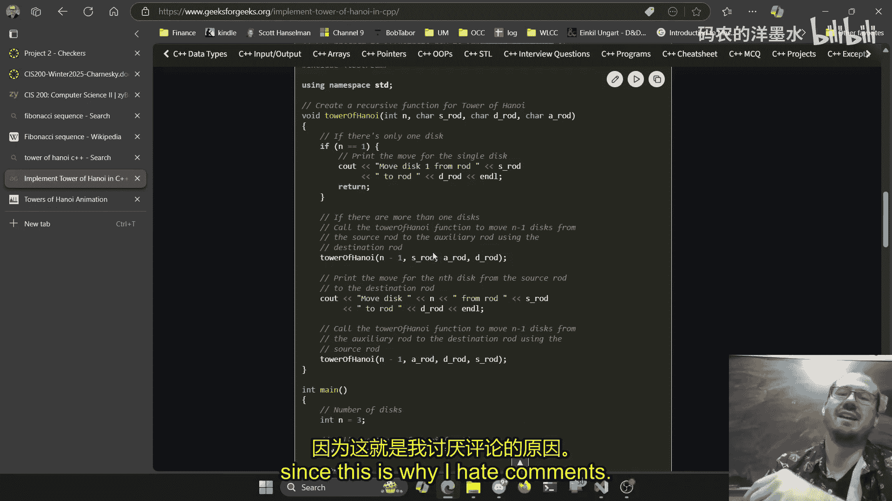

为了提高效率，我们可以使用一个辅助函数，通过“尾递归”来避免重复计算：

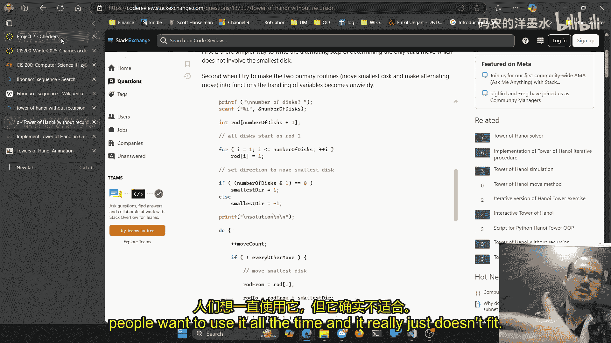

```cpp
int helperFib(int n, int currentN, int prev, int curr) {
    if (currentN == n) { // 基准情况：达到目标位置
        return curr;
    }
    // 递归情况：计算下一个值并继续
    return helperFib(n, currentN + 1, curr, prev + curr);
}

int betterFib(int n) {
    if (n <= 1) return n;
    // 从 fib(1) 和 fib(0) 开始
    return helperFib(n, 1, 0, 1);
}
```

这种方法的本质与循环相同，但通过递归形式表达。一个等价的迭代版本可能更直观：

```cpp
int iterativeFib(int n) {
    if (n <= 1) return n;
    int prev = 0, curr = 1;
    for (int i = 1; i < n; i++) {
        int next = prev + curr;
        prev = curr;
        curr = next;
    }
    return curr;
}
```

这个例子说明，**能够用递归解决的问题，不一定应该用递归解决**。需要根据效率选择最佳方案。


---

## 何时使用递归：汉诺塔问题

有些问题天然适合递归解决，汉诺塔就是典型例子。规则是将一堆盘子从一根柱子移动到另一根，每次只能移动一个盘子，且大盘子不能放在小盘子上。

解决思路是：
*   **基准情况**：移动一个盘子（直接移动）。
*   **递归情况**：要移动 N 个盘子，先移动上面的 N-1 个盘子到辅助柱，然后移动最大的盘子到目标柱，最后再将 N-1 个盘子移动到目标柱。

递归代码非常简洁，而非递归解法则需要复杂的状态跟踪。这体现了递归在解决此类“自相似”问题时的优势。

一个通用规则是：**任何递归问题都可以用迭代解决，但反之则不成立**。递归是工具箱中的一件特殊工具，应在合适场合使用。


---


## 回溯递归：迷宫求解


上一节我们介绍了递归的基本模式，本节我们来看看一种特殊的递归应用：**回溯**。回溯用于尝试所有可能的路径，并在走不通时“撤销”步骤。


迷宫求解是回溯的经典案例。算法思路如下：
1.  **基准情况**：当前位置是终点，问题解决。
2.  **递归情况**：尝试向上、下、左、右四个方向移动。
    *   如果某个方向可走（是空地或终点），则移动到该位置，并递归调用求解函数。
    *   如果所有方向都走不通，则返回上一步（回溯）。

以下是迷宫求解器类的核心框架：

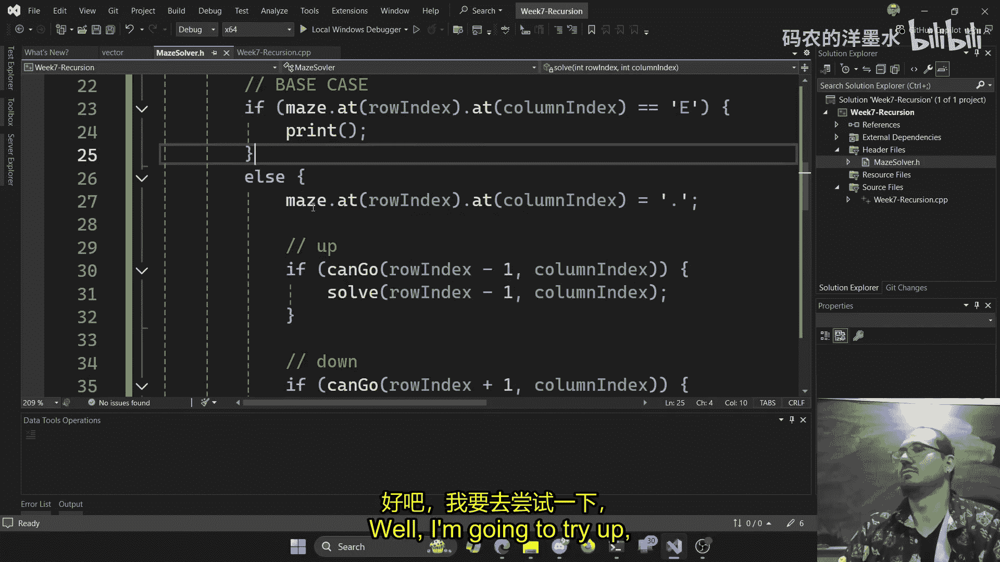

```cpp
class MazeSolver {
private:
    vector<vector<char>> maze;
    bool canGo(int row, int col) {
        // 检查位置是否在迷宫内且是空地或终点
        if (row < 0 || row >= maze.size() || col < 0 || col >= maze[row].size()) {
            return false;
        }
        char cell = maze[row][col];
        return (cell == ' ' || cell == 'E'); // ‘E’代表终点
    }
    void solveHelper(int row, int col) {
        if (maze[row][col] == 'E') { // 基准情况：到达终点
            printMaze(); // 打印解决方案
            return;
        }
        // 留下“面包屑”，标记已走过的路
        maze[row][col] = '.';
        // 递归情况：尝试四个方向
        if (canGo(row-1, col)) solveHelper(row-1, col); // 上
        if (canGo(row+1, col)) solveHelper(row+1, col); // 下
        if (canGo(row, col-1)) solveHelper(row, col-1); // 左
        if (canGo(row, col+1)) solveHelper(row, col+1); // 右
        // 回溯：擦除“面包屑”，恢复为空地
        maze[row][col] = ' ';
    }
public:
    void solve() {
        solveHelper(0, 0); // 假设起点在(0,0)
    }
};
```


关键点在于“留下面包屑”和“擦除面包屑”。这确保了算法能探索所有路径，并在回溯后恢复迷宫状态，以便找到最终路径或尝试其他可能性。

---


## 课程总结与项目预告


本节课中我们一起学习了递归的核心概念。我们了解到递归是函数调用自身，需要明确的基准情况和递归情况。我们通过倒计时和斐波那契数列的例子，看到了递归的简单实现及其可能存在的效率问题。我们还探讨了汉诺塔这类适合递归解决的问题。最后，我们深入研究了回溯递归，并用它来求解迷宫问题。

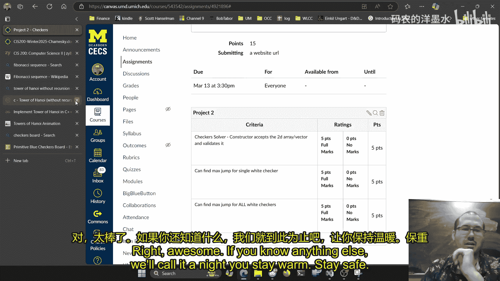

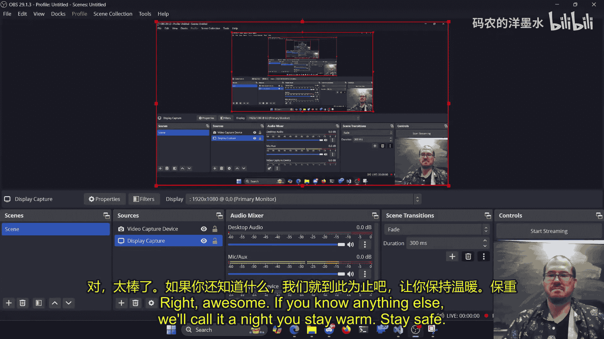

在接下来的项目中，你们将应用回溯递归来解决一个跳棋问题：计算一个跳棋棋盘上，任意白棋棋子能完成的最长连续跳跃次数。这需要你们模拟所有可能的跳跃路径，并在尝试后正确回溯以恢复棋盘状态，为计算下一个棋子的跳跃做好准备。我们将在后续课程中继续练习和深化对递归，特别是回溯技术的理解。