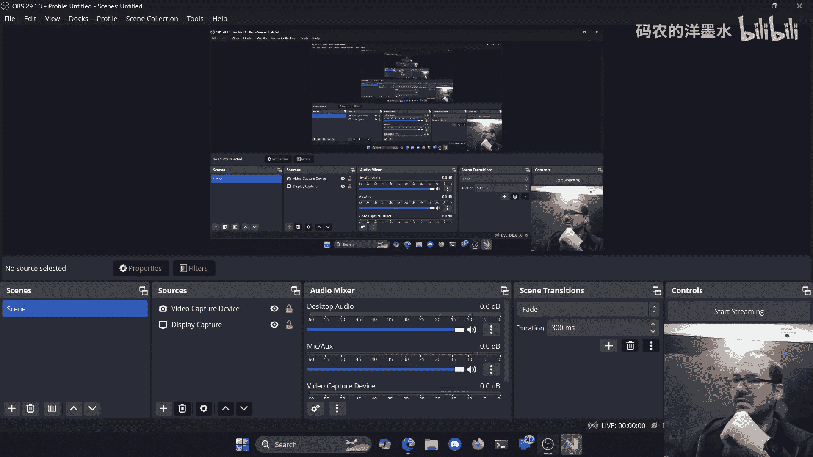
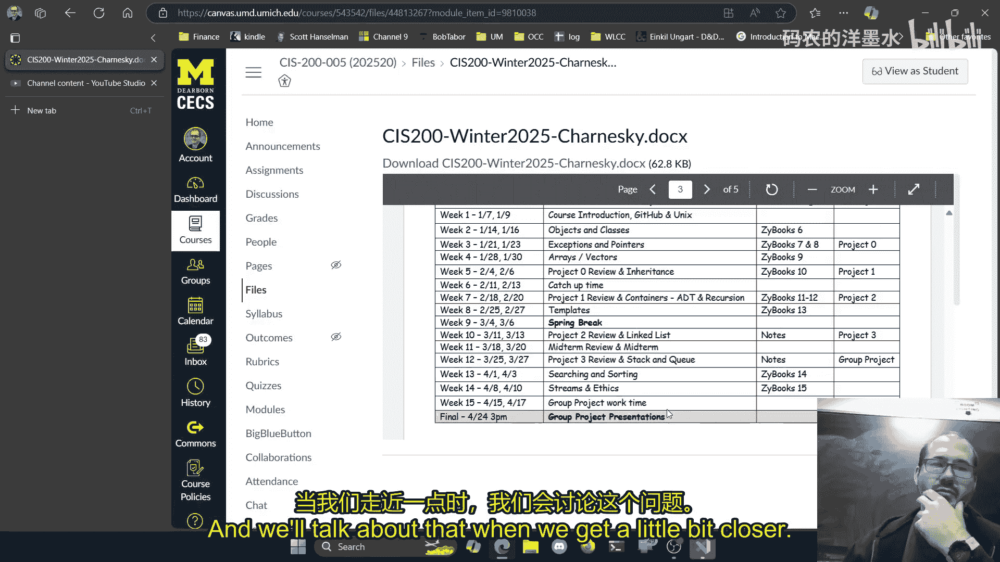
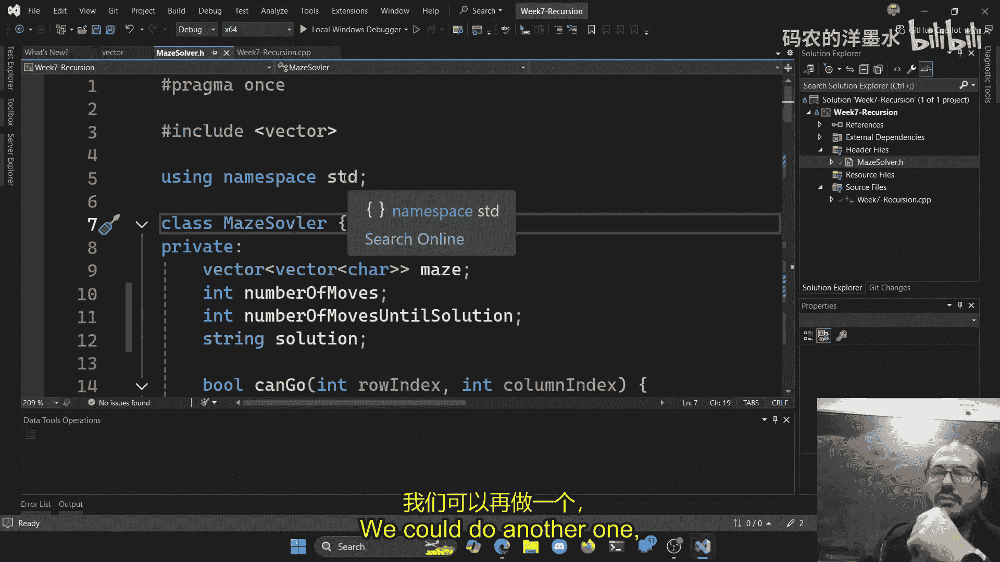
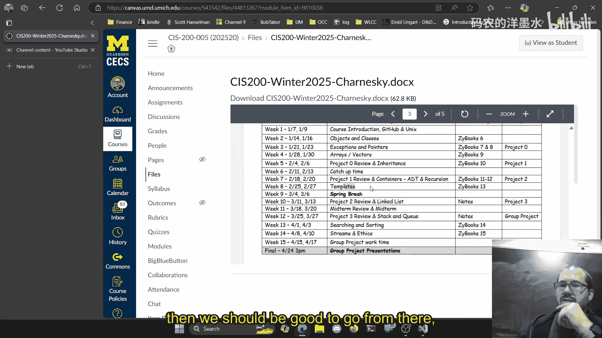
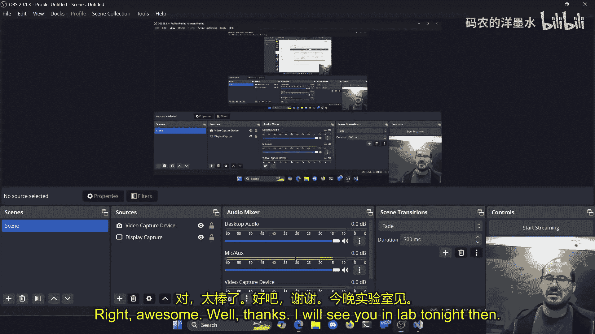

# 011：递归（第二部分）🚀



在本节课中，我们将深入学习回溯递归，这是一种通过尝试所有可能性来解决问题的强大技术。我们将以迷宫求解为例，详细讲解其工作原理，并探讨如何优化以寻找最短路径。



---

## 课程概述


上一节我们介绍了递归的基本概念。本节中，我们将重点探讨**回溯递归**。这是一种“尝试-失败-回退”的算法策略，常用于解决迷宫、棋盘游戏（如跳棋）等需要探索所有路径的问题。我们将通过一个迷宫求解器的实例，来理解如何实现回溯，以及如何记录和比较不同的解决方案。


---


## 迷宫求解与回溯递归


我们之前构建了一个迷宫求解器。其核心思想是：从起点开始，尝试向各个方向移动。如果到达终点，则成功；如果走入死胡同，则退回上一步，尝试另一个方向。

### 基础案例与递归步骤

递归必须有一个明确的**基础案例**，即知道何时停止。对于迷宫求解，基础案例是**到达终点**。

如果未到达终点，算法需要尝试向终点迈进一步。由于不知道哪条路正确，**回溯递归**会尝试**每一个**可能的方向。其模式是：尝试一个方向 -> 递归调用 -> 如果失败则撤销尝试（回溯） -> 尝试下一个方向。

以下是核心逻辑的伪代码表示：
```cpp
bool solve(x, y) {
    if (isEnd(x, y)) {
        return true; // 基础案例：到达终点
    }
    if (isValidMove(x+1, y)) { // 尝试向下走
        markCell(x+1, y);
        if (solve(x+1, y)) {
            return true;
        }
        unmarkCell(x+1, y); // 回溯：撤销尝试
    }
    // ... 类似地尝试左、右、上等其他方向
    return false; // 所有方向都尝试失败
}
```

### 寻找所有解与最短路径


最初的求解器在找到一条路径后就会停止。但迷宫可能有多个解。通过移除“找到即返回”的限制，算法可以继续探索，从而找到**所有可能的解决方案**。


然而，当解决方案很多时，输出所有路径会显得杂乱。更实用的目标是找到**最短路径**。为此，我们需要在求解过程中跟踪步数。


以下是优化后的步骤：
1.  添加变量记录当前路径的移动步数 (`moves`) 和目前找到的最短路径步数 (`shortestMoves`)。
2.  每次尝试移动时，`moves` 加1。
3.  到达终点时，比较当前 `moves` 与 `shortestMoves`。
4.  如果当前路径更短，则更新 `shortestMoves` 并保存当前路径方案。
5.  在回溯（撤销移动）时，记得将 `moves` 减1。

关键模式始终是：**执行动作 -> 递归 -> 撤销动作**。这对于跳棋等项目同样适用：执行跳跃 -> 递归探索后续棋局 -> 撤销跳跃以尝试其他走法。

---

## 生成随机迷宫进行测试

为了更全面地测试我们的求解器，我们可以编写一个函数来**生成随机迷宫**。

以下是生成随机迷宫的关键步骤：
1.  确定迷宫的随机行数和列数（例如4到10之间）。
2.  为每个格子随机分配“墙”或“路”。可以通过生成随机数并取模来控制路的概率（例如，`rand() % 4 == 0` 生成墙，否则为路）。
3.  将左上角设置为起点 `‘S’`，右下角设置为终点 `‘E’`。
4.  将生成的迷宫传递给求解器。

通过批量生成和求解随机迷宫，我们可以观察算法在不同复杂度迷宫下的表现，并验证其能否正确报告“无解”情况。

---

## 回溯递归的特点与局限性

回溯递归是一种强大的暴力搜索方法，但它并非最高效的：
*   **优点**：思路直观，能确保找到所有解（如果存在）。
*   **缺点**：需要尝试的可能性数量可能呈指数级增长，对于大型问题（如超过30x30的迷宫）可能导致栈溢出或运行时间过长。


因此，它更适合于规模有限或对解的质量有特殊要求（如需要所有解或最优解）的问题场景。


---


## 总结

本节课我们一起学习了**回溯递归**的核心思想与实现。
*   我们明确了其 **“尝试-递归-回溯”** 的核心模式。
*   我们通过迷宫求解案例，实践了如何寻找所有解，并优化算法以记录**最短路径**。
*   我们探讨了通过生成随机迷宫来测试算法健壮性的方法。
*   最后，我们讨论了回溯递归的优缺点及其适用场景。








理解这种模式对于完成像跳棋这样需要探索多种走法的项目至关重要。在接下来的实验课中，我们将有更多机会练习这一技术。