# 013：三法则 🧩


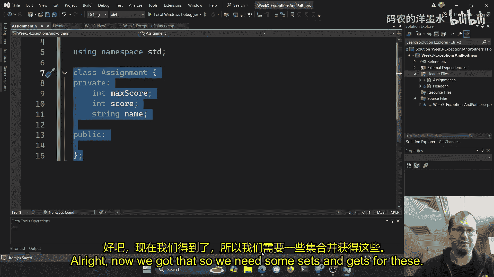

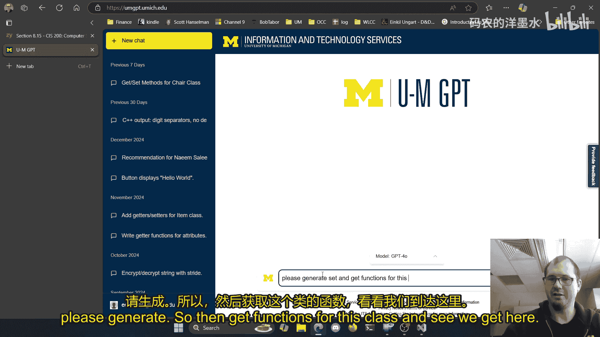

在本节课中，我们将学习C++中一个重要的概念——“三法则”。当我们的类管理动态内存（例如，使用 `new` 分配内存）时，编译器提供的默认拷贝和赋值行为可能会导致问题。三法则告诉我们，如果一个类需要显式定义**析构函数**、**拷贝构造函数**或**拷贝赋值运算符**中的任何一个，那么它很可能需要同时定义这三个函数，以确保内存被正确管理。

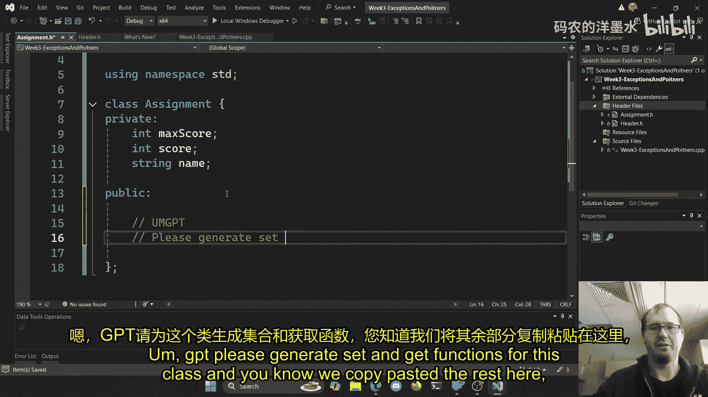

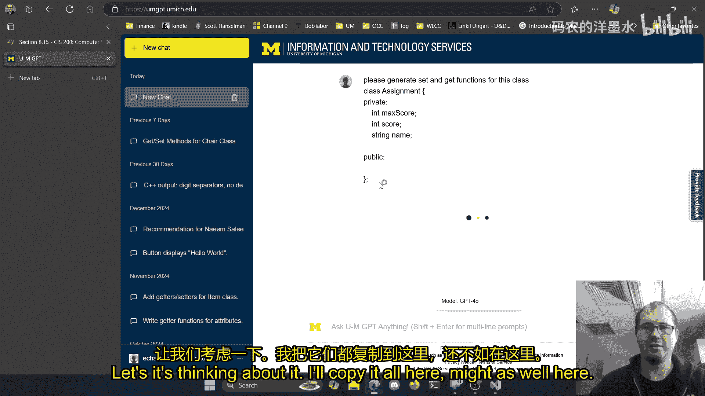

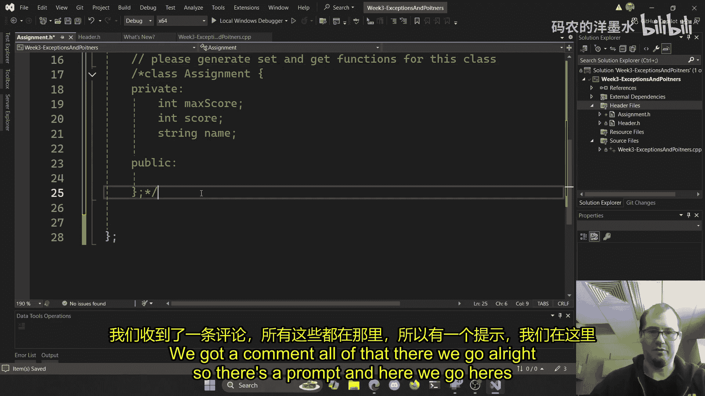

## 动态内存管理的问题

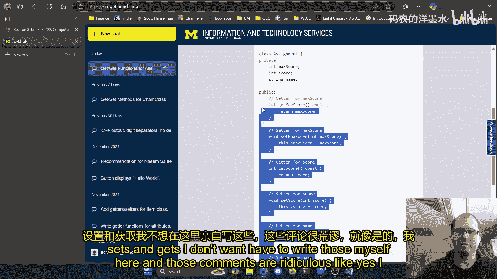

上一节我们介绍了类的基本概念。本节中我们来看看当类使用动态内存时会出现什么问题。

考虑一个简单的 `Assignment` 类，它包含作业名称和分数。

```cpp
class Assignment {
private:
    std::string name;
    int score;
    int maxScore;
public:
    // 构造函数、setter和getter...
};
```

现在，我们创建一个 `Student` 类，它使用一个动态分配的 `Assignment` 数组来存储学生的作业列表。

```cpp
class Student {
private:
    Assignment* assignments; // 指向动态数组的指针
    std::string name;
    int currentNumAssignments;
    const int MAX_ASSIGNMENTS = 5;
public:
    Student() {
        assignments = new Assignment[MAX_ASSIGNMENTS];
        currentNumAssignments = 0;
        name = "";
    }
    // 其他成员函数...
};
```

在构造函数中，我们使用 `new` 在堆上分配了内存。如果不进行管理，当 `Student` 对象被销毁时，这块内存不会被自动释放，从而导致**内存泄漏**。

## 析构函数 🗑️


为了解决内存泄漏问题，我们需要定义一个析构函数。析构函数在对象被销毁时自动调用，用于释放对象生命周期内申请的资源。


析构函数的语法是在类名前加一个波浪号（`~`）。


```cpp
~Student() {
    delete[] assignments; // 释放动态数组
}
```

添加析构函数后，当 `Student` 对象离开其作用域或被 `delete` 时，动态分配的数组内存会被正确释放，从而避免了内存泄漏。

## 浅拷贝与深拷贝

接下来，我们探讨拷贝对象时会发生什么。如果我们尝试拷贝一个 `Student` 对象：

```cpp
Student student1;
// ... 为 student1 添加一些作业
Student student2 = student1; // 拷贝初始化
```

编译器会提供一个默认的拷贝构造函数，它执行的是**浅拷贝**。这意味着 `student2.assignments` 指针会复制 `student1.assignments` 指针的值，即它们指向**同一块内存地址**。

这会导致严重问题：
1.  修改其中一个对象的作业列表会影响另一个对象。
2.  当两个对象都被销毁时，它们的析构函数都会尝试 `delete[]` 同一块内存，导致**未定义行为**（通常是程序崩溃）。

## 拷贝构造函数 📋


为了进行**深拷贝**（即复制指针所指向的内容，而不是指针本身），我们需要自定义拷贝构造函数。


拷贝构造函数接受一个对同类对象的常量引用作为参数。

```cpp
Student(const Student& other) {
    // 1. 分配新的内存
    assignments = new Assignment[MAX_ASSIGNMENTS];
    // 2. 复制原始数据
    name = other.name;
    currentNumAssignments = other.currentNumAssignments;
    // 3. 复制动态数组中的每个元素
    for (int i = 0; i < currentNumAssignments; ++i) {
        assignments[i] = other.assignments[i];
    }
}
```


现在，`Student student2 = student1;` 会调用这个自定义的拷贝构造函数，创建一个拥有独立动态数组的完整副本。


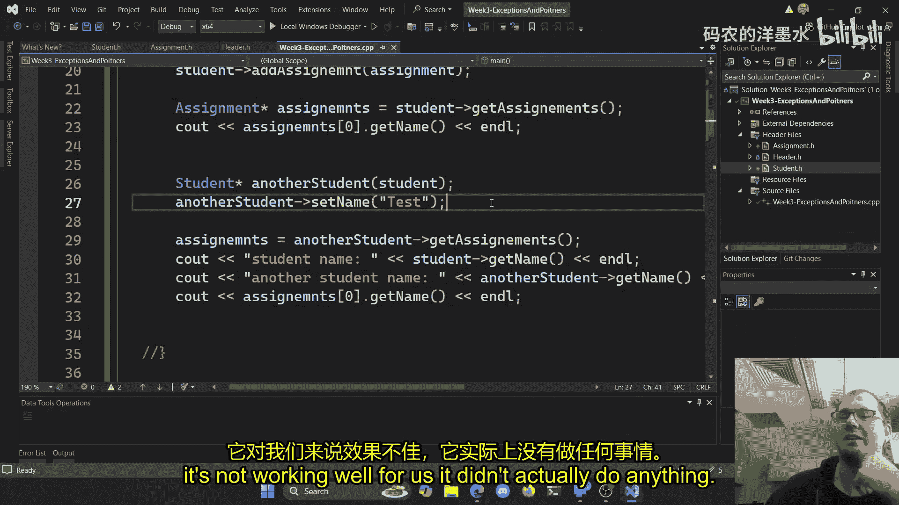

## 拷贝赋值运算符 🔄

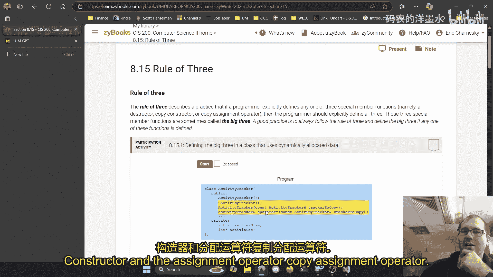

除了初始化时的拷贝，我们还需要处理赋值操作：

```cpp
Student student1;
Student student2;
// ...
student2 = student1; // 赋值操作
```


默认的赋值操作同样是浅拷贝。我们需要重载拷贝赋值运算符 `operator=`。

拷贝赋值运算符通常返回一个指向当前对象的引用，以实现链式赋值（如 `a = b = c`）。


以下是实现步骤：

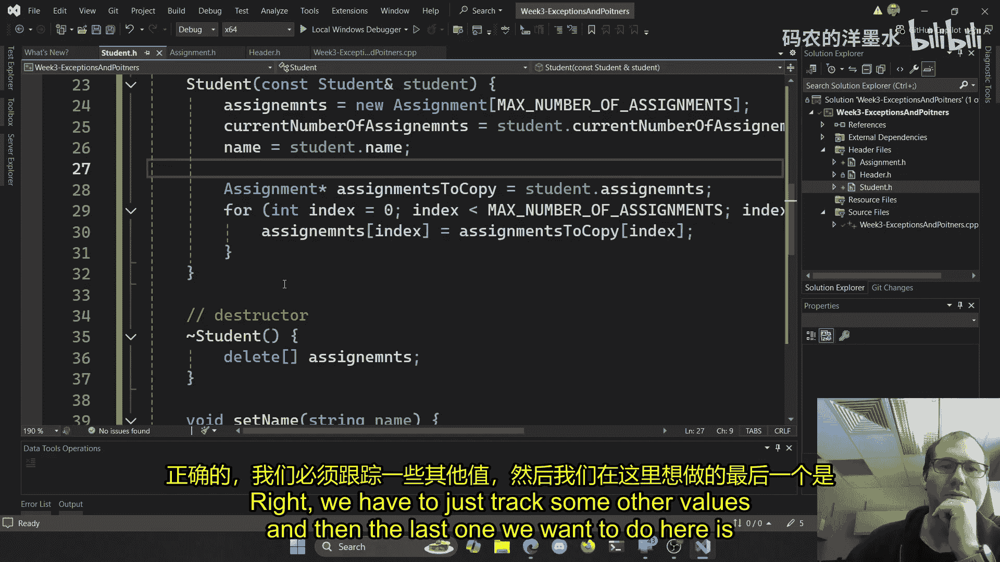

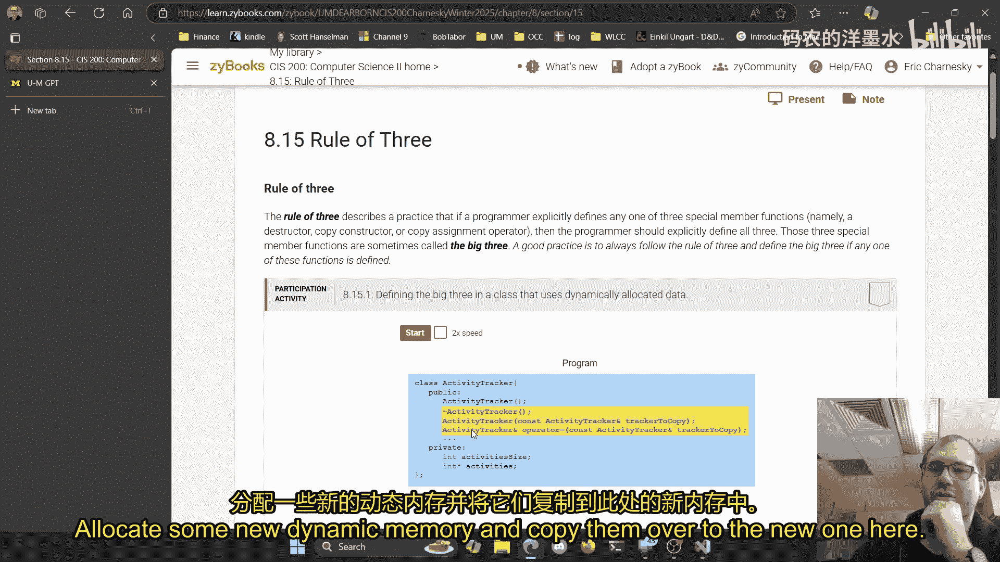

```cpp
Student& operator=(const Student& other) {
    // 1. 防止自赋值 (例如: student1 = student1)
    if (this != &other) {
        // 2. 释放当前对象持有的旧资源
        delete[] assignments;
        // 3. 分配新资源并复制数据（与拷贝构造函数类似）
        assignments = new Assignment[MAX_ASSIGNMENTS];
        name = other.name;
        currentNumAssignments = other.currentNumAssignments;
        for (int i = 0; i < currentNumAssignments; ++i) {
            assignments[i] = other.assignments[i];
        }
    }
    // 4. 返回当前对象的引用
    return *this;
}
```

**自赋值检查** (`if (this != &other)`) 至关重要。如果没有它，在自赋值时，我们会先删除自己的内存，然后试图从已删除的内存中复制数据，这会导致错误。

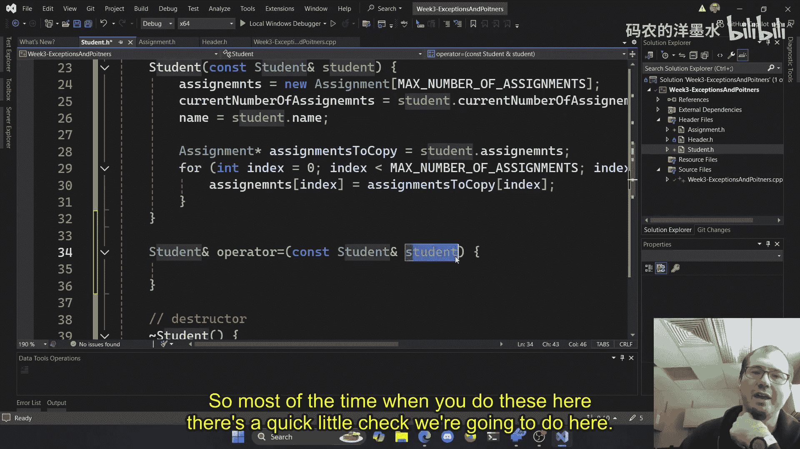

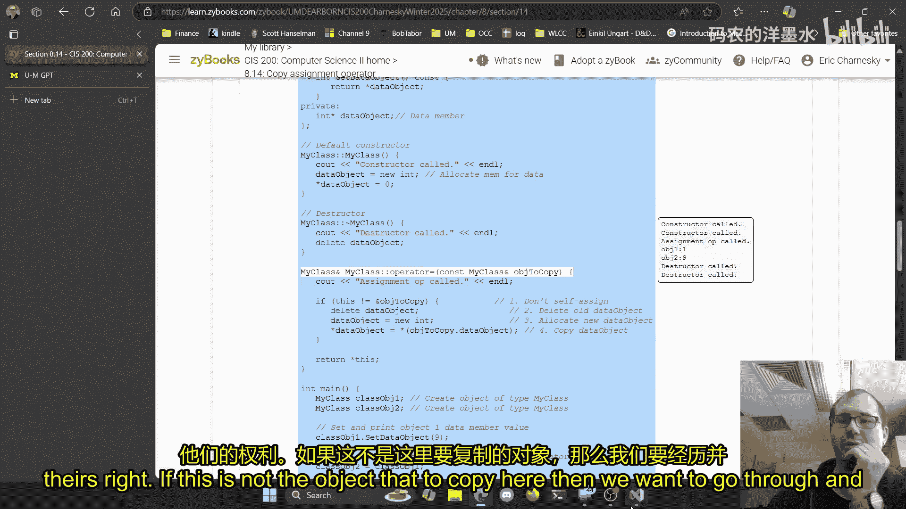

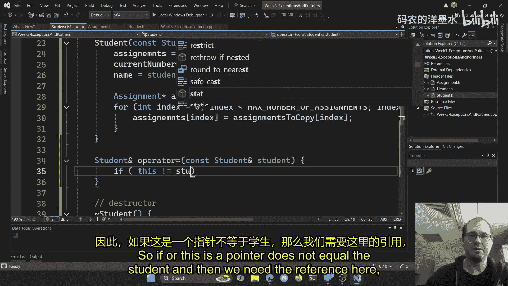

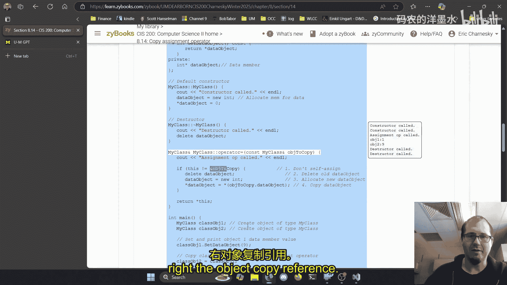

## 三法则总结

综上所述，**三法则**的核心是：如果你需要为一个类显式地定义析构函数、拷贝构造函数或拷贝赋值运算符中的任何一个，那么你通常需要同时定义这三个函数，以确保资源（尤其是动态内存）在所有情况下都能被正确管理。

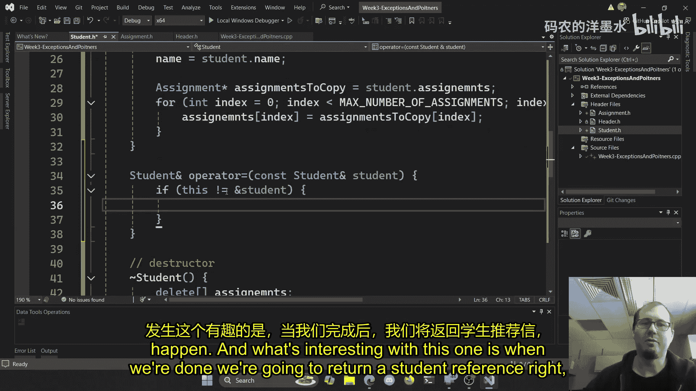

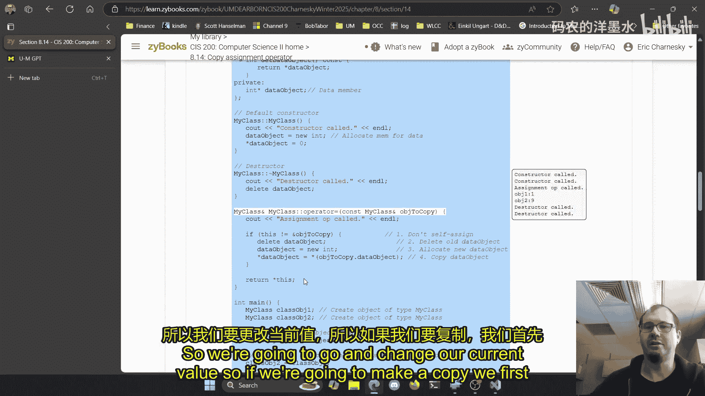

以下是需要实现这三个函数的典型情况：
*   类中包含指向动态分配内存的指针。
*   类管理着文件句柄、网络连接等需要显式释放的资源。

## 动态数组扩容思路

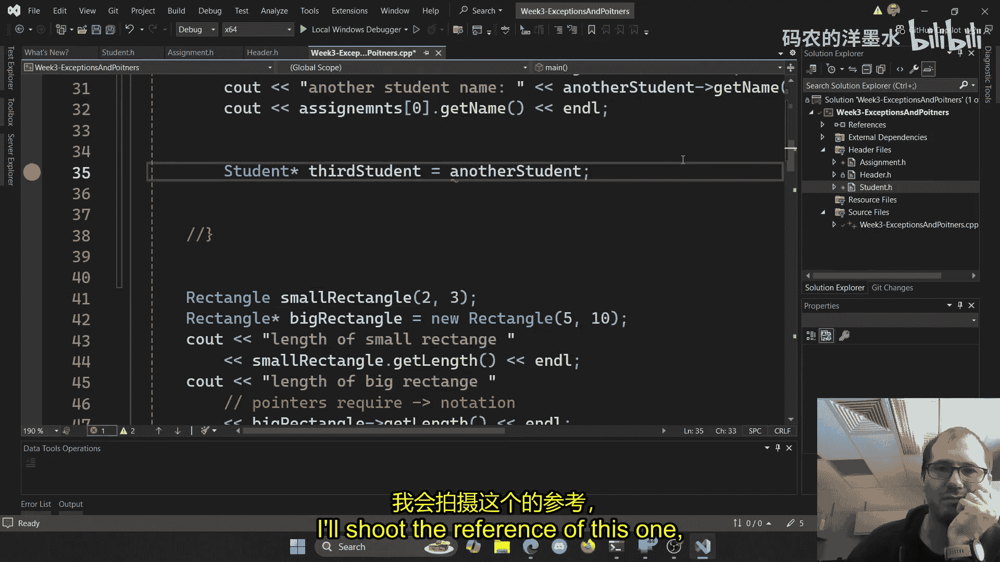

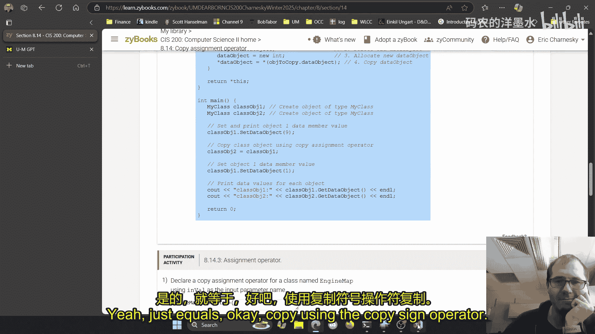

在 `Student` 类的例子中，我们的作业数组有固定大小（`MAX_ASSIGNMENTS`）。在实际应用中，我们可能需要动态扩容。思路如下：

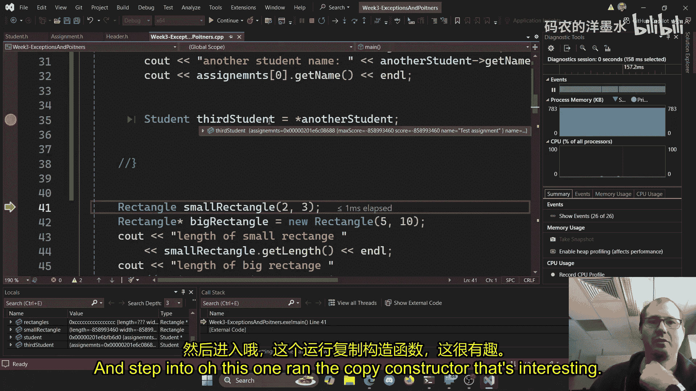

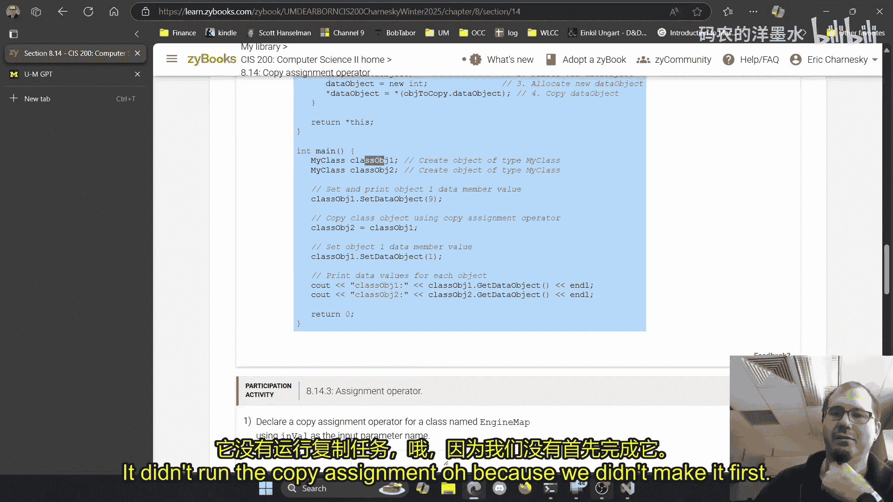

1.  当数组已满且需要添加新元素时，分配一个更大的新数组。
2.  将旧数组中的所有元素复制到新数组中。
3.  释放旧数组所占用的内存。
4.  让类的指针指向新的数组。
5.  更新数组容量的记录。

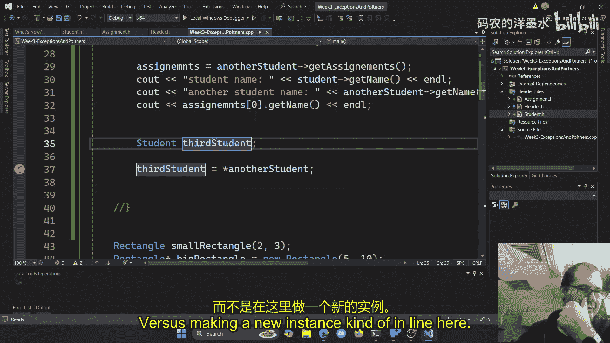

这个过程在拷贝赋值运算符中已经有所体现（释放旧内存，分配新内存，复制数据），可以将其抽象成一个独立的私有辅助函数（如 `resize()`）来供 `addAssignment` 等方法调用。

---

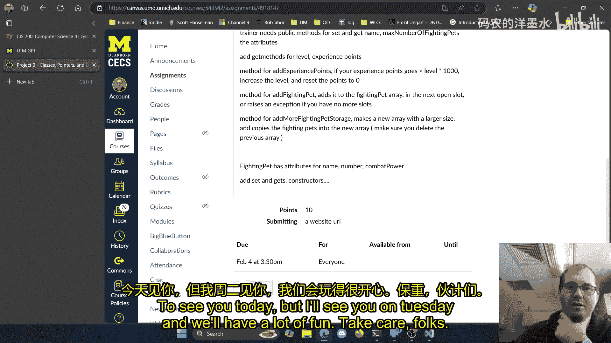

本节课中我们一起学习了C++的“三法则”。我们了解了为什么管理动态内存的类需要自定义析构函数来避免内存泄漏，以及为什么需要自定义拷贝构造函数和拷贝赋值运算符来替代编译器的浅拷贝，从而实现安全的深拷贝。掌握三法则是编写健壮、无资源泄漏的C++程序的关键一步。