# 016：抽象类与测试 🧪

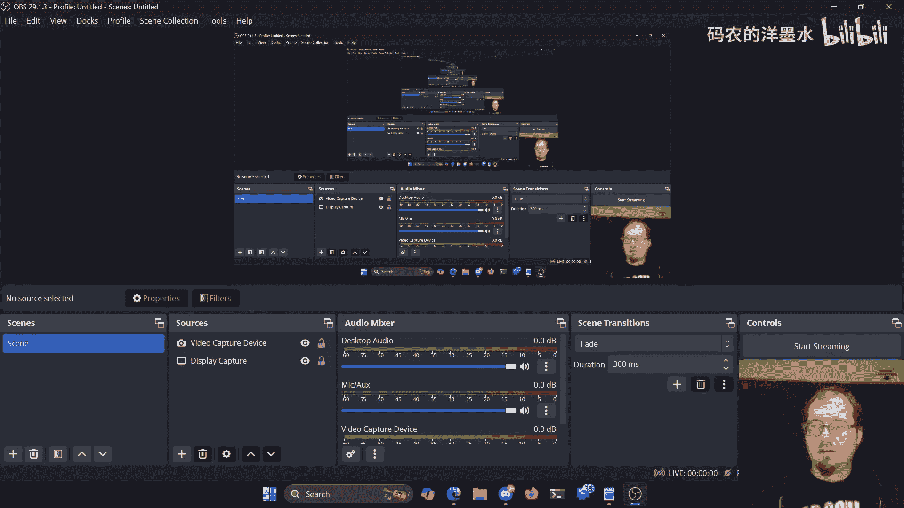

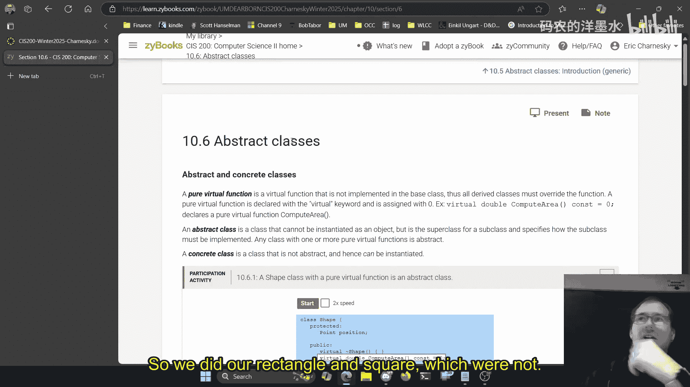

在本节课中，我们将完成关于继承的讨论，并学习两个重要的高级概念：**抽象类**和**单元测试**。我们将通过扩展形状类的例子来理解抽象类的用途，并学习如何编写自动化测试来确保代码的正确性。

---

## 抽象类与纯虚函数 🧩

上一节我们介绍了继承和多态的基本概念。本节中，我们来看看如何定义一个**抽象类**。抽象类是一种不能被直接实例化的类，它通常包含一个或多个**纯虚函数**。纯虚函数就像一个“占位符”，它告诉编译器：“这个函数必须存在，但具体如何实现，由继承我的子类来决定。”

### 定义抽象基类：多边形

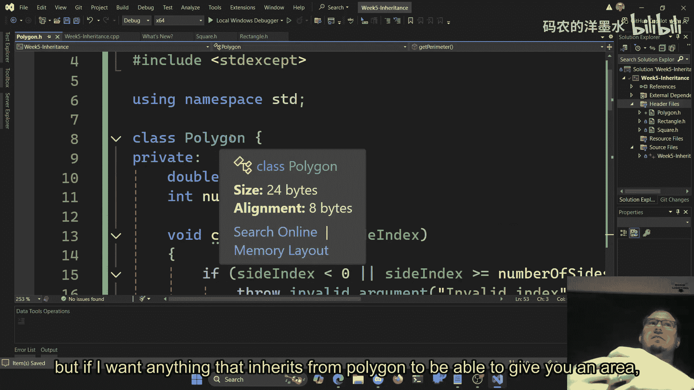

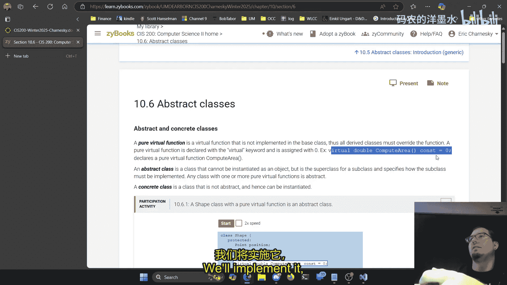

假设我们有一个`Polygon`（多边形）基类。对于任意多边形，我们都能计算其周长，但计算面积的方法因具体形状而异。因此，`getArea`函数可以定义为纯虚函数。

以下是`Polygon`类的核心代码框架：

```cpp
class Polygon {
protected:
    double* sideLengths; // 使用动态数组存储边长
    int numSides;

public:
    Polygon(int sides);
    virtual ~Polygon(); // 虚析构函数
    virtual double getPerimeter() const;
    virtual double getArea() const = 0; // 纯虚函数
    virtual void setSideLength(int index, double length);
    double getSideLength(int index) const;
    int getNumSides() const;
};
```

**公式**：纯虚函数的语法是在声明末尾加上 `= 0`，例如 `virtual double getArea() const = 0;`。


### 实现具体子类：矩形和三角形

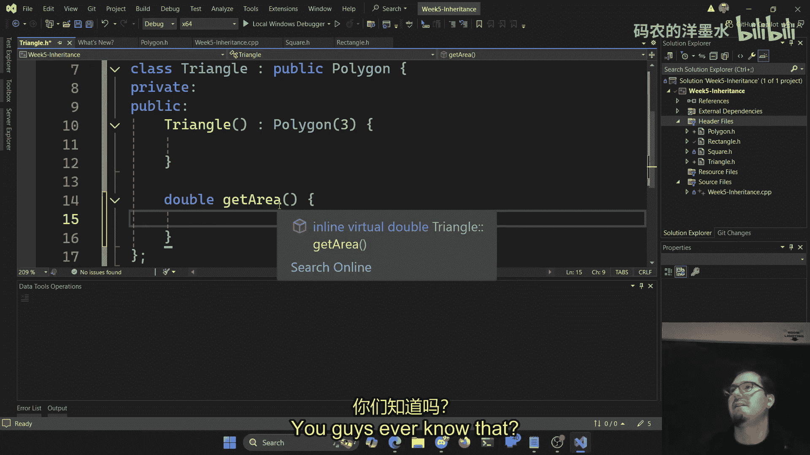

当一个类继承自包含纯虚函数的抽象类时，它**必须**提供所有纯虚函数的具体实现，否则它自身也会成为抽象类。

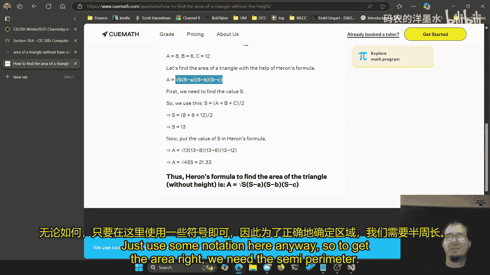

以下是`Rectangle`类需要实现`getArea`的示例：


```cpp
class Rectangle : public Polygon {
public:
    Rectangle(double width, double height) : Polygon(4) {
        // 设置四条边的长度，确保对边相等
        setSideLength(0, width);
        setSideLength(1, height);
        setSideLength(2, width);
        setSideLength(3, height);
    }
    double getArea() const override {
        return getSideLength(0) * getSideLength(1);
    }
    // 重写setSideLength以保持矩形属性
    void setSideLength(int index, double length) override {
        if (index == 0 || index == 2) {
            Polygon::setSideLength(0, length);
            Polygon::setSideLength(2, length);
        } else {
            Polygon::setSideLength(1, length);
            Polygon::setSideLength(3, length);
        }
    }
};
```


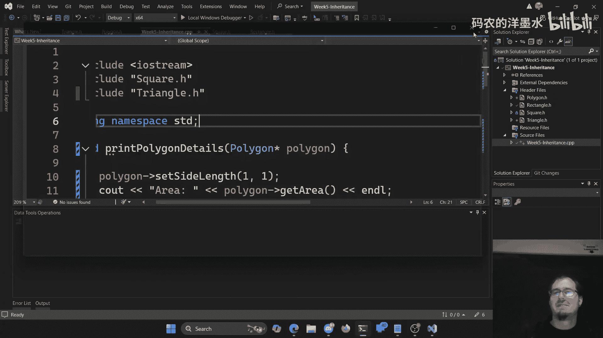

对于`Triangle`类，我们可以使用海伦公式计算面积：

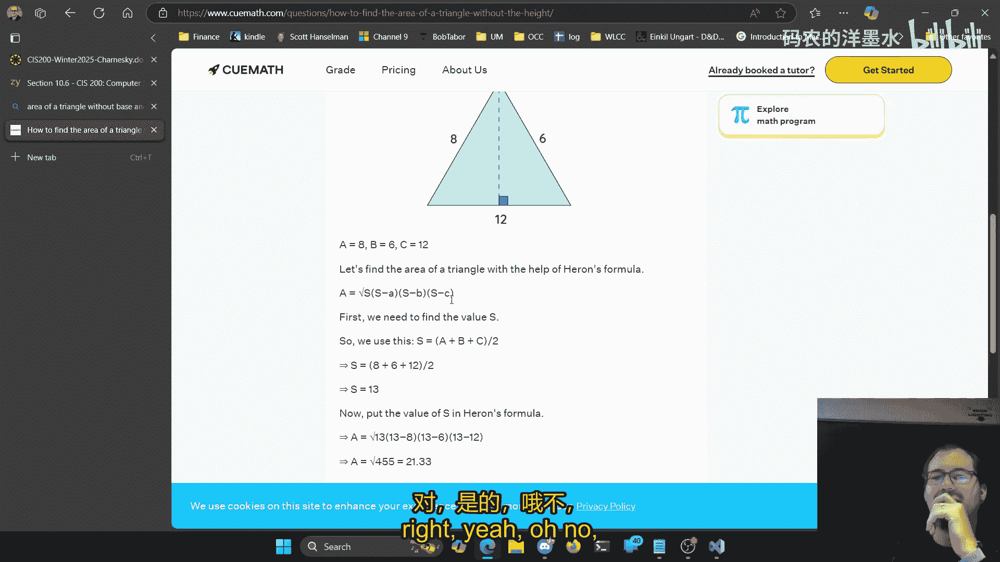

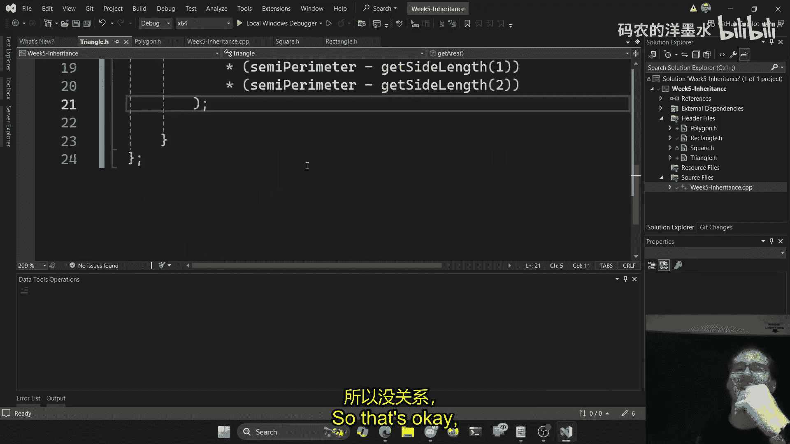

**公式**：海伦公式 `Area = sqrt(s * (s - a) * (s - b) * (s - c))`，其中 `s` 是半周长 `(a + b + c) / 2`。

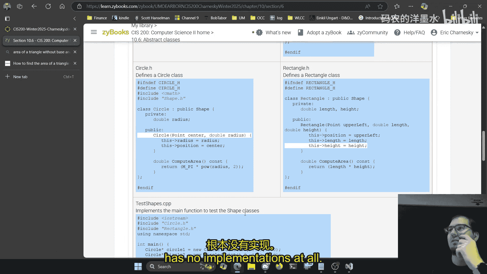

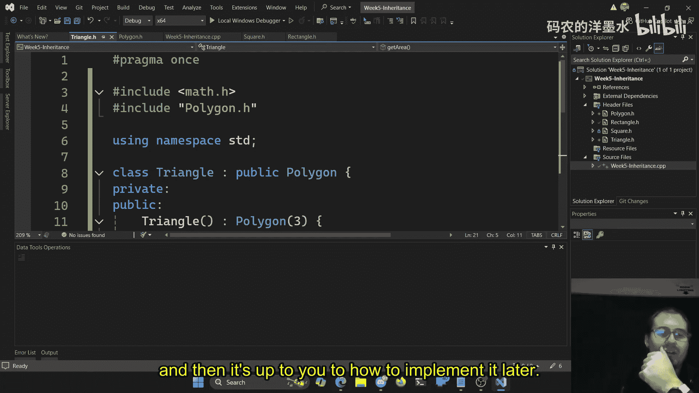

```cpp
class Triangle : public Polygon {
public:
    Triangle(double a, double b, double c) : Polygon(3) {
        setSideLength(0, a);
        setSideLength(1, b);
        setSideLength(2, c);
    }
    double getArea() const override {
        double a = getSideLength(0);
        double b = getSideLength(1);
        double c = getSideLength(2);
        double s = getPerimeter() / 2.0;
        return sqrt(s * (s - a) * (s - b) * (s - c));
    }
};
```

通过使用抽象类，我们可以创建`Polygon`类型的指针数组，利用多态性统一处理不同的形状，同时确保每个形状都能正确计算面积。

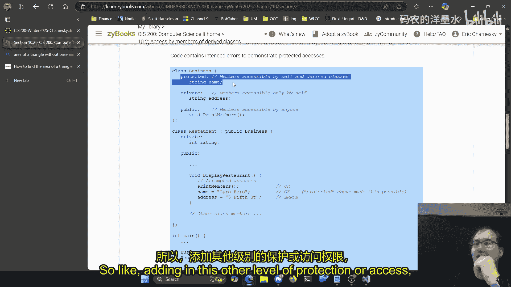

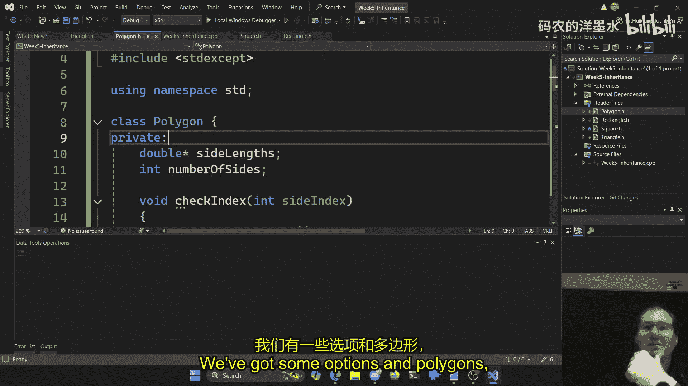

---

## 编写单元测试 ✅

编写完类之后，如何确保它们的行为符合预期呢？手动运行程序并检查输出容易出错且效率低下。更好的方法是编写**自动化单元测试**。

### 测试框架简介

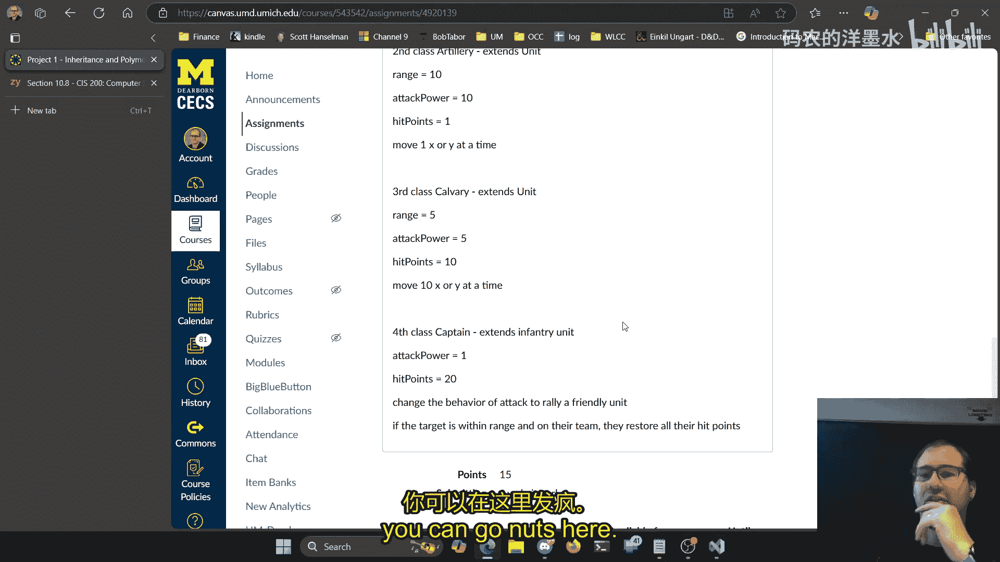


在Visual Studio等集成开发环境中，可以使用内置的测试框架（如Microsoft C++ Unit Test Framework）。测试的基本模式通常遵循“**3A原则**”：
1.  **Arrange**：准备测试所需的数据和对象。
2.  **Act**：执行要测试的代码。
3.  **Assert**：验证结果是否符合预期。


### 为三角形类编写测试

以下是一个测试`Triangle`类面积计算的示例：

```cpp
TEST_METHOD(TestTriangleArea) {
    // Arrange: 准备一个3-4-5直角三角形，预期面积为6
    double expectedArea = 6.0;
    Triangle triangle(3, 4, 5);

    // Act: 调用getArea函数
    double actualArea = triangle.getArea();

    // Assert: 验证实际结果与预期结果是否相等
    Assert::AreEqual(expectedArea, actualArea);
}
```

当测试运行时，框架会自动比较`expectedArea`和`actualArea`。如果相等，测试通过（显示绿色对勾）；如果不相等，测试失败（显示红色叉号），并会明确指出期望值和实际值。

### 测试异常情况

我们还需要测试代码在非法输入时的行为，例如为矩形设置负的宽度。


以下是测试异常抛出的示例：


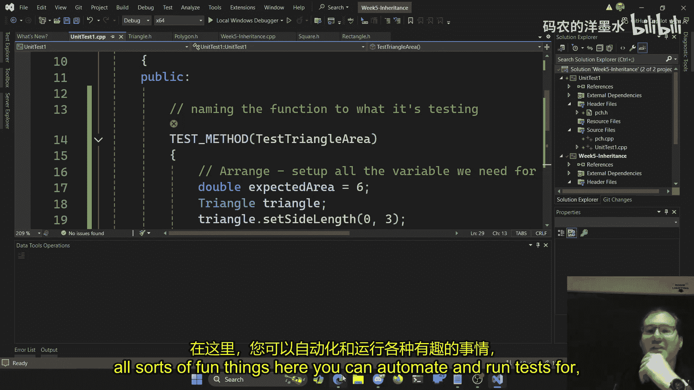

```cpp
TEST_METHOD(TestRectangleNegativeWidthThrows) {
    // Arrange: 准备一个矩形
    Rectangle rect(5, 10);
    std::string expectedError = “Width cannot be negative”;
    std::string actualError = “”;

    // Act & Assert: 尝试设置负宽度，应抛出异常
    try {
        rect.setWidth(-5);
        // 如果没抛出异常，测试失败
        Assert::Fail(L“Expected exception not thrown”);
    } catch (const std::invalid_argument& e) {
        actualError = e.what();
    }
    // 验证抛出的异常信息是否正确
    Assert::AreEqual(expectedError, actualError);
}
```


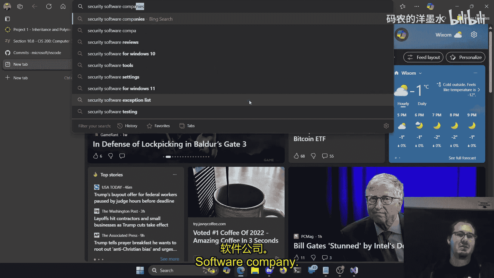

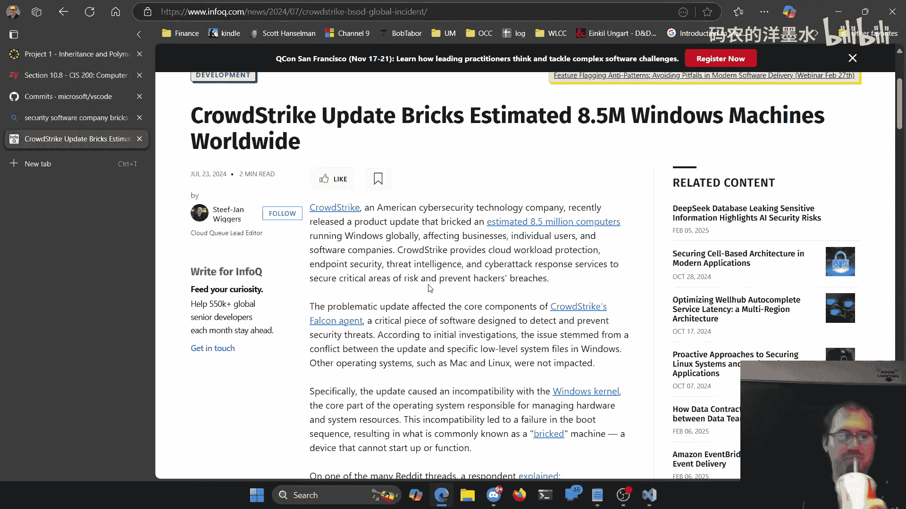

### 测试驱动开发与代码覆盖率


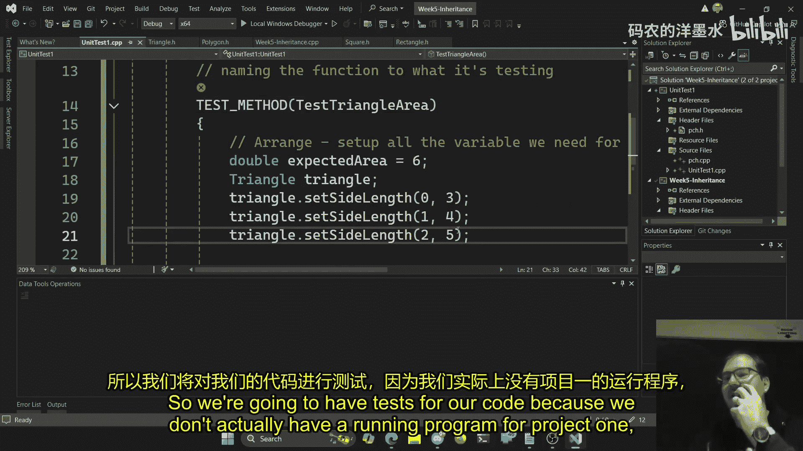

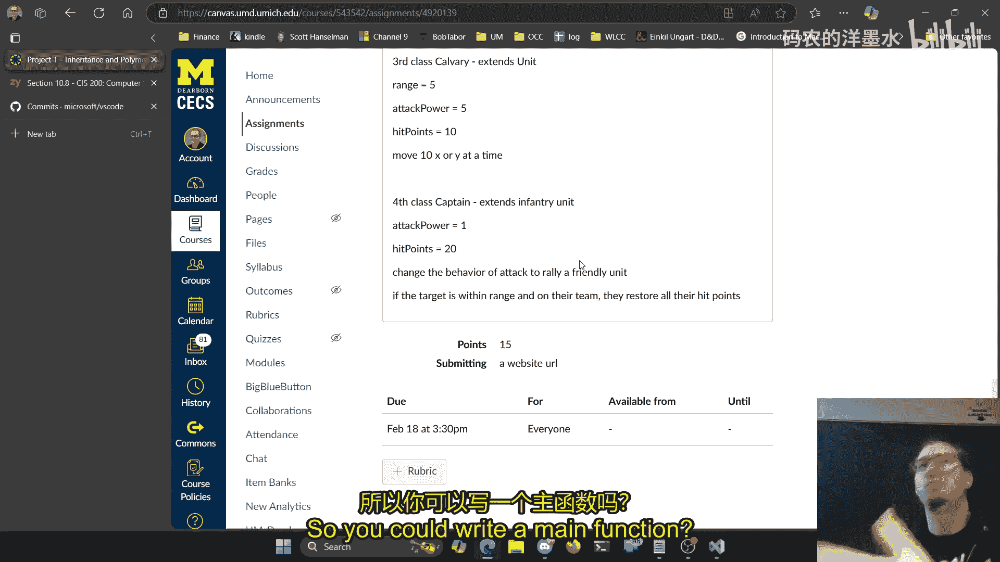

编写测试不仅能验证当前功能的正确性，还能在未来修改代码时，快速检测是否引入了新的错误（这称为“回归测试”）。理想情况下，我们追求高的**代码覆盖率**，即测试用例执行了代码库中的大部分语句和分支。


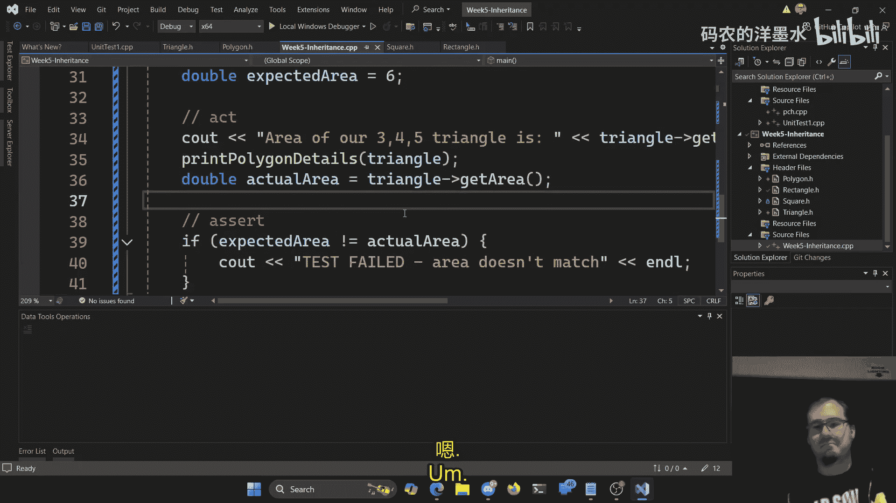

虽然达到100%覆盖率可能成本很高，但为关键逻辑和边界情况编写测试，能极大提升代码的可靠性和开发者的信心。

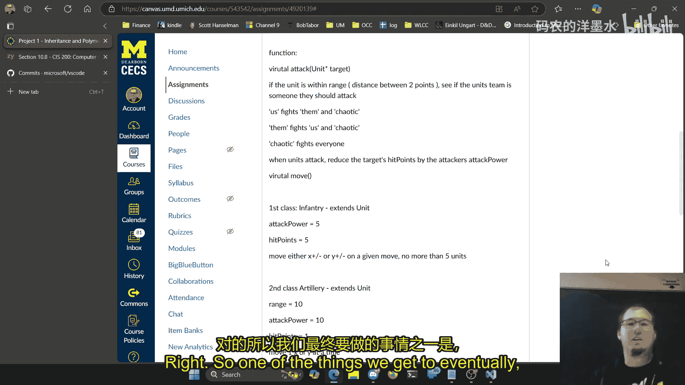

---

## 总结 📚

本节课中我们一起学习了面向对象编程中的两个高级主题。

首先，我们深入探讨了**抽象类**和**纯虚函数**。抽象类通过定义纯虚函数，为一系列相关类制定了必须实现的“契约”，它本身不能被实例化。这使得我们可以设计出更清晰、更灵活的类层次结构，并充分利用多态性。

其次，我们介绍了**单元测试**的重要性及基本编写方法。通过自动化测试，我们可以系统化地验证每个类和方法的行为，确保代码在各种情况下（包括异常输入）都能正确工作。这不仅是良好的编程实践，也是实现持续集成和持续交付的基石。

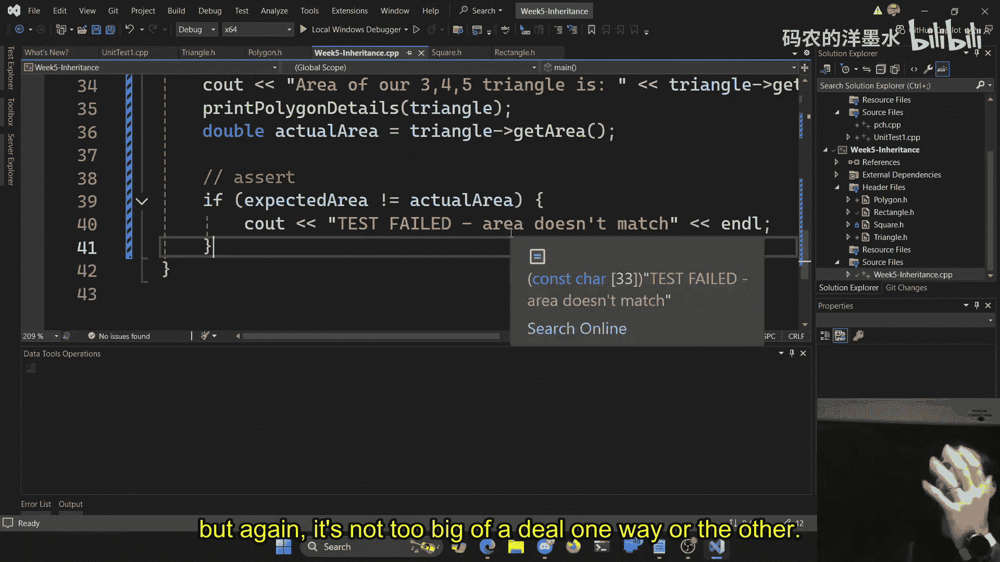

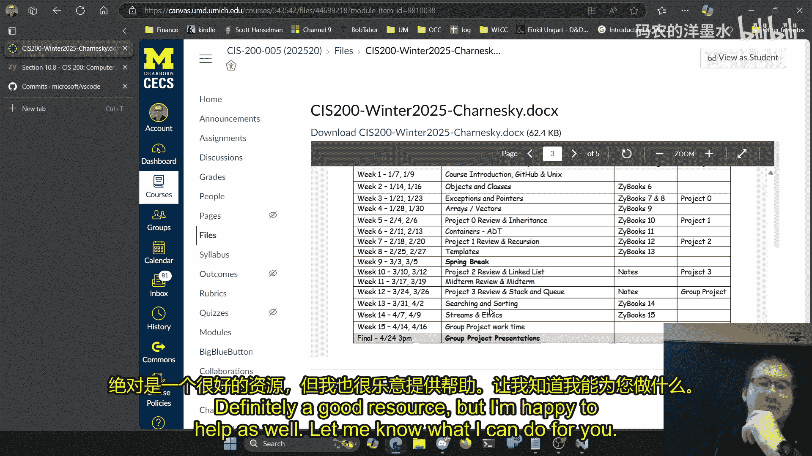

掌握抽象类让你能设计出更强大的软件架构，而掌握单元测试则能让你写出更健壮、更易于维护的代码。在接下来的项目和课程中，请积极运用这些概念。