# 001：导论

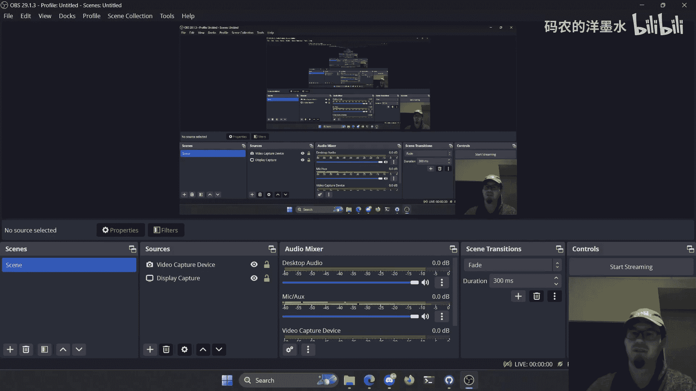

在本节课中，我们将学习C#游戏开发入门课程的整体介绍，包括课程目标、所需工具、评分方式以及学术诚信等重要信息。

## 课程概述与教师介绍

欢迎来到C#游戏开发入门课程。本课程将涵盖除Web开发外的各种C#应用开发，特别是游戏开发相关内容。课程为3个学分。

我是讲师Eric Chinsky。请注意，根据大学规定，我不能使用“教授”头衔。我的邮箱是ericchinsky@umich.edu。建议直接发送邮件，而非通过Canvas站内信联系，以便我能及时收到通知。

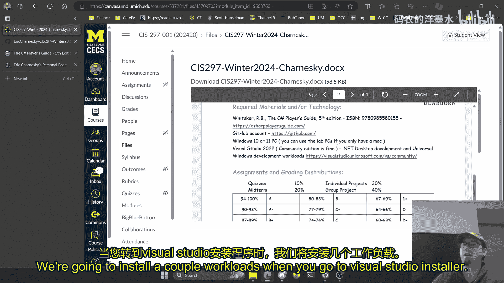

我的联系电话是(313) 123-4567。由于我还有另一份工作并有七个孩子，我的工作时间通常在晚上11点至凌晨4点。如果需要回电，请提供几个备选时间。

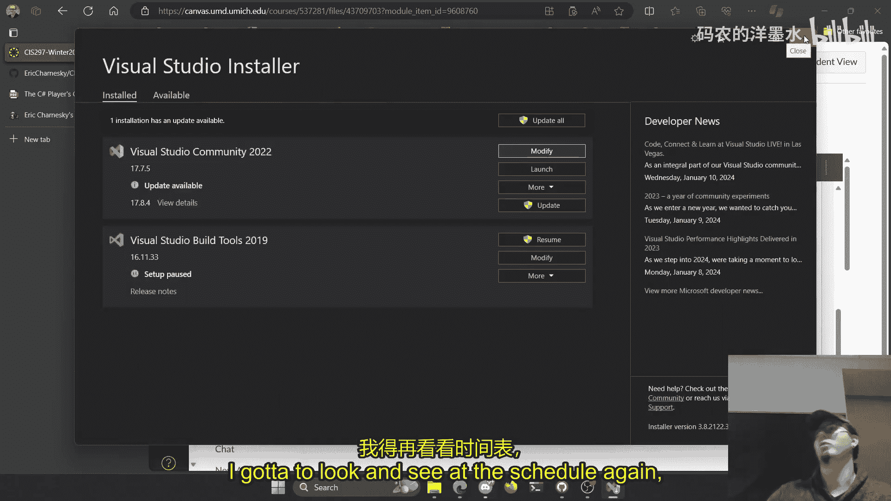

我通常在CIS大楼239号讲师办公室办公。课程将在Castle教室进行，并且有一个实验室可供使用。

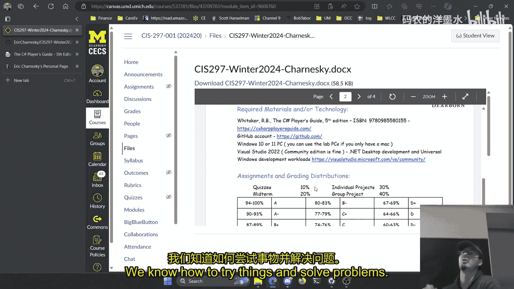

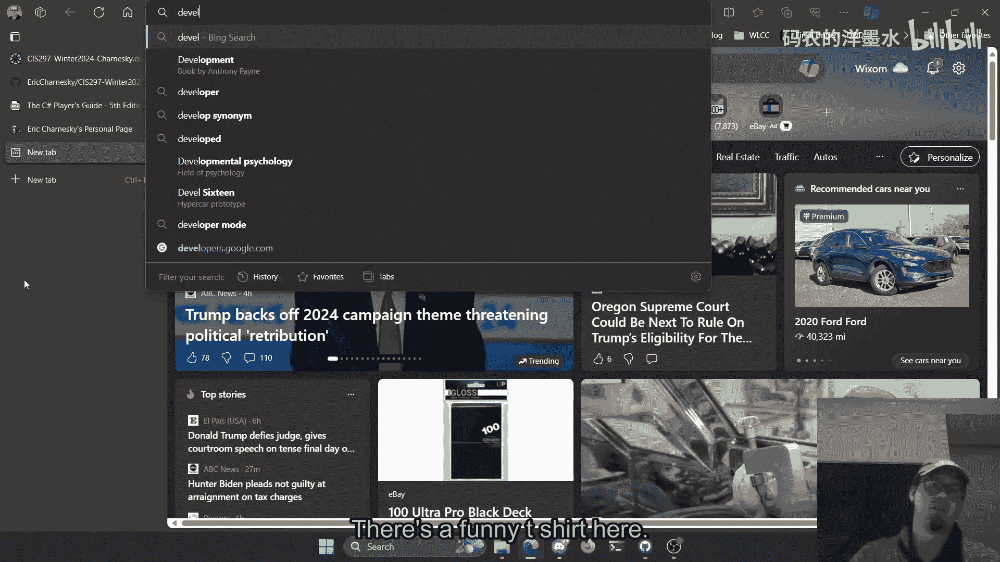

## 课程目标与内容

本课程旨在设计和实现简单的游戏，并解释在游戏开发中（例如选择动画精灵的方式时）的算法权衡。C#是Unity游戏引擎的脚本语言，因此被纳入游戏设计课程体系。

我们将主要使用Windows平台进行开发，并最终将游戏部署到Xbox One上运行。课程将指导你编写中等规模的C#程序。

## 所需材料与技术

**主要教材**：Rob Miles的《C# Programming Yellow Book》。这是一本专注于游戏开发的C#入门书籍，价格约为30美元。请支持作者，不要分享PDF。

**开发工具**：
*   **Git与GitHub**：我们将使用Git进行版本控制，并使用GitHub托管代码。这是行业标准工具。
*   **操作系统**：推荐使用Windows 10或11。虽然部分内容可在Mac上完成，但后期开发需要Windows环境。
*   **集成开发环境(IDE)**：使用Visual Studio 2022社区版。安装时需要勾选以下工作负载：
    *   **.NET桌面开发**：用于C#开发。
    *   **通用Windows平台开发**：用于后期游戏开发。
    *   **.NET多平台应用UI开发**：可选，用于跨平台开发演示。

## 评分方式

以下是本课程的评分构成：

*   **每周测验 (10%)**：开卷考试，旨在鼓励阅读教材。重点是学会查找信息，而非死记硬背。
*   **期中考试 (20%)**：开卷考试，用于检查对C#核心知识的掌握程度。
*   **个人项目 (30%)**：一系列编程练习。
*   **小组最终项目 (40%)**：课程最后一个月，小组合作复刻一个经典的2D游戏（如Atari游戏）。**未完成小组项目将无法通过本课程**。

## 课程安排

课程前半部分（春假前）将快速学习C#的所有核心主题。春假后，我们将进行期中考试，然后学习更高级的主题，包括数据库编程和通用Windows平台游戏开发。课程最后几周将专门用于小组项目开发。期末考试周将进行最终项目展示。

## 学术诚信政策

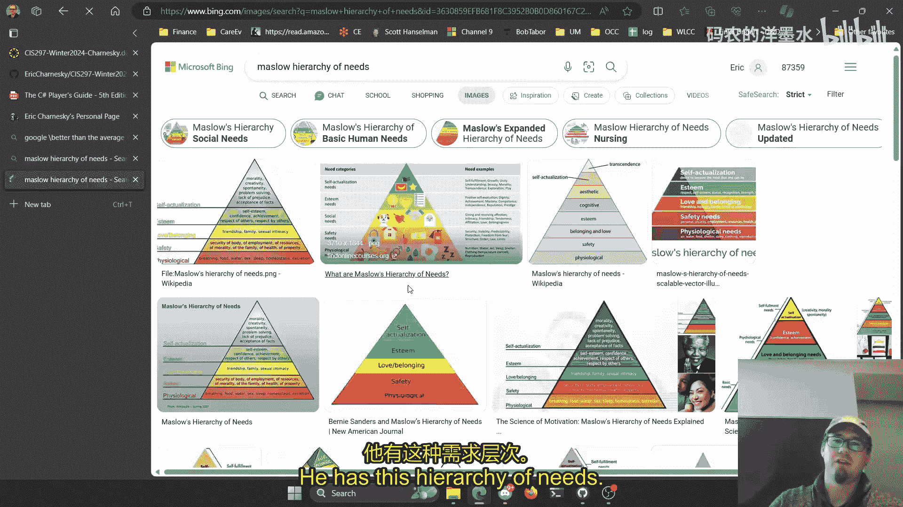

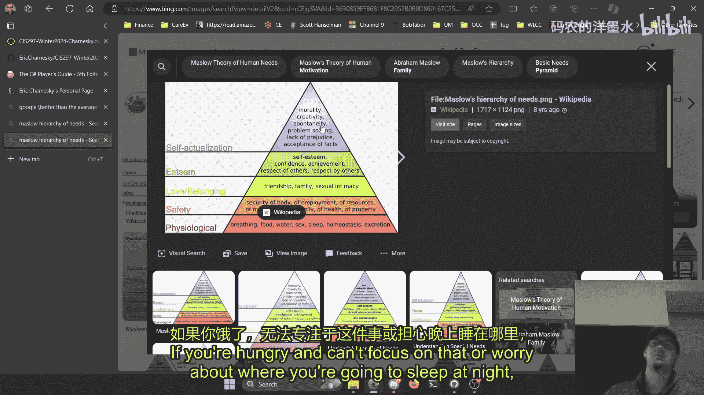

合作讨论想法和算法是允许且鼓励的。但是，直接共享代码是严格禁止的，这构成抄袭。

**严禁使用Chegg等网站**获取作业答案。使用ChatGPT等AI工具时，**必须注明引用来源**。就像写论文一样，你不能提交完全由AI生成的代码并声称是自己的作品。你的原创性努力和整合能力是关键。

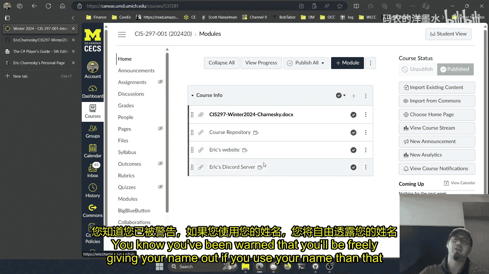

如果对某项操作是否合规有疑问，请在提交作业前向我咨询。作弊的后果非常严重，包括课程不及格和繁琐的文书工作。

## 其他政策与资源

*   **迟交政策**：作业一般不接受迟交，因为我通常会在课上讲解答案。如有特殊情况，请提前与我沟通。
*   **食物银行**：大学设有食物银行，如果你有基本需求方面的困难，可以联系他们寻求帮助。
*   **生病政策**：如果生病，请在家观看课程录像，不要来教室。
*   **安全政策**：如果遇到紧急情况，请遵循“跑、躲、战”的原则。我个人会选择迅速离开。

## 课程代码仓库与工具演示

所有课堂代码示例都将发布在我的公开GitHub仓库中：`https://github.com/your-repo-link`。课程录像也会更新在那里。

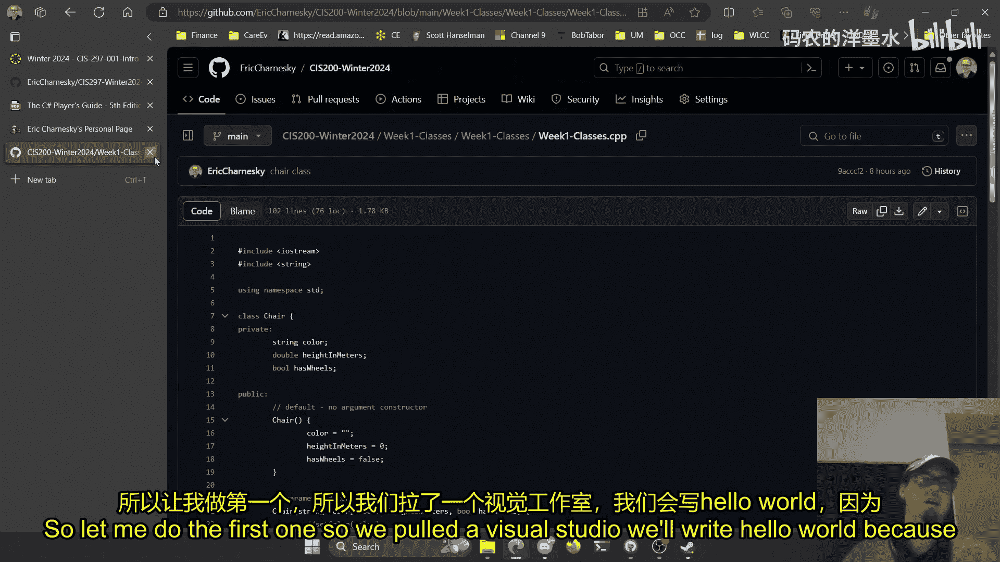

我们将使用Git和GitHub提交作业。我会通过GitHub Classroom为每次作业创建私有仓库，确保代码安全且便于我查看。

现在，让我们通过一个简单的“Hello World”程序来熟悉开发环境。

### 创建第一个C#项目

以下是创建控制台应用程序的步骤：

1.  打开Visual Studio 2022。
2.  选择“创建新项目”。
3.  在搜索框中输入“console”，选择“C#控制台应用”（标记有Linux、macOS、Windows图标的那个）。
4.  为项目命名，例如“HelloWorld”。
5.  在配置界面，可以选择是否“不使用顶级语句”。如果勾选，代码会包含显式的`Program`类和`Main`方法；如果不勾选，则使用更简洁的顶级语句语法。两者功能相同。
6.  点击“创建”。

### 代码示例

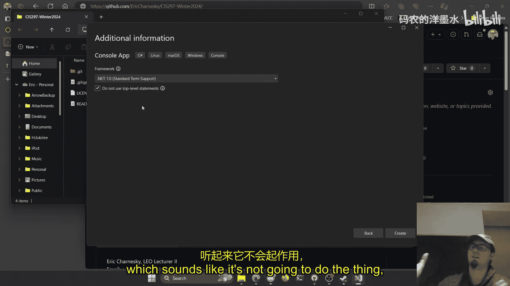

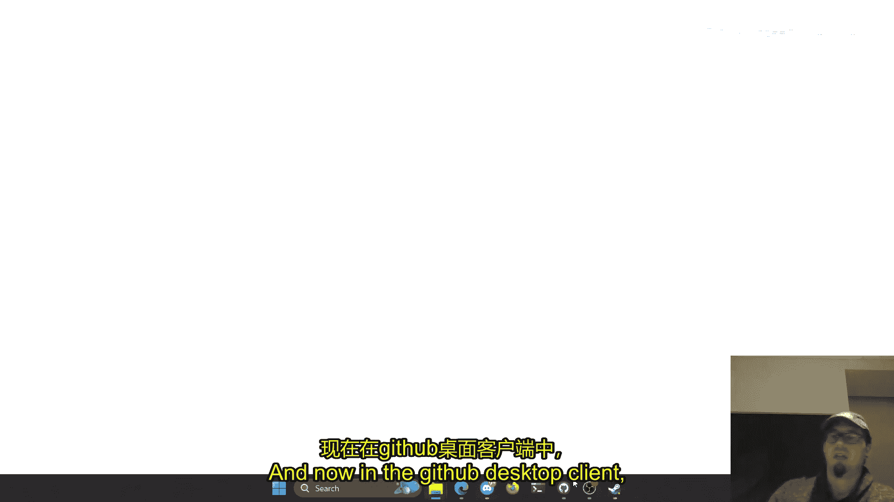

**不使用顶级语句的版本：**
```csharp
namespace HelloWorld
{
    internal class Program
    {
        static void Main(string[] args)
        {
            Console.WriteLine("Hello, World!");
        }
    }
}
```

**使用顶级语句的版本（默认）：**
```csharp
// 参见 C# 9.0 及更高版本
Console.WriteLine("Hello, World!");
```

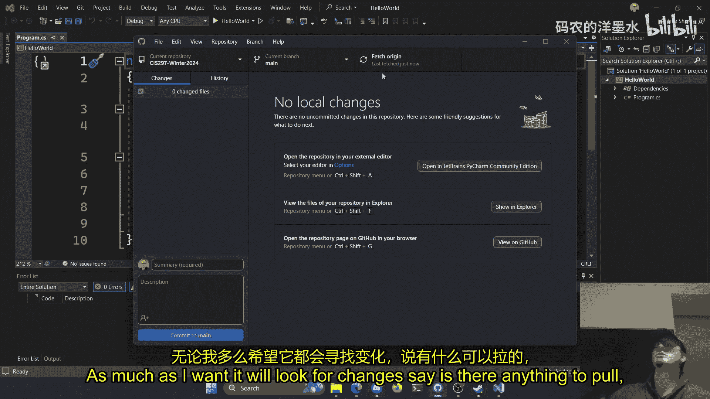

编写代码后，可以点击运行按钮或按`F5`键进行调试和运行。程序将在控制台输出“Hello, World!”。

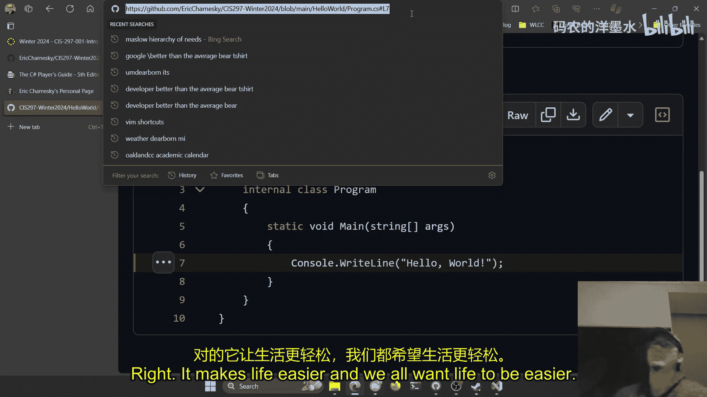

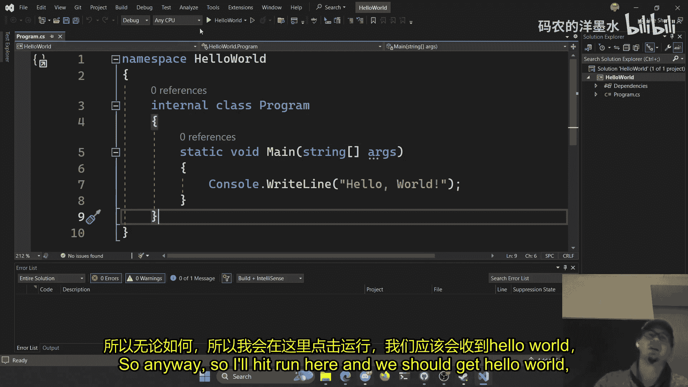

### 使用Git提交代码

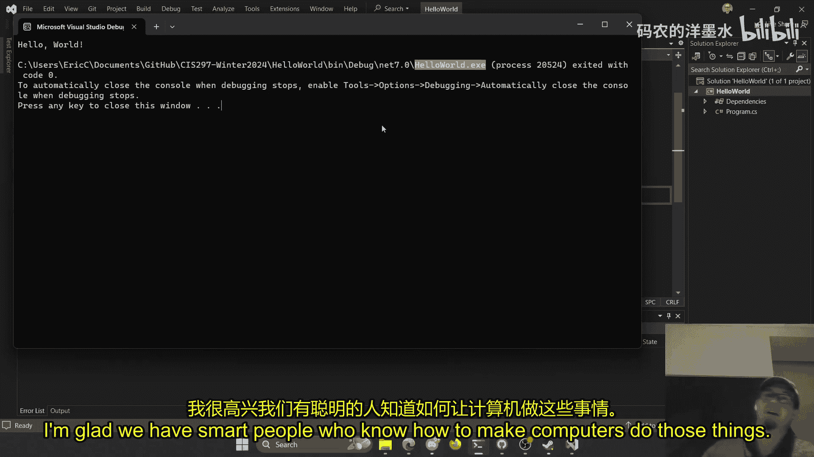

项目创建后，Git会检测到文件变化。你可以使用GitHub Desktop或命令行来提交代码：

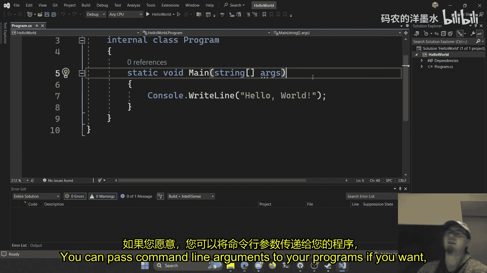

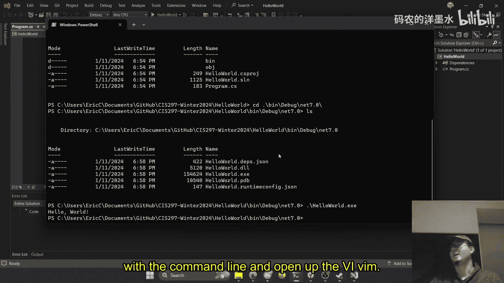

1.  在GitHub Desktop中，填写提交摘要（例如“Initial commit: Hello World”）。
2.  点击“提交到main”。
3.  点击“推送origin”将本地提交同步到GitHub云端仓库。

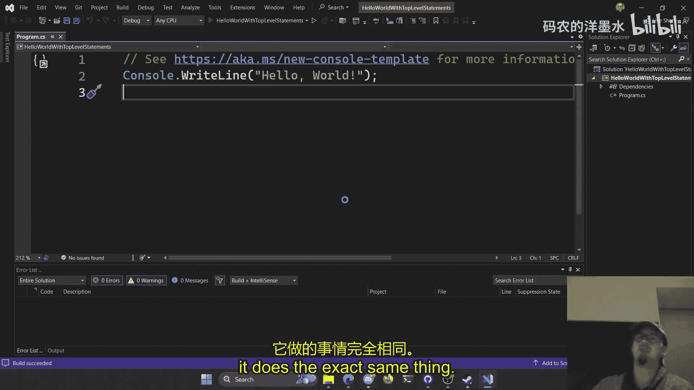

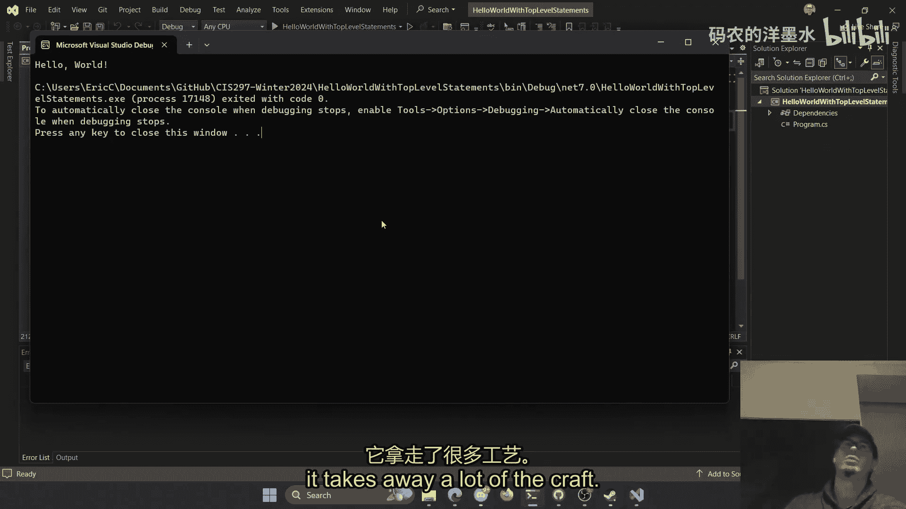

这样，你的代码就安全地托管在云端，并且我可以直接通过GitHub链接查看你的代码，非常方便。

---

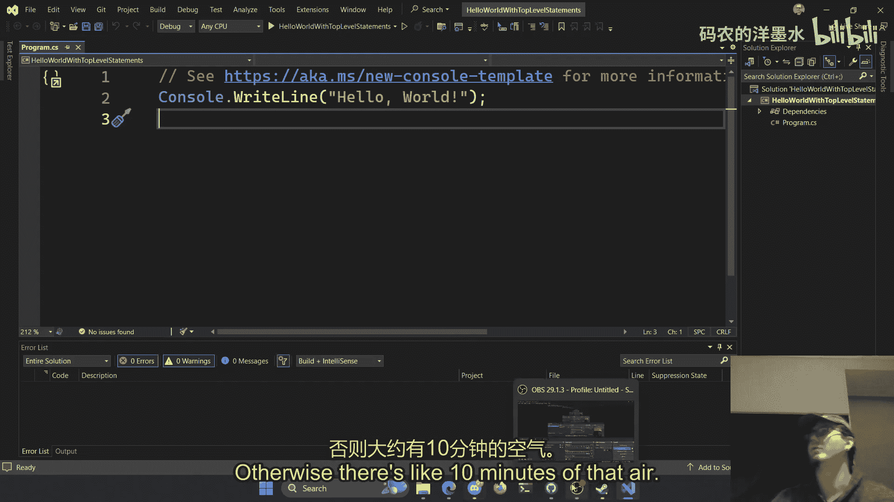

本节课中，我们一起学习了C#游戏开发课程的总体框架、必备工具、评分标准以及重要的学术规范。我们还动手创建了第一个C#项目，并了解了如何使用Git进行版本控制。接下来，我们将深入C#语言本身，开始有趣的编程之旅。