# 004：面向对象编程-part2

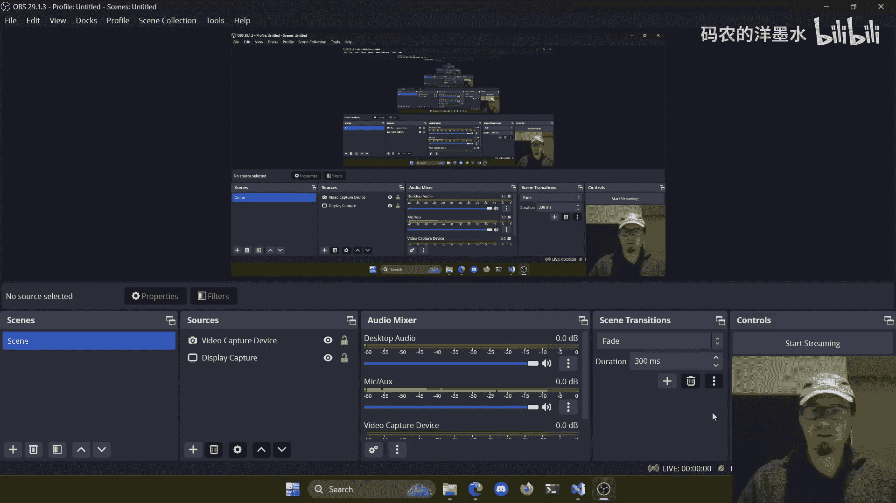

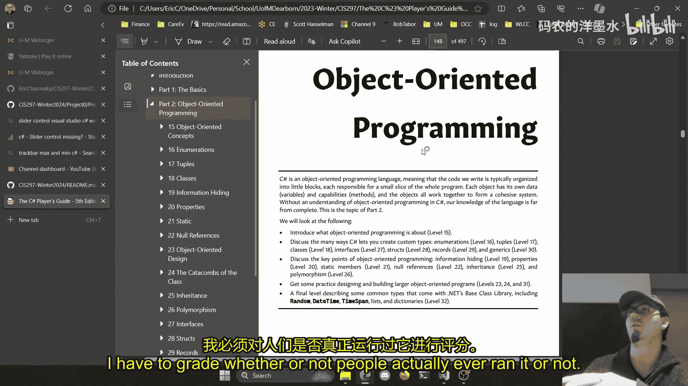

在本节课中，我们将继续学习面向对象编程的核心概念，重点是属性、信息隐藏以及如何通过单元测试来确保代码质量。我们将通过创建`Circle`和`Vehicle`类来实践这些概念，并最终介绍一个基于这些知识的项目。

## 概述

上一节我们介绍了类、枚举和元组的基本概念。本节中，我们将深入探讨类的属性，这是一种更优雅地管理类数据成员的方式。我们还将学习如何通过私有设置器实现信息隐藏，并介绍单元测试的重要性，以确保我们编写的代码能够按预期工作。

## 属性

在之前的示例中，我们使用私有属性和公共的`get`/`set`方法来访问和修改数据。C#提供了一种更简洁的语法：**属性**。

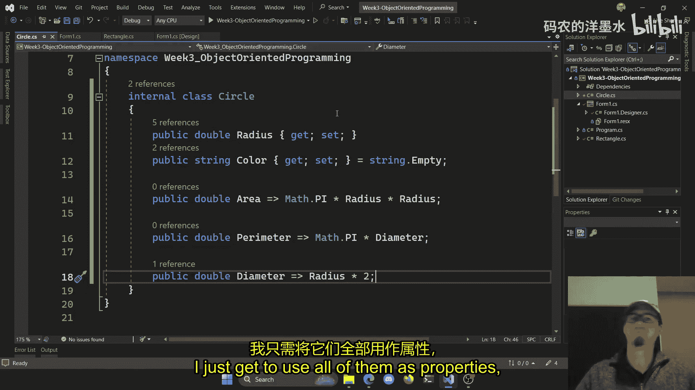

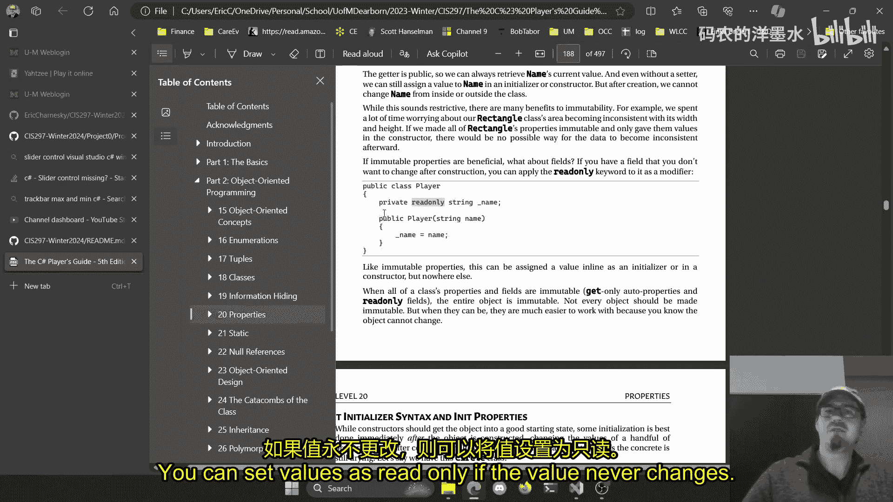

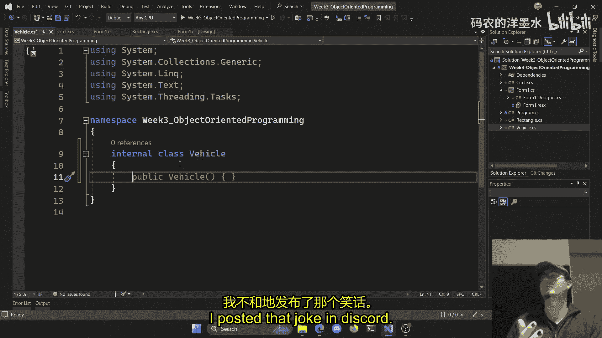

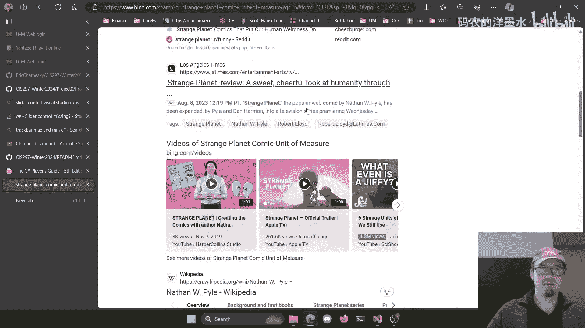

属性允许我们像访问公共字段一样访问数据，同时可以在内部封装逻辑。

### 创建Circle类

让我们创建一个`Circle`类来演示属性的使用。

```csharp
public class Circle
{
    public double Radius { get; set; }
    public string Color { get; set; } = string.Empty;

    // 表达式主体属性：计算面积
    public double Area => Radius * Radius * Math.PI;

    // 表达式主体属性：计算直径
    public double Diameter => Radius * 2;

    // 表达式主体属性：计算周长
    public double Perimeter => Diameter * Math.PI;
}
```

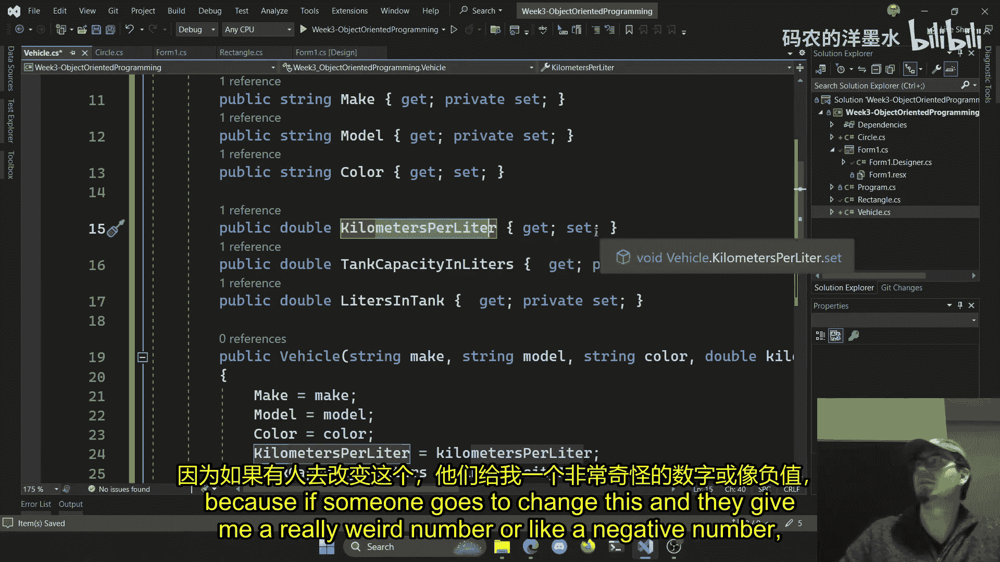

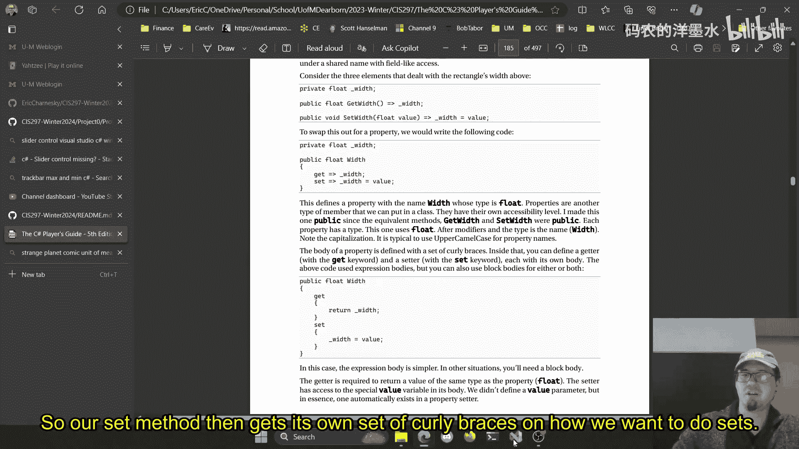

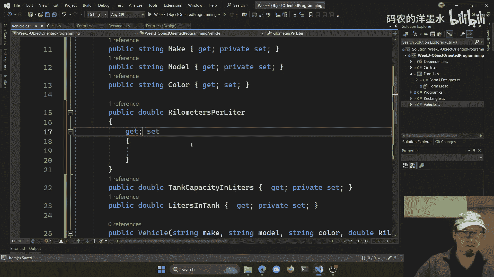

在上面的代码中：
*   `Radius`和`Color`是自动实现的属性。编译器会自动为我们创建支持字段和基本的`get`/`set`访问器。
*   `Area`、`Diameter`和`Perimeter`是**表达式主体属性**。它们没有显式的`get`访问器，而是直接返回一个表达式的结果。每次访问这些属性时，都会重新计算其值。

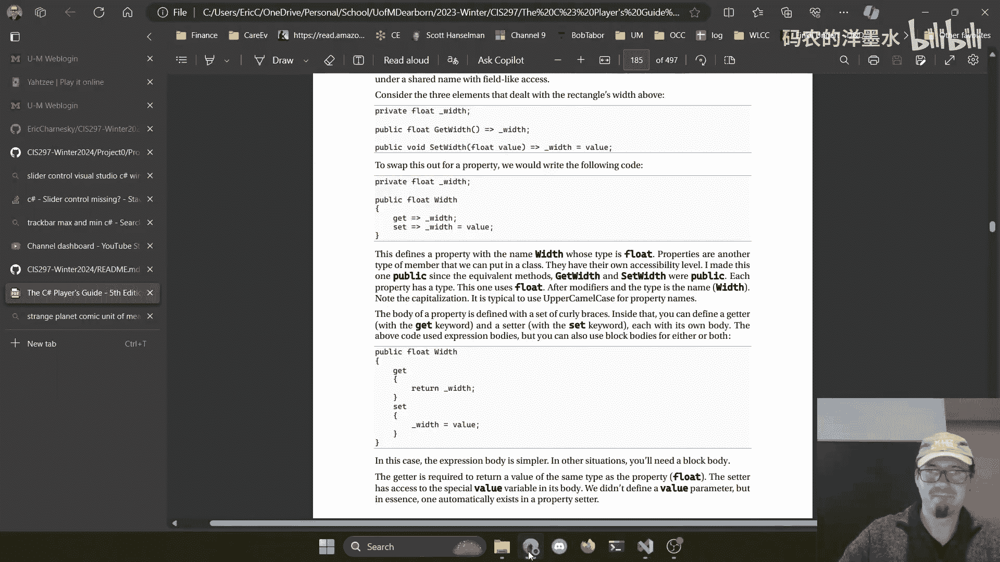

使用属性创建对象时，可以使用对象初始化器语法，这非常方便：

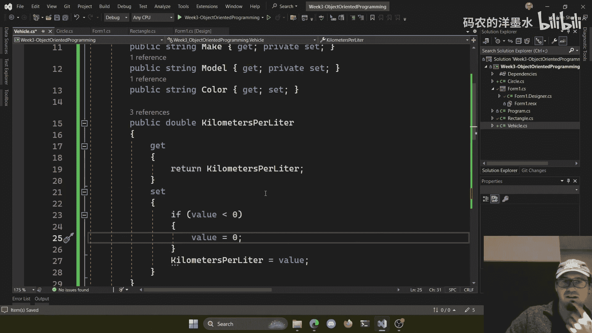

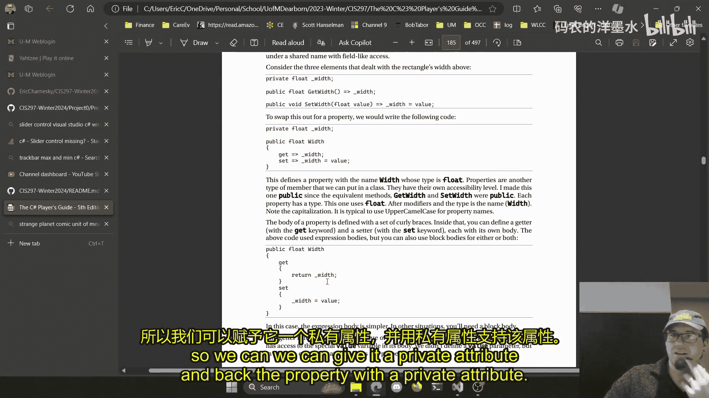

```csharp
Circle myCircle = new Circle { Radius = 10.5, Color = "Blue" };
```

### 属性的访问控制

我们可以控制属性的`get`和`set`访问器的可见性。例如，可以创建一个只读属性，或者一个只能在类内部设置的属性。

## 信息隐藏与更复杂的属性

属性不仅仅是简单的数据包装器。我们可以在`set`访问器中添加验证逻辑，或者使用私有字段来支持属性，以实现更复杂的控制。

### 创建Vehicle类

让我们创建一个更复杂的`Vehicle`类来演示这些概念。

```csharp
public class Vehicle
{
    // 支持字段
    private double _kilometersPerLiter;

    // 只能在构造函数中设置，之后只读
    public string Make { get; }
    public string Model { get; }

    // 公共可读写
    public string Color { get; set; } = string.Empty;

    // 带有验证的set访问器
    public double KilometersPerLiter
    {
        get => _kilometersPerLiter;
        set
        {
            if (value < 0)
            {
                _kilometersPerLiter = 0;
            }
            else
            {
                _kilometersPerLiter = value;
            }
        }
    }

    // 私有set，只能在类内部修改
    public double TankCapacityLiters { get; private set; }
    public double LitersInTank { get; private set; }

    // 私有set的只读属性
    public int OdometerReadingKm { get; private set; }

    // 构造函数
    public Vehicle(string make, string model, string color, double kilometersPerLiter, double tankCapacityLiters)
    {
        Make = make;
        Model = model;
        Color = color;
        KilometersPerLiter = kilometersPerLiter; // 使用属性设置器进行验证
        TankCapacityLiters = tankCapacityLiters;
        LitersInTank = 0; // 新车油箱为空
        OdometerReadingKm = 0;
    }

    // 方法：添加燃油
    public bool AddGas(double litersToAdd)
    {
        if (LitersInTank + litersToAdd <= TankCapacityLiters)
        {
            LitersInTank += litersToAdd;
            return true;
        }
        return false;
    }

    // 方法：驾驶
    public bool Drive(double kilometersToDrive)
    {
        double litersNeeded = kilometersToDrive / KilometersPerLiter;
        if (LitersInTank >= litersNeeded)
        {
            LitersInTank -= litersNeeded;
            OdometerReadingKm += (int)kilometersToDrive; // 简化处理，忽略小数
            return true;
        }
        return false;
    }
}
```

在这个`Vehicle`类中：
*   `Make`和`Model`属性只能在构造函数中设置，之后变为只读。
*   `KilometersPerLiter`属性的`set`访问器包含了验证逻辑，确保值不为负。
*   `TankCapacityLiters`和`LitersInTank`的`set`访问器是私有的，只能通过类的方法（如`AddGas`和`Drive`）来修改，这保证了数据的一致性。
*   `AddGas`和`Drive`方法封装了业务逻辑，并返回操作是否成功的布尔值。

## 单元测试

编写代码只是工作的一部分，确保代码正确运行同样重要。单元测试是一种自动化测试方法，用于验证代码的各个独立单元（通常是方法）是否按预期工作。

### 为什么需要单元测试？
*   **自动化验证**：计算机可以快速、准确地重复运行测试。
*   **早期发现错误**：在代码集成或部署前发现问题。
*   **支持重构**：在修改代码时，确保现有功能不被破坏。
*   **作为文档**：测试用例展示了代码应该如何被使用。

### 为Vehicle类编写测试

我们将使用Visual Studio内置的测试框架为`Vehicle`类的`AddGas`和`Drive`方法编写测试。

以下是测试`AddGas`方法的示例：

```csharp
[TestClass]
public class VehicleTests
{
    [TestMethod]
    public void AddGas_Successful()
    {
        // 1. 安排 (Arrange)：设置测试所需的数据和对象
        double expectedLiters = 4.2;
        Vehicle testVehicle = new Vehicle("", "", "", 10, 5); // 油箱容量为5升

        // 2. 行动 (Act)：执行要测试的代码
        bool result = testVehicle.AddGas(expectedLiters);
        double actualLiters = testVehicle.LitersInTank;

        // 3. 断言 (Assert)：验证结果是否符合预期
        Assert.IsTrue(result, "添加燃油应返回成功。");
        Assert.AreEqual(expectedLiters, actualLiters, 0.001, "油箱中的油量应与添加量相等。");
    }

    [TestMethod]
    public void AddGas_Unsuccessful_ExceedsCapacity()
    {
        // 安排
        Vehicle testVehicle = new Vehicle("", "", "", 10, 5); // 油箱容量为5升

        // 行动：尝试添加6升油（超过容量）
        bool result = testVehicle.AddGas(6);
        double actualLiters = testVehicle.LitersInTank;

        // 断言
        Assert.IsFalse(result, "添加超过容量的燃油应返回失败。");
        Assert.AreEqual(0, actualLiters, 0.001, "添加失败后，油箱油量应不变。");
    }

    [TestMethod]
    public void Drive_Successful()
    {
        // 安排
        Vehicle testVehicle = new Vehicle("", "", "", 10, 5); // 油耗10 km/L，油箱5L
        testVehicle.AddGas(5); // 加满油
        double kilometersToDrive = 8;
        int expectedOdometer = 8;
        double expectedLitersRemaining = 5 - (kilometersToDrive / 10); // 5 - 0.8 = 4.2

        // 行动
        bool result = testVehicle.Drive(kilometersToDrive);
        int actualOdometer = testVehicle.OdometerReadingKm;
        double actualLitersRemaining = testVehicle.LitersInTank;

        // 断言
        Assert.IsTrue(result, "在有足够燃油时驾驶应返回成功。");
        Assert.AreEqual(expectedOdometer, actualOdometer, "里程表读数应增加。");
        Assert.AreEqual(expectedLitersRemaining, actualLitersRemaining, 0.001, "油箱剩余油量应正确减少。");
    }
}
```

测试遵循 **AAA模式**：
1.  **安排 (Arrange)**：初始化对象并设置测试数据。
2.  **行动 (Act)**：调用要测试的方法。
3.  **断言 (Assert)**：验证方法的结果（返回值、对象状态）是否符合预期。


### 测试驱动开发与持续集成

编写良好的单元测试是**测试驱动开发**和**持续集成/持续部署**的基础。
*   **测试驱动开发**：先编写测试，再编写实现代码，确保代码始终可测试且满足需求。
*   **持续集成**：每当代码提交到版本库时，自动运行所有测试，确保新代码不会破坏现有功能。
*   **持续部署**：在测试通过后，自动将代码部署到生产环境。

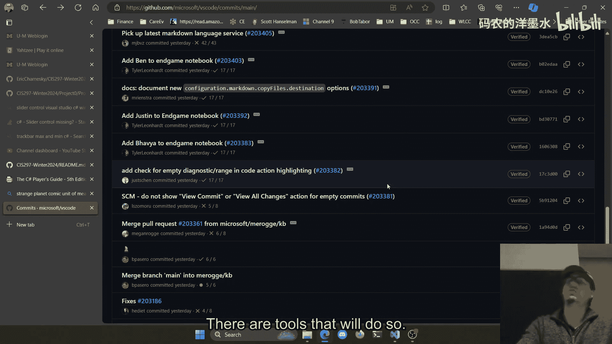

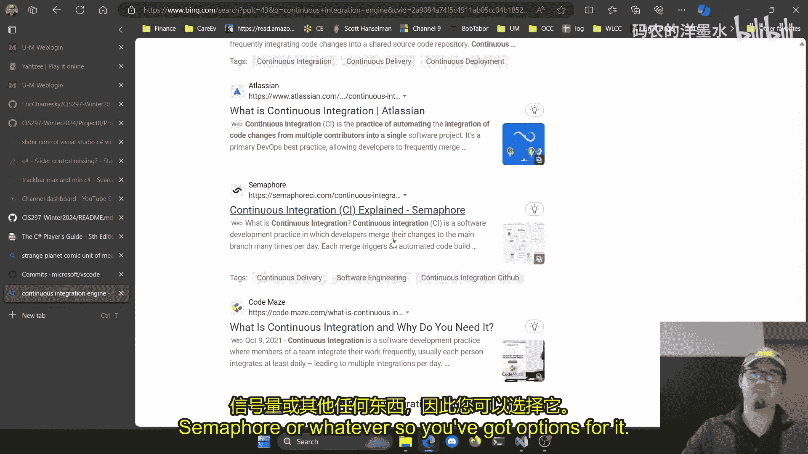

## 项目介绍：Yahtzee游戏


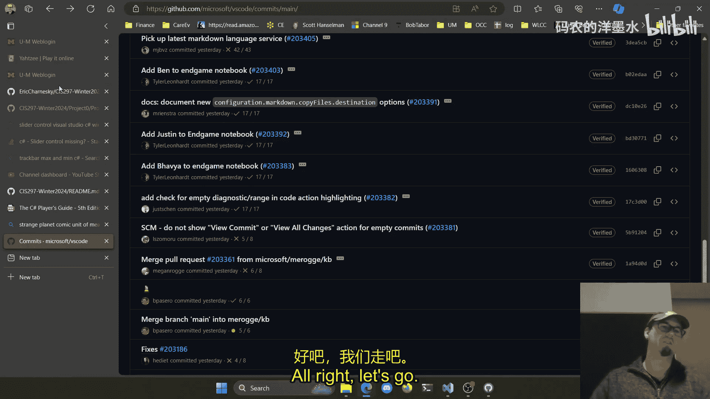

现在，我们将应用所学的面向对象编程和单元测试知识来构建一个项目。

### 项目目标
创建一个两人版的Yahtzee游戏图形用户界面程序。

### 游戏规则简介
*   玩家有5个骰子，每回合可以掷骰子最多3次。
*   每次掷骰后，玩家可以选择“保留”部分骰子，只重掷剩下的。
*   3次掷骰后，玩家必须将当前骰子组合计分到计分卡上的一个类别中。
*   计分卡分为上区和下区，共有13个计分类别（如：三条、顺子、Yahtzee等）。
*   每个类别只能计分一次。游戏共13轮，总分高者获胜。

### 项目要求
1.  **面向对象设计**：将游戏逻辑（如骰子管理、得分计算）封装在独立的类中，与用户界面分离。这便于测试和代码复用。
2.  **正确性**：游戏逻辑必须正确实现Yahtzee的规则。
3.  **单元测试**：为游戏逻辑的核心类编写单元测试。例如，测试给定一组骰子时，各个计分类别的得分是否正确计算。

### 评分要点
*   **对象导向设计**：清晰分离业务逻辑和UI。
*   **功能正确性**：游戏运行符合规则。
*   **测试覆盖**：为核心逻辑编写有意义的单元测试。

### 建议步骤
1.  设计核心类，如`DiceSet`、`ScoreCard`、`YahtzeeGame`。
2.  先为核心类的计算方法编写单元测试。
3.  实现核心类，确保所有测试通过。
4.  最后，创建Windows Forms或WPF用户界面，调用核心类的方法来驱动游戏。

## 总结

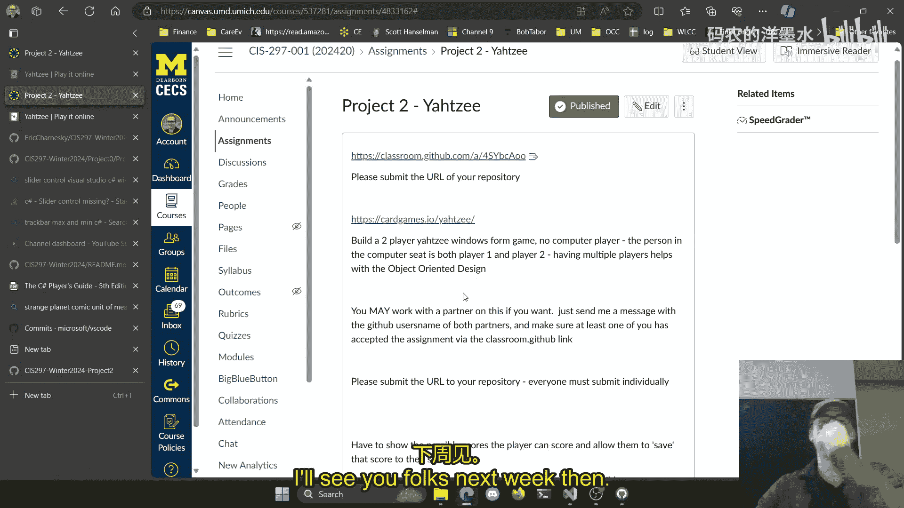

本节课我们一起学习了C#中属性的强大功能，它让我们能够以更简洁、安全的方式管理类中的数据。我们探讨了如何通过设置不同的访问权限来实现信息隐藏，并编写了包含业务逻辑的`Vehicle`类。最重要的是，我们介绍了单元测试的概念和实践，这是编写可靠、可维护代码的基石。最后，我们预览了将运用这些知识来完成的Yahtzee游戏项目，希望大家能通过实践巩固所学。