# 007：接口与项目3


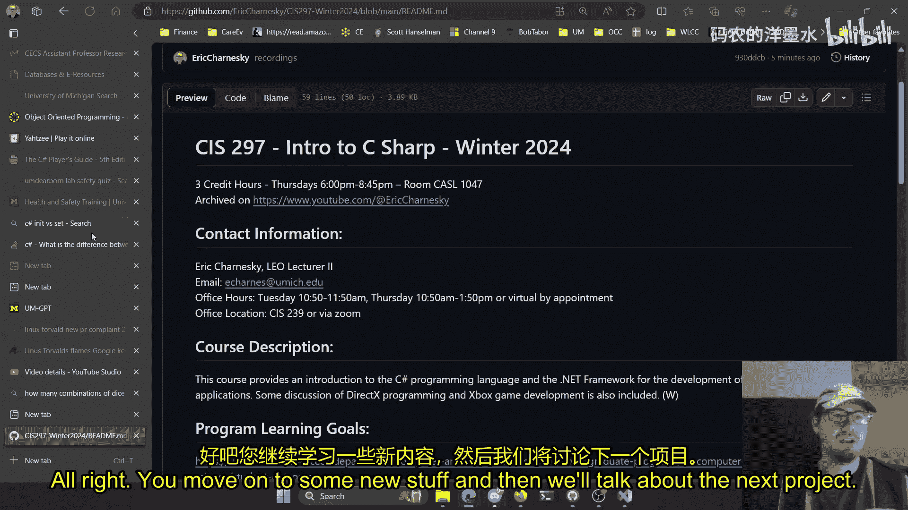

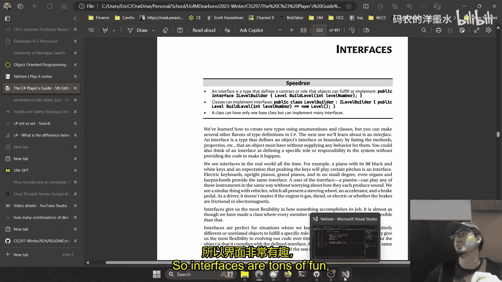

在本节课中，我们将要学习C#中一个非常重要的概念——接口，并了解如何利用接口来改进代码设计，特别是为了便于单元测试。最后，我们将介绍下一个项目：一个基于德州扑克的游戏。

## 接口的概念与应用

上一节我们介绍了面向对象编程的基础。本节中，我们来看看接口。接口可以被理解为一个纯粹的抽象类。它定义了一组方法，但不提供具体的实现。实现接口的类必须履行这个“契约”，即提供接口中所有方法的具体实现。

接口的核心作用在于定义一种规范。通过接口，我们可以实现多态性，将不同的实现类视为同一种类型来处理，从而增加代码的灵活性。

## 通过接口改进测试：依赖反转

在之前的项目中，我们有一个 `YatzyDice` 类，其掷骰子的逻辑依赖于 `Random` 类。由于 `Random` 生成的是随机数，这给单元测试带来了困难。我们无法预测和控制骰子的结果来验证计分逻辑。

为了解决这个问题，我们可以使用一种称为“依赖反转”的设计模式。其核心思想是：**不让类自己创建它所依赖的对象，而是由外部提供**。

以下是实现步骤：

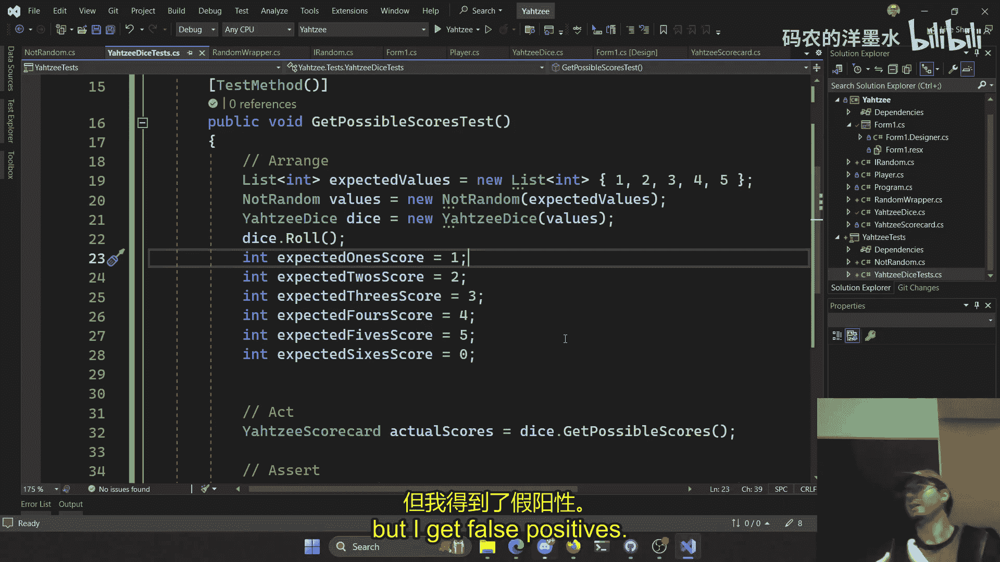


1.  **定义接口**：首先，我们创建一个接口 `IRandom`，它包含我们所需的方法签名。
    ```csharp
    public interface IRandom
    {
        int Next(int start, int end);
    }
    ```


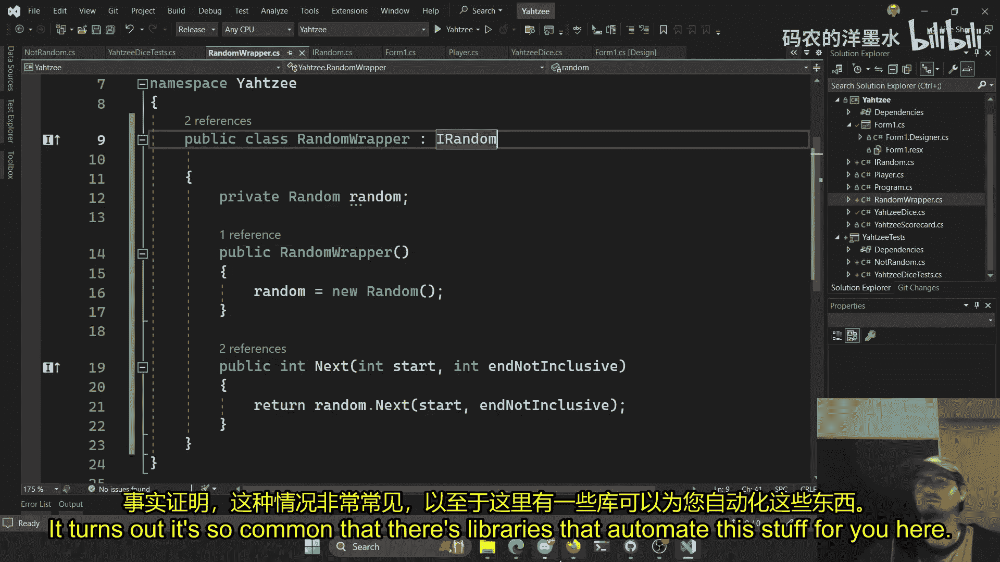

2.  **创建包装类**：接着，我们创建一个包装类 `RandomWrapper`，它实现 `IRandom` 接口，并在内部调用真正的 `Random` 类。
    ```csharp
    public class RandomWrapper : IRandom
    {
        private Random _random = new Random();
        public int Next(int start, int end)
        {
            return _random.Next(start, end);
        }
    }
    ```

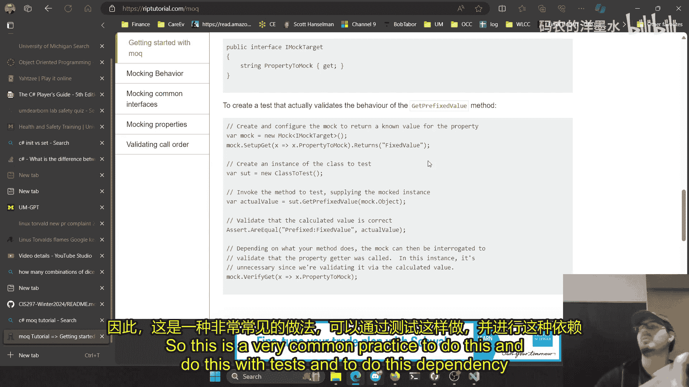


3.  **修改依赖类**：修改 `YatzyDice` 类，使其不再直接依赖 `Random`，而是依赖 `IRandom` 接口。通过构造函数将 `IRandom` 的实例注入。
    ```csharp
    public class YatzyDice
    {
        private IRandom _random;
        public YatzyDice(IRandom random)
        {
            _random = random;
        }
        // ... 其他方法使用 _random.Next(...)
    }
    ```

4.  **创建测试专用类**：为了测试，我们可以创建一个 `NotRandom` 类，它也实现 `IRandom` 接口，但返回我们预设的、非随机的值。
    ```csharp
    public class NotRandom : IRandom
    {
        private List<int> _values;
        private int _currentIndex = 0;
        public NotRandom(List<int> values)
        {
            _values = values;
        }
        public int Next(int start, int end)
        {
            // 返回预设列表中的值，忽略 start 和 end 参数（仅用于演示）
            int value = _values[_currentIndex];
            _currentIndex++;
            return value;
        }
    }
    ```

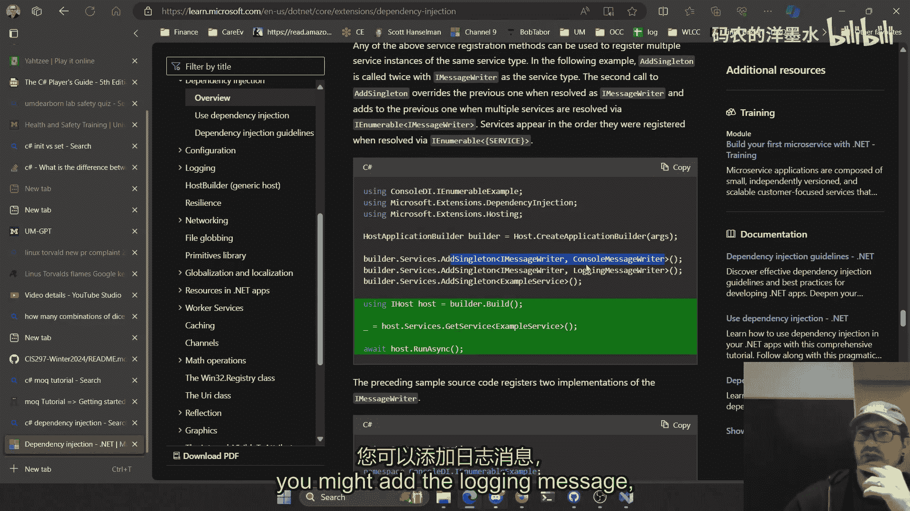

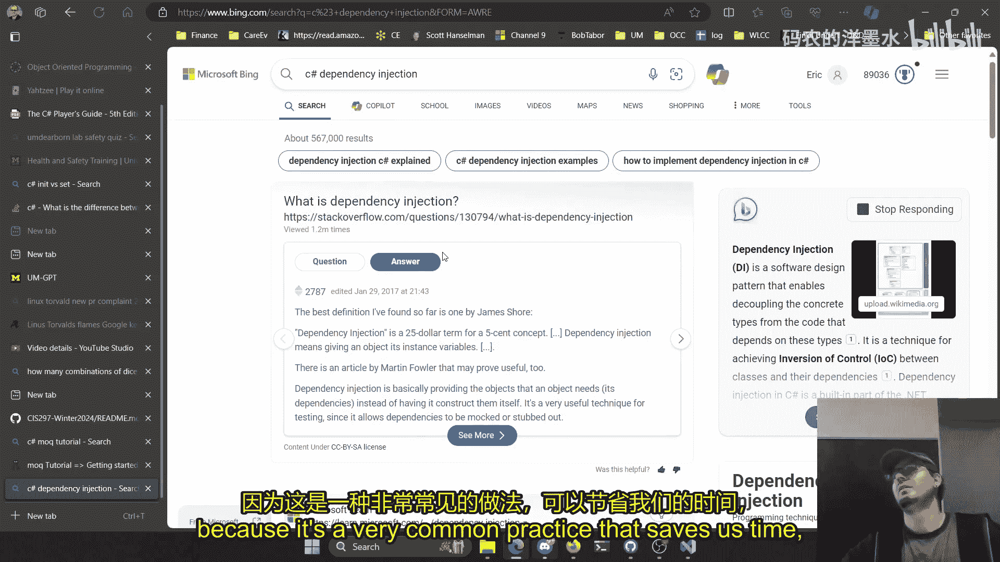

现在，在单元测试中，我们可以这样使用：
```csharp
[TestMethod]
public void TestYatzyScore()
{
    // 准备 (Arrange)
    var fixedValues = new List<int> { 1, 2, 3, 4, 5 };
    IRandom testRandom = new NotRandom(fixedValues);
    YatzyDice dice = new YatzyDice(testRandom);

    // 执行 (Act)
    dice.Roll(); // 现在骰子值会是 1, 2, 3, 4, 5
    var scores = dice.GetPossibleScores();

    // 断言 (Assert)
    Assert.AreEqual(1, scores.Ones); // 预期“一点”得分为1
    Assert.AreEqual(2, scores.Twos); // 预期“二点”得分为2
    // ... 其他断言
}
```

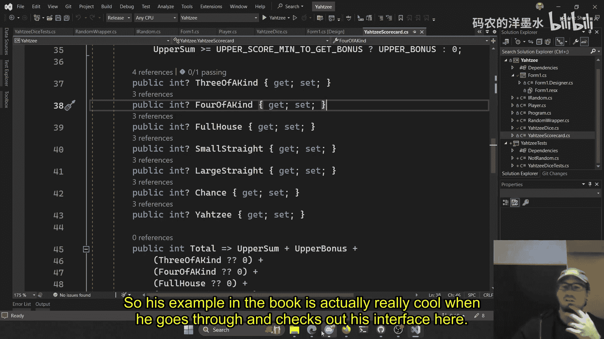

通过这种方式，我们将不可控的随机依赖转换成了可控的接口依赖，从而能够编写稳定、可重复的单元测试。

## 接口的更多优势


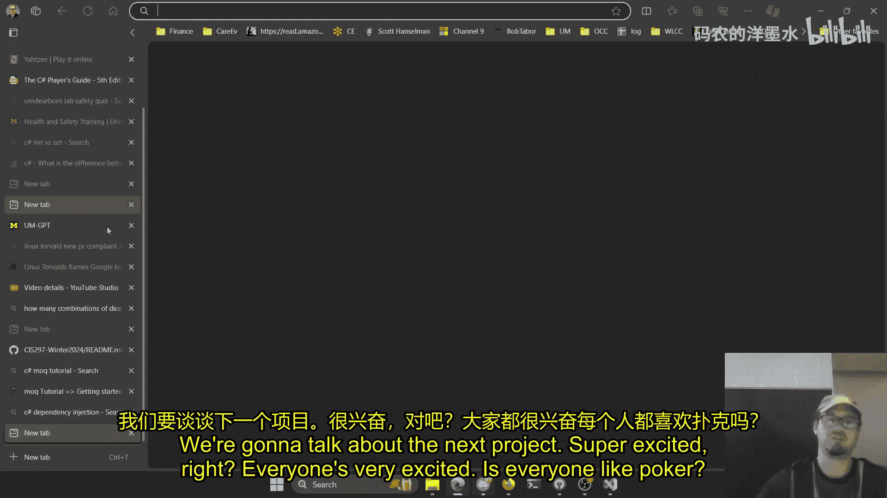

接口的用途远不止于测试。它为我们提供了极大的灵活性。

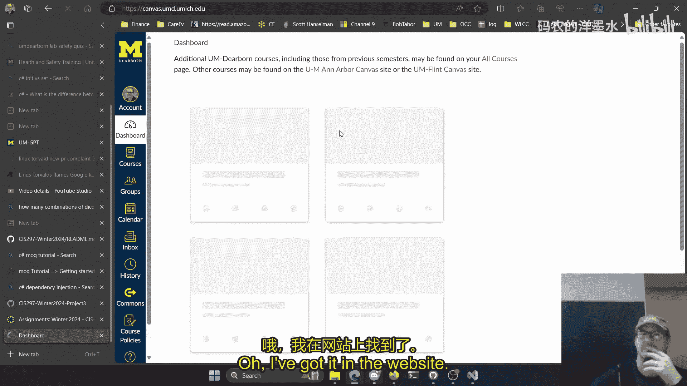

*   **实现多态与替换**：我们可以编写多个不同的类来实现同一个接口。主程序代码只需要知道接口，而不关心具体的实现类是什么。这使得更换实现（例如，更换日志系统、数据存储方式或游戏关卡生成器）变得非常容易。
*   **支持设计模式**：许多高级设计模式，如工厂模式、策略模式、依赖注入等，都重度依赖接口。
*   **便于使用Mock库**：在实际开发中，我们经常使用像 **Moq** 这样的Mock库。它允许我们动态地创建接口的“模拟”对象，并设定当调用某个方法时返回什么值，而无需像上面那样手动编写 `NotRandom` 这样的类，极大地提升了测试效率。

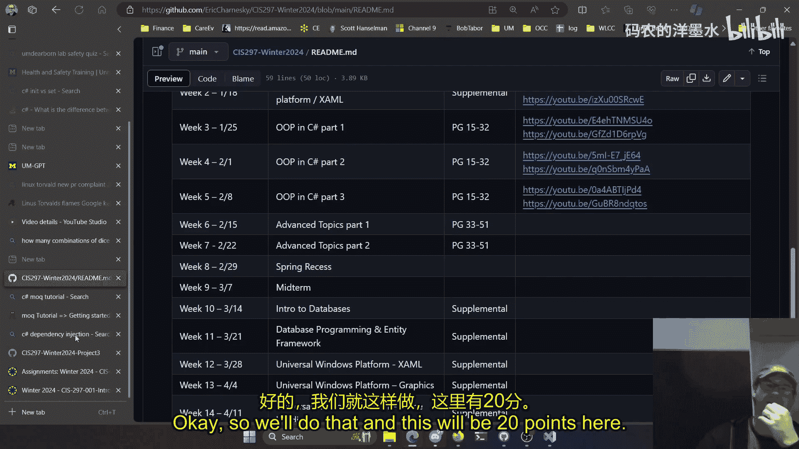

## 项目3：德州扑克游戏介绍

接下来，我们将开始项目3：开发一个一对一的德州扑克游戏。

以下是项目的基本规则和实现思路：

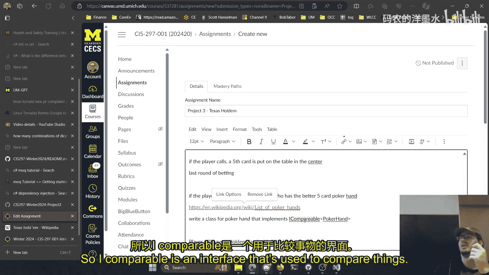

1.  **游戏概述**：两个玩家各拥有100美元的初始筹码。游戏目标是赢得底池中的所有筹码。
2.  **牌局流程简化**：
    *   每位玩家先获得两张私有牌。
    *   进行第一轮下注（玩家1先行动，可以下注、跟注、加注或弃牌）。
    *   发出三张公共牌（翻牌）。
    *   进行第二轮下注。
    *   发出第四张公共牌（转牌）。
    *   进行第三轮下注。
    *   发出第五张公共牌（河牌）。
    *   进行最后一轮下注。
    *   如果未分胜负，则进行摊牌比大小。
3.  **比牌规则**：德州扑克使用7张牌（2张私有牌 + 5张公共牌）来组合成最好的5张牌扑克牌型。牌型从高到低依次为：同花顺 > 四条 > 满堂红 > 同花 > 顺子 > 三条 > 两对 > 一对 > 高牌。
4.  **实现思路**：
    *   **`PokerHand` 类**：代表一个5张牌的扑克手牌。这个类需要实现 `IComparable<PokerHand>` 接口。`CompareTo` 方法的核心逻辑就是比较两手牌的大小，返回1、0或-1。
        ```csharp
        public class PokerHand : IComparable<PokerHand>
        {
            private List<Card> _cards; // 假设有Card类
            public int CompareTo(PokerHand other)
            {
                // 1. 先比较牌型等级（如：同花顺为8，高牌为0）
                // 2. 如果等级相同，再比较牌面大小
                // 返回比较结果
            }
        }
        ```
    *   **`HoldemHand` 类**：代表一个玩家的德州扑克手牌，包含2张私有牌和共享的5张公共牌。这个类也需要实现 `IComparable<HoldemHand>`。其 `CompareTo` 方法的实现方式是：从7张牌中生成所有21种可能的5张牌组合（C(7,5)=21），为每个组合创建一个 `PokerHand` 对象，然后找出其中最好的一个 `PokerHand`，最后用这个最好的手牌去与对方的 `HoldemHand` 做比较。
    *   **游戏逻辑**：利用上述可比较的类，游戏的主循环可以清晰地处理下注、发牌，并在摊牌时轻松判定胜负。

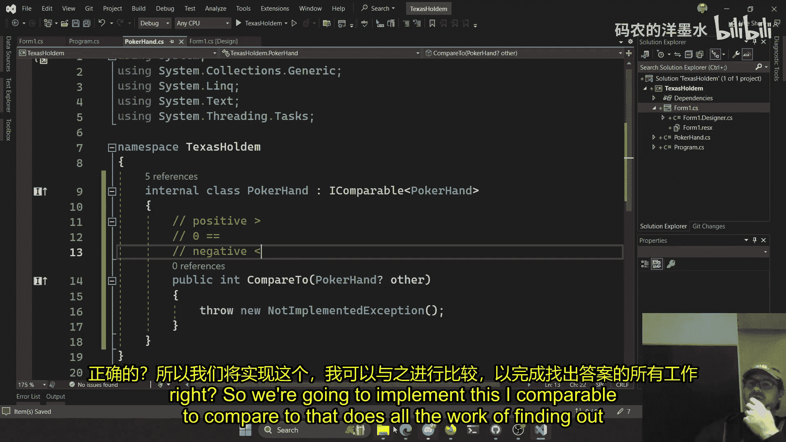

这个项目将很好地锻炼大家的面向对象设计能力，尤其是对接口、比较和组合逻辑的应用。

## 总结

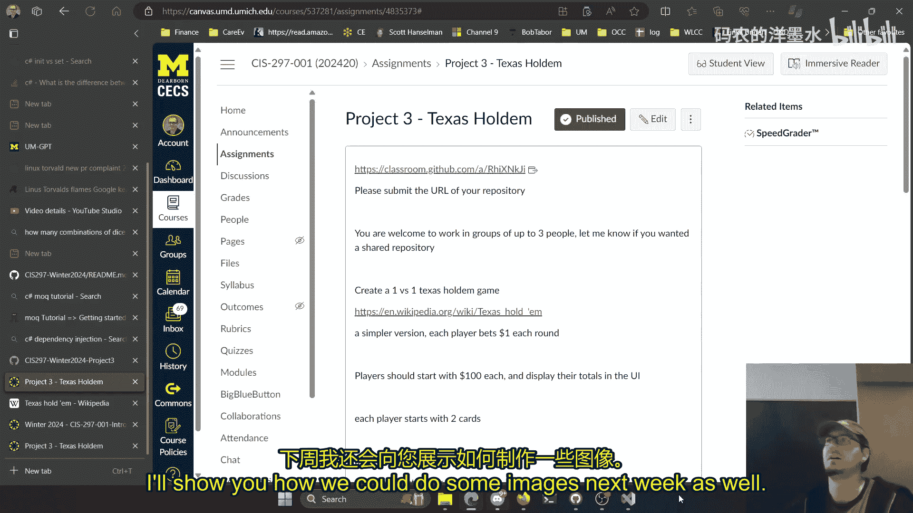

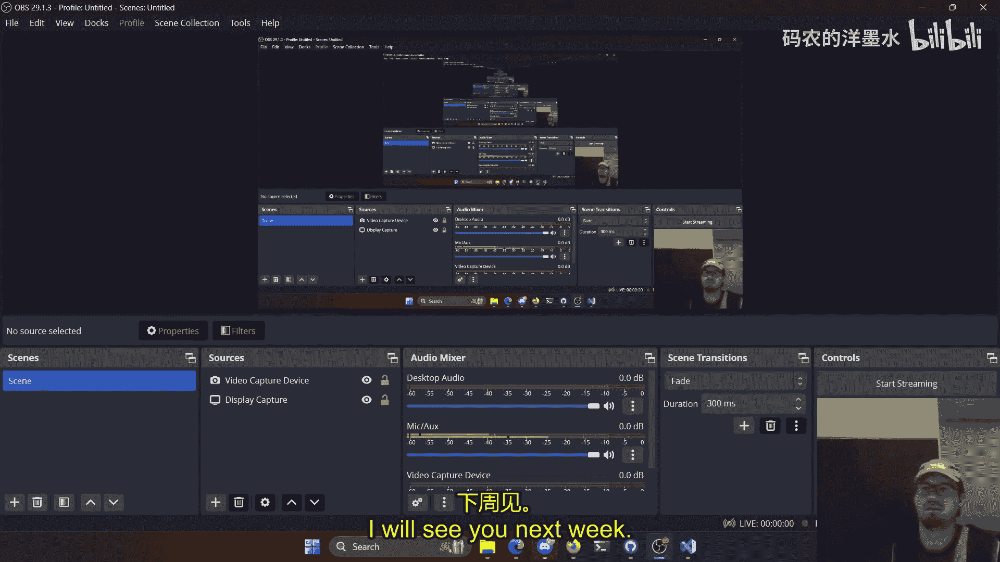

本节课中我们一起学习了C#接口的核心概念。我们了解到接口是一种定义行为契约的强大工具，并通过“依赖反转”模式将其应用于单元测试，解决了随机性带来的测试难题。我们还看到了接口在实现多态性和支持灵活设计方面的巨大潜力。最后，我们介绍了项目3——德州扑克游戏，它将综合运用接口、比较和面向对象设计来完成一个有趣的游戏逻辑。