# 009：Win2D图像处理与代码重构

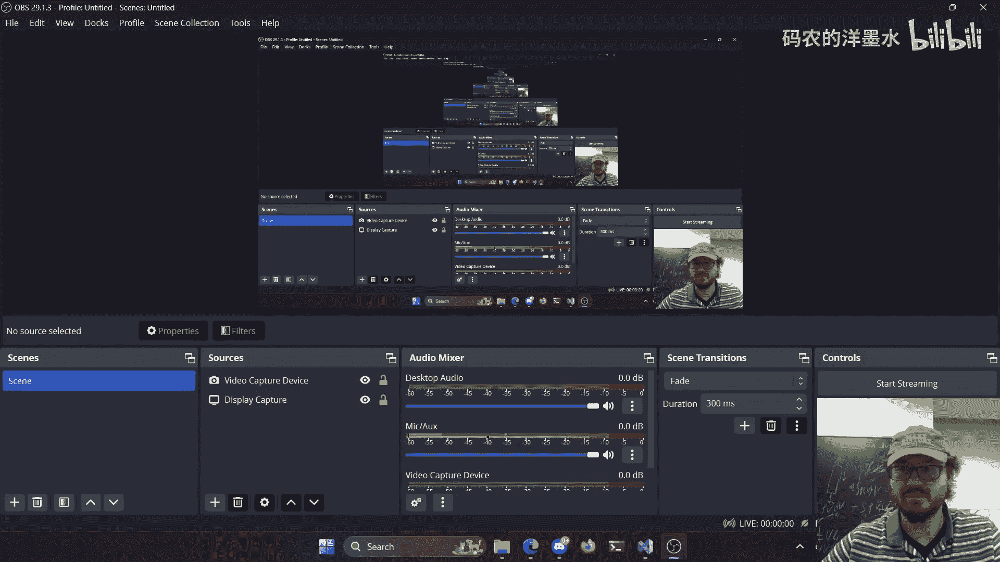

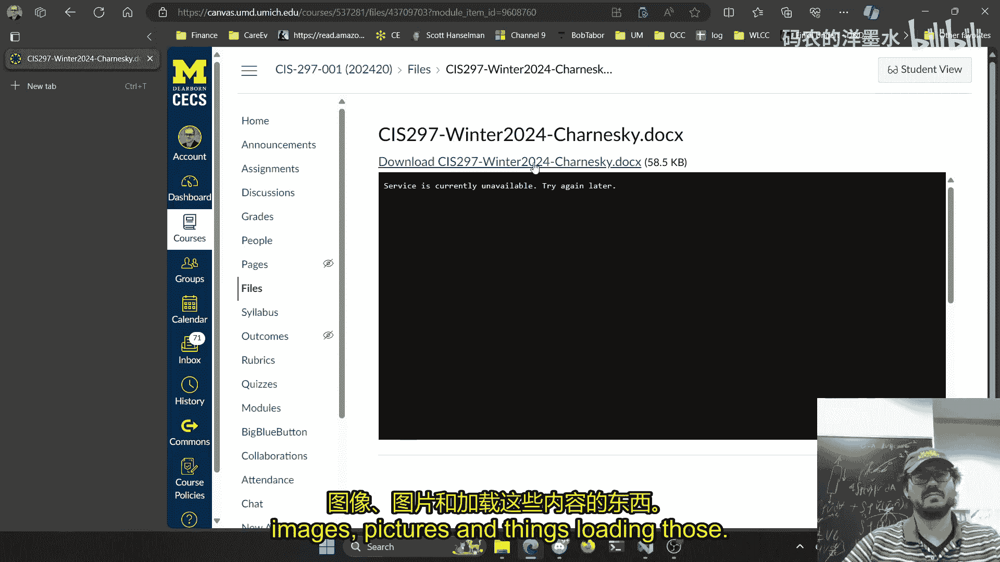

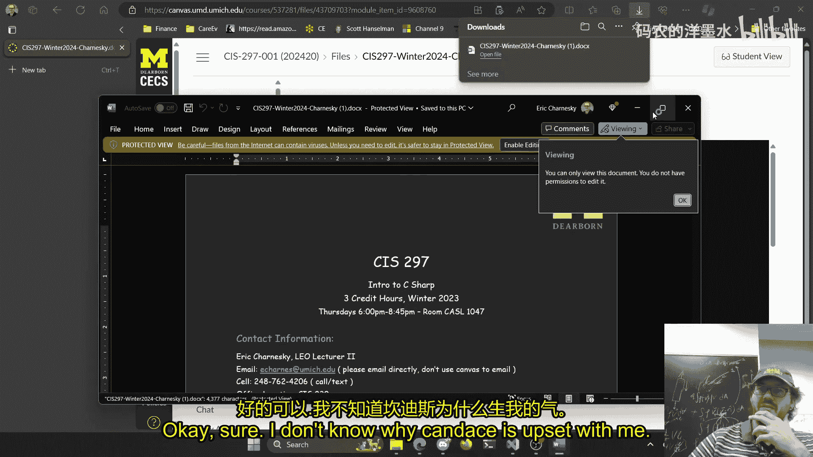

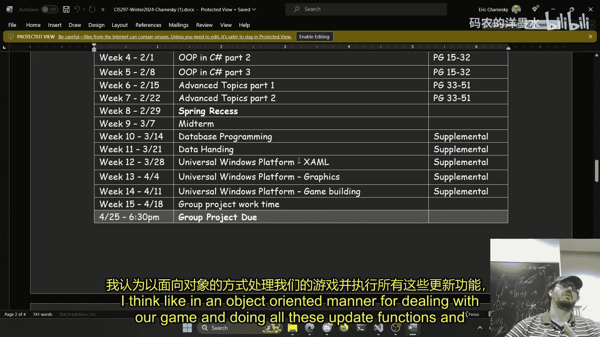

在本节课中，我们将学习如何使用Win2D库加载和绘制图像，并探讨如何将游戏逻辑重构为更清晰、面向对象的代码结构。我们还将简要介绍如何为最终项目做准备。

---

## 图像加载与绘制

上一节我们介绍了基本的图形绘制。本节中，我们来看看如何加载外部图像文件（如JPG、PNG）并在游戏中使用它们。

### 添加图像资源

首先，需要将图像文件添加到项目的`Assets`文件夹中。

1.  将图像文件（例如`soccer_ball.jpg`）复制到项目目录的`Assets`文件夹中。
2.  在Visual Studio的解决方案资源管理器中，右键点击`Assets`文件夹，选择“添加” -> “现有项”。
3.  找到并选择你的图像文件。
4.  在属性窗口中，将图像的“复制到输出目录”选项设置为“始终复制”。

### 异步加载图像

由于图像加载是I/O操作，为了避免阻塞UI线程，我们需要异步加载图像。这通常在页面的`CreateResources`事件中完成。

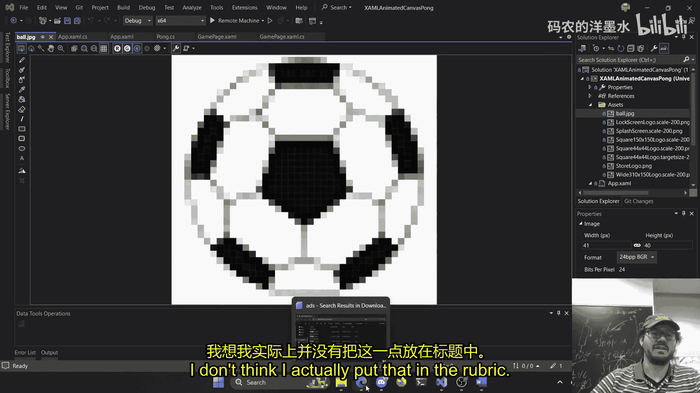

在XAML页面（如`MainPage.xaml`）中，为`CanvasControl`添加`CreateResources`事件处理器。

```xml
<canvas:CanvasControl CreateResources="CanvasControl_CreateResources"
                      Draw="CanvasControl_Draw"
                      Update="CanvasControl_Update"/>
```

在对应的代码文件（如`MainPage.xaml.cs`）中，实现`CreateResources`方法。

```csharp
private CanvasBitmap ballImage;

private void CanvasControl_CreateResources(Microsoft.Graphics.Canvas.UI.CanvasControl sender, Microsoft.Graphics.Canvas.UI.CanvasCreateResourcesEventArgs args)
{
    args.TrackAsyncAction(CreateResourcesAsync(sender).AsAsyncAction());
}

private async Task CreateResourcesAsync(CanvasControl sender)
{
    // 从Assets文件夹异步加载图像
    ballImage = await CanvasBitmap.LoadAsync(sender, new Uri("ms-appx:///Assets/soccer_ball.jpg"));
}
```

### 在游戏对象中使用图像

我们可以修改现有的游戏对象类（例如`Circle`类），使其能够存储和绘制图像，而不仅仅是几何图形。

以下是更新`Circle`类的示例：

```csharp
public class Circle
{
    public int X { get; set; }
    public int Y { get; set; }
    public int Radius { get; set; }
    public CanvasBitmap Image { get; set; } // 新增的图像属性

    public void Draw(CanvasDrawingSession drawingSession)
    {
        if (Image != null)
        {
            // 绘制图像，以(X, Y)为左上角
            drawingSession.DrawImage(Image, X, Y);
        }
        else
        {
            // 如果没有图像，则回退到绘制圆形
            drawingSession.DrawCircle(X + Radius, Y + Radius, Radius, Colors.White);
        }
    }

    // 碰撞检测边界需要根据图像尺寸调整
    public int Left => X;
    public int Right => X + (Image?.Bounds.Width ?? Radius * 2);
    public int Top => Y;
    public int Bottom => Y + (Image?.Bounds.Height ?? Radius * 2);
}
```

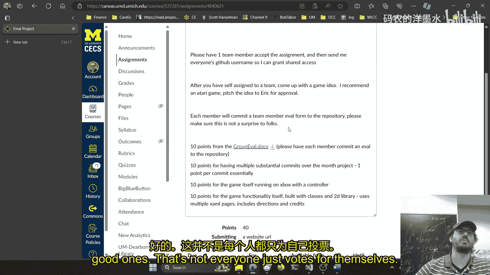

在创建`Circle`对象时，为其分配加载好的图像。

```csharp
// 在游戏初始化或CreateResources之后
myCircle.Image = ballImage;
```

**核心概念**：图像绘制以左上角`(X, Y)`为原点，而之前圆形绘制以圆心`(X+Radius, Y+Radius)`为原点。使用图像后，碰撞检测的边界计算需要从基于半径改为基于图像的`Bounds.Width`和`Bounds.Height`。

---

## 代码结构与重构

当游戏逻辑变得复杂时，将所有代码都写在主页面（如`MainPage.xaml.cs`）的`Update`和`Draw`方法中会显得臃肿且难以维护。

### 面向对象的设计思路

一个更好的方法是将游戏实体（如玩家、敌人、子弹）抽象为类，每个类负责自己的状态更新和绘制。主页面则主要负责协调这些对象。

以下是重构代码的基本步骤：

1.  **创建游戏对象基类或接口**：定义通用的`Update`和`Draw`方法。
2.  **分离游戏逻辑**：将具体的移动、碰撞检测逻辑从主页面移到各个游戏对象类中。
3.  **主页面作为协调者**：在主页面的`Update`和`Draw`循环中，遍历所有游戏对象，调用它们各自的`Update`和`Draw`方法。

### 重构示例

假设我们有一个简单的游戏，包含一个玩家球和多个障碍物。

首先，定义一个`IGameObject`接口。

```csharp
public interface IGameObject
{
    void Update(CanvasControl sender);
    void Draw(CanvasDrawingSession drawingSession);
}
```

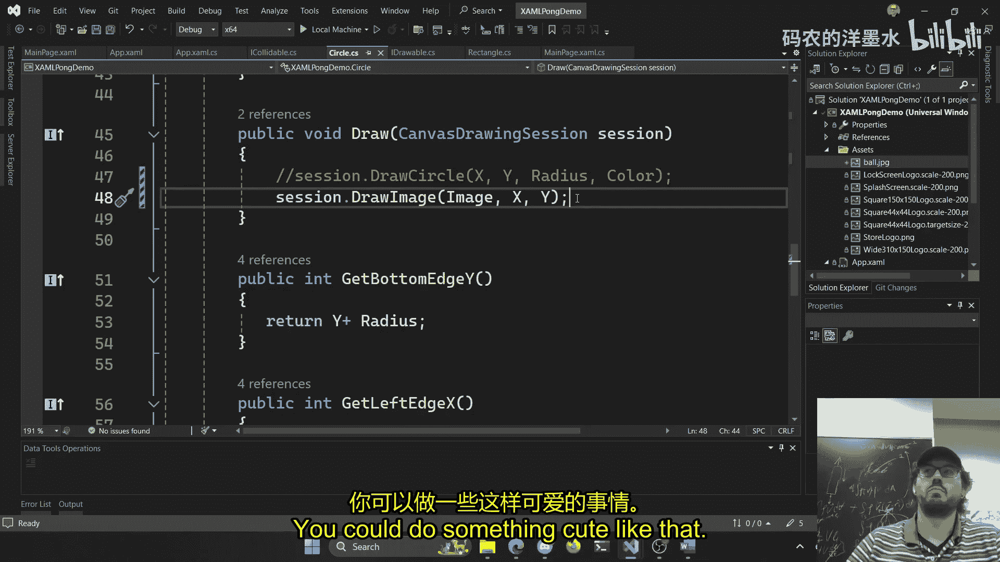

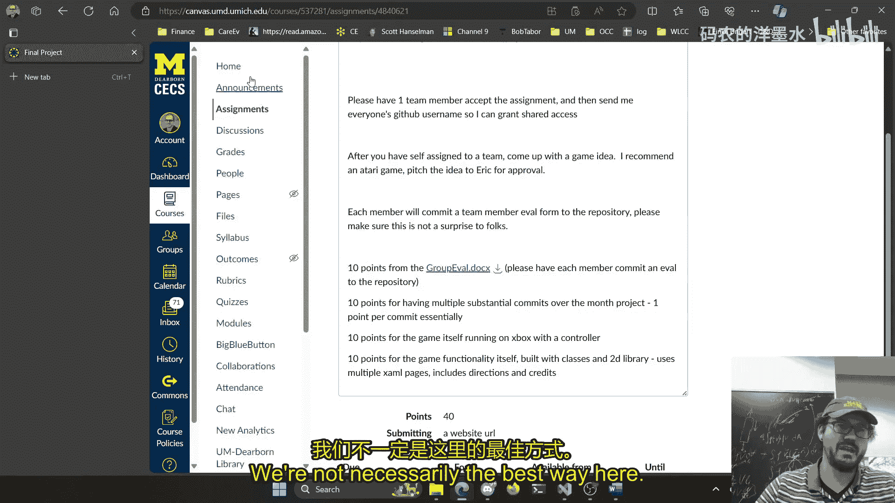

然后，让`Circle`类实现这个接口。

```csharp
public class Circle : IGameObject
{
    // ... 之前的属性 ...

    public void Update(CanvasControl sender)
    {
        // 在这里实现球的移动逻辑，例如根据速度更新X, Y
        X += speedX;
        Y += speedY;
        // 添加边界检查和碰撞检测
    }

    public void Draw(CanvasDrawingSession drawingSession)
    {
        // ... 之前的绘制逻辑 ...
    }
}
```

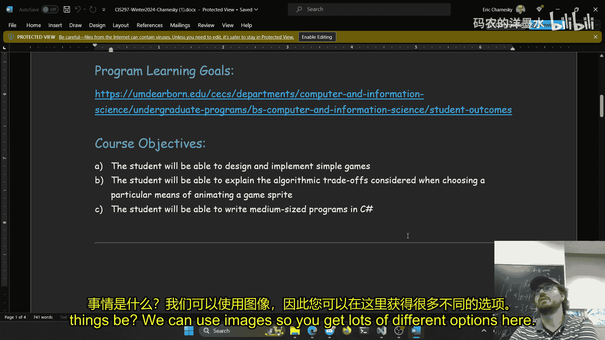

在主页面中，维护一个游戏对象列表。

```csharp
public sealed partial class MainPage : Page
{
    private List<IGameObject> gameObjects = new List<IGameObject>();
    private Circle playerCircle;

    public MainPage()
    {
        this.InitializeComponent();
        // 初始化游戏对象
        playerCircle = new Circle() { Image = ballImage, X = 100, Y = 100 };
        gameObjects.Add(playerCircle);
        // ... 添加其他对象 ...
    }

    private void CanvasControl_Update(CanvasControl sender, CanvasAnimatedUpdateEventArgs args)
    {
        // 更新所有游戏对象
        foreach (var obj in gameObjects)
        {
            obj.Update(sender);
        }
        // 这里可以添加全局的碰撞检测逻辑（如对象间碰撞）
    }

    private void CanvasControl_Draw(ICanvasAnimatedControl sender, CanvasAnimatedDrawEventArgs args)
    {
        // 绘制所有游戏对象
        foreach (var obj in gameObjects)
        {
            obj.Draw(args.DrawingSession);
        }
    }
}
```

**核心概念**：通过将游戏逻辑分散到各个`IGameObject`中，主页面变得简洁，只负责循环调度。每个游戏对象类职责单一，代码更易读、易测试和易扩展。

---

## 项目准备与团队协作

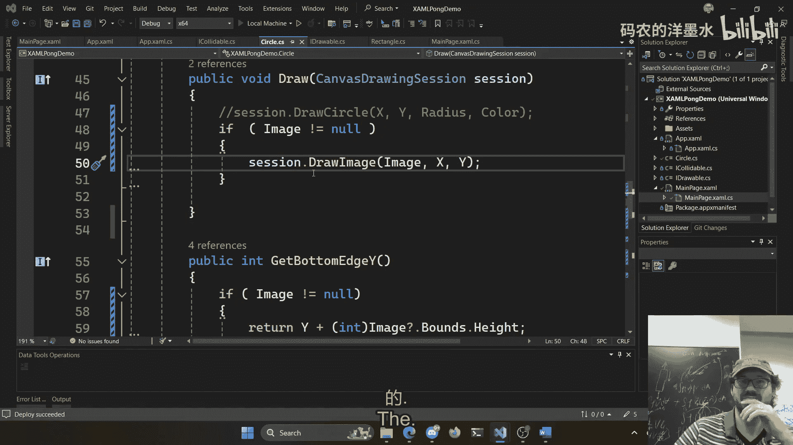

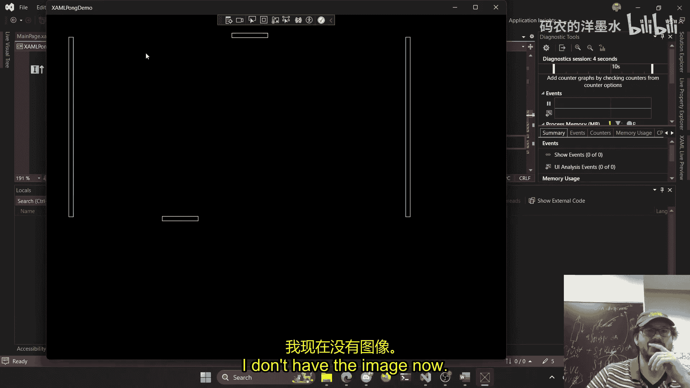

本节课的最后，我们简要回顾最终项目的要点和团队协作规范。

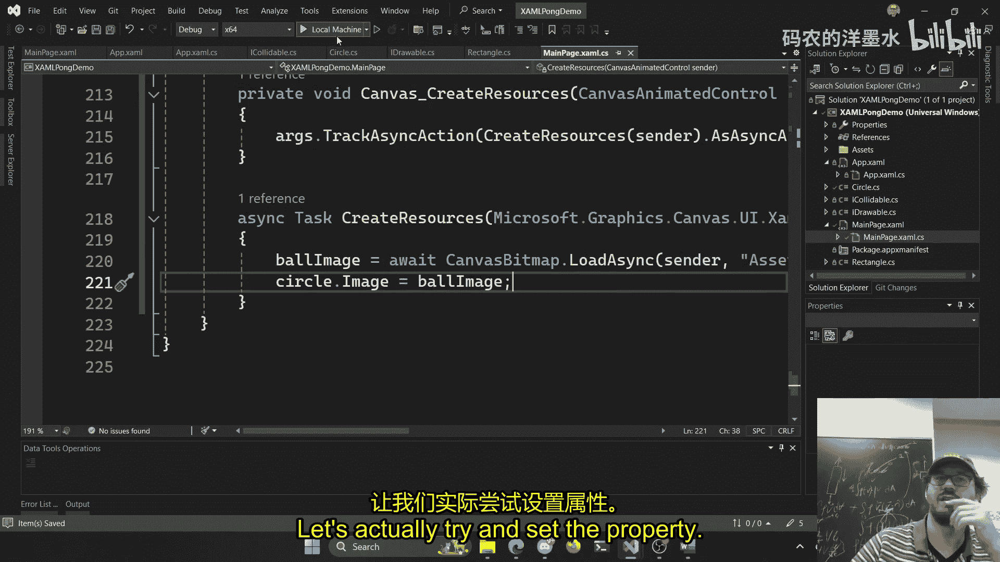

### 最终项目要求

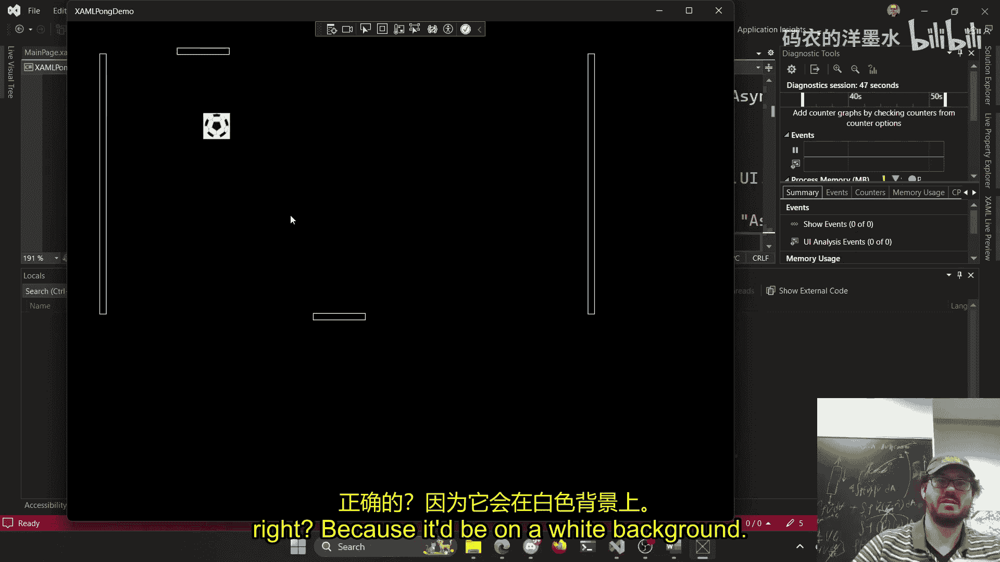

以下是项目成功的关键点：
*   **使用Win2D库**：实现2D图形绘制。
*   **使用图像资源**：游戏不应仅由基本几何图形构成。
*   **面向对象设计**：使用类来组织游戏实体和逻辑。
*   **在Xbox上运行**（加分项）：支持Xbox控制器输入。
*   **基本游戏功能**：包含开始、游戏进行、结束等状态，有明确的玩法和目标。
*   **代码提交**：团队应有多次实质性的Git提交记录，体现协作过程。

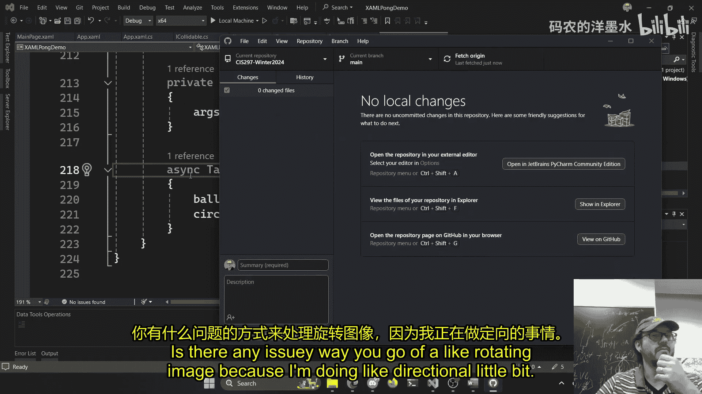

### 团队协作建议

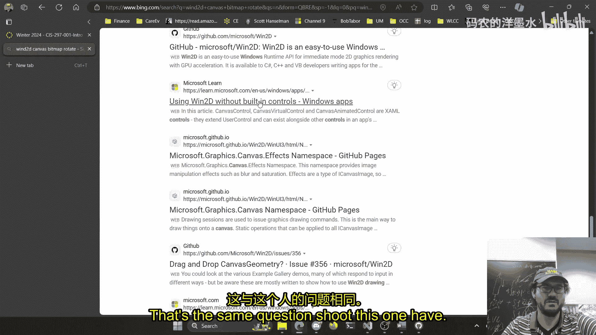

有效的团队协作是项目成功的一半。
*   **提前规划**：在编码前，共同设计游戏架构，明确模块划分。
*   **定期沟通**：利用周四课程时间或其他固定时间进行团队会议和同步。
*   **使用版本控制**：熟练使用Git进行分支管理和代码合并，避免冲突。
*   **互相评估**：项目结束后，基于贡献、沟通、时间管理等方面进行客观的同伴评估。

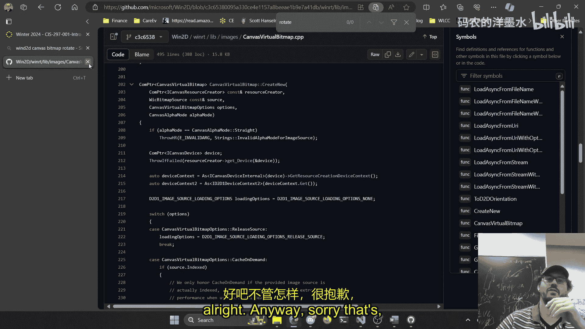

---

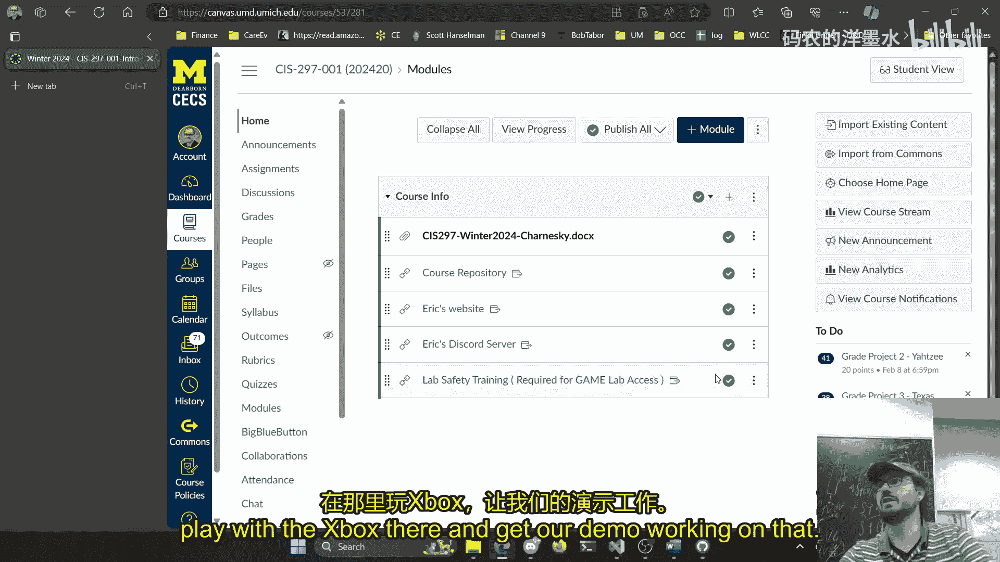

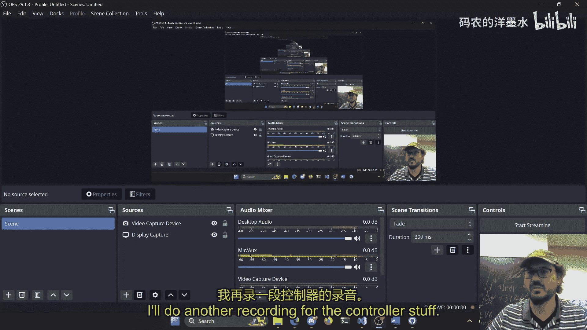

本节课中，我们一起学习了Win2D中加载和绘制图像的方法，理解了将图像集成到现有游戏对象中的技巧。更重要的是，我们探讨了如何通过面向对象的思想重构游戏代码，使其结构更清晰、更易于维护。同时，我们也为最终的团队项目明确了方向和要求。请将这些概念应用到你的项目中，打造一个结构良好、玩法有趣的游戏。