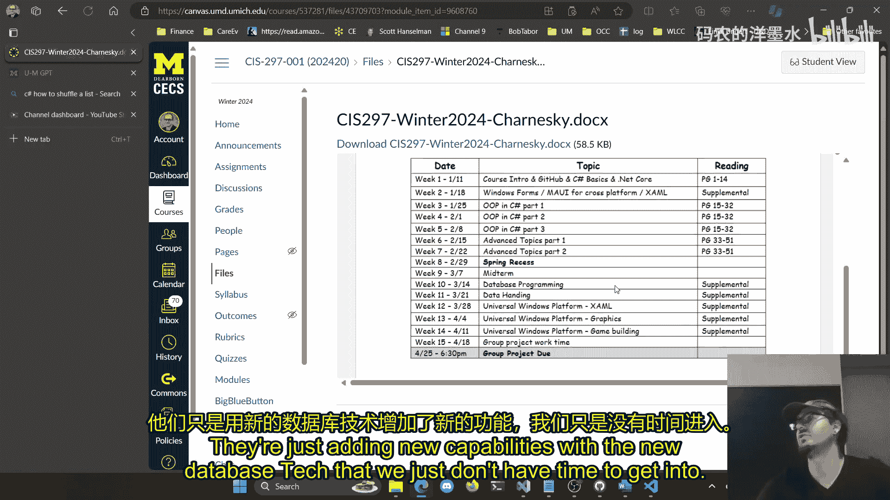
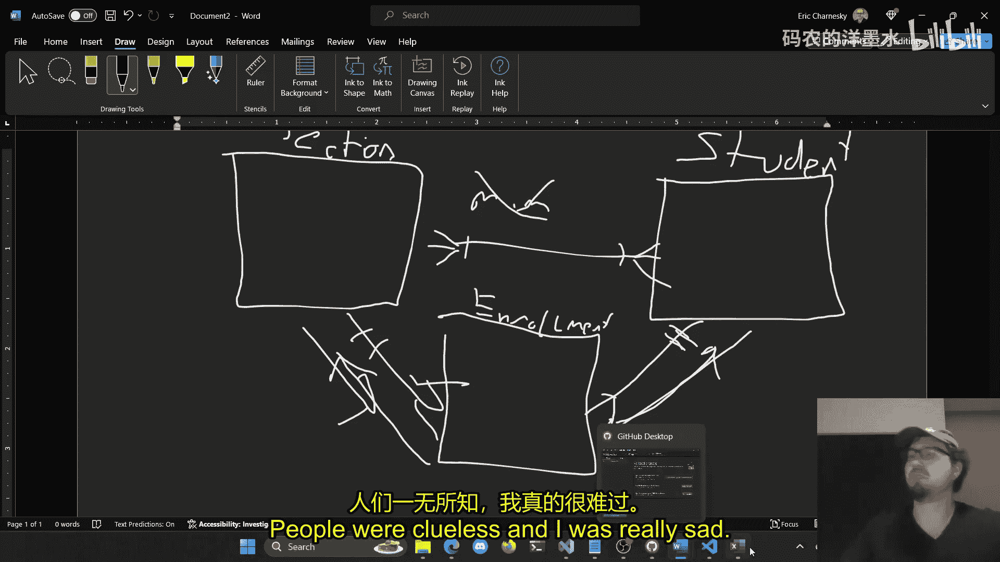
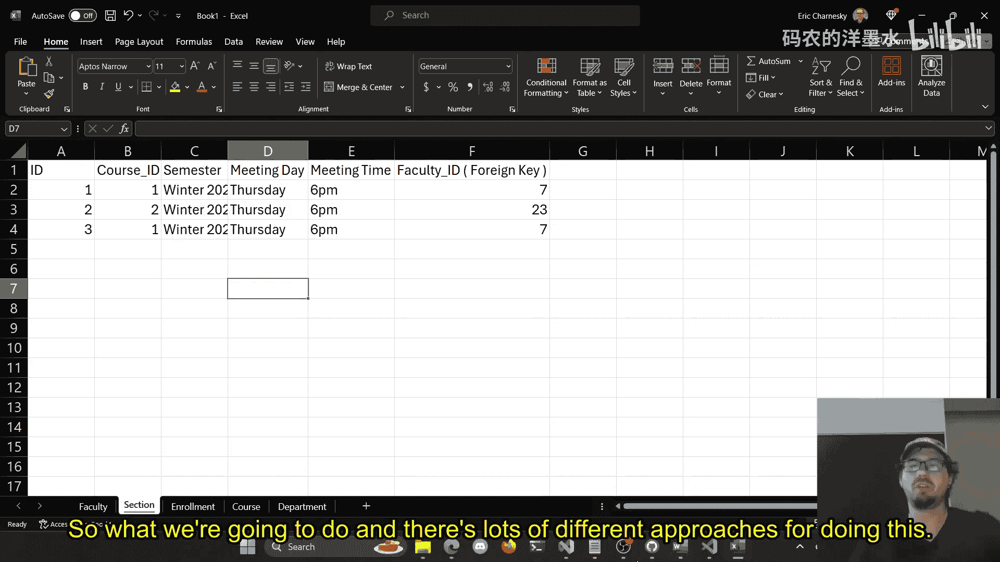
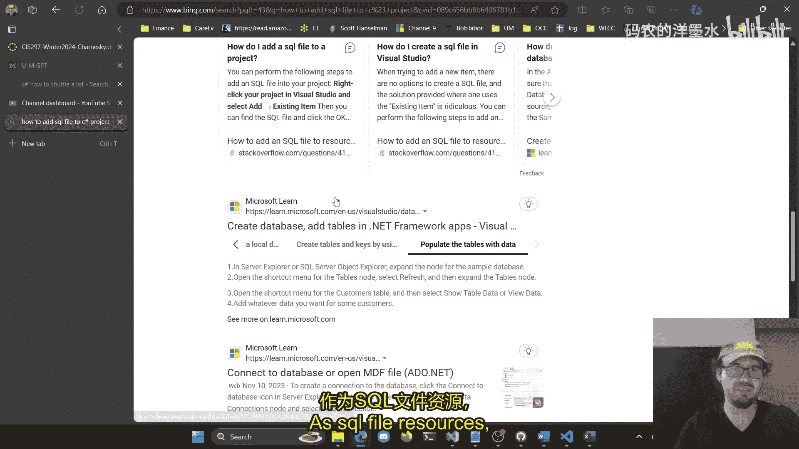
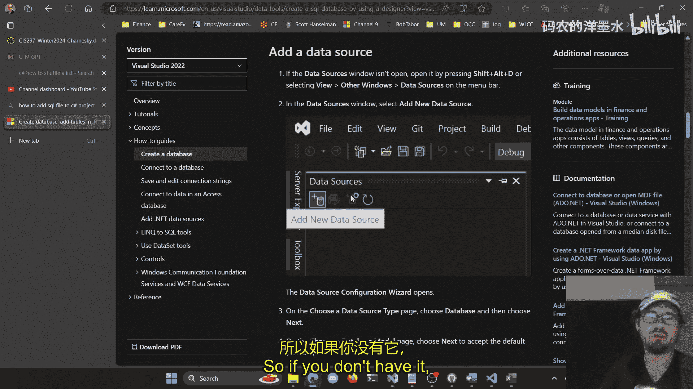
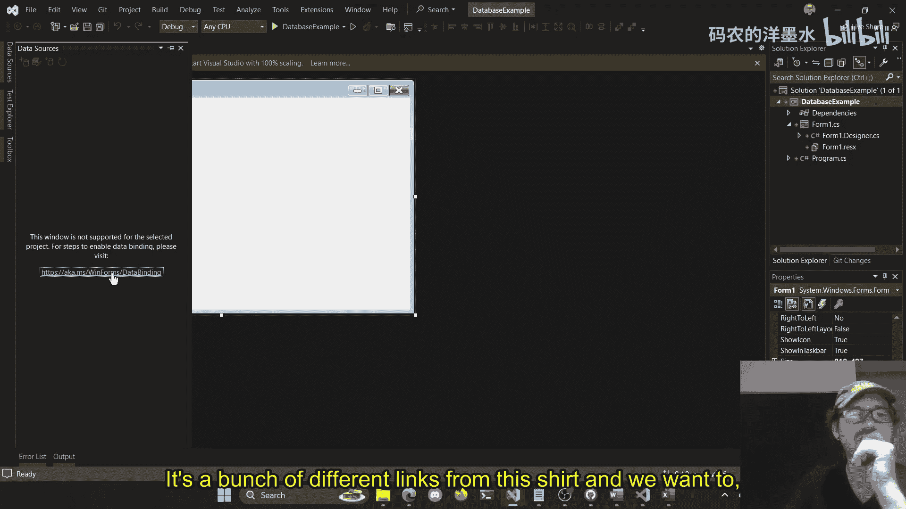

# 010：数据库入门 🗄️

在本节课中，我们将要学习数据库编程的基础知识。我们将了解什么是数据库，它如何存储数据，以及如何在C#程序中与数据库进行交互。这对于构建需要存储和检索数据的应用程序至关重要。

## 概述

上一节我们完成了C#语言基础的学习。本节中，我们来看看如何将数据持久化存储到数据库中。几乎所有现代应用程序都需要从数据库获取数据，因此理解数据库的基本概念和操作是开发者的核心技能。

## 什么是数据库？

数据库是一个用于存储、组织和管理数据的系统。我们主要关注**关系型数据库**，这是一种传统但至今仍被广泛使用的数据库类型。

你可以将数据库中的**表**想象成Excel电子表格。每个表存储特定类型的信息。

## 数据库的核心概念

以下是理解关系型数据库的几个核心概念。

### 表、行与列

*   **表**： 存储特定实体（如学生、课程）数据的集合。
*   **列**： 表中的每一列代表一个特定类型的信息（属性），例如 `ID`、`FirstName`、`LastName`。
*   **行**： 表中的每一行代表一个具体的记录或实体实例。

用代码类比，一个表就像一个类定义，而一行就是该类的一个实例对象。

### 主键

主键是表中唯一标识每一行的列。它必须是唯一的，不能为空。通常我们使用整数作为主键，因为它存储效率高。

**公式**： `PRIMARY KEY (ID)`

### 外键与关系

当一个表中的列引用了另一个表的主键时，该列就称为**外键**。这建立了表与表之间的关系，并确保了数据的**参照完整性**。数据库会阻止你插入一个引用了不存在记录的外键值。

**公式**： `FOREIGN KEY (FacultyID) REFERENCES Faculty(ID)`

### 关系类型

表之间的关系主要有三种：

1.  **一对一**： 例如，一个部门只有一位主席，一位主席只负责一个部门。
2.  **一对多**： 这是最常见的关系。例如，一门课程可以有多个章节，但一个章节只属于一门课程。
3.  **多对多**： 例如，一个学生可以选修多门课程，一门课程也可以被多名学生选修。处理多对多关系时，需要创建一个**连接表**（如“选课表”）来将其分解为两个一对多关系。

## 在Visual Studio中创建本地数据库

为了便于学习和开发，我们可以使用本地数据库文件，而无需配置完整的数据库服务器。

以下是创建本地SQL Server数据库文件的步骤：

1.  在Visual Studio中，打开“服务器资源管理器”窗口。
2.  右键点击“数据连接”，选择“添加连接”。
3.  选择“Microsoft SQL Server数据库文件”，然后点击“浏览”创建或选择一个 `.mdf` 文件（例如 `College.mdf`）。
4.  连接成功后，你可以在“服务器资源管理器”中看到该数据库。
5.  右键点击“表”，选择“添加新表”，即可开始设计表结构（定义列名、数据类型、设置主键等）。
6.  在表设计器中，可以将某列的“标识规范”设置为“是”，这样该列（通常是ID列）就会自动递增。
7.  设计完成后，点击“更新”以创建表。
8.  创建表后，可以右键点击表名，选择“显示表数据”，以类似Excel的界面添加和查看数据。

> **注意**： 这种本地 `.mdf` 文件的方式适用于开发和测试。在生产环境中，通常会使用独立的数据库服务器（如 SQL Server、MySQL、PostgreSQL）。

## 数据库操作：CRUD

与数据库交互主要涉及四种基本操作，通常被称为 **CRUD**：

*   **C - Create (创建)**： 向表中插入新数据。对应SQL语句：`INSERT`
*   **R - Read (读取)**： 从表中查询数据。对应SQL语句：`SELECT`
*   **U - Update (更新)**： 修改表中已有的数据。对应SQL语句：`UPDATE`
*   **D - Delete (删除)**： 从表中删除数据。对应SQL语句：`DELETE`

在下节课中，我们将学习如何在C#代码中执行这些CRUD操作，并与我们创建的数据库进行交互。

## 总结

本节课中我们一起学习了数据库的基础知识。我们了解了关系型数据库的核心概念，包括表、主键、外键以及表之间的关系（一对一、一对多、多对多）。我们还实践了在Visual Studio中创建本地数据库文件并设计简单的表。理解这些概念是后续进行数据库编程的基石。下节课，我们将把重点转向C#代码，学习如何连接数据库并执行CRUD操作。