# 011：Lambda表达式教程 🎮

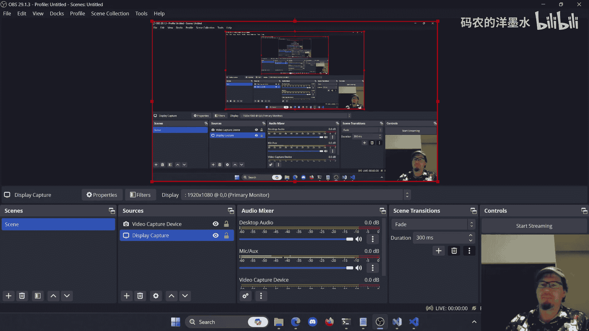

在本节课中，我们将要学习C#中一个强大的特性：Lambda表达式。Lambda表达式提供了一种简洁的方式来编写匿名函数，使我们能够更高效地处理数据集合，特别是在使用LINQ（语言集成查询）时。我们将通过一个扑克牌游戏的实例来理解其应用。

---

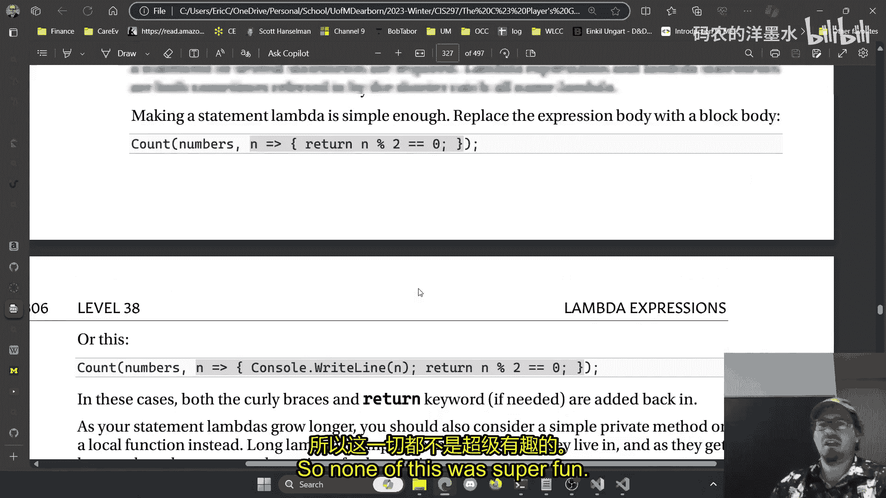

## 概述

Lambda表达式本质上是一种简写形式的匿名方法。它允许我们在需要委托（一种指向方法的类型）的地方，直接内联编写函数逻辑，而无需预先定义一个完整的方法。这在处理集合数据、进行筛选、排序和分组等操作时非常有用，可以显著减少代码量。

上一节我们介绍了错误处理，本节中我们来看看如何使用Lambda表达式来简化代码并增强功能。

---

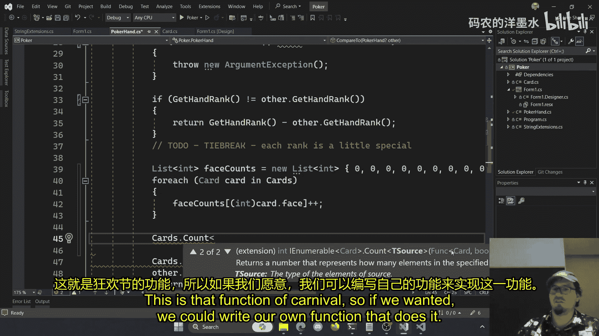

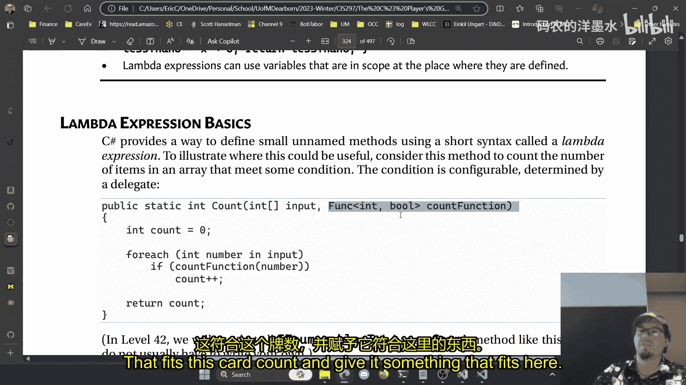

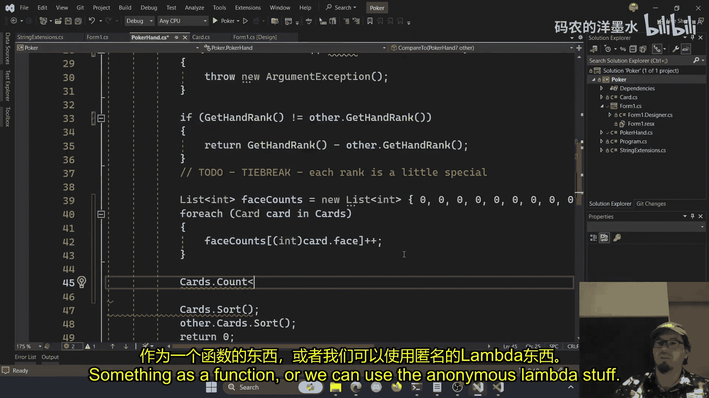

## Lambda表达式基础

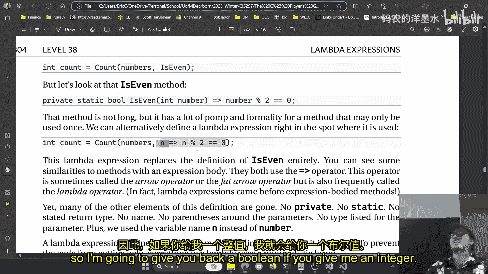

Lambda表达式的基本语法是使用 `=>` 运算符（读作“goes to”）。运算符左边是输入参数，右边是表达式或语句块。

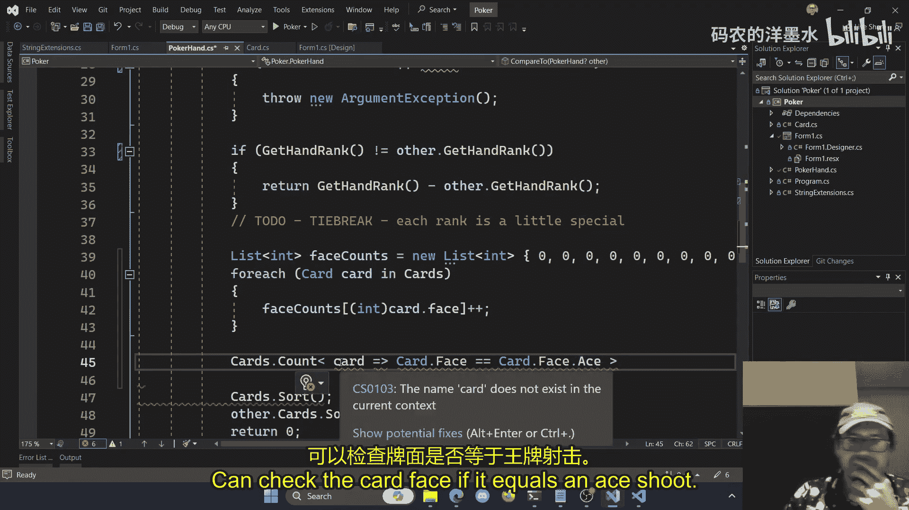

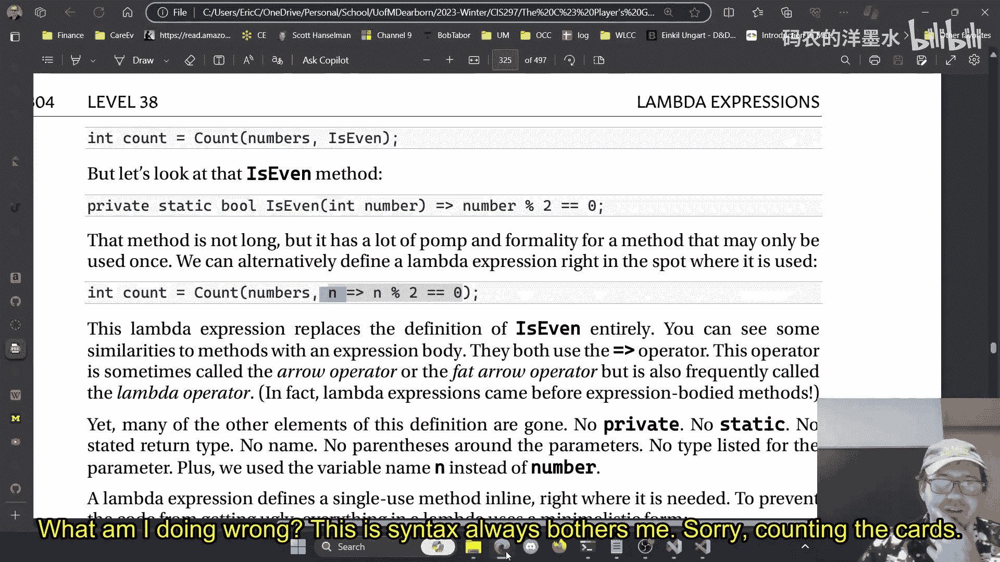

以下是Lambda表达式的几种形式：

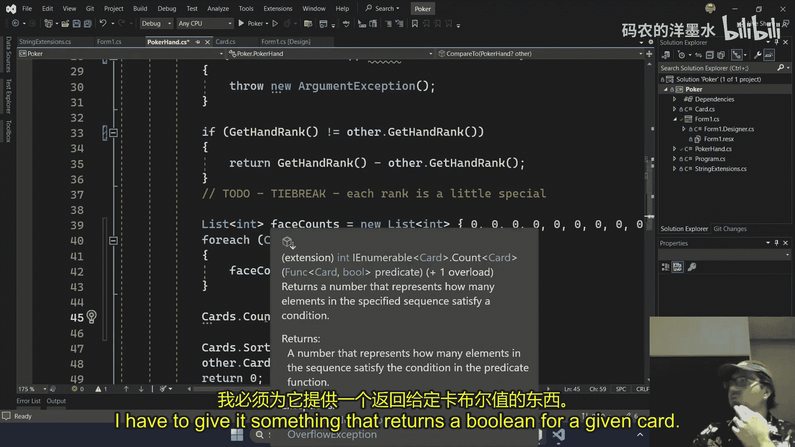

*   **带参数的Lambda**：`(参数) => 表达式`
    *   例如：`(int n) => n % 2 == 0` 检查一个整数是否为偶数。
*   **无参数的Lambda**：`() => 表达式`
    *   例如：`() => Console.WriteLine("Hello")` 执行一个无参操作。
*   **类型推断**：编译器通常可以推断参数类型。
    *   例如：`(n) => n / 2` 可以推断 `n` 为整数。
*   **忽略参数**：使用下划线 `_` 表示忽略不用的参数。
    *   例如：`_ => Console.WriteLine("Ignored")`

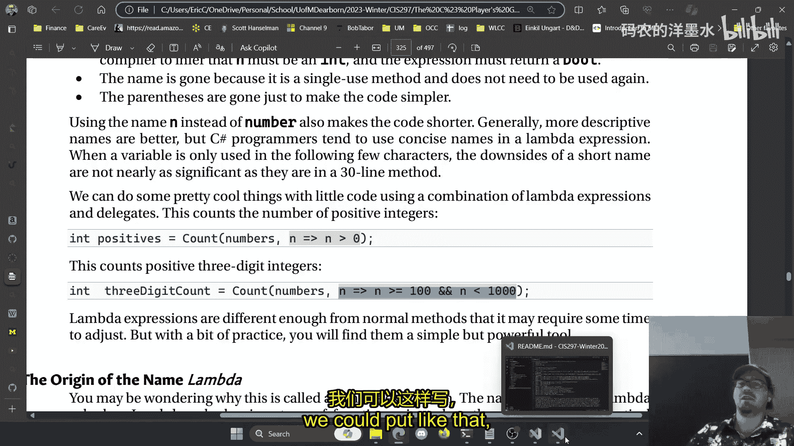

**核心概念公式**：
```
(输入参数) => 表达式或语句块
```

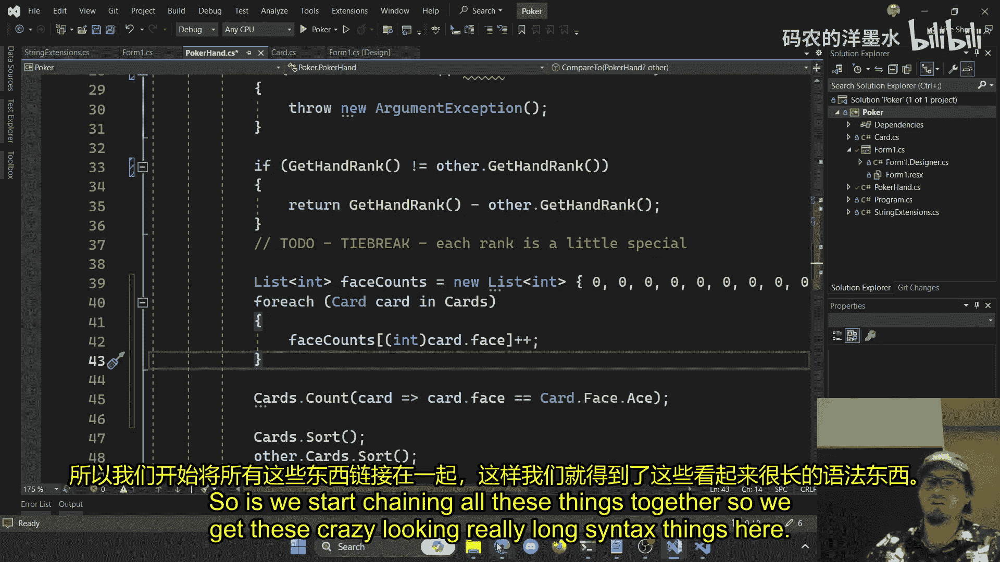

---

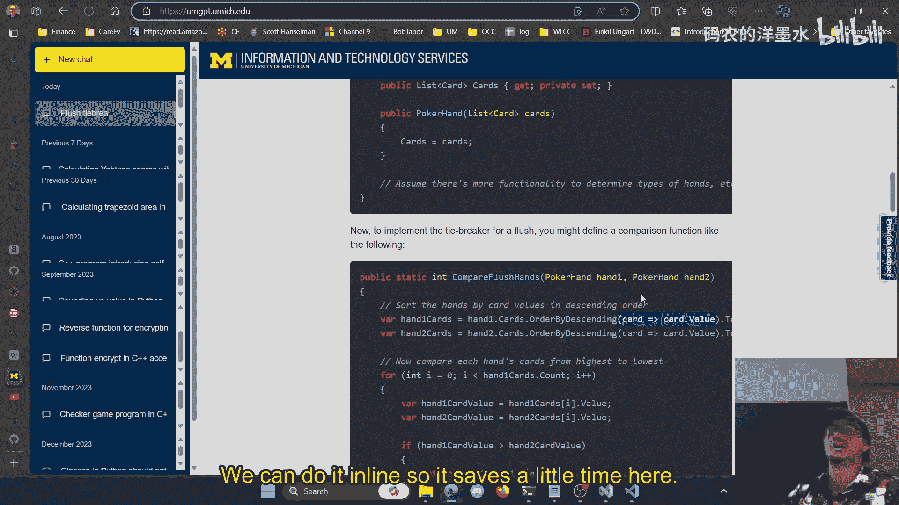

## 在项目中的应用：统计牌面

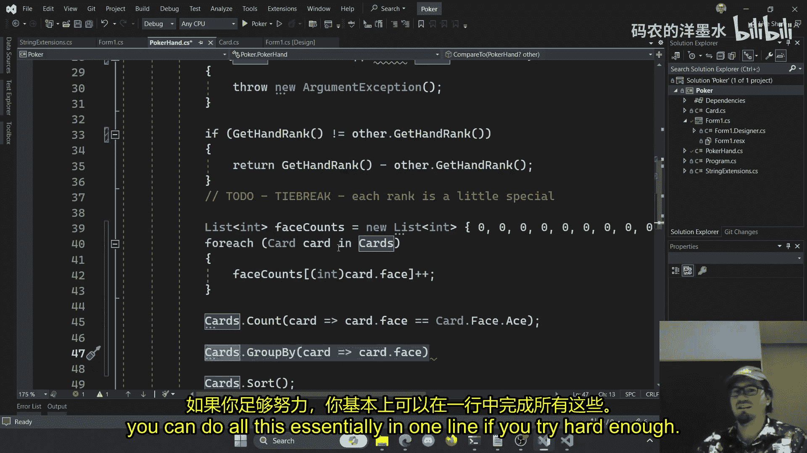

让我们回到扑克牌游戏项目。一个常见的需求是统计手牌中每种点数的出现次数。

### 传统循环方法

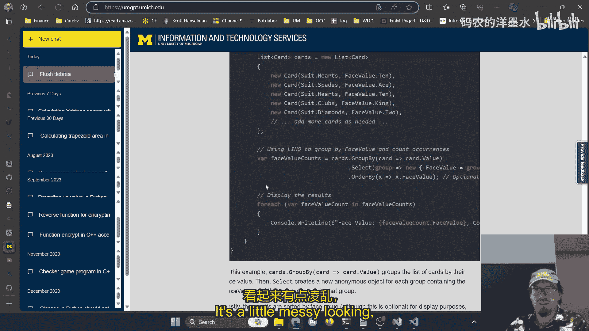

在Lambda表达式出现之前，我们可能会使用循环来实现：

```csharp
List<int> faceCounts = new List<int> {0, 0, 0, 0, 0, 0, 0, 0, 0, 0, 0, 0, 0};
foreach (Card card in cards)
{
    int faceIndex = (int)card.Face; // 假设Face是一个枚举
    faceCounts[faceIndex]++;
}
```

### 使用Lambda和LINQ方法

现在，我们可以使用 `Count` 方法和Lambda表达式更简洁地完成特定统计，例如计算手中有多少张Ace：

```csharp
int aceCount = cards.Count(card => card.Face == CardFace.Ace);
```

在这行代码中：
*   `cards.Count(...)` 是一个LINQ扩展方法，用于计算满足条件的元素数量。
*   `card => card.Face == CardFace.Ace` 就是一个Lambda表达式。它定义了一个匿名函数：对于给定的 `card` 参数，如果其 `Face` 属性等于 `Ace`，则返回 `true`。

这种方法将循环和条件判断浓缩成了一行代码。

---

## 进阶应用：分组与复杂查询

Lambda表达式真正的威力在于可以链式调用多个LINQ操作。

例如，我们想要按牌面点数分组，并获取每组数量，然后按点数降序排列：

```csharp
var faceValueCounts = cards
    .GroupBy(card => card.Face)               // 按牌面分组
    .Select(group => new                      // 将每组转换为新对象
    {
        FaceValue = group.Key,                // 牌面值
        Count = group.Count()                 // 该牌面的数量
    })
    .OrderByDescending(item => item.FaceValue); // 按牌面值降序排列
```

以下是这个链式调用中每一步的分解：

1.  **`GroupBy`**：使用Lambda `card => card.Face` 作为分组依据。
2.  **`Select`**：使用Lambda将每个分组（`group`）投影成一个新的匿名类型对象，该对象包含 `FaceValue` 和 `Count` 两个属性。这里的 `new { ... }` 语法创建了一个匿名类。
3.  **`OrderByDescending`**：使用Lambda `item => item.FaceValue` 指定排序依据。

通过这种方式，我们无需编写复杂的嵌套循环，就能以声明式的方法表达复杂的数据处理逻辑。

---

## 在游戏逻辑中的实际使用

在扑克牌比大小的逻辑中，Lambda表达式可以帮助我们快速判断牌型。

例如，判断手牌是否为“两对”：

```csharp
// 获取每种点数的出现次数列表
var counts = faceValueCounts.Select(fvc => fvc.Count).ToList();

// 判断是否有两个“对子”（即出现次数为2的点数有两个）
bool isTwoPair = counts.Count(c => c == 2) == 2;
```

又或者在比较两个“两对”牌型的大小时，我们需要先比较较大的对子，再比较较小的对子，最后比较单张牌：


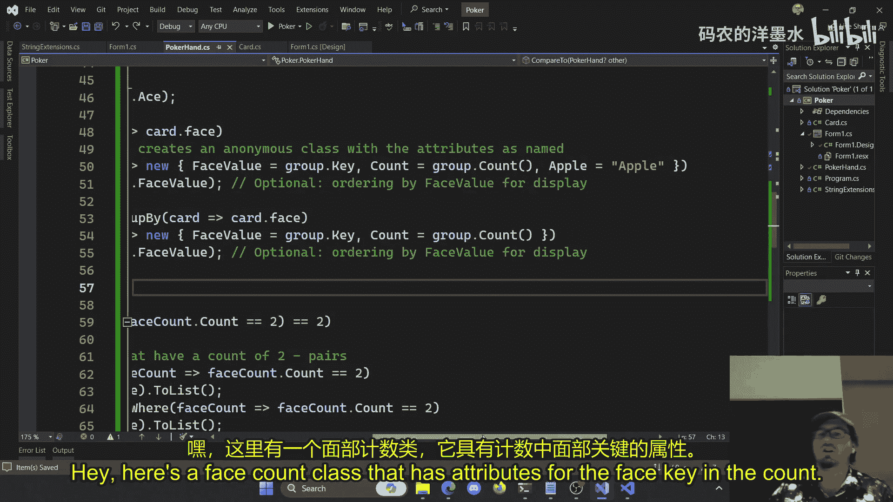


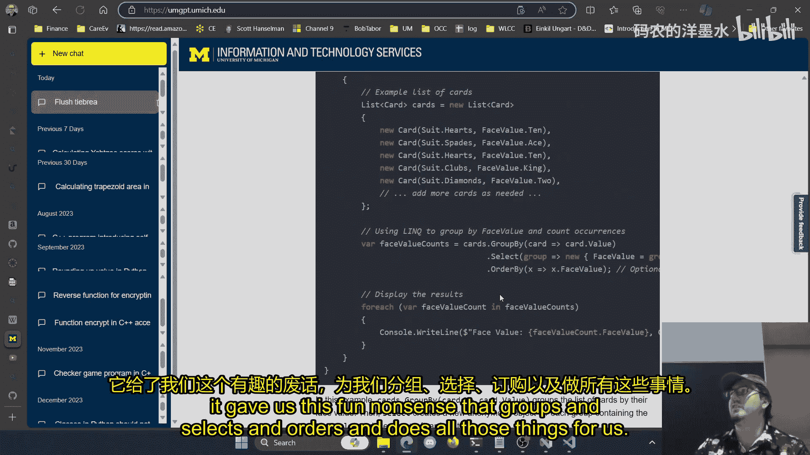

```csharp
// 获取自己手牌中所有“对子”的点数列表（已排序）
var myPairs = faceValueCounts.Where(fvc => fvc.Count == 2)
                             .Select(fvc => fvc.FaceValue)
                             .OrderByDescending(fv => fv)
                             .ToList();

// 获取对手手牌中所有“对子”的点数列表（已排序）
var otherPairs = otherPlayerFaceValueCounts.Where(fvc => fvc.Count == 2)
                                           .Select(fvc => fvc.FaceValue)
                                           .OrderByDescending(fv => fv)
                                           .ToList();
// 逐对比较
for (int i = 0; i < myPairs.Count; i++)
{
    if (myPairs[i] > otherPairs[i]) return 1;  // 自己的大
    if (myPairs[i] < otherPairs[i]) return -1; // 对手的大
}
// 如果所有对子都相等，比较剩下的单张牌
var myKicker = faceValueCounts.First(fvc => fvc.Count == 1).FaceValue;
var otherKicker = otherPlayerFaceValueCounts.First(fvc => fvc.Count == 1).FaceValue;
return myKicker.CompareTo(otherKicker);
```

虽然这些链式调用看起来复杂，但它们用一行或几行代码就替代了多个循环和临时变量，使意图更加清晰。

---

## 总结

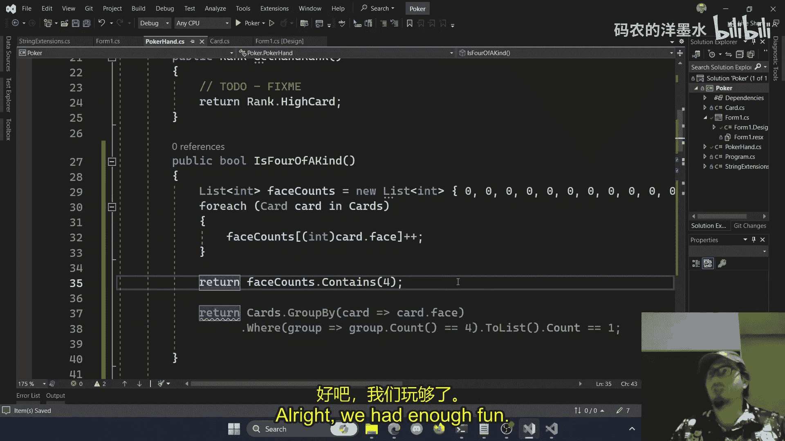

本节课中我们一起学习了C#的Lambda表达式。我们了解到：

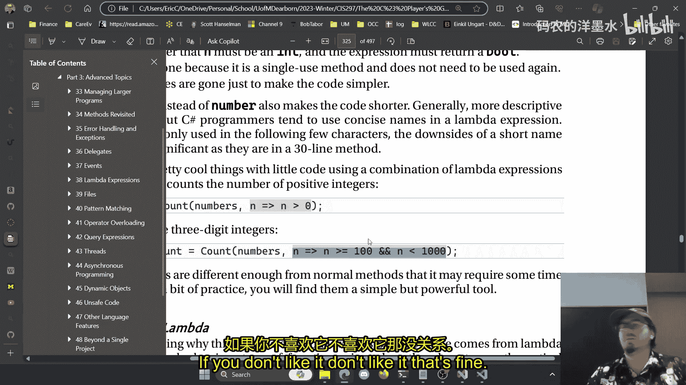

*   Lambda表达式是编写匿名函数的简洁语法，格式为 `(参数) => 表达式`。
*   它常与LINQ方法（如 `Count`, `Where`, `Select`, `GroupBy`, `OrderBy`）结合使用，以处理数据集合。
*   使用Lambda和LINQ可以用声明式的代码替代命令式的循环，使代码更简洁、易读，尤其在执行筛选、投影、排序和分组操作时。
*   虽然复杂的链式调用可能初看令人困惑，但理解每个步骤后，它能极大提升开发效率。

Lambda表达式是C#现代编程风格的核心组成部分，熟练掌握它将为后续学习数据库操作（如Entity Framework）和异步编程打下坚实基础。

---

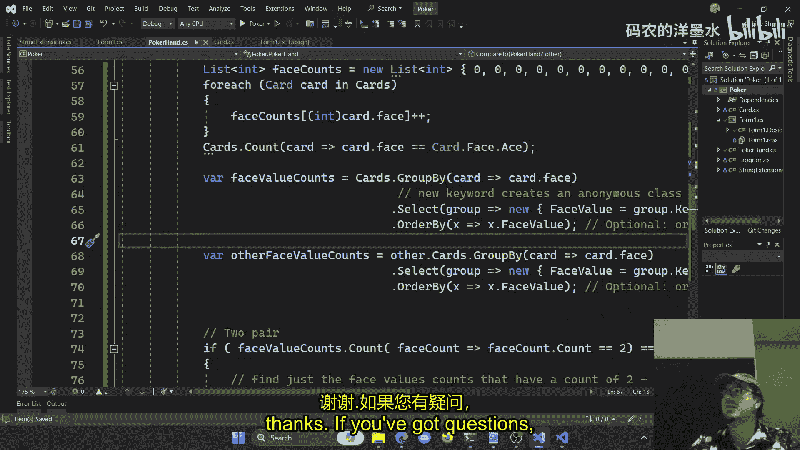

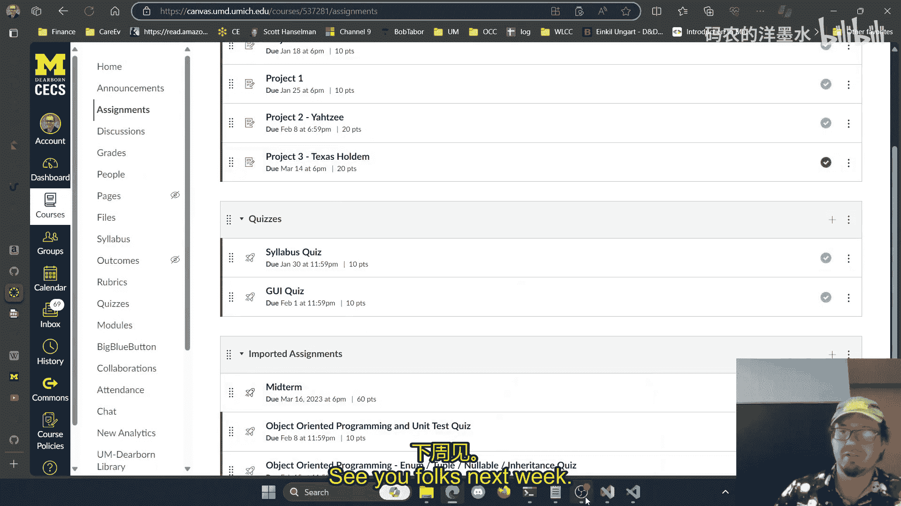

**下节预告**：在接下来的课程中，我们将深入探讨**委托（Delegates）**和**事件（Events）**，它们是图形用户界面（GUI）应用程序和响应式编程的基石。我们还将初步接触**线程**和**异步编程**。