# 012：MAUI与UWP开发 🎮

在本节课中，我们将学习两种用于构建跨平台和原生Windows应用程序的现代技术：.NET MAUI和通用Windows平台。我们将通过创建简单的“Hello World”应用来了解它们的基本工作原理、布局方式和开发体验。


## 概述


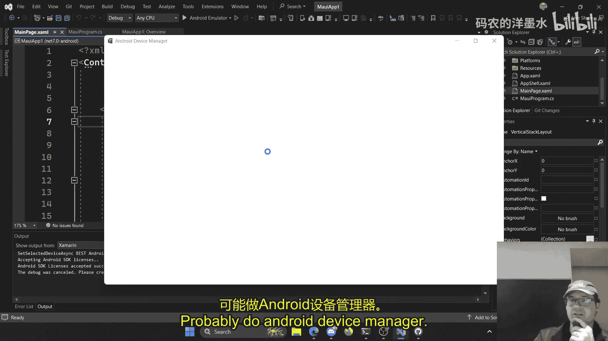

上一节我们介绍了Windows Forms，它是一种快速构建桌面应用的传统技术。本节中，我们来看看两种更现代的选择：.NET MAUI用于跨平台开发，UWP用于构建原生Windows应用。我们将分别创建应用，并比较它们的特点。

## .NET MAUI 应用开发 🌐

我们首先创建一个.NET MAUI应用。MAUI代表`.NET Multi-platform App UI`，它允许我们使用单一代码库为多个平台（如Windows、Android、iOS）构建应用。


### 项目结构与启动

创建一个新的.NET MAUI项目后，我们会看到`MauiProgram.cs`文件。这是应用的入口点，它负责配置和启动应用。

```csharp
// MauiProgram.cs 中的核心启动逻辑
// 它构建了应用的主页面
```

应用的实际界面定义在`MainPage.xaml`文件中。与Windows Forms不同，MAUI使用XAML（可扩展应用程序标记语言）来定义用户界面。

### 灵活的布局设计

MAUI应用的核心思想是**灵活布局**。界面元素不是通过固定的像素位置来放置，而是使用如`VerticalStackLayout`（垂直堆叠布局）这样的容器来组织，使应用能自适应不同尺寸的屏幕。

以下是界面布局的核心结构：
```xml
<!-- 在 MainPage.xaml 中 -->
<ContentPage>
    <ScrollView>
        <VerticalStackLayout>
            <!-- 标签、按钮等元素将在这里垂直排列 -->
            <Label Text="Welcome to .NET MAUI!" />
            <Button Text="Click me" Clicked="OnCounterClicked" />
        </VerticalStackLayout>
    </ScrollView>
</ContentPage>
```

### 事件处理与代码逻辑

当用户与界面交互时，例如点击按钮，我们需要处理事件。事件处理逻辑写在`MainPage.xaml.cs`文件中，即所谓的“代码隐藏”文件。

在下面的示例中，我们定义了一个类级别的变量`count`来跟踪点击次数，并在按钮点击事件中更新它：

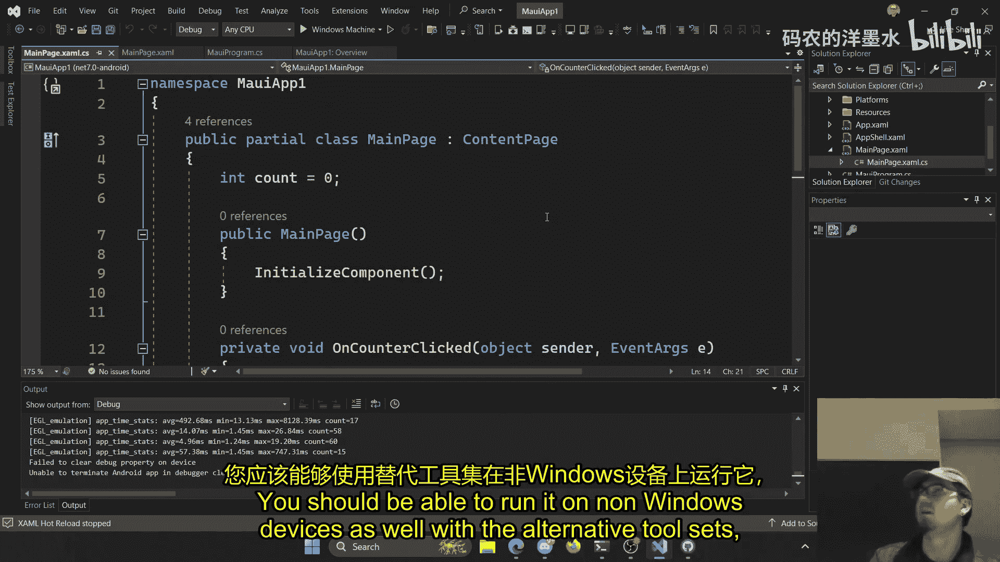

```csharp
// MainPage.xaml.cs 中的代码
public partial class MainPage : ContentPage
{
    int count = 0; // 类级别变量，用于存储状态

    public MainPage()
    {
        InitializeComponent();
    }

    private void OnCounterClicked(object sender, EventArgs e)
    {
        count++; // 每次点击增加计数
        // 更新界面上的文本显示
        CounterLabel.Text = $"Current count: {count}";
    }
}
```

### 跨平台运行与调试

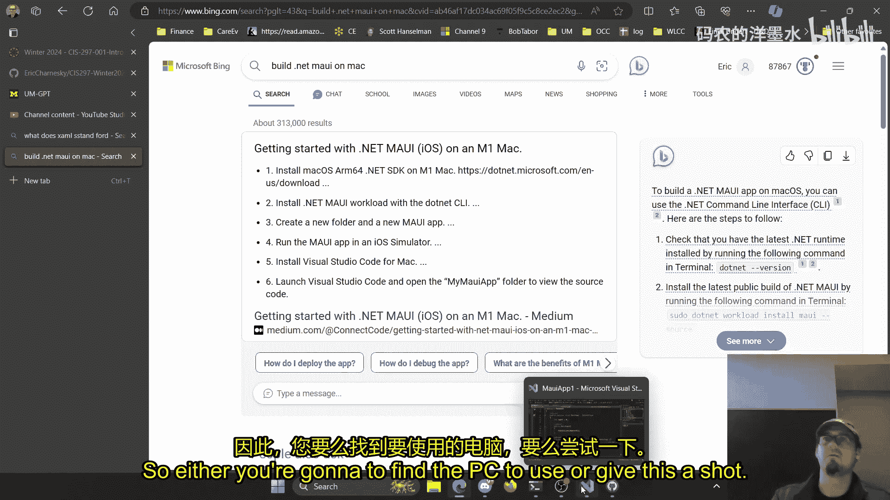

.NET MAUI的一个强大功能是能够选择不同的目标设备进行调试和运行。你可以在Visual Studio中选择在Windows应用、Android模拟器或iOS模拟器上运行你的应用。

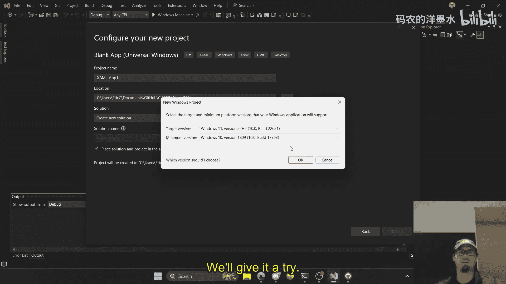

*   **Windows应用**：直接在Windows桌面上运行。
*   **Android模拟器**：需要安装并启动Android设备模拟器（如Pixel 5），应用将在模拟的Android设备中运行。
*   **iOS模拟器**：通常需要在macOS环境下运行。

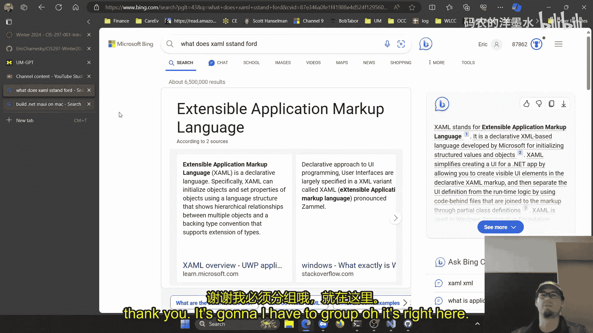

尝试在Android模拟器上运行应用，并点击按钮，可以看到计数功能正常工作。你甚至可以在代码中设置断点，在点击时进行调试，这展示了强大的跨平台开发能力。

## 通用Windows平台应用开发 🪟

接下来，我们看看通用Windows平台应用。UWP旨在创建能在所有Windows 10/11设备（如PC、Xbox、HoloLens）上运行的应用。

### 创建UWP项目

创建一个新的“空白应用（通用Windows平台）”项目。与MAUI类似，UWP也使用XAML来定义界面，主界面文件是`MainPage.xaml`。

### 界面设计与属性

UWP提供了设计器视图，允许你通过拖放控件来构建界面。这与Windows Forms的体验有些相似，但使用的是现代XAML技术。

例如，你可以从工具箱中拖入一个`Button`和一个`TextBlock`（相当于标签）：
1.  将`Button`的`Content`属性改为“Click me”。
2.  为`TextBlock`设置一个名称（如`ClickMeTextBlock`），以便在代码中引用它。

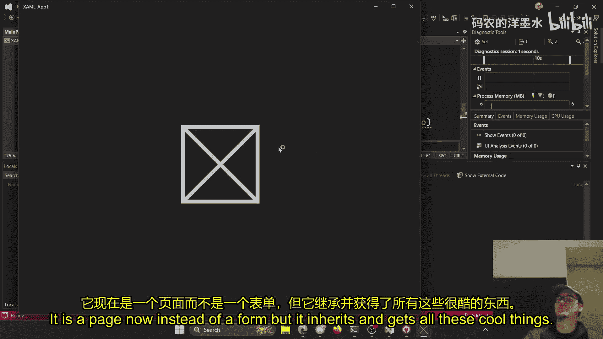

### 事件处理与原生集成

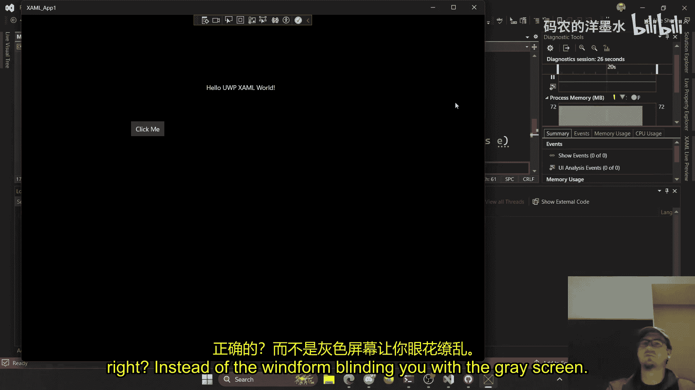

双击设计器中的按钮，会自动生成点击事件的处理方法。我们可以在该方法中编写逻辑，例如更新`TextBlock`的文本。

```csharp
// MainPage.xaml.cs 中的事件处理
private void Button_Click(object sender, RoutedEventArgs e)
{
    // 通过名称找到TextBlock控件并修改其文本
    ClickMeTextBlock.Text = "Hello, UWP World!";
}
```

UWP应用的一个优点是能更好地与Windows系统集成。例如，它会自动适应系统的深色/浅色主题模式，提供更原生的用户体验。

### 多目标部署

在UWP项目中，你可以指定应用的目标设备系列和最低版本。这意味着你可以针对特定的Windows设备（如桌面、Xbox、IoT）优化你的应用。调试时，可以选择在本地计算机、模拟器或远程设备上运行。

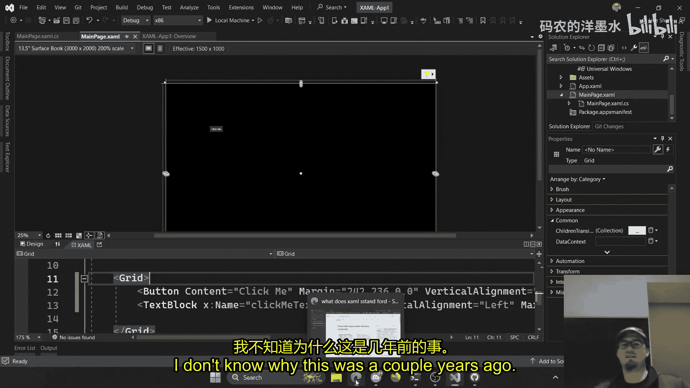

## 技术选型与思考 💡

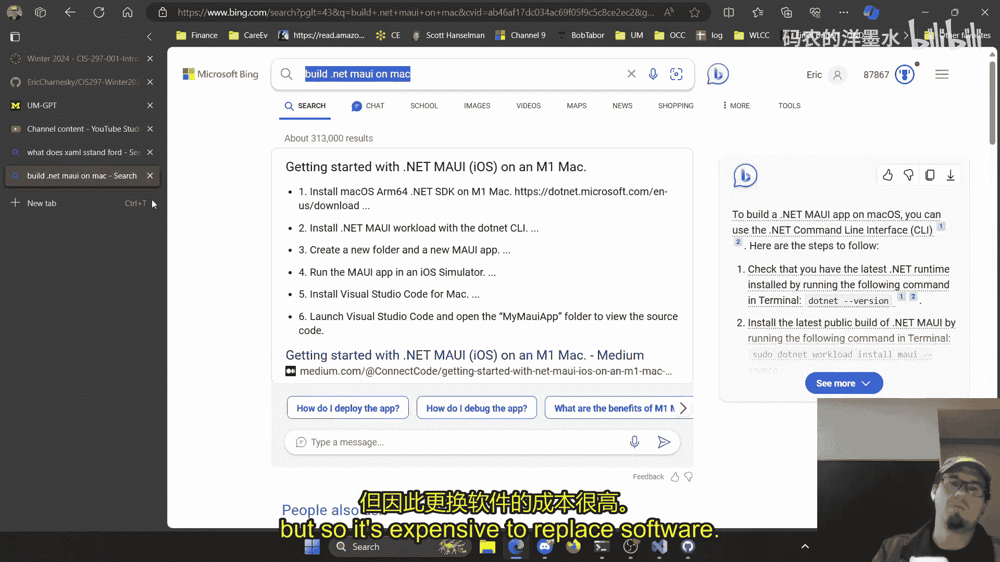

我们已经体验了三种GUI开发方式：Windows Forms、.NET MAUI和UWP。以下是它们的一些关键对比和考量：

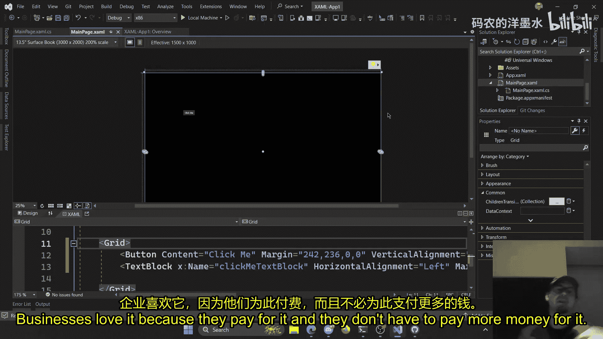

*   **Windows Forms**：成熟、稳定、开发速度快，大量现有企业应用基于此构建。但界面相对陈旧，且主要限于Windows桌面。
*   **.NET MAUI**：真正的跨平台解决方案，使用灵活的布局适应各种屏幕尺寸，是开发现代移动和桌面应用的推荐方向。
*   **UWP**：为Windows生态系统（包括Xbox、HoloLens）打造原生体验，与系统深度集成，适合发布到Microsoft Store。

对于新项目，.NET MAUI是追求跨平台能力的首选。而对于需要深度利用Windows特定功能或 targeting Xbox等设备的应用，UWP仍然是不错的选择。许多遗留系统由于“技术债务”原因，仍在使用Windows Forms，因为重写功能完善但技术陈旧的软件成本高昂且存在风险。

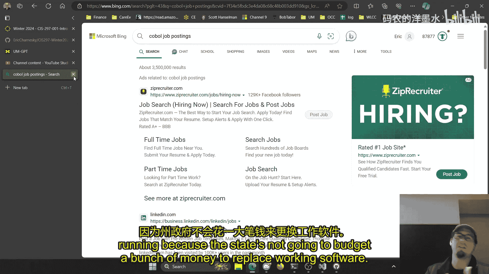

## 总结


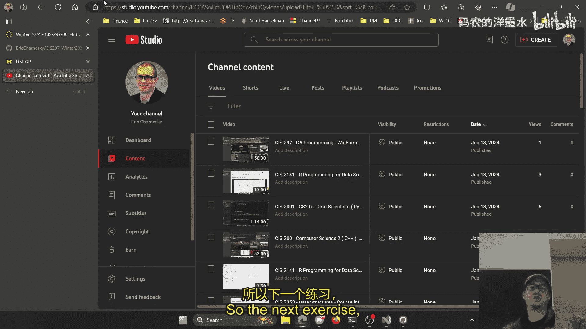

本节课中我们一起学习了两种构建图形用户界面的现代C#技术。我们创建了.NET MAUI应用，了解了其基于XAML的灵活布局和跨平台运行能力。我们也创建了UWP应用，体验了其与Windows系统的原生集成和设计器开发体验。理解这些工具的特点，将帮助你在未来项目中做出合适的技术选型。

## 课后练习 📝

接下来的练习是将之前的“Project Zero”（控制台税务计算器）转换为一个带有图形界面的应用程序。你可以选择使用Windows Forms、.NET MAUI或UWP中的任意一种来实现。

**核心要求如下：**
*   创建一个新的GUI项目（例如，在原有解决方案中新建一个“ProjectOne”）。
*   将税务计算逻辑迁移到新项目中。
*   使用按钮、文本框、标签等控件构建用户界面。
*   用户应能通过界面输入收入，点击按钮后，在界面上显示计算结果。

**实现提示：**
*   这主要是一个练习，旨在让你熟悉GUI开发的基本流程。
*   如果花费时间超过一小时，不必追求完美，理解过程即可。
*   你可以重用之前项目中的计算逻辑代码。

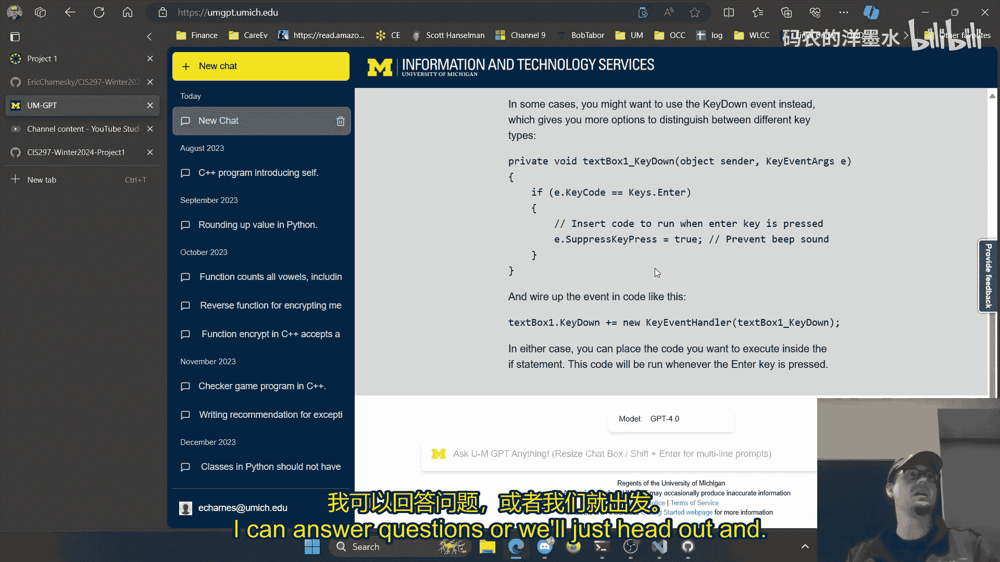

在下节课中，我们将开始学习类与对象，并着手构建一个更复杂的游戏项目。