# 013：XAML乒乓球游戏-part1

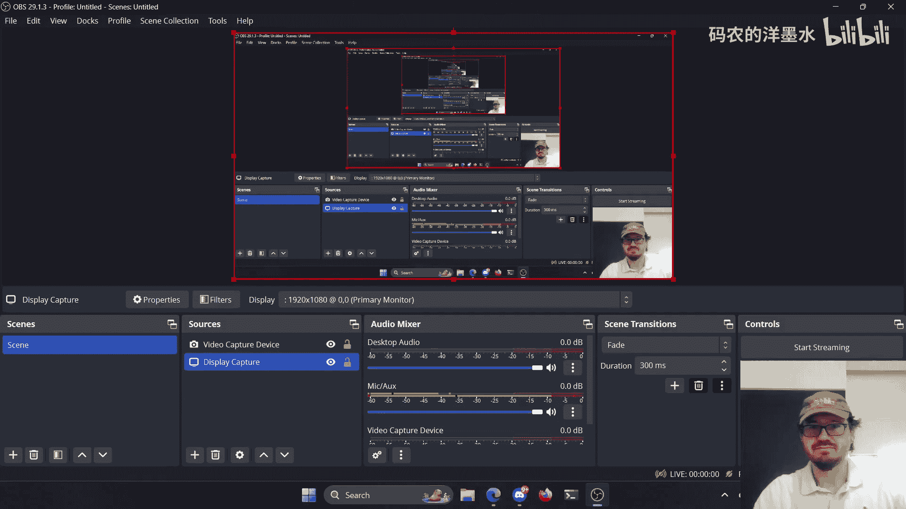

在本节课中，我们将开始学习如何使用C#和XAML，结合Win2D库来创建一个简单的2D游戏。我们将从设置项目环境、理解游戏循环的基本概念开始，并创建一个可以移动和碰撞的简单图形对象。

---

## 项目概述与设置

上一节我们介绍了课程安排和期末项目。本节中，我们来看看如何开始一个基于Universal Windows Platform (UWP)的游戏项目。

首先，我们需要创建一个新的UWP项目。在Visual Studio中，选择“创建新项目”，然后选择“空白应用(通用 Windows)”。为项目命名，例如“XAMLPongDemo”。

创建项目时，需要选择目标版本和最低版本。对于我们的游戏，选择较新的版本即可，因为我们不会使用特别前沿的API。

项目创建后，我们需要添加Win2D库。Win2D是一个易于使用的2D图形API，它封装了DirectX的复杂性，让我们可以轻松地在UWP应用中绘制图形。

以下是添加Win2D库的步骤：
1.  在解决方案资源管理器中，右键单击项目，选择“管理NuGet程序包”。
2.  在浏览选项卡中，搜索“Win2D.uwp”。
3.  选择该包并点击“安装”。

安装完成后，Win2D库会出现在项目的引用中。

---

## 理解游戏循环：CanvasAnimatedControl

在传统的XAML应用中，UI是静态的。为了制作游戏，我们需要一个能够持续更新和重绘画面的循环。手动管理这个循环（包括多线程和计时）非常复杂。

幸运的是，Win2D提供了`CanvasAnimatedControl`控件。这个控件为我们管理了一个游戏循环，它会以大约每秒60次的频率自动调用两个关键方法：
*   **Update**： 在这里更新游戏逻辑，例如物体的位置、状态。
*   **Draw**： 在这里绘制所有游戏元素到屏幕上。

这种将逻辑更新(`Update`)和画面渲染(`Draw`)分离的模式，是游戏开发中的常见做法。

我们需要在XAML页面中使用这个控件。打开`MainPage.xaml`文件，在`Grid`标签内添加`CanvasAnimatedControl`，并为其指定名称，例如`gameCanvas`。

```xml
<Page ...>
    <Grid>
        <canvas:CanvasAnimatedControl x:Name="gameCanvas"
                                      Draw="gameCanvas_Draw"
                                      Update="gameCanvas_Update"/>
    </Grid>
</Page>
```

注意，我们需要在页面顶部添加Win2D的命名空间引用：
```xml
xmlns:canvas="using:Microsoft.Graphics.Canvas.UI.Xaml"
```

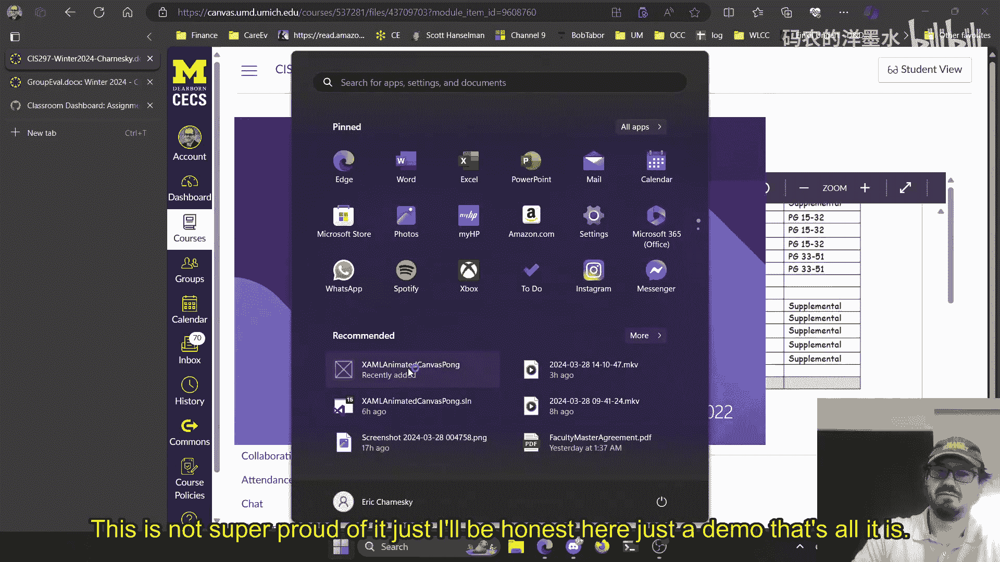

---

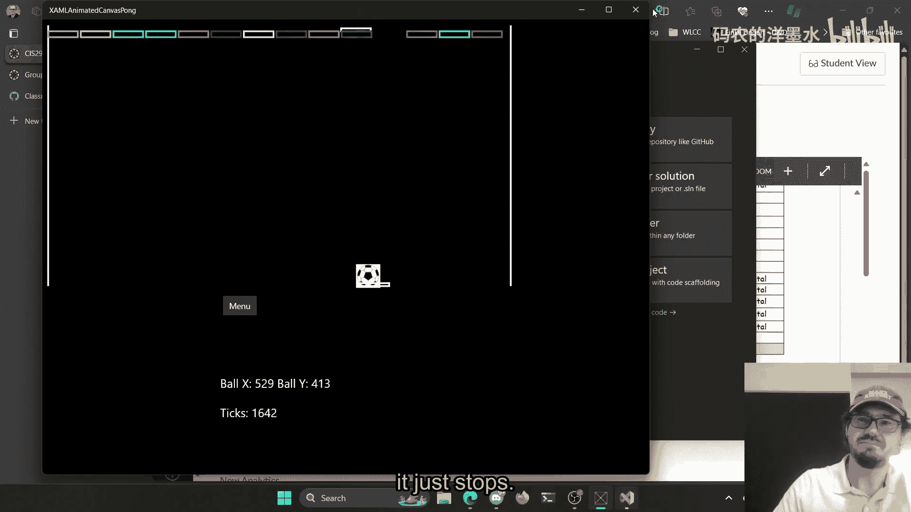

## 绘制第一个图形

现在，我们来实现`Draw`事件处理程序，绘制一个简单的圆形。

在`MainPage.xaml.cs`文件的代码中，找到自动生成的`gameCanvas_Draw`方法。在这个方法中，我们可以使用参数提供的`CanvasDrawingSession`来绘制图形。

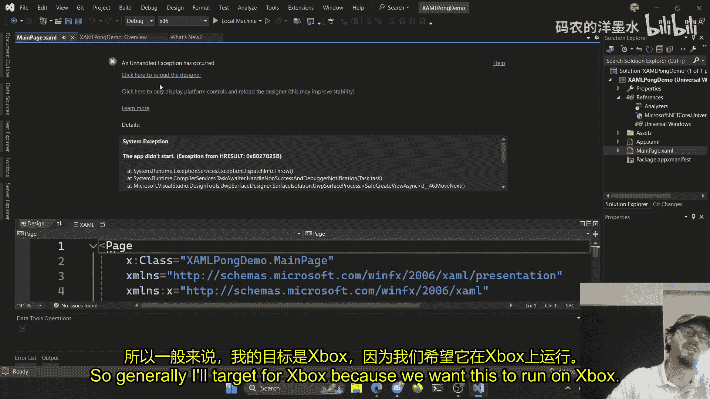

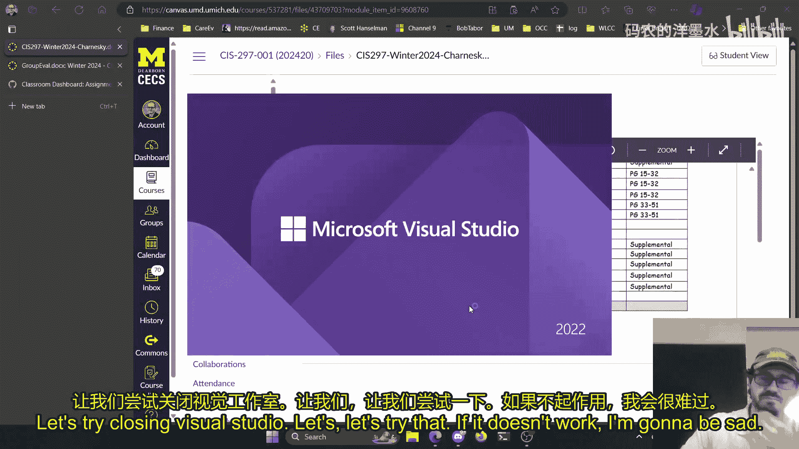

以下是绘制一个蓝色圆形的代码：
```csharp
private void gameCanvas_Draw(CanvasAnimatedControl sender, CanvasDrawEventArgs args)
{
    // args.DrawingSession 是我们用来绘制的工具
    args.DrawingSession.FillCircle(150, 150, 50, Colors.Blue);
}
```
这段代码在坐标(150, 150)的位置，绘制了一个半径为50像素的蓝色实心圆。在屏幕坐标系中，(0,0)点是左上角。

运行程序，你应该能看到一个静止的蓝色圆形。

---

## 让图形动起来：Update方法

要让图形移动，我们需要在`Update`方法中改变它的位置，并在`Draw`方法中使用这个新位置来绘制。

首先，我们定义一些类级别的变量来存储圆形的状态（位置、半径、移动方向）。

```csharp
public sealed partial class MainPage : Page
{
    // 圆形的属性
    private int circleX = 150;
    private int circleY = 150;
    private int circleRadius = 50;
    private bool movingRight = true; // 移动方向

    public MainPage()
    {
        this.InitializeComponent();
    }
    // ... Draw 和 Update 方法
}
```

然后，在`Update`方法中，我们根据移动方向更新圆形的位置，并检查是否碰到边界以改变方向。

```csharp
private void gameCanvas_Update(ICanvasAnimatedControl sender, CanvasAnimatedUpdateEventArgs args)
{
    // 更新逻辑：每帧移动1像素
    if (movingRight)
    {
        circleX++;
    }
    else
    {
        circleX--;
    }

    // 简单的边界检查（假设屏幕宽度约为900像素）
    if (circleX + circleRadius >= 900)
    {
        movingRight = false; // 碰到右边界，向左移动
    }
    else if (circleX - circleRadius <= 0)
    {
        movingRight = true; // 碰到左边界，向右移动
    }
}
```

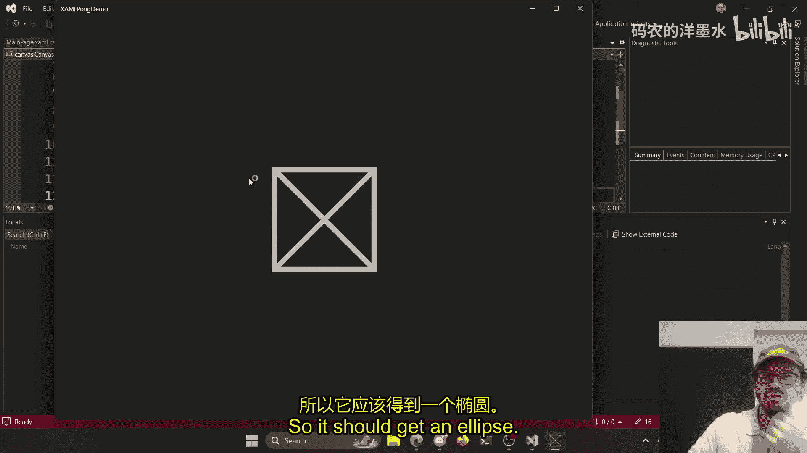

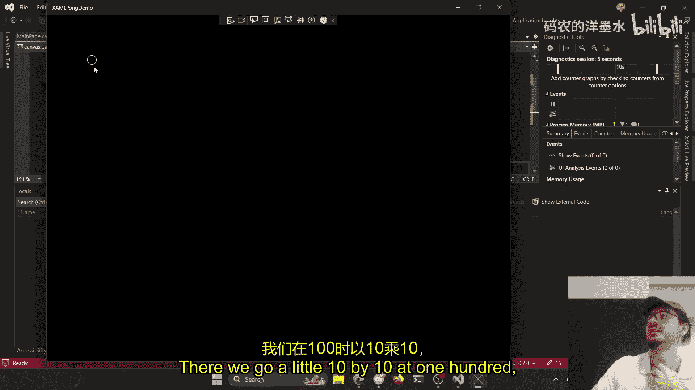

最后，修改`Draw`方法，使用变量`circleX`和`circleY`来绘制圆形。

```csharp
private void gameCanvas_Draw(CanvasAnimatedControl sender, CanvasDrawEventArgs args)
{
    args.DrawingSession.FillCircle(circleX, circleY, circleRadius, Colors.Blue);
}
```

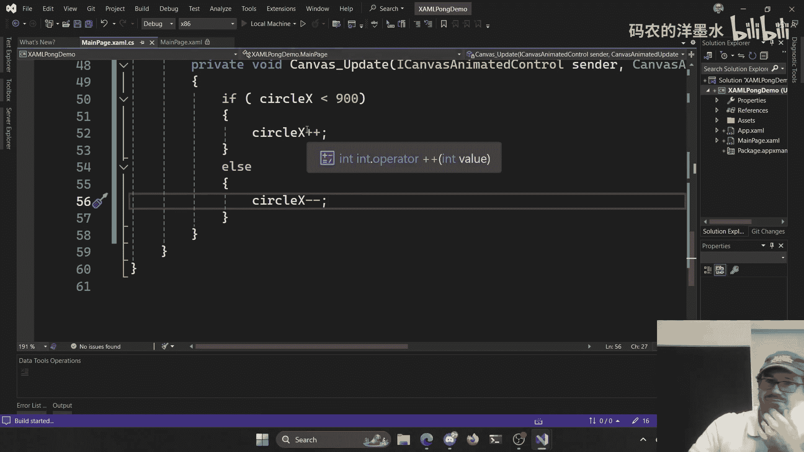

现在运行程序，你会看到蓝色圆形在屏幕左右边界之间来回弹跳。

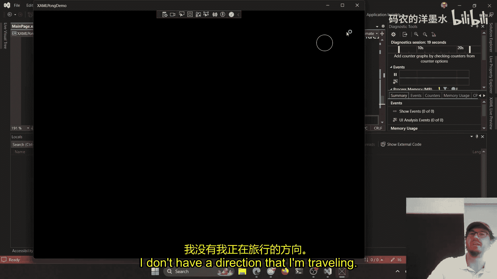

---

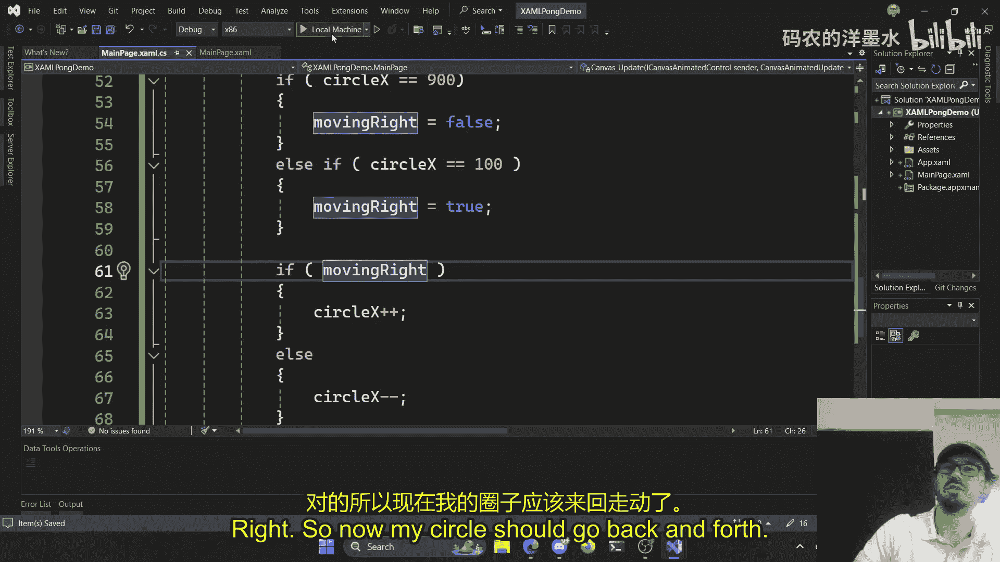

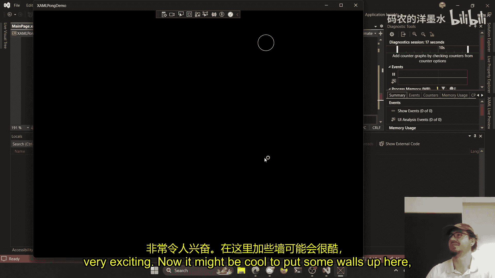

## 创建游戏对象类

目前，我们直接在页面代码中管理圆形和墙壁的变量。随着游戏元素增多，这会变得难以维护。更好的做法是为每种游戏元素创建类。

例如，我们可以创建一个`GameObject`类或更具体的`Ball`类和`Paddle`类。这样可以将数据（位置、大小）和行为（绘制、更新）封装在一起。

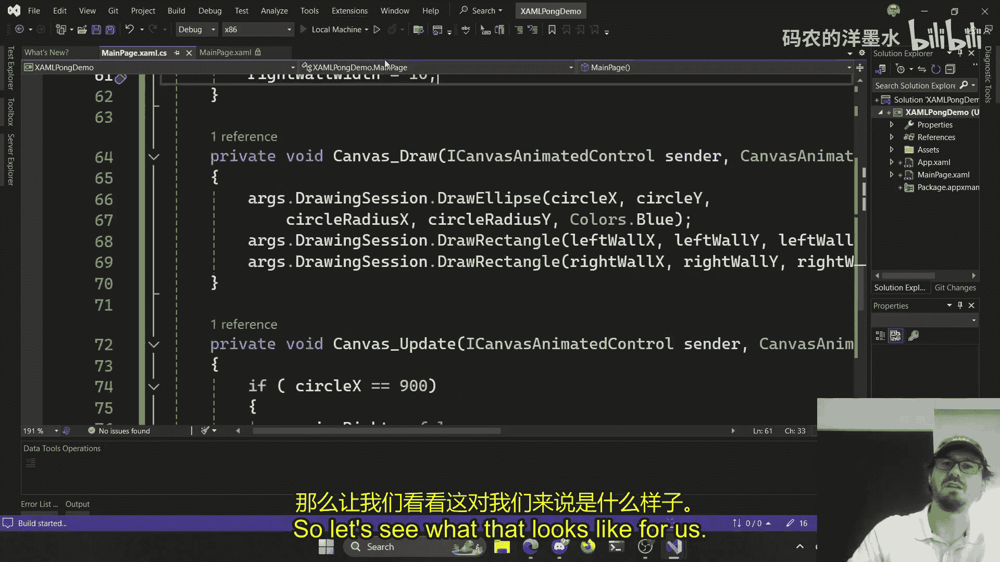

以下是创建一个简单`RectangleObject`类的示例：

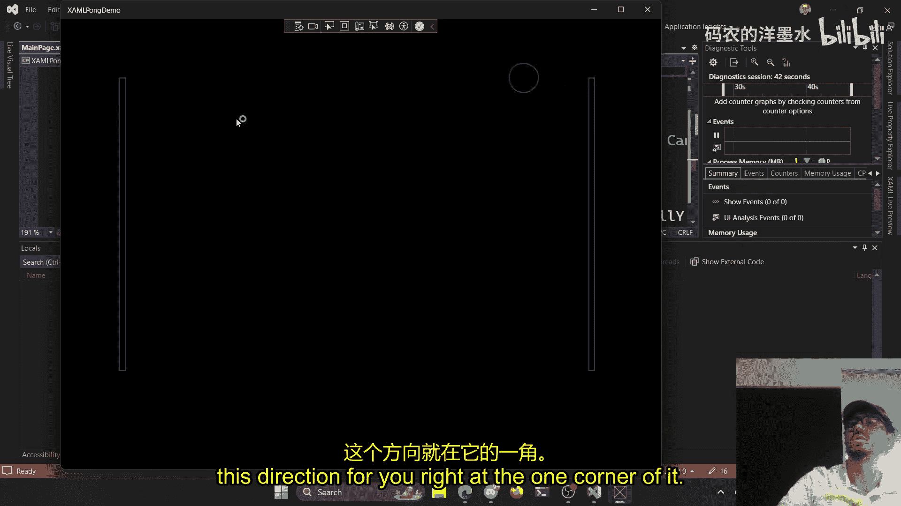

```csharp
public class RectangleObject
{
    // 属性
    public int X { get; set; }
    public int Y { get; set; }
    public int Width { get; set; }
    public int Height { get; set; }
    public Color Color { get; set; }

    // 构造函数
    public RectangleObject(int x, int y, int width, int height, Color color)
    {
        X = x;
        Y = y;
        Width = width;
        Height = height;
        Color = color;
    }

    // 方法：绘制自己
    public void Draw(CanvasDrawingSession session)
    {
        session.FillRectangle(X, Y, Width, Height, Color);
    }
}
```

在`MainPage`中，我们可以这样使用它：

```csharp
// 声明墙壁对象
private RectangleObject leftWall;
private RectangleObject rightWall;

public MainPage()
{
    this.InitializeComponent();
    // 初始化墙壁
    leftWall = new RectangleObject(50, 100, 10, 400, Colors.White);
    rightWall = new RectangleObject(850, 100, 10, 400, Colors.White);
}

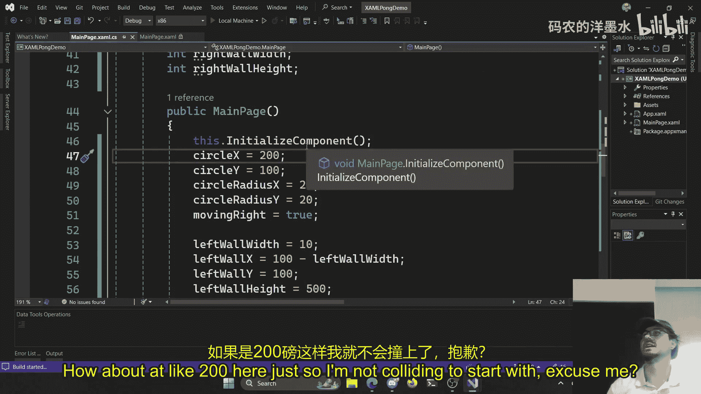

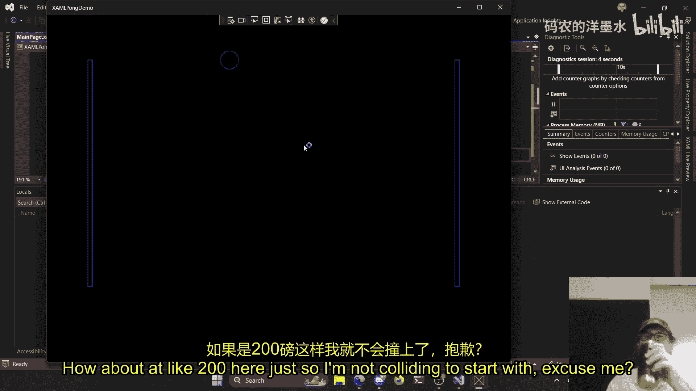

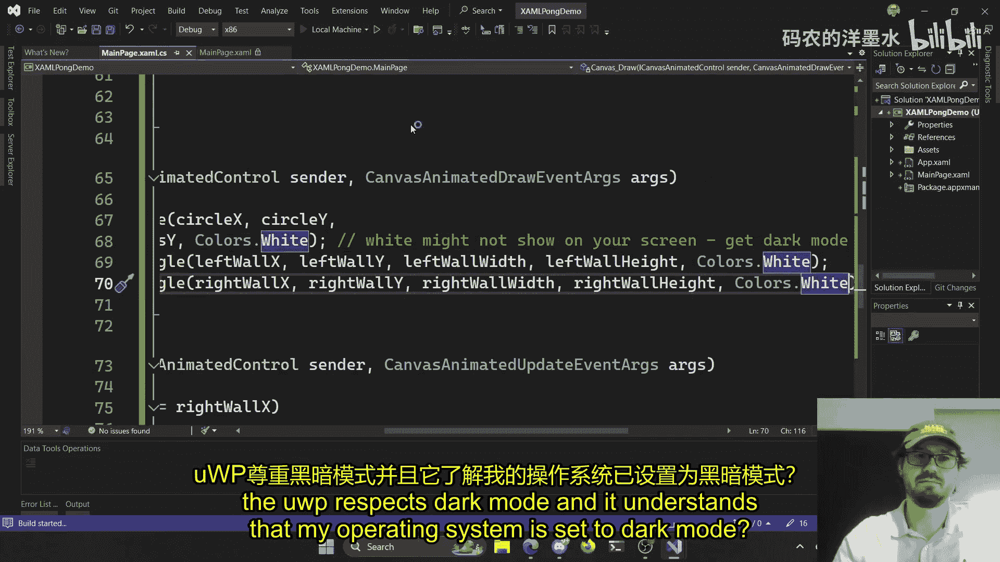

private void gameCanvas_Draw(CanvasAnimatedControl sender, CanvasDrawEventArgs args)
{
    // 绘制墙壁
    leftWall.Draw(args.DrawingSession);
    rightWall.Draw(args.DrawingSession);
    // 绘制球
    args.DrawingSession.FillCircle(circleX, circleY, circleRadius, Colors.Blue);
}
```

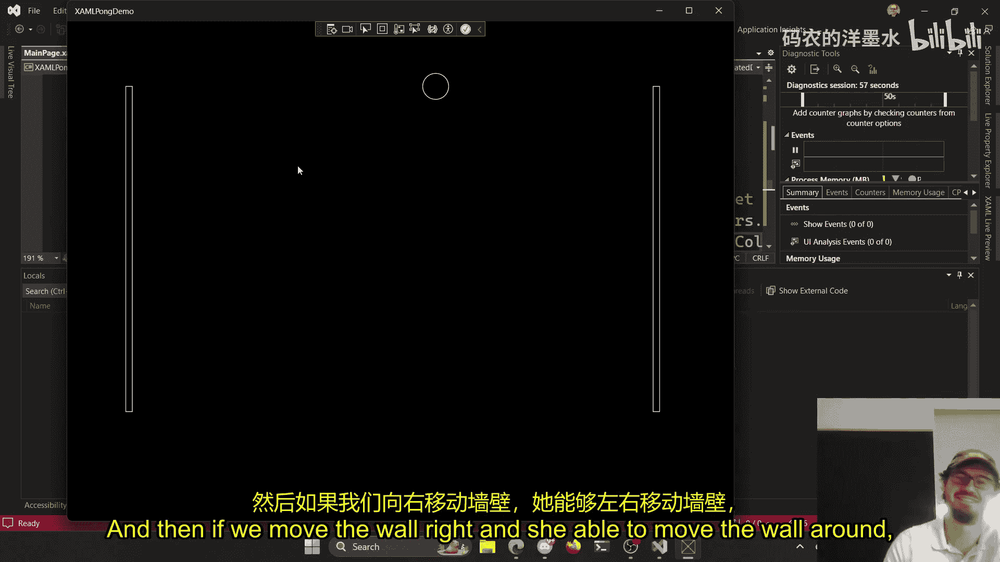

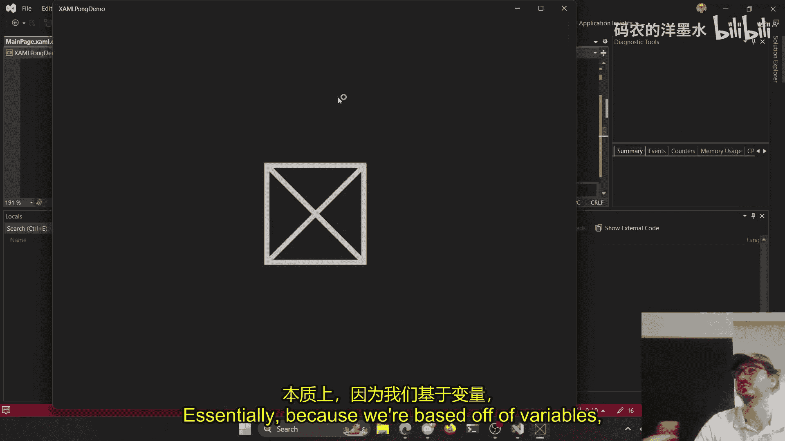

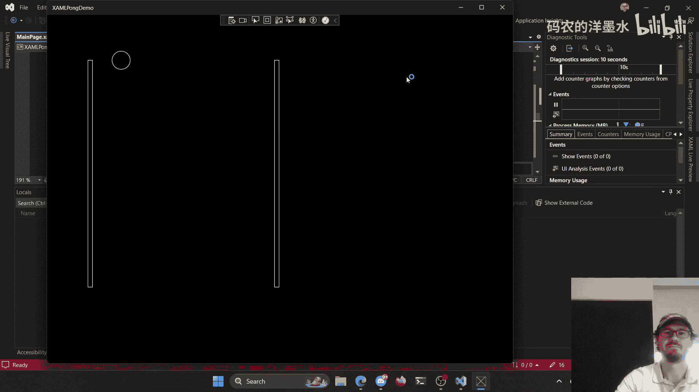

使用类来管理对象，代码更加清晰，也更容易扩展。例如，接下来我们为球添加与墙壁的碰撞检测时，就可以在`Ball`类中添加一个`CheckCollision`方法，接收一个`RectangleObject`作为参数进行判断。

---

## 碰撞检测思路

目前，我们的球只在固定的左右边界弹跳。在一个真正的乒乓球游戏中，球需要与移动的球拍（也是矩形）以及上下边界发生碰撞。

碰撞检测的核心是判断两个矩形（或圆形与矩形）是否发生了重叠。对于轴对齐的矩形（AABB），检测逻辑相对简单：
*   如果物体A的右边缘小于物体B的左边缘，则没有碰撞。
*   如果物体A的左边缘大于物体B的右边缘，则没有碰撞。
*   如果物体A的下边缘小于物体B的上边缘，则没有碰撞。
*   如果物体A的上边缘大于物体B的下边缘，则没有碰撞。
*   如果以上条件都不满足，则两个物体发生了碰撞。

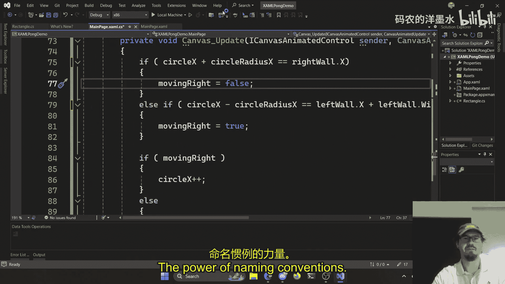

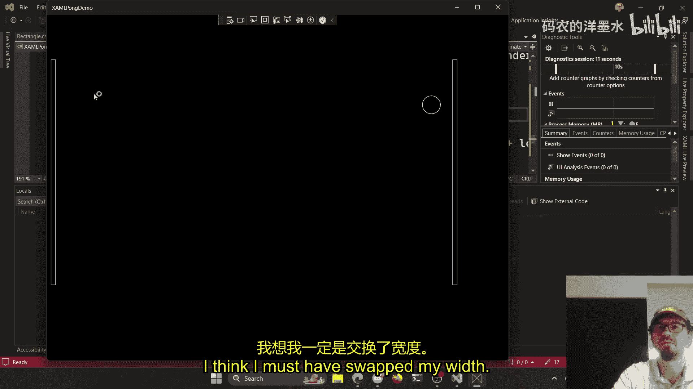

对于圆形和矩形的碰撞，逻辑会更复杂一些，需要计算圆心到矩形最近边的距离。

一个高效的实现方式是，为所有可碰撞的游戏对象（球、球拍、墙壁、砖块）提供一个通用的接口或基类，包含位置、大小等属性。然后维护一个游戏对象列表，在每帧更新时，检查球与列表中每个对象的碰撞情况。

---

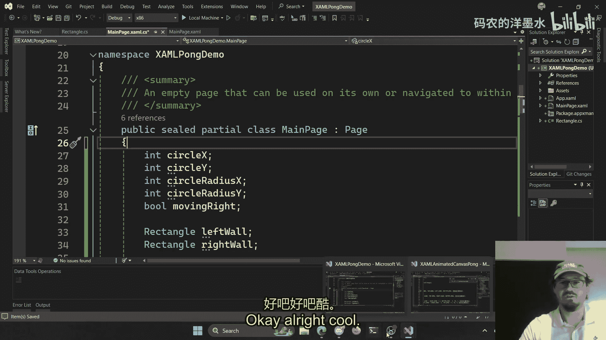

本节课中我们一起学习了如何设置UWP游戏项目，使用`CanvasAnimatedControl`控件建立游戏循环，绘制并让图形移动，以及通过创建类来更好地组织游戏对象。我们还探讨了碰撞检测的基本思路。在下一部分，我们将实现更完整的碰撞检测，并添加玩家控制的球拍。