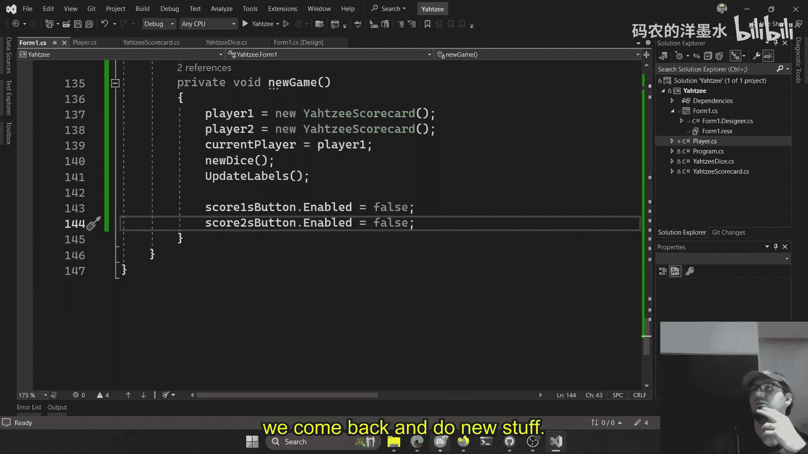

# 016：快艇骰子游戏（第二部分）🎲


在本节课中，我们将继续构建快艇骰子游戏的用户界面（UI），将之前创建的游戏逻辑与可视化的窗体控件连接起来。我们将学习如何创建按钮、标签和复选框，并编写代码让它们与我们的`Dice`和`Scorecard`类进行交互。

---


## 创建玩家类

上一节我们介绍了`Dice`和`Scorecard`类，本节中我们来看看如何为游戏创建玩家。

首先，我们添加一个`Player`类。这个类目前非常简单，主要包含一个玩家的记分卡。


```csharp
public class Player
{
    public Scorecard Scorecard { get; set; }

    public Player()
    {
        Scorecard = new Scorecard();
    }
}
```

实际上，在这个游戏中，玩家几乎等同于他们的记分卡。如果我们不打算给玩家起名字，甚至可以跳过这个类，直接使用一个记分卡列表。但为了结构的清晰，我们暂时保留它。

---

## 设计游戏窗体界面

接下来，我们需要在窗体上放置各种控件来构建游戏界面。这是一个需要耐心但很直观的过程。


以下是需要在工具箱中添加的控件列表：
*   **一个“掷骰”按钮**：用于执行掷骰动作。
*   **五个标签**：用于显示五个骰子的当前点数。
*   **五个复选框**：用于让玩家选择“锁定”哪些骰子，防止它们在下次掷骰时被重新掷出。
*   **多个计分按钮和标签**：用于显示各个得分项（如“一点”、“二点”等）的可能得分，并允许玩家选择记录哪个分数。


我们将这些控件拖放到窗体上，并给它们起一个清晰的名字，例如`rollButton`、`die1Label`、`holdDie1CheckBox`、`scoreOnesButton`等。


---


## 连接窗体代码与游戏逻辑

现在，我们需要在窗体的后台代码中，将UI控件与我们之前创建的游戏逻辑类连接起来。


### 初始化游戏状态


在窗体的构造函数中，我们需要初始化游戏所需的核心对象。

```csharp
public partial class MainForm : Form
{
    private Player player1;
    private Player player2;
    private Player currentPlayer;
    private Dice dice;

    public MainForm()
    {
        InitializeComponent();
        // 初始化玩家和骰子
        player1 = new Player();
        player2 = new Player();
        currentPlayer = player1;
        dice = new Dice();
        // 更新界面显示
        UpdateLabels();
    }
}
```

### 实现掷骰功能

当用户点击“掷骰”按钮时，我们需要调用`dice.Roll()`方法，并将骰子的新点数更新到对应的标签上。

```csharp
private void rollButton_Click(object sender, EventArgs e)
{
    dice.Roll();
    die1Label.Text = dice.Die1Value.ToString();
    die2Label.Text = dice.Die2Value.ToString();
    die3Label.Text = dice.Die3Value.ToString();
    die4Label.Text = dice.Die4Value.ToString();
    die5Label.Text = dice.Die5Value.ToString();
    // 更新剩余掷骰次数和可能得分
    UpdateLabels();
}
```

### 处理骰子锁定

当用户勾选或取消勾选“锁定”复选框时，我们需要同步设置`Dice`对象中对应骰子的锁定状态。


```csharp
private void holdDie1CheckBox_CheckedChanged(object sender, EventArgs e)
{
    dice.HoldDie1 = holdDie1CheckBox.Checked;
}
```
我们需要为五个复选框分别编写类似的事件处理方法。

### 更新界面标签


我们创建一个`UpdateLabels`方法来集中更新界面上的各种信息，例如剩余掷骰次数、当前玩家的可能得分等。


```csharp
private void UpdateLabels()
{
    // 更新剩余掷骰次数
    rollsRemainingLabel.Text = (3 - dice.TimesRolled).ToString();
    // 更新当前玩家标签
    currentPlayerLabel.Text = (currentPlayer == player1) ? “玩家一” : “玩家二”;
    // 更新各个得分项的标签和按钮状态
    if (currentPlayer.Scorecard.OnesScore == null)
    {
        onesScoreLabel.Text = dice.GetPossibleScores().OnesScore.ToString();
        scoreOnesButton.Enabled = true;
    }
    else
    {
        onesScoreLabel.Text = currentPlayer.Scorecard.OnesScore.ToString();
        scoreOnesButton.Enabled = false;
    }
    // ... 为其他得分项（Twos, Threes等）重复类似逻辑
}
```


### 记录得分与切换玩家


当玩家点击某个得分按钮（如“记录一点”）时，我们需要将当前可能的分数记录到当前玩家的记分卡中，然后切换到另一位玩家。


```csharp
private void scoreOnesButton_Click(object sender, EventArgs e)
{
    // 记录分数
    currentPlayer.Scorecard.OnesScore = dice.GetPossibleScores().OnesScore;
    // 切换到下一位玩家
    NextPlayer();
}

private void NextPlayer()
{
    // 切换当前玩家
    currentPlayer = (currentPlayer == player1) ? player2 : player1;
    // 为新玩家创建一副新的骰子，重置所有状态
    dice = new Dice();
    // 重置所有锁定复选框
    holdDie1CheckBox.Checked = false;
    // ... 重置其他四个复选框
    // 更新界面
    UpdateLabels();
}
```


### 实现新游戏功能


最后，我们添加一个“新游戏”按钮，其功能是重置所有游戏状态，回到初始界面。


```csharp
private void newGameButton_Click(object sender, EventArgs e)
{
    // 重置玩家和骰子
    player1 = new Player();
    player2 = new Player();
    currentPlayer = player1;
    dice = new Dice();
    // 重置UI控件状态
    holdDie1CheckBox.Checked = false;
    // ... 重置其他控件
    // 更新界面
    UpdateLabels();
}
```


---

## 总结



本节课中我们一起学习了如何为快艇骰子游戏构建完整的用户界面。我们创建了`Player`类，在窗体上布置了按钮、标签和复选框等控件，并编写了事件处理代码，将这些UI元素与后端的`Dice`和`Scorecard`游戏逻辑紧密连接起来。我们实现了掷骰、锁定骰子、计算并显示可能得分、记录分数、切换玩家以及开始新游戏等核心功能。虽然界面和部分细节（如所有得分项的完整实现）还有待完善，但游戏的核心交互流程已经成功搭建完成。