# 018：德州扑克游戏实现

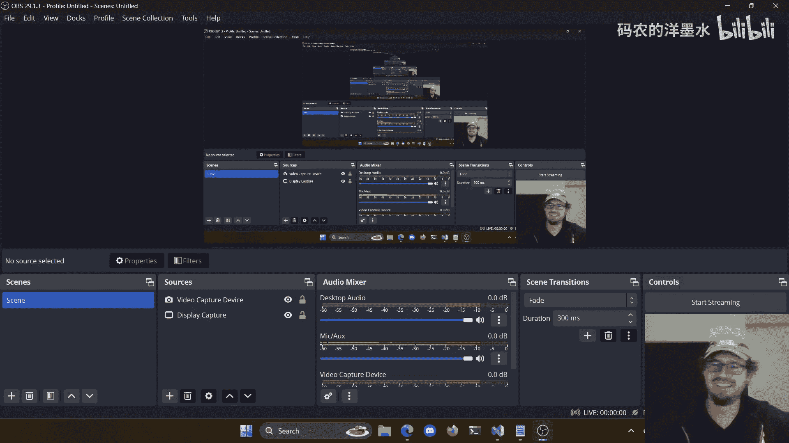

## 概述

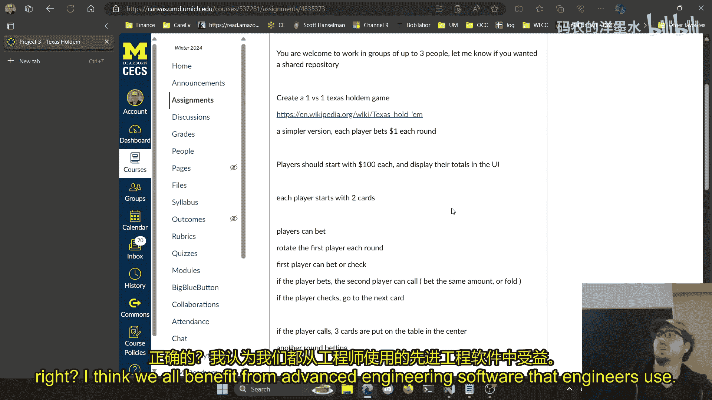

在本节课中，我们将学习如何使用C#实现一个德州扑克游戏的核心逻辑。我们将重点构建扑克手牌的比较系统、游戏状态管理以及一个简单的用户界面。通过本教程，你将理解如何将复杂的游戏规则转化为可执行的代码。

---

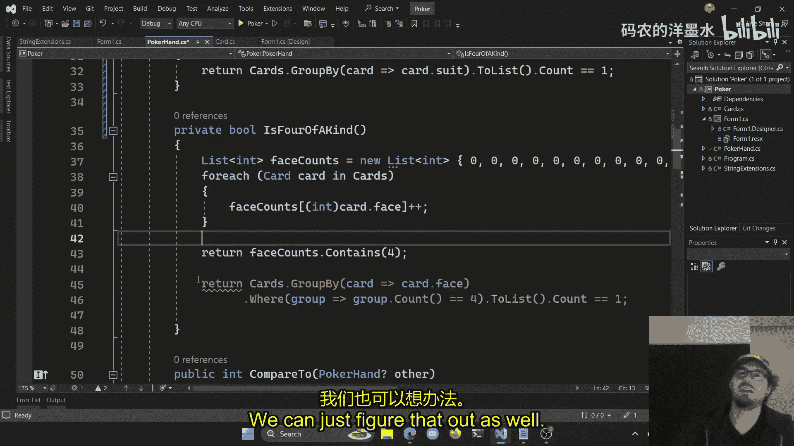

## 扑克手牌比较系统

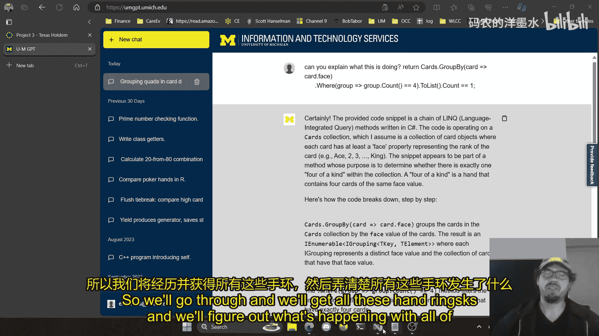

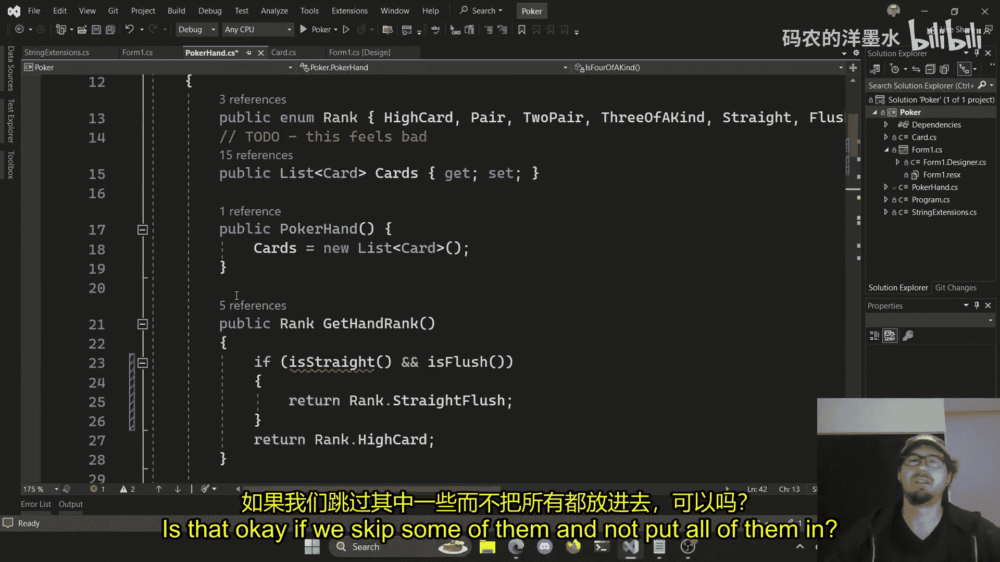

上一节我们介绍了德州扑克的基本概念，本节中我们来看看如何实现扑克手牌的比较系统。这是整个游戏的核心，因为所有胜负判定都依赖于手牌的比较。

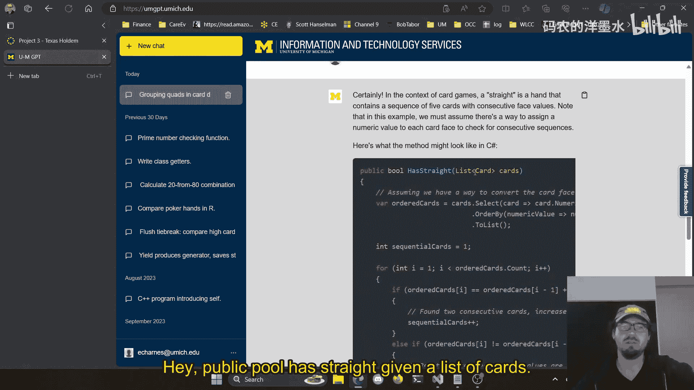

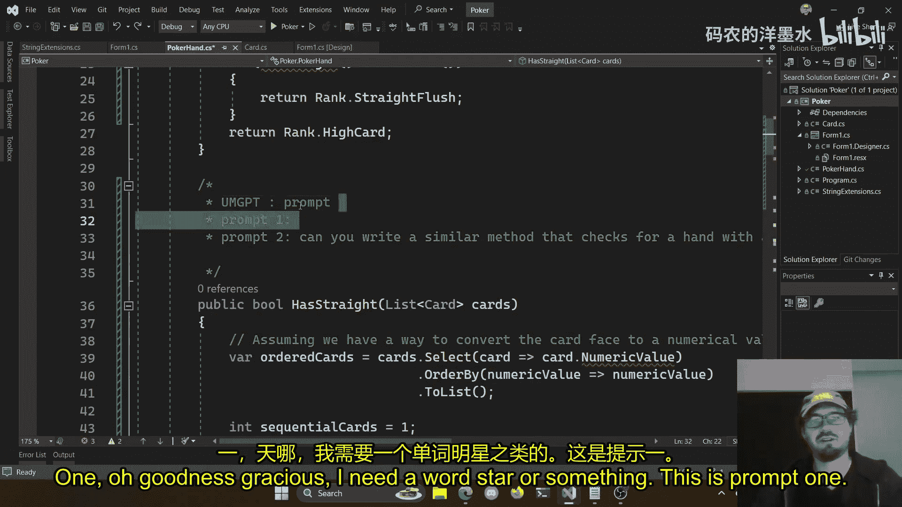

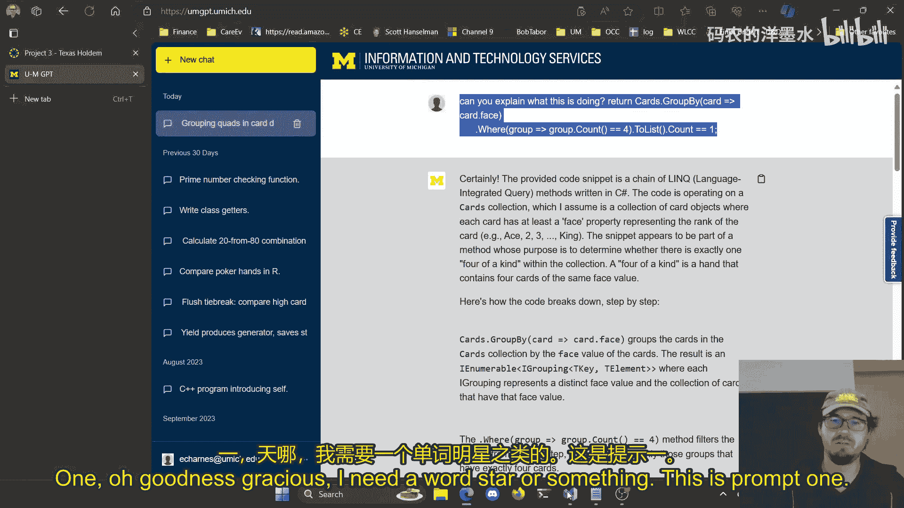

扑克手牌类 `PokerHand` 需要实现 `IComparable<PokerHand>` 接口，以便能够比较两手牌的强弱。比较的逻辑遵循标准的扑克牌型等级：同花顺 > 四条 > 满堂红 > 同花 > 顺子 > 三条 > 两对 > 一对 > 高牌。

### 手牌等级判定

我们需要一系列私有方法来判定手牌的牌型。以下是判定同花和顺子的方法示例：

```csharp
private bool HasFlush()
{
    // 检查所有牌是否花色相同
    return Cards.GroupBy(card => card.Suit).Count() == 1;
}

private bool HasStraight()
{
    // 检查牌面值是否连续
    var sortedValues = Cards.Select(card => (int)card.Face).OrderBy(v => v).ToList();
    int sequentialCount = 1;
    for (int i = 1; i < sortedValues.Count; i++)
    {
        if (sortedValues[i] == sortedValues[i - 1] + 1)
            sequentialCount++;
        else if (sortedValues[i] != sortedValues[i - 1])
            sequentialCount = 1;
        if (sequentialCount >= 5) return true;
    }
    return false;
}
```

### 获取手牌等级

通过按优先级检查牌型，我们可以确定一手牌的最终等级：

```csharp
public HandRank GetHandRank()
{
    if (HasStraight() && HasFlush()) return HandRank.StraightFlush;
    if (HasNOfAKind(4)) return HandRank.FourOfAKind;
    if (HasFullHouse()) return HandRank.FullHouse;
    if (HasFlush()) return HandRank.Flush;
    if (HasStraight()) return HandRank.Straight;
    if (HasNOfAKind(3)) return HandRank.ThreeOfAKind;
    if (HasTwoPair()) return HandRank.TwoPair;
    if (HasNOfAKind(2)) return HandRank.OnePair;
    return HandRank.HighCard;
}
```


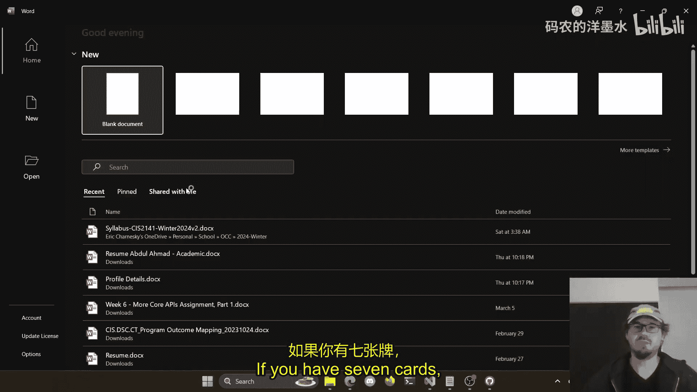

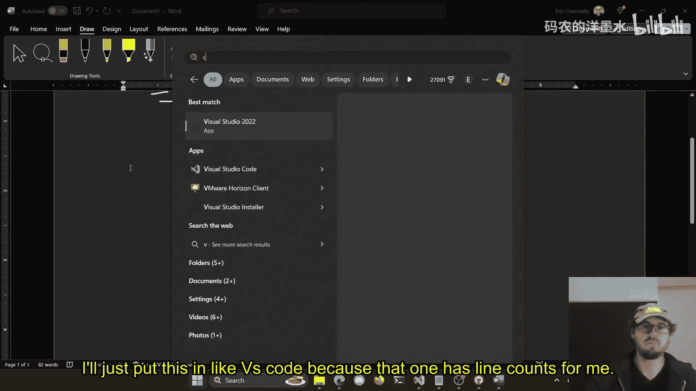

---

## 德州扑克手牌类

在实现了基础扑克手牌后，我们需要创建德州扑克手牌类 `HoldEmHand`。德州扑克手牌由两张私有牌和五张公共牌组成，我们需要从中选出最好的五张牌组合。

### 生成最佳五张牌

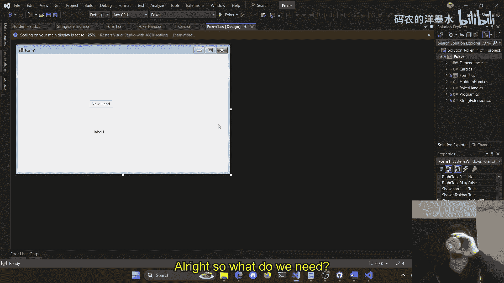

`HoldEmHand` 类的核心方法是找出所有21种可能的五张牌组合，并选出最强的一个：

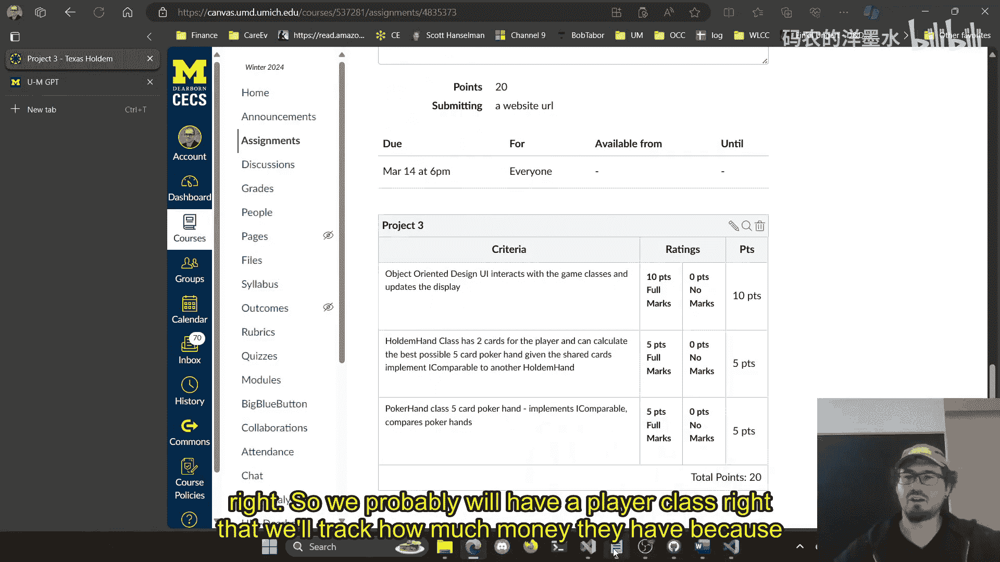

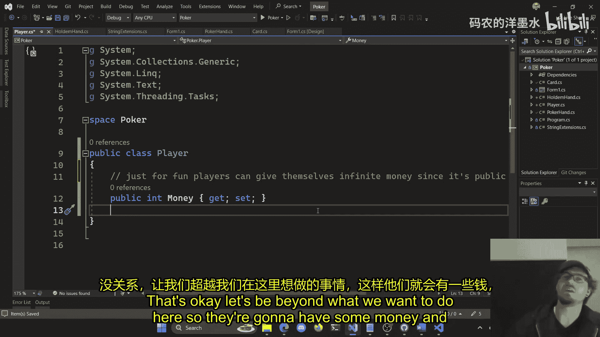

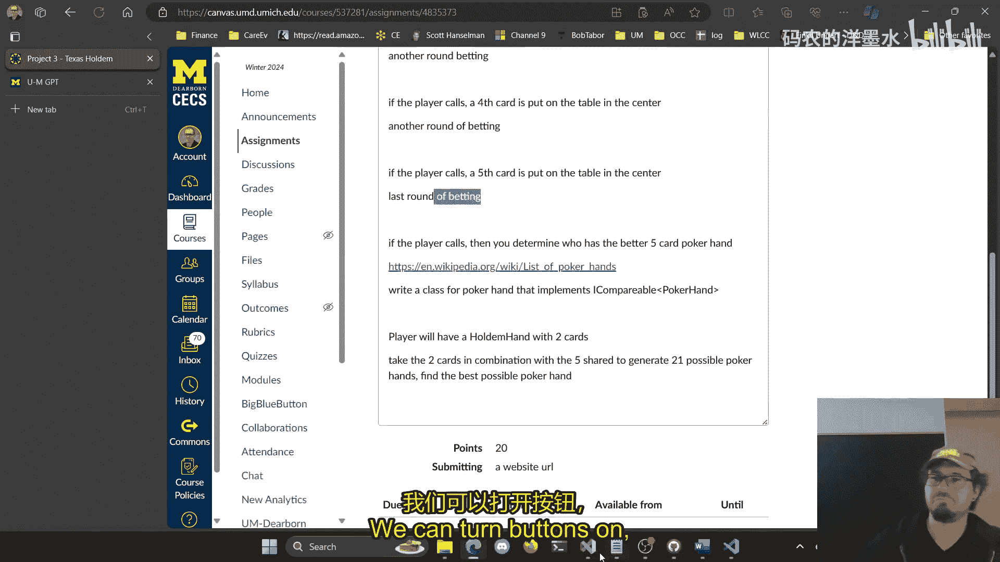

```csharp
public PokerHand GetBestPokerHand()
{
    List<Card> allCards = new List<Card> { Card1, Card2 };
    allCards.AddRange(SharedCards);
    List<PokerHand> allPossibleHands = new List<PokerHand>();

    // 使用五层嵌套循环遍历所有7选5的组合
    for (int i = 0; i < 3; i++)
        for (int j = i + 1; j < 4; j++)
            for (int k = j + 1; k < 5; k++)
                for (int l = k + 1; l < 6; l++)
                    for (int m = l + 1; m < 7; m++)
                    {
                        PokerHand hand = new PokerHand();
                        hand.Cards.Add(allCards[i]);
                        hand.Cards.Add(allCards[j]);
                        hand.Cards.Add(allCards[k]);
                        hand.Cards.Add(allCards[l]);
                        hand.Cards.Add(allCards[m]);
                        allPossibleHands.Add(hand);
                    }
    // 返回最强的牌型
    return allPossibleHands.Max();
}
```

### 比较两手牌

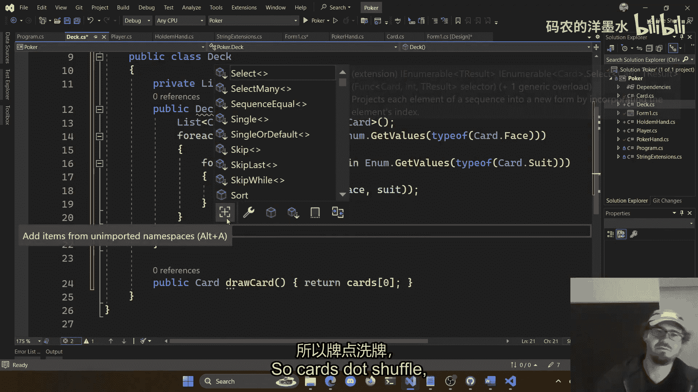

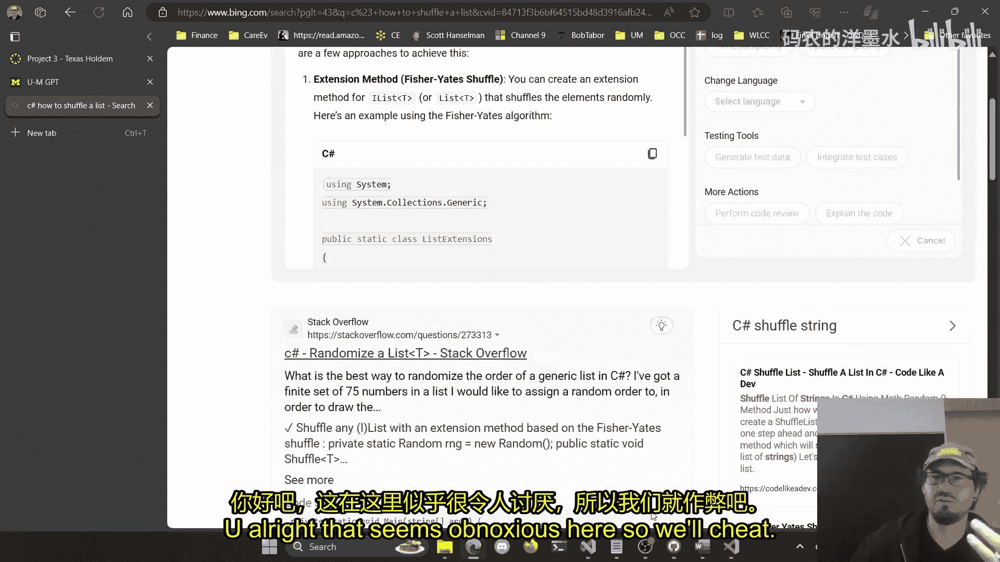

`HoldEmHand` 也实现了 `IComparable<HoldEmHand>` 接口，比较逻辑就是比较两手牌的最佳五张牌：

```csharp
public int CompareTo(HoldEmHand? other)
{
    if (other == null) return 1;
    return this.GetBestPokerHand().CompareTo(other.GetBestPokerHand());
}
```

---


## 游戏状态与玩家管理

有了手牌比较系统，接下来我们需要构建游戏的整体流程，包括玩家、下注和回合管理。

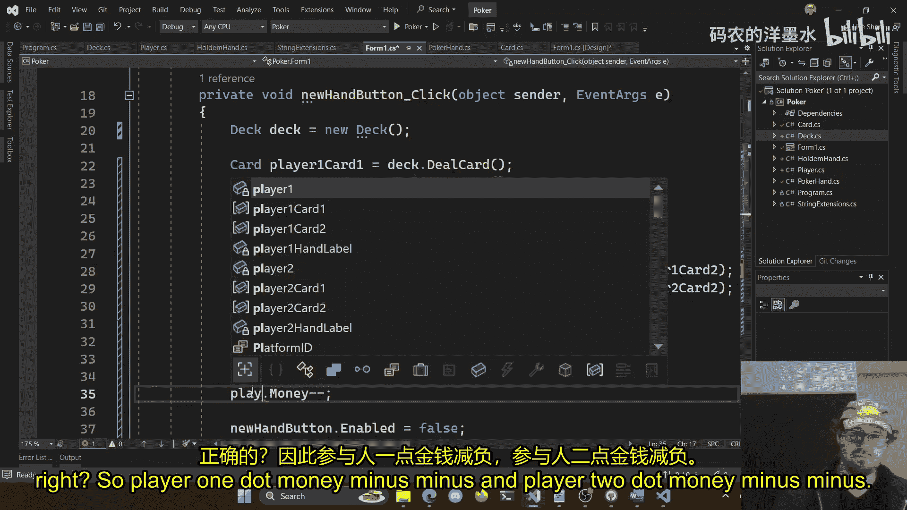

### 玩家类

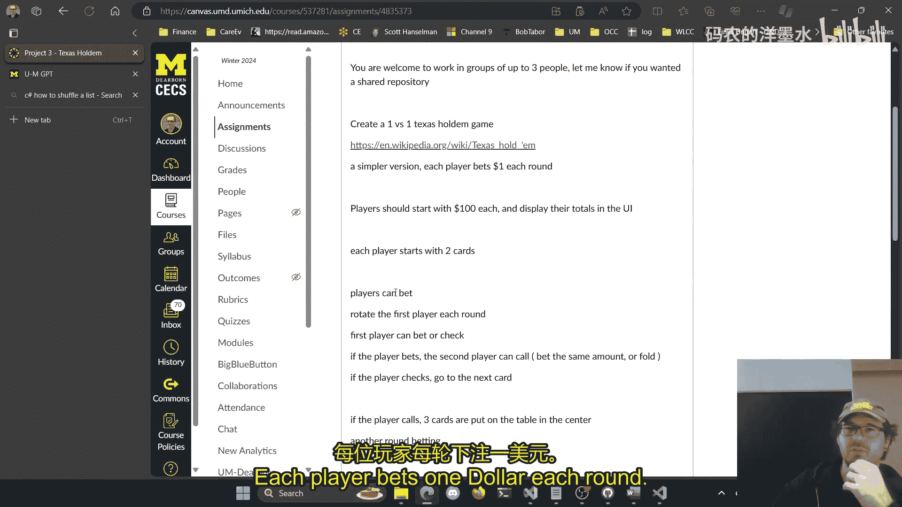

玩家类 `Player` 需要跟踪玩家的资金和当前手牌：

```csharp
public class Player
{
    public int Money { get; set; } = 100;
    public HoldEmHand? Hand { get; set; }
    public string Name { get; set; } = string.Empty;
}
```

### 游戏流程控制

游戏的主要逻辑在窗体代码中实现，控制以下流程：
1.  发牌：创建新牌堆，给每位玩家发两张私有牌。
2.  下注回合：共进行四轮（翻牌前、翻牌、转牌、河牌），每轮玩家可以选择下注、跟注、加注或弃牌。
3.  摊牌与胜负判定：所有下注回合结束后，比较双方玩家的最佳牌型，决定赢家并分配彩池。

以下是开始新游戏和处理“检查”操作的简化代码：


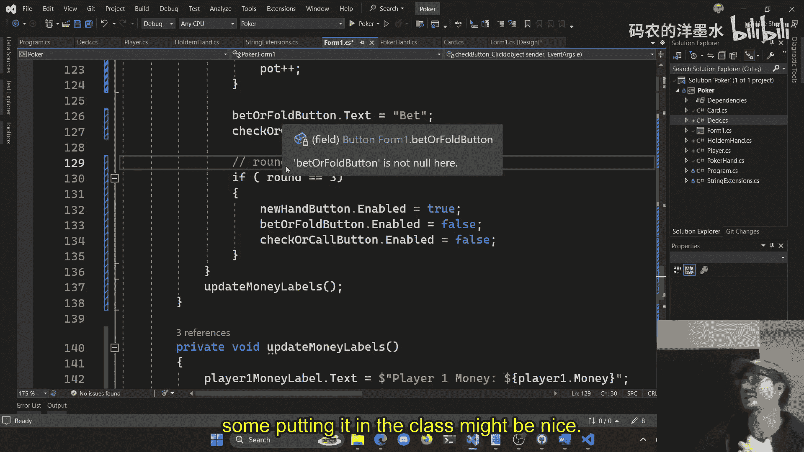


```csharp
private void btnNewHand_Click(object sender, EventArgs e)
{
    // 初始化新牌局
    deck = new Deck();
    player1.Hand = new HoldEmHand(deck.DealCard(), deck.DealCard());
    player2.Hand = new HoldEmHand(deck.DealCard(), deck.DealCard());
    sharedCards.Clear();
    pot = 0;
    currentRound = 0;
    UpdateMoneyLabels();
    // 更新UI显示
}
private void btnCheckCall_Click(object sender, EventArgs e)
{
    if (btnCheckCall.Text == "Check")
    {
        // 进入下一轮，发出公共牌
        currentRound++;
        if (currentRound == 1) DealSharedCards(3);
        else if (currentRound <= 3) DealSharedCards(1);
        if (currentRound == 4) RoundOver(); // 所有回合结束，判定胜负
    }
    else // Text == "Call"
    {
        // 跟注逻辑：扣除当前玩家资金，更新彩池
        // ...
    }
}
```

---

## 总结

本节课中我们一起学习了如何用C#构建德州扑克游戏的核心框架。我们实现了：
1.  **扑克手牌比较系统**：通过 `PokerHand` 类及其 `IComparable` 实现，完成了各种牌型的识别与强弱比较。
2.  **德州扑克手牌逻辑**：在 `HoldEmHand` 类中，通过组合数学找出最佳五张牌，并基于此进行比较。
3.  **基础游戏流程**：涵盖了发牌、多轮下注、胜负判定等基本游戏状态管理。


虽然我们完成了一个可运行的游戏原型，但仍有许多可以扩展的地方，例如：
*   完善所有牌型的平局决胜规则。
*   实现更复杂的下注逻辑（加注、全下）。
*   为牌面添加图形化显示。
*   开发简单的计算机对手AI，通过计算胜率来做出决策。


通过这个项目，你将游戏规则转化为具体代码的能力得到了实践，这是游戏开发中至关重要的一步。