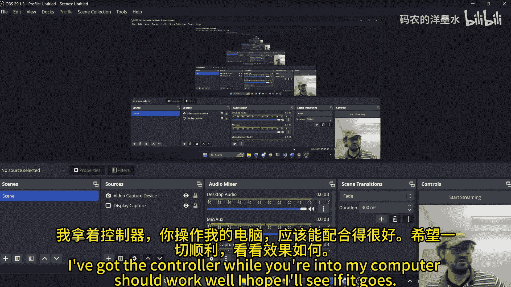
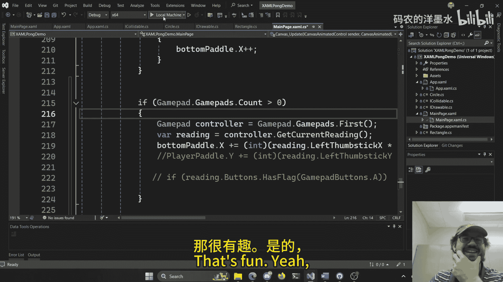
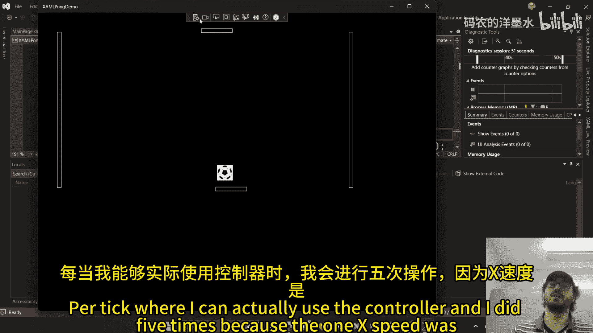
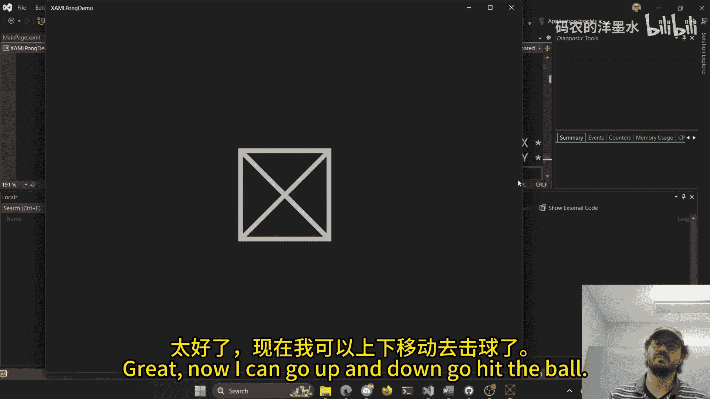
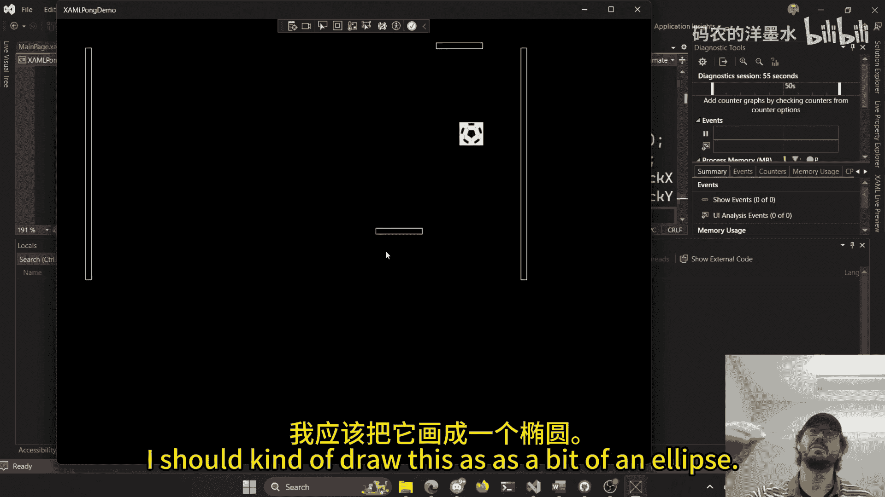
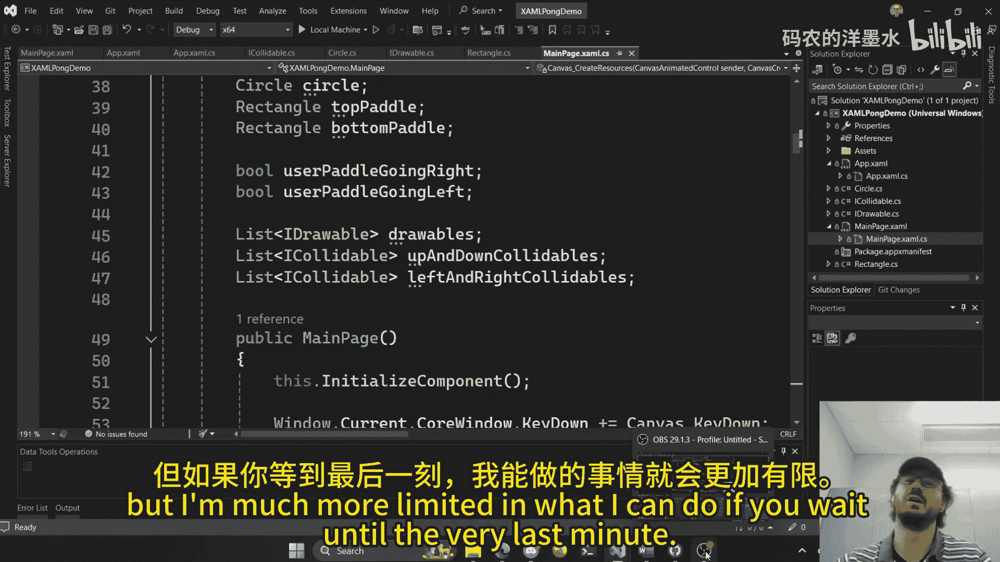
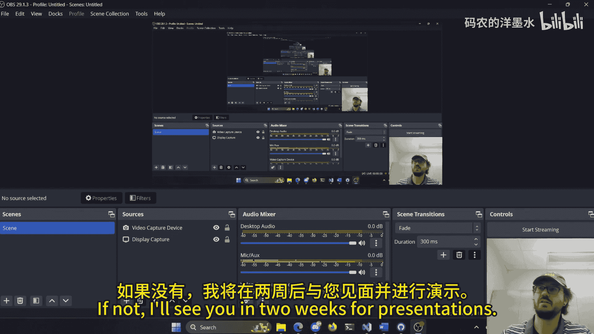

# 019：Xbox手柄控制 🎮



在本节课中，我们将学习如何在C#游戏项目中集成Xbox手柄控制。我们将了解如何读取手柄的输入，并利用这些输入来控制游戏中的对象，例如移动一个球拍。

---

## 概述

在之前的课程中，我们使用键盘事件（如`KeyUp`和`KeyDown`）来控制游戏。本节我们将转向另一种输入方式：Xbox手柄。与事件驱动不同，我们将在一个持续运行的更新循环中轮询手柄的状态，并根据其当前输入来更新游戏。

## 手柄输入原理

处理手柄输入时，我们并非监听独立的按钮按下事件。相反，我们在游戏的主更新循环中，持续检查手柄的状态。这个更新函数每秒大约运行60次，我们可以根据每一“帧”手柄的读数来影响游戏。

以下是检查已连接手柄的基本代码：

```csharp
Gamepad controller = Gamepad.Gamepads.FirstOrDefault();
if (controller != null)
{
    // 手柄已连接，可以读取其状态
}
```

## 使用摇杆控制移动

摇杆的读数是一个介于-1到1之间的浮点数。例如，左摇杆的X轴值（`ThumbSticks.Left.X`）在完全左推时为-1，完全右推时为1。我们可以直接将这个值加到游戏对象的坐标上，从而实现平滑移动。

以下是如何使用左摇杆控制球拍水平移动的代码：



```csharp
// 假设 bottomPaddle 是玩家的球拍对象
if (controller != null)
{
    // 读取左摇杆的X轴值
    float stickX = controller.ThumbSticks.Left.X;
    // 将摇杆读数乘以一个系数来调整移动速度
    bottomPaddle.X += stickX * 5;

    // 注释掉的Y轴控制代码
    // float stickY = controller.ThumbSticks.Left.Y;
    // bottomPaddle.Y += stickY * -5; // 可能需要取反以适应屏幕坐标系
}
```

**注意**：屏幕坐标系中，Y轴向下为正。因此，摇杆向上推（通常认为是负值）可能对应屏幕上Y坐标的减小，有时需要进行取反操作。

## 检测按钮按下



除了摇杆，我们还需要检测按钮的按下。`GamepadReading`的`Buttons`属性是一个枚举集合，我们可以检查特定按钮的标志位是否被设置。

以下是检查A按钮是否被按下的方法：



```csharp
GamepadReading reading = controller.GetCurrentReading();
if (reading.Buttons.HasFlag(GamepadButtons.A))
{
    // A按钮被按下，执行相应操作
}
```

你可以用同样的方式检查其他按钮，如B、X、Y、方向键或肩键。

## 处理摇杆漂移



旧手柄或使用频繁的手柄可能会出现“摇杆漂移”，即摇杆在未触碰时产生微小的输入值。为了避免因此导致的意外移动，我们可以在代码中设置一个死区。

例如，只有当摇杆读数的绝对值大于0.01时才进行处理：

```csharp
float stickX = controller.ThumbSticks.Left.X;
if (Math.Abs(stickX) > 0.01f)
{
    bottomPaddle.X += stickX * 5;
}
```

## 整合与边界检查

目前，我们的移动代码允许球拍移出屏幕边界。与处理键盘输入时一样，我们需要添加边界碰撞检测。

一种简单的方法是在更新位置后立即进行修正：

```csharp
// 移动球拍
bottomPaddle.X += stickX * 5;

// 简单的左边界检查
if (bottomPaddle.X < 0)
{
    bottomPaddle.X = 0;
}
// 简单的右边界检查（假设屏幕宽度为800，球拍宽度为100）
else if (bottomPaddle.X > 700)
{
    bottomPaddle.X = 700;
}
```

更完善的方案是将碰撞检测逻辑封装成独立的函数或整合到游戏对象的更新方法中。

## 项目结构建议



目前，所有游戏逻辑都写在主页面（如`MainPage.xaml.cs`）的代码中。随着项目变得复杂，这会使代码难以维护和协作。

一个更好的做法是创建一个独立的游戏类（例如`PongGame`），该类负责管理所有游戏对象（球、球拍、砖块）和逻辑。主页面只负责初始化和启动这个游戏类。这样分工明确，便于团队协作开发。

## 总结



本节课中我们一起学习了如何为C#游戏添加Xbox手柄控制。我们掌握了在更新循环中读取手柄摇杆和按钮状态的方法，实现了游戏对象的平滑控制，并讨论了处理摇杆漂移和边界检查的重要性。最后，我们还探讨了通过优化项目结构来提升代码可维护性的最佳实践。通过集成手柄，你的游戏将能为玩家提供更多样化的交互体验。