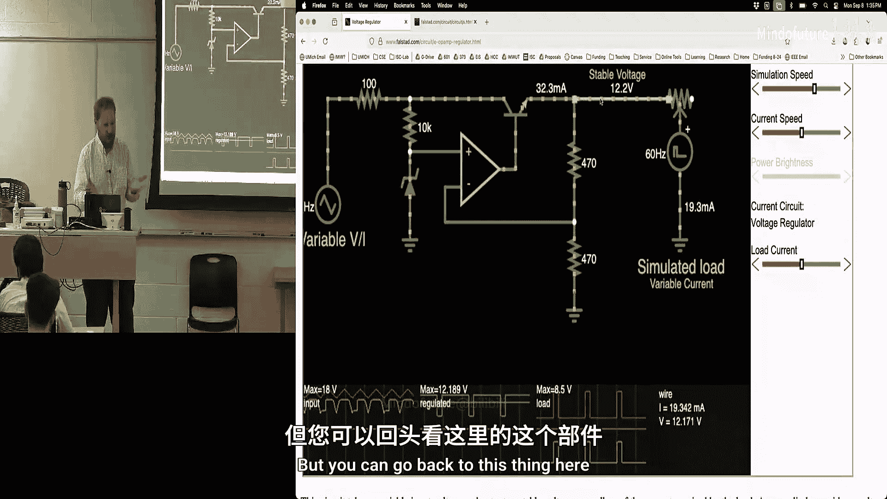
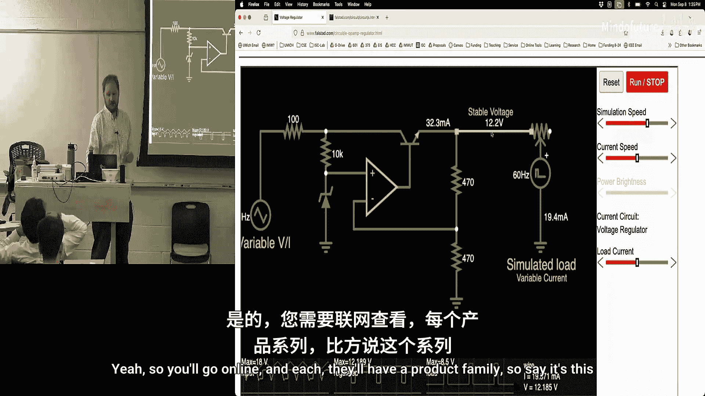
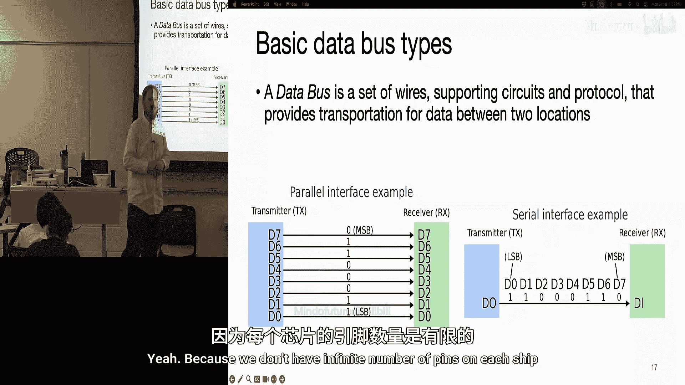
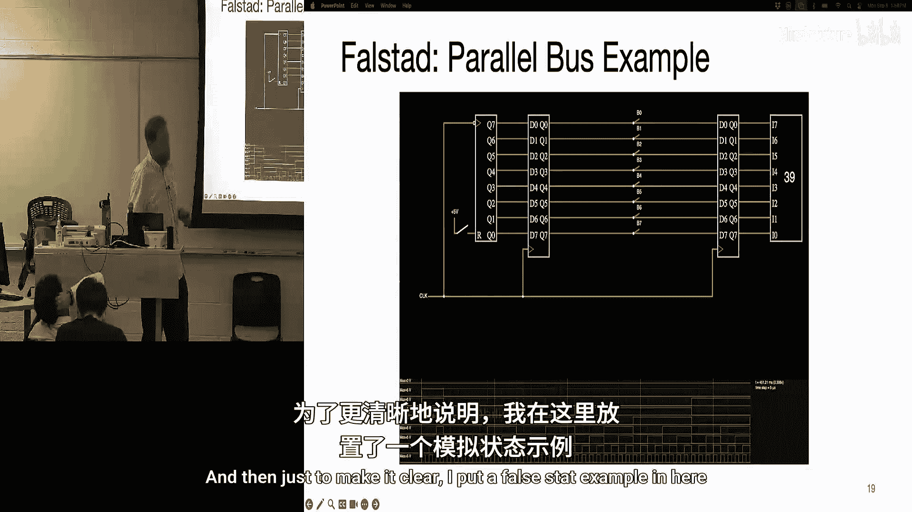
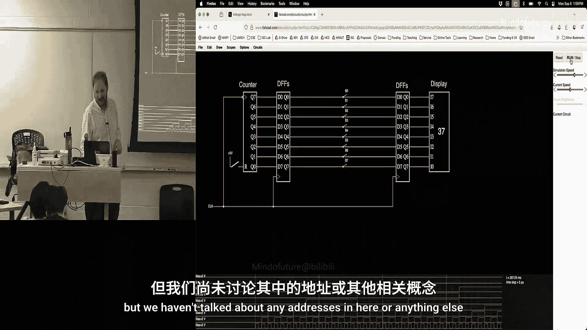

# 004：内存映射IO与APB总线

在本节课中，我们将学习嵌入式系统中的两个核心概念：**内存映射IO**和**总线架构**，特别是ARM Cortex-M系列微控制器中使用的**高级外设总线**。我们将了解处理器如何与外设通信，以及总线如何协调这些数据传输。

---

## 电压调节器简介

在深入总线之前，我们先简要了解一个嵌入式系统的常见组件：**电压调节器**。嵌入式系统（如STM32）通常需要稳定的电压（例如3.3V）才能工作，但电池电压会随时间变化（例如锂电池从4.2V降至3.2V）。电压调节器的作用就是将变化的输入电压转换为恒定的输出电压。

其核心功能可以用一个简单的比喻理解：就像一个消防员需要稳定水压来灭火，无论水源压力如何波动或用水量如何变化，他都需要调节阀门以保持出水压力恒定。在电路中，电压调节器就是这个“调节阀门”。

*   **线性稳压器**：简单易用，通常只有三个引脚，但效率较低。
*   **开关稳压器**（如降压/升压转换器）：效率高（可达90%以上），但电路更复杂，可能存在奇怪的启动状态。

对于课程项目，如果使用电池供电，很可能需要一个电压调节器来为微控制器提供稳定电压。

---

## 内存映射IO

上一节我们提到了系统供电，本节我们来看看处理器如何与外部世界“对话”。这就是**内存映射IO**的概念。

在传统的复杂处理器（如x86）中，可能存在**端口映射IO**，即使用专门的指令（非加载/存储指令）来访问特定外设（如显卡）。然而，在微控制器领域，为了简化架构，普遍采用**内存映射IO**。

**核心思想**：从处理器核心的角度看，所有外设（如GPIO、定时器、ADC）都只是内存地址空间中的一部分。处理器不需要知道它是在访问RAM、Flash还是外设寄存器，它只需要使用相同的**加载**和**存储**指令即可。

**工作原理**：
*   ARM为芯片制造商定义了一个巨大的“地址城市规划图”。
*   制造商（如ST、NXP）根据自家芯片的实际资源（需要多少Flash、SRAM、外设）在这个规划图中“分配地块”。
*   例如，GPIO端口A的输出寄存器可能被分配到一个特定的地址（如`0x40020014`）。
*   当核心执行一条向该地址存储数据的指令时，数据就会被写入一组D触发器（即该寄存器），进而控制GPIO引脚的电平。

**优势**：简化了处理器设计，程序员可以使用统一的内存访问指令与所有硬件交互。

**思考题**：如果有一个1GB的SD卡需要连接，但芯片内部没有1GB的SRAM来映射所有地址，该如何实现内存映射访问？
**答案**：不需要1:1映射。可以设计一个“SD卡控制器”外设。它内部有一个状态机，当核心访问某个特定地址范围时，状态机会将这个访问请求（地址和数据）翻译成SD卡通信协议（如SPI）的命令，从而对SD卡进行读写。控制器内部可能只有少量缓存寄存器，而不是完整的1GB存储。

---

## 总线架构

我们已经知道核心通过地址访问外设，那么数据是如何在芯片内部从核心“旅行”到外设的呢？这需要通过**总线**。

总线是一组遵循特定协议的导线和电路，用于在多个模块间传输数据。总线主要分为两类：
*   **并行总线**：所有数据位同时传输。**优点**：速度快。**缺点**：需要大量导线，占用芯片引脚多，适合**片内**连接。
*   **串行总线**：数据位依次传输。**优点**：所需导线少，节省引脚，适合**片外**或远距离通信。

在复杂的芯片内部，许多模块（ALU、寄存器、外设控制器）需要共享数据。如果每两个模块间都直接连线，线路将无比复杂。总线就像一个“共享公交系统”，所有模块都连接到一组公共的线路上，通过协议决定谁在何时使用线路。

ARM Cortex-M系统常用两种总线：
1.  **高级高性能总线**：用于高速数据传输，支持流水线、多主设备，适合连接核心、DMA、高速内存。
2.  **高级外设总线**：用于较低速的外设，设计更简单，对延迟容忍度高，适合连接GPIO、UART、SPI等。

本课程我们将重点学习**APB**，其基本工作原理与AHB类似，但更易于理解。

---

## APB总线信号详解

APB总线采用**主从架构**。核心侧的总线控制器是**请求者**，外设是**完成者**。只有请求者能发起传输，完成者只能响应。

以下是APB的关键信号线（“P”代表APB外设）：

1.  **PCLK**：总线时钟，所有操作与之同步。
2.  **PADDR**：地址总线（如32位），由请求者驱动，发送目标外设的地址。
3.  **PWRITE**：读写控制信号。`1`表示写操作（存储），`0`表示读操作（加载）。
4.  **PWDATA**：写数据总线（如32位），请求者在写操作时发送数据。
5.  **PSELx**：外设选择信号。**这是点到点信号**，每个完成者都有自己独立的PSEL线。只有当PSEL有效时，该外设才会响应总线上的操作。
6.  **PENABLE**：使能信号。请求者用它来指示地址和控制信号已稳定，可以执行传输的第二个阶段。
7.  **PRDATA**：读数据总线。**每个完成者都有自己独立的读数据总线**返回到请求者。这避免了总线竞争，也允许不同速度的外设独立响应。
8.  **PREADY**：准备就绪信号。由完成者驱动，`1`表示它已准备好完成当前传输。如果外设需要多个周期准备，可以保持PREADY为低，插入等待状态。

**关键点**：
*   `PADDR`, `PWRITE`, `PWDATA`, `PCLK`, `PENABLE` 是**共享**的，连接到所有完成者。
*   `PSELx`, `PRDATA`, `PREADY` 是**独立**的，每个完成者都有自己的线路连回请求者。

---

## APB写操作时序示例

让我们通过一个具体例子，看看一次存储指令如何转化为APB总线上的信号活动。

假设核心执行指令：`STR R0, [R1, #4]`，其中`R0 = 0xCAFE`，`R1 = 0x1000`。
这意味着要将值`0xCAFE`存储到地址`0x1004`（`0x1000 + 4`）。

再假设我们有两个外设：
*   **D1**：响应地址范围 `0x1000 - 0x100F`
*   **D2**：响应地址范围 `0x1010 - 0x101F`

显然，目标地址`0x1004`属于D1的地址范围。

以下是总线信号在D1和D2接口上的变化：

**共享信号（D1和D2看到相同的信号）**：
*   `PCLK`：持续运行的时钟。
*   `PADDR`：在操作期间变为`0x1004`。
*   `PWRITE`：变为高电平`1`，表示是写操作。
*   `PWDATA`：变为`0xCAFE`。
*   `PENABLE`：在地址和数据稳定后的下一个周期变高，指示传输进入使能阶段。

**独立信号**：
*   **对于D1**：
    *   `PSEL1`：变高，因为地址`0x1004`在其范围内，它被选中。
    *   `PREADY`：在`PENABLE`有效后，D1可以立即在下一个时钟上升沿捕获数据，因此它使`PREADY`变高，表示传输完成。
*   **对于D2**：
    *   `PSEL2`：保持低，因为它未被选中。
    *   `PREADY`：状态无关（或为低），因为它不参与此次传输。

通过这个时序，值`0xCAFE`就被成功地写入到了外设D1内部地址为`0x1004`的寄存器中。

---

## 总结

本节课中我们一起学习了：
1.  **电压调节器**的作用：为系统提供稳定电压。
2.  **内存映射IO**的核心思想：将外设寄存器映射到内存地址空间，使核心能用统一的加载/存储指令访问所有硬件。
3.  **总线**的角色：作为芯片内部数据通信的“高速公路”。
4.  **APB总线**的具体工作方式：理解了请求者与完成者的关系，以及`PCLK`、`PADDR`、`PWRITE`、`PSEL`、`PENABLE`、`PREADY`等关键信号在传输过程中的时序配合。

掌握内存映射IO和总线概念是理解微控制器如何与丰富外设交互的基础，对于后续进行底层驱动编程和系统调试至关重要。