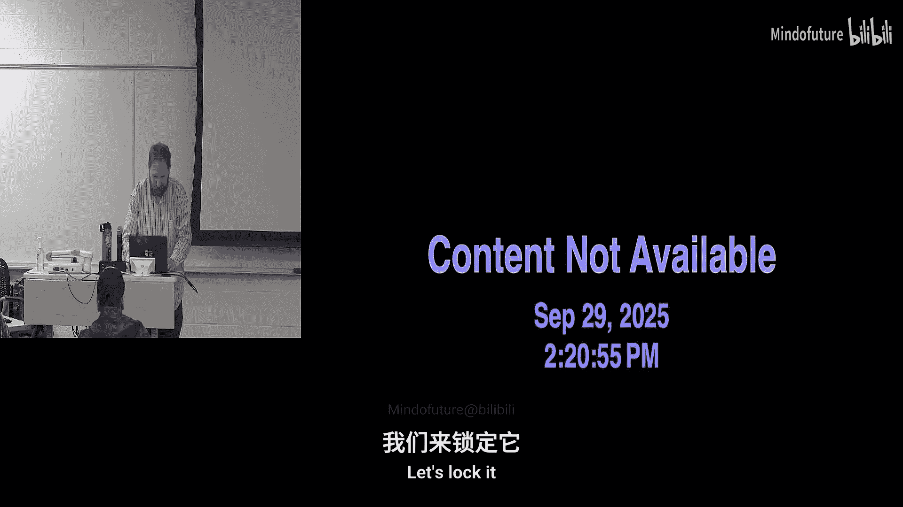

# 010：定时器、PWM生成与虚拟定时器 🕒

## 概述
在本节课中，我们将学习嵌入式系统中定时器的核心概念，包括如何配置定时器来生成精确的PWM信号以控制伺服电机，并探讨当硬件定时器资源不足时，如何通过软件实现“虚拟定时器”来管理多个定时任务。

---

## 定时器回顾 ⏱️

上一节我们介绍了定时器的基本概念，本节中我们来回顾两种主要的定时器工作模式：捕获模式和比较模式。

### 捕获定时器
捕获定时器用于测量外部事件发生的时间点。其工作原理如下：
*   一个时钟源经过预分频器后，驱动一个计数器。
*   当指定的外部事件（如引脚电平变化）发生时，当前计数器的值会被“捕获”并存入一个专门的寄存器。
*   同时可以触发一个中断请求，通知处理器事件发生的精确时间。

**核心流程**：`外部事件 -> 捕获计数器值 -> 触发中断`

### 比较定时器
比较定时器用于在特定时间间隔后触发事件。其工作原理如下：
*   计数器在时钟驱动下运行（向上或向下计数）。
*   用户预先在一个比较寄存器中设置一个目标值。
*   当计数器的值等于这个目标值时，会触发一个事件（如改变输出引脚电平或产生中断）。

**核心流程**：`设置目标值 -> 计数器运行 -> 匹配时触发事件`

### PWM生成
PWM（脉冲宽度调制）是一种常见的比较定时器应用，用于控制电机、LED亮度等。其关键点在于：
*   一个定时器可以配置多个“捕获/比较寄存器”。
*   每个寄存器可以独立控制一个输出通道，实现多路PWM信号。
*   通过设置不同的比较值，可以改变输出脉冲的宽度（占空比）。

**配置示例**（向上计数模式）：
*   当 `计数器值 < 比较寄存器值` 时，输出高电平。
*   当 `计数器值 >= 比较寄存器值` 时，输出低电平。
*   计数器达到自动重载值后归零，开始下一个周期。

---

## 设计实例：伺服电机PWM控制 🎮

现在，我们通过一个具体的设计问题来应用上述知识：如何生成控制伺服电机所需的PWM信号。

### 问题定义
伺服电机通过脉冲宽度来解读目标角度。给定规格如下：
*   **脉冲周期**：必须为20毫秒。
*   **脉冲宽度与角度关系**：
    *   `1 ms` 脉冲对应 **-90度**。
    *   `1.5 ms` 脉冲对应 **0度**。
    *   `2 ms` 脉冲对应 **+90度**。
*   **控制精度**：需要在-90度到+90度范围内实现至少180个步进（即角度分辨率至少为1度）。
*   **微控制器时钟**：主时钟频率为4 MHz。

### 设计步骤

#### 1. 绘制波形图
首先，我们需要明确要生成的信号波形。以下是周期为20ms的PWM信号示意图，其中关键参数是脉冲宽度（1ms 到 2ms之间变化）。

```
高电平 |¯¯¯¯¯¯¯¯¯¯|________________________|
       <-脉冲宽度-><-        低电平        ->
       (1-2 ms)        (周期 - 脉冲宽度)
```

#### 2. 计算所需的最小计时分辨率
为了在1ms到2ms的脉冲宽度范围内实现180个步进，每一步对应的最小时间增量（即所需的最小计时分辨率）为：
`(2 ms - 1 ms) / 180 步 ≈ 5.556 微秒/步`

因此，定时器的计时单元必须能分辨至少 **5.556 微秒** 的时间。

#### 3. 配置预分频器
已知系统时钟为4 MHz，周期为 `1 / 4,000,000 Hz = 0.25 微秒`。
为了得到约5.556微秒的计时步长，需要将时钟分频。预分频器（PSC）的计算公式通常为：
`输出频率 = 输入频率 / (PSC + 1)`
因此，
`所需分频比 ≈ 5.556 µs / 0.25 µs ≈ 22.22`
由于PSC必须是整数，且 `PSC = 分频比 - 1`，我们选择 `PSC = 21`（得到分频比22，输出周期5.5 µs）或 `PSC = 22`（得到分频比23，输出周期5.75 µs）。这里我们取 `PSC = 21`，它满足最小分辨率要求。




分频后的时钟周期为：`0.25 µs * (21 + 1) = 5.5 微秒`。

#### 4. 配置自动重载寄存器
我们需要整个PWM周期为20 ms。自动重载寄存器（ARR）的值决定了计数器从0计数到ARR所需的时间，即PWM周期。
`ARR = 目标周期 / 计时步长 = 20,000 µs / 5.5 µs ≈ 3636`
由于ARR必须是整数，我们取 `ARR = 3636`。此时实际周期为 `3636 * 5.5 µs = 19.998 ms`，误差极小，可以接受。

#### 5. 计算比较寄存器值
比较寄存器（CCR）的值决定了脉冲宽度。我们需要计算对应-90度、0度和+90度的CCR值。
*   **计时步长** = 5.5 µs
*   **-90度**（1 ms脉冲）：`CCR1 = 1000 µs / 5.5 µs ≈ 182`
*   **0度**（1.5 ms脉冲）：`CCR2 = 1500 µs / 5.5 µs ≈ 273`
*   **+90度**（2 ms脉冲）：`CCR3 = 2000 µs / 5.5 µs ≈ 364`

通过微调CCR值在182到364之间，即可精确控制伺服电机在-90度到+90度之间任意定位。

---

## 虚拟定时器 🧠

当系统需要管理的定时任务数量超过硬件定时器数量时，我们可以使用“虚拟定时器”技术。

### 核心思想
虚拟定时器通过**单个硬件定时器**和**软件队列管理**，模拟出多个定时器的行为。

### 工作原理
1.  **创建事件队列**：所有需要定时触发的任务（事件）被放入一个按“到期时间”排序的队列中。队列头部是即将最先到期的事件。
2.  **配置硬件定时器**：将硬件定时器的中断时间设置为队列头部事件的到期时间（这是一个“时间差”，即delta）。
3.  **中断服务例程**：
    *   当硬件定时器中断触发时，执行队列头部事件对应的任务。
    *   从队列中移除该事件。如果是重复性事件，则计算其下一次到期时间并重新插入队列。
    *   更新队列中所有剩余事件的“剩余时间”（减去刚才度过的时间段）。
    *   重新排序队列，并将硬件定时器设置为新的队列头部事件的“时间差”。

### 示例流程
假设有三个程序设置定时事件：
*   程序A：3秒后执行（单次）。
*   程序B：每2秒执行（重复）。
*   程序C：5秒后执行（单次）。

初始事件队列排序为：`B(2s) -> A(3s) -> C(5s)`。
1.  硬件定时器设为2秒。
2.  2秒后中断触发，执行程序B的任务。B是重复事件，重新计算其下次触发为4秒后（从初始时间算起）。更新队列：A剩余1秒，C剩余3秒，B下次在4秒。重新排序：`A(1s) -> C(3s) -> B(4s)`。
3.  硬件定时器设为1秒。
4.  1秒后中断触发，执行程序A的任务。更新队列：C剩余2秒，B剩余3秒。排序：`C(2s) -> B(3s)`。
5.  依此类推。

### 注意事项
*   **精度**：虚拟定时器涉及软件处理开销（中断响应、队列更新等），不适合对时序要求极其精确（微秒级）的场景，更适用于秒或毫秒级的人类交互或后台任务。
*   **动态添加事件**：如果要在定时器运行中途添加新事件，需要软件触发中断，暂停当前计数，更新队列（将当前已计时间从所有事件中扣除，插入新事件，重新排序），然后重置硬件定时器。
*   **优先级**：如果多个虚拟定时器同时到期，需要在中断服务例程中按一定顺序处理，这可能引入微小延迟。

---

## 总结
本节课中我们一起学习了：
1.  **定时器基础**：回顾了捕获模式（测量外部事件时间）和比较模式（生成定时事件/PWM）的工作原理。
2.  **PWM实战**：通过伺服电机控制实例，详细演练了如何根据需求计算并配置预分频器、自动重载寄存器和比较寄存器，以生成符合规格的PWM信号。
3.  **虚拟定时器**：了解了当硬件资源不足时，如何通过软件算法，利用单个硬件定时器管理多个定时任务，包括其队列管理原理和优缺点。


掌握这些知识，你将能够为嵌入式系统配置精确的定时功能，并高效地管理复杂的定时需求。