# 013：模拟信号概述 🎛️

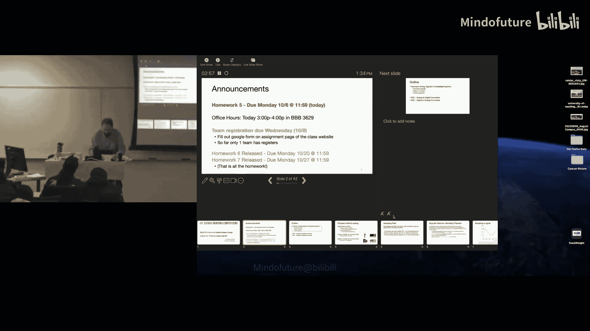

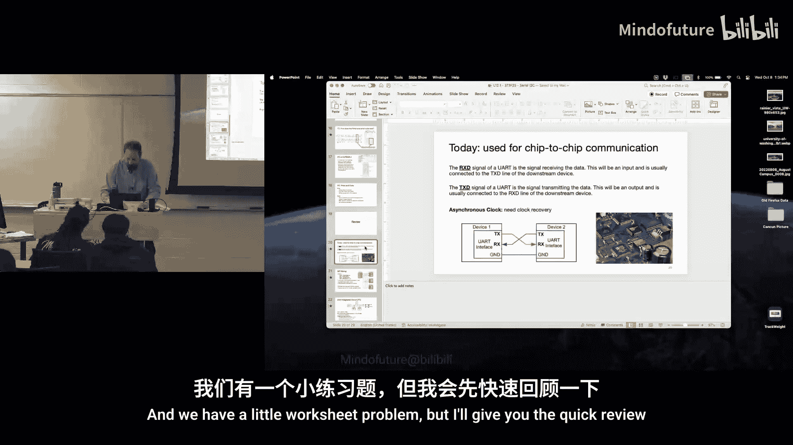

在本节课中，我们将要学习模拟信号的基础知识，包括模拟到数字转换（ADC）和数字到模拟转换（DAC）的核心概念、工作原理以及在实际系统中的应用。

## 课程概述

上一节我们介绍了串行接口的收尾内容。本节中，我们将进入课程的最后一大块内容：模拟信号。我们将首先概述模拟信号的基本概念，然后讨论ADC和DAC的架构，以及如何在嵌入式系统中应用它们。

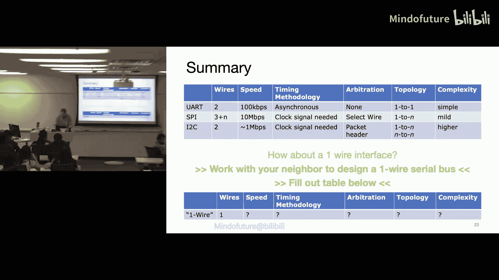

## 串行接口回顾

在深入模拟信号之前，我们先快速回顾一下之前讨论过的几种串行接口协议。

以下是几种常见串行接口的关键特性总结：

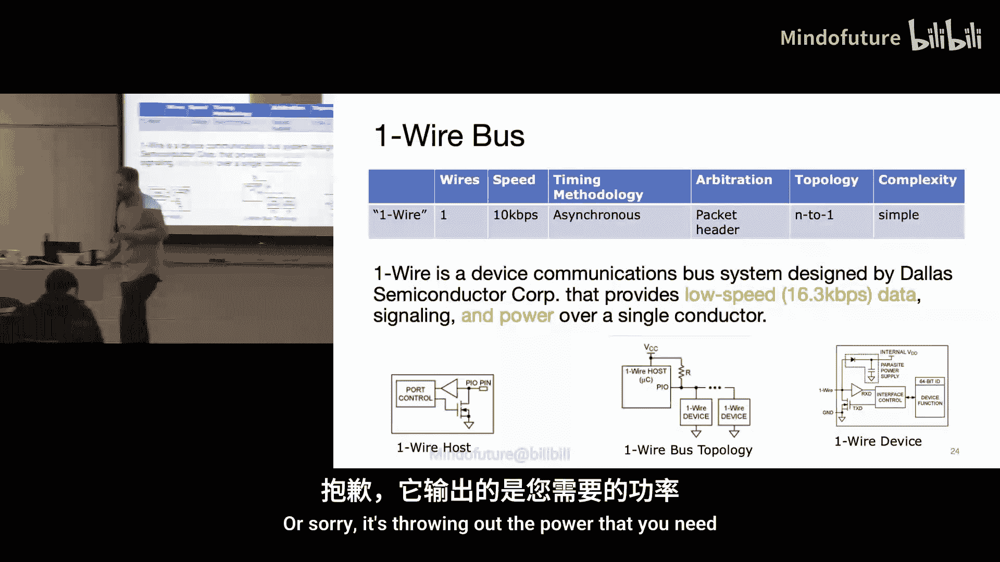

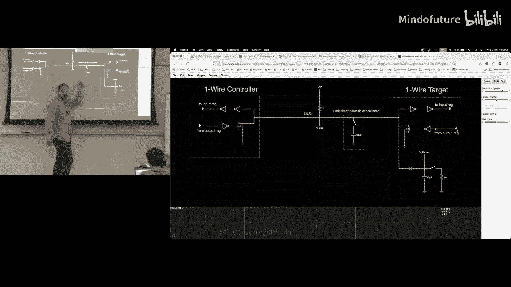

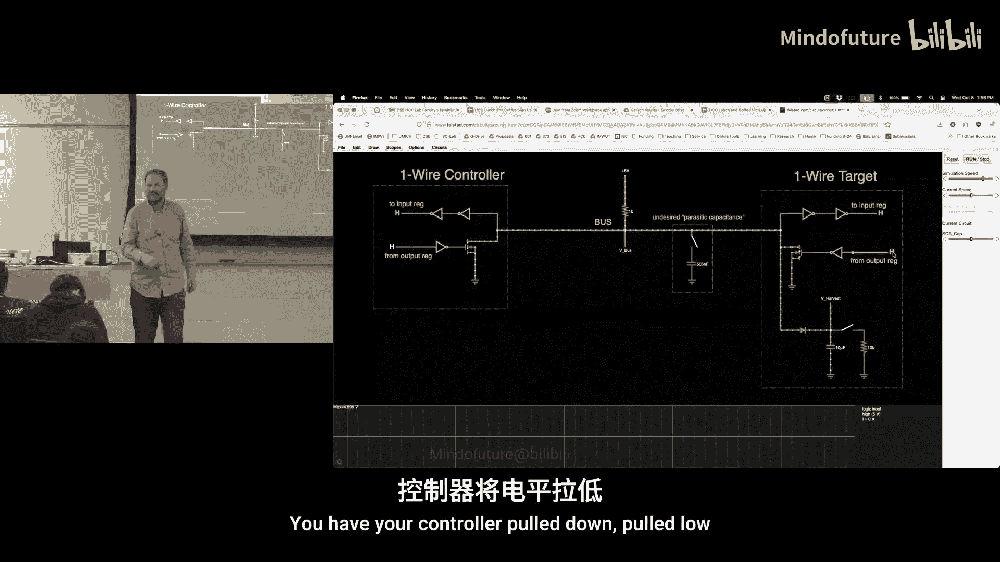

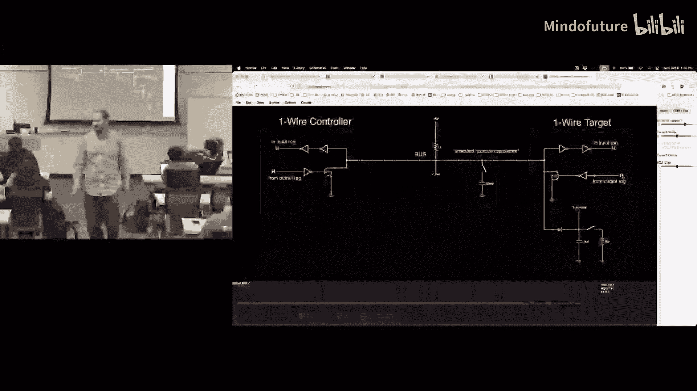

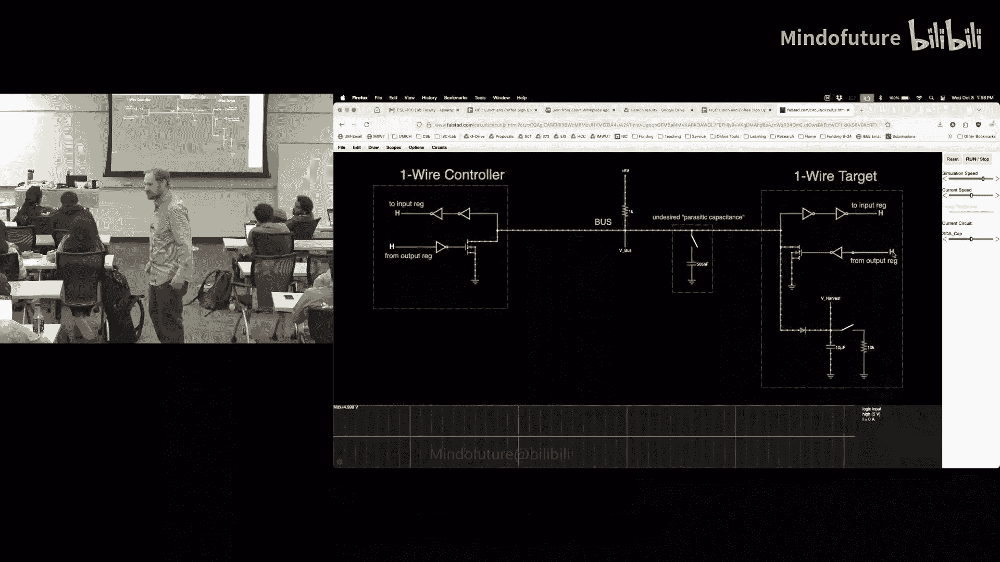

*   **UART**：一对一设备通信，无仲裁协议，异步通信（无时钟线），需要预先约定波特率，通过起始位序列开始通信。
*   **SPI**：事实上的标准，但无官方规范。同步通信（有时钟线），主控制器产生时钟，通过片选（Chip Select）线进行仲裁，数据可同时收发，通常基于移位寄存器，数据包大小通常为8位。
*   **I2C**：使用最少的线缆（两条：串行数据线SDA和串行时钟线SCL）实现一主多从或多主通信。通过设备地址进行仲裁，采用开集输出，总线速度受上拉电阻硬件限制。

## 单线接口设计思考

基于对现有串行协议的理解，我们思考一个设计挑战：如何设计一个仅使用一根数据线（外加地线）的通信接口？

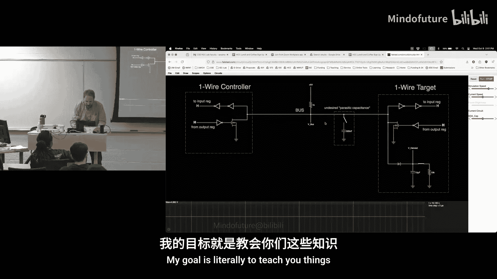

这个新协议的目标是至少支持一个控制器与多个外设通信，并可能扩展到多主模式。我们需要考虑数据收发、时序方法（如异步时钟恢复）、仲裁机制（如使用地址或数据包头）以及拓扑结构。

一个实际存在的例子是“单总线”协议。其物理层与I2C类似，使用晶体管将线拉低表示0，依靠上拉电阻回到高电平表示1。它通过数据包头中的地址进行仲裁，并采用异步通信，接收端需要过采样来恢复时钟。一个关键特点是，它可以从数据线上“窃取”功率：当线路为高电平时，通过二极管给电容充电，为外设供电；在发送低电平期间，电容存储的电荷为外设逻辑供电。因此，协议设计必须确保连续低电平的时间不会长到让电容电量耗尽。

## 模拟信号基础

微控制器的一个核心目的是与外部世界交互。模拟信号处理是这种交互的关键方式之一。ADC用于从物理世界捕获信号（如麦克风），而DAC用于向物理世界输出信号（如扬声器）。函数发生器和示波器分别是DAC和ADC的商用等效设备。

### 采样与奈奎斯特定理

采样是将连续时间模拟信号转换为离散时间数字信号的过程。采样率至关重要。例如，高质量音频采样率为44.1 kHz，电话语音约为8 kHz。

奈奎斯特-香农采样定理指出，为了无失真地重建信号，采样频率必须至少是信号最高频率的两倍。否则会发生混叠，即高频信号被错误地采样为低频信号。实际应用中，考虑到噪声和时钟抖动，通常需要以信号最高频率的5倍或更高速率进行采样。

### 量化与分辨率

ADC的任务是将连续的模拟信号转换为离散的数字值。这个过程涉及幅度上的量化。

一个N位ADC将参考电压范围（Vref_high - Vref_low）划分为 2^N 个离散电平。每个电平对应一个数字码。例如，一个3位ADC，参考电压为0V到5V，则每个电平的电压步进为 (5V - 0V) / 8 = 0.625V。模拟电压1.0V将落在二进制码001（0.625V）和010（1.25V）之间，通常通过向下取整或其他映射方式得到数字值001。

分辨率通常指ADC能分辨的最小电压变化，计算公式为 (Vref_high - Vref_low) / (2^N)。对于12位ADC，参考电压0-3.3V，分辨率约为 3.3V / 4096 ≈ 0.0008V = 0.8 mV。

### 量化误差

由于模拟值是连续的，而数字表示是离散的，因此必然存在误差，称为量化误差。其最大值为±1/2 LSB（最低有效位）。例如，对于上述12位ADC，最大量化误差约为±0.4 mV。在实际系统中，电源噪声、数字开关噪声、电磁干扰等通常远大于LSB，因此ADC的最低1-2位可能是不可靠的。

### 信号调理

为了充分利用ADC的动态范围，需要确保输入信号幅度匹配ADC的参考电压范围。
*   **范围过小**：信号仅占用ADC范围的一小部分，导致有效分辨率降低。
*   **范围过大**：信号超出ADC量程，导致削波失真。
*   **理想情况**：信号幅度尽可能占满ADC量程（略留余量以防过冲）。

如果无法调整ADC的参考电压，可以使用运算放大器等模拟电路对信号进行放大或衰减，即信号调理。

### 抗混叠滤波

为了防止高频噪声或信号在低于奈奎斯特频率下被采样造成混叠，必须在ADC输入端之前添加一个低通滤波器（抗混叠滤波器）。该滤波器的截止频率应低于采样频率的一半，以确保只有我们感兴趣的频率范围内的信号进入ADC。

## 研究实例：EMI传感

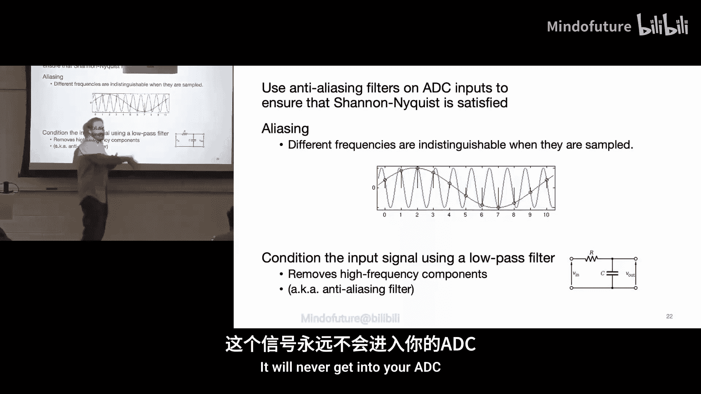

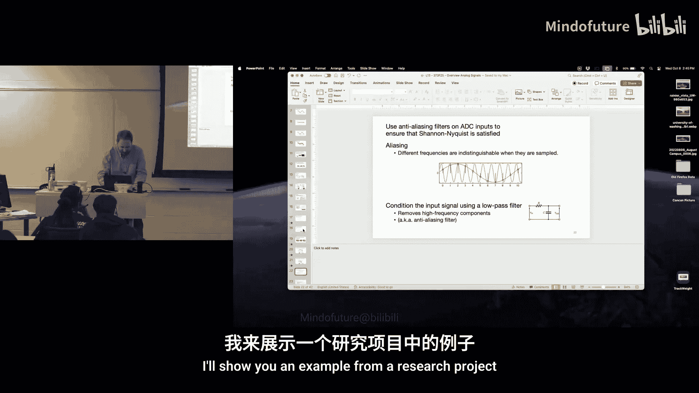

一个研究项目展示了ADC和信号处理的应用。该项目通过一个包含高速ADC（2.3 MS/s）的腕带设备，捕捉人体从各种机电设备（如手机、电钻、笔记本电脑）耦合到的电磁干扰（EMI）信号。每个设备都会产生独特的EMI“指纹”。通过对ADC采集的信号进行快速傅里叶变换（FFT）、背景减除和机器学习分类，系统可以识别用户正在触摸的物体。这个案例也警示了抗混叠滤波的重要性：在没有适当滤波的情况下，一个高频的乡村电台信号被欠采样后，被错误地识别为“梯子”的触摸信号。

## 总结

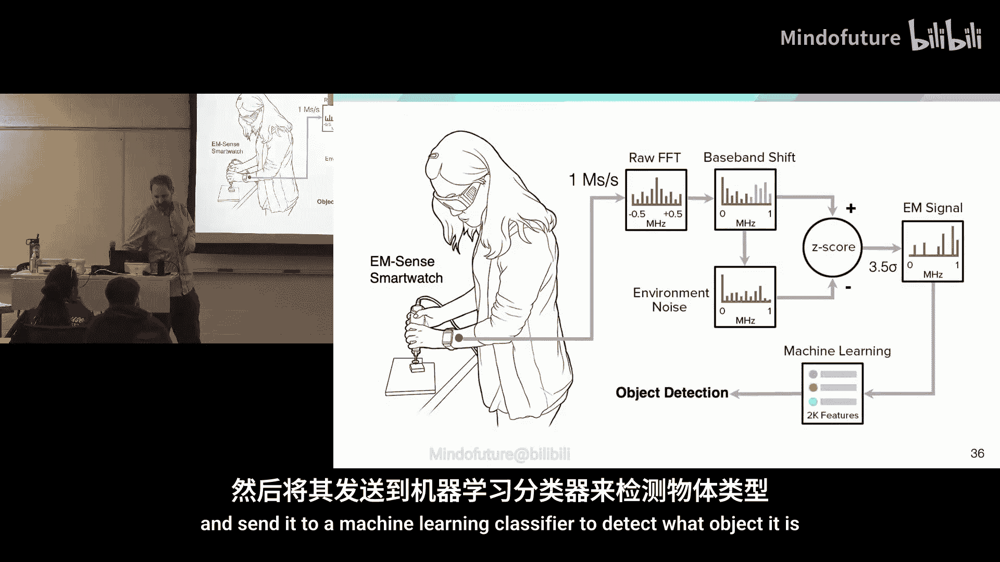

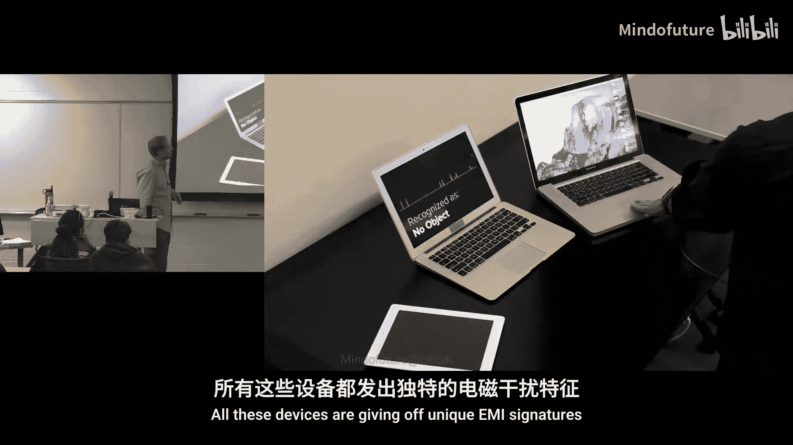

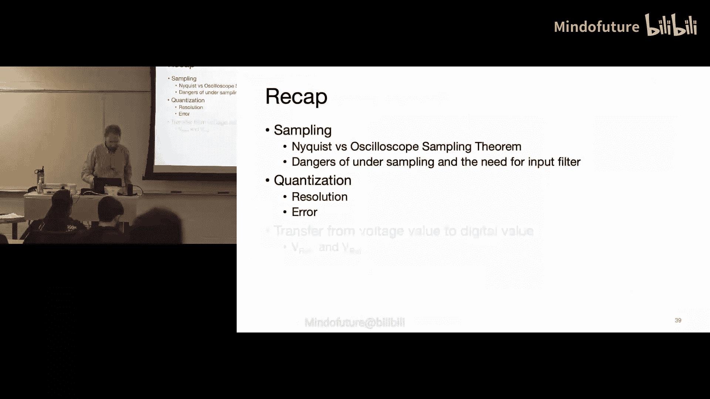

本节课中我们一起学习了模拟信号处理的基础。我们回顾了串行接口，并探讨了设计单线接口的思考。重点介绍了模拟到数字转换的核心概念：采样与奈奎斯特定理、量化与分辨率、量化误差以及信号调理和抗混叠滤波的必要性。最后，通过一个研究实例，我们看到了高速ADC和数字信号处理在实际应用中的强大能力。理解这些原理对于设计能够有效与模拟世界交互的嵌入式系统至关重要。