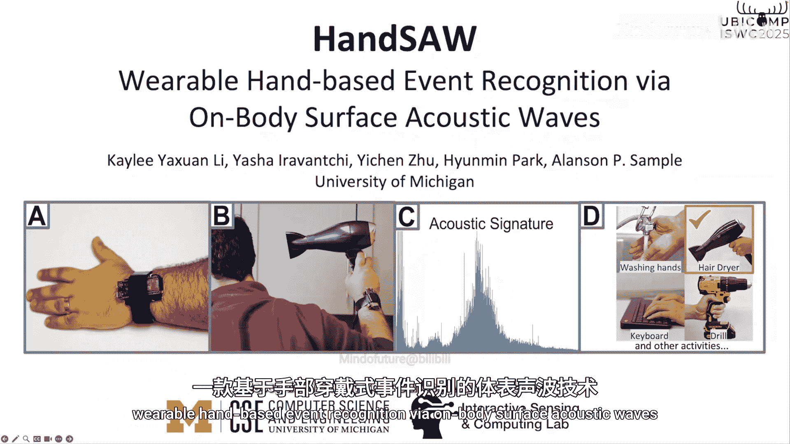
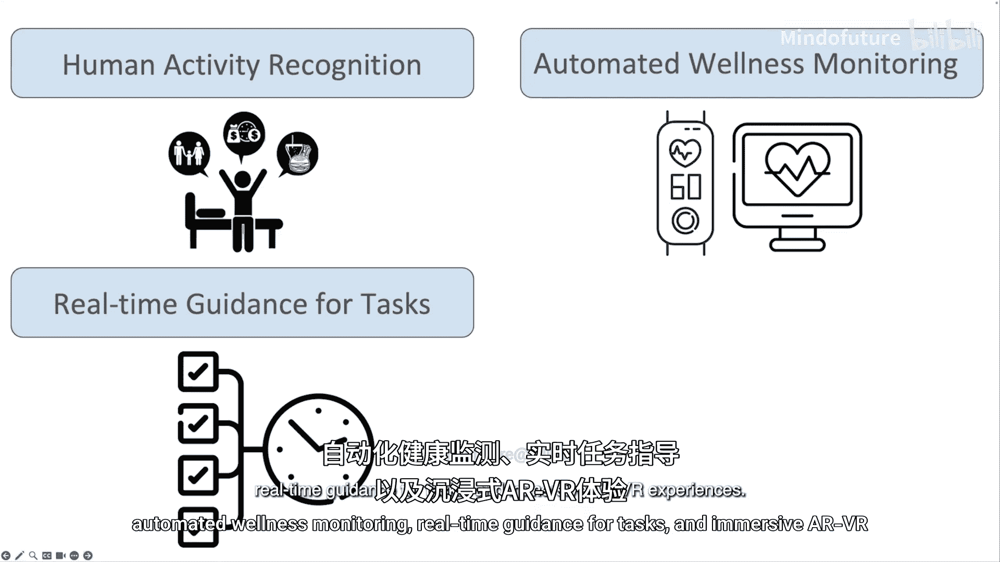
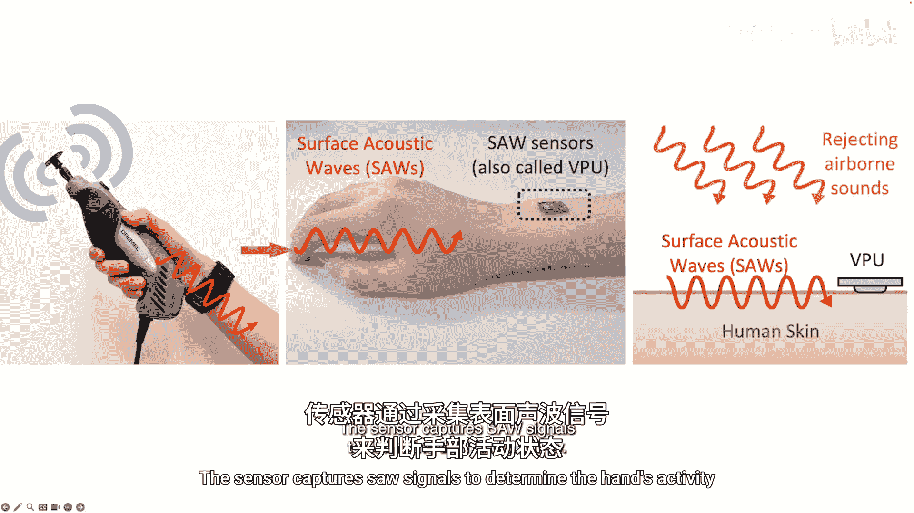
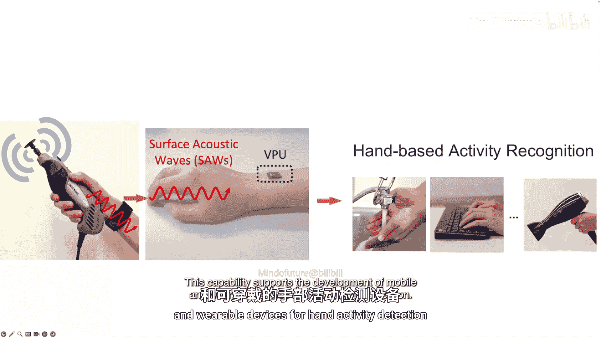
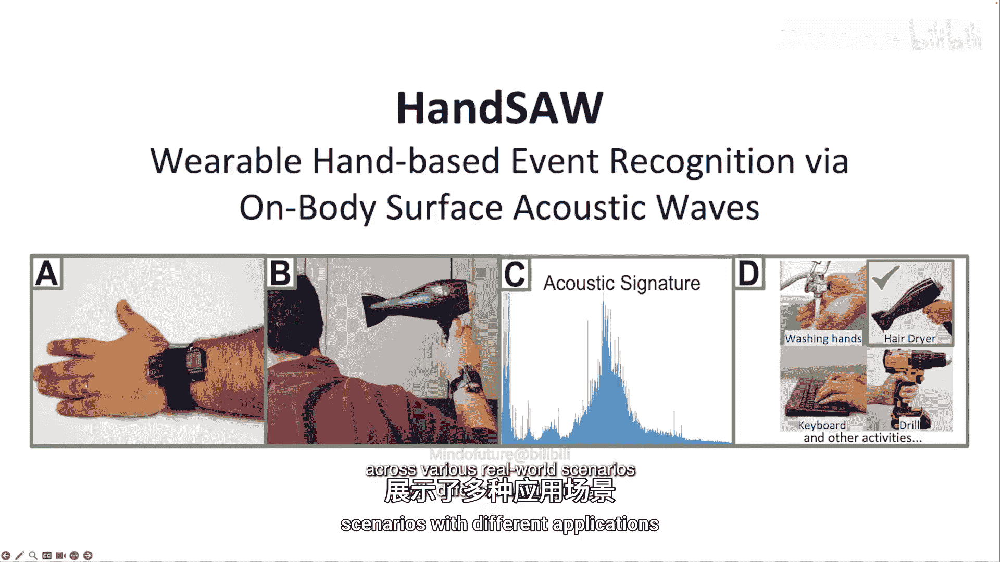
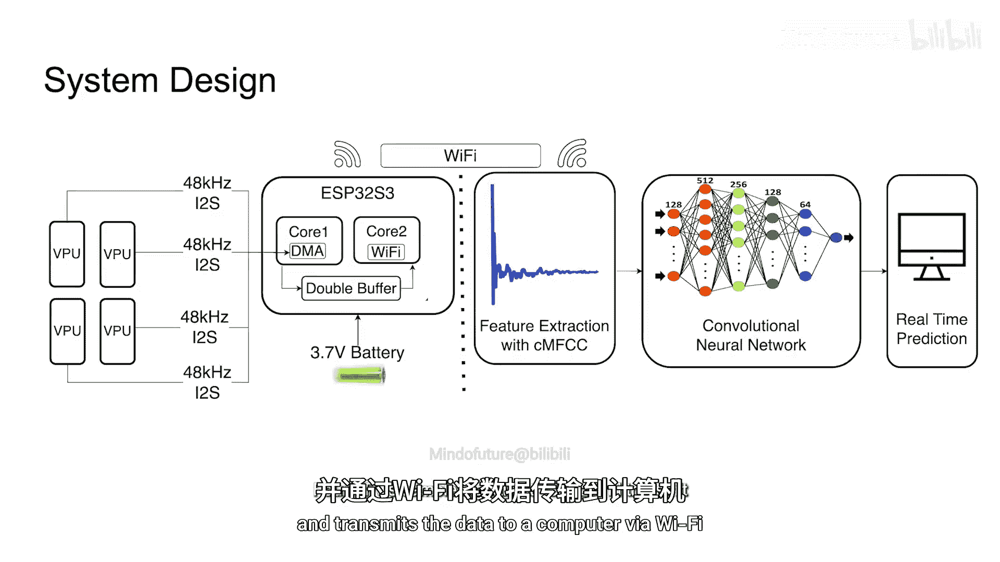
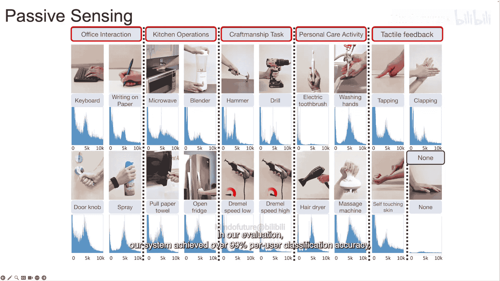
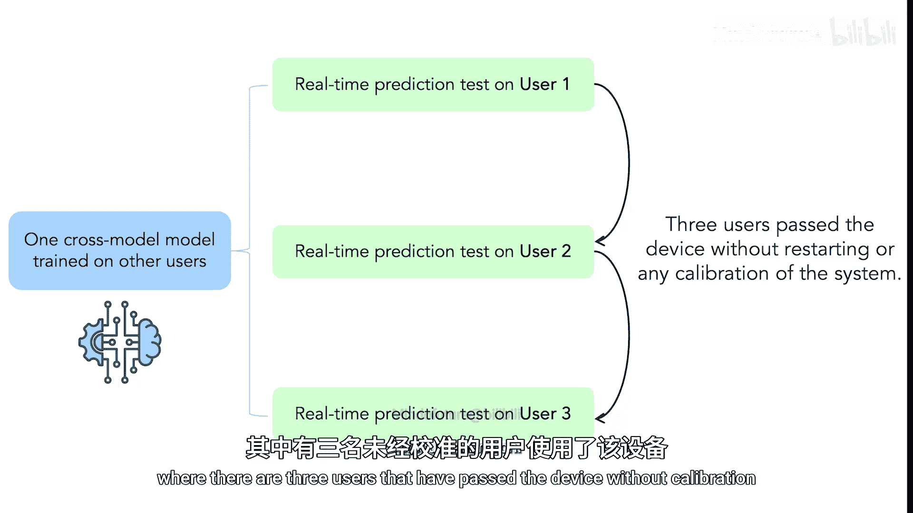
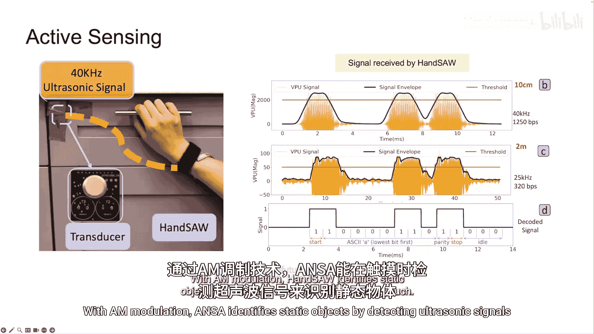
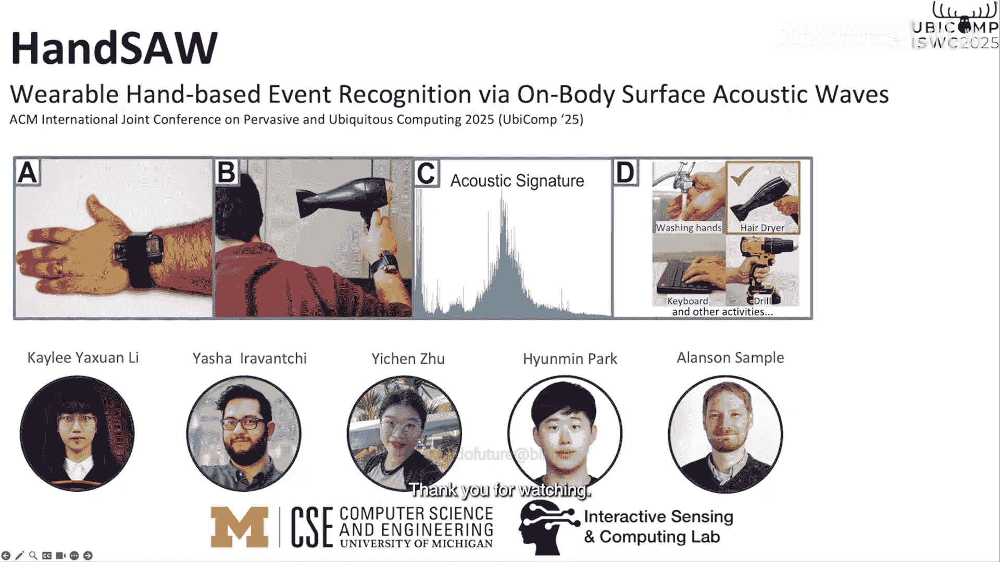

嵌入式系统设计导论：P14-P15：基于手部穿戴设备的声表面波事件识别 👋

在本节课中，我们将学习一种名为HandSAW的创新系统。该系统利用佩戴在手腕上的声表面波传感器，通过检测手部与物体交互时产生的特定声波，来实现高精度的手部活动识别。这项技术为移动健康监测、实时任务指导和增强现实等应用提供了新的可能性。

---

手部与物理世界的交互，能够揭示一个人在特定时刻的活动状态。这种交互提供了关于用户行为及其周围环境的详细上下文信息。从这些行为中识别出细微的信号模式，能让计算机洞察人与物体的交互过程。准确识别这些交互行为，可以支持多种应用，例如活动识别、自动化健康监测、实时任务指导以及沉浸式的增强现实与虚拟现实体验。

许多机械设备在运行时都会发出声波。同样，与大多数物体发生物理交互时也会产生声波。其中一种特殊的声波是声表面波。这种波沿着皮肤与空气的界面传播，当手部与物体交互时，它会从手部传播到身体。这一特性使得基于声表面波的传感方法能有效抑制空气中的环境噪声。

传感器通过捕获声表面波信号来判断手部活动。这种能力支持开发用于手部活动检测的移动和可穿戴设备。

---

上一节我们介绍了声表面波传感的基本原理，本节中我们来看看HandSAW系统的具体构成。

HandSAW系统包含一个可穿戴设备，该设备采用了一种名为VPU的新型声表面波传感器来捕获声表面波。该系统提供了卓越的带宽和信噪比，同时能过滤通过空气传播的声音。

以下是HandSAW系统的核心组件与工作流程：

*   **VPU传感器**：VPU的核心是一个密封的质量-弹簧-振膜结构，位于麦克风的声音端口上方。这种设计使其能够捕获物体产生的、并在触摸交互过程中通过用户皮肤传输的声表面波。
*   **微控制器**：系统使用ESP32微控制器处理捕获的数据。VPU以48kHz的频率对信号进行采样。
*   **数据传输**：处理后的数据通过Wi-Fi传输到计算机进行进一步分析和模型评估。

为了评估HandSAW，我们进行了一项有16名参与者用户研究，分析了涵盖五个场景的20类活动，包括办公室交互、厨房操作、工艺制作任务、个人护理活动以及触觉反馈。在我们的评估中，系统实现了超过99%的单用户分类准确率。

---

了解了系统构成后，我们来看看HandSAW在实际场景中的应用演示。

系统监控器上显示了原始信号、快速傅里叶变换特征以及实时预测结果。HandSAW可以为安全的车间工具使用提供实时安全规程监控与指导。

例如，系统可以提示：“通用使用警告：使用锯子时，请勿穿着宽松衣物、佩戴首饰或留有长发。使用实用方法并支撑工件。”

此外，HandSAW在跨用户测试中达到了91.6%的准确率。第二个演示展示了使用跨用户模型进行实时预测的情况，其中有三名用户在未重启系统的情况下传递并使用了该设备。这表明HandSAW无需校准即可对新出现的、未见过的用户表现出良好的性能。

---

除了被动传感，HandSAW还支持主动交互模式。

采用类似的方法，可以为物体配备低成本的超声波换能器，以生成听不见的信号进行主动数据传输。这通过调幅调制实现了用户-物体交互和活动检测。

HandSAW通过在触摸时检测超声波信号来识别静态物体。例如，当用户触摸冰箱时，HandSAW可以发送购物清单提醒。这种方法可以与被动信号模式协同工作，实现与各种物体的基于声表面波的通信。

最终，HandSAW通过基于体表声表面波的传感，为检测用户-物体交互和活动，提供了一种易于实现、鲁棒且经济高效的可穿戴设备解决方案。

---

本节课中我们一起学习了HandSAW系统。我们了解到，该系统利用手腕佩戴的VPU传感器捕获手部与物体交互时产生的声表面波，通过ESP32微控制器处理数据，并借助机器学习模型实现高精度的活动识别。该系统在被动传感和主动交互模式下均表现出色，为健康监测、工业安全、智能家居等领域的应用提供了新的技术路径。

如需了解更多信息，请参阅我们的论文。感谢观看。