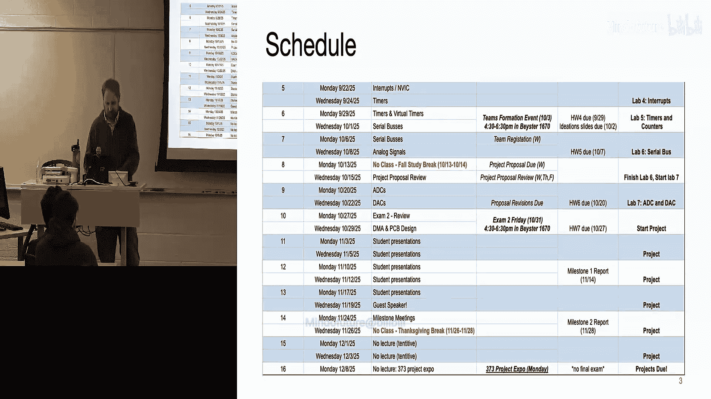
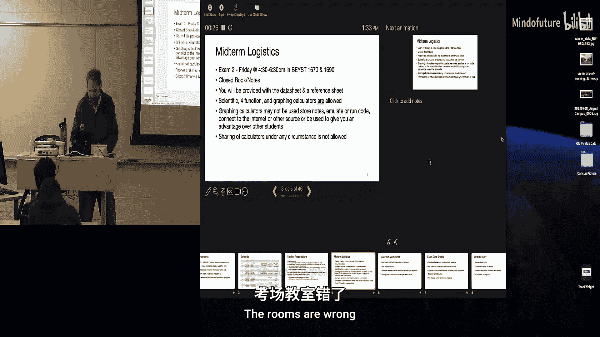
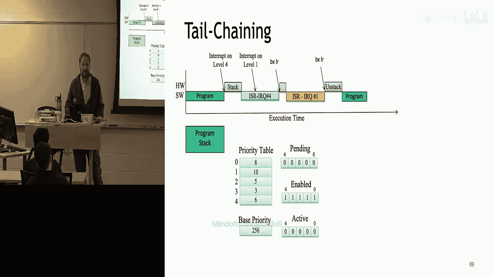
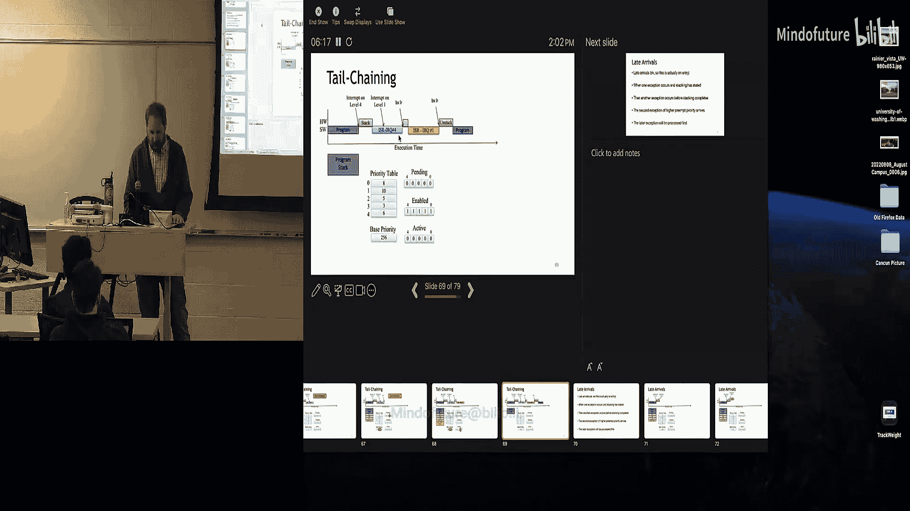
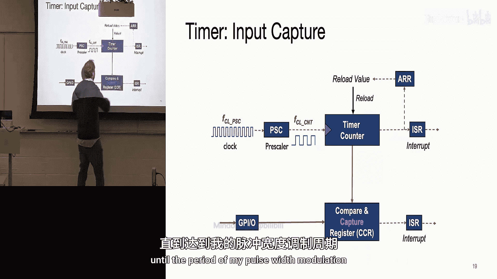
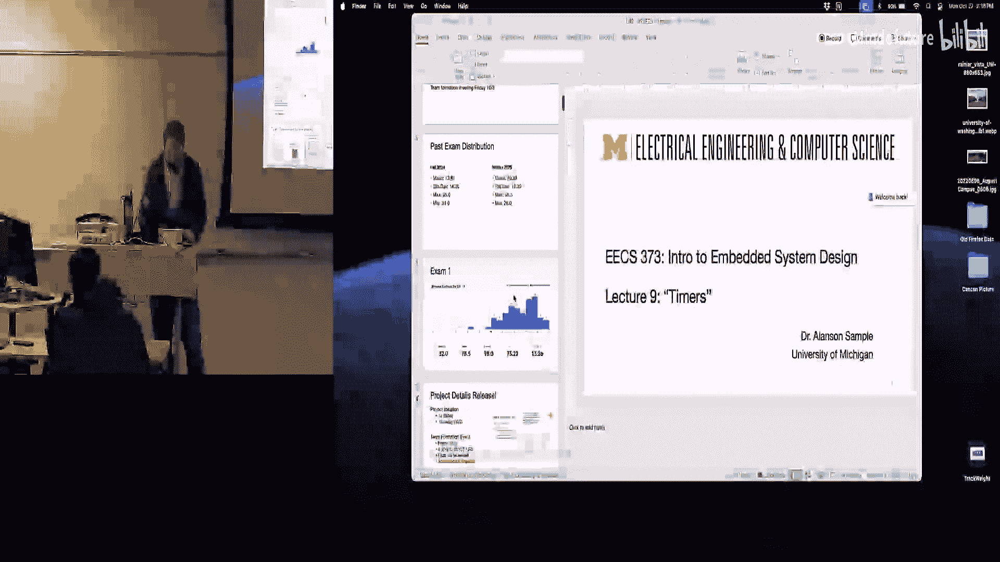
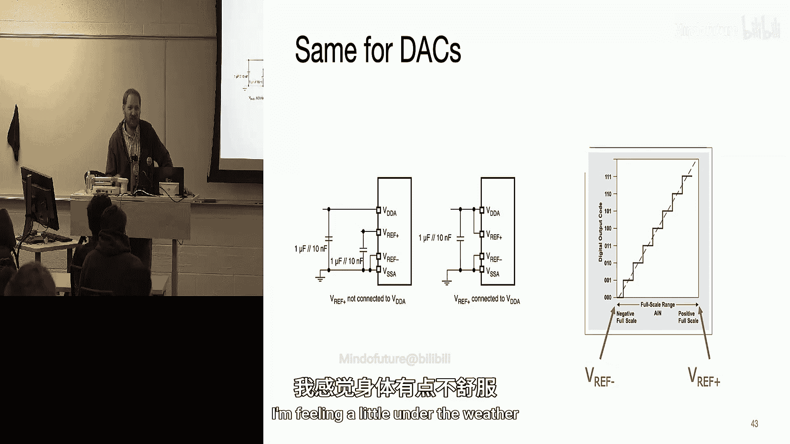

# 017：考试2复习 🧠

在本节课中，我们将对考试2的核心内容进行复习，涵盖中断、定时器、串行通信以及模数/数模转换器。我们将逐一回顾这些关键概念，确保大家能够理解其工作原理和应用场景。

## 中断机制 🔄

上一节我们介绍了课程的整体安排，本节中我们来看看中断机制。中断是嵌入式系统中处理异步事件的核心机制，它允许处理器在执行主程序时，能够响应外部或内部事件。

中断请求（IRQ）通过专用线路（而非总线）发送到嵌套向量中断控制器（NVIC）。NVIC负责管理多个中断源，并根据优先级决定处理顺序。

当中断发生时，硬件会自动执行“压栈”操作，保存当前处理器状态（包括程序计数器PC、程序状态寄存器PSR和链接寄存器LR等），以便中断服务程序（ISR）执行完毕后能恢复现场。这个过程对核心是透明的。

中断向量表存储在内存的特定起始地址（例如0x00000004），其中包含了各个中断服务程序的入口地址。NVIC根据中断号查找对应的地址，并引导处理器跳转执行。

以下是中断处理的关键步骤：
1.  外设触发中断请求。
2.  NVIC接收请求，确定中断源和优先级。
3.  硬件自动压栈，保存上下文。
4.  处理器跳转到对应的中断服务程序（ISR）地址。
5.  ISR执行完毕后，通过特定返回指令触发“出栈”，恢复上下文。
6.  处理器继续执行主程序。

关于中断优先级，需要理解抢占优先级和子优先级的区别。抢占优先级更高的中断可以打断正在执行的低优先级中断。当多个中断 pending 时，NVIC 会根据抢占优先级和子优先级共同决定执行顺序。

中断处理中还有“尾链”和“迟到”等优化机制。尾链指当一个中断正在退出，而另一个已挂起的中断具有相同或更低优先级时，硬件可以跳过部分恢复/保存上下文的步骤，直接处理下一个中断，以节省时间。迟到指在压栈过程中，如果有一个更高优先级的中断到达，处理器可以在压栈结束前直接转向处理这个更高优先级的中断。

## 定时器 ⏱️

理解了如何响应异步事件后，我们来看看如何精确地测量和控制时间，这正是定时器的功能。定时器是嵌入式系统进行时序控制的基础。

基本定时器结构包括时钟源、预分频器、计数器、自动重载寄存器和捕获/比较模块。时钟源提供基准频率，预分频器用于降低计数频率，以适应不同的定时需求。

计数器根据时钟边沿递增或递减。自动重载寄存器（ARR）定义了计数器的周期（上限或起始值）。当计数器值达到特定条件（如溢出、与比较值匹配）时，可以触发中断。

捕获/比较模块增强了定时器功能：
*   **捕获模式**：用于测量外部事件的时序。当外部引脚发生特定事件（如上升沿）时，捕获模块会记录当前计数器的值，从而可以计算出时间间隔。
*   **比较模式**：用于生成精确的输出信号。当计数器的值与比较寄存器（CCR）的值匹配时，可以触发中断或改变输出引脚的电平，这是生成PWM（脉冲宽度调制）信号的基础。

PWM通过调整CCR值相对于ARR值的比例来控制输出信号的高电平时间（占空比），从而控制LED亮度、电机速度等。

以下是定时器的工作模式示例：
*   **向上计数**：从0计数到ARR，溢出后复位或触发中断。
*   **向下计数**：从ARR计数到0，下溢后触发中断。
*   **中央对齐**：先向上计数到ARR，再向下计数到0，可以延长周期而不损失分辨率。

## 串行通信 📡

系统内部的时间管理离不开定时器，而系统与外部设备或其他芯片的数据交换则依赖于串行通信协议。串行通信使用较少的引脚在设备间传输数据。

**UART** 是一种异步串行通信协议。它使用两条线（TX和RX）进行全双工通信。通信双方需要预先约定相同的波特率。由于没有时钟线，接收方采用过采样技术来定位数据位中心并进行采样。数据帧通常包括起始位、数据位（5-9位）、可选的奇偶校验位和停止位。

**SPI** 是一种同步串行通信协议，通常需要4条线：
*   **SCK**：时钟信号，由主设备产生。
*   **MOSI**：主设备输出，从设备输入。
*   **MISO**：主设备输入，从设备输出。
*   **CS/SS**：片选信号，主设备通过拉低对应从设备的片选线来选中它进行通信。

SPI支持全双工通信，数据在时钟边沿同时移入和移出。SPI有四种时钟模式（CPOL和CPHA的组合），定义了时钟空闲电性和数据采样的边沿。

**I²C** 是一种仅需两条线（SDA数据线和SCL时钟线）的同步串行协议，支持多主多从。它采用开漏输出，需要上拉电阻。通信由主设备发起，包括起始条件、从设备地址（7位或10位）、读写位、应答位、数据字节和停止条件。地址用于选择总线上的特定从设备。

## 模数/数模转换器 🔌

最后，我们复习连接模拟世界与数字世界的桥梁——转换器。嵌入式系统需要与模拟信号交互，ADC和DAC实现了模拟信号与数字代码之间的转换。

**ADC（模数转换器）** 将连续的模拟电压转换为离散的数字值。其核心参数是分辨率（位数），它决定了最小可分辨的电压变化（LSB）。`LSB = (V_ref+ - V_ref-) / (2^N)`。

常见的ADC架构及其特点：
*   **闪存ADC**：速度最快，但电路复杂，分辨率较低。
*   **逐次逼近型ADC**：在速度、精度和复杂度之间取得良好平衡，应用广泛。
*   **斜率积分型ADC**：精度高，抗噪声能力强，但转换速度慢。

**DAC（数模转换器）** 将数字代码转换为模拟电压。其输出电压公式为：`V_out = V_ref * (D / 2^N)`，其中D为输入的数字码值。

常见的DAC架构：
*   **PWM型DAC**：利用微控制器的PWM输出加低通滤波器实现，成本低，但建立时间慢，精度有限。
*   **电阻分压型DAC**：类似于闪存ADC的逆过程。
*   **R-2R梯形网络DAC**：仅需两种阻值的电阻，易于集成，是集成电路中常见的结构。

---

本节课中我们一起复习了嵌入式系统设计的几个核心模块：中断机制、定时器、串行通信协议（UART， SPI， I²C）以及模数/数模转换器。理解这些组件的工作原理和交互方式，对于设计和调试嵌入式系统至关重要。