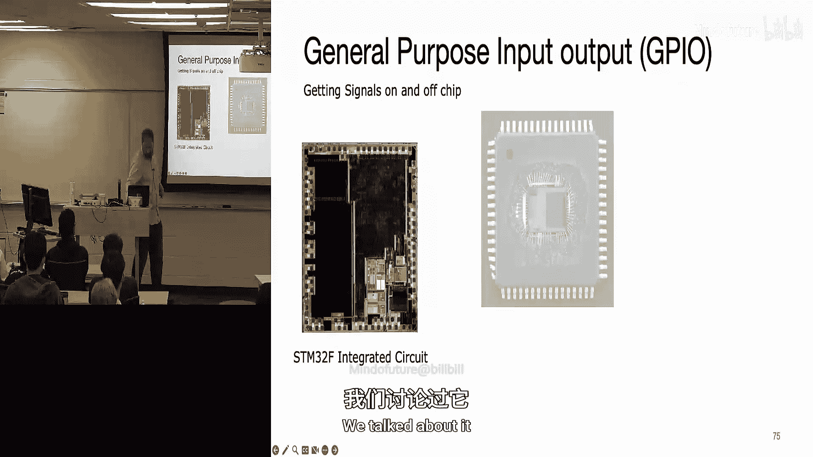
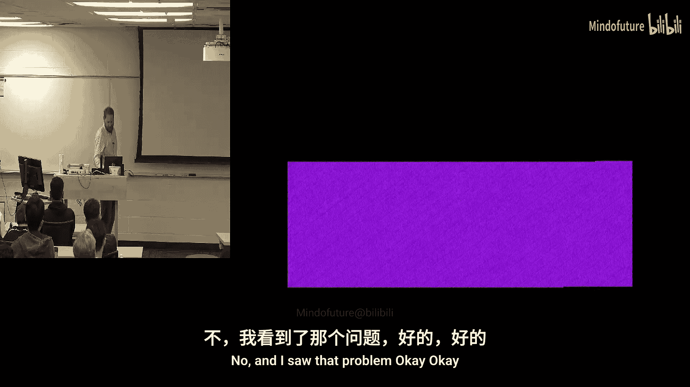
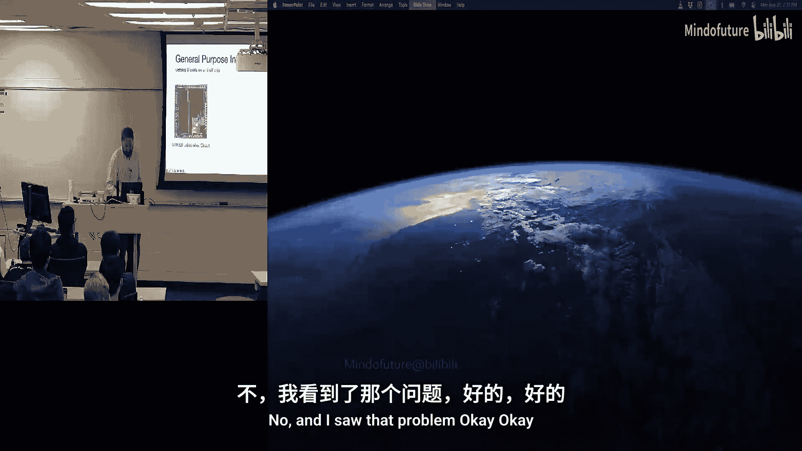
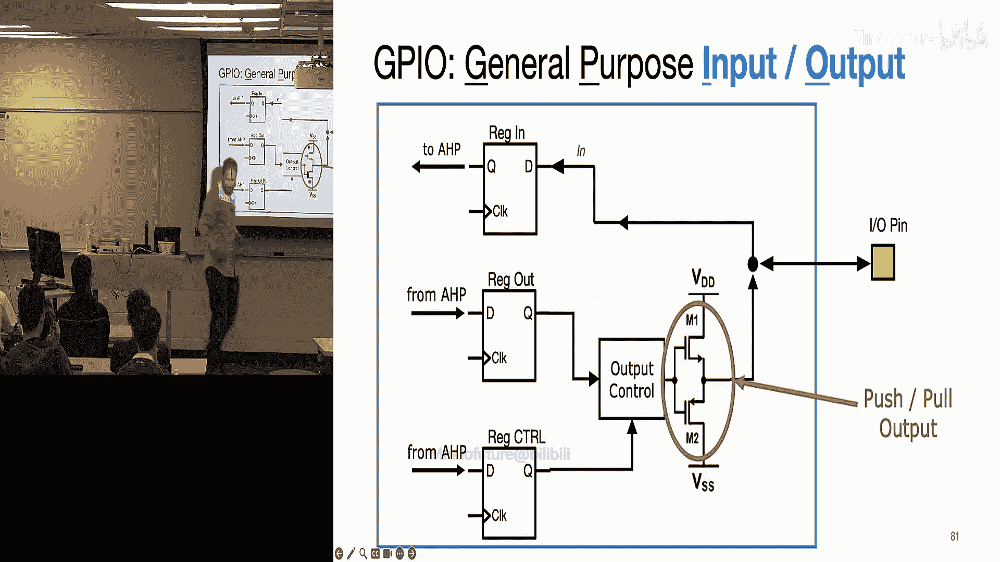
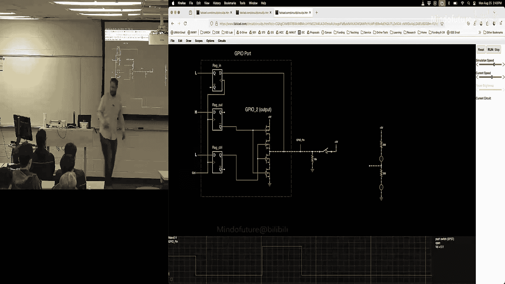
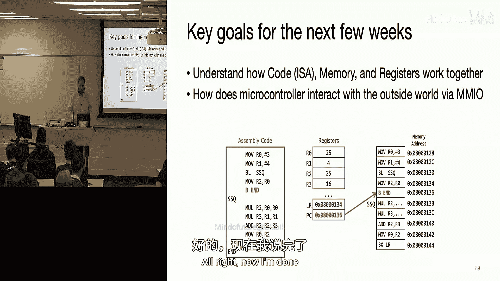

# 【密歇根大学】嵌入式系统设计导论-EECS-373-｜-Introduction-To-Embedded-System-Design-2025-p01-P02_课程1_课程概述与GPIO简介--BV1VTSNBoEem_p1-

That charging 27。Have you ever these？Good market。one。All right， let's get started。啊。

There we go all right， system today mostly we'll do little exercise to get you guys thinking about embedded systems and we'll course overview a little bit about myself so on'm Lansing example。

I went to University of Washington， but really when I was doing my PhDA I really hung out here。

 I did almost my entire PhDO at Intel research they were like three blocks away from campus and I almost failed out of graduate school because I spent all my time here which is great。

 that's fine， I'll tell you that story later， but basically I spent a lot of time in industry。

 I ended up spending six years at Intel in total。嗯。Well， that's kind of true， that's true。

 say thats true。Then I went back and did a postdoc at U but I didn't in computer science but I didn't do computer science I actually did wires the powered heart implants so it's embedded systems and we actually got them to animal trials and the idea was that there's sorry this therapy called an LVD which pumps blood for your heart if your heart's been damage where there's a wire that comes out of it and the problem with that wire is that it's a path for infection right to your heart and so 90% of patients are hospitalized within a year with therapy because of infection and so we took care of that problem。

And I went back to Intel， I did have enough somehow and I took the job down in like big Intel。

 big big corporate Intel not the cute little tot bo over here working on IoT and wearable stock but that got boring。

 said， oh man， big corporate world's boring so do the other big corporate world let come back。

This one was more fun。No， don't give it all away。I worked at Disney Research。

 so they had small little Gucci lab， kind of like this lab here， when in Pittsburgh working with CMU。

 did robotics， animation and I did a lot of my work。

 went into parks and resorts and ended up working working my way in lab director of the LA lab。

That boring。And I became here， I became assistant professor mostly。

 what happened is that Disney decided that they wanted to buy Fox， great choice， buy Fox media。

 they said need money。Well my little， but that's fine。 come over here。

So I work on weird embedded systems to help connect humans to computers and help computers better understand humans。

 and it's called call HCI， as computing mobile wearables。

 I think about embedded systems is the mechanism to interact with humans。

 and so usually I'm trying to solve a human focused problem。Any questions about me？Not any questions。

 fantastic。Yeah， some brave person， apples on pizza， yes or no。Pineapples on pizza yes or no， God no。

 what are you doing？Oh，All right， it's a very question。被告。So announcementnocements。

We take intake survey， there's already a homework assignment to you next Tuesday， gotcha。

Ash having a lab this week， you don't have to do the pre labb before that。

 this is be only week you don't have to do a pre lab， but please go to the lab。

 we'll get you started。Exam dates are set we'll talk about them。

 we're so waiting on locations and make sure you're enrolled in graycope and Piaz if you're not sending an email and I'll get you enrolled。

あ。All right， so outline， come back I'll check for today what is invented systems course overview。

 and then we're going to start getting into the architecture of the STM32 and differentiating this between what you learned in 370。

And then getting you ready， hopefully there's enough time will'll get you ready for a primer GPIO。

 which is a general purpose hint point， output pins for your lab。

embedded systems is everywhere right， so I think the modern car has like over 100 microprocessors of it in some way or another one certainly for all sorts of transportation things。

Medical devices。Moment office things， all these things need some level of automation and computation when it's not a computer screen it's not a mouse and a keyboard these are other classes of devices so here's an example here's a N thermostat。

Let's see it has an LCD screen has a rotary encoder like a knob here， heres the here's the PCB of it。

's see what it has it has an arm cortex M or Art and cortex88 so it the application class processor。

 you run embed the Linux on it。It has also has a cortex M3 built into it。

 so that's like the class of micro controllertrollers are going to be programming this class。

 this is something that a user wouldn't SSH into this is something lower level we were going to do with like bare programming。

Has wfi。Dig B and Bluetooth， has external flash， has two IR motion monitors。

 has some power management circuitry， it's a lithium battery and an iron charger。

 and can you believe it， you ready for what else it has in it？A temperature sensor， oh my gosh。

 these guys， they put a temperature sensor right into thermostat。

You tell ask why in the world does a thermostat would cost like $250 and you can buy a normal thermostat that just measures temperature for like $23 and keeps track of your schedules。

 why in the world how to put all this technology into their device？

When I take 30 seconds to talk amongst yourselves， come up with an answer。

 how have they done this horrible thing the internet and？

Why does the wife leaving your data back to the？ it's smoke。🎼Yeah， I don't。You， this is good。最そうです。

想家励。ます。とうございまし。最バ。我是。All right， what do we think？Anybody have an answer。

 whyhy is Google or Ne put all this stuff in here？Congress。

Like potentially changing the temperature from your phone whether or I maybe don't want to get out。

8 year。ConSo wireless interface to your phone can people in the back hear me？All right。

 you got to yell if I can't hear you， then you won't learn anything and then I actually failed at my job。

 so if you can't hear something， please let me know。All right， so we got an better interface。

 wireless interface to a computer or to a human， what else is there？Yeah。

Doing more tell us more I don't know why you need motion sensors on the。

I don't like all of this feels like it's kind of excessive。 It is excessive absolutely。

 you might argue that a motion sensor to know if you're in the room or not so they could heat it we could argue that。

What else， what else do you think Nest and Google are doing。

 why do they put so much computation in there？The nest I have at my house。

 it'll light up the screen when you walk towards it， walk around it。

 so that's why I think they have that motion sensors as okay。Prety good。想再计你点咯。Like tell us more。

 what does that mean？Yeah remember you are the product that is not free。

 you are the product all right so you're all about right now the idea here is sure they have an application class processor but to run the screen really like the computation you need to set the thermostats not that big right why do we need that and look at all the radios so they have they have wireless they also have Zigby and Bluetooth that's why they have all these protocols so they envision that the N would be the gateway into the home right they didn't sell Google wasn't selling routers at the time I don't know if they do maybe they do know but they weren't selling routers so they wanted to have wireless connectivity into your house to be the steppingsome for all other ecosystem things that in your house so you're gonna go put a Google Home pod that can connect to this right that was their vision they're going give you more hardware than you need for future expansion。

So maybe collect data was right， and that's about right。

What' I think is amazing is how they could get all of this computation here for pretty cheap。

 so let's think about some of those trends， let's take a little side to her。

 think about what are the trends that are causing the technical innovation to make that embedded systems possible just again。

 just to heat and cool your home or to control heating and cooling in your home。

All right so we think about here we got we got a fake graph you see a lot of these especially in big tech demos where you have axes that don't mean anything and therere one line's always beating the rest that's kind of like this graph so here we have time and this is like logarithmic something this is logarithmic number of people per computer so first we started off with mainframes it would take entire buildings and you'd have one for per like you know an entire campus and then you have like many computers。

 maybe you have one for a department and workstation one for a lab and then you have personal computers and laptops and smartphones and now we have multiple devices per person that's just a function of the evolution of technology we have a lot more computational devices available per person。

We also think about the volume， so here I've changed the magic access to size。

 we've gone from very large things right from building size things down to phone size。

 things even smaller， so now we can see the size of technology is changing。

And then another axis change here we have cost， so this was you know millions of dollars in the past adjusted for inflation and now $1000 or less you can get a lot of computation。

 you see these driving technology forces that are happening so what's causing these things。Well。

 we have Moore's law i'm sure you've heard about this。

 this is really a statement that the number of transistors doubles every 18 to 24 months and that's not like a law of physics。

 that's more like a law or a statement about economics you could say the other way is that it's economically viable to keep increasing the number of transistors in your process nodes or in your products every 18 to 24 months so this is just another statement things are getting cheaper。

also look at trends in wireless communication， we have speeds versus time。

 I guess I should update this slide we're over here somewhere now。

But it's interesting we have wired connection， so Ethernet is increasing as a function of time then we have two types of wireless we have。

 they're calling nomadic。And they're calling wireless， so wireless here。

 they say like GSM cellular services， and then the nomadic ones are Bluetooth wfi things that。

Aren't necessarily fixed in space at least the transmitters and it's interesting to me if I look into the future as my job as a researcher。

 I'm trying to figure out what's the future going to look like and pretty soon these lines are going to converge So what happens when wireless is the same speed as my wired connection What changes about technology。

 what could I build then and what should I prepare for now for when that future is viable。

Other trends， so trends in battery technology， so this is not driven by a law necessarily it just happens to be that every 19 to 14 years the energy density of batteries starts doubling so if you I don't know when are you guys born。

After 2000， I have no idea when you were born。Oh my gosh， you guys are young，About that time。

 about 2010， all of a sudden lithium ion batteries came on and it was now possible to make portable electronics before then it just wasn't reasonable to have a camcorder。

 if you know what those things are， with a huge battery on it， people didn't want that thing。

 it was too clunk and all of a sudden the revolution and batteries came through and now we could have portable electronics that could feed this kind of embedded systems thing that we're working on now。

It's important to note this is not a technology scaling law like Dard scaling or Moore's law。

 this is just I think the chemist every few years throw a hill Mary and it actually works that there's any trends at all that's why thingss happening so there's lots of other technology trends I didn not going to go over and talked about Moore's law。

Dynard scaling has ended now， but this was the idea that if you shrunk the size of your transistors。

 your power would also go down and it lasted basically up until the 2000s or so。

 but this was really driving economic power in the semiconductor industry for a long time。

 if you look at Moore's law in Dnard scaling for us。

 it means that if you hold the number of transistors fixed， we're not trying to increase。

 we're not trying to make the next process there we're just going to keep it fixed。

 then things become exponentially lower power and exponentially lower cost。

And I'm sure you're aware that there's other technology trends better， LCDs， display technology。

 ME's fabrication for sensors， new memory types， new architectures and wireless protocols。

 all driving technology。So getting to the point now。

 there's this thing called Bell's Law and this states that new class of computers is developed every decade。

 so stated for roughly every decade a new lower priced computer class forms based on new paradigm and platforms。

 networking and interfacing resulting in an establishment of a new technology。

 something disrupts okay this thing all these forces come together and so the question I have for you all is what's next。

We're going to give this class is about giving you the foundations to build the next thing。

 so I want you to think about we have all this technology trends。

 what is the next class of computers and it's very hard to know even though we should know we're at you over here。

 but it's usually this is a retrospective thing， but take 60 seconds to 90 seconds to talk amongst yoursels and tell me what's the next class of computing device。

ね。いけない。かです。So you don't even need to keep more anything。あございますねござまし。三位。

At one point were trying to chin smaller。it wouldn't take the place of your life。It gets bigger。

 but it's the potential side effects of that AR is much because Instagram death rate。

It my PC for home maybe there would be Jordan technology like the laptop。

Recently that people enjoy using。I felt。Yeah。we have those now， I don't think it's like churn。

U and it's just cable itself is because part of theor。And's time of like your。

just disconnected and my just my seat to some people now when I go home lot time， like supposed PC。

 I have another kid time and it's like 10 zombie。し。かしてくだ。すみませんか。な。

These are some teaser questions you can think about All right so maybe I made the brief a little too vague。

 a little too vague， I'm saying that we should be we're here， we're 2025。

 we're using this class of devices now which just hasn't been named。Right。

 some of them I heard are like over here after I'm dead。

 some of them I heard and some of them are closer than that。

 but it's more about a retrospective right of like how we use technology。

 how many people use that technology， or how many of them are available。

 what is that class of technology that we will in five years look back and say okay。

 that was the age of the 2000 or 2020s yeah？Smartwat is， okay？Yeah。Comition power。BR， yep。

Like Internet of things， devices like your smart fridge。

or whatever you have a computer in that probably doesn't need one。

 how many people have like an IoT device of some type？

I don't see anybody with their hands necessarily down， I see shy people， I see shy people all right。

 anybody yeah other ideas Yeah， but I feel like that's here。Right way down here we don't I mean。

 it exists， but it hasn't like this technology， smartphone。

 especially the iPhone really revolutionized a generation of users they went from flip phones to iPhones now we can that's it we haven't gotten to that point with quantum Qua has a lot of possibilities it's not there yet。

Like broadly speaking wearable technologies like launches or a ring out of glass Yeah okay yeah。

 I like that we're going to take the VR and put them into the wearable camp Okay。

 I could see now now it's kind of a larger thing， right？All right。

 well here's what I'm going to guess， and it funny thing as I'm teaching them meta As class。

All right， so one possible answer is I wrote this sure mobile sensing computings basically I look at this as IoT is that thing that's going to exist now wearables versus IOT we can make the definition whether it's implanted in the environment around us or we carry with us。

 maybe that's the retrospective that we need and 10 years we'll look back and say oh that was the wearables time or that was the IOT time。

That's my project。To me， it sounds all those things sound a lot like IoT and like all the predictions these guys made。

 and I think embedded systems is a foundational part， it's like the end effect。

 right a lot of those IoT systems are connected to the cloud backed by AI， that's great。

 but still you need that thing that's going to sit and interact with the human。All right。

 if you're interested in these sort of questions like how do we predict the future based on the technology trends。

 I encourage you to read this paper， this is one of my colleagues I've worked with them on a couple projects so beyond Wisr from ubiquitous computing to the collective computing。

 so ubiquitous computing is this class of computing devices that sounds like IoT although is developed in the '70s about what would you do when you have technology embedded in all devices around us。

All right。So switch gears a little bit what is embedded systems so let's go through a few examples and we'll kind of figure out maybe we'll come up with a definition so we have general computers versus application specific is this so in the general computing senseens this costs like you $2000 hard to configure larger heavier consumes more power over here you have a gaming console $400500 easy to set use less computation but it only does one thing only does one thing well right this one can do everything gaming media playback to your taxes。

 all that sort of stuff good deep learning stuff so here is one aspect is this an embedded system what do we think。

Gaming console embedded system。Maybe？I don't think so， it's got a lot of user interfaces though。

 but it is kind of like a vetted system， it does hit this thing of application specific。

 it's designed for one task， it's not general purpose， but it's a pretty high functioning device。

Aious embedded system。I will say that embedded systems is often about making tradeoffs and optimizing for a particular application。

 that's what this does， I just think is probably to the point where it's a specialized computer。

 maybe not an embedded system。We look at the history of the embedded smartphone market。

 so here I'd say something like this is an embedded system。Okay， this is like an analog system。

 this is like you don't even have a processor maybe you do have a processor and I guess you do。

 but here you know there's not much of interface very application specific and on the other end we're here with modern or a decade old phones。

 but it's called modern phones。So my question is you。When did I put this in your lot？

Is a mobile phone an embedded system？嗯。Where you think yes， mobile phones embedded system。No。

All right， take 30 seconds。Argue with your lab mates or your seat partners。

 which when is it an embedded system and when is it not an embedded system？そ。大夫。I was a lib。I right。

Yeah。This。Its if it's not， anything they can like。な。Look looks like there's like a blue icon on it。

はい。す。見ば。sizes。All right， what do we think it's a cell phone embedded system don no。

 that's a good answer。It's a good answer， anybody， anybody want to hazard to guess。No。

What about this thing feels like an embedded system。

 what about this thing it has all the little pieces in it， no。

 it's like it's not embedded in anything else， it is a system。嗯。Ebed okay。

 so that's a good question is embedded system something that's actually embedded into something like I would say this projector could be considered an embedded system what about a wearable Sure。

 but what about a wearable right so wearable isn't embedded in something although you could say that technology is embedded in the case。

Okay， anybody else want to hazard a guess？Yeah。Thats great。

Anything after this is not an embedded system Okay， all right。

 well' you're getting to my questions here， oh come back。

What year so I would say that this is not an embedded system， but this is an embedded system。

 so what year did phones cross from an embedded system to general purpose computing device so that happens to be mobile0707 here？

Wai。Well， the iPhone had access to the internet， so it became much more of a general purpose device Yes。

 but it was Apple， you know， the first iPhone was very specifically built for that purpose。

It he didn't get to software on it to run things what year did that happen？No。That's fine。

That was 2008 the app store was launched I wouldn't going to argue that before this it was just a closed little box。

 happened to have a nice screen， and Apple controlled everything and all of a sudden now you had an app app store and third parties could put apps on it。

 you could jail break and put apps on it and now all of a sudden it turns into this more general purpose computing device now this is not a hardfi rule。

 we could debate forever， but in my mind that's a difference between embedded one indifference between embedded systems and general purpose computing。

Anybody want to counter argument？ok。How about an autonomous vehicle， is that an embedded system？Wai。

I see some people in the audience， yes。It dependss on what you're we're allowed。

 I think it depends on which part of the vehicle you're talking about because I think all the systems that are specifically for。

The autonomous navigation definitely count as submitted systems okay。

 or maybe if you're talking like a Tela has the center console and it basically just like a big iPad。

 I think that might count an as like a general purpose computer Okay。

 anybody else have a different viewpoint？Anybody want to argue this is not an embedded system？Okay。

 I'm going to say， oh I forgot to give you time to brainstorm。

 but I'm going to say this is not embedded system。I'm going to say this is an autonomous vehicle。

 right this is a robot。says it， but this is a robot which is different。

 a robot is not inherently embedded system， although you are very correct。

 there are lots of components on this robot that would constitute embedded systems like your LiDA on top。

 yes， that is itself an embedded system is trying to figure out range as reporting back over its canvas bus to the rest of the vehicle。

 its approximate location okay。All right， how about an SD card is this an embedded system。

 I'll give you your 30 seconds to brainstorm do we think an SD card is an embedded system？It first。

それや。That's the answer。doesn't have process。It just right。これも多ですね。で。ちょとこれ無れか。小。

This one my last credit I like I happy these。たさんで。你说。问题。前不。これの原にも。All right。

 what do we think is an SD card an embedded system？你是什么。I I say more like the component with。

systemystem where kind of like I like， you know， the system needs some sort of power source like that battery in itself isn't an embedded system。

 but okay， the component of a embedded system， anybody have a different point of view？Yes。

 because it's specifically used force。啊方。Well， so I don't know if we'd call memory itself an entire system。

In that definition， but I would say it goes into embedded system。

 yeah can't just this thing you need another system to put the photos in it out， yeah。

Yes because SD cards typically have memory rollers inside them so as you look ahead the slides are all online I should have said this I put redacted slides online so the answer may not be in there figure out which one I put up but so you guys can follow along when we for the rest of the class with a note and make your notes but I'm going to argue you hit on it that while it's not obvious there's no way you should have known but embedded SD cards are typically almost always always have microcontrollers built into them sometimes are built right into the silicon but the microcontrollers are there because this memory first of all is made to be as cheap as possible like just the worst process that they can make anything on here like the most defects possible like just like the garbage of the silicon world they're trying to make this out of and the problem is that that makes it noisy that makes it you put a photo on there and the likelihood of getting some bit flipped around or bad so what they do is they need a microcontroller or。

Some computational device to put error encoding in there so you interface through this through the memory interface and then it says well。

 I'm going to spread the data out and add redundancy in it so that the file actually stays on there even though there's lots of errors in the memory module and so you will actually find that a lot of these things actually have like 8051s or arm 7s or some small little microcontroller in there to manage data transfer and error encoding。

All right。So I gave you lots of examples and trick to every single time feel very good as a professor。

But I'm pointing this out because it's hard to come up with a definition for embedded system。

 it's not like an obvious like okay， that's one and this is one。

 so why don't you guys come up with take you know 60 seconds， brainstorm。

 come up with some sort of guidelines or definitions you can use for identifying embedded systems。

し勉強前なんだよ。I be very。Yous a complete sign。on the。Lron。There。I really like definition。

 can you get your own？I feel like that's things are embedded in anything。letters。

It's like it's just like a piece of hardware。おいします。しな。Yeah。そ。I。系呢嘅。なかとる。ませ。ました失礼。I take a。啊这个是什么意思。

違これ。わけだけ。5。你这是么。いそざいます。Now Ar Royals come back together。

 is N to be one a hazard definition of an embedded system？At you have a change of software， but this。

Cannot have a change of software， but it's the smallest of its kind not intended to have a change of software。

I think that's pretty good， like it's not user， it's not like I can't put nuclear version of Windows on it。

 right it's not like user facing software typically but certainly the manufacturer could update it。

wareYeah， there we go， okay， and it's the smallest instantiation of that thing。All right。

 it's kind of getting somewhere like that， anybody else？来，出来。

Yeah specialized that's a big part embedded systems typically what you're trying to do is you could just give the consumer a general purpose computer that would be easy。

 your job would be done however from a cost point of view you have to make tradeoffs and specialize it so that you can hit the power requirements。

 cost requirements， size requirements any other definitions。Yeah， does I have to be。

Because like the 2007 iPhone is like it was able to do a lot of things able to take photos like message call I guess you could say this comes down to is that an embedded system there's an argument to be made。

 I would say that that was in the maybe you could call it firmware world right it had many functions an embedded system could like a flight controller for an airplane has lots of functionality but it's not adatable that sort of stuff so I don't know。

All right， let's look at some textbook definitions， they have their limits。

 so a digital system provides service as part of a larger system。

 so if we go back to the autonomous vehicle robot scenario。

 all those modules on it would be embedded systems that support a larger system。I can do that。

Any device that includes a programm any device includes a programmable computer。

 but does's not itself a generalizable computer， general purpose computer， yeah， okay？

A less visible computer， I like that one， that one I can see when I try to explain like you know I'll meet other professors like what do you work on I say and they're like oh computer science。

 oh my gosh， look at you know fancy and I said no no， I'm not doing AI。

 I work on computers without screens they're like oh geez。

 what's that guy talking about but a less visible computer I like that one？A single functioned。

 tightly constrained reactive computing system。I like that though we haven't talked about the word reactive yet in this context reactive is like it senses the world or button pushes or something in response to it。

 usually it kind of encoding the idea of real time operation let's see else we have。

Comp system with a dedicated functionality within a larger mechanism or electrical system。

 often in real time computing with real time computing constraints。

So hopefully you'll be able to recognize an embedded system as part of this class and then be able to build them as well I can give you some examples of when embedded systems get weird so this is like my masters project or so from a long time ago that was that Intel so we have passive RFID tags I didn't invent passive RFID tags but here you have an RFID reader that sends power to these devices and this is there's a little piece of silicon inside these things this is an antenna and what happens is it harvests the RF energy here enough to boot up and then it sends data back it actually reads the data as am modlation coming into it and it sends data back what's cool about RFID is it doesn't actually emit any radio waves instead of bounces the radio waves back and so the analog to this is somebody has a signal mirror and you have a flashlight if you're the flashlight you the RFID reader you can send light to the person and instead of them having to generate power to send light back they take their signal mirror and bounce the light back to and they can by switching the next effort。

You can encode information here。 We just changed the impedance of the antenna。

 How hell did that happen。That would be amazing all right well this is fantastic so we were wondering what happens if we put the most computation you could possibly put in the wirelessly powered device and we're going to do this we're going to have a range of like44 to9 meters we used backscatter and we're going to add a bunch of the stuff to it so here this kind of like the block diagram so we had some pemat network and a rectifier that harvests the energy。

 some power management and a demomulated the signal and then we had a full microcontroller 16 bit microcontroller very low power and then we had all the stuff you'd want on the embedded systems and we had like 3D accelerometers and temperature sensors what else we have some LEDs and a watch crystal to keep track of time and external memory and no batteriess whatsoever so now we have the device that can be perpetually power we can one of the professors here built it into this side into this foundation of his house and then he can take an RF5DD reader and scan this thing it still works today。

So what can you do with that， well here's one example。This example， it's horrible， sounding example。

Hey。So this is RF reader， this is me holding the device and it measuring thecc boots up。

 harvests power boots up， measures the acceleration of gravity downwards。

 sends that data back and here we have Saturn moving in time mimicking my hand and。

Ping a theman for whatever reason I don't know we're graduate students we got a little crazy in the lab。

 that's what we did， which is an example of you know you can do weird things with this and the spawn。

 a so subfield of embedded systems where people were trying to play with what's the extent of wirelessly powered computers and at one point we had like there are 50 different universities around the world using these devices and the research in different ways？

All right。So key takeaways the way you think about just in general beyond this class。

 there's all these market forces， there's all this technology trends that are evolving computing and your job in like two or three years is to go in an industry or wherever you're going to be and thinking of the future and say oh this is where we should be I don't want to be working on what's right now Ive got to use all my knowledge of what I can do。

 what technology's been doing and then get in front of everybody and figure out what's that next class of computing devices or what's the thing that will drive value for my company。

U。See embedded systems are specialized computing devices。I don't know what I was going to say there。

There's no precise definition of embedded systems， but you should be able to identify one when you see one All right。

 so any questions so far before we move on to logistics of the class？Anybody want to argue about？

What's an embedded system？Okay。All right， talk a little bit about structure of the class。

So course goals， so you should learn to implement embedded systems。

 including the software and hardware interfaces。Learn to design embedded systems and think about how embedded software and hardware will work together。

You're going to design and build nontrial projects I'm sure many of you heard about the final project takes about a third of the class。

 this is where you actually get to get your hands dirty and experience all those things like integration hell oh it's fantastic but really I want to make sure you have the foundational knowledge so that you can go in when you go to your next embedded system or next embedded system platform you're like oh that's just like this right one of the challenges and I think I have another slide is that getting into embedded systems is incredibly hard。

 you have to have a real breadth of knowledge but once you're in there once you kind of know it you're like oh this MSP430 or ESP 32 is just like this STM except for these small little differences so once you get the foundation you can pretty much practice any version of the embedded systems and the like mobile class computing devices。

So we'll learn in this class a lot about the cortex M processors。

 this is probably one of the most widely used types of processor architectures。

 learn about this instruction sets， and this is kind of like 370 only for a specific processor that actually exists。

Then we'll talk about memory map IO and this is how you get information off and on to a microcontroller。

Tal about timers and interrupts， but this is how you interact with the external world and this is how you keep track of time。

 and then this is the interfaces to the external world through serial buses。And then finally。

 we'll talk about analog to digital converters in DAACs， digital to analog converters。

 and how we can interface with things in the real world。Lab heavy class。

 we have two lab instructors this is unfortunately is going well fortunately for Matt he's retiring that's great unfortunately for us he's been working with us for over 2020 years teaching 370 James so hes the last semester here he'll be helping out James Carl is more or less his replacement he's aum CEOlum and worked in Ford or some automotive company which I forgot for 10 years。

We have a GSI and John and Canan Canan is an instructional aide。

 he took  or 370 and 470 last year believe。All right。

So these are the three platforms that you need to be familiar with。

 so a class website has almost everything you could possibly want on it， all the data sheets， labs。

 all the materials there， gradeadecope， the one thing for gradeScope is please make sure you're in gradescope。

 you're in the correct lab section because your due dates are based on which lab section you are and then please use Piazza for almost everything you can email me。

 I get lots of emails。I'm bad at emails Piazza is the best you're going to get answers from the other IH。

 GSIs and Carl as well as me。And no canvas because Can is linkeding。Hey， Canvas。

All I got one guy's with me， all right。嗯。So class breakdown average is around a high B。

 maybe an A minus somewhere in there， we don't necessarily set a curve every year。

 in the least we would never bring anybody down， but sometimes we do increased grades for everyone a linear curve if needed。

So class， this is your opportunity to get foundational learning。

 I'm trying to give you an overview of the field embedded medicine systems and realistically I'm trying to get you so you can read the data sheet on your own。

The biggest compliment I ever got from a student was when I asked him， okay， what's the problem。

 he says， no， no， no， I don't need your help， you already taught me how to read the data sheet。

All right， like I taught him all the skills he needs， so now he can go learn for himself。

 he doesn't need me to teach him things anymore， he can read the datahe and figure it out。

 but you need a lot of context， a lot of background information before that datahe is going to make sense to you。

Lectury recordings are going to be posted at the end of the week。

 so I have this weird idea that the best learning happens when you're in class， I know that's weird。

And so Im encourage you to come to class， there is a chance to see lecture recordings。

 of course at the end of the week， we also have class part points。

 it's about 4% your grade and I'll hand out in class assignments。Once a week。

 maybe twice a week we'll see how it goes and is this going to be you know pass fail basically look it's a small percentage of your grade you need to miss class go miss class i'm just encouraging you to take advantage of the best possible learning experience I can offer you so don't get stressed out if you're missing one you can get extra points by answering piazza questions okay。

Extra resources。Sometimes I'm not clear， that's fine。

 sometimes you need another source of information， both these textbooks are great。

 you can find them online， you can know where to look， I won't tell you。

 this one is written probably for junior or so sophomores and this is written for people who've been in industry for two years。

This is really good but it does not cover necessarily memory map IO in some of the topics we go into more depth and this is very specific to the core of the microcontrollers but not the process family and we'll talk about that difference later on。

 but I have never found anybody who got one of these books ended poorly in the class this is a great cheat sheet I just don't require everybody to get them because I don't use them in my lectures。

You'll have seven homeworks， you'll have exams， we do things a little bit differently。

 we have two exams they're early。Right that's so that you guys don't have to have a final and after the final the second midterm。

 you just turn off your brain， you just dump all that information right out of your brain and go do the projects better than making you work for three weeks or I mean five weeks on a project and then try to remember what I taught you in lecture。

什么不好。No final exam where we going to teach you in lab everything I talked about we'll spend more time is one thing to realize that labs appear here pretty easy。

 especially the first one where like take this value plug it in here boring okay it's going to be super easy but by a time and then we start reducing them out of information like do horrible things like make you look it up for yourself so that you know how to look up things so you know how to read the day sheet and by the time we get down to here we're just like here just achieve this goal。

Okay， so that's kind of the progression of labs。Late policies。

 you know homeworks if you're 24 hours late will give you a 10% penalty。

 there's no homeworks submitted after that so that's if you're a little late it's not that big a deal submit your homework labs are really important that you get done so here is you can submit it late so 5% for 25 hours late and then every day after that is the 10% penalty we need you to keep up on those labs but just skipping one is really bad for your learning。

And then please note that each lab has their own due dates。

 so make sure you're in the correct lab in grade scope。

Student presentations is part of our AbeET certification， this CE program still part of AET。

 if we want you guys to practice your presentation skills。

 so you'll work as a team to present some topic embedded systems for the rest of the class。

 this helps you learn how to present and it helps the rest of the class learn how like XB works which is a wireless protocol that almost every group is probably going to use here so we'll have that team teach you how to use it。

And then， finally。There's an open- ended project， you will define this project we'll give you guidance and we'll teach you the constraints to get good grades and willll obviously define a lot more about the project later。

 but it's your directed project， it's the major focus of the last third of the class in fact the last two weeks or maybe three weeks of class we don't even have lectures anymore。

 it's just project time。We do have a required team formation event。

 this is the date they're online as well， you need to come there so that everybody can find the teammate and move forward in the project if not the problem is when we didn't do this。

 then people would never find teammates and now we're just delaying the projects farther and farther all right。

So let's see， what are the important dates， so here we're going to learn about the core the first up to the first exam。

 only like three weeks away。We're going to get you。

We're going to learn basically the inside of the microcontroller， the core。

 and then it's how the rest of the topics are how do you talk outside of the microcontroller then after your final project it's just or sorry your second exam then it's just final project time there was going to be an expo we'll have it in E。

Right where the labs are， and you will have three hours to demo your devices。Any。Any questions？

Logistics questions。Anybody dropping out already？Maybe， okay。あ。

Another question yeahs do the presentation do you assign us with a topic so do we pick one typically what happens by then groups have already formed and so I'll say oh you guys are using like a linear actua that's your topic right so it's something that should help you because you need to learn it for your project and probably something that other people need to learn so it's not too abstract and some people like some groups I them like I't know it's assigned you so I'll give you some options but it should be something relevant to what your project is。

Any other questions， the good questions？All right。So。So for me。

 the thing I'm super excited about this course is before 373 I feel like students are learning engineering in the abstract they're like I took a lot of math oh that was so fun and you're like I've intro to programming and then you take 37 you're like well I guess this is a computer it' like this made up language that nobody uses is okay sure you're just kind of like learning how something could work and then all of a sudden they take 373 and it's like you have to synthesize all that knowledge and just like something that's real world like you have to solve a real problem and I feel like by the end of 373 students have taken their first step to really be an engineer like now they can look at something and be like oh yeah I know how to make that like just about anything you're like how would you make this microphone thing oh yeah I can figure that out now it might not be the optimal solution because you haven't spent years in industry but you could remake that whole thing no problem and you'll look around the entire your apartment to be like I can build that I could build that I think it's pretty amazing I think it's a transformational course if you care about embedded systemss。

All right。Let's keep going forward。All right， so we' now we're going to talk about hey got an order。

 so I want to talk about SCM32 architecture and I'm going to go real fast and this is going to be horrible because I'm going to be confusing。

 I want you to think about how things are linked together。

 not how the little individual pieces work so don't freak out。

So let's see the goal here is to link some of the 370 content to the hardware that we're using here。

 I want you to learn the high level architecture of a cortex M4。

 which is the type of processor that we're using。I want you to again focus on what things do and how they fit together or don't focus on what they do。

 but fix on how things fit together and don't worry about the details we are going to spend the entire course going over the details。

All right， so this is your death kit。This is your microcontroller and then your devK has all these extra features。

 these are header pins and resistors and LEDs in a programming interface， all these extra features。

 but really we're talking about that microcontroller that's the thing that is this thing that we're going to study in this class。

 you still have to kind of be able to read a schematic and understand like where this pin is connected to that pin sure。

 but we're really focus on that microcontroller。Inside that microcontroller there's a piece of silicon and this is obviously not exactly the same one。

 but there's these little bond wires that go from so there's a little pad here that goes to this pin。

 this pin gets connected on the PCB and inside here is the microcontroller that we're focusing on and there's a die photo and so from an architectural point of view that dye is represented by this topology and now again this is the part you're not supposed to freak out don't freak out I'm just going to give you the overall feel of what this is and then we're going to spend the rest of the class going through each one of these little modules so this is the big idea a big picture part。

So in 370 you basically only worried about this， you had your ALU。

 you were fetching instruction decoding them， you had registers， you had。

 well you didn't really think about a memory interface or interrupts。

 but basically this was the core of what you did， you didn't think about okay well。

 how do you actually get data in and out of memory， it just happened right？

OopsSo we have here we have memory， two types of memory on these devices。

 we have instruction memory usually in flash and then data memory and SRAM。

 we don't really cover these in this class， but we have memory controllers。

 we do talk about DMA a little bit， so direct memory access controllers。

But all of this is connected with buses， so we're going to spend a lot of time talking about how the core you learned about in 370 is connected to the rest of the chipH and how you actually send information around。

 how do you actually get data when you try and do something here。

 why does a GPO pin go high or low or how do you make an ADC actually do a task？

And so at the highest level buses are just a set of def flip flops， there's registers here。

 there's registers over here， and then we have a bus structure which is going to send data in one clock cycle n data lines and the thing I'm not showing here is that this bus can go to many different devices and so we're going to talk about all the control procedures to make sure that the sender here or the core is talking to the right end device。

We have different types of buses so we're going to learn about the high performance bus。

 this thing is actually like a pipeline multicycle bus。

 we're not going to go too deep in it instead we're going to learn about the advanced peripheral bus because buses are so important to microcontrollers and better system architecture。

 but learning two different bus structures is horrible so we're going to mostly just focus on the advanced peripheral bus。

And there's this bridge between them， so we have the world of the very fast and we have the world of the very slow and we're slow because we're typically trying to wait for something on the external world。

 like a spy port or an op amp or some time or something that go off， you don't need those to be fast。

 but you want your GPO or camera interfaces to be fast。U。We have when we talk about peripherals。

 these are peripherals to the core， but these are still on the device itself。

 so on a microcontroller you might have a DAC or a PWM generator or an ADC。

 and these are functions that you can have the microcontroller do so when I say peripheral。

 it's not external to the device it's actually in the piece of silicon。And finally there's interrupt。

 interrupts or how we have we let the microcontroller or the core know that some event has occurred。

 so it's doing its normal execution and then align or signal goes off that says， well。

 I want you to stop that execution because some user press the button and do some other tasks。

 this is a way to interrupt the processes that are going on here。

 interrupt Ma to do some other goals。And so for an example here， you guys learned about load。

 I forgot what you guys called it in 373 or 370， but that's something you get out of memory right and then you'd fetch it。

You decode the instruction and it say， okay， load something out of where， like memory SraM。Oop。

 and then you're going to decode that。And then you can get another instruction out。

And they'll come through your system through your i code and then you're going to say a I'm going to decode that and that tells me take this register value and stick it off somewhere so here it will stick it I don't know over in the timer or something you're going to set up a timer so a lot of this is all about just moving data around your device。

All right。Has everybody freaked out so far？Good， I see some people saying yes， okay。

 this part of the thing， again you're not supposed to know anything。

 you're just supposed to know that your job is to learn how everything is linked together。

 that's your job today or for the class actually， is learn how things are linked。

Eventually you're going to read this data sheet， this is from your data sheet。

 it has all that stuff in there I just talked about， so we got the core， we've got SRAM。

 we've got advanced peripheral bus and DMA and a memory controller or a memory protection unit。

 you've got the advanced peripheral bus， actually you have two of them。

You have external devices like USB controllers and cameras。You have， come on。What do we got here。

 got you the APP bus bridges。Those are the APB buss。

And then you have all these different peripherals and you it's overwhelming now， but you'll be like。

 okay， this timer 16， you'll look up in the data sheet and say you want to keep track of something。

 you'll know how to use that timer。All right， and watchdog timers， all sorts of great things and DAX。

All right， so the time we're going pretty fat， wait， we're going real fast today。

 I'm talking too fast， great。I'm want to give you a primer on GPIO so that's what you're going to be doing in your lab is like turning pins high or low how many people took 215？

Okay。Great， that's more than usual somehow that's fantastic this class is not heavy on analog。

 but you at least need to know what a pull up resistor is， you need to know what a mossV is。

 need to know how light an LED。That's about all and so the first step of that is we're going to have what's called a GPL pins which is just the external pin on your microcontroller and we're going to want that to be higher low VDDs like 3。

3 volts or 0 volts and that's basically lab1 so I want to give you the background to see how to do that So where already talked about this micro microchip right we talked about。

Cl come back。

So here we have these little pads， these are what's connected to your peripheral。

 so your GPO peripheral， it goes through these gold wires here， so these are called bond wires。

 where bond， a piece of silicon to a piece of metal and then they encapsulate this in epoxy。

 this is UVV UVV opaquepoxy， why do they make a UVV opaque。You can use what's used to et the silicon？

Oh yeah， that's true。诶。Yeah， they sputtertter things on top so they're not worried about you etching the silicon and usually it's。

You have your etchching which they're trying to make it hard or make it flow away whether anybody else know reason why you wouldn't want to have UV get into your piece of silicon flips Yeah so you'll hit any radiation will go home and hit hit one of these you know part of the memory and itll flip a bit and then your thing will crash。

 we don't really have good things for like gamma rays。

 there's no way really to shield those but at least UV low power ionizing radiation。

 we can pacify and so they put these in these epoxy resin containers also it just mechanical protection。

那我。And I solve that problem。Okay。ち在な。すどうしてす。Microoft logical and for more people autoous software。

Okay， so I。

Okay。ちち。And then the trick that oftentimes confuses students is that you probably have like three or four data sheets you have to read through to understand every little piece。

 there's like a data sheet just for the piece of silicon and they have like this is like everything that you'd want to know about this family of processors and then there's a data sheet for your specific instantiation of your processor because it might be slightly different they're going to add components or take components away。

Okay。And then you're going to have a data sheet just for your PCB because you have to know like just knowing that this is the pin say that she is going to go high or low。

 well you can't really probe that with a scillosscope or put an LED on it。

 you got to know where it goes you know which pin over here these are header pins。

 these are places where you put header pins， this is actually a header pin you have to figure out where that is so now you have to kind of read through a bunch of documentation and that's what lab is going to kind of guide you through in the beginning。

All right。So we're back to our block diagram， we'll look over this block diagram many times throughout the semester。

 and the goal now is to figure out how do we go and make a GPO pin go high over here。And so。

Effectively we're going to have register banks， we're going to go these in a lot of detail when we talk about the application binary interface。

 but basically have the register and now you need to store the value of this register in some GPO register so this is the register in the core。

 we use a term interchangeably but this is a register that this's in here basically a set of D flapps inside a peripheral which control if the pin goes high or low and these are the registers in your microcontroller core。

So remember what to register is registers just a bunch of de flip flops that just hold state。

 you know you put data in and every clock cycle is going to hold it on queue until the next clock cycle。

 so this is going to represent， say all the pins on your GPO output port。

And so here say we take these are 32 bit processors， so we're going to take 32 bit lines。

 we can store an entire value into this register and then pull it out on the other side。

 so here we can store something in， say this is your peripheral register where your GPOs data is stored and then you can so you store data in and then you can load data out。

 low data， when you load data you're going to load it back to the core。So again。Just loads in stores。

 basically。But you need to know where to load and store your data。

 so here this is the data that's in the register in your core。

 but this is you need to know what's the address of where something should be stored and that's what this value here and that value over there is going to be is the location。

 what you'll need to do is you'll need to figure out from your data sheet。

 where is the memory location of the GPO pin。That's the key piece of information that we'll be searching for。

Here's to say this is one of those D flip flops。So again。

 here we have the cores able to store data into a peripheral。

And this way you have a low data out if needed， and we'll take a look at just one of those D flip flops and this is what a GPpaO pin approximately looks like right starts off with just a D flip flop。

 a state holding device connected to we're going to call an IO pin and this is the piece of metal on the outside of that epoxy wire bonded thing and it's sure there's some circuits in between but this is essentially what it is。

 it's going to hold this pin either high or low depending on what data you've stored in that flip flop。

And so say this is going to come from the one of the bits of the high performance bus。

 it's going to store it in there， you're going to have a clock。

And then if you're going to go make your GPO pen and input， right。

 you want to check to see if if somebody's pressed a button， you can go the opposite way。

So now you have a button here and say when the user presses the button it goes high。

 well here I switched the pins so that it's confusing because you probably didn't notice that。

 so here we have the input here and every clock cycle is going to  la the value and put it on the queue and this will be connected to the bus to take it back。

All right， so we're going to have to put all those pieces together because we want to input register and output register。

So here we have from the APP we have an output register for this pin。

 we have an input register for that pin， they're not the same register。

 it just would be from a hardware point of view， it's not the choice they made and it would be hard to implement switching the directions you have an output controller so this is output driver for this pin this is just a push pull pair so POSs and Nmoss and what it does is it can drive more current onto this pin than say a normal just this the output of this gate so we have this little device here and then you have a controller because you'll find later on GPL pins often have multiple functions and sometimes you're going to want to disconnect this pin altogether together so that it can be an input。

And then you need some control logic because this thing is going to say actually you should be both wires connected here。

 this thing is going to say do I want to be an input or an output and then you're going to have some control register。

 so now already you have three registers， you have control register which tells if this particular pin should be input or output by putting a1 or0 here you can send data out by putting a1 or0 here and if this thing is set to control as an output。

 then you're going to output this one or0， whatever you load into this register onto that pin and reverse if this thing was saying this I wanted to be an input so maybe it's control0 then data or a signal one0 volts or 3。

3 VDD would come in here and it would set this pin。

 this queue high or a low on a clock cycle and then you could read that out with your high performance bus。

What questions you had is this how foreign from 373 is this？

47 it should be like 2703 sorry 270 and 215 together。Okay， somebody nodded yes。Great。And yeah。

 and this is a push pull pair。

Now I do like， I oftentimes use falsest， which is this nice online circuit simulator。

 and so they allow you to embed the entire circuit as a URL so you guys can go and play with these circuits if you want。

So I happen to have some loaded it up。And so this is just the basic version of a GPpeo pin。

So let's see if I run this。You know a mosFt is just a switch。

 so we can just model this as a switch and sometimes you have things called open drain where you only have part or open trainer open source where you want to pull this thing low but you only have half a switch so here right now the state is a logical one and I can click that thing and it pulls it down to zero you can see that here。

Oh。And so now you can see how I can control eight。There we go you can control the state of this output pin so this little box denotes that hey。

 this could be this is your microcontroller， this is your external world。

 and now they can control the state of this pin by switching that likewise with a push pull pair。

 I can make this pin either high as see I'm making it high here。Or low。You can see that here。

 it's going high or low。And then the equivalent version is just with MossFts。

 so here I can have an open drain I can pull it low or high， and then with a push pull pair。

So this is all is's happening， this is just a logical signal and now you have an analog signal that you're able to push it higher low。

 the resistors are there just to demonstrate it's just a dummy circuit that you're driving so the big idea is that in your core in your microcontroller core。

 you're sending data to a register here it's going to control this pins to either go high or low。

Any questions？How many people are excited to see analog circuits today？Oh my gosh。

 that's making my heart so happy， that's fantastic。嗯。

This is probably a close representation of a GPO pen here。

 let's just say it's two GPO pins and I happen to loop them back together。

 they are not that's not how they're actually done。

 but I want to go and show you how like say your input register was here and your advanced peripheral buses over here。

 you know you can go and take this data and just having ones or zeros right all。Oh。

 I got to run the simulation。So all I'm doing here。

Is this making this pin go higher low and this is just a buffer and all it's doing is thresholding and whether the analog signal is above VDD over two or low VDD over two。

 and then you'd have some digital circuit here here I'm just looping it back and then again I'm driving an LED how do I drive an LED well I'm just going to raise this pin come back。

I don't know。Pr up my circuit。Just controlling this line right here defines if my LED is on or off。

ちちちち。All right， so go play with this， if you're confused， come ask questions。

 but essentially the idea is to get the understanding that these there will be a D flip fl here that's driving the circuit and this is what's making your LED go high or low。

And then finally。We can put it all together kind of as a GPO port here。Yes。Yeah。

So here is an example of a GP by point we have a controller。

 so this thing is going to define if this thing is this is output or it' high impedance。

 if I close off these two MoOSFts it'll disconnect from this node and allow data to go up so let's see if I can get this to work。

And I could add something to it， so let's go and add。We'll start with adding some LEDs。

 we'll drive some LEDs。I do this。That output port I need to set this high。

 there we go and now I can control now I have two LEDs in this configuration。

 I have one when this node is pulled low， so I put a logical low into this register which drove this mossFt or this moOSsFt to be connected and I can actually see the current flowing。

 so I've driven this thing to a logical low of an LED on there。

And then I can put a one into the output register right and as this has caused this mospht to close。

 these are already closed because this is our control register and now I have current flowing through this line and I have the bottom LED going。

So again， you guys job is just to control these registers and see which LEDs are turning on and make sure they're turning on。

 and then if I wanted to change this to an input，都唔。I'm just going to grab the circuit。

 I'm going to put a button on there now。So how this button works。How this button works is that。

It's normally being pulled to ground， you can kind of see the current coming through here， oh。

 I got to change this to be an input type。It's going to drive that low。

Now this input is disconnected because there's no current flowing through these transistors。

 and now this line is being pulled down because of this pull down resistor。

 when I push a button I'm going to connect it to VDD。

And now you can see that a signal is going through that wire up to this register in and on that clock cycle is' going to switch over to high if I let it go。

 it goes back to zero， you can see on the next clock cycle it went to low so this is like almost exactly the mechanism underneath the hood that's happening and your job is just to think about the register you're putting data in and out of。

Pice control。What questions you have because I can't be that clear。

Is this the circuit that you posted on the slides？Yep， so you guys can go play with it， copy the URL。

 it should just work。the other two circuits there there， let's go look， I just jumped ahead。

 so I have the basic pull up pull down circuits and then I have a GPO driving the LED。

はや。This is just that same circuit I just showed the last circuit I showed you， here's the URL for it。

 but this is other than this control logic being slightly different and not shown here。

 this is the same as exact circuit so you can play with it and kind of get intuition about how all that GPO logic works drive pins higher lower or be inputs。

What questions you have？ so is that not a standard logic gate？好 think。

Which one is not stand logic pusher it's not because exactly they use a push pull pair but they need to be able to disconnect the push pull pair from this pin when you want it to be an input so there's a state in which you want your GPOP to be outputs there's a state where you want them to be inputs and you don't know like the manufacturer and know you're the programmer like oh。

 I want to use it for this application and you get to define which direction data goes through those pins that's why they're called general purpose input output。

What questions you have？I went real fast。So you should have questions。Okay。Well。

 you guys have plenty of material to go play with again， you should be able just to copy this URL。

 that link should work on the PDF that I send out and I'll send the non redacted ones， hold on。

 don't get excited。If you are a computer science major。And you are like。

 what the is this guy talking about， I didn't come here for analog circuits。

 or if you're a computer engineering major who took 215 and said， I don't want to ever do that again。

Okay， there are some basic videos I link here for you to kind of get review and the GSI and IAAs are going to do an analog circuit review it's more on the practical side。

 no node voltage equations， nobody wants that， we want practical embedded analog。Hold on， all right。

 let me do my recap slide， got four minutes。All right。

 so what we talk about we talked about technology and market forces。

 how to identify embedded systems， general course overview and so I want you to look for website for everything don't there's nothing on canvas I promise if you have any questions or there's missing info sometimes you know I do horrible things like get the dates on the calendar for due dates for homework different from gradecope。

 just tell me I'll fix it， I promise。Today we went over a high level architecture and talked about pull up switches Next lecture。

 kind of setting you guys up for what we're doing。 We're gonna talk about the cortex instruction set。

 or do assembly and talk about the binary application interface。 Basically。

 I want you guys to understand you learn it in 3，70， right。

 But this is like a real microcontroller process。 How to assembly the registers and external memory work all together。

 We're gonna spend about two weeks making sure this is solid。 kind of review a 370。

 And then we'll move on how do you talk to everything else on the chip。 All right， now I'm done。😊。

Lets go。