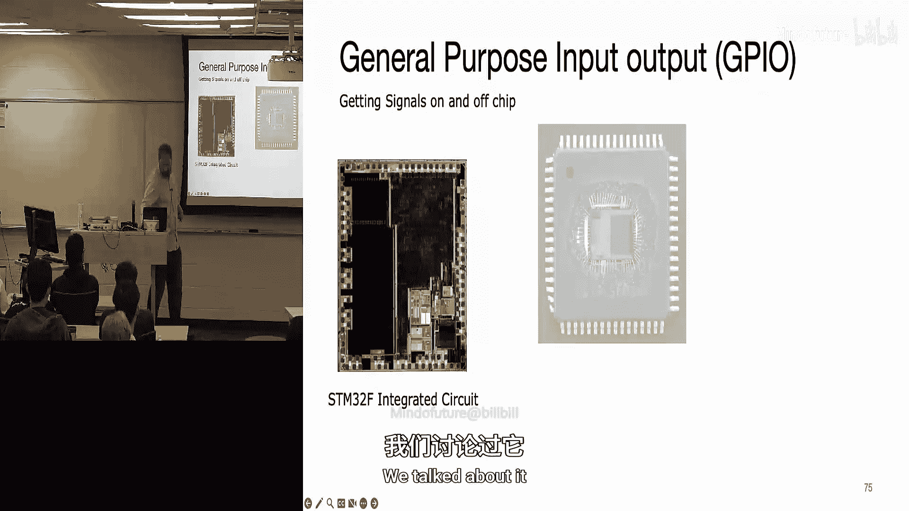
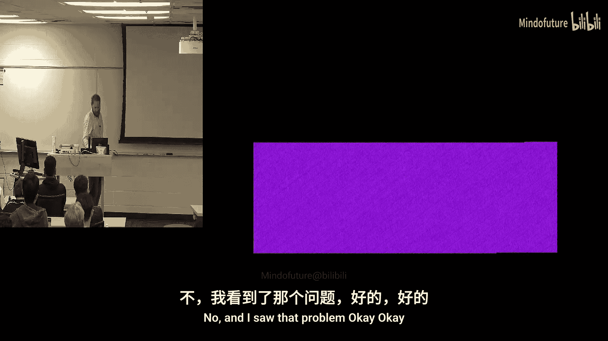
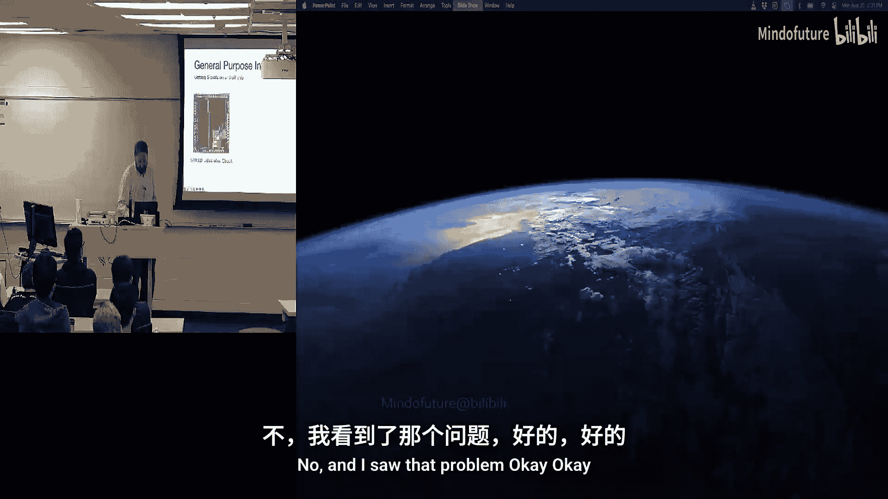
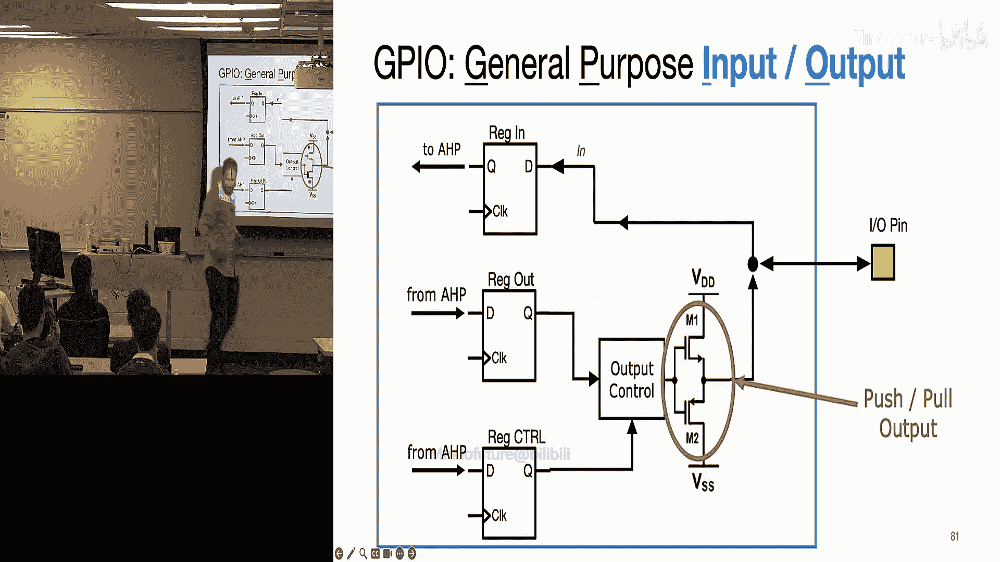
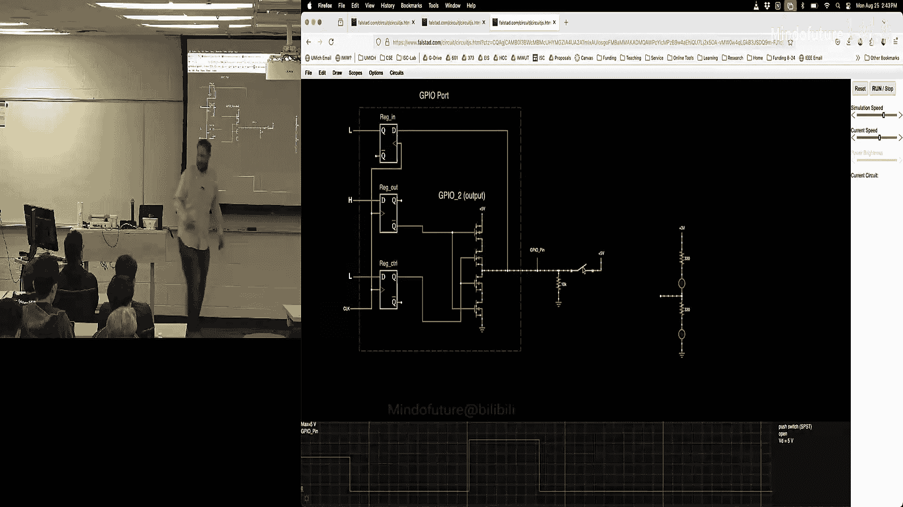
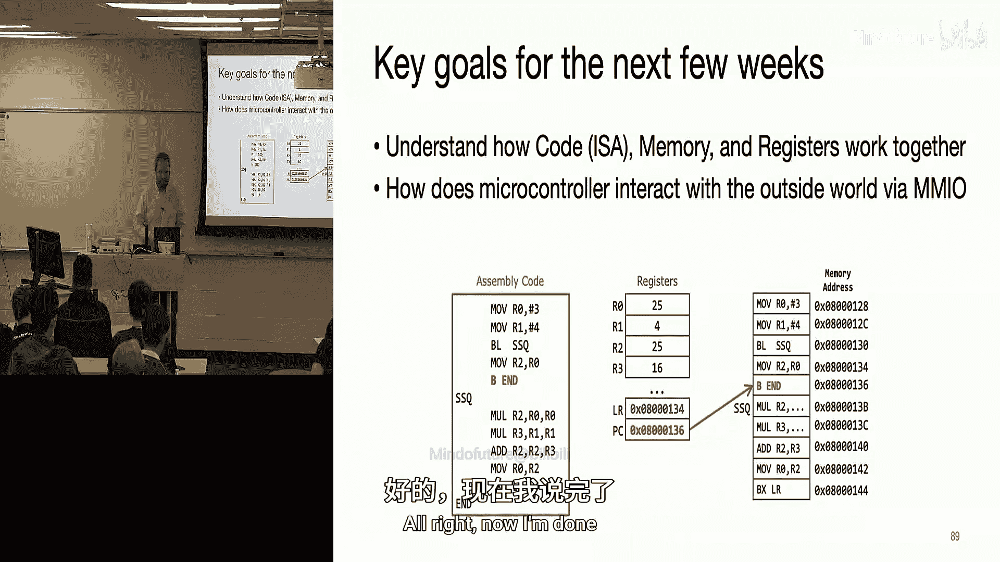

# 嵌入式系统设计导论：1：课程概述与GPIO简介

在本节课中，我们将学习嵌入式系统的基本概念、课程的整体结构，并初步了解通用输入输出（GPIO）的工作原理。我们将从宏观的技术趋势开始，逐步深入到具体的硬件接口细节。

## 课程概述与嵌入式系统定义

上一节我们介绍了课程的基本信息，本节中我们来看看什么是嵌入式系统。

嵌入式系统无处不在。现代汽车中可能包含超过100个微处理器，医疗设备、办公设备等也都需要某种程度的自动化和计算能力。这些设备通常不依赖传统的计算机屏幕、鼠标和键盘，而是构成了另一类计算设备。

一个典型的例子是智能恒温器。它包含一个运行嵌入式Linux的应用级处理器（如ARM Cortex-A系列）和一个用于底层控制的微控制器（如ARM Cortex-M3）。此外，它还集成了Wi-Fi、Zigbee、蓝牙、外部闪存、红外运动传感器、电源管理电路和温度传感器等多种组件。

为什么一个简单的恒温器需要如此多的技术？这背后是多种技术趋势共同驱动的结果。

以下是推动嵌入式系统发展的几个关键技术趋势：
*   **计算设备普及**：从大型机到个人电脑、智能手机，再到如今人均拥有多个设备，计算设备的可及性大大增加。
*   **设备小型化**：电子设备的尺寸不断缩小，从建筑大小发展到手机大小甚至更小。
*   **成本降低**：计算成本从过去的数百万美元降至如今的1000美元或更低。
*   **摩尔定律**：晶体管数量每18-24个月翻一番，使得计算能力持续提升而成本下降。
*   **无线通信**：无线通信速度不断提升，未来可能与有线连接速度趋同。
*   **电池技术**：大约每10-14年，电池的能量密度会翻一番，推动了便携式电子设备的发展。
*   **登纳德缩放比例**：在晶体管尺寸缩小的同时，功耗也会降低（该定律在2000年左右已接近尾声）。

这些趋势共同作用，催生了新的计算设备类别。根据贝尔定律，大约每十年就会出现一个新的、更低价格的计算机类别。那么，下一代计算设备会是什么？可能是物联网设备、可穿戴设备，或是其他尚未命名的形态。本课程的目标就是为你打下基础，去构建下一代设备。

那么，如何定义嵌入式系统？它没有绝对精确的定义，但通常具有以下特点：
*   作为更大系统的一部分提供特定服务。
*   包含可编程计算机，但其本身不是通用计算机。
*   通常是“不可见”的计算机（没有传统屏幕）。
*   是功能单一、约束严格、响应式的计算系统。
*   具有专用功能，通常有实时计算约束。

简而言之，嵌入式系统是专用的计算设备。当你看到一个时，应该能识别出来。

## 课程结构与STM32架构简介

上一节我们探讨了嵌入式系统的概念，本节中我们来看看本课程的具体安排和我们将要使用的硬件架构。

本课程的目标是教会你实现和设计嵌入式系统，理解软硬件接口如何协同工作。你将通过实验和最终项目获得实践经验。我们将重点学习ARM Cortex-M处理器、内存映射I/O、定时器、中断、串行总线以及模数/数模转换器等核心知识。

课程将围绕STM32微控制器展开。你需要熟悉三个主要平台：课程网站（获取所有资料）、Gradescope（提交作业）和Piazza（交流讨论）。

现在，让我们将你在EECS 370（计算机组成）中学到的知识与实际硬件联系起来。在370中，你主要关注**CPU核心**：取指、译码、执行（ALU）、寄存器等。但在实际的微控制器中，核心需要与芯片上的其他部分通信。

下图展示了STM32微控制器的高层架构：

```
[CPU Core] <---> [总线系统] <---> [各种外设]
                 (AHB/APB)         (GPIO, 定时器, ADC, 串口等)
                      |
                      v
                [内存 (Flash/SRAM)]
```

关键组件包括：
*   **核心**：你从370中已经了解的CPU部分。
*   **内存**：用于存储指令（Flash）和数据（SRAM）。
*   **总线**：连接核心、内存和外设的数据通路。我们将主要学习**高级外设总线（APB）**。
*   **外设**：集成在芯片上的特定功能模块，如GPIO、定时器、ADC等，它们通过总线与核心连接。
*   **中断**：允许外部事件打断核心正常执行流程的机制。

整个系统的工作可以简化为**加载（Load）**和**存储（Store）**操作。核心通过总线将数据存储到外设的寄存器中（例如，让一个GPIO引脚输出高电平），或从外设的寄存器中加载数据（例如，读取一个按钮的状态）。

## GPIO入门：从寄存器到引脚

上一节我们介绍了微控制器的整体架构，本节中我们深入看看最基础的外设：通用输入输出（GPIO）端口。

你的第一个实验将涉及控制GPIO引脚来点亮LED。GPIO引脚是微控制器与外部世界连接的基本接口，可以配置为输出（驱动信号）或输入（读取信号）。

其核心思想是**内存映射I/O**。芯片上的每个外设（包括GPIO）都对应一个或多个特定的内存地址。核心通过向这些地址**写入数据（存储）**来控制外设，或从这些地址**读取数据（加载）**来获取外设状态。







对于一个GPIO引脚，通常涉及三个关键寄存器（每个寄存器本质上是一组D触发器，用于存储状态）：
1.  **控制寄存器**：配置引脚的方向（输入或输出）。
2.  **输出数据寄存器**：当引脚配置为输出时，向此寄存器写入1或0，可使引脚输出高电平（如3.3V）或低电平（0V）。
3.  **输入数据寄存器**：当引脚配置为输入时，外部电压（如按钮按下产生的高电平）会改变此寄存器的值，核心可读取它。

引脚内部的简化电路包含一个**推挽输出级**（由一对PMOS和NMOS晶体管构成），它可以有效地驱动电流到外部电路（如LED）。当配置为输入时，该输出级会被断开，以防止干扰外部信号。

以下是控制一个LED亮灭的简化流程：
1.  在数据手册中找到控制目标LED的GPIO引脚所对应的**控制寄存器**和**输出数据寄存器**的内存地址。
2.  通过存储指令，向控制寄存器写入特定值，将该引脚配置为**输出模式**。
3.  通过存储指令，向输出数据寄存器写入 **`1`**（点亮LED）或 **`0`**（熄灭LED）。



对于读取按钮状态：
1.  将引脚配置为**输入模式**（可能还需要启用内部上拉或下拉电阻）。
2.  通过加载指令，从**输入数据寄存器**读取值。按钮按下时通常为 **`1`**，释放时为 **`0`**。

## 总结与下节预告

本节课中我们一起学习了：
*   嵌入式系统的广泛存在及其定义，它是由技术趋势驱动的专用计算设备。
*   EECS 373课程的目标、结构以及将使用的STM32微控制器的高层架构，其核心是通过总线与内存、外设进行通信。
*   GPIO的基本工作原理，即通过读写内存映射的寄存器来控制引脚的电平状态，这是嵌入式硬件交互的基础。



下节课，我们将深入探讨ARM Cortex-M的指令集和应用程序二进制接口（ABI），将你在EECS 370中学到的处理器核心知识与这个真实的微控制器架构紧密结合起来。我们将花大约两周时间巩固这一基础，然后再学习如何与芯片上的其他外设进行通信。



---
**附：电路仿真链接**
*   基础GPIO驱动电路：[https://tinyurl.com/373-gpio-basic](https://tinyurl.com/373-gpio-basic)
*   GPIO输出驱动LED：[https://tinyurl.com/373-gpio-led](https://tinyurl.com/373-gpio-led)
*   完整GPIO端口示例（输入/输出）：[https://tinyurl.com/373-gpio-full](https://tinyurl.com/373-gpio-full)
（你可以复制这些URL到浏览器中，与模拟电路进行交互，直观理解GPIO操作。）