# 【密歇根大学】嵌入式系统设计导论-EECS-373-｜-Introduction-To-Embedded-System-Design-2025-p02-P03_课程2_指令集架构_(ISA)--BV1VTSNBoEem_p2-

Back to our regularly scheduled program。What are we going to talk about oh， logistics。

 there's a class website， great scope， no canvas， don't worry about what Pateli said。

 there is no canvas， canvas is lame， everything will be on the web。

So assignments so for today by the end of today I'd like you to take the class intake survey that's the QR code I showed it before that's just to help me in the labs have understand this class and what they're unique well not unique but how you guys are different from other classes so we can adjust content homework one is due a week from yesterday and I will have oh in labs you do have lab this week。

 you don't have to do the prelab beforehand you can do that in lab but typically you have to do prelas before your lab I'm going to adjust my office hours so I'm going to make them Monday three to four so that they better align with homework so normally homeworks will be do on Monday that way I'm available for next week because we have a holiday on Monday I won't see you in class I'll have extra office hours on Tuesday at 11 and these are posted on the lab calendar as well so if you're just wondering where is my office hours you can look there。

you can also see when there's open lab hours for lab help。Any logistics questions？Y。

 where can we find a slide。On the website。Scroll down on the lecture page。

 there's a list of lectures and then below， there's you got it， great。And so again。

 we do the redacted slides in here， so I don't give away all the information you guys actually have to think a little bit and then after the class over。

 I'll give you the full slides。So review from last time， easy intro class lecture。

 so we talked about what is embedded system and where is it going， overview the class。

 and then we talked about like the high level of system architecture and how it touches GPOs and that was to help you get ready for lab。

For the remainderer of this week， next week and maybe next two weeks。

 we're going to be really talking about the instruction set。

 or sorry the ISA memory and registers and how all these things work together。

 so this is sort of a review of 370 or at least a reinterpretation of 370 concepts for the Arcore text M0 or M4 line。

 but then we're also going to be talking about this thing called memory map IO and that's where you have the core interacts with things outside of the core。

 which is a subject that you didn't really talk about last time。All right。

So today we're going to talk about arm instruction sets。

 instruction sets or the ISA instruction sets， and then we'll do an indexing problem if we have time we might not。

Any questions so far？Yeah， sorry we're achieving the reviews。With caching as well。

 we come to micro we don't have caching in this world of micro controllertrollers。

 so we're a level below that。But we'll get into it， you'll see by the end of this。

So let's talk about。It's helpful to understand the microcontrollers you're learning about if you understand the business in which they exist in。

 so we have arm， arm has shipped， they claim probably more now 160 billion ships。Sold， wow。

 that's pretty impressive， they're everywhere。It's interesting to think that they are a fabulous semiconductor company。

 what does anybody know what that means？Fabulous semiconductor company， they don't make anything。

 they just sell the intellectual property。So this is a wild idea。

 one of the most profitable companies in the semiconductor world doesn't actually sell semiconductors。

So what they do sell as a company is they sell architectures。

 instruction sets in the intellectual property to glue it all together。

 so they sell basically the blueprint or the design of the microprocessor。

And a microcontroller to other companies， so you know some of these other companies。

So it' things like STM， which you're using Cyppress， NXP， you know Apple， Samsung。

 they're all using this architecture， now a question for you is oh， and then of course。

 these companies make variants right and the difference between like NXP and STM they're both selling Arcortex M class processors。

They're just adding their own special peripherals so they differentiate themselves in the market。

 they're adding their own special thing to it， but still underneath。

 if you know how to program them because of what they've guys done。

 then you can switch between these processors pretty easily。还有。I forgot what I was going to ask。

 it was going to be a great question， I don't know what it was， it was great。An。Okay。

So armM in general makes three different classes of processors。

 so there's the application class processors， this is tablet cell phones。

 these are things that are user facing in a sense， then you have the realtime platforms。

 these are more hardened， they're very much similar to the what they call microcontroller or family or the cost a sense of the family。

 but they are more robust than and hardened for those applications。

There is a wild landscape out there of different types of processors and different architectures and it's really important that you know what you should be looking up for this class。

 so here is a bunch of good here。So these are chip architectures and these are instruction sets and you can see for。

Here are the class of microcontrolllerers that you'll be studying in this class。

There are multiple instruction sets that can go with them for this class we're specifically looking at。

The RV7M architecture and the Th2 instruction set， so just as you're looking online。

 make sure you're in the right zone。All right， so what is an instruction set and an instruction set architecture。

 so this is an abstract model of the computer， it defines how software controls the CPU。

 and it's an agreement between the programmer and the hardware designer that if you program this thing it will actually function。

So the ISA defines like instructions and data types and data storage and addressing schema and data flow control。

Arm has multiple instruction sets that you saw， they have a 16 bit。

 they call them thumb and then they call them arm， I don't know if they actually came up that's why they said。

 but thumb is smaller than arm that's what I remember。

 but they have these two different instruction sets and for thumb2。

 they made what they claim is a hybrid， well I mean it is a hybrid。

 but they say is optimized better performance than either individual one。

 but they have a mix of 16 bit and 32 bit instructions，And they're not all of them。

 it's a subset and they say it's highly optimized for both code density because you have limited amount of storage on these little microcontrolllerers and speed。

And then different microcontrollers will architectures will do different subset of the instructions。

 so cortex M0 is the smallest M1 and M0， and then you have a larger number of instructions including these for the cortex M3 and4 and then the floating point variance as well。

So we can go through an example here so architecture defines how the instruction set is being processed on the Harvard level。

 this class focuses on the cortex M4， which is a variant of M3。

 yes I know that but consider the following example。

 even though we're talking about the M4s this is application class。

 so this is a slightly different architecture， so the cortex A8 running this architecture is a 13 core 13 stage processor application class。

The RMV architecture has eight as a three stage pipeline。

 so same type of instructions is just the core itself， the hardware in CNhes。

 how it's processed differently， even though it's essentially the same instructions。

They both use or can be used the thumbh2 instruction set。

 so here instructions different than are implemented differently on different architectures。Okay。

 so a little bit of back yeah I had a question， do they are they concerned they have the same ISA or no？

No， these two are slightly different instruction set architectures， they're both arm V7， cis D M， D。

 not M。But they both do the insane instructions， so the architecture is different。

 but the actual instructions is different。All right， so let's go back a little bit and think。

So here we have the kind of the evolution here of what arm has put out over the years and then they come up with you know these were all like 8 bit maybe and then we got or 16 bits and we got 32 and they have thumb which is kind of both and then they have 32 and 64 and thumb2 and just thumb like they kind of all over in the instruction set size so first question what technology trends are causing or caused the shift from 16 bit to 32 bit to 64 bit architecture why has the industry done this in this you could think in the class of desktop processors or even a little microcontrollers？

And then given this change， why has arm focused on making a hybrid 16 bit and 32 bit。

 so why you take 60 seconds， talk amongst yourself， come up with an answer for each one of those。

All you to stay there and I。But this was the first time I more complex I just myself。在这上面说到是。I。还我。

Yeah。Or that address the memories。もさ。原告。So。It。What do we think for question one。

 why has the computing industry in general gone from 16 bit to 32 bit to 64 bit？Instruction sets。

 yeah。Or and larger tasks。So we can get more performance out of each instruction。Okay。

 any other reasons？有。嗯。To address more memory that's a great one and that's the one I was thinking of it's certainly true that you can do more work with a larger instruction but there was a time let's say 2005。

 2004 where they were limited in the amount of memory that you could have in a desktop computer not because they couldn't make computer memory that was more dense it's just they did have enough address space with a 32 bit process instruction set to address all that space and so they had to switch over to a 64 bit architecture just so they could address more things and they're limited about four gigabytes or so。

What about this， what does this mean for here， why have we chosen a 16 bit and 32 bit architecture for these small microcontrollers？

Yeah。I might have a lot of devices that actually don't cat or need a lot of storage。

is better so smaller is better why not just stay 16。

 why not go8 four like why go have a mix of 3 or 32 and 16？

You'd also need enough bits to like decide the instruction can do okay， so we can't go down to four。

 maybe some researchers made a four bit in instruction set。

 but there are eight bit ones why go up to 32。L history or legacy of other 32 bits so you can work other things to no no。

 you were right the first time you do want to get the advantage of having a larger instruction set so you can get more work done。

But you don't also want to have such a large instruction set that you can't fit it all in memory。

 so they're like we don't have to address this huge very large over4 gigabyte memory space。

 but we want to have the advantage of 32 Bs instructions to get more worked on what we want and we want the code size of 16 so this is the tradeoff that they're trying to make。

Okay。All right， so let's talk a little bit about the ISA in terms of memory registers and data with。

So we remember this complicated diagram from before for the purposes of this lecture and oh yeah all the bus wishes are 32 bits we're just going to consider the core talking to unified memory they don't have any difference between flash and SRAM we're just going to talk about unified memory and so and that's how arm is actually an important point this is how arm thinks about the world so。

Arm doesn't know， let's go back to this picture here。Now I remember my question too。

 why don't these folks just make their own processors？Would be easy。

 don't have to pay any licensing fees to R。Yeah。Oh we got to be real loud。

 nobody would write software for them。Well， it's okay。

 but at least especially at the lower end stuff， maybe not， yeah， I mean。

 you can always hire people to program it and teach them how to do it。Any other reasons？

sSt to reinvent the wheel Okay that's partly it right every now imagine that and you're not wrong about the programming part but imagine every manufacturer has to make their own really good processor and it's hard there's lots of little air conditions all you know there's lots of things to keep track of now you have to make tool change from it and you do have to have people that are trained on it it's nice if you buy this and now you have somebody else responsible for all those errors that can occur in keeping track of the processor architecture and you do have a workforce that's flexible to go through it it's just that now these guys don't know or Ar doesn't know how NxP is going to specialize their chip。

Arm doesn't want to make an ISA specifically for NXP。

 they have to make one that everybody's going to use。And let's see。

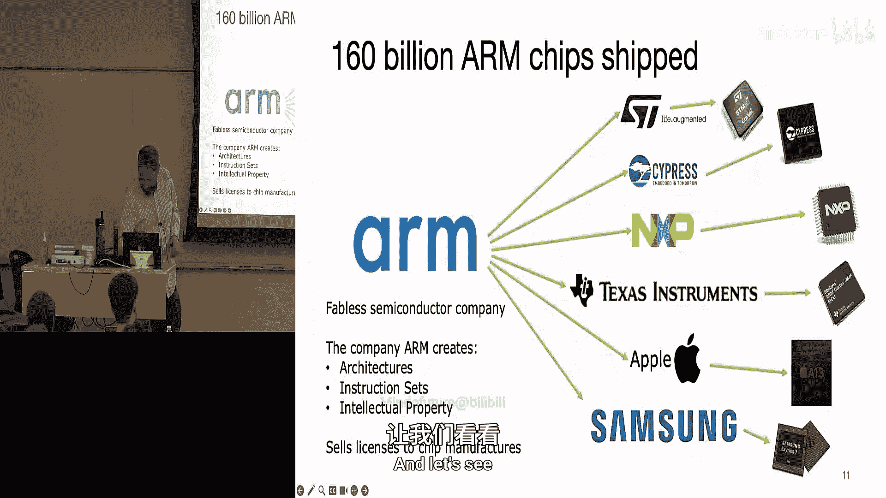

And so when we come back to this here， we're going to talk about unified， this is a unified memory。

 this is from Ar's point of view， what Ar does is they just say okay， here's some address space。

 so here we have addresses going up and they're just going to say code exists between this address and this address。

 they're going to say SRAs here， peripherals here， external memory device and this other things。

 they're not saying they're saying this is the maximum can be。

 they're not saying exactly what its seem to be。It's up to the manufacturers to go through and decide。

 okay well I only need codespace that's a certain size， I don't want to instantiate whatever this is。

 half a gig of code of memory on my device would be too expensive。

 I'm just going to instantiate a little bit， but arm is saying well。

 your code has to start here your SRAMS has to start here。

 peripherals has to start here so that their ISA's work and their tool sets work。

So here there are you know four gigabytes worth of memory described here。

 that's lots of memory locations， sorry there's four gigs of memory locations。

 it's all a unified memory structure， but this is independent of the implementation。

 so memory regions are predefined but for operaability but there's no guarantee this is actually going to be the case。

 so if we look for your specific microcontroller you're using it in the lab。

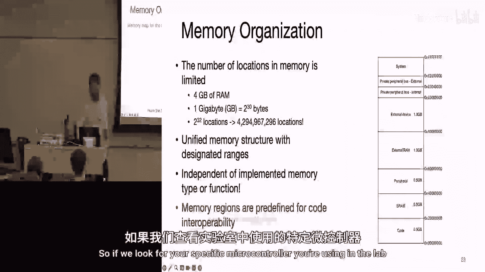

They have a lot of these reserved spaces you'll see this in data sheet reserve doesn't mean that it's there reserve just means that they're reserving it for maybe in a future architecture they're going to go implement something here or maybe in a different design。

 it's just not implemented these addresses and this memory does not actually exist they're saying here's Bo here's flash at this address。

 here's SRAM starting here and up and up and up。Yeah。CanThey don't exist。Yeah。

 there's literally no storage elements there and your compilers should throw an error on you。

ca your compiler should know what chip you're using。

 so there's just nothing there for you to do it's says they just didn't implement it。

 but instead of having arm keep track of everybody's implementation and making it as small as possible。

 they just say here's the regions you can operate in。

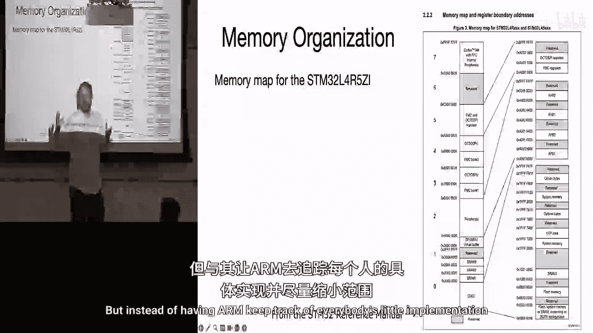

basically said all that。Yeah， great。So here we have， let's see， SRAM okay。

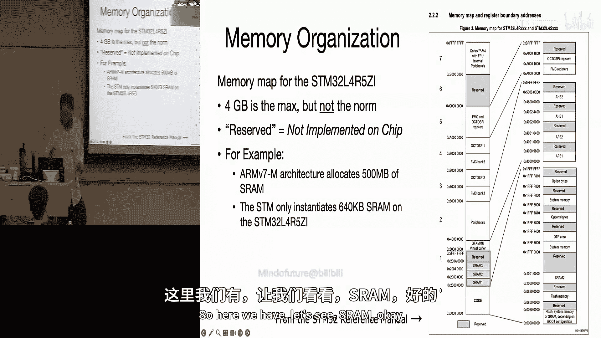

So here's unified memory why， so the I like I said。

 ISA treats SRAM and flash as a unified block of memory， why would a microcontroller want both types。

 what's the advantages and disadvantages？SRM is fast， but it takes up more area。

 so you want to have a little bit of it when speed matters。

 when you want more storage you can use flash memory。

More storage for flash memory I think isn't SRAM densesr than flash， I think so。

It's definitely faster than flash， what's the special thing for flash， why do we need flash on there？

He't erase when you cook power y， so he said it's non volatile we didn't he didn't say that he said it doesn't erase when it。

Powric is taken off。

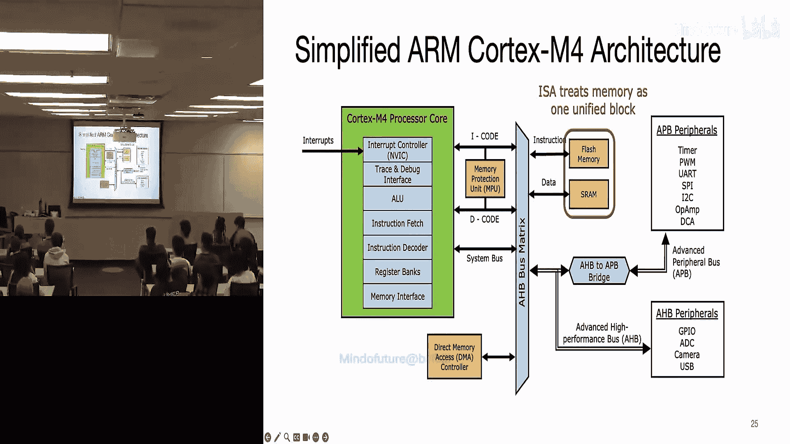

We use the term nonviatile， it's just nice that when you unplug your device you would like to have some amount of memory that is persistent。

 so when it boots up you boot out a flash and then you' boot your program into SRAM and you work in SRAM and SRAMs are very fast。

 it doesn't have that speed penalty as flash。Okay， so how are we going to organize our memory addresses in this space。

 so each memory location has a 32 bit address， however each memory location can store a bite of data。

However， that's not probably how we really think。Or how I thinking about a 32 bit system would think about storing information。

 is' not that I store a byte every time I can store words or half words。

 so the alternate way to think about this，Is。So here we have a sendingending order and so now I can say this address can store a word now the difference here is in I start at AC and here's A and AE and AF we're just not showing it in this specictogram but and then here we're going to increment by four so most your operations that you'll do is actually 32 bit operations you're going because your buses are that wide your whole system set up for that you're just going to be storing and loading 32 bit words you just have to make sure you're doing it on the index of four so that you're getting the data out however you have the opportunity if you should do so is to store bytes in half words。

Does that make sense？Part of this is you need to know your indiness。Unless otherwise stated。

 you can assume that we're a little Indian here， most of the problems that were inconsistent between lab and lecture。

Or with even in lab or lectures which way our addresses are increasing。

 are they increasing up or increasing down yeah？I have a question about like a couple slides back。

 the memory organization， why does Ar make any distinction between all of the different sections because like it's just doing like loads and stores on like certain mattresses。

 why do they say like' pulling your code can exist here and now exist over here Sure because that's a great question。

Let's look here so some of these things have specific functions so we're going to learn later that part of what we call memory map IO is that your peripherals like GPO pins and timers are actually just memory addresses and the way the core interfaces with them is this by pushing data in and out of memory addresses now it happens to be that those memory addresses will cause things to happen like GPO pins that go high the core doesn't know that you as the programmer knows that so back to your question is they could make it go anywhere but a lot of these have very specific functions like SRA is certain type of memory and the flash would be a certain is another designation iss not on here but flash would be a different type of memory and they've allocated that as well does that make sense。

Like the from the would the cortex execute like a different instruction if it's going to try to be like addressing something that's going to be like SRAM versus memory map I versus something else。

 whereas it all just loads in stores from a Co's point of view it's all this loads in stores。

 it makes things easy for arm。Their core processor just use loads and stores。

And then the documentation right or the IDE interprets that as okay。

 this GPO pin is going to go high or low， like you have to know that Mar's memory address means something else than just storing data then in theory if I was like one of like an STM like like board manufacturer。

 could I put like my memory map bio in the SM section？So say your STM， I mean。

 you could probably do it。I think arm would probably say well you're violating our terms of service。

 we're not going to indemnify any horrible decisions you've made right and then when you hire the new junior programmers that took 373 they're going to be like oh no。

 I'm just going to put my data here and all of a sudden their GP goes crazy and then so that's bad and then your IDE tools would have to be changed for each particular processor or so there's no inherent reason it can't be done it's just not convenient。

Pific convention。All right， those are great questions well questions yes they memory and add a bunch of sections instead of just having massive so different processors even in the STM line have different amounts of memory of sRA let's say so you can buy little processors they're cheaper because really it's all about die area right so if I have left memory on there my die can be smaller and now so let's say't it's not a good example here。

Let's go back up here so say this is SRAM right， I just want to go and use a little bit less。

 but I don't want to have to change my tool sets in all my instruction sets and everything for different amounts of memory。

So they just allocate it and they don't use it， does that make sense。

 and what I mean to allocate like on a piece of paper they do。

 they don't actually put hardware in there。I feel like I didn't answer any of your questions。And的。

Oh ask it again so why don't they just have one entire reserve section of so when you go to another processor that has more memory then you would have to move everything else up。

 right？And now it's just more keeping track of all the little details and like my peripherals would start at different stop and start points。

 and so it's just easier from like a bookkeeping point of view to say my timers always start at this memory address regardless of how much SRAM I have below it。

So there's no reason you can't do it， it's just not convenient and that's not how it's done。

Right and so like code would be here's like flash here's sRAm if you move your code made your your flash larger。

 which would be more convenient， you don't want to have to move your sRAM around and just be incompatible with other things also if you go back to。

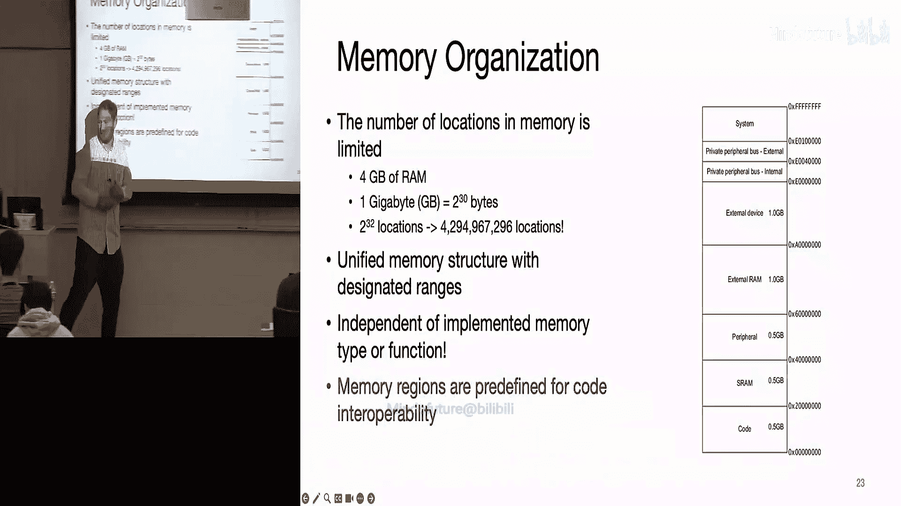

Here。There's architectural choices underneath right there's an entire different data bus for SRAM and there's instruction right and we're not going to teach you all the nitty degrees of this processor but there's an instruction bus specifically and there's a data bus and you don't want to have to and then your core is optimized to the fetch instruction so you don't want to have to mix these two up and now your core is doing weird things right you don't want to take data and trying to be passing it to your instruction fetch and decoder logic。

Okay。With questions， these are good questions， yes， we can go to the little big ending site again。

Yeah。所以。There's a chair over here， by the way。嗯。嗯。Well before I move so actually I don't know if it's on this slide but at least like when we were in the lab one thing I noticed is that when it was like big ending like all the hex sliders were in order but then when I switched a little ending it's like you move two digits of hex at a time and rearrange so why is it like that because that just even made a con so I do have a slide later on it and it's because we have not as a species come up with a perfect convention and how you ask in lab to display memory addresses whether it's word addressable or bite addressable changes the order of what you're seeing so it is something to keep track of and it's horrible？

All right， any other good questions， even bad questions， I can answer those too。そ。Let's see。

 where were we？That's not interesting， I mean， it is interesting but we're behind now。Okay。

 so so far we've talked， nope， don't like that one。All this， I don't know why it's frozen。Okay。

All the slide was just showing you is that different types of data are stored in different locations。

 I guess the things to remember about the slide is the stack grows down and the stack is for things that are dynamically allocated or like not dynamically but things that are run at runtime。

 there's constants which could be put on the he， we don't narrow use the heap in this class like you can use it。

 but we just don't teach it it's just an extra piece of complication that's not that necessary。

 but we'll do a lot of stack work and you just have to remember the stack grows down。Okay。

 so what you should have。Learn so far。Did I talk about registers？Should have。Here we go。

So just like in 373 your core has a set of registers these are 32 bits wide。

 you have general purpose registers like R0 through R nine or so and you have some are 13 you have some special purpose registers you have a stack pointer a link register and a program counter there's other special registers we'll talk about later these are things that keep track of like your program status we'll talk about interrupts and faults and control logic you don't have to worry about them now there are two different modes your processors could be in we don't really address that it only comes up with interrupts so there are shadow registers that you may see but those are privileged and non-privileged modes it's not that big a deal right now so anyways you have 13 registers that can be used is a scratch space stack pointer link register and program counter。

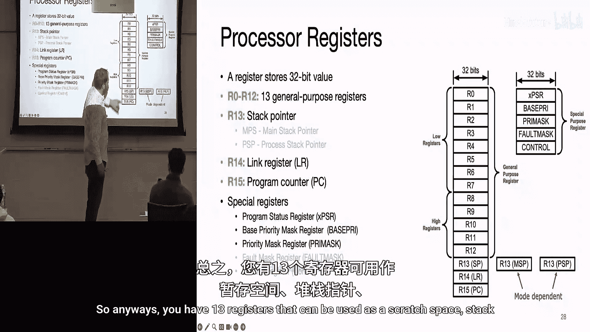

All right。So so far， we've talked about how memory organized。Memory can hold instructions。

 memory can hold data， and we talk about the Reg organization， so we're going to jump ahead to yep。

E a four and three Oh yeah， that's a good typo。

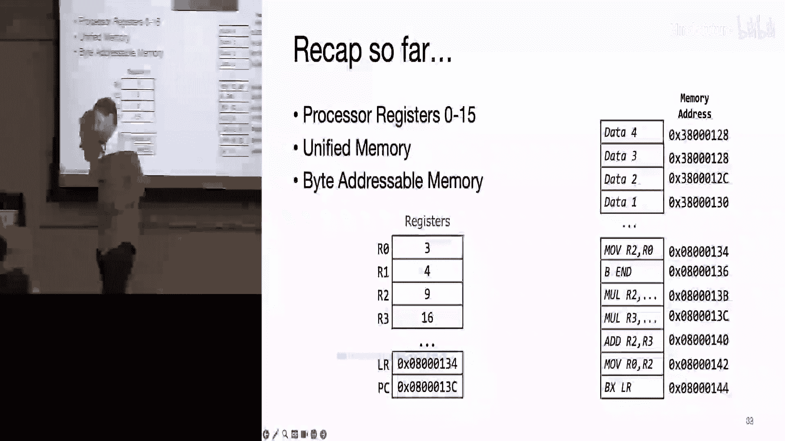

One day I'm going to have good slides。I need more people like you pointing out where my slides got off。

嗯行。He's waiting 32。W。And再也不是。Yes。ok。Where are we goingll talk about instructions。So okay。

 let's go ahead， so there's different types， arithmetic moves。

 flow control branching will give you an overview of them。

 you not your job is not to remember every instruction， good God， that would be horrible。

 will'll give you reference sheets for exams that you can look at。On the previous register slide。

 what's the difference between the low registers and the high registers。

 that's going to be a tricky question for later。I don't want to give that away yet。

It is somewhat valuable to learn how instructions are encoded。

 not because I think your ability to transfer between you know。

Whatever this code or assembly and binary is important。

 but if you do understand how it's done then you understand the ramifications of why the processor was made the way it is。

 so you will see things like if you look through the data sheet so this is a screenshot from the data sheet from the sorry you have many data sheets this is from the architecture reference manual you can see the encoding for a instruction so I'll just go through it。

 you can say here you have a move， this is a move S which means you're going to set some status registers that is denoted the SP。

S here and then what does it say it says I'm going to do an immediate 10 I'm going to move that into register r0 so you can go through and kind of figure out how that encoding works so here we have the destination register and area we have bits for an immediate so now you can go through。

And do。The task of figuring out what that binary encoding is， so here you have the operaand。

 you have some other bits， then you have the destination which is00 and then you have 10 in binary。

Now arm goes through and says， well， if this is only a 16 bit encoding。

 then I want to encode this next value？No but。Yeah。

So here I'm going to go to register one and I'm going to move in a zero。

 so I'm going to make an immediate into that value。I can store that in the same memory address。

So remember these are going by four， this is a world that you can store in bytes。

 half words and words， and so to save space， you could have made this all zeros could have been fine。

 but to save space， we're going to put two instructions in one 32 bit memory location。

How we feel about that？I'm sure I have not been clear yet。Somebody has a question。Yeah。

 what are those extra two bits between the instruction and the register these。

 it whatever those smart architects decided， they decided they want two zeros。

 I do whatever they say but don't have any choices。Yeah。

How come we only have threes you've got to speak so loud？

We only have three bits to index the register if we have 16 register so here's certain to see。

 I put the diagram up here and you're starting to see all the flaws we're going to get to them。

 we're going to get to the good questions in a second。Okay。Um， this is a three stage oh。

 so you got a program carrying to the index memory and you still have to do the fetch tocode and execute cycles。

Yeah， is a three stage pipeline？And if。You happen to get a memory location that has two instructions you're just going to stall for one while you're waiting for that next you're going to decode this one early and have it ready for the next one。

 so it's not that you only pull out 16 bits is that you pull out all 32 check to see what's going you know what types of instructions are there are and then you go and execute them in your pipeline so the question for you is。

When the core does a fetch for the next instruction。

 how does it know if it's 132 bit instruction or 216 bit instructions？

So why you take 30 seconds brainstorm， how do these architects figure this out because they're trying to save space。

 but sometimes they want the expressitivity of a 32 bit instruction and when you're pulling data out of memory。

 you just don't know what it is it's not defined， so how are they going to do this？Maybe theres some。

Like。没有这个。Yeah。We' been which like't you see。I。别じ。I London。To。where I'm like， okay。

 the gears are coming back like we're trying again everything。全开电。か。

No what do we think what is some way you could accomplish this a its one instruction or two。

 where are these bits held？It could be those those two mystery bits we had earlier。 Okay， yeah。

 or it could be。You register that buy themselvess。Well， you got enough of the answer there。

 so and you wouldn't know this unless you took this class， but they're going to allocate。

Certain uprans here are certain codes that indicate that this is a 16 bit or a 32 bit so they're just going to have dedicated bits for that task that are part of the instruction and so the 32 bits instruction comes out of memory goes into decoder is looking to see okay。

 is it one of these two three patterns if it is， it's this type of instruction if it's not it's the other type of instruction it's all they're doing。

系。Now see there's lots of ways to encode instruction， so this is in a move and immediate。

 so this is a way to generate a constant or a value and there's lots of different ways to do this so we can kind of guess which。

We'll take a guess here， so here we have this is a 16 bit instruction and this is a 32 bit encoding。

If you wanted to get the smallest， what type of encoding would you use for move SR3 pound5？Sure。

 sure， what's up？Or the three stage pipeline got a in order。I don't know。I'd have to look it up。

 it's probably in order。好。Yep， so for 16 bit instruction are those two mystery bits are they always zero Yeah they're just defining that this is this is that first five bits and I don't know why。

I don't know why they put the space there right they could or a little slash there。

 they should have just made it all five and it would have been easy for us to understand。

But where for this one， what conco could you use？Why yeah exceed bit you could use a 16 bit I mean you could do the same thing with a 32 bit it's not like it's impossible but you could use t1 encoding because I can get the binary value of this into these eight binary values and I can set the destination register as R3 right so I have enough bits for that How about R 915。

I see one person telling me it's encoding two fantastic， why？

Is it because we can't index as much with the？Yeahep。

So here I cannot get the binary value of nine into three bits。

 therefore I'm forced to go over here where I have four bits。Okay。

So that means this instruction cannot access those upper registers。How about this instruction？

Which encoding would you use for this one？Hold up your hands， let's see one， I got some twos。

I think the twos win in this side of the class is beating your pants off。

 a lot of people over here raise your hand， you are all terrified of me， all right。Okay， the hint is。

 what is this in binary？And can you fit it in here？Right。And so it's going to be encoding type。2。

Oner instruction， so even though you can get to it with three bits for the destination Reggitry。

 you can't make an immediate that large。All right， so oh yeah。

 go ahead I a question so M8 is still only like8 that's on on the 22。

they trick you so once you get Zen with the instructions and your brain gets real foggy and you kind of finally see through the mist what they're trying to show you here is that you can concatenate immediate an immediate three and they kind of show this here oh and you get immediate one here so here they're showing you the concatenation why did they choose to spread it out throughout the instruction I don't know we're living in their world so so that's here you get this is where you get enough bits to do that。

这什个问题。We'll talk about what move S is later， this is just a move operation and we're going to set some status registers yes。

Yeah 416 and binaryer is being split up between immediate A and B a three and tab and then it's telling you here。

 here's how we're going to concatenate these right because it's not。

 I mean it logically makes sense to us that this is like the most significant and then this one and that one but I don't know they can do gra things if they switch it around you can look in here and see what the concatenation structure is。

Yeah， so contaminat does go from left to right so for the 416 immediate three。

 the last bit of immediate three would carry the one for 416 and then。

The next eight bits would be so I would say where we yeah。

 zero so here's the zeros from here if we're going backwards and we're building up and then zero is that yeah。

So you just， I think the trick really is to watch this structure。

 so this here tells you the order of the contiation， if they took the eye and put it in between。

 then they would have mixed it up or so that how it's laid out here is not totally telling you what the order of the bits is。

I don't think I've ever seen it the other way， but they're telling they always add thetonation instructions。

Yeah， so as they had it。So if we did a 16 big instruction， right？

Right after that I wanted it needed to do a 32 bit instruction would IllinoisA 60 instruction did nothing or would it just convert the 160 bit to a 32 well so your compiler will always try to get you in 16 bit instructions if the encoding can be done that way。

But if from a layout point of view， you're putting instructions， if there's a gap。

 then it's just a gap， I think they put all zeros in and you're done。Yep。

 so in that hint there's 12 bits， but you only have 11 bits and is that true， well that's a bad hint。

Wait，8，9，10，11， 12 at the I bit。Yeah， know啊。は。It wouldn't be a no op。

 I think it would just be an ignore and so I believe it's all zeros we'd have to go look up at like in the architecture what's actually stored there。

So I don't actually remember exactly， I think it's all zeros。There are no ops。

 that is an instruction that's separate。Yeah， so there's a system working half where it's like now it's goes 0 to 150 to 15 versus like  zero to like you know。

 it's 31。Do you mean here the indexing the difference between like T1 and T2 is set up so you can easily。

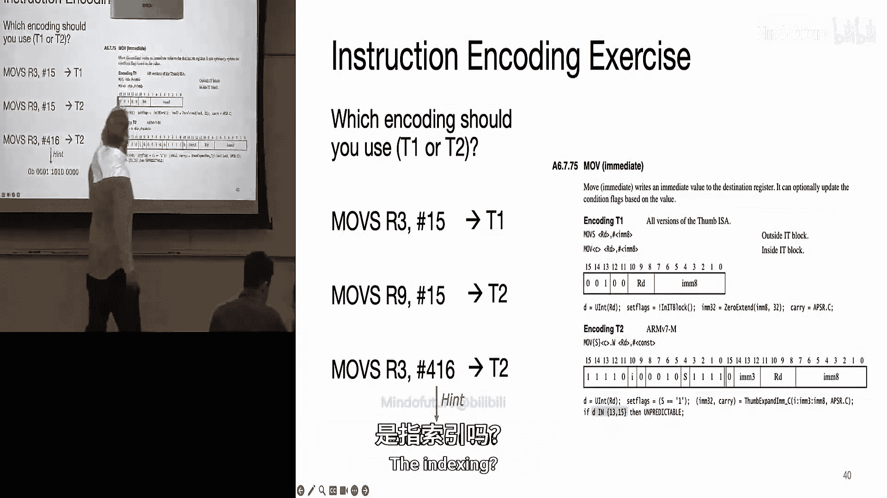

うます。16 and 32 bids based on。think how large Yeah yeah， I mean。

 so your compiler is going to look at your assembly instruction and say， okay。

 now I need to turn into binary and it will pick the most appropriate instruction size。

And then this is just showing us， this is just easy for those humans to read。

 does that answer your question？If you can fit within a smaller size， I'll take the smaller side。

And only go up what it needs yeah， yeah， to save space， that's all it's trying to do。

Any other questions？钙。So you guys kind of got to the answer pretty fast。

 but why does the ISA make a distinction between low and high registers and how does this instruction size 32 bit versus 16 bit impact how we use high and low register。

 so take 30 seconds， talk amongsts yourselves， come back with an answer。感就。want you get to use T2。I。

Okay。し。If you're doing。All right， what do we think How about over here， somebody over here， yes。Yes。

disruptionions。ep， but if you go， you have to。Yep， and so this is where the architectural choice to allow for small codeden right we live in a world where memory is expensive you know in terms of physical space cost money different than your desktop computers you have as much memories you possibly want seems they said。

 okay， I am going to make 16 bit instructions but the penalty for that is I can only really access the lower registers that's the only space I get to use with those small instructions。

But if I do want to go to these higher registergiries well I do have that option of a 32 bit instruction so you can kind of get the flexibility of both worlds now of course arm you see you know those awesome graphs that they always show like you know Apple and all these you know where you have no axes and you always beat right so they're saying they're better I've seen this graph they're like they're better than 16 and 32 in terms of performance and code size like they're likere like really I don't know how you can be better than both but they'rere。

You better than the linear combination even so okay。

Any questions here so your compiler has to be smart about this right so it will certainly optimize functions and it will certainly optimize your code to use the lower registers especially if it's repeating tasks right so it will store appear when they have to。

 but it's not optimal。So 16 will not be able to access the 13 to 15。

it typically won't be able to get eight through 15。

I mean certainly we could construct a 16 bit address。

 16 bit instruction such that you could encode enough information to get up here but then you wouldn't have enough。

 you wouldn't be expressive enough in the rest of the command right so they just basically said lower registers are first 16 bit instructions those are what you can get to yes。

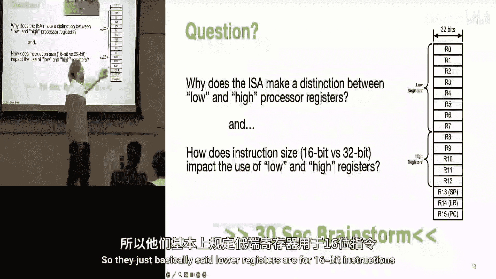

You're an instruction by any chance in the ISA where you can make the 16 bit instructions address the high registers and like set the most significant bit I bet a very clever student can look through the you know 1000 page instruction ISA and find one。

 I am just pointing out that that is not the intent and that they specifically make a differentiation that 16 are optimized for low registers in 32 bits or for high registers yeah。

So more immediate of like larger than a bit say like a lot different would it mean that the microprocess work hard。

那哈尔滨。It be pretty。So I think what you said is if you need to make an immediate。

 a large enough immediate。Then if it can't fit within it， like if we go back here。

 like I can't get in it wouldn't fit in the。So yeah， a large immediate won't fit in a T1。

Instruction prioritize using higher registers Oh no， you can it can be any register here。

 it's just it will always prioritize if your assembly instruction can fit within a T1 instruction。

 it will do it。Right。It will try to get it there I don't I mean you yes maybe your asemmbr or your compiler is smart enough to say only put this up somewhere else。

 but then you self have to manipulate it right so I don't see I don't think any reason why your compiler would choose large numbers can are prioritize for higher registers I don't think that's what's going to happen。

For T2， there's like I don't know， like 12 bits that they're like constant like one or zero they do they really have to have like the like do they have that many instructions？

They have to choose between them。Yeah。Certainly here this is the instruction and codingd。

 tells you what instruction it is， I don't know exactly what these things function as。

 I mean as users of the ISA we don't get a lot of insight into their choices that they've made。

I'm really trying to get you to think about like why we're using 16 bit。

 32 bits and how those decisions are made and it's really made on destination size and bit size。Yeah。

Because most of the time it's going to be most of the time be like regardless if it's。

If it's a number you can't even monitoring about run time。

 it would always just be a through two bed instruction。No that's a good point， probably yeah。

All right， let's go on。um。So we're going to quickly overview some instructions again。

 you're not supposed to memorize instructions， that's why you have pieces of paper， but it's good。

 you are expected to know basic instructions like an ad， a subtract， a move， a load。

 so we're going to go over some of those and then specifically we're going to get to the point where we're going to talk about how these instructions impact working with external memory for memory outside the core which is still on your device。

All right。So if you really got excited， these are kind of the instructions that I would want you to look at。

 a lot of these are just not that important， and again。

 you'll see on the handouts that we give you which ones we think could possibly be useful。Okay。

 so there's lots of common arithmetic constructions， you could look at them。

 we have a ad carries subtract， all that good stuff。

 but there's a special set of modifiers you can put on these and you can add this S at the back and that S tells the compiler or the asemmbler that you want to set the status register flags。

So SAS registers here are the outputs of your ALU right。

 so you have different like zero negative carry overflow， you have these status adss。

 and now you can tell that I want the result of this instruction to update those values so that another instruction can figure out can operate based on those values。

There's so this is part of the application program status register it says reserved here。

 in this case I happen to know what's there。Because they have this 32 bit string controls also the interrupts and a bunch of other things。

 and this is a subreister in a super registerister that's called the program status Reg I think。

 but anyways for the purpose of this slide， you're just looking at those particular bits here to say what the status of your ALU is。

And so we can go through an example here， we want to add264 bit numbers。

 and there's going to be a carry through。So just as a memory or walkthrough。

 so here we have two ways to make an immediate， this is a move immediate by it invert。

 so we're just going to take the value here and invert it。

So these are fast ways to get constants into your program。

So here we're going to set up the values of FFFF，2，1 and4 in these registers0，1，2，3 and4。

 and then when we do the add operation here where we're adding let's see those two bits。

 C and B and A， then we need to figure out if there was a carry if there's a carry。

 then well it will update those flags and then add carry， we'll check that flag。

 add these two things together and add that flag there。

 so just just a way to modify status registers， there's explicit nomenclature and assembly for doing that。

There's a bunch of bitwise operators。I'll tell you a few that are particularly useful to remember so bitwise logical or。

 so here you're going to or two things together， I want to set these bits to one。

 this one happens to already be one that's fine， this one is zero so now we're going to set it to one。

 why would you ever want to use a bitwise operation， why would this be useful？

Does ever modify a certain bit Yeah and particularly for embedded systems。

 you're like you have an output LED array， you don't know what those other people have done with it。

 some other parts of code is running and so you just want to turn on your LED and you don't want to take the time to load in the registers that control all the LEDs or it manually and put it back down so here you can just a bitwise or with whatever' is there and put it into your register。

All right， other ones that are particularly useful it' a bit clear。

 this is just good for manipulating registers， so here is this a way to go and zero out all those registers so should be a bit of a review from 370 this is a great way to control and manipulate flags for lab。

Okay。We talked about move and move inver or not， we have some other specific。

 you can move to a specific register in different ways。But let's look at。

To more valuable concepts so one of the problems here is I cannot make a 32 bit constant with just to move instruction right it's just not possible because I have a 32 bit instruction I can't put a 32 bit constant in that and so the architects have said okay well I will provide a method to help you do that so here they have move wide and move top。

And so move wide here。Says okay， this is the value this's in。

 say existing value and I want to put in one2，3，456789 or2，3。

45678 into this register first you can set these values here， you can do this， move wide。

 we'll put it in here， and it'll clear out all zeros。Up above。Okay。

Then you can do move top and move top will preserve right it's not going to go and erase these values。

 it's going to preserve the lower bits so it's the special operation that preserves these bits when you're writing that in so now with two operations you can get a 32 bit value in this register it doesn't work symmetrically its not you can't go say do move top first so move top would go and move in 876 into the top part of that register leaving there whatever was there before and here I'm just showing it was AAAA and then if you did move wide move wide will go and clear out the 876 you put in there by putting all zeros so there's an order of operations necessary to in CNC a 32 bit value in a register。

I've given you special instructions that will be helpful later yeah hows there space in the instruction there is special instructions that give you enough space for it I showed you one that was the T2 encoding there's like T3 and T4 encodings as well。

It's a good question。A hole in my presentation。Were not。Okay。

Now we'll get on to things that are specific you probably haven't seen before or specific for this particular class。

 so there's operations like load and store so load is specifically a load and storess our instructions that allowed you to talk to external memory。

 you're not going to use move， move is for only manipulating registers inside the core。

 we're talking about load and storing data in and out of memory and here you have this is the address。

 this is a register R1 holds the address of the memory you're trying to get to and they're showing you that this is that little braracky here helps me remember that that is talking about memory while this is the value of the data so here we're going to load the data thats stored in memory at our address R1 and place it into register R3。

Like I just said that， and again， there's different encodings here so that you can get to different memory sizes and different register sizes。

There are different store operations， so you have kind of standard load in stores for 32 bit。

 but you can also do half， you can do signed， you can do unsigned or unsigned and signeded。

 you can also do eight bit operation signed and unsigned okay。So an examples here。

So here you got 32 operations load sign it let's see load register sign extend half word tells you that you can go when you go and place it in the register it will or take it out of memory it'll do sign extension if that's what you've told to do so that's nice if you happen to already know there's a sign number in there and you can pull it out and it will its convenient in the sense that when it lands in your register it'll all be signed to extendend my question to you is why is store register sign extend half not useful or valid instruction why are they didn't make it symmetrical if we go back to this。

Slide， you see that we have this， but we don't even have a version here。

 why aren't they making a signed word store operation？Take some time to chat with each other。

S remind exactly。All right， what do we think， why is there no store halfway sign extension sign extended？

Lo， you got to be loud。I't have a assigned version of storing a half word because if we're storing a half word。

 we only want to touch the two bytes。Actually are storing into like there's nowhere to side extent。

We're just saying memory， right， because by definition I'm doing a half。

 I make no claimss about these other things that would have to be a hold if that's like a 32 bit instruction。

 and so it's not even a valid question。That's fine， it's a good reason， is there another reason yep？

You would like I don't know like waste data， even though you can just load and extend it anyways。

 So yeah， how much。Also， there's。Memory is not tight， it's just raw bits in this architecture。

 so it's you as the programmer and the compiler that has to keep track of is this data signed。

 the memory is not is not you know instantiating or retaining that information anyway so it doesn't really matter what you put it down as because there's no space to because you either have for there's no space to sign extension here and it's just raw bits that's how memory operates。

嗯。All right， so somebody asked this a word of caution about your IDEs。

 so depending how you view your IDE， there is going to be different representations。

 you have to remember is your memory addressing going down or up is that this is showing bitewise。

 this is showing halfwise and this is showing word wise。

 and so it kind of puts it on you to be able to interpret your data like this looks completely different than this。

 but it's exactly the thing。Okay。There's so we talked about load in stores as this way of you have an address and you register and you want to go to that location of memory and pull out data and put in another register there's other load and store manipulations that can be done so there's three of them so there's offset so say you have a base register and you know that there's peripheral things that need to be done relative to this base base register so you can put an offset so you're going to load based off an offset then you can also update your register or your address register by saying stuff like this is an immediate this means change the value in the register by this offset before you go and get in data and this is after you go get the data change the offset so we'll walk through some examples to make sure that's clear because I guarantee it wass not。

All right， so here's this normal load operation， we have the address stored in r0 okay and we're going to go out to memory here。

 so this is the address we're going to go to this memory location。

 and we're going going to grab this value and we're going to load it into R1。

Now you notice that here I've been tricky I'm being tricky to you right so here it's I'm incrementing by one which means these are all byte addressable okay if I had incremented by four。

 then it's still by addressable， but this would represent an entire word here it represents a byte and I'll try to be consistent by putting the extra zeros there if it is a word addressing scheme。

Okay， so here I'm going to go to this address， I'm going to take this value。

 I'm going to put it here， what's the value going to be here？One， two， yeah，0，0，0，0，7， eight。우。F。

 it's actually going to go through because it's a word size operation， it's going to go here。

 it's going to grab the entire Words worth of data。Okay， and put it over there。All right。

 so now we're going to look at offset addressing， so here there's an extra pound for added here and we're going to say for that address is stored in r0。

 let's add four to it， so we're going to go out on the fly you don't have to do calculations here that's not it's not going to a you operations per se that takes extra cycles。

 it's in within one cycle， you're going to go here， you're going to add four in the fly。

 which increment your index by one word。You're going to grab that value。

And then you're going to pull it back into R1。We can go for pre indexing。So here。

 the same thing as before， there's a bang at the end。

 and that just means we're going to do it right now and now。So here before we do the load operation。

 we're actually going to change the value in r0 again in one cycle， you know。

 there's not an ALU operation where you have to add this together and using instructions that is here you're going to add four to it。

 then you're going to go out。And get go to 8004， grab a Word's worth of data because we used load as a 32 bit instruction。

 and we're going to bring back that data。And finally， post indexing。

We're going to go and we're going to go to that value， so we're going to go to 8000。

 we're going to get a Words worth a day to bring it back。And then when we're done。

 we're going to go and in post， edit that register and increment it to four。

 so you can imagine that if you're iterating through loops。

 you want to keep track of where you're pointing at。

 these are useful tools for loading and storing information and keeping track of those iterations。

What questions do we have？Sero questions。Thank you to do two different things because。

The order of the way the memory being updated is different， right？No， because for post indexing。

 you grab zero through three。And then after you update it， yes。

 you have four you have four from seven yes， but it's not it's not because of memory it's I mean it's because of how the instruction wanted to do。

 it's just keeping track of like imagine you're itering through a loop when you're adding a value or going through memory or something and it's just like。

Keeping track of when do you update this variable here and so in that we have hardware to support that because it's such a common task but that changes what you yes it does。

 yes。Okay。So there's a summary。Okay， so for this load instruction。

 what is the largest possible offset that can be achieved within the immediate。

 so why you take a couples。30 seconds to chat come up with an answer。86。Yeah。あそさして。Yes。もになはラだ。

Why would you say that？关系。All right， what do we think what's the largest possible offset you can get with an immediate？

あります失礼。95Yep exactly because it's just saying here's the value that could possibly fit in these 12 bits。

 what's that going to be， 404009， whatever it is for 095 you could do so this is a load immediate which is different than a load register register can hold the full address this is just if you're trying to there's giving you some preference to this lower space right that these are the things that you can jump too easily without having to do put that value into a register first。

ち。Okay。Yeah二。Most was thinking it might be signed。Why is it not why would it not be there's different encodings what did I say what is the largest possible oh offset。

 yes， there are different encodings that can be signed。

 I did not give that to you so you could be negative as well。From a Piwell， from an immediate though。

 and not for immediate。You can do with offset offset indexing。

 you can be negative but not within the media right so you can have sorry， I misspoke。

 so this value can be negative。Oh。Right。啊。Yeah。Is that value not the media 12 that is the media 12 so I don't know how in this encoding I don't know how we're going to make it。

 I think it might have to be a different encoding that would make it negative。

 but yeah that would be plus or minus 256 or whatever or whatever it would come out to be。Okay。

 I'll look it up， I'll go figure out what the encoding is for a negative number and how they I don't think it's signed。

73。嗯。O。How much can we get through we're well behind， let's just do branching and get out of here。

 we can do that very fast。U。What do you want to know so branching is very similar to what you learned in 370 so you're going to branch to a label a label is a place and code and when you compile in the binary。

 the floor planner will go replace the label with a memory address。

 you can branch with the link register， you can branch with the indirect link register and you can branch indirectly。

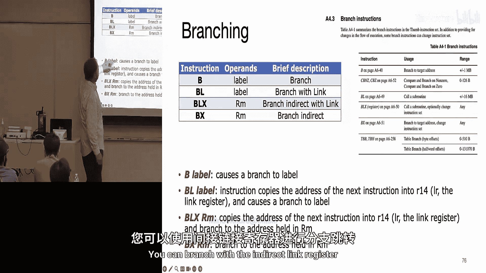

That's probably not the most exciting part。But you can go and modify all those instructions with conditionals and where do those conditionals get set。

 those conditionals get set in your ALU flags， and so previous instructions like an ad can set that flag and then you can do it a conditional so you could be like branch equal。

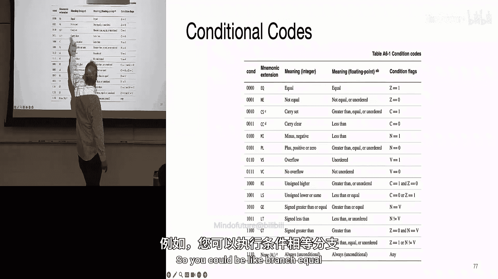

And so you would just denote that as B equals a label and if this condition is set。

 then you get to go and actually execute that branch。

 and then there's all the possible variants you could imagine off of those ALU flags。

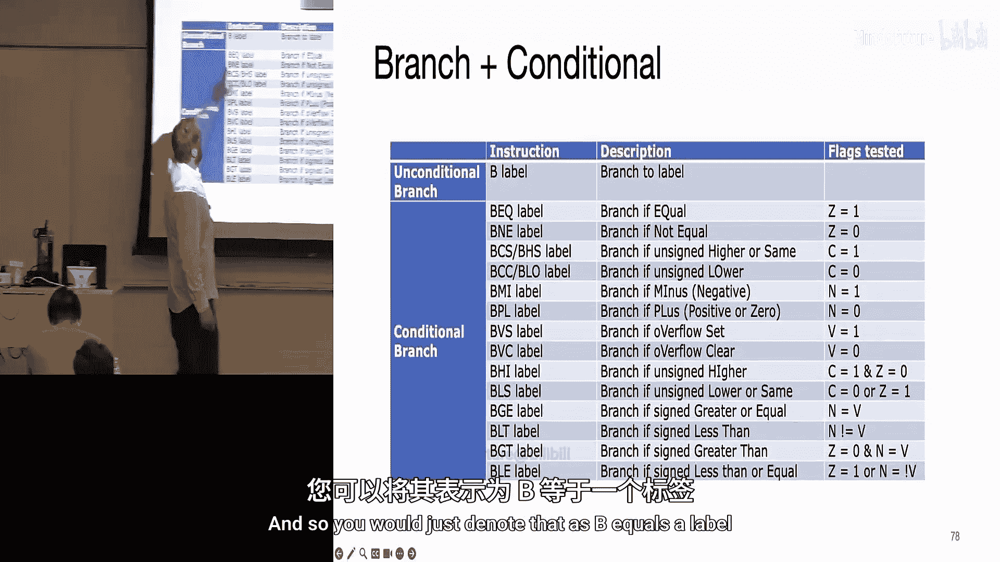

There's also， if you want to purposefully set those ALU flags where you don't have an operation。

 you can say， I want to compare there's specific instructions for that so you could compare。

 compare negative test equivalentence and then test where you get to go and test to values to figure out if your ALU flags should be set。

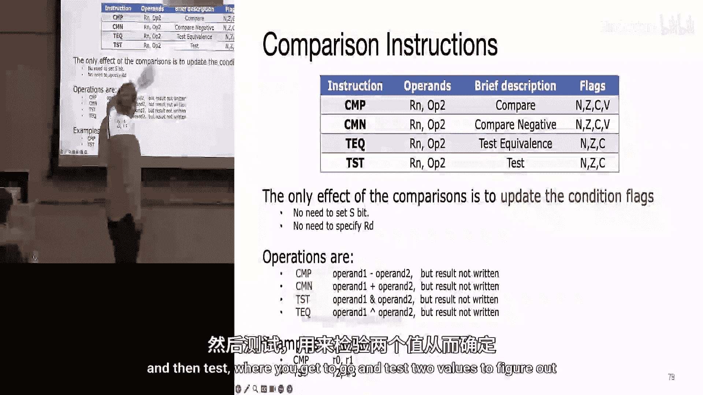

All right， and with that。Nope， we're going for it。All right。

 let's try and figure out how to add all this stuff together， last concept of the class。

Here we want to do a simple thing， we just want to iterate X， we're going to add one to it。

So here is some assembly of how it could get done， so here we're going to load some value at this address into this register。

 we're going to add one and store it back into memory。

So we're going to try and unify all this stuff together here we have registers in a core。

 we have memory okay we have。codeode space， we have data space and then we're not visualized directly is the instructions so here we have a program counter that's going to go over to some memory location here I've decoded this instruction let's assume that they're all 32 instructions for now make our lives easy。

 we've decoded it into well it is load register I would go into let's see。

We had to fetch that and decode it and everything now we're going to go and load this value at that memoryial location。

 grab that and place it here okay so we've gone and loaded the value the address is sort in r0 and place gone out to memory。

 grab that and place into R1。Then we're going to the program counter is going to increment。

 going to the next instruction that happens to be add r1 to one or add1 to r1。

And so here ALU is going to go1， and we're going to go increment that。

And then we're going to our program counter is going to increase by four， again。

 we're just assuming these are 32 bit instructions。We're going to go and get the store command。

 it's going to say take the value that is in R1 and place it in the address defined by r0。

Now we're going to go out to memory and we're going to go increment that value。Okay。

So that's how all those things link together any you got two minutes worth of questions。

Some ways got questions。Everybody wants to leave。Thank you。好。Negative encoding the T3 encoding。生。

Okay so you。It's good to have smarter students than me they just solved that right away， okay。

 well I will update and tell the rest of the class later， thank you for pointing that out all right。

Thanks。う。You bit， let's look at that。

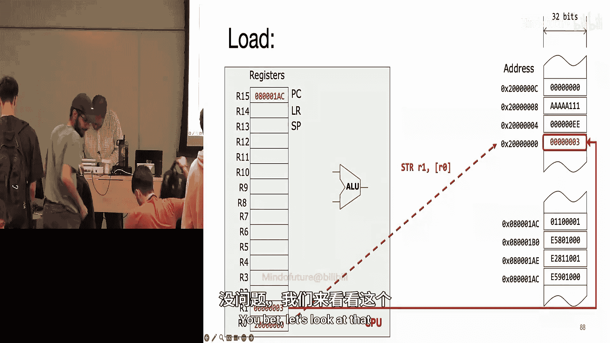

I 뭐。都没。

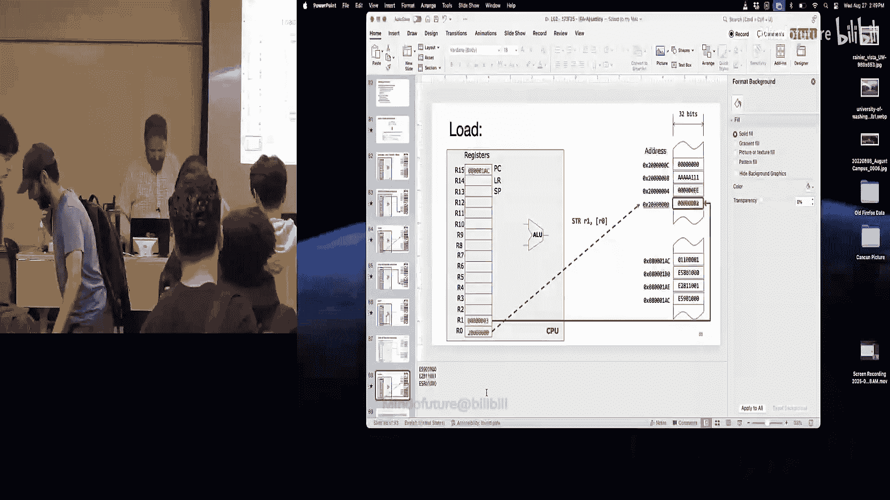

I a temperature。