# 嵌入式系统设计导论：课程2：指令集架构 (ISA) 🧠

在本节课中，我们将学习指令集架构（ISA）的核心概念，了解ARM处理器如何组织内存和寄存器，并掌握基本的汇编指令。这是理解嵌入式系统如何与硬件交互的基础。

---

## 概述

上一节我们介绍了嵌入式系统的基本架构和GPIO。本节中，我们将深入探讨指令集架构（ISA），这是软件与CPU硬件之间的“契约”。我们将学习ARM架构的内存组织、寄存器以及如何通过指令与系统交互。

---

## ARM生态系统与商业模式 💼

了解你正在学习的微控制器所处的商业环境是有帮助的。ARM公司是一家独特的半导体公司。他们不生产任何芯片，而是销售知识产权。这意味着他们出售微处理器和微控制器的架构蓝图和设计。

其他公司，如STMicroelectronics（STM）、Cypress、NXP，甚至苹果和三星，都从ARM获得授权，使用其架构来制造自己的芯片。这些制造商通过添加自己独特的外设（如特定的定时器或通信接口）来使产品在市场上与众不同。但底层核心架构是相同的，因此如果你知道如何为一种ARM芯片编程，切换到另一种会相对容易。

ARM主要提供三类处理器：
*   **应用级处理器**：用于平板电脑、手机等面向用户的产品。
*   **实时平台**：更坚固耐用，适用于工业控制等场景。
*   **微控制器系列**：成本敏感，资源有限，是我们课程的重点。

对于本课程，我们关注的是 **ARMv7-M架构** 和 **Thumb-2指令集**。在学习时，请确保你查阅的资料是针对这个特定领域的。

---

## 什么是ISA？🔧

指令集架构（ISA）是计算机的抽象模型。它定义了软件如何控制CPU，是程序员和硬件设计师之间的一份协议，确保编写的程序能够正确运行。

ISA定义了：
*   指令（如加法、跳转）
*   数据类型（如字节、字）
*   数据存储方式
*   寻址模式
*   控制流

ARM有多种指令集。Thumb是16位指令集，ARM是32位指令集。Thumb-2是一种混合指令集，包含16位和32位指令，旨在为资源有限的微控制器提供更好的代码密度（占用更少存储空间）和性能。

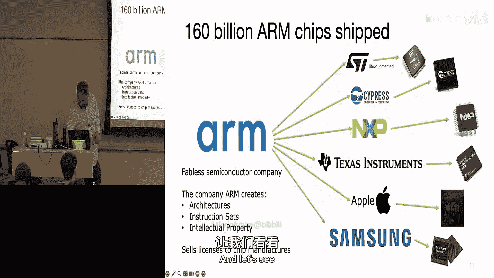

不同的微控制器架构支持不同的指令子集。例如，Cortex-M0支持最少的指令，而Cortex-M3/M4支持更多指令，包括浮点运算。

**核心概念示例：指令编码**
一条汇编指令在硬件层面被编码为二进制数。例如，一条移动指令 `MOVS R0, #10` 可能被编码为特定的比特模式，其中某些位表示操作码（MOV），某些位表示目标寄存器（R0），某些位表示立即数（10）。

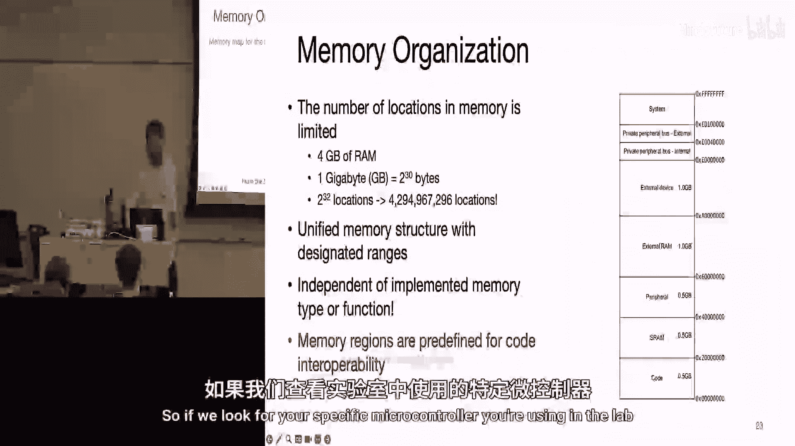

---

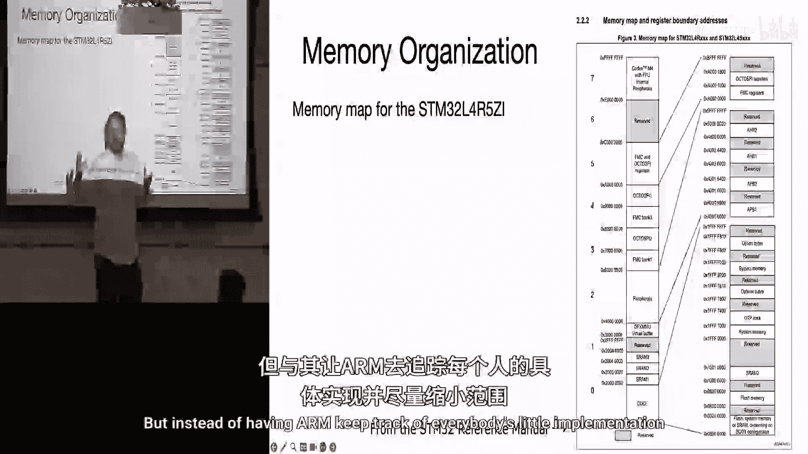

## 从16位到64位：位宽的演变 📈

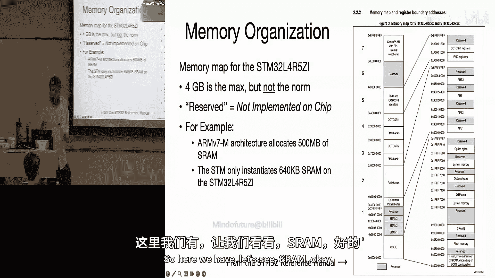

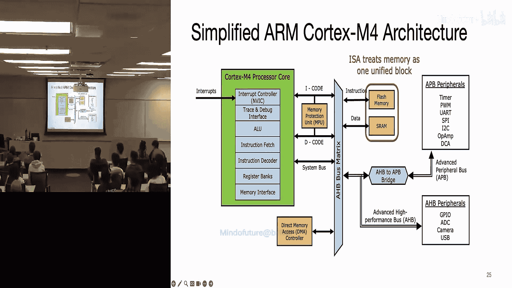

计算行业从16位发展到32位，再到64位架构，主要受两个因素驱动：
1.  **更大的地址空间**：32位地址最多只能寻址约4GB内存。随着内存需求增长，需要64位地址来访问更大的内存空间。
2.  **更高的性能**：更宽的指令和数据通路可以在一个周期内处理更多数据，提升性能。

那么，为什么ARM要为小型微控制器设计混合的16/32位（Thumb-2）架构呢？
*   **效率权衡**：32位指令功能强大，但占用存储空间多。16位指令节省空间，但功能有限。Thumb-2试图兼顾两者：常用操作用16位指令以节省代码空间，复杂操作用32位指令以保证功能。

---

## 内存组织与统一内存视图 🗺️

从ARM核心的角度看，内存是统一的。下图展示了ARM定义的逻辑内存映射，它并不代表芯片上实际存在的物理内存大小，而是一个地址空间规划。


*   **代码区**：通常从地址0x00000000开始，存放程序指令。
*   **SRAM区**：用于存放运行时数据（如变量）。
*   **外设区**：这是**内存映射I/O**的关键区域。微控制器的外设（如GPIO、定时器）被映射到特定的内存地址。读写这些地址就等于控制硬件。
*   **保留区**：这些地址可能没有对应的物理内存，访问它们可能导致错误。

制造商根据芯片成本和需求，只实例化这个地址空间中的一部分。例如，一个便宜的芯片可能只有64KB的Flash和20KB的SRAM，但它仍然遵循这个地址映射规则，只是未实现的区域是“空”的。这种约定简化了工具链（如编译器）和程序移植。

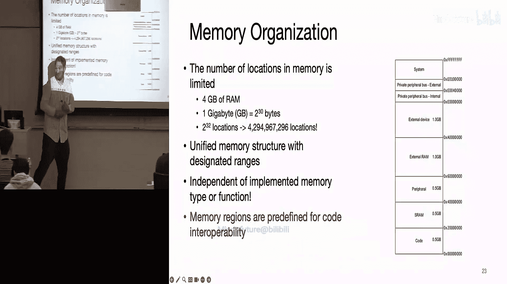

**为什么需要Flash和SRAM两种内存？**
*   **Flash**：非易失性，断电后数据不丢失。用于存储程序代码。速度较慢。
*   **SRAM**：易失性，断电数据丢失。但速度非常快。用于程序运行时处理数据。

---

## 数据存储与字节序

在32位系统中，每个内存地址对应一个字节（8位）的存储空间。但通常我们以字（32位/4字节）为单位操作数据。

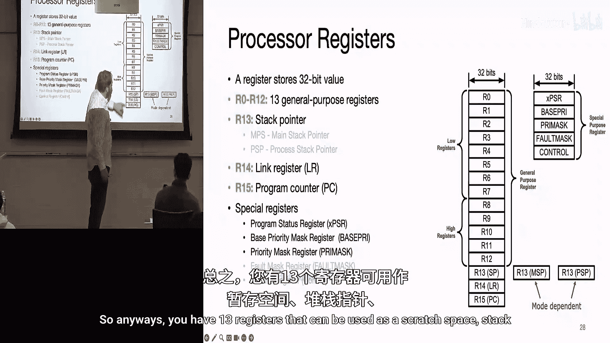


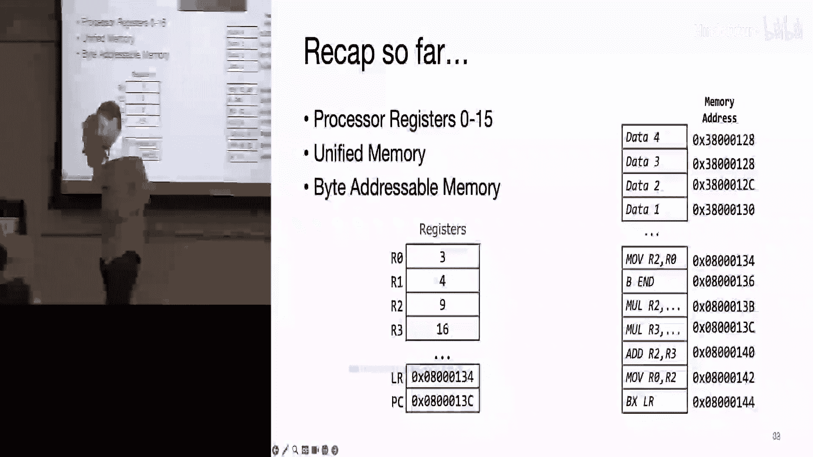

内存地址是顺序递增的。对于一个32位的字，它的4个字节存储在连续的4个地址中。这里就涉及到**字节序**：
*   **小端序**：低位字节存储在低地址。这是ARM架构默认采用的。
*   **大端序**：高位字节存储在低地址。

在查看调试器或内存数据时，需要注意显示设置是基于字节地址还是字地址，这会影响你看到的字节排列顺序。

---

## 寄存器组 🏦

寄存器是CPU内部的高速存储单元，访问速度远快于内存。ARM Cortex-M处理器拥有以下寄存器：


*   **R0-R12**：通用寄存器，用于临时存储数据和地址。
*   **R13**：栈指针（SP），指向当前栈顶。**栈是向下增长的**。
*   **R14**：链接寄存器（LR），用于存储函数调用的返回地址。
*   **R15**：程序计数器（PC），存储下一条要执行的指令地址。

此外，还有**程序状态寄存器**，包含一些标志位（如零标志Z、进位标志C），这些标志由ALU运算结果设置，并用于条件分支判断。

**低寄存器与高寄存器**：R0-R7被称为低寄存器，所有的Thumb指令都可以访问它们。R8-R12是高寄存器，只有部分Thumb-2指令可以访问。这是为了优化16位指令的编码空间。

---

## 指令格式与编码 🧩

了解指令编码有助于理解处理器的设计权衡。指令的二进制格式中包含了操作类型、源寄存器、目标寄存器和立即数等信息。


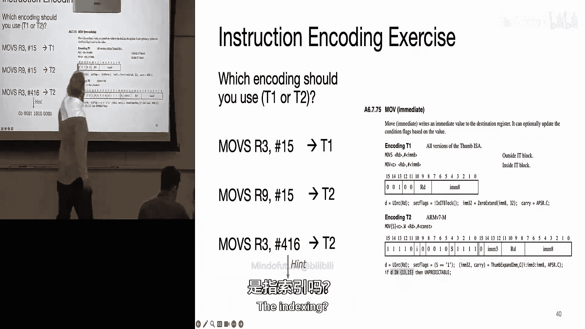

例如，一条指令的编码可能被分成多个字段。Thumb-2指令集的一个特点是，处理器如何知道从内存中取出的是一条32位指令还是两条16位指令？答案是：指令编码本身的前几位（操作码）就指明了它的长度。解码器会根据这些固定模式进行判断。

**指令选择示例**：
编译器会尝试使用最紧凑的编码。例如：
*   `MOV R3, #5` 可以使用16位编码（T1），因为目标寄存器（R3）和立即数（5）都能放入有限比特位中。
*   `MOV R9, #15` 可能需要32位编码（T2），因为寄存器编号9无法用3个比特表示（3比特只能表示0-7）。
*   `MOV R3, #1024` 也需要32位编码，因为立即数1024太大，无法放入16位指令的立即数字段。

---

## 核心指令类型概览 ⚙️

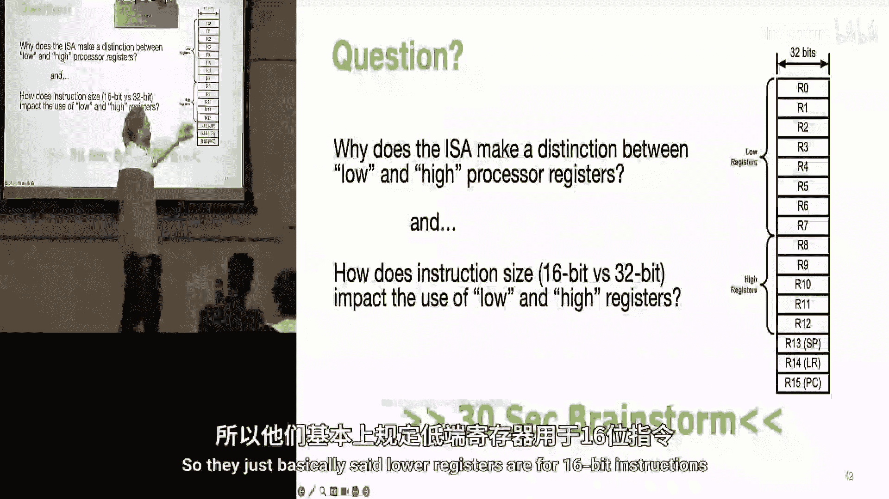

以下是本课程中需要掌握的一些基本指令类型。你不需要记忆所有指令，但应理解其作用。

### 算术与逻辑运算
*   `ADD Rd, Rn, Operand2`：加法
*   `SUB Rd, Rn, Operand2`：减法
*   `AND Rd, Rn, Operand2`：按位与
*   `ORR Rd, Rn, Operand2`：按位或（常用于设置特定位为1）
*   `BIC Rd, Rn, Operand2`：位清除（用Operand2的反码与Rn相与，常用于清除特定位为0）

许多指令可以加上 **`S`后缀**（如 `ADDS`），表示该指令的执行结果会更新**程序状态寄存器**中的标志位（如零标志、进位标志），这些标志可用于后续的条件分支。

### 数据传送指令
*   `MOV Rd, Operand2`：在寄存器间或与立即数之间移动数据。
*   `MVN Rd, Operand2`：移动操作数的反码。

**加载32位立即数**：由于一条指令空间有限，无法直接放入32位常数。ARM使用 `MOVW`（移动低16位）和 `MOVT`（移动高16位）两条指令组合来实现。顺序必须是先 `MOVW` 再 `MOVT`。

### 内存访问指令：加载与存储 🚚
这是CPU与外部内存（或内存映射外设）交互的关键。

*   **加载（从内存到寄存器）**：
    `LDR R3, [R1]` 将内存地址（存放在R1中）处的数据加载到寄存器R3。
*   **存储（从寄存器到内存）**：
    `STR R3, [R1]` 将寄存器R3的数据存储到内存地址（存放在R1中）处。

这些指令可以指定操作的数据大小：
*   `LDR/STR`：字（32位）
*   `LDRH/STRH`：半字（16位）
*   `LDRB/STRB`：字节（8位）

对于有符号数加载，可以使用 `LDRSH`（有符号半字）或 `LDRSB`（有符号字节），它们会将数据符号扩展后放入32位寄存器。**存储指令没有有符号版本**，因为存储时只是将比特位写入内存，不涉及符号解释。

### 寻址模式
加载/存储指令支持灵活的寻址方式，便于遍历数组或访问结构体成员。

以下是几种主要模式：
1.  **偏移寻址**：`LDR R1, [R0, #4]`
    *   从地址 `R0 + 4` 处加载数据到R1。**R0的值不变**。
2.  **前变址寻址**：`LDR R1, [R0, #4]!`
    *   先将R0的值加4，然后从**新的地址**加载数据到R1。**R0被更新为R0+4**。
3.  **后变址寻址**：`LDR R1, [R0], #4`
    *   先从R0指向的地址加载数据到R1，然后将R0的值加4。**R0被更新为R0+4**。


### 控制流指令：分支与跳转 🔀
*   `B label`：无条件跳转到标签 `label` 处。
*   `BL label`：带链接的分支。将下一条指令地址（返回地址）存入LR寄存器，然后跳转。用于函数调用。
*   `BX LR`：间接跳转，跳转到LR寄存器存储的地址。用于函数返回。

**条件分支**：可以根据状态寄存器的标志位进行条件跳转。
*   `BEQ label`：如果相等（Z标志为1）则跳转。
*   `BNE label`：如果不相等则跳转。
*   `BGT label`：如果大于则跳转。
*   （还有 `BGE`, `BLT`, `BLE` 等）

条件标志通常由前面带有 `S` 后缀的算术指令（如 `CMP`, `ADDS`）设置。`CMP Rn, Operand2` 指令专门用于比较两个数并设置标志位，但不保存结果。

---

## 综合示例：指令执行流程 🔄

让我们将所有概念串联起来，看一个简单的程序如何执行：`x = x + 1`。

假设变量 `x` 存储在内存地址 `0x8000`。

对应的汇编代码可能如下：
```assembly
LDR R0, =0x8000   ; 将变量x的地址加载到R0
LDR R1, [R0]      ; 从内存(0x8000)加载x的值到R1
ADD R1, R1, #1    ; R1 = R1 + 1
STR R1, [R0]      ; 将新的值存回内存地址0x8000
```

**执行过程**：
1.  **取指**：程序计数器（PC）指向 `LDR R0, =0x8000` 指令所在的内存地址，将其取出。
2.  **解码与执行**：解码器识别出这是加载指令。执行单元将立即数 `0x8000` 存入寄存器R0。PC增加，指向下一条指令。
3.  **循环**：PC指向 `LDR R1, [R0]`。核心使用R0中的地址（0x8000）访问内存总线，将该地址处的数据取回，存入R1。PC增加。
4.  **运算**：PC指向 `ADD R1, R1, #1`。ALU执行加法，结果写回R1。PC增加。
5.  **写回**：PC指向 `STR R1, [R0]`。核心将R1中的数据通过内存总线，写入R0所指向的地址（0x8000）。完成 `x = x + 1`。


这个过程展示了寄存器、ALU、内存总线如何在指令的控制下协同工作。

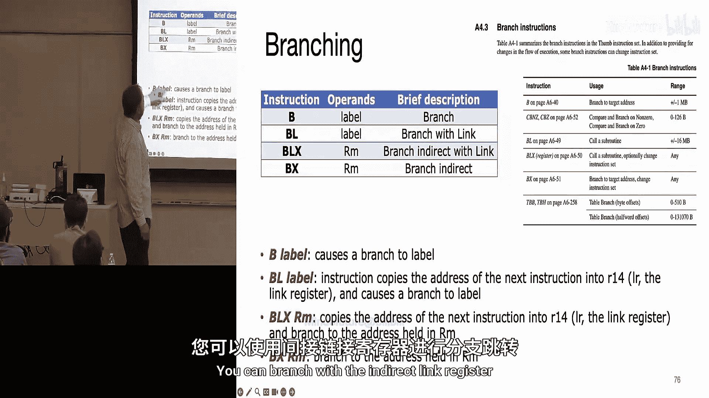

---

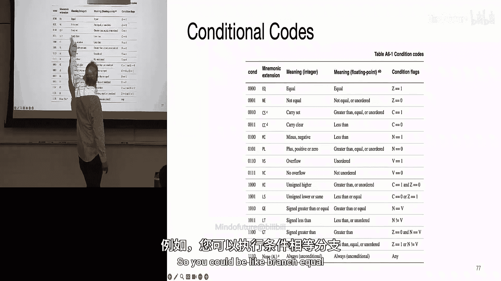

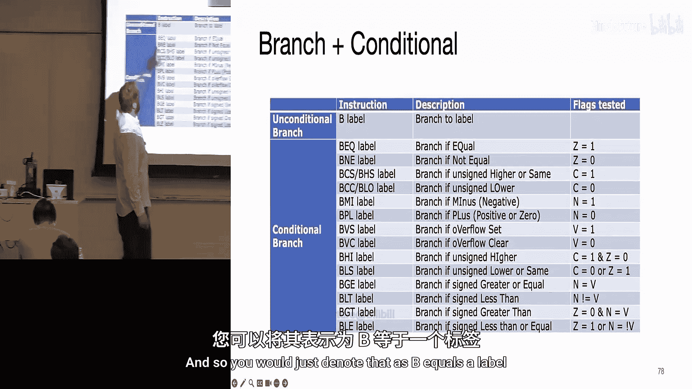

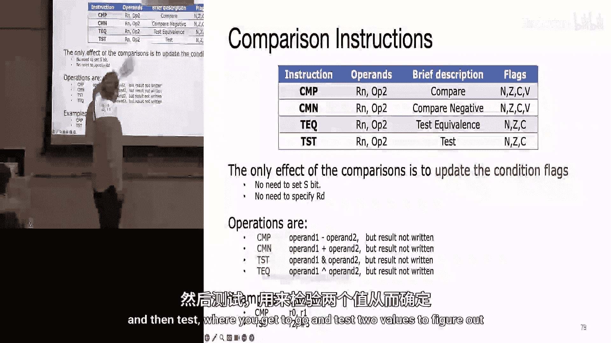

## 总结 🎯

本节课我们一起学习了嵌入式系统设计的核心基础——指令集架构（ISA）。

*   我们了解了**ARM的商业模式**及其在嵌入式领域的主导地位。
*   明确了**ISA的定义与作用**，它是软硬件之间的契约。
*   探讨了**位宽演变**背后的原因，以及Thumb-2指令集的设计权衡。
*   掌握了ARM的**统一内存视图**和**内存映射I/O**的概念，这是控制外设的基石。
*   认识了关键的**寄存器组**及其功能。
*   学习了**指令编码**的基本思想，以及如何根据操作数选择指令格式。
*   概览了**算术、数据传送、内存访问（加载/存储）和控制流**等核心指令类型，特别是加载/存储指令的多种**寻址模式**。
*   最后通过一个综合示例，理解了指令在CPU、寄存器和内存之间的**完整执行流程**。

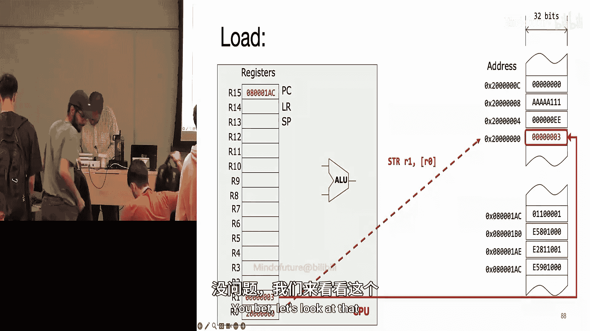

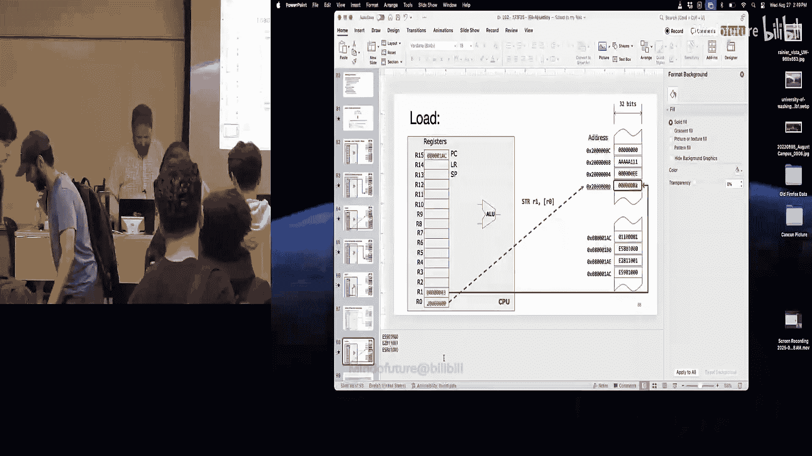

这些知识为我们后续学习如何具体编程控制微控制器、处理中断以及与复杂外设通信打下了坚实的基础。