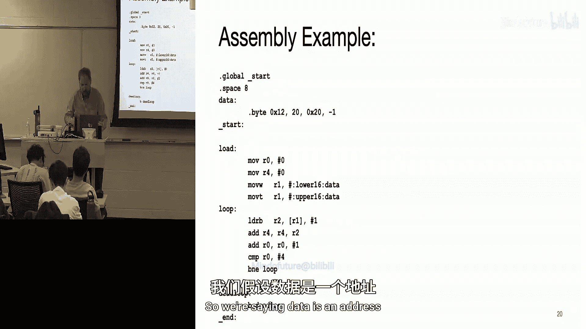
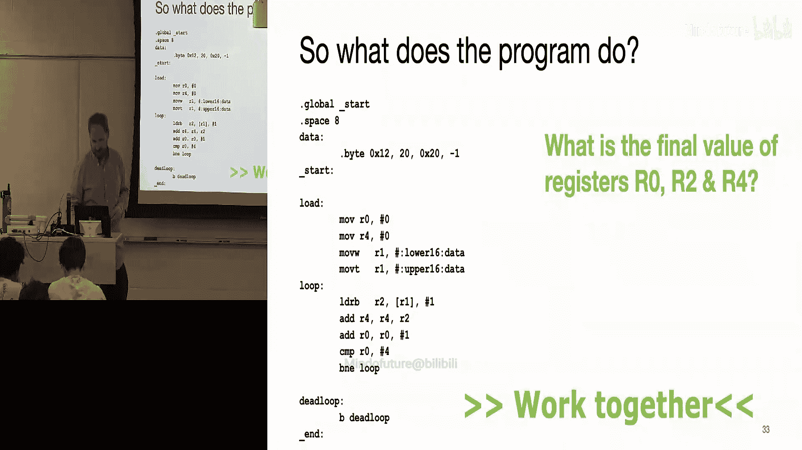
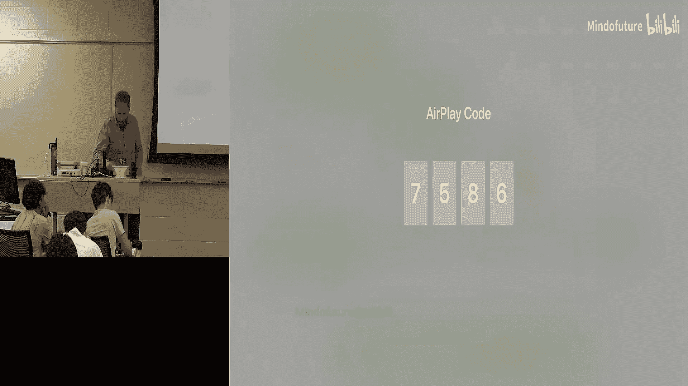
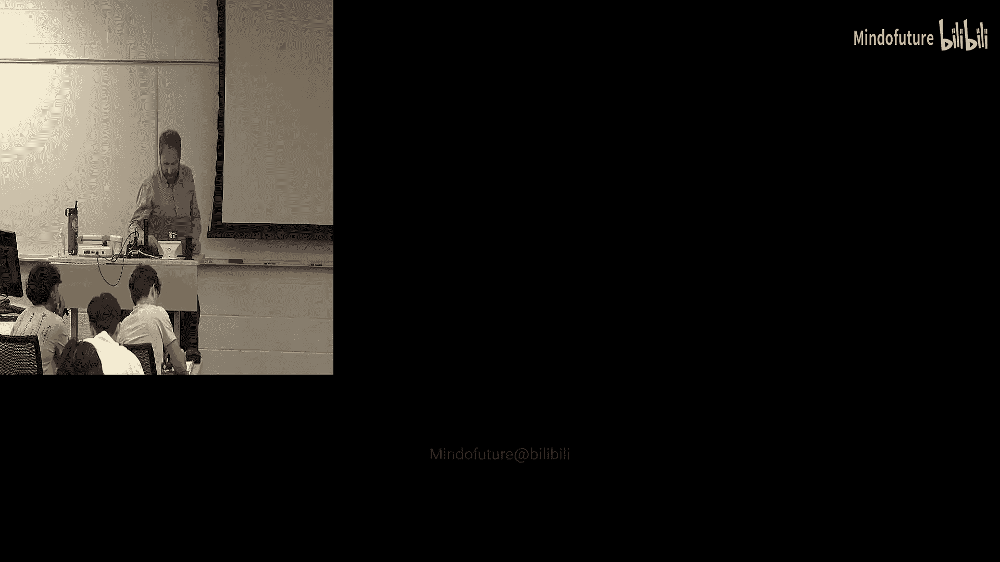
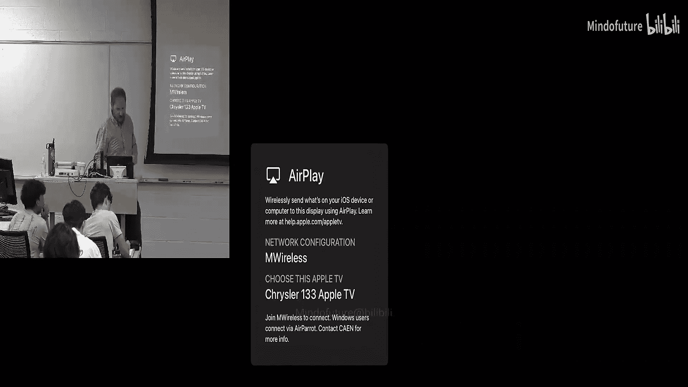
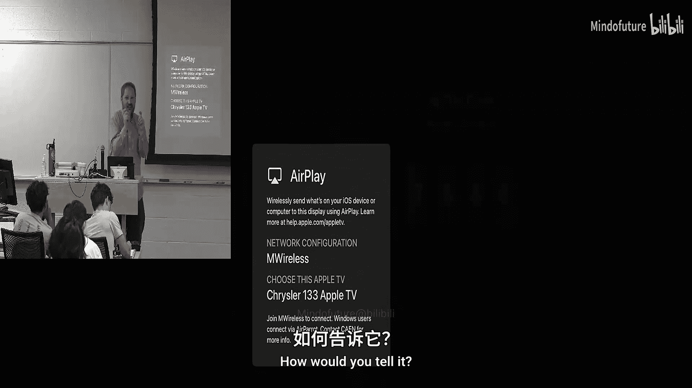
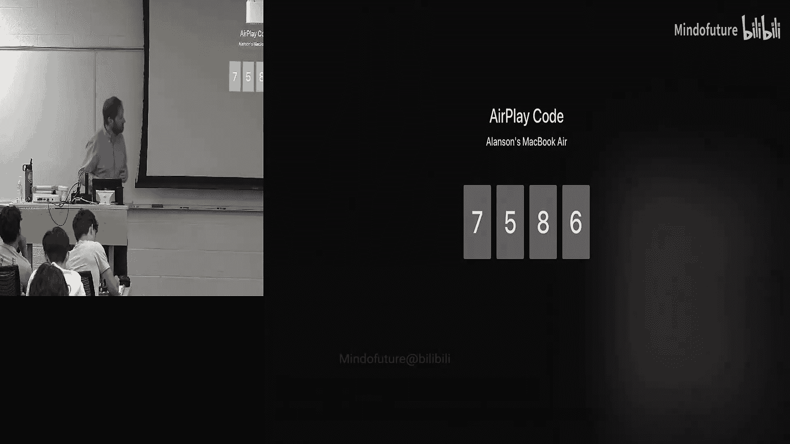
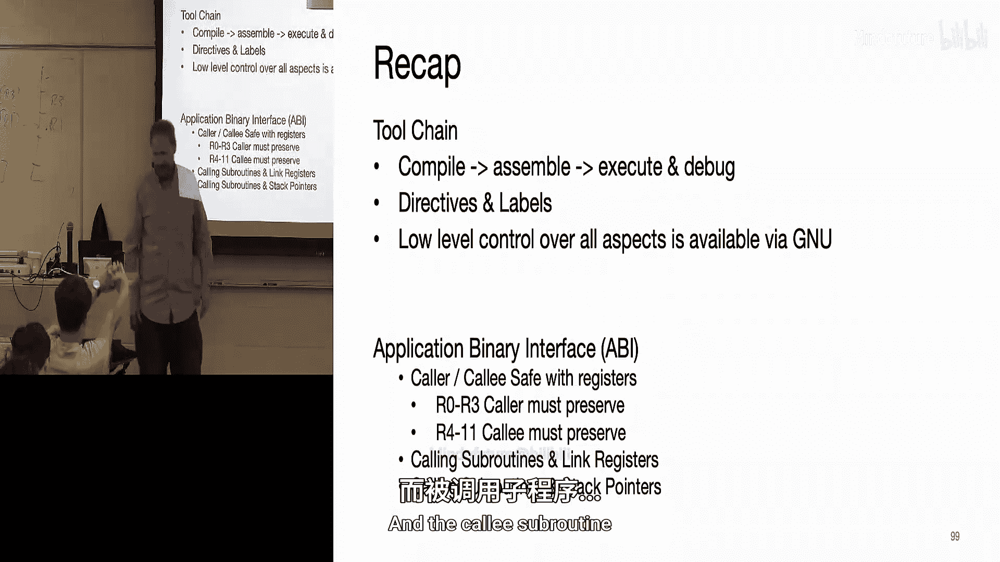

# 【密歇根大学】嵌入式系统设计导论-EECS-373-｜-Introduction-To-Embedded-System-Design-2025-p03-P04_课程3--BV1VTSNBoEem_p3-

Today we're going to talk about the and the application binary interface。

So yes homework one we do yesterday the late deadline is today。

 the goal of the late deadline is to give you guys opportunity met a little bit late without having to incur a major penalty other than that we don't accept late homework homework two has been posted it's due a week from today a week。

ますか。Whateverever day it is。And then these I want to make sure everybody has them on their at rules。

 we're still trying to figure out exact dates， but exam one is on Friday of the 19th。

Team M2 is on October 31st is Sooky day and then we have a team registration event。

 yes Wednesday because do Wednesday due on Monday。看看什。月今まで。You very good with your dates。

 I am clearly not good with my dates。Whatever grade scopepe says。所有。But we did the pre level。

Okay we're probably going to be in the BB building for exams entertainment team formation event。

 I'm still trying to get confirmation on the exact rooms， but that's the date and time。All right。

 so I want to talk about there's a lot of thesis to invented systems to get right。

second one of the challenges is we're now going to be responsible， not only for all the code。

 not only for all the hardware involved， the electronics and mixing those things together。

 you're also going to be in charge of like mechanically putting things together。

 which is horrible and painful and so some people already know what connectors are。

 but some people might be new to you so I figured I give you this extra information about embedded systems。

 so these are called headerpins。don't know why they're called headers， they just are。

Are there ways for you to connect cables or ribbon cables or little wires or boards together？

These are usually soldered onto a device， so this would be a surface mount header。

 this is a throughable header and theirre ways just connect boards together。

 so this is the header pins you have on your dev kit now。

Any job that you want to do of connecting two wires together or a board to a wire or two boards of a wire。

 somebody's already figured out how to do it and so you could try and reinvent the whole thing you're like I'll sawer wire directly might be the right solution or just think that there's probably another solution out there。

😡，And there's lots of different types there's like these ones that are shrouded so that you can't mechanically hit them with stuff you have things that are called。

Rightright angleangle listen example， rightangle maybe not but right angle points this way vertical points that way there's things called keyed and Locking story one my favorite stories is I was mentoring a PhD student atHH Suric。

 she was part of our Disney lab Disney research lab and she was a computer scientist working in vet systems and she had a reputation。

Of catching things on fire。So the Disney executive would come come through and she had a project where she had like floor panels like these put electronics in them and she had a wristband that would talk to the floor through body channel communication。

 so sending low frequency radio waves through your body。

And what she did is she accidentally put powering ground backwards and the whole thing caught on fire so the executive knew about this person right that was an amazing demo that caught on fire。

 but if she had just known hey wait there's these things called key and locking connectors that cannot be put in the wrong direction so no matter how confused you are stressed out who cannot put them in the wrong direction that would have saved her it will save you as well。

Note your types of connectors， they're valuable。Have questions。

 you can watch there's YouTube videos I found one here。

 it's pretty good just explaining the background of connectors。

 it's not important to your grade in the class， it's just useful stuff to them。你不感。

So recap from last time we talked about arm， some of his naming conventions。

 we talked about memory layout and the registers， we have the 13 general purpose registers and special registers instead status control registers。

 we go through more of these later on and of course and then we talked about different types of instructions a lot of this is just essentially an expansion of 370 instead of using L2CK we're actually using a real language。

 you don't have to know every single instruction that's not the goal wouldn't even be possible。

 but you should at least know how to read the data sheets that we give you like theM data sheet a reference sheet we'll tell you like okay here's an ad that has these capabilities。

And then we didn't actually get to the memory manipulation example。

 I'll put it online later for you guys to look at， or maybe we'll do it as part of our review for an exam。

All right， so today， any questions before we move on today's stuff？Yeah。Homework， if you didn't like。

一。Where it says like each question boxes might be different。

 is that something that we should be working about？

We'll make it so the students have to fill it in usually students and' like that。

 but we' I got enough complaints about it， will'll just change it to you guys and circle your answers for the next one for this one。

 if you didn't get it， answer didn't line up。And that's fine。

 we'll figure it out and if the graders grade you off because you couldn't find your answer just to a regrade submit or come talk to us。

 we're not going to penalize you because the tools in't work。That's not that for。

SoToday we're going to talk about the assembly programs and the tool chains so last time it's about instructions now we're going to talk about putting them all together and then we're going to talk about the application binary interface which is an agreement basically between the harder folks and the programmers about how or at least the ISA and the programmers about how they're going to use the instructions so there's no errors and issues。

Qu functions，So the I love you guys are familiar with C right C is a human readable high levell language then you guys are just learning about or I guess you learned about 370 but here we're focusing on assembly right so this is as close the machine code representation as possible but the assembler does have an important job and is the turn these things these op codes into machine language and that's the binary。

Binaries that you will burn or put onto your device that will actually get wrong and dont we don't talk much about the asmbler。

 but we're going to talk about it today in some of its roles in figuring out where to put those binary values so that you program pretty。

You guys have this wizzyWig you know IDE so QBIDE obvisscates a lot of these details from you。

 it's good because these systems have gotten so complex over the years that you kind of need a nice IDE to keep track of all the things like what are this register what does it mean to kind of make it programmable。

 but they also obscate a lot of the details from you？For those who get really excited。

 QB ID is built on and a lot of our development tools are all built on goodNew tools。

So an example our Gnu has a whole system of arm embedded tools and they give you these basic functionalities that allow you to do things like debug things allows you to have these binary assets allows you to have a see compiler and so the entire industry is built on top of these tools if you ever had something wrong with your tool chain or needed to have explicit control these are the tool frames that you would use ID Q IDE is just convenient but under the hood is all this I had a project where we wanted to make a debugger for microcontroller but the microcontroller was working on harpsed energy。

And so the problem is the bugs you get from harvestveed energy are going to be different before you plug it in so we now we had the device we couldn't debug at all。

 so we went and rewrote grab here so the good new debugger and rewrote it so that it had an extension for energy harvesting and we had a little piece of extra hardware which would inject power or take away power or control the power levels as part of the de debugging process so as you step through your code you were aware of the project state so Bob I'm really telling you is there are real powerful tools underneath QIE that gives you full control over everything。

All right。So if you're trying to make some executable binaries right。

 you can have some assembly files， those get assembled into object files， you have C。

 you have some library objects， you have a， usually call this a make file。

 but it's kind of your memory layout， your link here which tells you floor plane of where you should put memory。

 then you have your GCC compiler which does many things， not just compiler your code。

 but then we'll turn it into an executable image and you have two versions of that you have your binary。

Which actually has your。Machine code in it， and then you have your disassembled list code and this is what your debugger uses to help you walk through。

Your code and your binary file。So I want to walk through kind of a basic assembly program so that you have the background to understand what is going on underneath the hood。

So here we have directives， so directives tell the asssembler what to do。

 the assmbler is essentially， it's not it's a very simple program that does。

 tries to do exactly what this does except it gives you a few little extra hooks so one way you tell the assembler what to do is you have these directives。

We'll go through each one of them in a minute。You have labels。

So these labels will turn into memory addresses later on so later on when you branch to loop here。

 this will be replaced by a value and when you assemble the asemmbler is going to take these instructions and place them in a location of memory and then your label will resolved so that when you say branch to loop not loop doesn't exist in the machine code。

 loop is a memory address and this loop will be replaced with a memory address once it's been assembled into a binary file。

And then you actually have your code lot of those instructions we talked about。Yes。这听到完。

We already compiled code and we were running like we were writing a assembly to compile with it that right？

So we justt thoughtful that of like sometimes we like put a label that was already like within like the other code it would like。

or because we inf two different labels that yeah， you can have a label collision and it depends on your assembler so if we go back here your GCC compiler such assembler should be able to resolve labels from different。

Objects。But it's not， you know， it depends on what settings you have。

 it's not guaranteed to always work。But you don't know what other people are writing。Question， okay。

 so let's go back， so this is a global statement that says， okay。

 we're going to globally expose start。We're also going to get some directives and so we have space invite bite。

Go for space just says fill up these bytes with zeros， it basically allows。

 I mean we can argue if it was required for this code is required for the example。

 but it's a way just to fill a region of memory with zeros and then byte is a method for putting in bytes into thick locations and memory。

So these are not assembly opcodes， these are not things that your machine language or your ISA knows or your hardware knows。

 they' are things only the assembbller really knows and it's just saying， hey， I want to put these。

 I'm going to put some eight bytes of zeros in and I want to put some bytes at。

These bites at a given location。And that location is going to be data。

Then we have moveve wide and move top， talked a little bit about these before。

 so the most basic one is move register， that's not what we showed here。

 but it allows you to move from one register to another register。

So all your instructions typically are broken into register version and an immediate version。

What we showed you there was an immediate because what we want to do。

 if we want to put zero into r zero and zero into R4。All right。

 so there's kind of three ways you can make immediate value into a register， so the simplest one。T1。

 this just allows you quite8 bit binary value into a register right so it's like the smallest。

 the simplest， easy to go， you get some out of code， you got a destination。

 you got an immediate value。T2， I'm going to just explain it's not that important in the sense。

 but it's a way to make constants that are larger value than this in fact。

 they allow you to ship and carry things around and just as an example again this is not like foundational material but just good to know how it's done here you can take those values there those eight values and you can designate where they go so you can say they're here。

 they're here， you can make repeating value so this is a way to somewhat easily make large numbers so if you wanted to make like 32 bit value with F in the beginning。

 there is a way to do that in one instruction without having to manipulate it。

But that's not just more of a curiosity than importance， I guess。Then finally。

 there's this thing called moveve Y， so T3， and now you can go make an immediate 16 and you can put it into some destination register。

Okay so it takes 32 bit instruction to house all the 16 bits。

 you couldn't have a 16 bit instruction does that， so it creates an immediate and it gives the upper bits of that register who you have register in your core。

 it's got to put 16 bits in the lower part not in the upper part it's going to make that all secure。

There should be one small differentiation here， there's two different versions and not versions。

 but there's two different ways using W here you have move and inent dot W that would mean that you're telling the assembbller。

 I want you to use a 32 bit version even though it could be a 16 bit version。

 that's different than this op code here which is move W without a dot and that's an entirely different encoding and they're doing that just to remind you hey that's move wide。

I don't know exactly， ma'am。That's why they're doing it， just to remind you that it's a move wide。

Okay。And then the other thing that's important here is move top， this is the kind of the。

The yang to the yang of move wide， so move top puts the upper 16 or 16 bit value and you put the instruction into the top of that register and leaves the lower 16 bit values the same。

Cared upstruct。Oh， finally， we have some other directives here。

So these are a way for you to get the address of data。

So here you're going to take six upper lower 16 is going to take the value of data and just give you the lower 16 and then upper 16 is going to give you the value of data and put it there and that allows you to do things like。

Get the values of the address here of F well let's see the value of fo and get the upper 16 and put it directly in here。

 now these is not necessarily an arm instruction this is for the assemblymbler to do at assembly time。

Now the important thing to think about in our particular example here is that data is not this value。

 data is a label， stages is a space in the memory that's going to get resolved back to a number when the thing is compiled。

And we have any sorry， any questions？Al very fast yeah why do you have to separate the move W and move T iss there like one instruction that allows you to fill all 32 bits in the register because how could you get because you need to 32 bit instruction and I can't get 32 bit arbitrary values in there So now we're going to have to do it in two instructions。

Yeah， so you said the move。w is forcing him to do a 32， but construction not6。This is the dock。Here。

 so you can put a dot usually behind almost any instruction and it will choose。

 it'll force the compiler to choose a 32 bit version of that instruction。

 even though it could fit into a 16。Okay。Given this， those engineers just wanted the optionsre。

给不 you。is it let's it hear the move W that is 60？Is that one。This is moved up。

 the T3 encoding there's no dot here so I'm just drawing to your attention， if you look at this。

 you say， wait， how is move with the dot dot different than the move without the dot？

They're different functions， they're different instructions。

So for the byte instruction you had it has like negative one at the end。

 so like what kind of number is it you are let's go a little bit further。

Can you go back to the assemblyly code？Is there a reason you have an underscored before to start。

 does that mean anything？That is telling the assemblymb that this is the start of code execution Yeah like yeah you need it。

All right， one more question， yeah， are we just resting。All right。Ear time。

 the space would have fell in like it survived aspect。

I your alignment off about the space or so there's no explicit reason why we need it other than just for the example。

 but sometimes an assmbr or a programmer would need just to create a space of8 zeros or N zeros。

If N would be first online you could do that or you could essentially prelocate space， right？

A lot of different reasons why you could want that。We talked about。嗯。We have a low registered right。

And so remember there's a difference here between load register byte and unsigned。

 so load byte basically just takes out not a 32 bit word， there's a 32 bit address。

 but it takes out just the byte at that address if you used just。Lo LDR。

 it would take out that whole 32 bits， there's also half as well。

And signed is the signed version of that。And then there's a comparison of branch。

 so comparison here just comparisons to values and sets those ALU flags in a program status register that says that can be read by something else。

 what's it going to be read by here we have branch and then we can put the suffix on branch I think you not equal before so then you're going to check for this。

 is it equal or not。So then that will be your decision branching point。All right。

 any questions so far？Yeah， I'm know you can come。操作这些。Yeah。

 so I know that it sort of like fills the values， I guess is that the right way to look at it？

So where is that， where is the 0 x， 12， 20， 0x20 and8 one， like where is that going into？

Well this will go into memory？And that memory will get defined at compile time。

 that actual memory address now we're going to use in this example。

 let's assume the most simple linker or the most simple statement where it happens after eight。All。

 then so first there's eight spaces， then there's datas placed and then these instructions are placed does it just go into memory the order of zeroerx 12 20 xerX does it follow that order or is that okay？

All right， so we'll do a little worksheet， you can pass them down。

What's in your neighbors to get credit？If you write your name on the top。

 do some work with minimum names， just bring your name would you realize one check。

Do you guys can work together。We're not really awkward。哇。Yes the table doing a training session。

guess it's like four or seven then something I one myself。I don't know if the right way though。

 because you see this is in'。like we're moving into the lower part。becomes。

what is the highest R would。I it order which these bites would go into。

I know even if it is it's just as a number because a short salt grass。then，2，This go。

whatever this address is he go to the address after that。32 bits。s just two of mine。you can do this。

 but I think would this be this address。 And then you add load in the And I think there's like basically。

I think that's what mixing with normal indexing without de one S inside inside number。找个好险。

It's not necessarily the art。那死。' all。 I wroteUn it's like all those zero。

 this is supposed so after you loaded， then you have the index star two。

zero and zero should that fight。Here we're training it so we're like going to where R1 is 22 and we're dropping' there。

I my mind。just。So now over to。I ask is。essentiallyWe're putting to this address of data。

Whatever this address is in front of data in。Yeah。Plus't're。I it's。ちとこれ。Luke is not this ob。

 so our in this right here， our one is lights。if you assume that these fronts are 0 R is it's just an address it's not really relevant then R2 R but I don't think that matter that's you say then you could R and then4 or20 as0。

And then if you add that into our force， our force is initially zero。

And you add 12 so we're saying data is an address add text and then you add text data right here contrast and you subtract data。

在79号。 they are protected by little Indian at the moment。Then smell。's。in the bottom then if you。

咱心美完 me。It has like。Any else get that？第方？T。It brave people， okay？

Go through and see how this all works。26。Why is there kind of out of order。

 but why is that loop a good idea here， why would you even put this year？

Yeah sort of executing whatever happens to be after that yeah so I'll see you guys later when you look at the example。

 but there is extra information here and now if it just went past this。

 it kept on going starts executing data right and now bad things are going to happen to your processor。

O。So let's walk through this， what does this program do， actually I will switch over to this。

All right， so here we have， you guys can't see that cool。

It doesn't make sense， but I guess it should start。All right。

 so here is a very simple compiler or assemblyr， so here we have our assembly code and here I have memory so there's nothing been allocated in memory we're going to start to address zero。

And then we're going to assemble this， let's see what happens。 all right。So。

Here we've allocated the first eight bytes as zeros， how do we know that？

I'll go back to the other view， little simple areas。So here we have space8。

 so now we've said here is space8， were put in eight zeros okay。Then we said， okay， bitete。

 we're going to use the byte directive。La down in memory。12。12 hes， 20 deck。

 20 hex and negative one decimal， so here are those values laid out in memory one right after each other。

 12， 20 decimal， 20F negative one okay。Any question so far？

Does everything tos compliment because of that negative one？Your sellerler did a good job for you。

Now we have data now data gave everybody a bunch， not everybody， but some people a bunch of trouble。

 so here we have data data is a label。It is a label just like loop loop here is not the instruction LDRB loop is a point as a memory address。

 it's a location， where is it happens to be here yeah， just a little bit I zoom in。Yeah。不し。看子。Yeah。

Now。Well， these actual binary values or hexta values are not going to be the exact encoding for RMV7M。

 is this compiler is RMV7A， it works functionally same something encoding is different。

 but it doesn't have all the horrible bells and whistles that cubeB ID has and my particular workstation won't work with a new right。

So who are using this？Okay， and then we're going to go into our instructions and then we're going to do what we're going to move zero into R1 or R0。

 we're going to move zero into R4 and then we're going to grab。The lower 16 of data that is not。Here。

 it is the address of data。Okay， now we haven't， when you guys were looking at your assembly。

 you didn't know where that was yet。Because you haven't seen no assembly process during assembly。

 the labels get resolved to the memory addresses。But you could just guess in it with a simple you didn't have to actually even know it for your program。

 but here we can just guess that it is going to be eight so let's see if that is true we go to our disassembled code so this is what you are。

Emily file is going to generate for you， so here we have I can't see it。就是。I would see data。

You have moved move and data here has been resolved to this value has been resolved to eight right so your assembler knew that it put down data at memory location8 and therefore it knows that the lower 16 of that happens to be eight and it knows the upper 16 is zero now you could have had data placed anywhere in memory I could have had we could have used other directives to place it way down somewhere else。

And then it would be replaced with appropriate values。

So way you have the address of where this information is here is going to be placed in R1。

 so by this function you're going to have R1 is going to contain the address 8。

 which is pointing at that memory location。How we feel so sorry？Any questions。这个意思。

You got to be real loud， though。 Can you go over how you came up with 8 or the lower 16 and0 for the upper 16。

 Okay， so at a compile time， the compiler said， well， I'm， I can't put a variable data into memory。

 I have to have machine code right， It has to be like binary values。 And so it said， is I。

 the assemr said， okay， I'm going to place data。rry， I'm going to place byte here。

 data is an address to this， I'm going to place this at memory location8。Now， again。

 the could have been anywhere it says you have a complicated system。

 you may have a dedicated memory location， but because we have a very simple program。

I just put eight blank spaces here right that got filled up first and then data was put down or point was used to put down 12。

 14 20 FF。哎。好。Yeah。我就什。I don't know about QB ID， you can look through the assembly。

 but yes and good New， yes。In this case， starting at8， so're saying the top。The data is at zero。

You're saying， you're saying how did lower data get resolved to eight？I get paid。

 I'm talking more of like an upper so I assessing an address zero， that's for the upper。

 No that's good。Is it the lower？If you have a 32 bit address， we took the lower bar of it， 0 or 08。

 halt it here， and then it took the upper of this。喂。And that happens to be zero。

But if it was some art you know we go way， way down whereas it's FFF， something， something。

 something， this code would still work so just putting the address it doesn't have anything to do with the actual thought。

Yeah because move cannot move a 32 bit value move can only do a 16 bit value and move y can only or move y can only do it 16 bit value and move top can only do the top 16 bit values。

 so I can move a 32 bit into that address， right？Memediately。Let sit up on the right slide。It can。し。

对呀。Every time I happens to figure it out when I look at this tool yes， I think increase。

 increase increase。It is。Things are going on that way right so memory address is increasing this way valley are increasing that way。

Last question， yeah。Why couldn't we just do move for one data？

Move R1 data like data is a 32 bit value， correct？And blew a 32 bit value。With a 32 bit instruction。

了解。Let's walk through this code a little bit， let's just see what happens， so step into this。

All right。So we're going to step in， we put you can't see what r zero is one， r0 is zero r。

We're can be turn to zero now we're going to move into R18 and then the top。

Now we're going to go whatever are were going to do。

 we're going to go to the memory address defined by R0。

R1 are here and we're going to take that value， a byte of it and put it into R2。

 and then we're going to increment by one。St over where we got， we see that now we have 12。

 12 came from here and we've incremented by one so this is post indexing now we're going to add our two to our four。

 our four is zero so we're just going to move 12 over there we go， then we're going to compare。

You know， is R0 equal afford 4 no， so then if that's not true， we're going to branch back to loop。

And we're going to keep going through now we're going to go to the next location right。

Well location is going to be address nine。And I'm going to take that value and put it into R2。

And then we're going to add one afterwards and we're going to keep going keep doing that path over and over again until we get to dead loop we can't get out of this。

And the value of our 12 or our0 is four， our two is FF and our four is 45。

What questions do you all have？load and not their XFF？

Because to the definition in your a sheet of the slide notes did not operate only on the first thing before the comma so B was here then said。

 well do you happen to have something next Ill look after the comma put down 20。

 then it did this it was not B does not operate on words。One last question。Oh， I guess。

just because how this thing mapped out from starts it here and draws it this way。

 it doesn't draw it the other way， but the real reason is it starts with and then it goes to the next fight and places the next bite down。

a that is the most smallest watching like a bike I out like a word like a word it's the other way。

 right。 I don't have all the other little words in here，So you got to keep track of look at your ID。

 figure it out。We're going after after the lectureW we going to be doing this an hour able to work through that project trip that。

it's also important to think about could we just give you you know like some random instruction on an exam and say okay figure out what pound upper is do you know what that means you're going to have no idea so think these things got to look through the data sheet that we gave you so in this case we gave you the the。

Plies beforehand for you to review just so you can walk through it。

 we probably wouldn't give you something that quite that devious in an exam。All right。

 but now we're going to move on to the application binary interface。

 we're going to talk about how to write color， call you save functions， how to call subroutines。

Register and how to use this tax？All right， so the binary application binary interface is a contractor between programmers who share harder resources。

 limits which registers can be used and how they have to be shared nicely。

 and allows you another programmer and you to write programs without cloering each other and making everything work。

We'll skip this question。So basic rules of the application binary interfaces a subre must preserve the context。

 the contents of R4 through R 11 plus to that point。

So a subbert team cannot just manipulate anything that any of the registers it wants。

 it only has certain registers that's allowed to manipulate。Or when it returns。

 it can't mess any of those registers off。Comp unitss are past two functions through R0 and through R3。

If you need more memory， need more information， typically you going put that in memory and then pass a pointer to your function and not necessarily。

 you can't cram more than those3 two big values。If you're going to return a value function typically it starts at R0。

 you're not going to put a function randomly at r1， however。

 if you have more variables or more information that send back， then you can start going up to R3。

 you don't just assume that you start with R0 first in your return error。嗯。

You to get around these rules you can put things on the stack right so say you just need more scratch space。

 you need place to work more than just those four registergries well then you're going to have to put some values up on the stack but you're going to have to return them afterwards so the stack is your kind of extra working space that you can use。

Let's see if we look up the layout of the registers。

We have so these are these have to be reserved by the or sorry the function manipulate these as much as they want。

 there's no expectation those values are going to be returned。

These values are going to be held by the caller， the thing that calls the function。

And that assumes that all these values are going to say the same。

 you can't necessarily the function can't rewrite these values or can't return from this function of these values you've written there's two other sets of registers this depends off you're using thread mode or basic mode doesn't really come up in most of what we do is used by your compiler in Q IDE and then there's inter procedurecure call space this really comes up when we're talking about interrupt which we'll talk about later in the course they have the stack pointer the link register in the program counter。

Any questions？Whats the pointer strategy is that registering name？这3是。You got to say。

 is it register enabled， renaming register renaming that？Or if we run out of。

The stack pointers I'll go over this， we'll have an example on that。

 but it basically points to a location in the stack as where the current data hits。

R1 cross these for results that for your function returns to variable Yeah。

 so if you have two variables or you have 128 bit value， you just put it across those four。

 you can always start with R0 and then build your way up。That's kind of what this says。

 your inputs can be， easy it can be， you know， you get to use R zero through R three。

 however you want， you can make it up and do 64 bits 128 bits， likewise you can return 128。

 but this is just telling you the strategy of data size that keep around。

When you're calling a subroutine typically you're going to branch。

 so this is branched with a link register to a label right the label is not the value。

 it's not the instruction itself， it's the address of the instruction and so here you're going to branch to some value。

And then it's going to update the link register。So that you know your way back。

 and then when you leave， you're going to VX branch to register， what register the link register。

 and is' basically going to make PC equal to link register or link register equal to PC。

And then you're just going to go back to that location in code， so we'll walk through an example。

Yeah。Thiss an article a Sc for me again。So this is the inter procedurecedure recall call crack credit。

 not a big focus of what you guys have to worry about at least right now。

This is used more when we have interrupts so that's you have asynchronous interrupts occurring and you need to pass data back and forth so you can think about how our nine and our club are really going to be used。

 those are going to be used by your compile in doingsembling your whole program together so you don't have to really worry about it now I would just you can't change these things when you're making a function that's the thing that they complain pay。

All right， so let's say we're going to do a little exercise here where we're going to do the summer squares。

 so here we have a program。We're going to move some things around and then we're going to call a program or sorry we're going to make some variables three is going to go to R1 and4 is going to go into R1 sorry three is going to go into R0 and we're going to call this function and when you come back it's going to do some more math and then here's the function here。

And essentially that's what the C code would be， so we're going to multiply things together。

 we're going to add things and we're going to move things。SoLet's see how that all works。

And here just remind myself that this is just a variable right so perhaps here has just been divided as R0 your compiler I told other things proposed。

 but in this particular case actually been here because that's the lowest variable passing through lies meaning。

So let's walk through。Yes， all right， so here we have assembly code。

 you have your registers and you have memory， okay this is instructions space。道。

What are we doing so our program counter is pointing at memory address 128。

 which happens to US instruction。他是这个。高。So we're going to move three into R zero。That's been长。Next。

 we're going to advance the program count here， we're just going to make it easier ourselves。

 we're going to advance whatever thatpo is for and our one puts or move。Puts four into R1。

Now we're going to branch to a label and what's that label。

 while we know because we've annotated that label here is that this address。

 so we're going to branch that address。And we're going to place that address here。

 that's going to be the program counter has been updated， but because we use the EL。

 so branch link register， the link register has been updated within that instruction after。

Whateverever gras right so that PC plus four is that what's going to go into the link register so that when we return for our function。

 we know where to go， we know where the programmers supposed。

And then we're going to multiply some stuff， so every time three is nine。Fourth times4 16。

 we're going to add them together and we're going to move them into R0。And then when we return。

We're going to branch register， so BX and Ws register， we're going to go to the link register here。

 so those two things are basically just going to put that into the program counter which forces us back up to here。

 which is the next instruction after our branch to our function and then we're going to do this task。

What questions do we have yeah， you're doing multiple batches would it save？

We're going to get to that that is the challenge， right when you're doing anything nested， right？

Yeah， so if you're doing nested， then you have to， as a programmer have to keep track of the link register that you're going to overwrite when you call your next one。

What's the difference between Bx and Bta D？W was be for an immediate？BBx。No that's a good question。

 I think I would have to logo look at the nomenclature so branch to a label。No， yeah， because branch。

The branch loop is to a memory address that gets compiled out assembly time right it gets defined then。

 but this is this is dependent right so where you're going to branch back to you don't necessarily know is branch to a register so Bx is registered。

 not a label。这必要。just turn here my chocolate。Squares some。Back after we're leaving it we' going。

why did to put a zero here I guess before we leave the function。

 we move the value r2 to r0 exit and then go to move r0 to r2 why do we do this it's just just a function just to show off what's supposed to happen is not there's no important reason why you'd have to do this is just the next line in the code。

O。Okay， so for the purposes of this， the PCE always is implemented by two or four actually somebody had a great question on how to bring five f。

So when you actually do when you look at in memory。

 your program pattern is always in reality is always incrementing by four。

 even if half the instruction say is a 16 and the other half of what's in memory is a 32 bit instruction is still going to fetch 32 bits at a time and then decode what it should be doing with those instructions。

 so you might find some differences in your lab。And then because you're always incrementing by at least two。

 it leaves the lowest bit of the instruction or the program counter to tell what modes it is。

 is it an arm mode or a thumb mode， so again， if you look through you're similar and you're looking at your program counter in QBI you might actually say。

 wait， wait， how is it going to an odd number I thought it could only go by two or four。

 well that's because the lowest bit is used for a different purpose？

U and then if you just disassemble your code from Q to ID。

 it could look crazy right this simple code can be expanded into this whole thing here they're using like frame pointers and extra stack pointers。

 it's very robust。To keep going further， you can put in a compiler flag to o the frame pointers。

 it gets a little bit simpler and I was just using。

St I think is doing a lot of loads and stores of memory， not very optimized。

 it takes a lot of cycles to get the sun and actually we don't talk about it much in this course。

 but the actually going right step to memory actually takes more than one cycle because you actually have much traffic that has to happen and it depends where and memory you're pointing to。

But you can get this essentially to be exactly the code we did if you compile use the right compiler flag。

 so here 001 will give you the most aggressive。Optimization and here you can see that you know a nice。

handwritten or even nicely compiled function is actually it can be very fast。Okay， yeah。

I dont have to worry about like collie or caller here because aren't we changing like R zero？In SSQ。

 like2 so the function。Can use the bottom floor for anything it wants。All right。

 so let's go back up here。So here， the function is being called uses this as scratch space and it has to return its variable here。

 but it can't go up to R for any of these things up above and start manipulating them because the main program assumes that these values are still here。

 okay。Oh， so it's okay。All right， so let's look at stacks， how to use stacks。

So here we're going to have program here， let's see。

Program here that has some value does some oh here's the showing the exam。

 the problem if you return 10 to four， you have some program that didn't do the correct job right it manipulated four。

 well all of a sudden when you return from F4 is not 1004 is 10 and now you've added one to it you get the wrong number so this is just where the agreement between the programmers didn't work out。

嗯。So if you happen to need to use。R4 we didn't explain why you would need to。

 but to say you had to use R4 for something， what you need to do is go and push R4 up the stack。

 do your manipulation， and then pop R4 back， leaving the registers intact when you return back to Ma so that this function is incorrect。

So that's your responsibility if you need an electricity。So。Push is just a。

I a special load or storage or a special instruction and it uses the stack pointer right and the stack pointer is descending the idea here is that instead of having to write every single time stack pointer you can just actually have an instruction specifically for this now you can do multiple registers at a time so you do push you can do as many well not as many but many of the lower registers as you want you put them to the stack。

 the only problem is is going to reorder them for you。For you is a bad term。

 but it reorders them rather you want them or not， so the order in which you push things in doesn't matter。

 you have to remember when you pop them back， they always come back in a sequential form。

Pop is the opposite， P takes things from the stack， which is a place in memory outside of the core。

Where the S point is pointing to and pops that back into the registers again。

 you're going to ask for the location， so you're going to say who this S point is pointing to to give me the next three values and place them sequentially in these locations。

 even if you do it out of order。Or in anywhere you want， it's going to do them sequentially。Yes。

So it's another example， so here we're going to push set our 3172， we're going to push them。

 it goes to the stack is going down here or going down right descending value。

 we start their stacks at the top and we're going to lay down seven， three，21。And if you pop。

 you're going to increment your program stack counter and you're going to pull back incrementally。

 so let me see you're going to go  zero48。So the question is， buy our P and Bush order invari？

Why would they make this？Or why would they have to make this instruction work this way。

 maybe take 30 seconds， come up with some reasons。stack work yeah。

 but like you could be something under the hood that liker。P order。7。it's beingL because have with。

I see I could do like this is have two bad things to get into running they want to share why the order is invariant how to design an instruction I would also skiing brave person。

You're super brave， I know how brave you are， else。就死。

So because there's like no way to know if like this is supposed to go back into R6。

 this is supposed to go into R7 and RA8。Like when you pop up so when you push something in there。

 yeah。In order so you know， when you pop it off becomes star six but you could say。

 I just want you to sequentially take whatever's in this memory location of the stack and put in RA and then increment by one。

And then put that， hey， Scott， put that in R2， I don't know how to get rid of that。

 somebody's trying to connect for me。It's annoying。

没，那我。

是他问。

I'll tell you why we can just imagine that you're looking at a data sheet。

 it's a great looking data sheet， they are trying to make this with one instruction to do multiple locations。

不ring。

And so imagine how you'd have to encode an instruction， how would you tell it。

 how many fields would you have for a registered right。

 how would you encode that into an instruction？

And so you find that if you have to arbitrarily do any register。

 then you're going to have a limit on how many you can pop at once。

Okay， so the answer is。So here this is not the actual register as it's a list of the registers so it's using one hot and coding it's saying if have if I want you to push or pop something this is push in this case I want you to take register zero if there's a binary one in here and it's going to do register zero and so we can do up to eight registers in one instruction。

Rather than having to define have fields for every possible that would hold multiple registers now there are there's one encoding here it says yeah this is per register you can actually define what register is we don't want to have to have this one one instruction can do eight pushes this can only do one push right so that's why they're doing this this hardware bring has given them that reason。

O。I think it。All right， so let's go to the you know main calls a function which calls a function and we're going to choose a very basic one here。

 we're going to take the cube of sum number so in this case we have you're doing some task you put four here you're going to call quad quad going to do。

It's going to return off the link register here， but when it's called it's going to call the loo call square and square is going to return so here the problem is we got to figure out。

We have to know where this next instruction is。And this link register is going to get overwritten when we。

Well it would get overwrittendden if we were going to another sub function。

 so here we're going to have to push and pop the link register to retain that statement。

This is about the last slide so for the pushing and flopping right it said that it goes sort of in sort in sequence right let's say I mean this might just be bad to come with but let's say I do like push R0 R2 R3 and then afterwards I push R1 how does it know that R1 goes between R0 R2 because。

This instruction coding does not actually keep track of the Rs in know which register you put in there in the instruction you just said you said sorry。

 isn't。I'll explain it and then okay， so here if you went to r0， it just puts a binary value here。

 puts a binary value， if you don't want r5， puts a zero there。

So it's not actually the numerical value five that's put in here， it's just its location。

think I got that。All right。Good question。Okay， here。We have some assembly code， we have registers。

 we've added the stack pointer here， we have a stack up here and we have code space down here there again。

 they're all part of unified memory， but there's just a big break queue。So we have some assembly。

 then we have a function square， a function quad， quad calls square。

Start we're at some sack pointers pointing at some memory location。

 we don't actually know what's in that memory location。

 it actually doesn't really matter right now for this example， it could be anything in it。じゃあ。See。

 the program counter is set to this valley， which is move， so move two into R zero that's been done。

Then we're going to branch link register to Quad， so Quad is a address right and we're just showing you the simplified version here。

So it's going to be this address and because we said the link register is going to update the link register with this net instruction which happens to be in。

Or a branch to end。哎。Thevent has been updated and the program counters been。Udated。All right。

So let me see， is that right？And then I'm going to branch again。Oh。Yeah。There we go。

 so now going I'm in Quad。And I need to keep track of the link register。

 so what we're going to do is we're going to push the link register。Here。On to the stack。

And so here we see， let's see。That's been done， right？I lost。Link register has been put up there。

 great。The S pointer is pointing out that it incremented down so when you push in。

 it increments first。And then we're going to branch to squared。

 so it's going to come up here and we're going to update its link register。

So the next instruction comes to here， and then we're going to do that one。

So we're going to multiply r0 times r0， place it in r0。Then we're going to branch back。

That's when need to put the link register into program counter。That's going to take us back to here。

 we're going to do that same task again。Yeah。16 R zeros and 16， we're in a branch， branch back again。

And now， because we need to figure out how we're going to get back here at this point we don't have in our register space。

 we don't have the location of this instruction the only place that exists is up in the stack so we're going to pull that back down。

这个故单。Into the link register， and then when we go and branch to the register link register。

Branch register link register now is going to make that the PC and we're going to be done。Okay。

 and then we'll go to end so this is's branch hand， I don't know where end is。包括什。

If this like multi function calls who owns the upper registers， Is it main or do they each like。

Candle it based on pushing and popping registers。It'sThe function itself owns it in a sense。

Otherwise do I private。When mainine when main calls something it owns the upper registers and its it assumes that those values are still going to be there and it's going to give up the lower registers to this function for its scratch leak now when a function calls another function it still has that same responsibility you can't go and just reuse anything on the upper 16 because somebody else is dependent on it and it has to give up space to the lower 16 or to the lower。

For registers for the function is calling so each step with the way you have to be responsible about you manipulateulate the upper registers or not and if you do you have to。

我 back down。I may have not really understood the part where you can push full。

Multiple register I'm a little。He's on this phone as well。

 So let's say if we push a link register and。zeroHow do we know the order of it。

 let's say I want to get on a pop but not。Mr。 Zero， I might want to do it later on。Okay。

 so link register is a special case。Because link register is one of the upper 16。

I for part of the registers。Let me go back here。Good question。 No， I don't want that。Okay。

So here we go。So the portion pop instruction， when we're dealing with the ordered thing cannot get passed Se。

 so only you only have to worry about the ordering effect on the lower eight registers， okay？

If you wanted to push or pop these things， there's an instruction that only does one register at a time okay but that's not really your question you were just using that as an example。

 you're saying how do we do multiple of these things right well because of how that instruction is encoded it's defining the order and how to pick an order so if you place things in there right and then you're going to pop it's going to come back to the same。

It's going to come back in that same order reversed。

It does not matter how what order you put the instructions into P does that answer your question so it would automatically figure out what I as problem or zero you could use you could have P as a function。

Give ittahi， if you saved。Push， let's see， our one。Hush。Let us make this R three， R1。

And then you could say pop。Our one。Our。Three， right？

Bad things are going to happen because you use two instructions to do this。

 the stack is not keeping track of what you put in memory at all。

So now you put them out of order and then when you pull them back it's going to be in a different order。

 so my suggestion， whenever you're writing code， if you're going to top four variables。

Pop them back exactly the same otherwise if you're going to start mixing things up。

 you're going to push one up now and then two up later and then pop all four back or whatever。

 just do them individually so you can keep track。They're basically put in the order up on the stack and then memory is indexed and then nothing's kept track of。

So basically you maintain your push to tops doesn't really matter what。wise you know。

 or based on how the instruction works to organize and put it back the way it should exactly right so if you pop four push four things up and the next instruction pop four things down and it's the same instruction or same registers。

Everything will work out just fine， its only when you start mixing in you're using multiple instructions to do a push or or a pop that those orders would matter here。

top R one before top R three yeah， you're going to do them individually right now because。し。

So on my stack。Let's say I'm going to put R3 in R1。

 my stack point is pointing here now and I'm going to pop。Um， I going to pop R1。

 I was just say a P R3， it has no idea that this is was R1， it doesn't know it， is this in place？

Memory location， all that says is okay I' can to take whatever that value is and put it into register earthbury there's no steam。

Ct at all is just directly just taking values out of memory and putting them back just like you were using a load or a store。

 you can think of it exactly the same way。Okay。It's it。Any more questions？All right。

 I'll do one review slide， so here we talked about compilers， the assemblrs。

 basically it's really simple things taking directives and instructions and putting them down。

 you know the difference between directive in labels。

Everything at lower level is good for me and then we talk about the application binary interface。

 the real thing to remember is that the collar must preserve R0 r3 Lee must preserve R4 R11 jump and the col subrine。

I。

