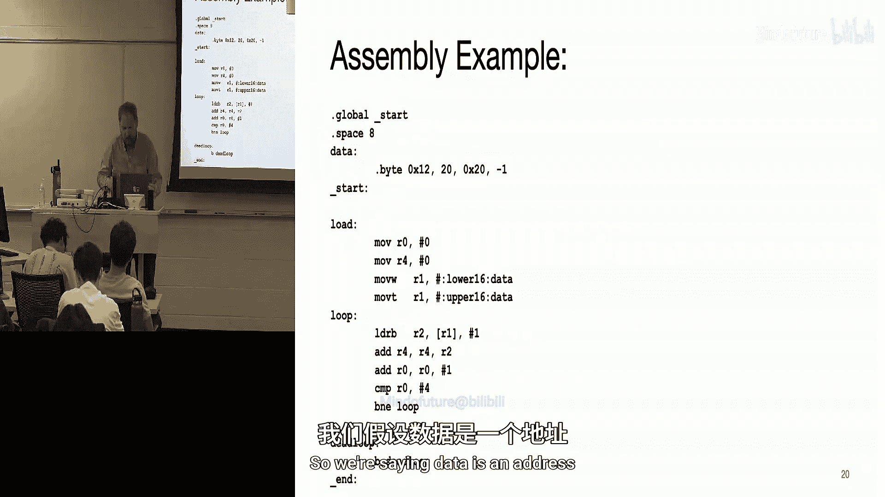
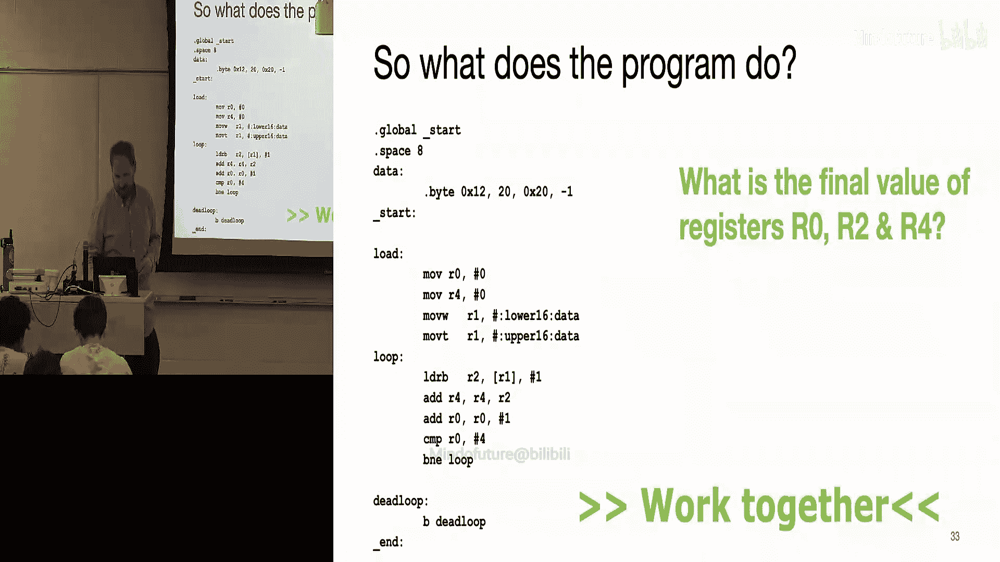
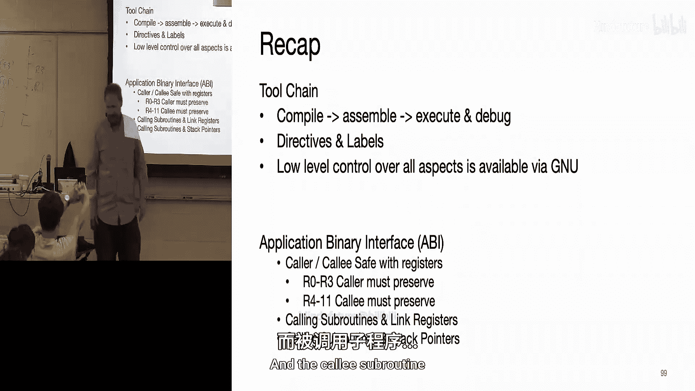

# 嵌入式系统设计导论：课程3：汇编程序与工具链

在本节课中，我们将要学习如何将汇编指令组织成完整的程序，并了解工具链（如汇编器和链接器）如何协同工作，将代码转换为可执行的二进制文件。我们还将深入探讨应用程序二进制接口，这是确保不同代码模块能够正确交互的关键约定。

## 汇编程序与工具链

上一节我们介绍了ARM汇编指令集，本节中我们来看看如何将这些指令组合成一个完整的程序，以及从源代码到可执行文件的转换过程。

一个典型的嵌入式开发工具链包含多个组件。C语言等高级语言是人类可读的，而汇编语言则更接近机器码。汇编器的工作是将汇编指令（操作码）转换为机器语言（二进制代码）。这些二进制文件最终会被烧录到设备中运行。

像Keil MDK或IAR Embedded Workbench这样的集成开发环境（IDE）为开发者提供了便利，但它们也隐藏了许多底层细节。实际上，这些IDE大多建立在GNU工具链（如GNU Arm Embedded Toolchain）之上。这些底层工具提供了编译器、汇编器、链接器和调试器等核心功能，给予了开发者对构建过程的完全控制。

以下是创建一个可执行二进制文件的基本流程：

*   **源文件**：包括汇编文件（`.s`）和C文件（`.c`）。
*   **汇编/编译**：汇编器将汇编文件转换为目标文件（`.o`），C编译器将C文件编译为目标文件。库文件也是预编译好的目标文件。
*   **链接**：链接器根据链接脚本（或Makefile中指定的内存布局）将所有目标文件合并，解析符号地址，生成最终的**可执行映像**。
*   **输出**：生成两种主要文件：
    *   **二进制文件**（`.bin`）：包含纯机器码，可直接烧录。
    *   **反汇编列表/ELF文件**：包含调试信息，供调试器使用，用于单步执行代码。

## 剖析一个基础汇编程序

为了理解底层机制，让我们分析一个简单的汇编程序示例。一个汇编程序通常包含三种元素：**指令**、**标签**和**伪指令**。






*   **伪指令**：指导汇编器如何工作，本身不生成机器码。例如，分配内存空间、定义数据。
*   **标签**：代表一个内存地址。在汇编时，标签会被替换为具体的地址值。
*   **指令**：实际的CPU操作码，如 `MOV`, `ADD`, `LDR`。


以下是示例程序：
```assembly
.global _start
_start:
    .space 8
data:
    .byte 0x12, 0x20, -1
    MOV R0, #0
    MOV R4, #0
    MOVW R1, #:lower16:data
    MOVT R1, #:upper16:data
loop:
    LDRB R2, [R1], #1
    ADD R4, R4, R2
    CMP R0, R4
    BNE loop
deadloop:
    B deadloop
```

**程序解析：**
1.  `.global _start`：声明 `_start` 标签为全局符号，通常是程序入口点。
2.  `.space 8`：伪指令，在当前位置分配8个字节并用0填充。
3.  `data:`：一个标签，标记了后续数据的起始地址。
4.  `.byte 0x12, 0x20, -1`：伪指令，在 `data` 标签处依次存入三个字节数据（0x12， 0x20， 0xFF（-1的补码））。
5.  `MOV R0, #0` 和 `MOV R4, #0`：将寄存器R0和R4清零。
6.  `MOVW R1, #:lower16:data` 和 `MOVT R1, #:upper16:data`：这两条指令将标签 `data` 的32位地址加载到寄存器R1中。由于ARM指令无法一次性加载32位立即数，所以分两次完成：`MOVW` 加载低16位，`MOVT` 加载高16位。
7.  `loop:`：循环开始的标签。
8.  `LDRB R2, [R1], #1`：从R1指向的内存地址加载一个**字节**到R2，然后R1的值**后递增**1（指向下一个字节）。
9.  `ADD R4, R4, R2`：将R2的值累加到R4中。
10. `CMP R0, R4`：比较R0和R4的值。R0为0，所以这条指令实际上检查R4是否为零。
11. `BNE loop`：如果上一次比较的结果是“不相等”（即R4不为0），则跳转回 `loop` 标签处继续执行。
12. `deadloop: B deadloop`：一个无限循环，当R4累加和为零时（这在本例数据中不会发生），程序会运行到这里并停止。

**程序功能**：此程序从 `data` 标签指向的内存区域逐个读取字节，将它们累加到R4寄存器，直到累加和为零为止（这是一个简单的循环求和示例，但给定的数据使其成为无限循环）。

## 应用程序二进制接口

上一节我们看了单个汇编模块的内部结构，本节中我们来看看多个函数或模块之间如何协作。这就是**应用程序二进制接口** 的作用。

ABI是一份调用约定，它规定了函数调用时如何传递参数、如何返回值、哪些寄存器由调用者保存、哪些由被调用者保存。遵守ABI可以确保不同程序员编写的代码，甚至不同编译器生成的代码，能够无缝衔接，不会互相破坏数据。

### ABI核心规则

对于ARM Cortex-M系列，基本的ABI规则如下：

*   **寄存器分类**：
    *   **R0-R3**：用于传递参数给函数，并用于返回函数结果。函数可以自由修改这些寄存器。
    *   **R4-R11**：被调用者保存寄存器。如果函数（被调用者）要使用这些寄存器，它必须在函数开头保存其值（通常压入栈），并在函数返回前恢复原值。调用者可以假设这些寄存器的值在函数调用后保持不变。
    *   **R13 (SP)**：栈指针。
    *   **R14 (LR)**：链接寄存器，用于保存函数返回地址。
    *   **R15 (PC)**：程序计数器。

*   **参数传递**：前4个参数通过R0-R3传递。如果参数多于4个，或参数体积过大（如结构体），通常通过栈来传递（将参数放入内存，并传递其指针）。
*   **返回值**：通常通过R0返回。如果返回值是64位，则使用R0和R1。
*   **函数调用与返回**：
    *   使用 `BL function_label` 指令调用函数。该指令会将下一条指令的地址（返回地址）存入链接寄存器 **LR**，然后跳转到函数。
    *   函数结束时，使用 `BX LR` 指令返回。该指令将LR的值加载到PC，从而跳回调用者。

### 栈的使用


当需要使用的寄存器超过R0-R3，或者需要调用另一个函数（会导致LR被覆盖）时，就需要使用**栈**来保存上下文。


*   **PUSH {reglist}**：将寄存器列表中的值压入栈。栈指针**SP**会递减。
*   **POP {reglist}**：从栈中弹出值到寄存器列表。栈指针**SP**会递增。

**关键点**：`PUSH` 和 `POP` 的寄存器顺序在编码时是指定的，但硬件会以确定的顺序（通常是寄存器编号顺序）进行压栈和出栈。因此，为了正确恢复数据，`PUSH` 和 `POP` 指令中的寄存器列表**必须匹配**。

**示例：嵌套函数调用**
假设 `main` 调用 `quad`，`quad` 又调用 `square`。在 `quad` 函数中，在调用 `square` 之前，必须保存当前的LR（即返回 `main` 的地址），否则 `BL square` 指令会覆盖它。
```assembly
quad:
    PUSH {LR}       ; 保存返回main的地址到栈
    BL square       ; 调用square，LR被覆盖为返回quad的地址
    ...             ; square返回后执行
    POP {LR}        ; 从栈恢复返回main的地址到LR
    BX LR           ; 返回main
```

## 总结



本节课中我们一起学习了构建嵌入式软件的核心底层知识。我们首先了解了从汇编源代码到可执行二进制文件的工具链流程，并剖析了一个完整的汇编程序，理解了伪指令、标签和指令如何协作。随后，我们深入探讨了**应用程序二进制接口** 这一关键概念，它通过规定寄存器使用规则、参数传递方式和栈的管理，确保了程序各部分能可靠地协同工作。掌握这些基础知识，对于理解系统底层运行机制、进行调试和优化至关重要。