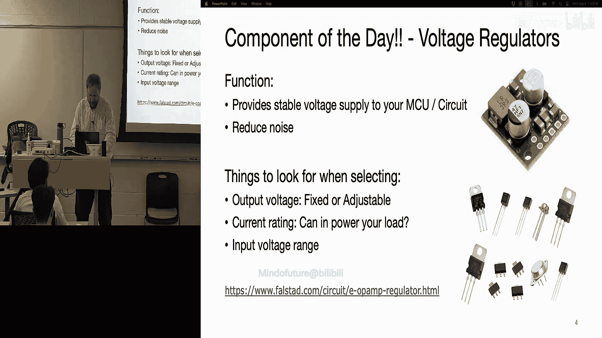
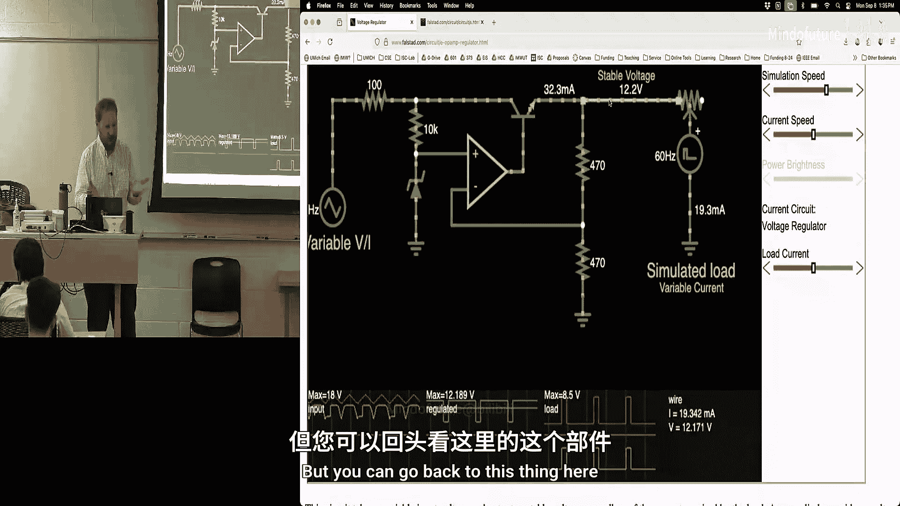
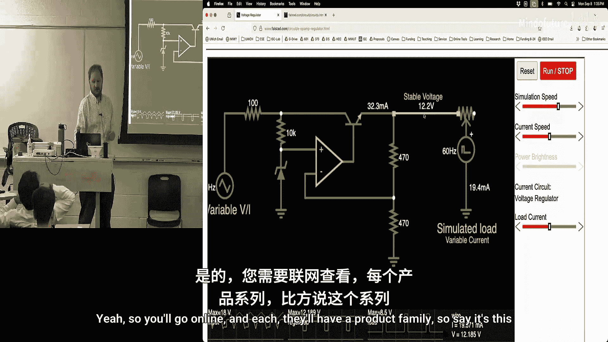
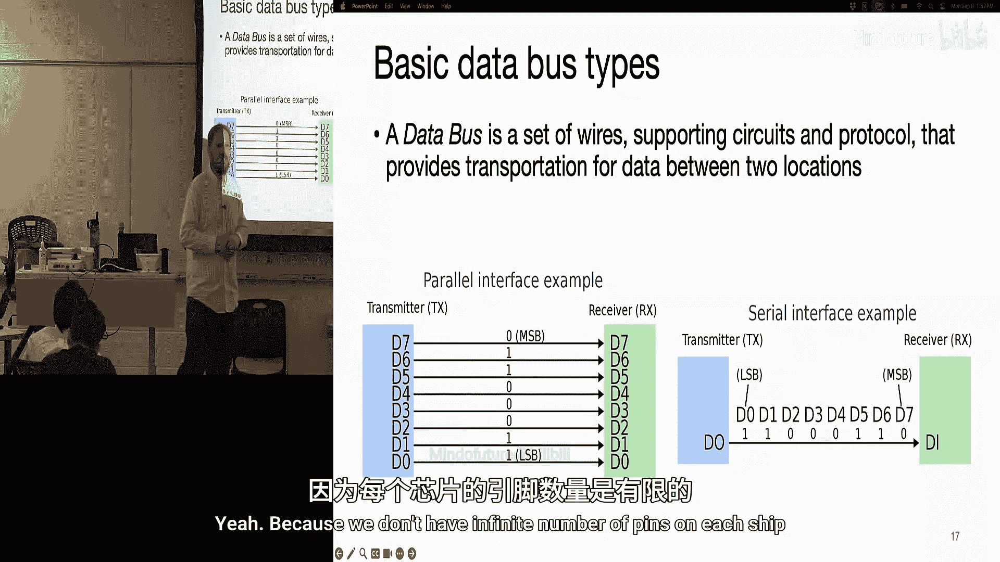
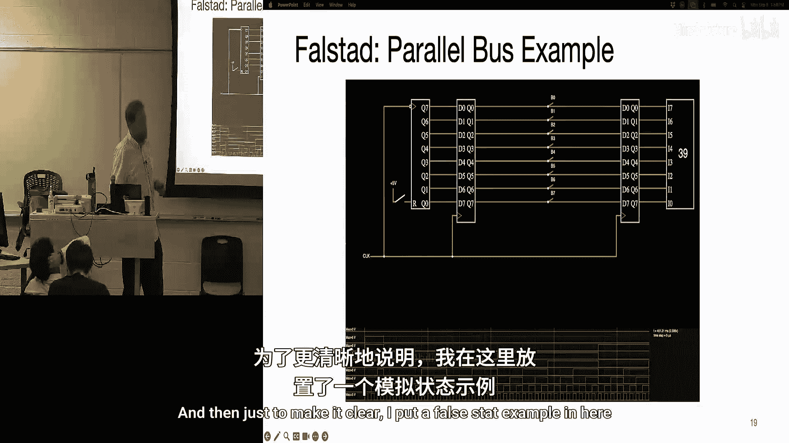
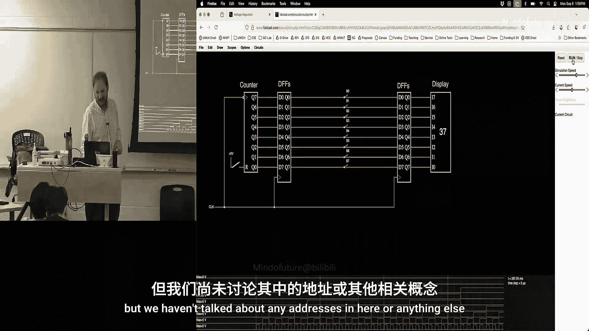
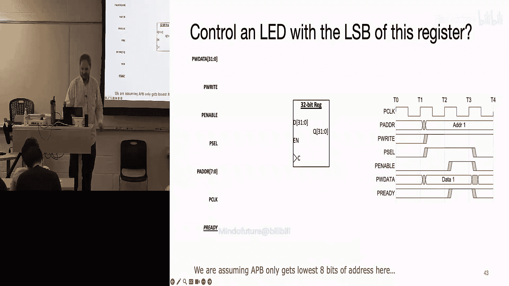

# 【密歇根大学】嵌入式系统设计导论-EECS-373-｜-Introduction-To-Embedded-System-Design-2025-p04-P05_课程4_内存映射IO-APB总线--BV1VTSNBoEem_p4-

I don't you might not be in the big thing， you know， the big tech companies。

 but there's lots of jobs around America， especially if you're willing to move。

To' trying to stay in Ann Arbor is' actually not that bad。

 you'll probably work in the automotive sector。All right， so let's get started。

that's the announcements， homework two is due today， homework three will be posted。

 when and will it be posted， posted this afternoon， probably tonight。

 office hours right after class today to help with homework。

A reminder that for lab two in labs and post labs they're due the night before the next week's lab。

 so you get a full week to do them and this week you'll be starting lab three。

And the pre labs are due before you go to section to lab。Any logistics questions？All right。So Ken。

In embedded systems we often like I said before， it's a wide range of topics you're responsible for knowing and one of them that always comes up is what's a voltage regulator or how do I connect my battery to my board so。

EP STM32 requires usually 3。3 volts some of the des can take5 volts but the IC actually runs at 3。

3 but your battery voltages range from for lithium ion will start at like 4。2 they say 3。

7 and then they'll drop down to 3。2 so they actually change their voltage over time and you need some device to control that voltage so that it always puts out 3。

3 volts and this thing is called a voltage regulator you don't have to know how they work other than that they do work and the trick is you can get really simple ones they just have three pins and you put in you just look at the specs you can usually put in like anything up to 12 volts and your desired voltage will come out if you buy the right one they're really easy to use they're just not power efficient and then there's things called boost converters or buck converters they're switching they're much more efficient but they usually take up more space than they're more complicated so when it comes to actually making your little prototypes especially for。

U。Your projects you will probably need， if you're battery powered。

 you're probably going to need some sort of voltage regulator， that's what they do。No， no。

 they actually control the output voltage， let's see here， let me see I can run， don't。

 oh you can't see that， I can see it though。

Go here。There。You guys can't see it very well。Because。Computers are hard。

Don't worry how this works this is too confusing scary and it may involve analog circuits。

 we don't want any of that we just say we have a variable voltage source which we are going to measure here。

 so that's that green line going up and down and then this is your output should be let's see output should be here stable output is 12 volts so no matter how I change the input voltage。

And you can see it wiggling up and down the output voltage here stays constant and then this is even pulling different amounts of current so the job of this thing is to kind of always control the amount of voltage so that the system no matter how much load it pulls or how much the input voltage varies so what would be an equivalent thing so you got a hose and you have to put some amount of waters per minute on a fire or something and so you're constantly and it's got to hit a certain range so you're constantly modifying how much pressure goes in and out of the hose to hit your target so that answer people's questions。

Any other questions。Okay。But you can go back to this thing here， yes。

So is it dependent on each voltage triulated what pitches in？Wire。So this is your output。依啊系我开错。

So you will have。Yeah， so you'll go online and they'll have a product family。

 so say it's this one and they'll have like 12 different ones and they'll have different output voltages that they're tuned for。

Some of them， especially ones like this one， you can put a resistor in there and you can hardware define it。

 so you put a feedback resistor in there usually in a certain ratio it tells you in the data sheet and then it will try to regulate to that equivalent voltage。

So it's like you define the output voltage by a resistor。在。What do you think？

you think that is possible， okay， it is possible， yes。

Can you make the voltage tire at all with there is a circuit called a boost converter and it's a switching circuit and it can boost the voltage up of course you're going to sacrifice current they are a little bit painful to use I would not recommend any 373 students to use them just because they're painful so we just get you more batteries so that you're always dropping down。

But it does I guess， Bo converters and buck converters， these switching converters。

 they have weird startup conditions， and sometimes they can go in odd states。

 they're not as robust as the linear regulators， which are the more simpler devices。

 but they bo converters， but converters are highly efficient so you can be up in the 90s。

Well these guys can be like。10% efficient depending on your division ratio，8 50%。

 so there's this trade off。But usually for your three cent three demos。

 you are trying to make it last for three hours。早。All right， but if you have more questions。

 come to office hours， you can play with this false a stuff or just go look on false a in general。

 they have other regulators that you can play with。All right。

 so today we're going to switch to this concept of memory Ma Di。So。

This is kind of where we step out of the things that were taught in 373 or 370 I mean。

 and start talking about new material， we're going to talk about the concept of memory Mao bus architectures and then the specific bus on the STM32 or at least the arm cortex M4s。

 which is the advanced peripheral bus that allows the core to talk to the peripherals。

So I remember our diagram， mostly we've been in here。

 and I'm talking about what's the actual like nuts and bolt signal mechanism that allows us to talk to these other things。

 especially the GPIO， which we call memory map IO。I mean， all these things are memory map IO。

 but the IO input output is really comes from the GPO where a lot of this stuff started。

So remember we had the Cortex M series has been defined memory allocation。

 so arm defines as memory allocation now I had some questions before because remember I said that like sometimes they've I don't know what this is half a gig and you certainly don't have a half a gig dedicated for code space and so imagine is kind of like the city。

A plans out of development and they said here's all the addresses to all the potential houses the developer says well I don't want to put a house in every plot of the land。

 I want larger plots of land or I don't want to just leave some unused and they could put a house just in a few spots on that city's plan that's kind of equivalent to this where Ar says hey here's all the addresses in all the space that you could put things and then STM or NXP or some manufacturer will say well I only need this much code space I need this much SRAM I need this much for peripherals blah。

 blah， blah， blah so that's why there's that holes in the map that I showed you kind of on day one。

 so anybody have any questions about that。Remember， if you ask me questions。

 I will teach you things that literally my job。Fantastic external device。

 What if you like plugged in something that has like more memory than。Be allocated。

 you won't be able to address it。I mean I suppose there's workarounds but not using the mechanisms that we have。

 which is loads and stores purely， yes， we're actually going to go through that example。

 but not without having some other mechanisms this beyond the core the loads and stores the core provides。

 we could add another information layer on top of it， we'll get to that。Okay。So here an example。

 we have that code memory space and the idea here is this is all distributed。Throughout your chip。

 now， of course， the core doesn't know that， the core assumes it's just a subset that。Okay。

 the core doesn't know， the core just looks at this as unified memory。

 a load to this address is the same as a load to this one， store store is all the same。

 it doesn't know that when you're talking to something it might be the peripheral or the external memory。

 but that's part of the simplicity the architecture arm doesn't have to keep track of for everyone。

It just happens to be that， say the external RAM here is accessible through a bunch of addresses and that happens to be hanging off of the high performance bus and peripherals are typically hanging off of the low performance bus。

 although some are here and then the external devices are on the peripheral bus。

 and then SRAM and flash are typically in off of the high performance bus and the data path and instruction path。

And then so if we keep going like in lab you've been talking to GPPAO and they have certain addresses。

 and so what ArM's done is just said， okay， well， arm and STM together just said， hey。

 heres the allocation space for GPPO， A，BCD。So those are different ports that you would have and then in just one of those addresses may be something like your output register and all that is is just a memory address。

 so I would have some memory address that would go here and you could put bits into that address。

And that is just a series of D flip flops。 so that's like the state holding mechanism。

 we're not talking about SRAM as a different state holding device， usually in the peripherals。

 it's just a bunch of de flip flops that now the peripheral itself can reuse to do task or sorry。

 can take this information and then have some output。So that's kind of like homework problem 1。

2 where we're saying heres some def flip flops essentially let's say we don't have any addressing architecture we're just going to put data into it and then this peripheral is task to do something right supposed to turn on the green LED。

 turn on the red LED， turn on blue LED， you do that when some data is put here and then your job is to make the combinational logic to have to turn on those lights over there。

 this is just the peripheral like say output register of the GPO pins and you just have a special GPO pin that does these things。

Okay。Yeah。呃，那就是。In the previous diagram， we showed that brickfields are。

Both the high performance and the。Fance， performance， and how does the decision to which？

I guess peripheral buses used specific well there's different goals here。

 so like GPpaO is on the advanced high performance bus。On the we used to use- oh， I forgot the name。

We used used a different micro controllertroller in the past and that company decided to put the GPOs on the advanced peripheral bus instead。

 so the manufacturer so in this case it would be STM has decided where the peripherals should go and that's really where there special sauces in the marketplace they're saying I'm going to make slightly different peripherals in my competitors maybe they have really good ADCs or a camera module。

 in this case STM said I want to have really fast interaction so my GPO pins can go really really fast。

 so that's why they put it on the advanced peripheral or the high performance peripheral bus。

Or I guess it's not， it's just the advanced。High performance bus， does that answer your question。

 anyone else？Okay。All right， so the basic idea of memory map IO we'll start with a counter example。

 so there's a thing called port map IO where the CPU is special instructions to do a task and this is more like in risk not at risk but like X86 architecture where you have a bus that's just for memory you have a bus that's just for video and so those have specific instructions and instructions only do the tasks they of uploading your video updating your video card。

 that's great for specialization but that's not where we're at we're at microcontroller level where we're trying to make an architecture that works for everyone。

And so memory map I always try it is simpler。And a more convenient way to work with IO devices because you don't have to know the special instruction。

 so each device is just from the course' point of view where each peripheral is just a memory address。

 and the CPU is just going to use loads in stores to access all those different functionalities if you're going to talk to the external memory internal or external memory what it external devices。

 the peripherals， it's just loads in stores， so it's lower performance than mapped IO but it's easier to construct because you don't have special instructions。

And so here's an example here you're going to do you have a core。

 you do some store into some address and say this address represents the data in here。

 represents a GPO pin， and now you by using a store function， you can make a GPO pin go high or low。

I own。系。Chef versus。Trying to。没是。U。I think both go from their perspective of everything's external to the core。

So you could have port map instructions to do special tasks on a device。

But memory Ma Iio is the only way and is a good way to go talk to the external world as well off chip。

Does that make sense？啊，对。Spec because does it No， it could be like update I don't know。

 it's been a long time since they ever looked at X86。

 but they have special instructions just for sending things to memory that's not loader store。

It may be hey， I want to take this transfer file from here to here or I want to update my video card。

 they have a whole port just for video and so now you have instructions that aren't load in stores for video。

 it's like makega polygon here or something。Yeah real loud why is memory map Di lower performance in port map Di because Port map I can be specialized。

 it does one very important instruction so you can probably get multiple things done and with one instruction well memory app map I is just I'm just going to put data at these addresses。

So you get to optimize better for memory report mapped。

 but it's not as flexible or it's more complicated yeah， storage you're using memory map。

 you're using some specialized nonloader store then you're using important。That's true。

 but this architecture doesn't have port mapped。This architecture only has loads in stores。

 sos it's just a different chip altogether everything we've been doing so far is memorying that correct。

I mean， I guess a move just to bring it back like a move instruction is not memory mapped IO because it's not using a load in stores。

 that's just how you can move information around the internal of the core。

 just the registers in here。Yeah memory I was writing you know writing a values to memory but then the port map is say like we connect the British to the poor and we write a value to the red which gets like transferred to the poor Yeah you can look at it that way I mean that could be a way to implement it i'm not saying that's how it's always done。

because you have instructions that go to a port like you have a GPpaO port。

 which is a group of GPO pins， you could have your video bus in your application class processor and that video bus can't do things like turn on LEDs and all the other stuff。

 it's designed for one particular task and now I have instructions to do one particular task。

So they're not inflexible instructions。They are good questions。All right。

 so we'll move on for a second， so here we're going to talk about external memory devices and I have a one gigabyte car it happens to be one gigabyte。

 so how do I interface with this thing？嗯。And I want you to kind of think through this and talk with your neighbors now the goal is you have to use loads of stores。

 but you want to minimize on chip memory， right you don't want to have to have a gigabytes worth of data here。

To be able to talk to a gigabytes worth of data here then I don't even need this anymore right so and it would make the cost of the chip very high so how can I manipulate this peripheral such that construct this peripheral such that I can use loads in stores and I minimize how much on chip memory I have so why't you take 30 seconds or a minute or so talk with your neighbor come up with a possibility。

Maybe something like indexing it。Just to get a little of ice cut and now I feel like a fuck。

You go the range and addresses。Okay。Were going boy。Yeah vacuuming thing I said。just。

You don't haveulation are the screen。みたななの。Yeah。Yeah。Its。This。I wouldn't be anything reading。

All right， just to make the problem more explicit， what you don't want to have to do is have a gigabers worth of registers here or memory locations or SRAM or whatever。

 just so that you transfer the same data one to one mapping over here， that would just be a waste。

So what else could we do， what would be a more size efficient mechanism？And rodeo。

Sos like kind of think of how cash works you can have like a small chunk and then you can map it to a specific section of the external when you want to like change the part of the SD card that you want to ask to be changed which part of it you want to map to that basically works that's basically a version of what they do I would say they just have a state machine in here it takes in an address right so the state machine is looking for anything it will respond to anything that's within the range of addresses I forgot what it was and then when it says go to this register this address offset something and it says oh well that just means somewhere in this card and then just going to take the data and this transfer over to the card now this peripheral will'll actually talk particular mechanism but from the course point of view it's just it's just memory address and then there's just some state machine that negotiating the transfer back and forth right so they't actually exist all those registers or all those memory。

Locations， it's just not useful yeah。我周。I wouldn't call a virtual memory now。

 just think of it as a combinational state machine， the cash analogy is fairly reasonable。

 it's just something that takes in addresses and says， oh， you're in this location。

 that means I go and store data over here。そす。Yeah， is that like kind of like a waste because you have like one gigte of storage on your memory and one gig but you don't that's why I'm trying to say that we don't have this that would be bad we just have a state machine that is literally combinational logic right have that gig Yeah into all of that right so it's looking for it so says。

Okay， if I have， if I get any memory loads or stores that are from a， blah， blah， blah up to E。

 I'm just going to take that data and I'm not going to store it here permanently。

 I'm just going to then move it over to there yeah。So when I reads data from the SD card。

 where does it store it or does it have to fetch the data every single it's got to fetch the data and then it has a small bit of cash essentially in here let's say。

 but has a small bit of register space in which it pulls it in now this is not supposed to be fancy like a micro full processor。

 it may only have one or two registers just to store this data and it may have a pages worth or something of registers。

But it's not going to act like cash well not at this stage where it's trying to always have the most recent data。

 we're not trying to be that sophisticated because we're in the 100 megahertz range right that's our clock speed of our devices。

 we're not trying to get the most out of every cycle if we wanted that we just move up to another processor class。

Yeah， so like I had like a much larger SD card， like 64 gigs， 64， 256， whatever it might be。

 and I had like large files like just individual pictures。How would like plugging a new SD card。

 how would that work with plugging like a new SD card into a device hasn't seen it before like with the state machine automatically be able to associate and like par it data it back in so you get your images like together I don't know if that's a question those are great questions beyond the scope of this toy example and what you would do is then you read through the SD manuals and you look up the external device peripheral and see what it says so I don't know about hot swapping I know it does have some provisions to go over a gigabyte but then you have to use you have to store into certain registers that say I'm in this upper range right you're setting an offset with that register so there's these extra functionalities it's just beyond this toy example。

Yeah， how do we manage that memory of that's going on to be a speaker？

How do you manage it with that it seems like we have arbitrary。Accessses from like A to E。

We just push it onto the SD card like what？You the programmers got to manage it。

We have to manage all the external data on this speaker。We're bare metal programming。

 you are here fighting bits and it's your job to keep track of it now there is a thing called an artta you can get a real time operating system for this。

Nobody in this class needs to worry about that， you go to 473， they'll teach you about our toss。Okay。

Yes I said all that okay so what's memory map Ao is a method for interfacing with peripherals and other elements that' are essentially outside the core and then just to be clear peripherals can be external devices as well like we're going to talk about。

We're talking about memory or storage as well， and the key idea here is from the core' point of view is just loads in stores。

 that's the only instructions we need to interact with them。U。Yeah。Okay。

So let's move on to the bus architectures， which is the mechanism for which the core is going to talk with these Me mapo registers out there。

So。ADab is just a set of wires along with protocols and circuits。

 allows you to transfer data between two locations if it was just really just two locations it would be super simple but the trick is it's not and then there's two general weight types of buses that we learn in the class there's parallel buses and then there' serial buses so parallel buses transfer all the data all the bits of the data simultaneously while serial interfaces does it sequentially why would you choose one or the other on ships anybody have an idea。

し。Much faster data，So why don't we just use， so what do we use is that should be that？

On chip connections or off chip connections。O or on chip connectionss。Why not off chip connections。

 why don't we use this for getting data off of chips？Yeah。

 because we don't have infinite number of pins on each ship so here I'll give you an example here。

So this is an 88 microprocessor fermentto， one of the first ones， these are the pins that they have。

It's much harder to get data on and off chips， this is why the bottom of like a CPU has all those little bumps on the bottom right is trying to get as many much data off and on and actually you're really defined by how many pins I never。

 I didn't believe it when I first took these sort of classes that it was actually limited by pins and then it's thermals as well about how much data you get off and on。

So if you have this device， you know we have all these different functionalities。

 we have ALU and registers and instruction registers and Dcode registers and some S pointers。

 and they're all distributed throughout the chip。And if you look they all need to share data in some ways。

 so this is the bus structure that links this chip together。

 and here it's an api chip with those are the rainbow colors so like that's these and this is power。

 this is ground。And so the idea is if it was just two modules that are just next to each other。

 go back here， well then sure and they are little really connected。

 but it's when you want to share the data to any one of those devices is when you need a bus。

And then just to make it clear， I put a falsett example in here。

 you guys can go just go through the slides and you just copy this link and you can go put it in your browser and you can play with it。

 I'll show you what it is quick but if you have any questions is this a way to reconfirm your learning so here this is a digital counter here and it's just counting up we can see binary is going up and it's been going on for a little while so it's counting up and then every clock cycle data is held in these def flip flops so there's eight of them and then the clock cycle is transferred over here is stched in and then it goes to this display module just binary to deck and so this is just the most simplest bus structure you could possibly have where data is being transferred over on every clock cycle。

But we haven't talked about any addresses in here or anything else。

So。There's lots more that you need to be able to get。Data pass through rather than just wires。

 so want you work together and think through what are the other。Signals。

 other things you need to keep track of when you're trying to send data from the court all over the chip。

You take 30 seconds or so work together。See would you come up with？要是需。呵呵。你啊屌个。知な。

I I don't think that's Yeah， that I keep， I'd be just cents。😊，All right。

 what do we think what else what other signals would you need other than just your data in your clock if you're trying to distribute？

Data or send data all over this chip。Yeah。Right， so we need some way to control we add some address lines right so address lines tell a different peripheral。

 hey， this thing I'm talking to you or I'm talking to you or I'm talking to you all those things that have to have an address and you need lines。

 data lines to or control lines to send that address bit over so that people know or the devices know it's being talked to。

 what else could you need？Have question this be part。Or is is a parallel bus？

There's a state machine just off the port called well we'll talk through it。

 it's called the bridge and it will take your loads and stores。

 turn them into bits that are sent across the bus。Yeah。

Type classifiers like type of data type of data does a load or store keep track of the type of data in any way？

No。Reset right， sometimes your bus might screw up， you need to have a reset， what else can we use？

Po the case you know you。Yeah， so you need to hold or some sort of way to say， well， wait a second。

 I'm not ready for more data or I am ready for data， okay？Any other control lines you can think of y？

Either take it to ya。Acknowledgement so that like the writer read is complete right that's a great one some sort of got a validation to like something got screwed up along like。

like a CRC bit or something like that yeah we typically don't that's a great idea we look at those for device to device so off chip。

 but typically there's no CRC or dirty bits or any not dirty bits what do you call it。I forget。

 but there's no， usually you don't have that on device because the signal integrity should be pretty good。

So here's what I came up with， so armM has the terms requester andcompr。

 that's what their termologist is like the these are the peripherals over here and this is the bus controller。

 and so you have data lines and you M of them， you have some address lines， you have a clock。

 there's usually a bunch of controller lines， and so I think we've hit all the classes here。

 and then the idea here is that this receiver， this Compr is going to respond to different addresses than this one is。

And then the data lines go to everything and the clock line goes to everything。

 and then there's different control lines to work with flow control back and forth。응 응一。All right。

 so terminology， we just talked a little bit about it。

 arm calls these high performance buses and the peripheral bus。

 you have the requester and the completer。U。So in this world。

 the requester is the thing that controls all the bus traffic and it initiates all the commands。

 the completer or the peripherals cannot request to have a conversation it's always driven by the bus controller or the requester and that's just an architectural choice you could make a bus architecture where everybody can ask and demand the talk。

 they get more complicated， so given the class of this chip。

 it's very common just to have one thing that's in control。U。

We're not using the bus that the completer， must not transmit to avoid short circuits or bus contention。

 you don't want to have two things talking at once， and there's actually explicit method for that。

 and they use these space tri state drivers to disconnect from the bus altogether。

Another other thing to remember， we'll look through a diagram a second is that some wires are shared with all devices while other ones make point to point connections。

So just to bring this home。We have the core， the core。

 somebody basically asked it you know like how does the core talk to a peripheral well there's this thing in between right so built into the core essentially is a state machine。

 this requester and this instruction gets executed and that part of that instruction。

 somebody is looking at the decode bit and say okay it's an instruction now and it's the requester's job to actually get the data out of what would it be R7 and then that becomes the address and then you have the actual data in R1 which is goes onto the data line and that is stored somewhere over here and this state machine is going to figure out oh okay you wanted to talk to that GPO and out over there。

Okay， yeahep。喂嚟。so there's not too many pins on those ship。This is all on。The peripherals on chip。

 yes。That's fine it's just a terminology problem right they arm try to mess you up today you do you can have external peripherals like when we call that I'm sure there's a device that like memory sometimes on some embedded systems would be called a peripheral but here in the context of this class of peripheral is。

Let's come back is。This is an entire diagram of everything that's on your microcontroller。

And this is you know， these are all considered peripherals。

 some of these peripherals will talk to the external world， but a timer doesn't necessarily。

 it just keeps track of time so it isn't actually going to be connected to GPO opens。

I forgot where it was。What questions？Where did I go？So yeah。

 we're trying to figure out what's the data range， is it a loader store。

 trying to keep track of the target address， is generating its own clock。

 it has to generate the control lines to talk to one of many completers。

And then the computerr is trying to figure out， okay。

 based on these control lines am I going to receive data or is my job to push data up is trying to say in trying to do control to make sure like maybe you're going to talk to a peripheral it takes a really long time to go so it has to have a line that says okay I'm ready to send you data or I'm ready to receive data there's no guarantee for the low performance bus or what we call the peripheral bus that things will be completed within one clock cycle。

All right， any last yep， let's go back over there yeah explain what a control line is and what it exactly does Sure so we'll go through more detail。

 these are the cartoon versions and we'll get to the nuts and bolts from the manual version but a control line just says is ways in which we want to negotiate the conversation between these two so basically ones just like raising your hand right so it says I'm trying to talk to you now is your job to pay attention that frees the computerr from having to look at every single address and doing you know basically computing is the controller talking to me it also control lines could say like hey I'm not ready for data where I am ready for more data or when it's sending data back hey my data is ready to go so these are bidirectional or can be bidirectional data lines。

Yeah。それさる。Step by step is the request are sort of like。

It's there for decoding what's coming from the core a two stage decoding with the completer as well is it fully decoding and we know what everything is doing by the time you get to the completer。

I think by decoding you mean has' it figured out what that is so these two are basically designed in tandem they work right next to each other this thing at this point has figured out completely what this instruction does and has translated it from you this binary instruction to you know turned it into the action of actual data that was in what would it be in R1 the address that was in R7 generated its own clock and now is controlling it so it's not that this thing has to decode this instruction。

 this thing has to respond to these lines that have been generated。So it would be accurate。

The requester is going to understand what the Co is talking about put it in a way that the completer correct work with correct interact interact right and the whole goal is what we're not showing here is there are。

You know， hundreds of these completers on your device。

 all trying to complete the tasks defined by the requester。

 and they're trying to share as many of these lines as possible so that you just don't have you know explosion of wires on ship。

So let's go through a little bit more examples and we'll。

We'll get to some concrete examples that might answer some of these questions as well so on your device this is just informational there's the advanced high performanceance bus this is really good for highspeed data transactions it's particularly interesting it's actually a pipeline bus structure just like a pipeline processor this is like a twos stage pipeline rather than you looked at like three stageage processors in actually this cortex M to three stage but this allows more data to go through has good for burst it can have multiple masters or controllers I should update that to the new terminologies and then it can split transactions up now the advanced peripheral bus is lower power it's simpler interface it can be blocking this thing is designed this bus right here it's designed to be slow so doing things like SPI which is talking to device off chip。

As a protocol for external communication， it might have to wait a long time for data to come back so it's much more this bus is much more tolerant to latency than the other bus。

And then for the purposes of this class， so， oh， there's also like this bus matrix is also another term for the advanced high performance bus。

Well talk when we talk about DMA so there's direct memory access。

 this little controller actually acts like a mini core in some ways and where it can route data directly from like GPO to memory without having to go through the core。

 we'll talk about this and be like one of the last lecture is in the class。

 but for now we're just going to assume we're just going to look at the advanced peripheral bridge。

So how the advanced peripheral bridge talks to the peripherals。

I could try and teach you how the advanced high performance bus and the core work and how and then it would be too much in your brains will explode you all re nobody wants that we're just going to assume that the advanced peripheral bus and how it interacts is functionally equivalent to how the high performance bus works and it is except for the pipeline so if you know one you're going to know the other one。

All right， so can you get more information if you need to？

There's a manual that's actually not 1000 pages long， think it's only like 100 pages long。

 and it defines the spec before the advanced peripheral bus， so if you needed to。

 you can go look through that。I'll be drawing my examples from that we'll look at some notation as we go through the rest of the diagrams we have like clock。

 this is just showing you what the transition from high to low symbol looks like。

 this is is showing you theres some uncertainty in that signal， same as high to low。

 this is the bus is stable but undefined。This is the buses in high imped mode that won't come up very often。

 this is just the bus that was changing and this could also mean that there's multiple bits of data on there a bus could symbol like this could be 32 bits。

 we'll show that later and this is a bus going from high impedance to stable condition we't care about that so much。

So look through each one of these signals， these are the signals。Between the requester and the Compr。

You have what was this fancy， you got P clock， so this is just a clock that defines the system。

We have the address so this is the address so this is going to be multiple bits now in class we're just going to say that's 32 bits in reality you don't have 32 bits worth of peripherals so the requester takes that address that's given and may trunccate it because it can represent the same values within a smaller area in fact we don't exactly know what STM has done when we had oh was the ActTele。

 we had to ActL boards before which had an integrated FPG and we knew exactly was going on but for this class we're going to just say that it's 32 bits。

Then there's a P write signal so these are all wires right。

 and the P write is going to define the requester is going to define whether it's writing or reading。

 so one for write， zero for read， so in this is an example this would be a writing action。

 basically you're storing something。We have PW data。So theres a bus specifically for writing data。

 this will be 32 bits wide， and here we're just showing that it was something it transition now its some other data。

 it's going to transition again， go back to some other data that's what those symbols mean。P select。

 so a peripheral， there's dedicated lines to select individual peripherals that's different than registers inside of peripheral that helps just so all peripherals don't have to decode all bits all addresses all the time。

 so there's a specific line to tele peripheral to turn on now a peripheral could have multiple addresses。

Inside of it， so it's not just the same as the address line。

It's actually a dedicated function and there's multiple peripheral selects， we'll see that later。

We have peripheral P and A。U。Yeah， so P and P and A tells that the peripheral that the data is ready。

And P data， P ready， is the target， we should have said。

 responder that says now I am ready to do the action， whatever it is， I am ready。

 so it could be ready in one cycle or it could take multiple cycles to become ready。

What questions do we have so far？Yeah， what does this device mean in piece of Lake you got to say that loud。

 I'm old What does this device mean in piece of leg？P select。Oh， this device like。

Like this let's say that this right here， this table is a peripheral and this table is a peripheral and this table is peripheral the piece select is saying I'm going to enable this peripheral now each one of these students has an address inside that peripheral so all is is saying here is we're selecting a particular。

Perripheral， not all or not any individual student， that's probably bad nomenclature。

Is there anything that to select with on？不意。Or is that the same thingP select as each completer y。

 so each row here could be a peripheral for a completer， yeah。

So we think of this as taking like a specific port like port A to enable that's what a select would do and then on inside a port you have like not only do you have the output register。

 you have the input register you also have the control register。

 those are all different addresses on a port。Yeah so P Read is the only thing that the requester send back correct other than data。

 we'll get to its data in a second， but yes。や。It's like the so you use the word asserted in there。

 so is it just it's just like verification that you normally do like a。

Isn't all these things addressed by？稍了一下。Like where the reader right is going to so the piece like just like a check on that or like。

Pace Select is a way to- let's just advance a little bit and I'll explain that， I answer。

 next diagram should help out or next couple diagram should help out。Let's see。All right。

 so let me just go through this diagram we'll get back to your question a little bit so what's happening here okay。

 so first we have a clock that's going through， we had a P right。

 so P right is high meaning this is a store。Some address has been asserted here that t between t0 and t1 normally these diagrams they're just showing you with the previous data in the action is starting here so an address has been asserted a it' been defined that it's a right peripheral has been selected now now that this data you need a clock cycle for the data to stabilize so yes it shows it up here that' stable but it needs a full clock cycle and then it says okay P enabledable basically the requester is saying hey I have established all the data required for this transaction here is your job to do a thing and actually the data was also established here so it says all this data is ready now do your thing and then the peripheral and this thing says hey it didn't matter if it was high or low before it didn't matter because it would have even talking to it now it says okay now it's your turn to respond are you know tell me when you're done and it says I'm immediately done just happens to me for this case it was done immediately and that's a typical case when you're just。

Talking to a flip flop and then it comes back and it says， okay， it releases I'm done or no。

 this thing deasserts that that peripheral and says， well。

 it doesn't matter what it can either be high or low。系。Yeah。

 how is the P ready like immediately ready， it's just like we'll go through examples where if all the data is here。

All the data is available and you clocked it in on the next clock cycle those D flaps would have captured it。

 D flaps have just captured in， now you're immediately available， immediately did that task。

 there are things called weight states where it may take multiple clock cycles for a fuel to complete and that way would be deaserted low。

O。I'm clearly I'm not being very clear here what elseT got so just to just to make sure I understand so at T2 that's when the peripheral sees that that the controller wants to write to it and it does the writing within that cycle and then at T3 that's when the controller sees okay the peripheral is done now。

Okay， let's keep going through some examples， I still have a whole question I got to get back to。Yep。

When it latched in all right， so here's the written example here， that you guys can go through later。

 let's go through the architecture which will answer that question over there so here。

We have P write data。This is 32 bits wide， right， and it goes to all of the completers。

We have P write data and P enabled， those go to all the completers as well。

P address goes to everything right so this is good in the sense that a lot of parallelization。

 you don't want to have to have an address， its own dedicated address pin bust to every single one。

 it wouldn't make sense。The thing that it does have here is P select goes to each individual。Okay？

And that is important to remember that there could be multiple registers in here。

 multiple things that will multiple locations where data can be stored。

 so it have multiple addresses just like your GPO A port has lots of different addresses in it。

 some for the control， one for input， one for output that's all being selected when would one piece select。

Clock。Is going to everything， everything was clocked the one difference ser oddity that I had not appreciated when I first sorry learning this architecture is that every completer peripheral has its own bus back。

All right， so that means that for every completer， there's another 32 bit bus that goes back to the requester and then the requester has to take in。

32 times n inputs now we just talked about how it weight。

 you know I thought you didn't want to have lots of pins。

 this is all on device so you can have as many inputs and outputs for a device you want。

 I mean routing does get hard eventually but that's the architecture。

 why would they choose to do this。What could be one reason why they would choose to have a bus for every completer to go back to the requester？

看。But because。大咗得。同埋。Do it have to be able to talk about the computers themselves cells set the voltage across each wire。

 which can。So you need to kind of like your。没有しま。stuffYeah so that would be that would be a problem the other one so that's definitely you don't want to have bus contention where this guy's accidentally fighting trying to set highs without one setting lows and you have a short circuit the other issue is that compared to the requester remember the requesters going very fast hundreds know100 megahertz or so the completer could be dealing with these horrible things called like humans that are so slow it you push the button it's just ages right just to push a button and so if a completer's task is the interface with the outside world it may be very very slow compared to the core so it needs to have weight seats it needs to wait a long time so you don't want to have one completer blocking all other tasks that the requesters or peripherals are doing on your chip so this one can take a long time to set up this data when it's ready it can instantiate P ready I can instantiate that forward there you go。

P ready， there's the P ready line back to each one， so P ready will go high when it's ready。

 and then the requester can scan through all the P ready lines and said oh。

 you finally got back to me even though I had 10 other conversations with this person while you were so slow。

 that's fine。All right， the questions have backed up here， did I answer your question？ okay。

 I forgot what it was， but I knew I'd get to it。Does that mean the requester has to have separate state machines for each computerr it wants to get data from what do you mean by that？

嗯。对就是。In the process of talking to Comp one， let's say it's trying to get some data from the outside world and you said like you can do 10 transactions with Comp zero Yeah how does the requester still keep track of the state that like oh we're still waiting for Comp one to yeah I wouldn't say each one has its own state machine but there is a state machine that has priorities that says okay this pin when this thing is ready it has a higher priority so maybe it be stacked up here right waiting for a bunch of lines high and then it'll go and say I want this one this one this one so there is a priority queue it's just buried in the RTL the logic we don't really deal with it because we can't manipulate it as programmers。

Yeah。The previous diagram， you looked like a kind of Pable was kind of moving。开。

s not guaranteed it's not guaranteed at all that's just we're going to go through some examples where it's not guaranteed at all。

But it is being enabled like triggering the you know。Any of us have before be ready getting。Okay。

Yeah。嗯。So。4 way。For one of them for P enable。 Yeah for P enable， like it seems like。

We're all waiting for the day all the all the other ones to get in place before P and and to be sent to high。

 correct。 Okay， so like it has to wait for everything else before it gets sent， correct。 I mean。

 that's just saying。It's like a flow control thing because if all the bus is changing， right。

 then how do you know when how does the completer know when the bus is finalized in this final state？

So I mean， that's a， yeah， so it's just out redundancy。

 it's not the only way you can make a bus structure， but it's a good way to make a bus structure。

be like different latencies or between different completers who got sort of out features Yeah we never get into it。

 a lot of this is not exposed to us as programmers but you will see understanding the bus structure in why things take weird amounts of time that's why one in part with you guys so you'll never have to really worry about the timeout features there's other control lines about errors and timeouts I didn't show you。

All right， so let's go through a toy example I think I got this right。

 I just read it this morning so let's say that we have APP requester and two completers devices D1 and D2 D1 has as a number of addresses is going to respond to right so this peripheral will respond to 1000 to 1000 F this peripheral 1010 and 1001F okay。

And so any addresses that are outside that range the device won't respond to。

 but it has multiple register banks， let's say inside of it which it could respond to so it's got to respond to multiple addresses the cortex M processor core is going to complete the following instructions so it's going to say store r0 into the address represented by R1 with offset of four and then you're going to be given some values for the address so to go back to last week's lecture this is what you would see right so the store function we're going to take this address。

 this is the address yes。To some location。We're going to offset by four because this is just offset indexing we're not going to increment oh then we're going to store the value here。

 which is coffee is going to get stored in this address and we're not going to go in advance this value because this is just offset indexing it's not pre indexdexing or post indexing so this is。

From the cho point of view， what's happening， and I want you guys to tell me。

And oh I have worksheets for you， so what is the advanced peripheral bus traffic look like to cause that to occur？

All right， so all that happened， let's see what is that number two。

So how what bus traffic must have occurred？As a result of those。Instructions is being issued。

And remember， please， ohs， sorry， I put them right on there。

Remember you'll be turning this in at the end of class for class participation credit。

So if you want to keep here。Copy， just take a picture of it。This is based on completion about effort。

 try it。五点です。All right。And then I don't know， I'm sure I ran out somewhere。Great。

 thank you Does anybody need one？You have my。I'm at accounting。第一个。ね。Okay。我就さ。Does anybody need one？

Okay。还。really here。并不。How will you start this horrible problem？

And that's a good place to start now for both of them I think it's actually Pwright。

 you look at the slides but Pwright is goose to Ever birth so then I would put it high on both of those。

Just so far ahead you're trying to worksheet too that only occurs on a rising ahead。

WWhy do they write this？一。你说。differentterr what's going on perfect the。so where does address go。

 which preferred？It's labeled up there right so the top diagrams for D the bottom diagrams for D2 these are the signals hitting the complete's interface however your sheets don't have D12 so it's very confusing for you D。

What do you think？HowI think they're the same because if I look here。

think same instance is going to have the same data。All right。

 so matter you should be drawing what D1 and D2 Cs， the input pins on the requesters。

 so for instance， we know that the address line is shared， the address lines go to every peripheral。

 therefore the address seen by D2 is going to be the same as D1。So you get a freebie there。

 you can think about what are all the lines that share between that's going to get you half the problem there you just put your data right in there。

I' what the address is？Let。有。W。I you want need to right？

ready to' trying to out my I like try trick students and they figured it out extremely exceptional'' not do different tasks。

The GPO4 this one is the camera interface to sample it Mr。

this thing and this thing can both students only one of them goes high。

 right each one has an individual those are different the double lines mean it's a bus the data as doing over here。

し。it tells you this instruction tells you what the value but I'm trying to trick you Okay so。

I mean thing。going be same as the top。 just the PL and else going be。

 So this example is and I just put site。I'm not sure you as well。

 that's I'm so confused don I you just I was just copying it from this So this one should look exactly like that I think we're writing through the D this one。

 though， because it's not actually getting data is。And there's no ready because it never writes。

The usera shared， I think， able write the address and right it's a right operating。

That's no idea if it is right， so that makes sense。Okay'。For this horrible example， please， he says。

 stop。If I teach you half to things， how are you' supposed to know things， that's right， okay。

Let's look at this example here， so this is you're essentially recreating this diagram。

From the perspective of the two completers or D1 and D2 and instead of putting in the word address one。

 you just write in the hexadeadeimmal value here and instead of putting in data you can put the hexadeadeimmal value here。

 but essentially all this is true and you might need to spend some time walking through the slides and this remembering or learning what each one of these things that actually does will'll go through it right now。

 but that's the kind of trick of this。Problem。So now we'll go through here All right。

 so how do we get copy from both these signals， let's see what did I write， So the address， right。

 what's the address going to be？Well， the address was stored here in R1。Well， here's the address。

 but it was offset indexed， so it's not 1000， it's 1004。

 that's what would be represented on the data bus line C by the peripherals。Because on the fly。

 this instruction is appended by four。When we think about that， yeah。

Maybe you got to be loud reason it's only for two cycles。

So the only reason only for you like it's all you need technically， there's no good reason。

 there's no reason you should know that the requester went and did a different task。

 so let's just say it could be on forever。So I didn't give you another instruction afterwards。Yeah。

Why is there a P added change at TP。Why is there what Oh why is it change here and not here T3 Oh。

 the same question he asked， just arbitrary the requester decided to do this。

 you wouldn't need to do this。Okay。If I put another instruction there。

 then it would start doing that next instruction that's the next instruction Okay。

 let's go forward a little bit。He right。The right goes high right so you could have started drawing everything at T0 would have been fine the way these diagrams are typically done in the data sheet is that you start at T1 I don't know why I'm not going to take points off if you start in the wrong spot or in the wrong spot if you start T1 versus T0 if you start at T4 run out of space I'll be annoyed but so here it's a right why is at a right because this is a store storing data into peripheral here is a right so right goes high telling the peripheral that it should be accepting data and not pushing data back。

Yeah， again， there's no reason why it changes that through that， no reason。

 no reason just just to cause more confusion。All right。

Pace select it only takes two cycles to complete this transaction that's why it changes。

 we're just really demonstrating here or these examples demonstrate that it could be something afterwards because it only takes two cycles you didn't know that the I didn't explicitly state that the peripheral only takes one cycle to complete after it's been set up but it does So select the switching at T3 the second switch Yeah because you're just saying some job is happening there or new task getting done over here don't worry about anything after T3 stop worrying that's three questions didn' that is the other the diagram or it says what's happening here Yeah all the other ones don't do that but peace like does do that So I was wondering if there's a different reason for that。

あ。你选择三个。Yeah， there is no other job happening here but this one's oh there is jobs happening here。

 it's just the address is the same address didn't change。

 maybe it's doing two rights to the same address， I don't know why it might want to。All right。

So we got P& A， P and A is stating that the data input onto D1 has been instantiated， right。

 it is available ready to be clocked in， so this goes high telling the per is time for you to do your thing。

Yes。What does P right use high low to high， but mean P cell and P enable using like low to high。

Why does P select go from low to high while Tide go from high low to high？I don't know。

 this is how those architects， people smarter than me decided to make their bust。

 I'm just here reporting to you how it works。SometimesSo if you're writing a you're sometimes writing to a memorymial。

Sure。Different amount of cycles for that。Sorry， so if the peripheral takes multiple cycles， yes yes。

Does that affect， so you will find if you do any detailed clocking that is rare to get things done like in one clock cycle。

 do a memory read， it's not one clock cycle， it least got to be two clock cycles。

 but typically it can be much more clock cycles。Because of weight states。Yeah。

 why does P enable not go high until the middle of？

Well first you have to instantiate all the data on the bus so and it has to happen one cycle after the day's iniateated this example arbitrary shows that T1。

 the change occurred and now here the bus is transitioning the data setup and now we're going to do it。

All right， an interesting time we'll keep going。We got coffee here so that's the P write data that's the data coming from the requester to the responder or no what do we call yeah I don't know the requester and the Compr so we have coffee where how do we know it's coffee that's a great question so in this command it says that we're going to store the value that's located r zero。

Whi is coffee and we're going to place it in the address defined by r1 plus4， so 1000 plus4。

 so here you're going to see coffee on the bus。And this is just a nomenclature right。

 this is just showing they it's a 32 bit bus and that's the data I didn't want I to draw 32 lines is you know。

 my hand gets tired。Okay。And then P Readddy said， well， okay， P enable went high and this says， well。

 I'm immediately available， I'll be ready， and then they just clocked in and then it's able a transition。

All right， so now we can say what's on D2， so it's the same address if we look back at the diagram with the two completers and all the yellow or all the colored signals。

 we see the address goes to everything。We see that P right goes to everything， so that's the same。

P select is not the same because this address range here。so D1 will respond to that address range。

 this is within the D1 address range so the requester only raises the line for the peripheral what's in that address range now there still could be multiple destinations within some peripheral。

 so that's why it's not just only it's not just one piece select for everything。

 you have different addresses inside of that thing that will respond。

And we get to Pable Pable is the same for everything。 It doesn't matter。

 it just doesn't care because it's not been selected。 D2 says， well， you can P andable all you want。

 but I don't really care I'm not selected。The data going into D2 is the same as D1 silk coffee。

And it doesn't matter if it's P ready or not， this bus is stable。

 it doesn't matter because was never selected in the first place。So。I'll take questions a second。

 but the key thing to remember is there's only a few lines that are actually different between those because we want to reuse all these data lines on chipI。

O。What questions you have？Why is the P and enableval line the same， because don't you。

Like do you want to do too depending on if it's like？Does that just feel like this。这个原因。

P enabled is more stating， maybe it's a nomenclature problem。

 it's more stating that the data on the bus is stable and ready right not P select is select I want back to somebody's question I want this particular device。

 P says data is ready。Yeah。我头。zero over。If it was a load， then it would be read。

Right you can't yeah because it's on the bus that's going back hold on hold on hold on hold on actually go back to this diagram you got the core you got the devices here a store will only cause that line to be high and a load will cause the right signal to be low yep。

one minute， what can I teach you in one minute？I must be able to teach you something。

I'll teach you one more thing， and that's it。All right。

 so let's say you wanted to control the lowest significant bit of an LED Okay you could have a third have I'll just do it next time you guys are already out of here。

 you get brains are fried， we'll do it next time。

Yeah， please turn your worksheets in to get credit。

でし。