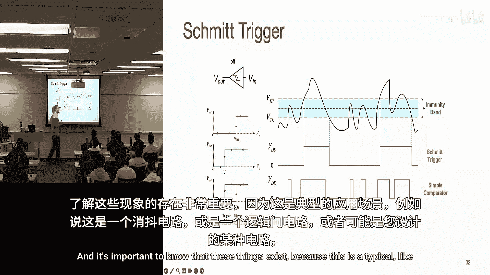
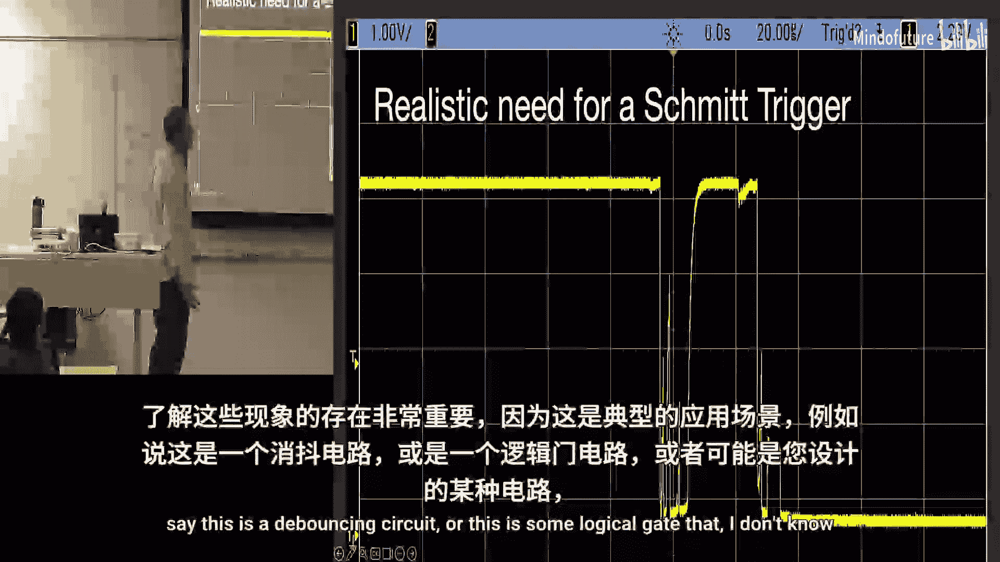
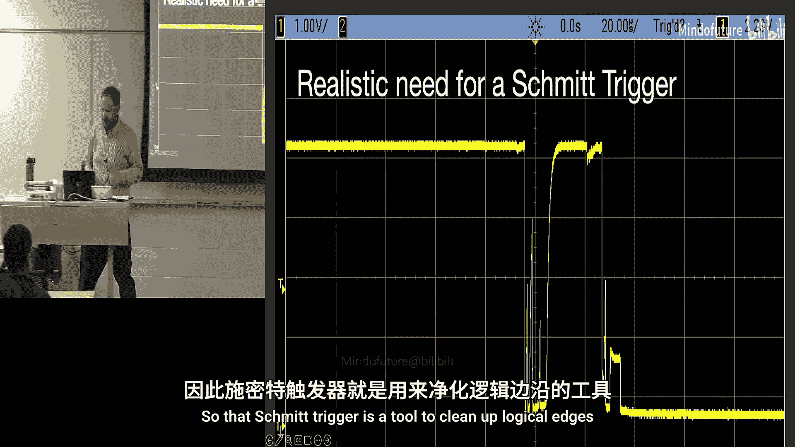
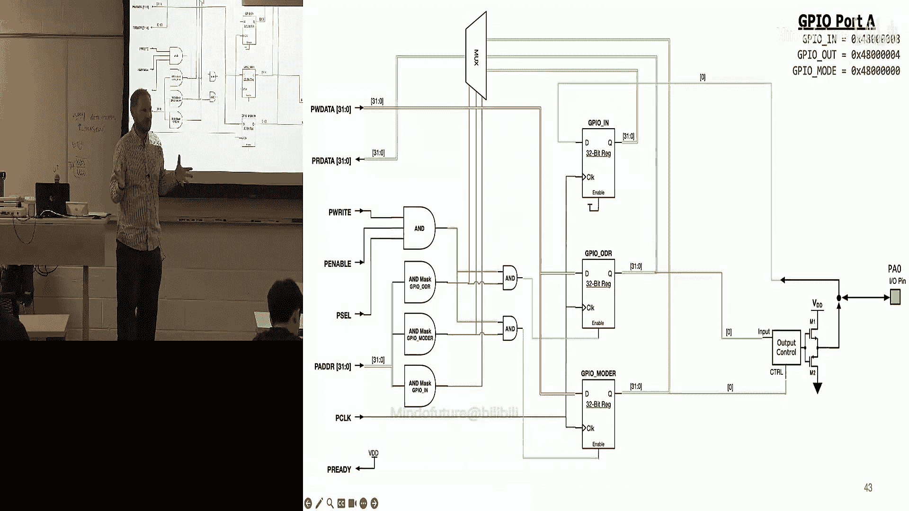

# 【密歇根大学】嵌入式系统设计导论-EECS-373-｜-Introduction-To-Embedded-System-Design-2025-p05-P06_课程5_GPIO内存映射IO--BV1VTSNBoEem_p5-

All right， well let's get。Back to yesterday's lecture， so's lecture。

 we were talking about the bus structure to get data from point A to point B。

 we went through this diagram or exist example where we were trying to take assembly code looking at the addresses of your two devices and trying to predict what the bus structures and what the bus signals are going to be。

 so you guys went through that。Great。And now what we're going to do is think about if youre the what's it called the requester and completer。

 your job is to write a completer， write that digital logic such that youre peripheral because a completer is a peripheral is able to complete some tax。

 so say we want to control the lowest significant bit of a register so register here is like a 32 bit set a de flip fl well this designate this is a de flip flop。

 but we're going to show that it has more than one by the snowmenclature here so here' showing the concatenation and then we have to label 32 bits。

And so we can say， well， what are the conditions in which this thing should respond well？The device。

 the peripheral should be selected， it should be enabled。

 and if you're trying to use the lowest significantbit of a to control the LED。

 that means it's an output it would have to be right as well so those things all have to be true and then you could enable。

The D flip fl， now there's other circuits that could be done。

 we're just talking about the circuit that you know we're just showing an example here。

Here we have 32 bits coming into this 32 bit register。

 but we only really need to look at the lowest bit。And so here as this said for the LSP。

 so I'm just showing you you the LSP， there should be a marker here at Den ocean， yes there we go。

 so this is saying this is the zeroth line here so this would be a bus or this is a bus structure。

 this is just denoting this is the zeroth of that output pin that goes to an LED。

And we have a P clock and a Pw right now we didn't do any address masking and we can just assume that this is the only register in this completer or in this peripheral。

 so this， if you had a statement that would store data a1 or a zero into the lowest bit of this address。

 which happens to be the only thing on the select line， then the LED would be raised and lowered。

What questions do we have？Yeah， are we still sending all 32 bits through Q but we're only like looking at the last Yeah。

 you could have rewritten this as one there's lots of ways to do it right it says toy example you could have had one flip flop and then take the zeroth line off of the data bit and store that there。

What questions we have。个人。it this happened we were reading， we used Q and feedback。Yeah。

 we'll go through a read example， but yes， there's different functionalities。

 we're just trying to show like what's the minimum number of circuits to make an LED turn on using this interface。

 it's not the most complete completer possible or most robust one yes。

Can you explain what the notation is for Be Read？The notation for you ready on the very bottom？Oh。

 this is a power symbol。 This means VDD is a logical one， that's a logical zero。 that's ground。

 And so here that's a great point。 This is just saying that P ready is。

We'll be ready immediately if we look at our timing diagram， here we see。Data came in。

 it was a logic， it doesn't matter what the uppers were， but the lowest bit was something。

 and then P Reddy was high immediately， there was no reason for it to wait because this was clocked in immediately when it was available。

 the peripheral didn't need to do tasks before turning on the LED。Okay。

 so we can kind of expand upon this example a little bit。

 but if you want to write to multiple registers in one peripheral this is the normal case and your GPL registers are peripherals there's multiple registers so here we have register A register B。

And we have- the note says here， here's the addresses for which these respond。Okay。

 and so how do we do this well， you'd have to be writing， so writing is going to be high。

 the whole thing has to be enabled and piece select has to go high， okay。

 that those things have to be true for any action to occur。

And the action is just clocking in data here we've done some wild notations so we have an eight bit bus。

 this is the P address bus， we just said it was eight bit for these examples because I don't want to write out 32 would be too many。

And then we just use an an gate， an an gate with bubble logic here。

 or an gate with bubble logic showing that we're going to take the inverse of this and then here we've denoted that it's going to be the fourth。

Number four， so here this will go high if you get 1000 and this will go high if it's 1004。

So just a way to select。And what would you have we're going to add。

 so if the address is 1000 and all these conditions are met then it registers is turned on。

 so here is' like the combinational logic that's why those diagrams。

 the Compr was a bunch of combinational logic to get some task done so all those things have enabled that。

Likewise， we can take， let's see the output of this and the output of this to enable this device。

 so so far if this is true， this is true， this is true， this is true。Then。

You have turned on one of those two things。And then to complete it。

 you got to actually send the data， so now the data comes off the data bus， this is 32 bits wide。

And now it's being passed to both of those。And then what is next OP clock goes to everything and then data ready is held high immediately because you clock the data in immediately we're not talking about reads。

 we're not talking about anything else just the brief was how do I write multiple registers this is how you can write the combinational logics to achieve that task。

why is P ready not connected to？Why is pure not connected？Why is P ready， not connected to anything。

 it's connected to high？This is a power symbol。Re。You good。

It doesn't need to because the registers will complete this task immediately on the following edge。

 let's see when P enable able goes， let's see。this let's see， P enables on this clock edge。

 this clock edge will latch in all the information from data。Where data is here。

So all those conditions are true at this point。And so it doesn't actually and because it happens instantaneously or close to。

 we don't have to hold this line low for a period of time， so we are just going to say it is high。

We'll talk about weight states where we actually do have to pull this thing low later。我妈就真不明。

Really loud writing to a specific address。Nope， the last one we just said。

We have said the only destination here。Sorry， this is the only register on all of peace of all that Compr or that peripheral so P select will do the job of selecting the most robust thing to do would have had to mask for and in fact if you were at arm and you dry and draw you know professor samples goofy diagrams they'll laugh at you they'll say no that's not robust enough we have a whole combinational logic suite to do the most you know robust thing but this is just the minimal amount of circuitry required to accomplish that task that's why we're showing you that。

Okay该 yes。The ready is connect to the power source like what is it the power source？

So these are combinational logics。Inside a de flip flop there's a line to power。

 so we have this is on the chip， I don't know， I think it actually the STMs actually run at 3。

3 volts so they have a power line throughout the entire chip and this is available to be tapped into and power BD is just the same as logical one。

嗯。Okay， what about P write data， what happens when you want to write data into this or read sorry。

 this is P read data， write data， this is when you want to read data out。Okay。

And also remember that each peripheral or completer has its own data bus that was coming back to that diagram and we saw all the yellow wires coming back。

All right， so we can talk， I don't know why I inherited this slide with Mr。 Switch on it。

 but this year it has Mr。 Switch on it， okay？It's a little goofy， but here's the goal。

 we're trying to take an input so this would just be a push button and we're trying to get that into that piece of hardware so regardless there's no GPO pins。

 let's ignore that for a fact， but there would be a logical1 or zero coming out of this device and we're going to capture it with a D flip flop notice that I've switched the Q in the D here to make it confusing for everyone。

But you can imagine that on the clock edge this。Signal they're high or low and it will be lashed into this DFF and then be made available on a D read line。

 so here the core is reading out of this memory location。

And we're just going to note that here's the zeroth bit of this you would have。

 if you wanted to have 32 of them， you could and then they could go to 32 different switches in this example would just have one button and then we just arbitrarily chosen it's the zeroth bit。

 but it's got it， it can't be all 32 bits。You need a clock。

 this thing is already available or immediately。What questions do you have possible if something's not ready immediately Yes we'll go over that example that is the typical case if you're just reading in and out of registers they want to make it fast so that's immediately available but say you want to do something complicated like an ADC read and analog to digital conversion you say take your analog start the conversion and send me back the value well it may take up to 16 to 32 cycles before that thing gets completed and that's is a small detail your as you'll find out later the clock on your peripherals is usually much much slower than the clock of your core so now because you also have different timings the peripherals are generally waiting from the courses point of view。

It takes a long time to。Be problem。Just like song。It could it depends。

 it depends how the code's been written and how it's been optimized， but yeah。

 these these processors don't necessarily have。嗯。They're not sophisticated enough to have an automatic way to take care of that the way we end up taking care about it you'll learn about later is you tell that peripheral to interrupt you。

 to set it interrupt when the job is done， so an interrupt is just a signal that goes back to the core that says hey。

 I'm done with a task and is asynchronous of the bus structure。So there's a mechanism it's just not。

 there's no cue or multitasking or anything inside these things。Oh没有。

So there's one problem with this and we used to be a larger problem when we had an older lab type kit。

 but for button reads it's not that big a problem now。

 but students will eventually run into this so we just bring it up and that is this idea of metatability。

That is the so here we have a bit that's transitioning from zero to one。

And here is different latch points， and so what they found out is that if you were trying to latch in a signal when it's halfway between1 and zero。

It's nondeterministic which way it's going to go sometimes you can even get the thing locked halfway in between and that's the worst case。

 but other times it will get latshed in and it'll be undeterministic for a while and eventually it will propagate through the system so typically they say well you don't just be careful about having asynchronous systems so that's the real story if you have two systems on two different clocks there's no guarantee that the data is perfectly ready and if the data is within the 50% range are close to it you don't know what's going to happen and so the way around that is that you put two D flip flops in series with each other。

And the likelihood that it breaks or has an issue with one D flip flop is low， but still there。

 but the likelihood that arrow will propagate to the second D flip flop is very low。

So that's the way they get around that you have an input you don't want this metatable state。

 this metatable mean between two states propagating and ining your system。

 so they put two D flip flops， but that's not good enough for medical systems。

 medical people say we need to have threeDF flops and then the statisticsists say that's about the life of the universe that is how likely the a meta stability event will occur through DF two DF flops。

 one D flip flop you can demonstrate and allow pretty easily。So。

What you have to learn I said a lot of stuff don't learn anything only thing you're supposed to learn from this is that if you have two asynchronous systems。

 you should worry that you're clocking data in the middle of the transition and the way to get around that is two D foot flops。

There it is Okay， so then you can modify this example to overcome this issue by putting 2 d flip flops and then this person because some guys are pointing out the problems here wouldn't you have to you wouldn't be immediately available you have to wait an extra clock cycle for D to go to Q and to be available on the second one and so that in that case you'd have to go put in。

Some sort of delay circuit， so I drew a crude one here and this grayed out clock to make a little bit more readable。

 essentially when this thing is enabled， right， then it will delay by one clock cycle by feeding Q back through and then it will rate lower P ready lower for one cycle and then let it back up so you'd have to have some delay structure here。

Yeah。How come with the data like between and like I guess unknown to data one。

 like when the address becomes available。Yeah。ai you want to go， oh， here？第二。PR data， yeah。

 and the timing diagram。Yeah。查看。我待。lay the data。canBecause this is the read data。

 this is the data coming from the device and we're just saying that it was unknown or undefined there。

 it wasn't ready until this thing this is what the circuit diagram from the manufacturers saying it doesn't matter what the data was could have been anything it's undefined until P ready goes high and the only reason P ready goes high is when all these other signals go then it has opportunity to go high and that is when the data is valid。

It could be ready for a long time beforehand。And then I made a mistake， I don't know why I lost it。

 but this one should have a separate D fl flop there。

 so I'll update the slides to put two def flos to match the problem so I was trying to solve this problem here by adding a flip flop here。

 but then somehow magically through the I don't know。

 through magic I lost that deffl fl so there should be two up there to resolve that case。Okay。

So let's move forward。Then we can have one more condition。

 one obviously you want to read between two different switches and's make it a simpler case。

 we won't worry about metaability for a second。In this case， we say， okay。

We have to be able to select well how would you select， a well let's use address。

 we'll use the second bit in address to control which one of these is going to because you could use any bit。

 but you can use the second bit here to control these two pins， oh， no。

 this says if I read from this address a。Then I want to get from switch A and if I read from this address。

 I want to get switch B， so here now I remember why I put a two here。

 so by putting the correct address on here the second bit。

We'll go and select this thing and switch the mus to one of these 2 T flipclos and then you can read it out。

Yeah。I see some confused faces。Any confused students？Fantastic， a brave student。

 It says there's only two bits being read from the P address。It says。Yeah， well。

 it only needs this bit。All the other bits are don't care。

because I'm just trying to select between this and here and why do I choose that because I'm trying to go between this address and that address。

 so what's the bit that differentiates between those addresses？First one。no no。

 this is the address I got to go 1004 oh I we should have said that the I guess I should have put a caveat that this entire register a peripheral is a register 1000 and then that would enable P select would be enabled it and then this would be the second bit。

Okay so let's go over some notation and we'll have you all have a practice at this so notation here typically is you know you have two different types of flip flos you can always add in or remove as many you know enables or resets as you want those are fine but you have to define if it's 32 bits or just one。

You can use to select an address sometimes it's really horrible to write bubble logic you don't like it。

 I don't like rating it so you could just write down I'm trying to here's an add or a mask。

 this is the thing I'm supposed to be masking for， especially if it's an exam or something and we're saying like you know what you know you instead of writing out all the bubbles you just write down what you want it to be if you have a bus you should tell us how many number of lines are in the bus and then you should tell us what the concatenation is so here's the number you have brackets that was going to tell us this is a 32 and then here's the upper 16 and the lower 16 and then as always VDD is logical one here ground is logical zero。

Okay。So you guys should have a worksheet。Your goal is to connect up this register。In this peripheral。

 such that it reads from all registers and it writes to all registers。

And if anybody doesn't have a worksheet， let me know。一新格。So this should be 4。2。Yeah。Fe。我搞。

Does anybody have any extra worksheets， 4。2 worksheets？Number5。There's4。 there's one extra one。

It the same， but we would just have that。 but I don't think we're doing。

Does anybody else you need a worksheet fantastic all right， that's fine。

 I gave everybody lots of things I'll take your extra five in case somebody needs it。B out。这。我喂我。

诶 think。Which you for？Read it my tongue here。I cannot write it without end being able for。

that's the correct at I'm confused I don't really know what we do for P。

worksets add selected which register to write to P cell P and P write pieces so we should do Yes。

 it's。' all。This is the we use in AP right and Ed。Be into enable but now is a piece like and it's updating。

read So I guess there's no right should be just reading from this one apparently the only one was and all four of them。

All right， we if we want to right to have it do a task do we what are the pins that have to go high to enable actions like reading and writing？

以为。Yeah。we can collect those to enable now， even if the right is down。

 the data is always available on that bus， which we can go here， we can oh piece flags。

So if right is low。Then this line is not going high， however， people only set only。

Updates enable allows clock to update。DF based on D so if this is d asserted。

 it doesn't matter the data here isn't changing clock keeps spinning。

 but the Q data is always available。And remember each individual peripheral has its own bus back to the core back to the requester。

 so it doesn't matter that there's data on this， we don't have to mask it out。

 we only care that these things are all high when we're trying to put new data into this so that's the way we're going to select whether we're allowing data to come in or holding data。

We didn't really care about address could have been。I could have given you an address。

 maybe I should have given you an address for the example。

 but if there was an address then you could put。And add or mask and write down the address here or do the bubble logic and then and that into this line as well so that they would only update when。

Just being Rick to。To the proper address。And then here we have data is。

 is always ready because this happens on T3 no matter what there's no actual delay。

What questions we got yes， okay， why does Oh you have to be loud Why does write enable and select go through an an gate and not？

Because it's not all of those have to be true， it can't just be one。

If we look at this timing diagram， it has to be all of those have to be high。

 it can't just be just one， why can't be one because P able goes to all peripherals and then you'd be tricking the other peripherals which beyond and trying to act。

angle clock that's just the clock symbol， I don't know。

 as like some Es from the 50s figure that out and put it there， I don't know what it means。

Should there be some logic to keep ready because like on T2？あくち。Are you ready， gosh。

 this is just a doning that it's in either state it doesn't matter， this is the only time it matters。

I don't， repeat write data and P read data are the double lines are those just significant that it's a bus that could go either way。

 Yes， okay， this is a bus and then we gave you the second hint here。 that's a 32 bit bus。

more yeah looks which specific that's true maybe except for the fact that I made a toy problem for you and the toy problem is this is the only thing in this peripheral and the bus that goes all the way back to the requester in each peripheral has its own bus so now it's the requester's job to look at the correct bus so it's not corrupting anything else by doing that。

One last one， oh， you got a good question， okay。So would we be penalized on the exam if we don't like draw double lines No because God's drawing things are horrible。

 just try your best and use all this bus notation if you can。

 this will really help me because there's no way you're drawing bubble lines but you can do a little splashing to indicate that it's 32 bits and that will help Bob on the exam we're trying to help we're hoping you get close。

Perfection is great， we all love perfection， but I want you to actually teach me that you know what's going on and I don't need perfection for that。

Okay。Let's see so a right transfer with weight states let's go through an example here。

 so what does that mean here we have the setup phase then。Fy has been pulled high， remains hot。

 remains low， sorry， saying that the data is not ready。

So it's file for two and then they go through the access space， so normally it's set up access。

 set up access here it set up wait weight access okay。

Let's talk about that condition and then if you're going to read data， the same thing could be true。

 do I have animations， I don't know。嗯。I have two animation or two eight states here and you were just saying the data is unknown。

 why is the data unknown， well， the peripheral has been asked to do a task。

 maybe do an ADC conversion or do some timing task and the data is not valid that's why they're showing it here it's only valid when it's been set up in the access phase。

 this thing goes high telling the requester hey look the data is valid now now is your time it' the clock it out at T5。

What would a P be wired to here？Well， it could be some Waackco circuit that I drew over here just before class。

So here's a circuit that's going to cause a delay。You'll see。LikeOn the exams。

 typically there's like some external device that you're like connecting to and that thing has like an enable pin or sorry。

 a data ready pin， and then that would have to go through here。What else I want to teach you？

Yes we get confused。Finallyly with my lectures that's pretty easy the data sheet for the APB bus is actually pretty good to 100 pages pretty readable just walk yourself through the distinct diagram this is what the logic of those lines are supposed to be accomplishing and it'll tell you what happens when there's a transfer what happens when there's a P Read is not available。

you way through this， there's another way to think about it。

There's some things we left out like peing error and there's a bunch of other lines that are really not。

I mean， they're important， I suppose， but they're not valuable for you to learn how buses work on shipHI。

 so if you look through the spec， don't worry about some of those extra data lines。

But there is a full list if you need。Okay， so before we move on to next lecture。

 what questions you have？Because the access phase only when P ready is high and it has to be after the setup phase every interaction takes at least two clock cycles right because you've got to set up and then you got to have the access phase。

All right。So here we're going to try and put it all together for you。All right。

 so today we're going to talk about GPO pins and methods for driving pins and then we're into another example of the trying to get the APB bus to the GPIO。

So so far， we've been talking about。Yeah core inside the core is this memory interface。

 that memory interface is essentially the requester。

 however there's advanced peripheral bus and when I teach you things it's the requester that's in here。

 but for the purpose of this class will let's assume this module is in here anyways。

 let's assume the module the requester is in the core it makes things a lot easier。

And the goal is to get data throughout the system， so here I want to go talk to register banks I'm doing a store or a load and I have to get data into or out of the GPO pen。

And again， those are peripherals， so one the thing I want you guys to realize is that this whole core。

 all that diagram is on a piece of silicon， it's on a chip okay and you're pushing data in and around this chip。

SoFor example， this is a we call chips integrated circuits。

 this happens to be STM 32 a smaller chip than the one you guys use with still from the same family and in this case we have the core here。

 we have a bus structure and we're trying to get data out to a pin so everything we've done so far is how do we get data to that pin。

These pins， this is a chip and this is a package so this is a package and then there's wire bond so there's a special machine that big gold wires to be able to connect to silicon substrates there's the chemistry involved that I don't really understand anymore but then use your wire bond machines to go to these metal things here these are pins and the reason that you have they're black is that they have to be insensitive to UV don't want UV hitting your chip rail to get bit flips and this mechanically keeps it safe so now we're going to go and take that pin is' going to go the data from here is going to go out to that pin and then this package sits on a PCV。

And this pin is what you're usually hooking up to your oscilloscope or some LED or something。

 I don't know if it's exactly that one， but the traces go through here。

 so this is literally that block diagram， there's a core pushing data through here。

 makes it all the way out to your device。Does that help？Yes。

Now let's just talk about one of these GPO pens here so here we have a general purpose input output here's the example that pin crossing from silicon onto your PCB。

 right？So what's connected to it， you have an input register so data can come in from that pin and be held in the D flip fl to the in our case for this chip is the high performance bus。

 but it doesn't really matter for the purpose of this class。You can take data in。

To this bit and it can go out and be put out in that pin but。You need some control logic。

This control logic is going to disconnect this thing from this pin or put it back on so if you're doing an input you don't want this thing pushing out at the same time you need have some digital logic here to control that and you need a method to control it so that's why you have a control register so here now we have a control register that sets the direction of the pin it's a pin and input is updating data or is an output meaning data is putting out here so now we have three registers。

We take those three registers and we start concatenating them register So here we're going to call them that say this port B pin zero。

One， two， three， and now we have your whole TIO cord right， multiple pins。

 multiple LEDs can be turned on and off。Inside those， we have。

All our input registers can be concatenated together， remember they're all put together。

 they're on there so we can go and put them into a register。We're to give that register an address。

 thiss going to look just like memory。We can do the same thing with the output Regs assume that they're all been highlighted underneath。

And we have the control register， and we're going to concatenate them all together and give them an address。

How are we doing？Questions。Grave people with questions。Like is the control matter of saying like？

That's it for now。use the input。Make it one zero with controller just。

Control tells you if the output register is connected to this GPB pin or do you want the GP connected to the info register？

Okay now we have registers with addresses。Gancing animation time， here we go。

 move away some of those things， and now this is just memory。

 in fact I don't even change the notation here。Instead calling them registereds we're going to call them memory and from the core's point of view。

 the core doesn't care， the core is like this is just memory， it's that addresses。

 I'm going to flip those bits up and down。And you know how to do that you guys are great at it now you do loads and stores loads of stores manipulate bits I going do loads and stores are going to manipulate these bits and these pigs are going to go higher or low and how are you going to do that what's the mechanism Well asks what we did learning about the bus so here we have a processor we have a requester are inside the cortex M core。

They transport the data across here to the completer。

 the Compr is a peripheral okay so here the the Compr we have this register and all the sort stuff is in there。

And then to send data through， you're going to say， okay I're going to execute this instruction。

 data is going to go through here， come through here and it's going to manipulate one of those registers。

 one of those registers， remember this little bit here represents one of those things and now I can control these registers and be putting data in and out。

Too many blank scare stare。 This is great。 This is exciting stuff here。 I promise you。

What kind of memory is the GPO peripheral linked？Is the GPO peripheral just for pumps？行。

You wouldn't want to use SRAM it's too dense it's not the right structure。

 so almost all the time the peripheral is going to be a flip flop now it is up to the hardware designer I don't know they could use JK flops I don't know。

 but generally it's just going to be a deep flop。So where is the output control。他去看吃。

here is it in ju？I mean， these two blocks are inside of here， maybe we put this one right here。

 but yes， they're all in the peripheral。And you have a completer。

 which is that digital logic that state machine we were drawing before and you're like。

 why yout have to worry about deep flip flops and you're drawing circuitcus。

 you were drawing this if you registers those registers manipulate two payroll pins or whatever your purple is。

来。Meary diagram is。So we're indicating one register， Yeah and this diagram。Yeah。

 would be correct to say that the state machine on the requester side of things would be the im of that like long memory diagram that we have with all the different points and memory。

 So it knows where to go or is that like unrelated。U。It's related。That memory diagram。

 remember the one where they had lots of reserves and it was very confusing because like why did Ar lay it out and then the STM and all the manufacturers do whatever they want anyways。

 that is baked into these addresses so we're going to say that you can only write to addresses that are not in the reserve space that are in the peripheral space and those addresses represents these registers right here。

 the stakeholders elements that are inside your device。

And even though we have like address from the processor or address from the G profiles。

 they're essentially from the same big block capacityac。

I had an animation one point where we had all the different peripheral like all the memory blocks and we've distributed them throughout so the core doesn't know that they're distributed right there's short the core just thinks okay I have memory address F you know zero to f whatever it is four gigabytes I can write to it just happens to be some of those represent different things some of them will represent F or sRAM some will represent。

Clash， some will represent these registers。Any more questions？So I think this is probably the crux。

Of。The first half of this class， this is exam one essentially right like understanding how data flows through here。

 this data is going to cause these lines to go high and low。

 which of these lines are going to go high and low when you do this， right？

These ions go higher low causes bits over here to go higher low and control some things， some tasks。

 typicallyy you guys are writing some sort of state machine here。

 some combinational logic which manipulates something that will talk to the external world。Yeah。

 so the that。takingaking information from the pit。You write down。Using a picture from the pin right？

He writes the output register well the output register is sensing like。

I would say the output register here is the output pushing data out。

 so you're going to put a store command that's going to put a logical one in here or zero。

 and that's going to translate to raising this pin higher or low。

output to writing and then convert to。And from it's always important to think about whose perspective were we talking about。

So what I know？So like。RightWhere if I set the GPO pin to output。

 that means this pin here can either drive this signal line high or low， it will drive it high。

 if it's an input， then is going to sample this pin。

 measuring if it's high or low and then report that into a register which can be read by the court。

Yeah， in the lab we can figure the output type to be like pushh pull or something else Yes。

 we'll talk about that in a second。It's a good question。Me the control lines。

 points and what other features。Whats is it like multiple like points of like a lot of things？

Is the control lines points like multiple computerrs or is it like the computer points like or like once you have the computer。

 the piece like points to different equal clouds？Let me see if I can reinterpret your question。

Your statement is。What happens if there's multiple of these things right there are lots of these there's probably at least 64 on your device okay that means one of the control lines which I didn't draw them all out here is P select P select is going to select one of those 64 peripherals。

That peripheral， there are going to be registers。Multiple registers， those registers have addresses。

So first what you do is you say one of those 64 peripherals。

 I'm going to select you and then it gives address pins。

 it tells you this is the address inside the peripheral I want you to read。

So there's one requester correct and there's like a ton of completers and they all get the PC like to know which one of them is being chosen to your job and so the thing you don't have to know so you can turn off your brains。

 but the reason why they have P select and address lines is they don't want to actually put3 two address lines that would just be too many you have 64 completers。

And say there's only 32 registers in any one completer。

 then you only need whatever that is eight bits to address any of the registers inside a Compr so the goal is a P select allows you to reduce the amount of data lines you need for address。

 I wouldn't worry about it too much for an exam to know that little detail but that's why they do it。

Yeah I've got two questions here one just in the diagram those blue boxes on the right side and those colored boxes up there those are the same thing basically they're all registers Okay excuse just one is like a circuit diagram representation one is the memory representation So when you're like this is different representations of the same thing Okay got you then second question let's say the request tries to access like。

The 33rd register that doesn't exist， what would happen in that case。

 would it just wrap around to like？Bothrow or first register would that cause a fault of some kind so this is like the error condition that's built into the hardware so for your compiler shouldn't let you Q ID should say hey that's out of bounds and if you do try to read from it it likely you're going to get nothing because you're row column the coders if you're trying to look at memory address thing it will point to something that's invalid so it probably has give you back zeros or ones or undeterministic in fact a lot of times your data sheet will say if you do this task is undefined because they don't know what will happen。

All right。Let's talk about what's inside these let's go to the next step and talk about what's inside GP opens a little bit more detail I gave you a cartoon version let's try and get to another level of accuracy so this is from yes is from the data sheet you can go look it up for your particular chip。

and so here they have these push poll types that we were talking about。

 you have let's see you have write， you have read registeristries you have oh these are。

So this output data register is telling you can read or write to the output data register。

 so say you made a pin high， you forget that you did it high， you can still read the data out。

 doesn't mean you can get data from this register。We didn't show that as a diagram previously。

 for these are read right， you can only read from an input register， you can't put data in it。

 it won't allow you， and then you have your select registers。

And then there's this thing here we'll talk about later alternative function。

 a lot of your GPO pins because there's not that many of them。

 so they're going to be input output pins or some other pins and there's an alternate path to get data in here you your push pulls and then there's a s Schmidt trigger。

Interestingly enough。They have very or they have diodes sorry they have protection diodes。

 these are pretty cool this since if they have overvoltage right if this pin raises higher than mediaDD by 0。

3 volts， then it'll start conducting likewise if this pin is lower than ground by 。

3 volts it'll start conducting so I actually had an air condition in one research project or I was doing some weird energy harvesting and all of a sudden the clock would go wild the clock would start increasing and going faster and faster on my little little tiny microcontrol I couldn't figure out why。

Well， this was old back in the day when low Mi controllertrollers weren't quite as good as they were now and they had voltage dependent internal clocks they had a ring buffer that would ring around and when my little energy harvester went some weird state hadn't considered it was actually pushing voltage through this pin up here raising the voltage of B2D of the entire chip。

And then changing my clock frequency and only two weeks of my life to figure that out。

 is pretty cool。They also have resistors in here， why do they have resistors？

Wouldn' anybody want to have resistors？So what you just described doesn't matter that would actually have been an easier fix that's not inherently a reason why well I guess I asked the wrong question。

 so here I'll tell you why there are resistors why you'd want resistors at all and that is for some communication protocols we talk about later you can have it pull up on its own without having digital logic to do it the trick is why with this company choose to put resistors which are physically large on chip。

Physically large resistors mean lower profit margins because you have more silicons。

 so why would a manufacturer put resistors on chip that somebody could put outside the chip？1天。

We're tampering。Tampering or potential damage。's actually too bad that's true。

 this thing is likely to exist all the time you it's not like somebody's going to bump it off because PCB manufacturers like Apple。

 whoever， who makes products are so size constrained that having a chip。

Physical little resistor outside is causing a problem now like imagine your earpods they care about every little component that goes on there because it so space constrained so now it's a better profit margin in the sense that you put this in here and manufacturers will pay extra to have resistors internally because they're smaller than the actual like 0。

001% of a penny that it actually costs to have a resistor outside your board。This economics point。

It may not be part of like that's my last why thes is just smaller on ship as a post stop ship outside。

It's a good question。I remember I was electrical engineer at once。

 I actually typed out chips at Intel and in other places。

You can make really bad resistors using your diffusion whatever I forget what。

 there's a silicon way to make really bad resistors that are actually kind of small and as long as you treat them right they're okay if you want really good resistors they also take up more space either way you're taking up space whats your questions sorry why is it easier to have like smaller resistors long Oh what？

Well， it's just a cost factor because they want small PCBs， so they're saying okay。

 I would rather pay more to have a more expensive chip just so I don't have to have a resistor outside on my PCB。

因 so。He is going to be in between Brown and B I hope。Okay， and like if the two resists were the same。

 there would be a precisely one half of feeding Yeah， usually don't turn them on at the same time。

那知怎看。But thought you could do that。AndYou can imagine you can imagine cicus where you might want that there's actually some of these GPO pins actually have off as as an alternative function because they're like well having an off amp on my PCB is too expensive in terms of board real estate so put it in this piece of silicon。

There's all these sorts of trade offs there are people making about trying to put things back。O。

What I want to I think I told you most of these things， yeah， yeah， I clearly got off oh wait。

Yeah and you probably know some of these things so we have GPO mode or Mo register right and so it was actually not one bit it was two bits so you could do input output alternative function or analog right so you might look through the data sheet and see those as options that's because you might want to have your Iquad C go through here or you might want to have be able to sample an analog pin that pin through your analog。

And so where is this？嗯。You also have your clock enable bit。

 so I bet you've been going through and changing your clocks， you can set it to port B。

 enable it or dissoninate it， it's a cost saving or power savings thing。And really。

 is this the GPO pin and then you're usually raising this higher low and having a clock run。

 especially like on modern processor is your clock。Like on an Intel processor。

 the process is so leaky now that having your clock on is almost the same as having your flip flops moving right just because of how much power these things consume so by changing by turning off your clock it's actually a pretty big power savings for them。

That's why it's off by default， to read it in analog， I would assume。

You would like need to pass it through an analog to digital so you would want to read like more than one bit this is just a controlling it yeah this is just controlling that I think I think there's a slide on the analog path back but it would go to like an ADBC or something。

But like if you were reading digital， you would only be reading one bit。Are you being loyal one day。

 correct？we have a whole unit on analog digital converters。

 an analog digital converter is a way to get the outside that soft human world into this digital world。

 and so it is a device that will measure the voltage between two points， BD and ground， let's say。

 and tell you what the digital representation of that voltage is。啊。Let's see。Let's see， oh。

 those are motor pins， okay？The gel purpose mode， sure。And this is the logic to get that done。是。

You can have your output type so there's push pull that's the one you're probably most familiar with。

 so this push pull means you're either going to connect either VCC is going to drive through this pin and raise this gate is going to be closed and raise this pin high or is going to connect this pin to ground and allow current to come back in we had some false stas circuit diagrams on the first day。

That will if you can look through and see how this protein works。

 the other modality that you might want is。got ahead of myself again。Another modality you might want？

Is to have an open drain so open drain is there's nothing connected up here they disconnected the Pmoss and now this can either hold the pin low or let it flow so if this skin is open if you have a sc here that was open this isn't connected to anything and the resistance here should be relatively high。

 say 100 kilooms or so and so no current should be able to pass into here and now you can let this thing float high and that's or float to whatever value is going to flow to and that's particularly useful for certain types of interfaces。

 certain types of sensors， but mostly it's useful for ice square C which is a communication protocol we talked about earlier yeah so open drain is low or high appedus。

It's either conducting current， so it's either a logical。

 it will result in a logical low or it will be high in peak。

You can have so this is open drain so the reason it's called open drain is that on the moss v or NOSs you have drain force in gate and then if you have P moss you still have source drain in gate so you can have open collector or open be open source for a P moOSs。

You also have a number of different speed options for your GPO pins where you can tell it essentially by writing into the speed address right so youd set in these different pins so here we're just showing these are the registers they're concatenated up in that remember over here we're talking about green purple orange registers。

 this is just another register that wasn't in that diagram which controls how fast the pins will go up and down and then it's showing you。

 let's see if I can read this directly so if here's the zero pin up to the 15th pin and theyre taking two bits so the day she is saying this is the read right and this is the order  zero1 is the concatenation fourth is fifth or 15th bit here。

 16th bit pin in this register。fact critical。Why would you want to have different speeds where your GPO ends。

 what different speeds even mean？Even frequency in which you be seeing data Well。

 this is for drive strength this is all about driving anybody else know why you'd want to control。

Yeah， power consumption， So if you like what you want is like high， high。That cover。还是9婚。

It's also about so it drive strength is basically how much current you're going to use to push through this so it definitely has a power impact。

 the other one is you don't always want to go really fast。

It's not showing in the diagram but you'll have ringing so this is when you grow up really high and it'll overshoot and it'll ring a lot and you'll add extra noise to your system if you're going too fast without an issue here you guys you know medium or fast are probably fine for any of the projects you're going to do but if you really wanted to high bandwidth deadline and as a circuit signer you're going to be responsible for ensuring that weren't overshoots by。

Properly loading the end of the transmission line， then using how it makes sense。See。

How they output data register again， this is just these are screenshots from your data sheet and so here is pin two let's say and pin two is connected right to an output。

OfYour GP open pen when selected， and then you can read and write out of。All right。

 what else we have any oh and here's the alternate function we talked about so here if this alternate function was chosen there's not really showing you the control bit for this。

 but they should go up to here and then you can take your analog signal back this buffer here this is a Schmidt trigger this is going to take。

Variable analog signal turn it or digital signal and turn it into a clay clean state。

 and that can go to your alternate function or to your GPO pins。That's I want to say。

 and then there's your output registers。We talked about that， push up。

 pull down different logics for those。Let's see， so Schmidt triggers， oh， overhol protection。

 that's great， s Schchmidt triggers。So digital signals are not always ones and zero sometimes they're noisy。

 there's lots of places you get noise in from your system a big one you get noise from is digital communication lines your power supply can inject noise at certain frequencies so there's lots of places to get noise in and so what a Schchmidt trigger does well the normal like a logical gate we just go and say anytime you're over a VDD over two over this threshold I'm going to go high low。

 high low， higher low but that may not actually represent your data so a Schmidt trigger goal is to add some hysteresis which means this hyster is derived from like the history of the previous state and basically what it says is when you're transitioning from say was this low to high I've got to go a little bit over VDD over two to make that state and then I have to come a little bit under VDD over two go to the backsstate so here I haven't gone high enough and it doesn't count I went really high here I'm made a full transition out of this state here that one high and then I made a full transition down。

But these weren't significant enough， so you can imagine this is a cleaned up version of this this signal。

 a cleaned up version of this signal， and it's important to know that these things exist。

Because this is a typical like。

Today this is a debaluncing circuit or this is some logical gate that I don't know some circuit you made where maybe it's a sensor that turns on when you have a distance sensor or something and now all these little spikes occur you don't want anything to be triggered off these little spikes you wanted to know when exactly your data was here so that Schchmidt trigger is a tool to clean up logical edges。

And all that exists inside your GPO peripheral and one for every one of these parts for every pin and there's multiple。

 and then the registers live here。What questions do we have about GPO open？Your questions。

I questions like through like the pull up pull down when you're controlling those is like the address of those like stored somewhere in memory as well Yeah the control there's a control register for it inside of that thing there's a register that says like whether it's not shown here it's shown in the data sheet but there's another little register here and then we didn't show every single line that goes over here there's going so the only way you can control things is basically through a register and you're gonna to do it through loads and stores from your core and then every piece of functionality is available to you you just have to read through the data sheet and be like okay that's the register I need to use to make this function happen So a lot of what happens is try and teach you enough to read the data sheet and then we just let you loose like okay say in the data sheet you want to figure out how to make your iceberg see that communication bus that needs it go high which register I don't know look in the data sheet as long as you know it's there。

是。Yeah。So， our。Aology guy opens Kimd analog I've seen some like boards that like say oh only this pin is like for analog so like is I like a do you have to like support it on the board So there's no there's no laws or requirements here okay so each manufacturer can choose to do different things so some manufacturers say like okay only port say a or port one can have analog function that's just because in that peripheral that's the only place they put the analog functionality。

there's no requirement that they have every GPO pin has analog functionality。Oh， okay， okay。Okay。

All right， so let's go through another example here。嗯。So hey we're trying to connect to our GPO pins。

 let's see， so here I guess these should really be oh should the the requester now。

 but the requesters here have a target。And then these are control lines back and forth to the GPO pin and your job is to go through and connect all these connect all the data lines such that this thing will be able to read and write out of those addresses and when you make your mask you just write the address down so I don't have to look above the logic。

And this is telling you， this is what you would see like an exam or in the data sheet where it says here's your GPPO out register。

 it is 32 bits， however the top is reserved。U and then it's going to say those are read only top ears is are right read and write and then you have a mode to configure。

 it tells you what the default is， it tells you what's the address is。

 and it tells you what the pin functions do。And then you can look through。

I just put this here so you guys can remember what the functionality of those things are。

So when I work together， I have extra sheets， you guys try to wire the whole thing up。C。啊，就是看到我们这边啊。

How， should I just forget you guys， was？he's given， no， it's not he like all of them。来がごす。

Right means it's in output control。The ball is set to input。

 nothing valid I really wanted to do that number care or like， do we have to handle that？

address going to all ofDRL。Keep go in， it's by snow。

both of them from here to here if the four is true binary that means you have a one in position all go into one all end with the P label。

啊好证。does this to。so would we have like massive end gate that takes these three imagess and these three wires and then it goes into the。

and then to 10。あた。And then you would。But also the ideas the。应该。So you take off。

 I concatecateated the 33 years0。that goes data time ready。So it goes to data， to enable。got。easier。

just， that is a 31。Enables on the bottom one of them is already wired and I guess this one is。

I think they go to but'm not entirely' going my name didn't know。

 which when we write to what we using400 I put in my it was just memory the enable being talking about but on a general scale we actually still function。

No this is the application I think control increased by， but I don't want to be that。会 be the。

whatever bit it is between these two and I read out of this register。

I the lower if if I'm a course to read what's the me out this。

 you would there are amazing children how do my four bits。I with the neighbor the mode or not bother。

I don't know where you get it from， so I'm going to say no I don't know。

 man his own address calling the mugs for the right sweep potato whatever。

It have been written through the I think itll be fine you can define because it just theulator which one you're reading。

every clock cycle is clock and data on date P data right functionality。not。I there is another Yeah。

 you're right。 there needs you guys doing should one ofs I'm。😊。

read I'm going tell you my all smart than one of bit allow then when those。

Voter definitely sentence like。It's just I have no space。is always。Okay。

 only only got some minutes might。All right， let's go through and finish this off All right。

 so remember。These are registers in your peripheral， this whole thing is a peripheral。

 it is a completer and your job is to make the combinational logic here such that this achieves the goal of being able to write in let's see those are the addresses which this thing should be a write in data this thing should be write in data and they should all read out this one you don't write data into where does that data come from。

Well it comes from over here we'll get to that I forgot which order my bills go into so you're able to write data into here right so you got 32 bits coming in here if you look back at the data sheet above it said that these two were read or write so you can read and write data in so that's going to go through that path。

Now data you could read data from all of them， so all 32 bits are going to come back。

 the problem is that align with Colllide right you can't have all all those buses go into here have to switch between them so we're going to put a muux up here so that mus is allow you to choose which one of these registers is connected back to the bus back to the requester。

And then we're going to take the 32 bits out of that。P clock。There you go， goes to everything。

Now we're going to get to the and the masks， why do we want to have these well they have different functionalities。

 different things should happen depending on the address。

 so this should only latch new data in from P right data when that address P out address is instantiateated on this address line so we're going to use a masking function to mask for that。

And I didn't write it out， I just said here's what it is could have written out in the binary or some other way if I'm going to take all 32 bins in here now somebody back there had a more clever solution to me。

 they only looked at like the second bit there and that was all they needed to do。

 that's a good solution too。All right， so now one of these things will go high when it's required。

And you got your anN， so it has to be P right， P enabled， and P left to be true。

And then we're going to add all that together。Through some horrible logic here， so let's see when。

You have the correct address and your PWrite Pable P select。

 only then will this thing be enabled and be able to clock in PwWrite data in from D into Q。下。

And what else we got we got this one does wheres it get his data from well this is a read only because you can't write data from the core into a GPO input that has to come from the pin itself so this comes in this way and we'll automatically update I had an error on your sheets show this thing was always on so this was。

Always clock this was pulled high， so this clocks every clock cycle is going to take the data from here and put it there。

Okay well it has changed oh I did that okay and then this is always ready right oh and then the control register here is connected and then the I just chose I didn't tell you guys and didn't give you guys a full prompt but I just chose the zeroth bit is the one that's actually controlling this particular GPO pin so I took the output zero bit of here and the control register here。

There go。What questions you have， oh， lots of questions， yes。What the mugs need three selector bits。

Why does the butt which bus the does theney I just did one hot and coat， I don't know， I was lazy。

I was lazy， lazy professor。Yeah， what's like the difference between selecting the enable。

Was ended together。The select and enable， the select selects one of the 64 or n peripherals you have on your device。

 enable tells it that the data is instantiated and ready。Now it could be。

So those are two different functions and if you get more complicated peripherals you actually may need to give it some wait time or some other tasks。

 so that's why they say there's an instantiation phase。And call it the setup phase。More questions。

You want to leave。You want to leave more than you want to learn。

Bonus points， okay， all right， I'll see you guys next week。好。

